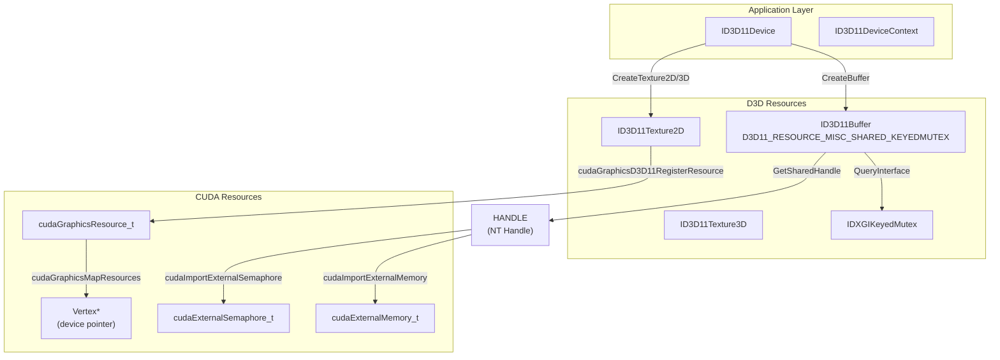
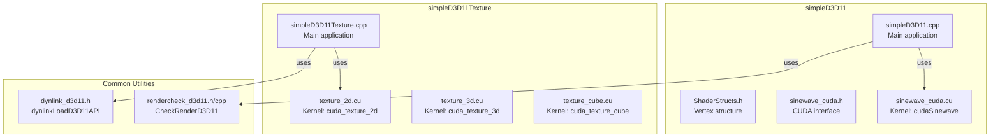
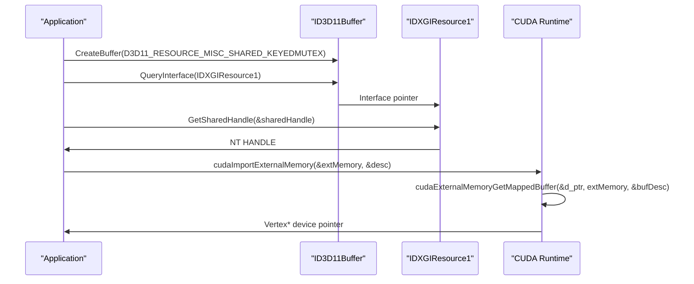
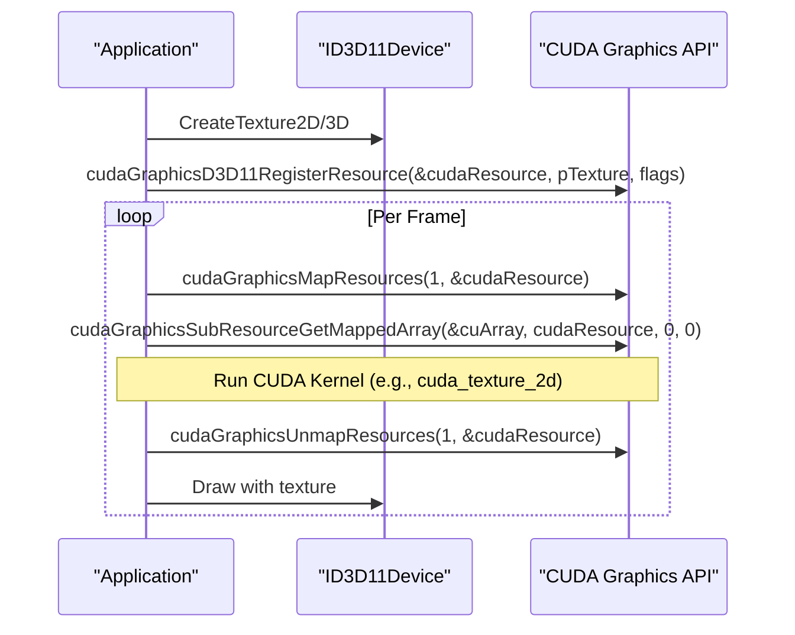
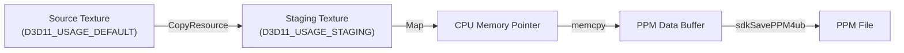

<!-- source: DeepWiki mcp.deepwiki.com · repo NVIDIA/cuda-samples · page 8.2 Direct3D Integration · fetched 2026-10-26 -->

# Direct3D Integration

Relevant source files

The following files were used as context for generating this wiki page:

- [Common/GL/wglew.h](Common/GL/wglew.h)
- [Common/GL/wglext.h](Common/GL/wglext.h)
- [Common/dynlink_d3d11.h](Common/dynlink_d3d11.h)
- [Common/rendercheck_d3d11.cpp](Common/rendercheck_d3d11.cpp)
- [Common/rendercheck_d3d11.h](Common/rendercheck_d3d11.h)

Direct3D integration in the CUDA Samples demonstrates interoperability between CUDA compute and Direct3D 11 graphics on Windows platforms. The primary samples are `simpleD3D11` and `simpleD3D11Texture`, which showcase buffer and texture sharing using external memory APIs, graphics resource registration, and `IDXGIKeyedMutex` synchronization.

## 1. Overview

CUDA-Direct3D interoperability allows zero-copy access to Direct3D resources from CUDA kernels. The samples demonstrate two main approaches:
- **Legacy approach**: Using `cudaGraphicsD3D11RegisterResource` for resource registration [Samples/5_Domain_Specific/simpleD3D11Texture/simpleD3D11Texture.cpp:1008-1098]().
- **Modern approach**: Using `cudaExternalMemory_t` and `cudaExternalSemaphore_t` with NT handles [Samples/5_Domain_Specific/simpleD3D11/sinewave_cuda.cu:50-95]().

**CUDA-Direct3D Interop Architecture**

Sources: [Samples/5_Domain_Specific/simpleD3D11/simpleD3D11.cpp:480-509](), [Samples/5_Domain_Specific/simpleD3D11Texture/simpleD3D11Texture.cpp:1008-1098]()

## 2. Sample Overview

| Sample | Resource Type | Interop Method | Synchronization |
|--------|---------------|----------------|-----------------|
| `simpleD3D11` | `ID3D11Buffer` (vertices) | External Memory API | `IDXGIKeyedMutex` |
| `simpleD3D11Texture` | `ID3D11Texture2D/3D` | Graphics Resource Registration | Implicit (Map/Unmap) |

Both samples target Windows platforms and require D3D11-capable adapters. They utilize `dynlink_d3d11.h` for runtime loading of Direct3D libraries [Common/dynlink_d3d11.h:112-158]().

**Sample File Structure**

Sources: [Samples/5_Domain_Specific/simpleD3D11/CMakeLists.txt:25-29](), [Common/dynlink_d3d11.h:36-160]()

## 3. simpleD3D11: External Memory and Keyed Mutex

The `simpleD3D11` sample demonstrates modern interop using external memory handles and keyed mutex synchronization.

### 3.1 Resource Creation with Shared Handle
The D3D11 buffer is created with `D3D11_RESOURCE_MISC_SHARED_KEYEDMUTEX`. The shared NT handle is obtained via `IDXGIResource1::GetSharedHandle` [Samples/5_Domain_Specific/simpleD3D11/simpleD3D11.cpp:480-509]().

### 3.2 CUDA External Memory Import
The `cudaImportVertexBuffer` function in `sinewave_cuda.cu` sets up external memory using `cudaImportExternalMemory` and maps it to a device pointer via `cudaExternalMemoryGetMappedBuffer` [Samples/5_Domain_Specific/simpleD3D11/sinewave_cuda.cu:50-77]().

**cudaImportVertexBuffer Function Flow**

Sources: [Samples/5_Domain_Specific/simpleD3D11/sinewave_cuda.cu:50-77]()

### 3.3 Keyed Mutex Synchronization
`IDXGIKeyedMutex` provides cross-API synchronization. The mutex is imported as a `cudaExternalSemaphore_t` [Samples/5_Domain_Specific/simpleD3D11/sinewave_cuda.cu:79-95](). D3D11 and CUDA coordinate access by acquiring/releasing the mutex with keys (e.g., 0 and 1) [Samples/5_Domain_Specific/simpleD3D11/simpleD3D11.cpp:560-599]().

Sources: [Samples/5_Domain_Specific/simpleD3D11/sinewave_cuda.cu:79-95](), [Samples/5_Domain_Specific/simpleD3D11/simpleD3D11.cpp:560-599]()

## 4. simpleD3D11Texture: Graphics Resource Registration

The `simpleD3D11Texture` sample demonstrates the `cudaGraphicsD3D11RegisterResource` API for texture interop.

### 4.1 Resource Registration and Mapping
The sample registers `ID3D11Texture2D` or `ID3D11Texture3D` resources using `cudaGraphicsD3D11RegisterResource` [Samples/5_Domain_Specific/simpleD3D11Texture/simpleD3D11Texture.cpp:1008-1098](). To process the texture, it maps the resource, retrieves a `cudaArray_t` or device pointer, and launches a kernel.

**Registration Workflow**

Sources: [Samples/5_Domain_Specific/simpleD3D11Texture/simpleD3D11Texture.cpp:1008-1098](), [Samples/5_Domain_Specific/simpleD3D11Texture/texture_2d.cu:34-49]()

## 5. Device Selection and Adapter Enumeration

The samples use DXGI to enumerate adapters and find a CUDA-capable device. The `findDXDevice` function iterates through `IDXGIAdapter` instances and verifies compatibility using `cudaD3D11GetDevice` [Samples/5_Domain_Specific/simpleD3D11/simpleD3D11.cpp:151-214]().

Sources: [Samples/5_Domain_Specific/simpleD3D11/simpleD3D11.cpp:151-214](), [Samples/5_Domain_Specific/simpleD3D11Texture/simpleD3D11Texture.cpp:309-402]()

## 6. Render Validation and CheckRenderD3D11

The `CheckRenderD3D11` class in `rendercheck_d3d11.cpp` provides utilities for automated QA [Common/rendercheck_d3d11.h:39-50]().

| Function | Description |
|----------|-------------|
| `ActiveRenderTargetToPPM` | Captures the current D3D11 render target and saves it to a PPM file [Common/rendercheck_d3d11.cpp:44-55](). |
| `ResourceToPPM` | Converts an `ID3D11Resource` (Texture2D) to a PPM file using a staging texture [Common/rendercheck_d3d11.cpp:57-107](). |
| `PPMvsPPM` | Performs a threshold comparison between two PPM files [Common/rendercheck_d3d11.cpp:109-124](). |

**ResourceToPPM Implementation Detail**

Sources: [Common/rendercheck_d3d11.cpp:57-107](), [Common/rendercheck_d3d11.h:39-50]()

## 7. Build Configuration

The samples require the Windows SDK and are configured via CMake to link against `d3d11.lib` and `dxgi.lib` [Samples/5_Domain_Specific/simpleD3D11/CMakeLists.txt:1-56]().

Sources: [Samples/5_Domain_Specific/simpleD3D11/CMakeLists.txt:1-56](), [Samples/5_Domain_Specific/simpleD3D11Texture/CMakeLists.txt:1-58]()

---

