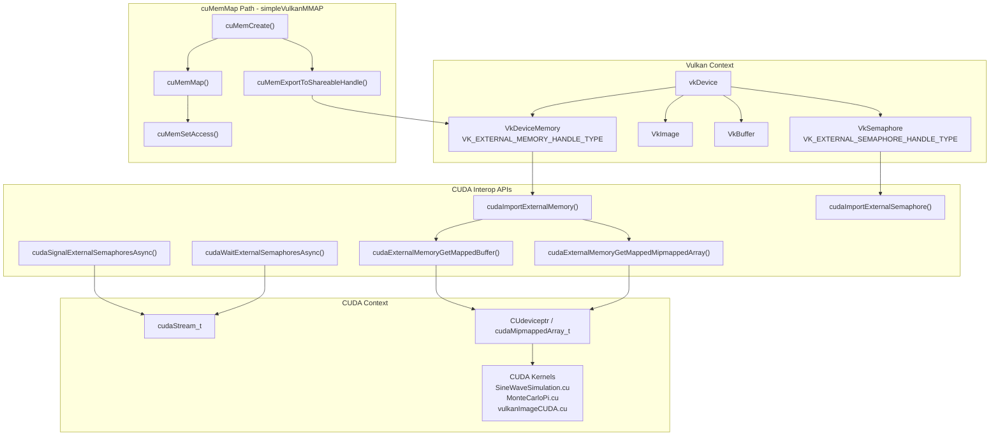
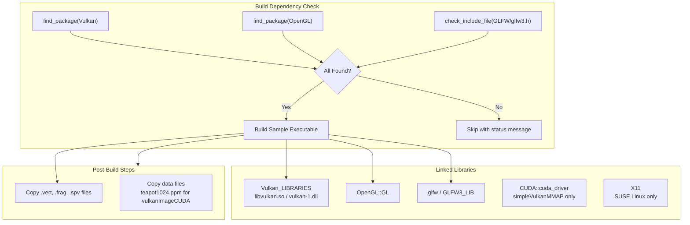

<!-- source: DeepWiki mcp.deepwiki.com · repo NVIDIA/cuda-samples · page 8.3 Vulkan Integration · fetched 2026-10-26 -->

# Vulkan Integration

<details>
<summary>Relevant source files</summary>

The following files were used as context for generating this wiki page:

- [CHANGELOG.md](CHANGELOG.md)
- [Common/helper_cuda.h](Common/helper_cuda.h)

</details>


This document covers CUDA integration with the Vulkan graphics API through three samples: `simpleVulkan`, `vulkanImageCUDA`, and `simpleVulkanMMAP`. These samples demonstrate external memory sharing via `cudaImportExternalMemory`, cross-API synchronization with external semaphores, virtual memory management through `cuMemMap` APIs, and SPIR-V shader integration.

For Direct3D 11 integration on Windows, see page 8.2. For OpenGL and EGL integration, see page 8.1.

## Overview

The Vulkan integration samples demonstrate three primary interoperability patterns:

1.  **External Memory Import**: Using `cudaImportExternalMemory` to access Vulkan-allocated memory from CUDA.
2.  **External Semaphore Synchronization**: Coordinating execution between Vulkan command buffers and CUDA streams via `cudaImportExternalSemaphore`.
3.  **Virtual Memory Mapping**: Leveraging `cuMemMap` APIs for fine-grained memory control with Vulkan external memory.

All samples use the Vulkan SDK, GLFW for windowing, and require compute capability 7.5 or higher. The samples compile SPIR-V shaders (`.vert`, `.frag`) for Vulkan rendering and CUDA kernels (`.cu`) for compute operations.

## Vulkan-CUDA Interoperability Architecture

### Interop API Flow Diagram



Sources: [cpp/5_Domain_Specific/simpleVulkan/CMakeLists.txt:1-114](), [cpp/5_Domain_Specific/simpleVulkanMMAP/CMakeLists.txt:1-114](), [cpp/5_Domain_Specific/vulkanImageCUDA/CMakeLists.txt:1-114]()

## Sample Descriptions and Source Files

### Sample Overview Table

| Sample | Location | Source Files | CUDA Kernels | Shaders |
| :--- | :--- | :--- | :--- | :--- |
| `simpleVulkan` | `5_Domain_Specific/simpleVulkan/` | `main.cpp`, `VulkanBaseApp.cpp`, `SineWaveSimulation.cu` | Sine wave generation | `sinewave.vert`, `sinewave.frag`, `vert.spv`, `frag.spv` |
| `simpleVulkanMMAP` | `5_Domain_Specific/simpleVulkanMMAP/` | `main.cpp`, `VulkanBaseApp.cpp`, `MonteCarloPi.cu` | Monte Carlo Pi estimation | `montecarlo.vert`, `montecarlo.frag`, `vert.spv`, `frag.spv` |
| `vulkanImageCUDA` | `5_Domain_Specific/vulkanImageCUDA/` | `vulkanImageCUDA.cu` | Image processing | `shader.vert`, `shader.frag`, `vert.spv`, `frag.spv` |

### Sample Component Diagram

```mermaid
graph TB
    subgraph simpleVulkan["simpleVulkan Sample"]
        svMain["main.cpp"]
        svVulkanBase["VulkanBaseApp.cpp"]
        svSineWave["SineWaveSimulation.cu"]
        svVertShader["sinewave.vert / vert.spv"]
        svFragShader["sinewave.frag / frag.spv"]
        
        svMain --> svVulkanBase
        svMain --> svSineWave
        svVulkanBase --> svVertShader
        svVulkanBase --> svFragShader
    end
    
    subgraph simpleVulkanMMAP["simpleVulkanMMAP Sample"]
        mmapMain["main.cpp"]
        mmapVulkanBase["VulkanBaseApp.cpp"]
        mmapMonteCarlo["MonteCarloPi.cu"]
        mmapVertShader["montecarlo.vert / vert.spv"]
        mmapFragShader["montecarlo.frag / frag.spv"]
        
        mmapMain --> mmapVulkanBase
        mmapMain --> mmapMonteCarlo
        mmapVulkanBase --> mmapVertShader
        mmapVulkanBase --> mmapFragShader
    end
    
    subgraph vulkanImageCUDA["vulkanImageCUDA Sample"]
        viMain["vulkanImageCUDA.cu<br/>All-in-one source"]
        viInputImage["teapot1024.ppm<br/>Input texture"]
        viVertShader["shader.vert / vert.spv"]
        viFragShader["shader.frag / frag.spv"]
        
        viMain --> viInputImage
        viMain --> viVertShader
        viMain --> viFragShader
    end
    
    subgraph CommonAPIs["Common Interop APIs Used"]
        cudaImportExtMem["cudaImportExternalMemory"]
        cudaImportExtSem["cudaImportExternalSemaphore"]
        cudaGetMappedBuffer["cudaExternalMemoryGetMappedBuffer"]
        cudaSignalSem["cudaSignalExternalSemaphoresAsync"]
        cudaWaitSem["cudaWaitExternalSemaphoresAsync"]
        cuMemMapAPIs["cuMemCreate / cuMemMap<br/>simpleVulkanMMAP only"]
    end
    
    svSineWave -.uses.-> cudaImportExtMem
    svSineWave -.uses.-> cudaImportExtSem
    mmapMonteCarlo -.uses.-> cuMemMapAPIs
    viMain -.uses.-> cudaGetMappedBuffer
```



Sources: [cpp/5_Domain_Specific/simpleVulkan/CMakeLists.txt:60-101](), [cpp/5_Domain_Specific/simpleVulkanMMAP/CMakeLists.txt:59-101](), [cpp/5_Domain_Specific/vulkanImageCUDA/CMakeLists.txt:59-101]()

## Core Interoperability Mechanisms

### External Memory Import with cudaImportExternalMemory

The `cudaImportExternalMemory` API imports Vulkan-allocated memory into CUDA.

**Workflow**:
1.  Allocate Vulkan memory with `VK_EXTERNAL_MEMORY_HANDLE_TYPE_OPAQUE_FD_BIT` (Linux) or `VK_EXTERNAL_MEMORY_HANDLE_TYPE_OPAQUE_WIN32_BIT` (Windows).
2.  Export the memory handle using `vkGetMemoryFdKHR` (Linux) or `vkGetMemoryWin32HandleKHR` (Windows).
3.  Populate `cudaExternalMemoryHandleDesc` with the handle type and file descriptor/HANDLE.
4.  Call `cudaImportExternalMemory` to import into CUDA.

**Buffer Mapping**:
After import, use `cudaExternalMemoryGetMappedBuffer` to obtain a `CUdeviceptr` for kernel access.

**Image Mapping**:
For textures, use `cudaExternalMemoryGetMappedMipmappedArray` to obtain a `cudaMipmappedArray_t`.

### External Semaphore Synchronization

Cross-API synchronization uses `cudaImportExternalSemaphore` with signal/wait operations:

*   **Signal**: `cudaSignalExternalSemaphoresAsync`
*   **Wait**: `cudaWaitExternalSemaphoresAsync`

**Synchronization Pattern**:
1.  Vulkan renders to image → signals semaphore.
2.  CUDA waits on semaphore via `cudaWaitExternalSemaphoresAsync`.
3.  CUDA processes image via kernel.
4.  CUDA signals completion via `cudaSignalExternalSemaphoresAsync`.
5.  Vulkan waits on semaphore → displays result.

### Virtual Memory Management with cuMemMap (simpleVulkanMMAP)

The `simpleVulkanMMAP` sample demonstrates advanced memory mapping using the Driver API. This sample was updated for CUDA 13.0 to use `cuCtxCreate_v4` via the `CUctxCreateParams` parameter [CHANGELOG.md:50-58]().

**cuMemMap Workflow**:
1.  `cuMemCreate`: Allocate physical memory with exportable handle type.
2.  `cuMemMap`: Map physical memory to virtual address range.
3.  `cuMemSetAccess`: Configure access permissions.
4.  `cuMemExportToShareableHandle`: Export handle for Vulkan import.
5.  Vulkan imports via `vkImportMemoryFdKHR` or `vkImportMemoryWin32HandleKHR`.

### Image and Texture Interoperability (vulkanImageCUDA)

The `vulkanImageCUDA` sample processes a PPM image texture. It uses `cudaExternalMemoryGetMappedMipmappedArray` to bridge Vulkan images to CUDA kernels [cpp/5_Domain_Specific/vulkanImageCUDA/CMakeLists.txt:99-100]().

**Format Compatibility**:
Common formats include `VK_FORMAT_R8G8B8A8_UNORM` mapped to `cudaChannelFormatKindUnsigned` with 4 channels.

Sources: [CHANGELOG.md:48-58](), [cpp/5_Domain_Specific/vulkanImageCUDA/CMakeLists.txt:99-100](), [cpp/5_Domain_Specific/simpleVulkanMMAP/CMakeLists.txt:59]()

## Build System Configuration

### Dependency Detection

All three Vulkan samples use identical dependency checking logic:

**Required Dependencies** ([cpp/5_Domain_Specific/simpleVulkan/CMakeLists.txt:22-30]()):
```cmake
find_package(Vulkan)
find_package(OpenGL)
check_include_file("GLFW/glfw3.h" HAVE_GLFW3_H)
```

**Build Conditions**:
*   Sample builds only if `Vulkan_FOUND`, `OPENGL_FOUND`, and `HAVE_GLFW3_H` are all true.
*   Missing dependencies result in skip message: "Vulkan not found - will not build sample".

### GLFW Library Detection

GLFW detection differs by platform ([cpp/5_Domain_Specific/simpleVulkanMMAP/CMakeLists.txt:41-52]()):

*   **Windows and SUSE Linux**: Manually locates GLFW header and library via `find_file` and `find_library`.
*   **Other Linux Distributions**: Links system-provided `glfw` library directly.
*   **SUSE Linux Special Handling**: Explicitly links `X11` library [cpp/5_Domain_Specific/simpleVulkan/CMakeLists.txt:88-92]().

### Target Configuration and Compilation Flags

**Executable Targets**:
*   `simpleVulkan`: [cpp/5_Domain_Specific/simpleVulkan/CMakeLists.txt:60]()
*   `simpleVulkanMMAP`: [cpp/5_Domain_Specific/simpleVulkanMMAP/CMakeLists.txt:59]()
*   `vulkanImageCUDA`: [cpp/5_Domain_Specific/vulkanImageCUDA/CMakeLists.txt:59]()

**Compilation Options** ([cpp/5_Domain_Specific/vulkanImageCUDA/CMakeLists.txt:61-65]()):
*   `--extended-lambda`: Required for CUDA kernels.
*   `cxx_std_17`, `cuda_std_17`: Standards compliance.
*   `CUDA_SEPARABLE_COMPILATION ON`: Enabled for these samples.

**Linked Libraries** ([cpp/5_Domain_Specific/simpleVulkanMMAP/CMakeLists.txt:71-74]()):
*   `${Vulkan_LIBRARIES}`: Vulkan loader.
*   `OpenGL::GL`: OpenGL for GLFW context.
*   `CUDA::cuda_driver`: Required for `simpleVulkanMMAP` (Driver API).

### Post-Build Shader Copy

All samples copy SPIR-V shaders to the build directory after compilation ([cpp/5_Domain_Specific/simpleVulkan/CMakeLists.txt:94-101]()):
```cmake
add_custom_command(TARGET simpleVulkan POST_BUILD
    COMMAND ${CMAKE_COMMAND} -E copy_if_different
    ${CMAKE_CURRENT_SOURCE_DIR}/sinewave.frag
    ${CMAKE_CURRENT_SOURCE_DIR}/sinewave.vert
    ${CMAKE_CURRENT_SOURCE_DIR}/vert.spv
    ${CMAKE_CURRENT_BINARY_DIR}
)
```

### Build Dependency Diagram



Sources: [cpp/5_Domain_Specific/simpleVulkan/CMakeLists.txt:22-110](), [cpp/5_Domain_Specific/simpleVulkanMMAP/CMakeLists.txt:22-110](), [cpp/5_Domain_Specific/vulkanImageCUDA/CMakeLists.txt:22-110]()

## Error Handling

Vulkan samples utilize the common helper headers for error checking. For CUDA Driver API calls (prominent in `simpleVulkanMMAP`), the `_cudaGetErrorEnum(CUresult error)` function in `helper_cuda.h` provides string translations [Common/helper_cuda.h:58-66]().

Sources: [Common/helper_cuda.h:58-66]()

---

