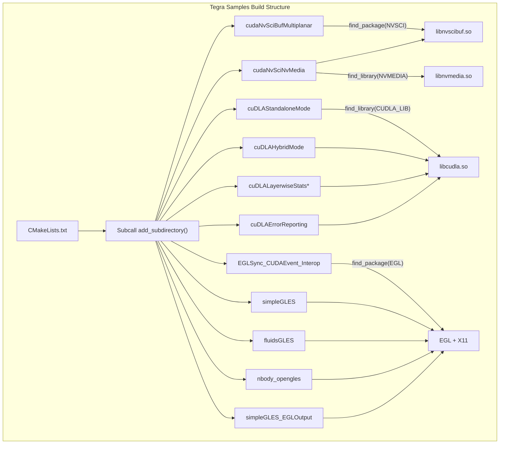

<!-- source: DeepWiki mcp.deepwiki.com · repo NVIDIA/cuda-samples · page 9 Tegra Platform Samples (Category 8) · fetched 2026-10-26 -->

# Tegra Platform Samples (Category 8)

Relevant source files

The following files were used as context for generating this wiki page:

- [CHANGELOG.md](CHANGELOG.md)
- [cmake/Modules/FindNVSCI.cmake](cmake/Modules/FindNVSCI.cmake)
- [cmake/toolchains/toolchain-aarch64-linux.cmake](cmake/toolchains/toolchain-aarch64-linux.cmake)
- [cmake/toolchains/toolchain-aarch64-qnx.cmake](cmake/toolchains/toolchain-aarch64-qnx.cmake)

The Tegra Platform Samples demonstrate NVIDIA Tegra-specific hardware features and system interfaces integrated with CUDA. These samples target embedded GPU capabilities, specialized accelerators, and system communication interfaces available on Tegra SoCs (System on Chips). The samples are organized into three main categories: NvSci system communication, CUDA DLA acceleration, and multimedia processing with graphics interoperability.

## Tegra Sample Architecture Overview

The Tegra platform samples target specific hardware and software capabilities available on NVIDIA Tegra SoCs. The samples are structured around three core subsystems:

| Sample Category | Key APIs | Hardware Target | Primary Use Cases |
|----------------|----------|-----------------|------------------|
| NvSci Communication | `NvSciBufObj`, `NvSciSync`, `NvMediaDevice` | Inter-processor communication | Zero-copy data sharing, multimedia pipelines |
| CUDA DLA Integration | `cudla` library, `cuDLA*` APIs | Deep Learning Accelerator | Neural network inference acceleration |
| Graphics Interoperability | EGL, OpenGL ES, X11 | GPU rendering engines | Real-time visualization, compute graphics |

### Sample Organization and Dependencies

Sources: [cpp/8_Platform_Specific/Tegra/CMakeLists.txt:1-13]()

## Platform Requirements and Build Configuration

All Tegra samples target `aarch64` architecture on Linux and QNX. They typically target CUDA architectures `87` (Ampere) and `110` (Hopper) found in Tegra platforms like Jetson Orin and Thor.

### Cross-Compilation and Toolchains

Tegra development often involves cross-compiling from an x86_64 host. The repository provides specific toolchain files to handle this:

*   **Linux (aarch64):** Uses `toolchain-aarch64-linux.cmake` which sets `CMAKE_SYSTEM_PROCESSOR` to `aarch64` and configures the `aarch64-linux-gnu-gcc/g++` compilers [cmake/toolchains/toolchain-aarch64-linux.cmake:1-10](). It also handles `TARGET_FS` (sysroot) mapping for library and include paths [cmake/toolchains/toolchain-aarch64-linux.cmake:17-44]().
*   **QNX (aarch64):** Uses `toolchain-aarch64-qnx.cmake` which utilizes the QNX Software Development Platform (SDP) tools like `qcc` and `q++` [cmake/toolchains/toolchain-aarch64-qnx.cmake:11-20]().

### Build System Logic

The Tegra samples use a conditional build system that detects platform-specific libraries via `find_package` or `find_library` and only builds samples when dependencies are available. For example, `FindNVSCI.cmake` is used to locate `libnvscibuf.so` and `libnvscisync.so` [cmake/Modules/FindNVSCI.cmake:1-17]().

Sources: 
- [cmake/toolchains/toolchain-aarch64-linux.cmake:1-69]()
- [cmake/toolchains/toolchain-aarch64-qnx.cmake:1-38]()
- [cmake/Modules/FindNVSCI.cmake:1-62]()

## NvSci Interface and System Communication

NvSci (NVIDIA System Communication Interface) provides zero-copy data sharing and synchronization between different processors (CPU, GPU, DLA, ISP) and hardware engines on Tegra SoCs.

For details, see [NvSci Interface and System Communication](#9.1).

### Key Components:
- **NvSciBuf**: Manages memory allocation and multi-engine access attributes.
- **NvSciSync**: Handles synchronization across different hardware domains.
- **cudaNvSciBufMultiplanar**: Demonstrates importing NvSciBuf objects into CUDA as `cudaExternalMemory_t` to process multi-planar YUV data [cpp/8_Platform_Specific/Tegra/cudaNvSciBufMultiplanar/cudaNvSciBufMultiplanar.cpp:85-150]().

Sources:
- [cpp/8_Platform_Specific/Tegra/cudaNvSciBufMultiplanar/cudaNvSciBufMultiplanar.cpp:1-200]()
- [cmake/Modules/FindNVSCI.cmake:1-10]()

## CUDA DLA and Deep Learning Acceleration

The Deep Learning Accelerator (DLA) is a dedicated hardware engine on Tegra SoCs designed for fixed-function neural network inference, freeing up GPU resources.

For details, see [CUDA DLA and Deep Learning Acceleration](#9.2).

### Execution Modes:
- **Standalone Mode**: DLA execution is managed independently of the GPU, often requiring `NvSci` for buffer management.
- **Hybrid Mode**: CUDA and DLA work together, where DLA handles specific layers or sub-networks, and CUDA handles pre/post-processing.
- **Instrumentation**: Samples like `cuDLALayerwiseStats` demonstrate how to profile DLA performance at a per-layer granularity.

Sources:
- [CHANGELOG.md:73-73]()
- [cpp/8_Platform_Specific/Tegra/CMakeLists.txt:1-15]()

## Multimedia and OpenGL ES on Tegra

Multimedia samples focus on the integration of CUDA with the Tegra display subsystem and OpenGL ES (GLES), which is the standard graphics API for embedded Linux and QNX.

For details, see [Multimedia and OpenGL ES on Tegra](#9.3).

### Feature Highlights:
- **EGL Interop**: Using `EGLStream` or `EGLSync` to coordinate between CUDA and the windowing system or display controller [CHANGELOG.md:74-74]().
- **OpenGL ES**: Samples like `simpleGLES` and `fluidsGLES` demonstrate rendering CUDA-calculated data using GLES shaders.
- **EGLOutput**: Demonstrates direct-to-display rendering without a traditional window manager, often using `libdrm` for display control.

Sources:
- [CHANGELOG.md:59-62]()
- [cpp/8_Platform_Specific/Tegra/CMakeLists.txt:5-13]()

## Relationship to Other CUDA Samples

The Tegra platform samples are specialized versions of concepts found in other categories, optimized for the SoC architecture:

| Tegra Concept | Related General Category |
|---------------|--------------------------|
| NvSci Interop | [Memory Mapping and Virtual Memory Management](#5.4) |
| GLES Interop | [OpenGL and EGL Integration](#8.1) |
| DLA Acceleration | [Tensor Core Operations](#5.5) |

Sources:
- [CHANGELOG.md:1-100]()

---

