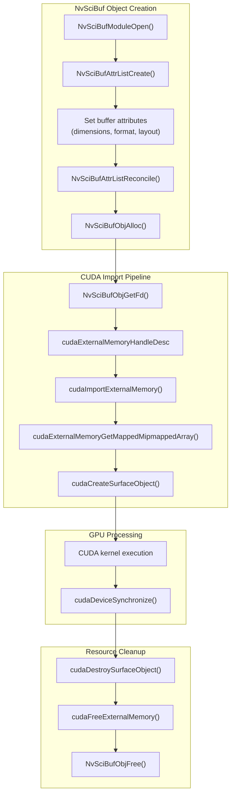
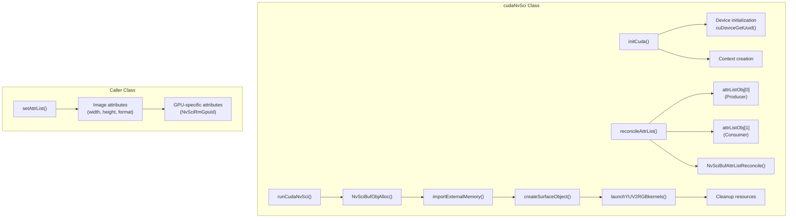
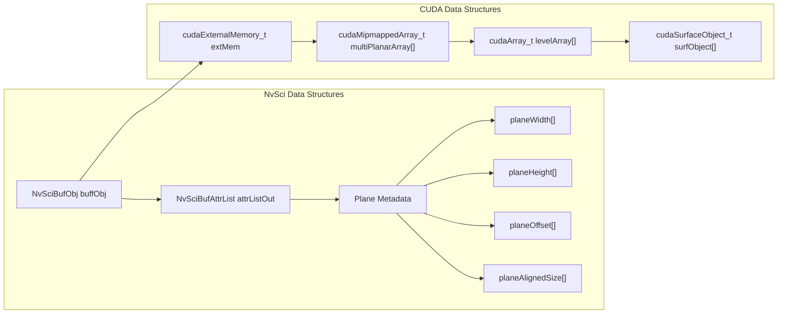
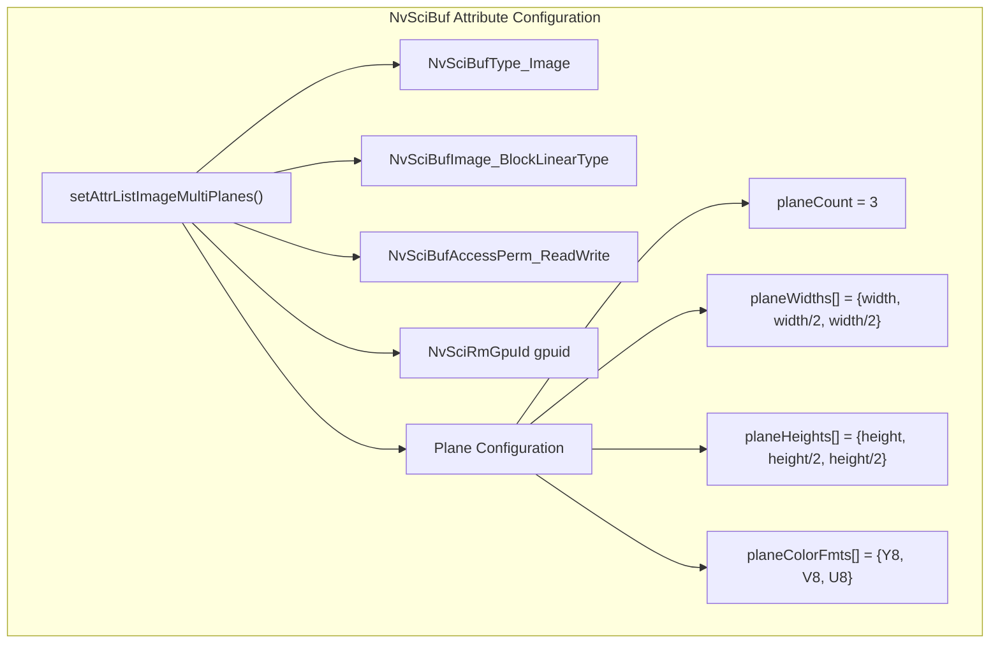
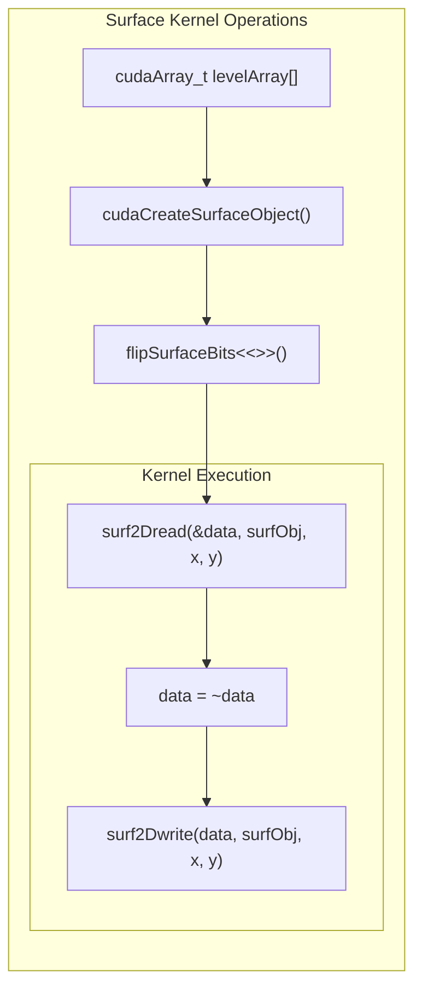
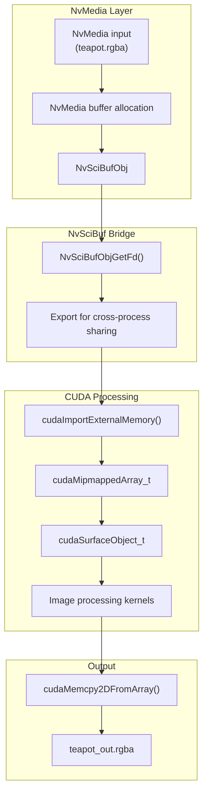
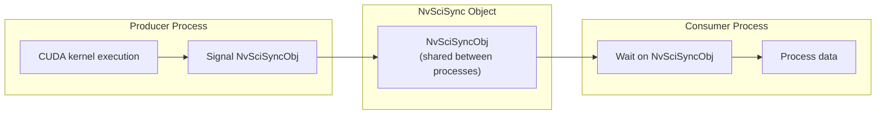

<!-- source: DeepWiki mcp.deepwiki.com · repo NVIDIA/cuda-samples · page 9.1 NvSci Interface and System Communication · fetched 2026-10-26 -->

# NvSci Interface and System Communication

Relevant source files

The following files were used as context for generating this wiki page:

- [CHANGELOG.md](CHANGELOG.md)
- [cmake/Modules/FindNVSCI.cmake](cmake/Modules/FindNVSCI.cmake)

## Purpose and Scope

This document covers NVIDIA's System Communication Interface (NvSci) integration with CUDA, focusing on inter-process and inter-device communication mechanisms on Tegra and compatible platforms. The NvSci framework provides standardized APIs for efficient buffer sharing (`NvSciBuf`) and synchronization (`NvSciSync`) between processes and hardware accelerators.

Three samples demonstrate NvSci-CUDA integration:

| Sample | Location | Purpose |
|--------|----------|---------|
| `cudaNvSci` | [cpp/4_CUDA_Libraries/cudaNvSci/]() | Basic NvSciBuf operations with single-plane images |
| `cudaNvSciBufMultiplanar` | [cpp/8_Platform_Specific/Tegra/cudaNvSciBufMultiplanar/]() | Multiplanar YUV 420 image processing |
| `cudaNvSciNvMedia` | [cpp/8_Platform_Specific/Tegra/cudaNvSciNvMedia/]() | Integration with NvMedia for multimedia workflows |

For CUDA Deep Learning Accelerator integration, see page 9.2. For OpenGL ES rendering on Tegra, see page 9.3.

**Sources:** [cpp/4_CUDA_Libraries/cudaNvSci/CMakeLists.txt:1-68](), [cpp/8_Platform_Specific/Tegra/cudaNvSciBufMultiplanar/CMakeLists.txt:1-65](), [cpp/8_Platform_Specific/Tegra/cudaNvSciNvMedia/CMakeLists.txt:1-96]()

## NvSci Framework Overview

### Core Concepts

The NvSci framework provides two primary interfaces for system communication, defined in the CMake discovery module [cmake/Modules/FindNVSCI.cmake:1-9]():

| Interface | Purpose | Key Types |
|-----------|---------|-----------|
| `NvSciBuf` | Buffer allocation and sharing | `NvSciBufModule`, `NvSciBufObj`, `NvSciBufAttrList` |
| `NvSciSync` | Cross-process synchronization | `NvSciSyncModule`, `NvSciSyncObj`, `NvSciSyncAttrList` |

### Buffer Management Architecture

NvSciBuf enables zero-copy data sharing between CUDA and other system components through a hardware-agnostic communication layer. The architecture centers on buffer objects (`NvSciBufObj`) that can be shared across process boundaries and imported into different execution contexts.

**Diagram: NvSciBuf Workflow with CUDA Integration**

**Sources:** [cpp/8_Platform_Specific/Tegra/cudaNvSciBufMultiplanar/cudaNvSciBufMultiplanar.cpp:266-287](), [cpp/4_CUDA_Libraries/cudaNvSci/CMakeLists.txt:23-47]()

## cudaNvSci Sample - Basic Buffer Management

### Overview

The `cudaNvSci` sample demonstrates fundamental NvSciBuf operations with single-plane RGB images. It performs image processing using CUDA surface objects created from NvSciBuf allocations.

**Build Configuration:**
- **Architectures**: SM 75, 80, 86, 87, 90, 110
- **Dependencies**: NvSciBuf, NvSciSync libraries (discovered via `FindNVSCI.cmake`)
- **Platform**: Linux only
- **Source Files**: `imageKernels.cu`, `cudaNvSci.cpp`, `main.cpp`

### Class Structure

**Diagram: cudaNvSci Class Architecture**

### Image Processing Pipeline

The sample converts YUV images to RGB format using CUDA surface operations:

1. **Input**: PPM format image file (`teapot1024.ppm`)
2. **Processing**: YUV to RGB color space conversion kernels
3. **Output**: Processed PPM file (`teapot1024_out.ppm`)

The workflow uses `cudaSurfaceObject_t` for efficient read-modify-write operations on the NvSciBuf-backed memory.

**Sources:** [cpp/4_CUDA_Libraries/cudaNvSci/CMakeLists.txt:1-68]()

## cudaNvSciBufMultiplanar Sample - Advanced Multiplanar Processing

### Core Components and Classes

| Class | Purpose | Key Methods |
|-------|---------|-------------|
| `cudaNvSciBufMultiplanar` | Main orchestrator for multiplanar NvSci-CUDA interop | `initCuda()`, `reconcileAttrList()`, `runCudaNvSciBufPlanar()` |
| `Caller` | NvSciBuf attribute management for multiplanar arrays | `setAttrListImageMultiPlanes()`, `copyExtMemToMultiPlanarArrays()` |

### Key Data Structures

The system operates on critical data structures bridging NvSci and CUDA memory spaces:

**Diagram: cudaNvSciBufMultiplanar Data Structure Mapping**

**Sources:** [cpp/8_Platform_Specific/Tegra/cudaNvSciBufMultiplanar/cudaNvSciBufMultiplanar.h:83-92](), [cpp/8_Platform_Specific/Tegra/cudaNvSciBufMultiplanar/cudaNvSciBufMultiplanar.cpp:230-288]()

### Buffer Attribute Management

#### Attribute List Configuration

The `Caller::setAttrListImageMultiPlanes()` method configures NvSciBuf attributes for multiplanar YUV 420 image formats. The configuration specifies buffer type, layout, permissions, and plane characteristics:

The attribute reconciliation process via `NvSciBufAttrListReconcile()` ensures compatibility between different callers and creates a unified buffer specification.

**Sources:** [cpp/8_Platform_Specific/Tegra/cudaNvSciBufMultiplanar/cudaNvSciBufMultiplanar.cpp:98-139](), [cpp/8_Platform_Specific/Tegra/cudaNvSciBufMultiplanar/cudaNvSciBufMultiplanar.cpp:290-300]()

### CUDA Integration Workflow

#### External Memory Import Process

The core integration workflow converts NvSciBuf objects into CUDA-accessible memory through the external memory API:

**Sources:** [cpp/8_Platform_Specific/Tegra/cudaNvSciBufMultiplanar/cudaNvSciBufMultiplanar.cpp:266-287](), [cpp/8_Platform_Specific/Tegra/cudaNvSciBufMultiplanar/imageKernels.cu:44-64]()

#### Surface Memory Operations

The `launchFlipSurfaceBitsKernel()` function demonstrates surface-based GPU processing:

**Sources:** [cpp/8_Platform_Specific/Tegra/cudaNvSciBufMultiplanar/imageKernels.cu:30-64]()

## cudaNvSciNvMedia Sample - Multimedia Integration

### Overview

The `cudaNvSciNvMedia` sample demonstrates integration between CUDA, NvSciBuf, and NvMedia for multimedia processing workflows on Tegra platforms.

**Build Configuration:**
- **Architectures**: SM 87, 110 (Tegra-specific)
- **Dependencies**: NvSciBuf, NvSciSync, NvMedia libraries
- **Platform**: Linux on Tegra/Jetson only
- **Source Files**: `imageKernels.cu`, `cudaNvSciNvMedia.cpp`, `main.cpp`

### NvMedia Integration Architecture

**Diagram: NvMedia-CUDA Data Flow**

**Sources:** [cpp/8_Platform_Specific/Tegra/cudaNvSciNvMedia/CMakeLists.txt:1-96]()

## Cross-Process Synchronization

### NvSciSync Integration

The `FindNVSCI.cmake` module defines `NVSCISYNC_LIBRARY` [cmake/Modules/FindNVSCI.cmake:19-25](), which is used for cross-process and cross-engine synchronization.

**Diagram: NvSciSync Synchronization Pattern**

### Synchronization Primitives

| Primitive | Purpose | Usage |
|-----------|---------|-------|
| `NvSciSyncObj` | Synchronization object | Shared between processes/engines |
| `NvSciSyncFence` | Fence value for signaling | Represents completion point |
| `cudaImportExternalSemaphore()` | Import into CUDA | Convert NvSciSync to CUDA semaphore |

**Sources:** [cmake/Modules/FindNVSCI.cmake:1-62](), [cpp/4_CUDA_Libraries/cudaNvSci/CMakeLists.txt:23-47]()

## Error Handling and Validation

### Custom Error Checking Macros

The system implements comprehensive error checking through custom macros:

| Macro | Purpose | API Coverage |
|-------|---------|--------------|
| `checkNvSciErrors()` | NvSci API error validation | `NvSciBufModuleOpen`, `NvSciBufAttrListCreate` |
| `checkCudaDrvErrors()` | CUDA Driver API validation | `cuDriverGetVersion`, `cuDeviceGetUuid` |
| `checkCudaErrors()` | CUDA Runtime API validation | `cudaImportExternalMemory`, `cudaCreateSurfaceObject` |

**Sources:** [cpp/8_Platform_Specific/Tegra/cudaNvSciBufMultiplanar/cudaNvSciBufMultiplanar.h:43-73]()

### Platform Requirements and Dependencies

- **Architecture**: aarch64 (Tegra platforms)
- **Compute Capability**: SM 6.0 or higher
- **Libraries**: `libnvscibuf`, `libnvscisync` [cmake/Modules/FindNVSCI.cmake:11-25]()

**Sources:** [cpp/8_Platform_Specific/Tegra/cudaNvSciBufMultiplanar/main.cpp:35-59](), [cmake/Modules/FindNVSCI.cmake:1-62]()

---

