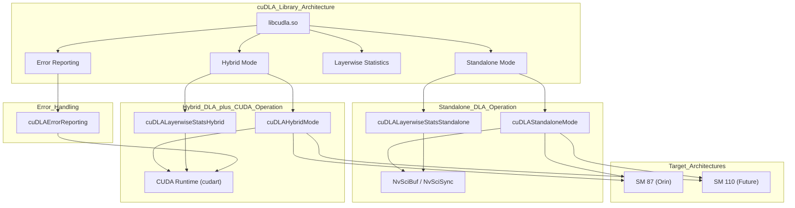
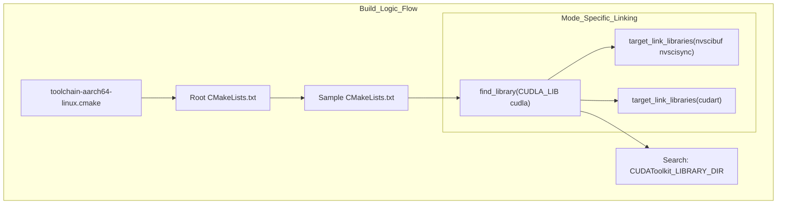
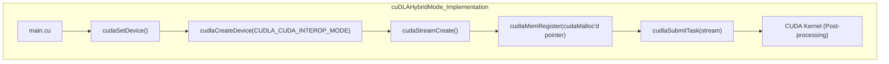

<!-- source: DeepWiki mcp.deepwiki.com · repo NVIDIA/cuda-samples · page 9.2 CUDA DLA and Deep Learning Acceleration · fetched 2026-10-26 -->

# CUDA DLA and Deep Learning Acceleration

<details>
<summary>Relevant source files</summary>

The following files were used as context for generating this wiki page:

- [CHANGELOG.md](CHANGELOG.md)
- [cmake/toolchains/toolchain-aarch64-linux.cmake](cmake/toolchains/toolchain-aarch64-linux.cmake)

</details>


## Purpose and Scope

This document covers the CUDA Deep Learning Accelerator (DLA) integration samples within Category 8 (Platform-Specific/Tegra). These samples demonstrate neural network inference using the `libcudla` library, which provides access to dedicated DLA hardware accelerators on Tegra SoCs. The samples cover two operational modes: standalone DLA execution (CPU-based control without GPU) and hybrid execution (combined DLA and CUDA GPU workloads).

**Key Samples Covered:**
- `cuDLAStandaloneMode`: Pure DLA inference with NvSCI buffer management.
- `cuDLAHybridMode`: Combined DLA and CUDA GPU execution.
- `cuDLALayerwiseStatsStandalone`: Performance profiling for standalone mode.
- `cuDLALayerwiseStatsHybrid`: Performance profiling for hybrid mode.
- `cuDLAErrorReporting`: Error handling and diagnostic reporting.

For NvSCI system communication interfaces used in standalone mode, see page 9.1. For OpenGL ES integration on Tegra, see page 9.3.

## DLA Architecture and Operating Modes

The CUDA DLA system provides multiple operating modes for deep learning inference acceleration on Tegra platforms. The architecture supports both standalone DLA operation and hybrid modes that combine DLA with CUDA GPU computation.

### DLA Operating Modes



Sources: [cpp/8_Platform_Specific/Tegra/cuDLAStandaloneMode/CMakeLists.txt:11](), [cpp/8_Platform_Specific/Tegra/cuDLAHybridMode/CMakeLists.txt:11](), [cpp/8_Platform_Specific/Tegra/cuDLALayerwiseStatsStandalone/CMakeLists.txt:11](), [cpp/8_Platform_Specific/Tegra/cuDLALayerwiseStatsHybrid/CMakeLists.txt:11](), [cpp/8_Platform_Specific/Tegra/cuDLAErrorReporting/CMakeLists.txt:11]()

### Library Dependencies and Build Configuration

The cuDLA samples require specific library dependencies that vary by operating mode. The build system uses `find_library` to locate `cudla` and associated NvSci components.

| Sample | Primary Source | libcudla | NvSciBuf | NvSciSync | CUDA Runtime | Architectures |
|--------|-------------|----------|----------|-----------|--------------|---------------|
| `cuDLAStandaloneMode` | `main.cpp` | ✓ | ✓ | ✓ | ✗ | 87, 110 |
| `cuDLALayerwiseStatsStandalone` | `main.cpp` | ✓ | ✓ | ✓ | ✗ | 87, 110 |
| `cuDLAHybridMode` | `main.cu` | ✓ | ✗ | ✗ | ✓ | 87, 110 |
| `cuDLALayerwiseStatsHybrid` | `main.cu` | ✓ | ✗ | ✗ | ✓ | 87, 110 |
| `cuDLAErrorReporting` | `main.cu` | ✓ | ✗ | ✗ | ✓ | 87, 110 |

**Architecture Support:**
- **SM 87**: NVIDIA Orin series.
- **SM 110**: Next-generation Tegra architectures.

Sources: [cpp/8_Platform_Specific/Tegra/cuDLAStandaloneMode/CMakeLists.txt:24-46](), [cpp/8_Platform_Specific/Tegra/cuDLAHybridMode/CMakeLists.txt:23-42](), [cpp/8_Platform_Specific/Tegra/cuDLAStandaloneMode/CMakeLists.txt:11](), [cpp/8_Platform_Specific/Tegra/cuDLAHybridMode/CMakeLists.txt:11]()

## Build System Integration

### CMake Library Detection and Linking

The build process for cuDLA samples relies on the Tegra-specific toolchains, such as `toolchain-aarch64-linux.cmake`, which configures cross-compilation paths and sysroot settings for `aarch64-linux` or `sbsa-linux` targets [cmake/toolchains/toolchain-aarch64-linux.cmake:18-22]().



**Library Search Paths:**
- Primary: `${CUDAToolkit_LIBRARY_DIR}` (configured via toolchain or `find_package(CUDAToolkit)`).
- Secondary: User-specified via `-DCMAKE_LIBRARY_PATH`.

Sources: [cmake/toolchains/toolchain-aarch64-linux.cmake:1-68](), [cpp/8_Platform_Specific/Tegra/cuDLAStandaloneMode/CMakeLists.txt:23-46](), [cpp/8_Platform_Specific/Tegra/cuDLAHybridMode/CMakeLists.txt:23-42]()

### Compilation Flags and Architecture Targeting

All cuDLA samples enforce consistent CUDA architecture targeting for Orin and beyond:

```cmake
set(CMAKE_CUDA_ARCHITECTURES 87 110)
set(CMAKE_CUDA_FLAGS "${CMAKE_CUDA_FLAGS} -Wno-deprecated-gpu-targets")
```

**Debug vs Release Configuration:**

| Flag | Debug Mode (`ENABLE_CUDA_DEBUG=ON`) | Release Mode |
|------|------------|--------------|
| **NVCC Flags** | `-G` (device debug symbols) | `-lineinfo` (profiling info) |

Sources: [cpp/8_Platform_Specific/Tegra/cuDLAStandaloneMode/CMakeLists.txt:11-18](), [cpp/8_Platform_Specific/Tegra/cuDLAHybridMode/CMakeLists.txt:11-17]()

## Sample Implementation Categories

### Standalone DLA Mode Samples

Standalone mode uses the DLA without initializing the GPU. It requires NvSci interfaces for memory and synchronization management.

```mermaid
graph TB
    subgraph "cuDLAStandaloneMode_Implementation"
        MAIN["main.cpp"]
        MAIN --> INIT["cudlaCreateDevice()"]
        INIT --> LOAD["cudlaModuleLoadFromMemory()"]
        LOAD --> MEM_IMPORT["cudlaImportExternalMemory(NvSciBuf)"]
        MEM_IMPORT --> SYNC_IMPORT["cudlaImportExternalSemaphore(NvSciSync)"]
        SYNC_IMPORT --> EXEC["cudlaSubmitTask()"]
    end
    
    subgraph "cuDLALayerwiseStatsStandalone"
        STATS_MAIN["main.cpp"]
        STATS_MAIN --> STATS_ENABLE["cudlaModuleEnableLayerwiseStats()"]
        STATS_ENABLE --> STATS_QUERY["cudlaModuleGetLayerwiseStats()"]
    end
```



**Standalone Mode Characteristics:**
- **Control Path**: Pure C++ (CPU) using the `cudla` library.
- **Memory**: `NvSciBuf` provides the backing memory for DLA tensors, allowing cross-process or cross-interface sharing.
- **Synchronization**: `NvSciSync` objects (fences) manage the execution flow between the CPU and DLA hardware.

Sources: [cpp/8_Platform_Specific/Tegra/cuDLAStandaloneMode/CMakeLists.txt:31](), [cpp/8_Platform_Specific/Tegra/cuDLALayerwiseStatsStandalone/CMakeLists.txt:31]()

### Hybrid DLA+CUDA Mode Samples

Hybrid mode integrates DLA tasks into a CUDA stream, allowing the GPU to perform pre-processing or post-processing while the DLA handles inference.



**Hybrid Mode Characteristics:**
- **CUDA Interop**: Uses `CUDLA_CUDA_INTEROP_MODE` during device creation.
- **Unified Memory**: DLA can access memory allocated via `cudaMalloc` after it is registered with `cudlaMemRegister`.
- **Stream Integration**: `cudlaSubmitTask` takes a `cudaStream_t`, ensuring the DLA task is ordered relative to GPU kernels.

Sources: [cpp/8_Platform_Specific/Tegra/cuDLAHybridMode/CMakeLists.txt:29](), [cpp/8_Platform_Specific/Tegra/cuDLALayerwiseStatsHybrid/CMakeLists.txt:29]()

### Error Handling and Performance Profiling

- **`cuDLAErrorReporting`**: Demonstrates usage of `cudlaGetLastError()` and `cudlaGetErrorString()` to diagnose failures in DLA task submission or module loading.
- **Layerwise Stats**: Both standalone and hybrid variants use `cudlaModuleEnableLayerwiseStats()` to enable hardware-level profiling. After inference, `cudlaModuleGetLayerwiseStats()` retrieves timing data for individual layers of the neural network.

Sources: [cpp/8_Platform_Specific/Tegra/cuDLAErrorReporting/CMakeLists.txt:29](), [cpp/8_Platform_Specific/Tegra/cuDLALayerwiseStatsHybrid/CMakeLists.txt:29]()

---

