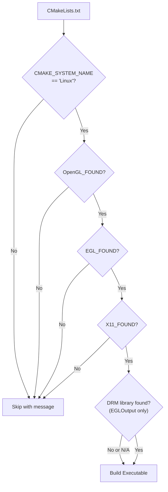
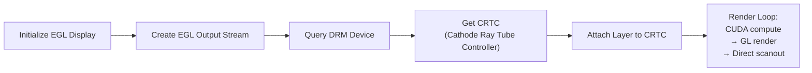
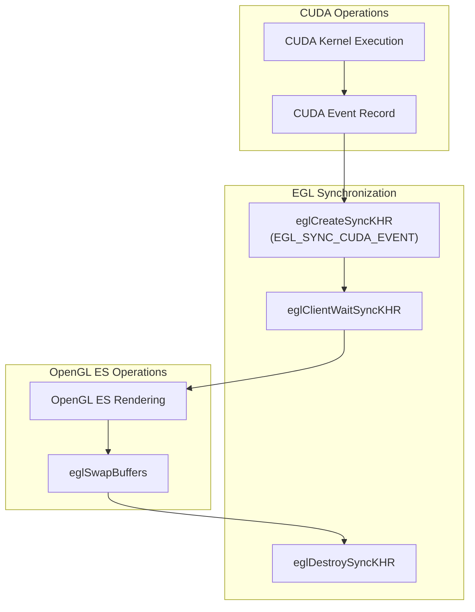
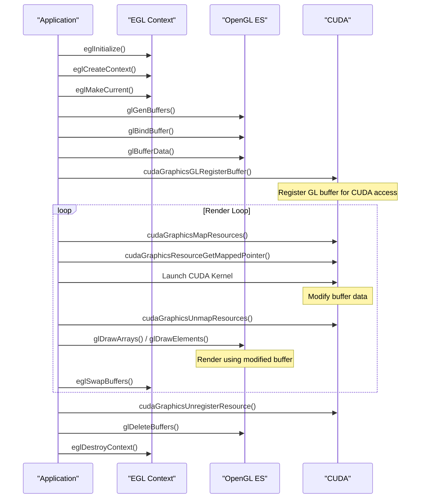
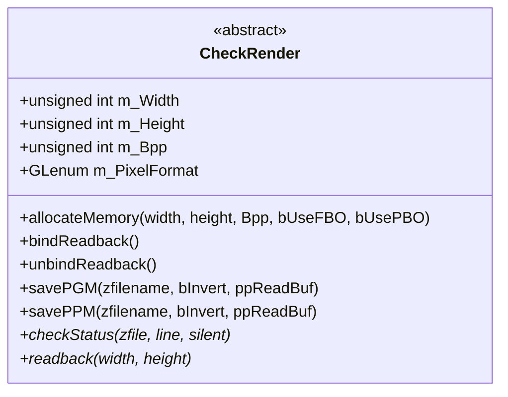

<!-- source: DeepWiki mcp.deepwiki.com · repo NVIDIA/cuda-samples · page 9.3 Multimedia and OpenGL ES on Tegra · fetched 2026-10-26 -->

# Multimedia and OpenGL ES on Tegra

<details>
<summary>Relevant source files</summary>

The following files were used as context for generating this wiki page:

- [CHANGELOG.md](CHANGELOG.md)
- [Common/rendercheck_gles.h](Common/rendercheck_gles.h)
- [cmake/Modules/FindEGL.cmake](cmake/Modules/FindEGL.cmake)

</details>


## Purpose and Scope

This document describes the multimedia and OpenGL ES integration samples for NVIDIA Tegra/Jetson embedded platforms. These samples demonstrate graphics rendering, fluid simulation, and multimedia processing using OpenGL ES (rather than desktop OpenGL), EGL context management, and NvMedia APIs. The samples target compute architectures 87 (Tegra Orin) and 110 (future Tegra platforms) and are Linux-specific.

For general NvSci buffer management and synchronization primitives, see [NvSci Interface and System Communication](#9.1). For deep learning acceleration on Tegra, see [CUDA DLA and Deep Learning Acceleration](#9.2). For desktop OpenGL interoperability (non-Tegra), see [OpenGL and EGL Integration](#8.1).

---

## OpenGL ES vs Desktop OpenGL

NVIDIA Tegra platforms use **OpenGL ES** (OpenGL for Embedded Systems) instead of desktop OpenGL. OpenGL ES is a subset of the full OpenGL API designed for embedded systems, mobile devices, and other resource-constrained environments.

### Key Architectural Differences

| Aspect | Desktop OpenGL | OpenGL ES (Tegra) |
|--------|----------------|-------------------|
| **API Surface** | Full OpenGL 4.x API | OpenGL ES 3.x subset |
| **Context Creation** | GLUT, GLFW, native windowing | EGL (Embedded Graphics Library) |
| **Shader Language** | GLSL 4.x | GLSL ES 3.x |
| **Fixed Function Pipeline** | Available (deprecated) | Removed entirely |
| **Default Framebuffer** | Implicit | Must be explicitly managed |
| **Extensions** | Desktop-specific | Embedded-specific (e.g., `EGL_ANDROID_*`) |

All Tegra samples in this section use EGL for context management and window system integration on Linux with X11.

**Sources:** [Samples/8_Platform_Specific/Tegra/simpleGLES/CMakeLists.txt:1-77](), [Samples/8_Platform_Specific/Tegra/fluidsGLES/CMakeLists.txt:1-77]()

---

## Sample Architecture Overview

```mermaid
graph TB
    subgraph "OpenGL ES Samples"
        SimpleGLES["simpleGLES<br/>Basic CUDA-GL interop"]
        FluidsGLES["fluidsGLES<br/>Fluid dynamics simulation"]
        EGLOutput["simpleGLES_EGLOutput<br/>Direct DRM rendering"]
        EGLSync["EGLSync_CUDAEvent_Interop<br/>Synchronization primitives"]
    end
    
    subgraph "Multimedia Samples"
        NvMediaSample["cudaNvSciNvMedia<br/>Multimedia processing"]
    end
    
    subgraph "Dependencies - Graphics"
        EGL["EGL Library<br/>Context management"]
        OpenGLES["OpenGL ES Library<br/>Rendering API"]
        X11["X11 Libraries<br/>Linux windowing"]
        DRM["libdrm<br/>Direct Rendering Manager"]
    end
    
    subgraph "Dependencies - CUDA"
        CUDADriver["CUDA Driver API<br/>Low-level CUDA operations"]
        CuFFT["cuFFT Library<br/>FFT operations"]
    end
    
    subgraph "Dependencies - Tegra-Specific"
        NvSci["NvSciBuf/NvSciSync<br/>Buffer & sync management"]
        NvMedia["NvMedia Library<br/>Multimedia hardware acceleration"]
    end
    
    subgraph "Shader Files"
        VertShader["mesh.vert.glsl<br/>Vertex shader"]
        FragShader["mesh.frag.glsl<br/>Fragment shader"]
    end
    
    SimpleGLES --> EGL
    SimpleGLES --> OpenGLES
    SimpleGLES --> X11
    SimpleGLES --> VertShader
    SimpleGLES --> FragShader
    
    FluidsGLES --> EGL
    FluidsGLES --> OpenGLES
    FluidsGLES --> X11
    FluidsGLES --> CuFFT
    FluidsGLES --> CUDADriver
    FluidsGLES --> VertShader
    FluidsGLES --> FragShader
    
    EGLOutput --> EGL
    EGLOutput --> OpenGLES
    EGLOutput --> X11
    EGLOutput --> DRM
    EGLOutput --> VertShader
    EGLOutput --> FragShader
    
    EGLSync --> EGL
    EGLSync --> OpenGLES
    EGLSync --> X11
    EGLSync --> CUDADriver
    
    NvMediaSample --> NvSci
    NvMediaSample --> NvMedia
    NvMediaSample --> CUDADriver
```



**Diagram: Tegra Multimedia and OpenGL ES Sample Dependencies**

All OpenGL ES samples require Linux OS and will not build on other platforms. The build system performs comprehensive dependency checking for EGL, OpenGL ES, X11, and platform-specific libraries before compilation.

**Sources:** [Samples/8_Platform_Specific/Tegra/simpleGLES/CMakeLists.txt:27-72](), [Samples/8_Platform_Specific/Tegra/fluidsGLES/CMakeLists.txt:26-72](), [Samples/8_Platform_Specific/Tegra/simpleGLES_EGLOutput/CMakeLists.txt:27-78]()

---

## Build System Configuration

### Dependency Detection

Each OpenGL ES sample uses a cascading dependency check pattern in CMake:



**Diagram: Build Dependency Resolution Flow**

If any required dependency is missing, the build system outputs an informative message and skips the sample:

- Missing OpenGL: `"OpenGL not found - will not build sample 'simpleGLES'"`
- Missing EGL: `"EGL not found - will not build sample 'simpleGLES'"`
- Missing X11: `"X11 libraries not found - will not build sample 'simpleGLES'"`

**Sources:** [Samples/8_Platform_Specific/Tegra/simpleGLES/CMakeLists.txt:27-72](), [Samples/8_Platform_Specific/Tegra/fluidsGLES/CMakeLists.txt:26-72]()

### Architecture Targeting

All Tegra multimedia samples restrict CUDA architecture targeting to Tegra-specific compute capabilities:

| CMake Configuration | Value | Description |
|---------------------|-------|-------------|
| `CMAKE_CUDA_ARCHITECTURES` | `87 110` | Tegra Orin (87), Future Tegra (110) |
| `CMAKE_CUDA_FLAGS` | `-Wno-deprecated-gpu-targets` | Suppress deprecation warnings |
| Debug mode flag | `-G` | Enable cuda-gdb debugging |
| Release mode flag | `-lineinfo` | Add line information for profiling |

**Sources:** [Samples/8_Platform_Specific/Tegra/simpleGLES/CMakeLists.txt:11-18](), [Samples/8_Platform_Specific/Tegra/fluidsGLES/CMakeLists.txt:11-17]()

### Shader File Deployment

OpenGL ES samples require GLSL shader files at runtime. The build system copies these files to the output directory:

```
add_custom_command(TARGET simpleGLES POST_BUILD
    COMMAND ${CMAKE_COMMAND} -E copy_if_different
    ${CMAKE_CURRENT_SOURCE_DIR}/mesh.frag.glsl
    ${CMAKE_CURRENT_SOURCE_DIR}/mesh.vert.glsl
    ${CMAKE_CURRENT_BINARY_DIR}
)
```

This pattern is used by `simpleGLES`, `fluidsGLES`, and `simpleGLES_EGLOutput`.

**Sources:** [Samples/8_Platform_Specific/Tegra/simpleGLES/CMakeLists.txt:54-59](), [Samples/8_Platform_Specific/Tegra/fluidsGLES/CMakeLists.txt:54-60](), [Samples/8_Platform_Specific/Tegra/simpleGLES_EGLOutput/CMakeLists.txt:60-66]()

---

## simpleGLES Sample

### Purpose

The `simpleGLES` sample demonstrates basic CUDA-OpenGL ES interoperability on Tegra platforms. It shows how to:
- Initialize EGL context and surface with X11 on Linux
- Create and manage OpenGL ES resources (vertex buffers, shaders)
- Register OpenGL ES resources with CUDA
- Modify vertex data using CUDA kernels
- Render results using OpenGL ES
- Properly synchronize between CUDA and OpenGL ES operations

### Build Configuration

```
project(simpleGLES LANGUAGES C CXX CUDA)

# Dependencies
find_package(EGL)
find_package(X11)
find_package(OpenGL)

# Executable
add_executable(simpleGLES simpleGLES.cu)

# Target configuration
target_include_directories(simpleGLES PUBLIC
    ${EGL_INCLUDE_DIR}
    ${OPENGL_INCLUDE_DIR}
    ${CUDAToolkit_INCLUDE_DIRS}
)

target_link_libraries(simpleGLES
    ${EGL_LIBRARY}
    ${X11_LIBRARIES}
    ${OPENGL_LIBRARIES}
)
```

The sample requires `--extended-lambda` compilation flag for CUDA code and uses separable compilation.

**Sources:** [Samples/8_Platform_Specific/Tegra/simpleGLES/CMakeLists.txt:5-51]()

---

## fluidsGLES Sample

### Purpose

The `fluidsGLES` sample demonstrates real-time fluid dynamics simulation using CUDA and OpenGL ES rendering. It combines:
- CUDA kernels for fluid physics computation
- cuFFT library for Fast Fourier Transform operations
- OpenGL ES for real-time visualization
- CUDA Driver API for low-level resource management

### Source Files

| File | Language | Purpose |
|------|----------|---------|
| `fluidsGLES.cpp` | C++ | Host code, EGL/OpenGL ES setup, main loop |
| `fluidsGLES_kernels.cu` | CUDA | Fluid simulation kernels |
| `mesh.vert.glsl` | GLSL ES | Vertex shader for rendering |
| `mesh.frag.glsl` | GLSL ES | Fragment shader for rendering |

### Build Configuration

Unlike `simpleGLES`, this sample requires additional CUDA libraries:

```
target_link_libraries(fluidsGLES
    CUDA::cuda_driver
    CUDA::cufft
    ${EGL_LIBRARY}
    ${X11_LIBRARIES}
    ${OPENGL_LIBRARIES}
)
```

The sample uses the CUDA Driver API (`CUDA::cuda_driver`) for lower-level control over CUDA-OpenGL ES interoperability and cuFFT for frequency-domain fluid simulation.

**Sources:** [Samples/8_Platform_Specific/Tegra/fluidsGLES/CMakeLists.txt:32-52]()

---

## simpleGLES_EGLOutput Sample

### Purpose

The `simpleGLES_EGLOutput` sample demonstrates **direct rendering to display hardware** using EGL output streams and DRM (Direct Rendering Manager). This technique bypasses the X11 compositor for lower latency and direct framebuffer access.

### DRM Integration

This sample requires the `libdrm` library for direct GPU-to-display communication:

```cmake
set(DRM_INCLUDE_PATH "/usr/include/drm" "/usr/include/libdrm" ${CMAKE_INCLUDE_PATH})
set(CMAKE_LIBRARY_PATH "/usr/lib/${CMAKE_SYSTEM_PROCESSOR}-linux-gnu" ${CMAKE_LIBRARY_PATH})
find_library(DRM_LIB drm PATHS ${CMAKE_LIBRARY_PATH})

target_link_libraries(simpleGLES_EGLOutput
    ${EGL_LIBRARY}
    ${X11_LIBRARIES}
    ${OPENGL_LIBRARIES}
    ${DRM_LIB}
)
```

### EGL Output Stream Workflow



**Diagram: EGL Output Stream to DRM Pipeline**

This approach is particularly useful for embedded displays where traditional windowing is not needed or desired.

**Sources:** [Samples/8_Platform_Specific/Tegra/simpleGLES_EGLOutput/CMakeLists.txt:31-66]()

---

## EGL Synchronization with CUDA Events

### EGLSync_CUDAEvent_Interop Sample

The `EGLSync_CUDAEvent_Interop` sample demonstrates bi-directional synchronization between CUDA and OpenGL ES using EGL sync objects. This is critical for ensuring correct ordering of operations across the two APIs.



**Diagram: CUDA-EGL Synchronization Flow**

### Build Configuration

```cmake
target_link_libraries(EGLSync_CUDAEvent_Interop
    CUDA::cuda_driver
    ${EGL_LIBRARY}
    ${X11_LIBRARIES}
    ${OPENGL_LIBRARIES}
)
```

This sample uses the CUDA Driver API for fine-grained event management and EGL extensions for cross-API synchronization.

**Sources:** [Samples/8_Platform_Specific/Tegra/EGLSync_CUDAEvent_Interop/CMakeLists.txt:32-53]()

---

## NvMedia Multimedia Processing

### cudaNvSciNvMedia Sample

The `cudaNvSciNvMedia` sample demonstrates integration between CUDA, NvSci buffer management, and NvMedia multimedia hardware acceleration. NvMedia provides hardware-accelerated image/video processing capabilities specific to Tegra platforms.

### Dependency Discovery

The build system searches for NvMedia libraries in standard system locations:

```cmake
set(CMAKE_LIBRARY_PATH "/usr/lib" ${CMAKE_LIBRARY_PATH})
foreach(LIBRARY_PATH ${CMAKE_LIBRARY_PATH})
    file(GLOB_RECURSE NVMEDIA_LIB
        ${LIBRARY_PATH}/libnvmedia.so
        ${LIBRARY_PATH}/*/libnvmedia.so
    )
    if(NVMEDIA_LIB)
        break()
    endif()
endforeach()

find_path(NVMEDIA_INCLUDE_DIR nvmedia_core.h PATHS ${CMAKE_INCLUDE_PATH})
```

### Source Files and Data

| File | Type | Purpose |
|------|------|---------|
| `main.cpp` | C++ | Application entry point |
| `cudaNvSciNvMedia.cpp` | C++ | NvSci and NvMedia integration |
| `imageKernels.cu` | CUDA | Image processing kernels |
| `teapot.rgba` | Data | Input RGBA image file |
| `teapot_out.rgba` | Output | Processed image output |

### Build Configuration

```cmake
target_include_directories(cudaNvSciNvMedia PUBLIC
    ${CUDAToolkit_INCLUDE_DIRS}
    ${NVSCI_INCLUDE_DIRS}
    ${NVMEDIA_INCLUDE_DIR}
)

target_link_libraries(cudaNvSciNvMedia
    CUDA::cuda_driver
    ${NVSCI_LIBRARIES}
    ${NVMEDIA_LIB}
)
```

The sample requires both NvSci (for buffer management) and NvMedia (for hardware acceleration). If either dependency is missing, the build is skipped with an appropriate message.

**Sources:** [Samples/8_Platform_Specific/Tegra/cudaNvSciNvMedia/CMakeLists.txt:1-96]()

---

## CUDA-OpenGL ES Interoperability Pattern

All OpenGL ES samples follow a common interoperability pattern:



**Diagram: CUDA-OpenGL ES Interoperability Sequence**

### Key API Functions

| Function | Purpose |
|----------|---------|
| `cudaGraphicsGLRegisterBuffer()` | Register OpenGL ES buffer object with CUDA |
| `cudaGraphicsMapResources()` | Map registered resource for CUDA access |
| `cudaGraphicsResourceGetMappedPointer()` | Get device pointer to mapped resource |
| `cudaGraphicsUnmapResources()` | Unmap resource, allow OpenGL ES access |
| `cudaGraphicsUnregisterResource()` | Unregister resource on cleanup |

**Sources:** Common interoperability pattern across [Samples/8_Platform_Specific/Tegra/simpleGLES/CMakeLists.txt:1-77](), [Samples/8_Platform_Specific/Tegra/fluidsGLES/CMakeLists.txt:1-77]()

---

## Rendering Verification

For automated testing and verification of OpenGL ES rendering, the repository provides `CheckRender`, a specialized class for readbacks and image comparison.



**Diagram: OpenGL ES Render Verification Class Structure**

The `CheckRender` class supports:
- Pixel Buffer Object (PBO) readbacks for efficient data transfer [Common/rendercheck_gles.h:84-90]().
- Framebuffer Object (FBO) status checking [Common/rendercheck_gles.h:50-54]().
- Saving rendered frames to PGM/PPM formats for visual verification [Common/rendercheck_gles.h:134-208]().

**Sources:** [Common/rendercheck_gles.h:56-132]()

---

## Common Build Settings

All Tegra multimedia samples share these standard build configurations:

| Setting | Value | Defined In |
|---------|-------|-----------|
| `CMAKE_POSITION_INDEPENDENT_CODE` | `ON` | All samples |
| `CMAKE_CUDA_ARCHITECTURES` | `87 110` | All Tegra samples |
| C++ Standard | `cxx_std_17` | All samples |
| CUDA Standard | `cuda_std_17` | All samples |
| `CUDA_SEPARABLE_COMPILATION` | `ON` | All samples |
| CUDA Compile Option | `--extended-lambda` | All samples |
| Common Utilities Path | `../../../../Common` | All Tegra samples |

### Installation

All samples use the shared installation configuration:

```cmake
include(${CMAKE_CURRENT_SOURCE_DIR}/../../../../cmake/InstallSamples.cmake)
setup_samples_install()
```

The `setup_samples_install()` function installs executables to the standard path:
```
bin/${TARGET_ARCH}/${TARGET_OS}/${BUILD_TYPE}/
```

For Tegra samples on Linux ARM64 in Release mode, this resolves to:
```
bin/aarch64/linux/release/
```

**Sources:** [Samples/8_Platform_Specific/Tegra/simpleGLES/CMakeLists.txt:74-76](), [Samples/8_Platform_Specific/Tegra/fluidsGLES/CMakeLists.txt:74-76](), [Samples/8_Platform_Specific/Tegra/simpleGLES_EGLOutput/CMakeLists.txt:80-82](), [cmake/Modules/FindEGL.cmake:1-18]()

---

