# Page: Overview

# Overview

<details>
<summary>Relevant source files</summary>

The following files were used as context for generating this wiki page:

- [CHANGELOG.md](CHANGELOG.md)
- [CMakeLists.txt](CMakeLists.txt)
- [LICENSE](LICENSE)
- [README.md](README.md)

</details>


The CUDA Samples repository is a collection of example programs and utilities that demonstrate CUDA programming concepts, techniques, and features. This repository serves as a reference implementation and learning resource for developers working with NVIDIA CUDA Toolkit version 13.3 and later [README.md:3-4]().

This document covers the overall repository organization, infrastructure components, and architectural patterns. For detailed information about specific subsystems, see:
- Build system configuration: [Build System](#2)
- Shared utility libraries: [Common Utilities and Helper Functions](#3)
- Individual sample categories: [Introduction Samples (Category 0)](#4), [Advanced CUDA Features (Category 3)](#5), [CUDA Libraries Integration (Category 4)](#6), etc.

## Repository Organization

The repository is organized into 9 numbered C++ categories (0-8) plus a new CUDA Tile category (9), and a parallel Python samples tree [CHANGELOG.md:4, 11, 17-18]().

**Sample Categories:**

| Category | Directory | Purpose |
|----------|-----------|---------|
| 0 | `cpp/0_Introduction` | Basic CUDA concepts, memory operations, simple kernels [CHANGELOG.md:35]() |
| 1 | `cpp/1_Utilities` | Device queries, topology, and diagnostics [CHANGELOG.md:41, 111]() |
| 2 | `cpp/2_Concepts_and_Techniques` | 32 samples covering advanced algorithms and optimization [CHANGELOG.md:43, 59]() |
| 3 | `cpp/3_CUDA_Features` | Driver API, Graphs, Dynamic Parallelism, and Tensor Cores [CHANGELOG.md:63, 76]() |
| 4 | `cpp/4_CUDA_Libraries` | Integration with cuBLAS, cuFFT, NPP, CCCL (CUB/libcudacxx) [CHANGELOG.md:5-10, 45, 66]() |
| 5 | `cpp/5_Domain_Specific` | Graphics, physics, and medical imaging applications [CHANGELOG.md:47]() |
| 6 | `cpp/6_Performance` | Benchmarks for Unified Memory, graphs, and memory alignment [CHANGELOG.md:81]() |
| 7 | `cpp/7_libNVVM` | 6 samples for NVVM IR compilation and LLVM integration [CHANGELOG.md:68]() |
| 8 | `cpp/8_Platform_Specific/Tegra` | 13 samples for NvSci, NvMedia, and cuDLA [CHANGELOG.md:73]() |
| 9 | `cpp/9_CUDA_Tile` | Tile-based GPU programming with `cuda::tiles` [CHANGELOG.md:4]() |
| Python | `python/` | CUDA Python (cuda.core/cuda.compute) equivalents [CHANGELOG.md:11-17]() |

**Infrastructure Components:**

| Component | Location | Purpose |
|-----------|----------|---------|
| Common utilities | `cpp/Common/` | Shared headers for error handling, device management, IPC [CHANGELOG.md:18, 51, 97]() |
| Build system | `cmake/`, `CMakeLists.txt` | Three-tier CMake architecture [CMakeLists.txt:1-34](), [README.md:31-33]() |
| Testing framework | `run_tests.py`, `test_args.json` | Automated sample validation and parallel execution [CHANGELOG.md:107]() |

Sources: [CHANGELOG.md:1-125](), [README.md:1-100](), [CMakeLists.txt:1-34]()

### Category Hierarchy Diagram

```mermaid
graph TB
    Root["CUDA Samples Repository<br/>https://github.com/NVIDIA/cuda-samples"]
    
    Root --> CPP["cpp/ (C++ Samples)"]
    Root --> PY["python/ (Python Samples)"]
    Root --> Infrastructure["Infrastructure"]
    
    CPP --> Cat0["0_Introduction"]
    CPP --> Cat3["3_CUDA_Features"]
    CPP --> Cat4["4_CUDA_Libraries"]
    CPP --> Cat7["7_libNVVM"]
    CPP --> Cat8["8_Platform_Specific/Tegra"]
    CPP --> Cat9["9_CUDA_Tile"]
    
    PY --> PY1["1_GettingStarted"]
    PY --> PY2["2_CoreConcepts"]
    
    Infrastructure --> Common["cpp/Common/"]
    Infrastructure --> CMake["cmake/"]
    Infrastructure --> Test["run_tests.py<br/>test_args.json"]
    
    Common --> "helper_cuda.h"
    Common --> "helper_cuda_drvapi.h"
    Common --> "helper_multiprocess.h"
    
    Cat4 --> CCCL["CCCL (CUB/libcudacxx)"]
    Cat9 --> Tiles["cuda::tiles"]
```

Sources: [CHANGELOG.md:4, 11, 17-18](), [CMakeLists.txt:33](), [README.md:107]()

## Infrastructure Components

### Common Utilities

The `cpp/Common/` directory provides shared header-only utility libraries. These utilities abstract common CUDA programming patterns, specifically error handling and device discovery.

**Core Utility Headers:**

| Header | Primary Functions | Usage |
|--------|-------------------|-------|
| `helper_cuda.h` | `checkCudaErrors()`, `findCudaDevice()` | Runtime API error handling and device selection [CHANGELOG.md:97]() |
| `helper_cuda_drvapi.h` | `checkCudaErrors()` (Driver API) | Driver API equivalents and error translation |
| `nvrtc_helper.h` | `compileFileToPTX()` | NVRTC runtime compilation utilities [CHANGELOG.md:52]() |

**Error Handling Pattern:**

The `checkCudaErrors()` macro wraps CUDA API calls and automatically checks return codes. In CUDA 13.3, this includes updated error codes for libraries like cuFFT (e.g., `CUFFT_NVJITLINK_FAILURE`) [CHANGELOG.md:86-95]().

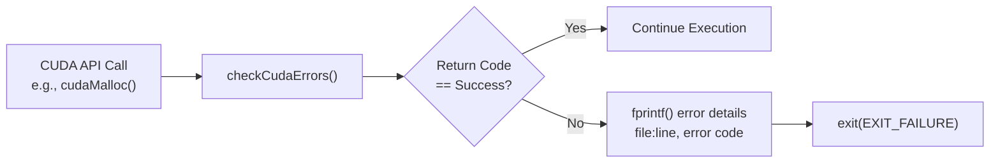

Sources: [CHANGELOG.md:86-97](), [Common/helper_cuda.h:1-989]()

### Build System

The repository uses a three-tier CMake hierarchy. Global settings are defined in the root `CMakeLists.txt`, which targets C++17 and CUDA 17 standards [CMakeLists.txt:9-13]().

**Key Build Configurations:**
- **Architectures:** Targets SM 75, 80, 86, 87, 89, 90, 100, 110, 120 [CMakeLists.txt:15]().
- **Debug Modes:** `ENABLE_CUDA_DEBUG` enables the `-G` flag for `cuda-gdb`; otherwise, `-lineinfo` is used for profiling tools [CMakeLists.txt:17-21]().
- **MSVC Compatibility:** Uses `-Xcompiler=/Zc:preprocessor` to comply with modern CCCL requirements [CMakeLists.txt:26-28]().

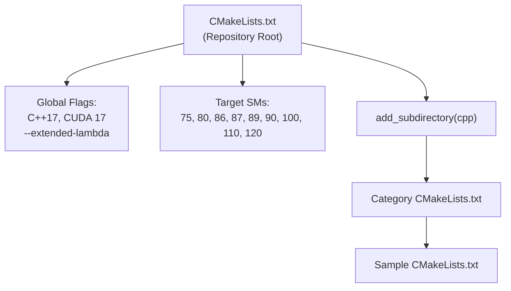

Sources: [CMakeLists.txt:1-34](), [CHANGELOG.md:21]()

### Testing Framework

The `run_tests.py` utility, introduced in CUDA 12.9, exercises all samples by parsing `test_args.json` to determine execution parameters and GPU requirements [CHANGELOG.md:107]().

**Automated Validation Workflow:**
1. **Discovery:** Scans build directories for executables.
2. **Filtering:** Checks `min_gpus` requirement against available hardware.
3. **Execution:** Runs samples with arguments defined in `test_args.json`.
4. **Reporting:** Captures stdout/stderr and validates return codes.

Sources: [CHANGELOG.md:107](), [README.md:107]()

## Prerequisites and Platform Support

**Required Software:**
- **CUDA Toolkit:** 13.3+ [README.md:3]().
- **CMake:** 3.20+ [CMakeLists.txt:1]().
- **Python:** Required for `run_tests.py` and Python samples [CHANGELOG.md:17, 107]().

**Platform Support:**
- **Linux/Windows:** Native support via CMake [README.md:35-71]().
- **Tegra (aarch64):** Specialized samples in Category 8, supporting both Linux and QNX [CHANGELOG.md:73, 103, 106]().
- **Cross-Compilation:** Supported via toolchain files in `cmake/toolchains/` [README.md:98-111]().

**Target GPU Architectures:**
The samples target a range of compute capabilities, from Turing (SM 75) to future architectures (SM 120) [CMakeLists.txt:15](). Specific samples like `graphConditionalNodes` or `cudaNvSci` require specific hardware or software versions [CHANGELOG.md:74-77]().

Sources: [README.md:3-111](), [CMakeLists.txt:1-15](), [CHANGELOG.md:74-77]()

---

# Page: Build System

# Build System

<details>
<summary>Relevant source files</summary>

The following files were used as context for generating this wiki page:

- [CMakeLists.txt](CMakeLists.txt)
- [cmake/CPM.cmake](cmake/CPM.cmake)
- [cmake/InstallSamples.cmake](cmake/InstallSamples.cmake)

</details>


## Purpose and Scope

This document describes the CMake-based build system architecture used across the CUDA Samples repository. It covers the three-tier configuration hierarchy (Root → Category → Sample), build configuration options, platform-specific toolchains, and the installation system. For detailed information about specific build configuration options and CUDA architecture targeting, see [CMake Configuration and Compilation Options](#2.1). For cross-compilation workflows and platform-specific details, see [Platform-Specific Building and Cross-Compilation](#2.2). For information about testing the built samples, see [Testing Infrastructure](#2.3).

## Build System Architecture

The CUDA Samples build system employs a three-tier CMake hierarchy that allows samples to be built either individually or as part of the complete repository. Each tier has distinct responsibilities and configuration scopes.

### Three-Tier Configuration Hierarchy

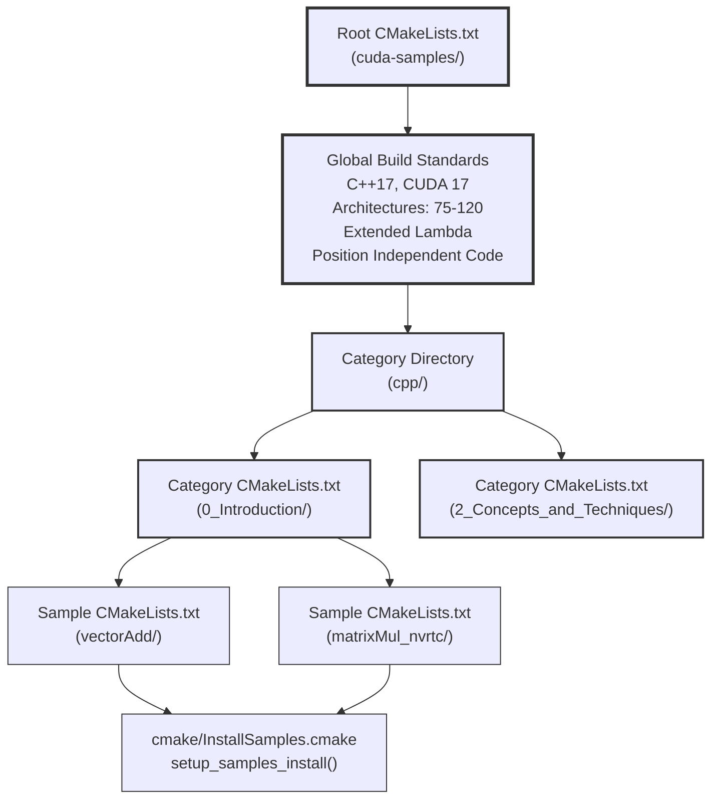

**Sources:** [CMakeLists.txt:1-34](), [cmake/InstallSamples.cmake:1-110]()

### Build Configuration Flow

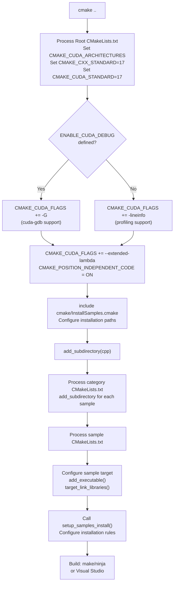

**Sources:** [CMakeLists.txt:1-34](), [cmake/InstallSamples.cmake:18-100]()

## Root Configuration Layer

The root `CMakeLists.txt` establishes global build standards that apply to all samples. It sets the minimum CMake version requirement, defines standard language versions, and configures CUDA-specific compilation flags.

### Global Build Standards

The root configuration establishes the following mandatory settings:

| Setting | Value | Purpose |
|---------|-------|---------|
| `cmake_minimum_required` | 3.20 | Minimum CMake version [CMakeLists.txt:1]() |
| `CMAKE_CXX_STANDARD` | 17 | C++ language standard [CMakeLists.txt:9]() |
| `CMAKE_CUDA_STANDARD` | 17 | CUDA language standard [CMakeLists.txt:12]() |
| `CMAKE_POSITION_INDEPENDENT_CODE` | ON | Enable position-independent code [CMakeLists.txt:7]() |
| `CMAKE_CUDA_ARCHITECTURES` | 75 80 86 87 89 90 100 110 120 | Target GPU architectures [CMakeLists.txt:15]() |

**Sources:** [CMakeLists.txt:1-15]()

### CUDA Compilation Flags

The root configuration sets CUDA compiler flags based on build mode:

**Debug Mode** (when `ENABLE_CUDA_DEBUG` is defined):
- Adds `-G` flag to enable `cuda-gdb` debugging [CMakeLists.txt:18]()
- Note: Significantly affects performance as compiler optimizations are disabled.

**Release Mode** (default):
- Adds `-lineinfo` flag to include line information for profiling tools [CMakeLists.txt:20]()
- Note: `-lineinfo` and `-G` are mutually exclusive.

**Always Applied:**
- `--extended-lambda`: Enables extended lambda expressions in CUDA device code [CMakeLists.txt:23]()
- `-Wno-deprecated-gpu-targets`: Suppresses warnings for older GPU architectures [CMakeLists.txt:16]()
- `/Zc:preprocessor`: MSVC-specific flag for standard-conforming preprocessor (required for CCCL) [CMakeLists.txt:27]()

**Sources:** [CMakeLists.txt:16-29]()

### Architecture Targeting

The build system targets multiple GPU architectures using `CMAKE_CUDA_ARCHITECTURES`:

```cmake
set(CMAKE_CUDA_ARCHITECTURES 75 80 86 87 89 90 100 110 120)
```

This covers:
- **SM 75**: Turing
- **SM 80, 86, 87**: Ampere
- **SM 89**: Ada Lovelace
- **SM 90**: Hopper
- **SM 100, 110, 120**: Blackwell and future architectures.

**Sources:** [CMakeLists.txt:15]()

## Dependency Management

The build system uses `find_package(CUDAToolkit REQUIRED)` at the root to ensure the CUDA development environment is available [CMakeLists.txt:5](). For external dependencies, the project includes `CPM.cmake` (CMake's Missing Package Manager) to manage third-party libraries if needed [cmake/CPM.cmake:1-42]().

## Installation System

The installation system organizes built samples into a structured directory hierarchy based on target architecture, operating system, and build type. This is managed via `cmake/InstallSamples.cmake` [CMakeLists.txt:31]().

### Installation Path Structure

The system constructs the installation path using the following logic:

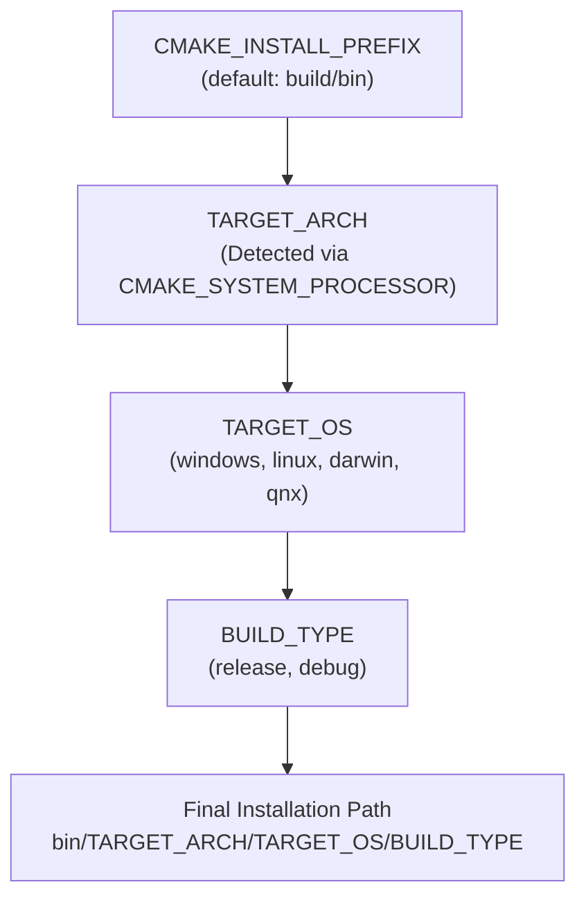

**Sources:** [cmake/InstallSamples.cmake:22-89]()

### Platform Detection

The installation system automatically detects platform characteristics:
- **Architecture**: Detected using `CMAKE_SYSTEM_PROCESSOR` [cmake/InstallSamples.cmake:23]().
- **OS**: Detected via `WIN32`, `APPLE`, or `CMAKE_SYSTEM_NAME` (checking for `QNX`) [cmake/InstallSamples.cmake:27-40]().
- **Build Type**: Handles both single-config and multi-config (Visual Studio/Ninja Multi-Config) generators [cmake/InstallSamples.cmake:42-59]().

### Installation Function: setup_samples_install

The `setup_samples_install()` function is used by individual samples to:
1. Determine the actual install directory [cmake/InstallSamples.cmake:118-129]().
2. Copy executables and shared libraries to a flat root directory [cmake/InstallSamples.cmake:132-135]().
3. Copy data files from the sample's `data/` directory and the shared `Common/data/` directory [cmake/InstallSamples.cmake:137-152]().
4. Filter out build artifacts like `.o`, `.obj`, and `.pdb` files [cmake/InstallSamples.cmake:181-205]().

**Sources:** [cmake/InstallSamples.cmake:114-324]()

## Cross-Compilation Support

The repository provides toolchain files for cross-compiling to Tegra platforms (aarch64).

### QNX Toolchain Configuration

The QNX toolchain (`toolchain-aarch64-qnx.cmake`) configures the environment for the QNX real-time OS:
- Requires `QNX_HOST` and `QNX_TARGET` environment variables [cmake/toolchains/toolchain-aarch64-qnx.cmake:11-12]().
- Sets `qcc` and `q++` as the compilers [cmake/toolchains/toolchain-aarch64-qnx.cmake:24-25]().
- Configures `CMAKE_CUDA_HOST_COMPILER` to use the QNX C++ compiler [cmake/toolchains/toolchain-aarch64-qnx.cmake:31]().

**Sources:** [cmake/toolchains/toolchain-aarch64-qnx.cmake:1-38]()

For detailed workflows on cross-compilation, see [Platform-Specific Building and Cross-Compilation](#2.2).

---

# Page: CMake Configuration and Compilation Options

# CMake Configuration and Compilation Options

<details>
<summary>Relevant source files</summary>

The following files were used as context for generating this wiki page:

- [CMakeLists.txt](CMakeLists.txt)
- [cmake/CPM.cmake](cmake/CPM.cmake)
- [cpp/0_Introduction/CMakeLists.txt](cpp/0_Introduction/CMakeLists.txt)

</details>


The NVIDIA CUDA Samples repository uses CMake to configure build settings, compiler flags, and CUDA architecture targeting. This page details the CMake variables and compilation options used across the repository, including CUDA architecture targeting (SM 75-120), debug modes (`-G` vs `-lineinfo`), and standard settings (C++17, CUDA 17, separable compilation).

## CMake Configuration Hierarchy

The CUDA Samples repository uses a three-tier CMake hierarchy: Root → Category → Sample. Configuration settings flow from the root level down to individual samples.

**CMake Configuration Flow**
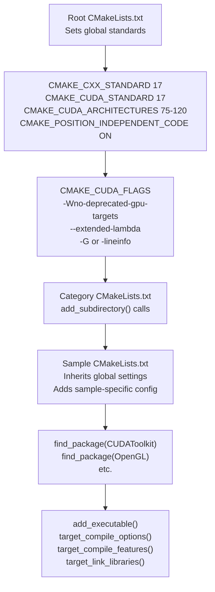

Sources: [CMakeLists.txt:1-33](), [cpp/0_Introduction/CMakeLists.txt:1-47]()

## Root-Level Global Configuration

The root [CMakeLists.txt:1-34]() establishes global build settings that apply to all samples unless overridden.

### Project Definition and Requirements

```cmake
cmake_minimum_required(VERSION 3.20)
project(cuda-samples LANGUAGES C CXX CUDA)
find_package(CUDAToolkit REQUIRED)
```

The repository requires CMake 3.20 or higher and declares support for C, C++, and CUDA languages. The `CUDAToolkit` package is required for all builds.

Sources: [CMakeLists.txt:1-5]()

### Global Compilation Standards

**Language Standards Configuration**
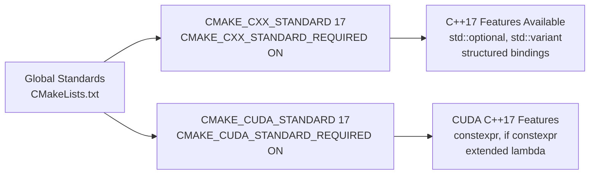

The root configuration sets C++17 and CUDA 17 as the minimum language standards:

```cmake
set(CMAKE_CXX_STANDARD 17)
set(CMAKE_CXX_STANDARD_REQUIRED ON)

set(CMAKE_CUDA_STANDARD 17)
set(CMAKE_CUDA_STANDARD_REQUIRED ON)
```

These settings ensure all samples use consistent modern C++ features and CUDA capabilities.

Sources: [CMakeLists.txt:9-13]()

### Position-Independent Code and MSVC Compatibility

```cmake
set(CMAKE_POSITION_INDEPENDENT_CODE ON)

if(MSVC)
    add_compile_options($<$<COMPILE_LANGUAGE:CUDA>:-Xcompiler=/Zc:preprocessor>)
endif()
```

The `CMAKE_POSITION_INDEPENDENT_CODE` setting enables PIC generation, required for shared libraries and ASLR support. For Windows builds using MSVC, the `-Xcompiler=/Zc:preprocessor` flag is added to ensure a standard-conforming preprocessor, which is a requirement for the CUDA Core Compute Libraries (CCCL).

Sources: [CMakeLists.txt:7-28]()

## CUDA Architecture Targeting

The CMake configuration targets specific CUDA compute capabilities to ensure compatibility with modern GPU architectures.

### Architecture Configuration

```cmake
set(CMAKE_CUDA_ARCHITECTURES 75 80 86 87 89 90 100 110 120)
```

This line in [CMakeLists.txt:15]() sets the target architectures for all samples in the repository, ranging from Turing (SM 75) to future architectures (SM 120).

**Supported CUDA Compute Capabilities**

| Compute Capability | Architecture | GPU Examples |
|-------------------|--------------|--------------|
| 75 | Turing | RTX 20 series, T4 |
| 80 | Ampere | A100 |
| 86 | Ampere | RTX 30 series |
| 87 | Ampere | Jetson Orin |
| 89 | Ada Lovelace | RTX 40 series, L40 |
| 90 | Hopper | H100 |
| 100, 110, 120 | Future | Blackwell and beyond |

### Code Generation Modes

**Architecture Code Generation**
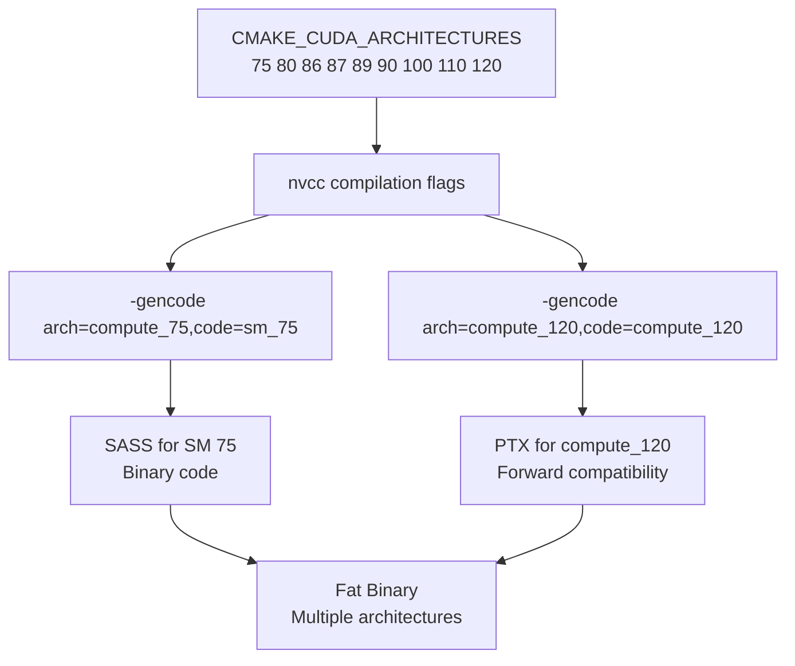

The highest compute capability generates PTX (virtual architecture) code for forward compatibility, allowing the binary to run on future GPU architectures through JIT compilation. The flag `-Wno-deprecated-gpu-targets` is applied globally to suppress warnings about older architectures.

Sources: [CMakeLists.txt:15-16]()

## Debug Mode Configuration

The repository supports two debugging modes controlled by the `ENABLE_CUDA_DEBUG` CMake variable.

### Debug Modes: -G vs -lineinfo

**Debug Mode Selection**
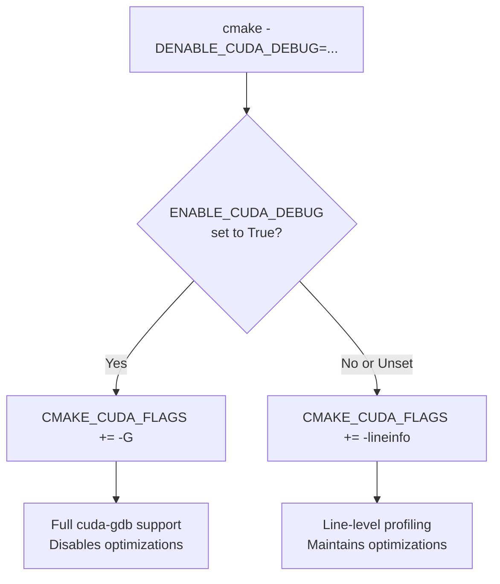

The configuration logic in [CMakeLists.txt:17-21]():

```cmake
if(ENABLE_CUDA_DEBUG)
    set(CMAKE_CUDA_FLAGS "${CMAKE_CUDA_FLAGS} -G")        # enable cuda-gdb
else()
    set(CMAKE_CUDA_FLAGS "${CMAKE_CUDA_FLAGS} -lineinfo") # add line information
endif()
```

- **`-G`**: Enables full symbolic debugging but significantly impacts performance and disables optimizations.
- **`-lineinfo`**: Default mode. Provides line number information for profilers (NSight) and stack traces without sacrificing performance.

Sources: [CMakeLists.txt:17-21]()

## Dependency Management with CPM

The repository includes `cmake/CPM.cmake`, a setup script for **CMake's Missing Package Manager (CPM)**.

**CPM Dependency Workflow**
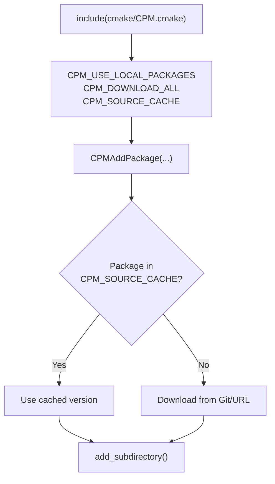

CPM provides a seamless way to manage external C++ dependencies by wrapping `FetchContent`. It supports:
- **Version Control**: Ensuring specific versions of dependencies are used across environments [cmake/CPM.cmake:42]().
- **Caching**: Using `CPM_SOURCE_CACHE` to avoid redundant downloads [cmake/CPM.cmake:163-167]().
- **Local Overrides**: Forcing the use of system packages via `CPM_USE_LOCAL_PACKAGES` [cmake/CPM.cmake:109-113]().

Sources: [cmake/CPM.cmake:1-189]()

## Compilation Flags and Standards

### Extended Lambda Support

```cmake
set(CMAKE_CUDA_FLAGS "${CMAKE_CUDA_FLAGS} --extended-lambda")
```

The `--extended-lambda` flag is enabled globally in [CMakeLists.txt:23](). This is critical for modern CUDA programming as it allows `__device__` lambdas to be defined within host code, facilitating the use of Thrust algorithms and Cooperative Groups.

Sources: [CMakeLists.txt:23]()

### Standard Settings for Samples

Individual samples inherit these settings and typically specify their own language requirements and include paths.

**Sample Compilation Pattern**
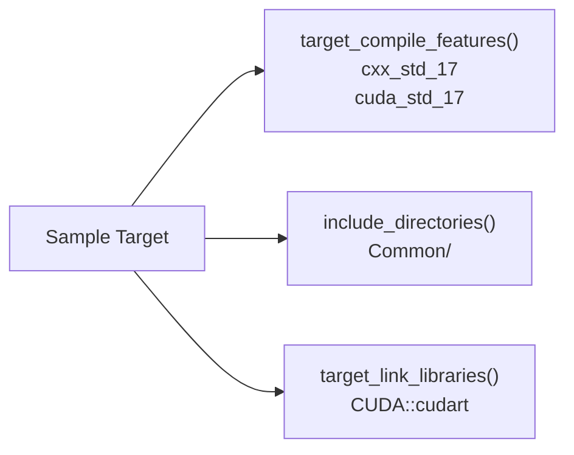

Sources: [cpp/0_Introduction/CMakeLists.txt:1-47](), [CMakeLists.txt:9-13]()

---

# Page: Platform-Specific Building and Cross-Compilation

# Platform-Specific Building and Cross-Compilation

<details>
<summary>Relevant source files</summary>

The following files were used as context for generating this wiki page:

- [cmake/InstallSamples.cmake](cmake/InstallSamples.cmake)
- [cmake/Modules/FindEGL.cmake](cmake/Modules/FindEGL.cmake)
- [cmake/Modules/FindFreeImage.cmake](cmake/Modules/FindFreeImage.cmake)
- [cmake/Modules/FindNVSCI.cmake](cmake/Modules/FindNVSCI.cmake)
- [cmake/toolchains/toolchain-aarch64-linux.cmake](cmake/toolchains/toolchain-aarch64-linux.cmake)
- [cmake/toolchains/toolchain-aarch64-qnx.cmake](cmake/toolchains/toolchain-aarch64-qnx.cmake)

</details>


This document covers the cross-platform build system architecture for the CUDA samples repository, including cross-compilation toolchains, platform-specific build flags, and target architecture support. It focuses on building samples for embedded platforms like Tegra, QNX, and automotive Linux environments, as well as the standardized installation pathing used for binary distribution.

For general CMake configuration and helper utilities, see [2.1. CMake Configuration and Compilation Options](). For automated testing across platforms, see [2.3. Testing Infrastructure]().

## Supported Platforms and Target Architectures

The CUDA samples repository supports multiple host and target platform combinations through CMake toolchains and platform-specific build configurations. The system automatically detects the architecture and OS to determine installation paths.

### Platform Support Matrix

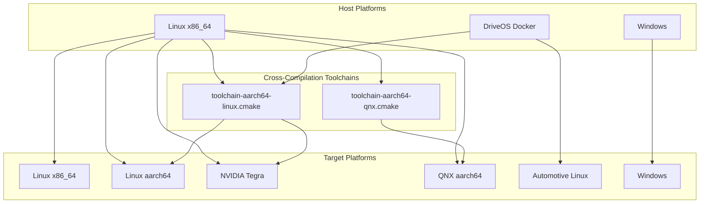

Sources: [cmake/toolchains/toolchain-aarch64-linux.cmake:1-2](), [cmake/toolchains/toolchain-aarch64-qnx.cmake:1-2](), [cmake/InstallSamples.cmake:22-40]()

## Installation Paths and Platform Detection

The build system organizes output binaries into a structured hierarchy based on the target environment. This ensures that cross-compiled binaries for different architectures do not collide.

### Detection Logic
The module `cmake/InstallSamples.cmake` performs the following detection:
1.  **Architecture**: Uses `CMAKE_SYSTEM_PROCESSOR` (e.g., `x86_64`, `aarch64`) [cmake/InstallSamples.cmake:22-25]().
2.  **OS**: Detects `windows`, `darwin`, `qnx`, or `linux` based on CMake system variables [cmake/InstallSamples.cmake:27-40]().
3.  **Build Type**: Handles both single-config (e.g., Make) and multi-config (e.g., Ninja Multi-Config, Visual Studio) generators [cmake/InstallSamples.cmake:42-59]().

### Standard Installation Structure
The default installation path follows the pattern:
`bin/${TARGET_ARCH}/${TARGET_OS}/${BUILD_TYPE}` [cmake/InstallSamples.cmake:9-13]().

| Variable | Description | Source |
| :--- | :--- | :--- |
| `TARGET_ARCH` | Target CPU architecture (lowercase) | [cmake/InstallSamples.cmake:24]() |
| `TARGET_OS` | Target operating system | [cmake/InstallSamples.cmake:40]() |
| `BUILD_TYPE_EXPR` | `release` or `debug` (evaluated at install time for multi-config) | [cmake/InstallSamples.cmake:89]() |

Sources: [cmake/InstallSamples.cmake:1-110]()

## Cross-Compilation Toolchain Architecture

The repository provides CMake toolchain files that configure cross-compilation for different target architectures and operating systems.

### Toolchain Configuration Flow

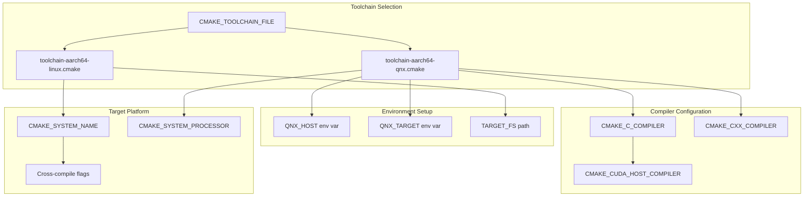

Sources: [cmake/toolchains/toolchain-aarch64-qnx.cmake:1-38](), [cmake/toolchains/toolchain-aarch64-linux.cmake:1-14]()

## Tegra and aarch64 Linux Cross-Compilation

Cross-compilation for NVIDIA Tegra devices and aarch64 Linux systems uses the `toolchain-aarch64-linux.cmake` toolchain file. A critical parameter is `TARGET_FS`, which points to the local copy of the target's root filesystem.

### Key Implementation Details
- **Sysroot**: The toolchain sets `CMAKE_SYSROOT` to `TARGET_FS` [cmake/toolchains/toolchain-aarch64-linux.cmake:24]().
- **CUDA Target Detection**: It automatically checks for `aarch64-linux` vs `sbsa-linux` targets within the CUDA toolkit [cmake/toolchains/toolchain-aarch64-linux.cmake:19-22]().
- **Library Paths**: It adds `rpath-link` flags for `/usr/lib/aarch64-linux-gnu` and `/usr/lib/aarch64-linux-gnu/nvidia` to ensure the linker finds dependencies within the sysroot [cmake/toolchains/toolchain-aarch64-linux.cmake:35-44]().
- **NVVM Pathing**: It resolves the real path of `nvcc` on the target filesystem to set `LIBNVVM_HOME` correctly for samples requiring runtime compilation [cmake/toolchains/toolchain-aarch64-linux.cmake:47-67]().

Sources: [cmake/toolchains/toolchain-aarch64-linux.cmake:1-69]()

## QNX Cross-Compilation

QNX cross-compilation requires the QNX Software Development Platform (SDP) and uses the `toolchain-aarch64-qnx.cmake` toolchain file.

### QNX Toolchain Configuration

The toolchain relies on `QNX_HOST` and `QNX_TARGET` environment variables to locate the `qcc` and `q++` compilers [cmake/toolchains/toolchain-aarch64-qnx.cmake:4-16]().

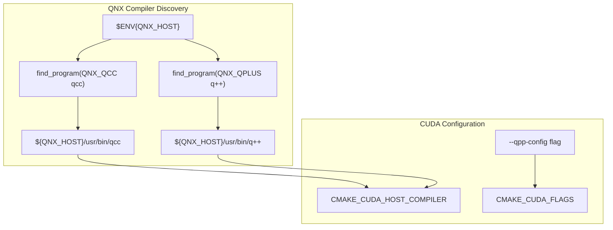

- **Compiler Flags**: The toolchain forces the use of `qcc` for CUDA host compilation [cmake/toolchains/toolchain-aarch64-qnx.cmake:26]().
- **QNX Source**: Defines `-D_QNX_SOURCE` for both CXX and CUDA flags to enable QNX-specific headers [cmake/toolchains/toolchain-aarch64-qnx.cmake:36-37]().

Sources: [cmake/toolchains/toolchain-aarch64-qnx.cmake:1-38]()

## Platform Dependency Discovery (Modules)

The build system includes custom CMake modules to find platform-specific libraries required for Tegra and advanced samples.

| Module | Purpose | Key Variables |
| :--- | :--- | :--- |
| `FindNVSCI.cmake` | Finds NvSciBuf and NvSciSync libraries for Tegra interop | `NVSCI_LIBRARIES`, `NVSCI_INCLUDE_DIRS` |
| `FindEGL.cmake` | Finds EGL headers/libraries for Tegra graphics output | `EGL_LIBRARIES`, `EGL_INCLUDE_DIRS` |
| `FindFreeImage.cmake` | Finds FreeImage for samples requiring image I/O | `FreeImage_LIBRARIES` |

Sources: [cmake/Modules/FindNVSCI.cmake:1-61](), [cmake/Modules/FindEGL.cmake:1-17](), [cmake/Modules/FindFreeImage.cmake:1-17]()

## Installation Logic for Samples

The `setup_samples_install` function in `cmake/InstallSamples.cmake` handles the deployment of built artifacts.

1.  **Executables**: Copied to a flat root directory within the versioned path (e.g., `bin/aarch64/linux/release/`) [cmake/InstallSamples.cmake:12-13]().
2.  **Data Files**: Preserves relative paths for `.ll`, `.ptx`, and `.fatbin` files by searching in `${CMAKE_CURRENT_SOURCE_DIR}/data` and `Common/data` [cmake/InstallSamples.cmake:136-152]().
3.  **Dynamic Resolution**: The installation script dynamically resolves `INSTALL_DIR` at install-time using `CMAKE_INSTALL_CONFIG_NAME` for multi-config generators [cmake/InstallSamples.cmake:117-129]().

Sources: [cmake/InstallSamples.cmake:112-160]()

---

# Page: Testing Infrastructure

# Testing Infrastructure

<details>
<summary>Relevant source files</summary>

The following files were used as context for generating this wiki page:

- [.gitignore](.gitignore)
- [.pre-commit-config.yaml](.pre-commit-config.yaml)
- [CMakeLists.txt](CMakeLists.txt)

</details>


The testing infrastructure provides an automated framework for running and validating all CUDA samples in the repository. This system discovers built executables, applies sample-specific configurations, executes tests in parallel, and reports results. The infrastructure handles GPU requirements, timeout management, and output capture to ensure reliable testing across different hardware configurations.

For information about building the samples that this testing system validates, see [Build System](). For details about the individual sample categories being tested, see [Overview]().

## Test Runner Architecture

The testing system centers around the `run_tests.py` script, which orchestrates the entire testing process from executable discovery through result reporting.

### Test Execution Workflow

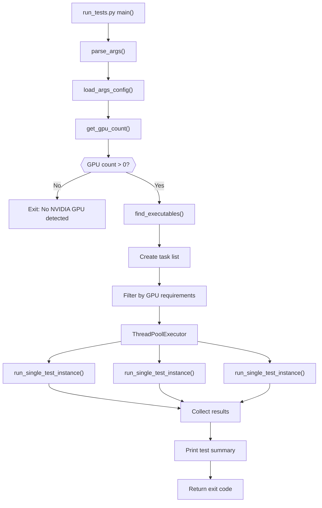

**Sources:** `run_tests.py` [run_tests.py:165-307]()

### Core Functions and Components

The test runner implements several key functions that handle different aspects of the testing process:

| Function | Purpose | Key Responsibilities |
|----------|---------|---------------------|
| `find_executables()` | Executable Discovery | Recursively searches for executable files, excludes libraries |
| `get_gpu_count()` | Hardware Detection | Uses `nvidia-smi` and `CUDA_VISIBLE_DEVICES` to detect GPU count |
| `load_args_config()` | Configuration Loading | Parses `test_args.json` and validates format |
| `run_single_test_instance()` | Test Execution | Runs individual test with timeout, captures output |
| `normalize_exe_name()` | Name Processing | Normalizes executable names across platforms |

**Sources:** `run_tests.py` [run_tests.py:46-124](), [run_tests.py:126-163]()

## Configuration System

The testing infrastructure uses `test_args.json` to configure how individual samples are executed, including arguments, skip conditions, and GPU requirements.

### Configuration Structure

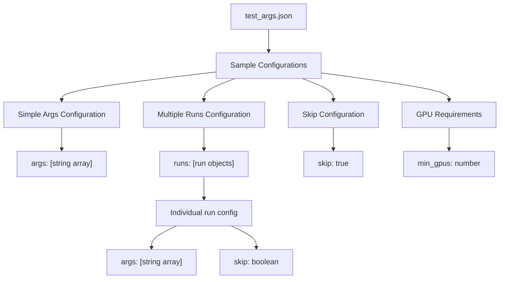

**Sources:** `test_args.json` [test_args.json:1-347]()

### Configuration Examples

The configuration system supports multiple patterns for different testing scenarios:

**Simple Arguments:**
```json
"simpleTexture3D": {
    "args": ["--file=ref_texture3D.bin"]
}
```

**Multiple Test Runs:**
```json
"recursiveGaussian": {
    "runs": [
        {"args": ["-sigma=10", "-file=data/ref_10.ppm"]},
        {"args": ["-sigma=14", "-file=data/ref_14.ppm"]}
    ]
}
```

**GPU Requirements:**
```json
"simpleP2P": {
    "min_gpus": 2
}
```

**Skip Configuration:**
```json
"simpleCUDA2GL": {
    "skip": true
}
```

**Sources:** `test_args.json` [test_args.json:2-9](), [test_args.json:28-54](), [test_args.json:329-331](), [test_args.json:2-4]()

## GPU Detection and Hardware Requirements

The testing system includes sophisticated GPU detection to ensure samples only run on appropriate hardware configurations.

### GPU Detection Logic

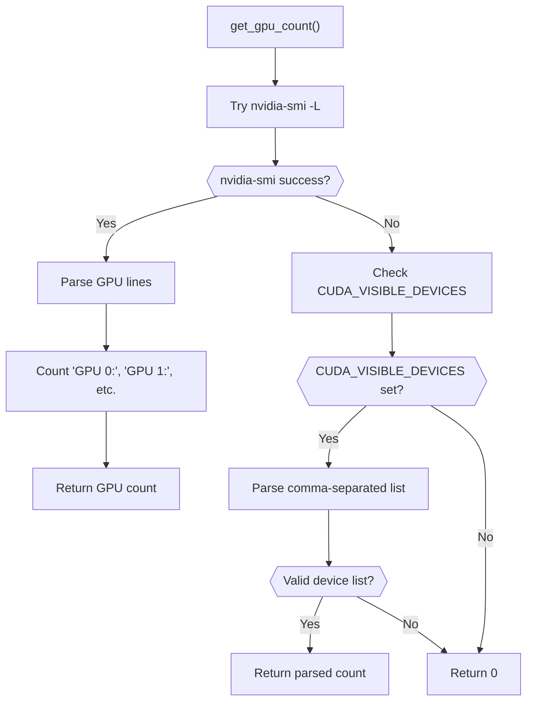

**Sources:** `run_tests.py` [run_tests.py:126-163]()

### Multi-GPU Sample Filtering

The system automatically filters samples based on GPU requirements to prevent execution failures:

| Sample | GPU Requirement | Purpose |
|--------|----------------|---------|
| `simpleP2P` | 2 GPUs | Peer-to-peer memory access |
| `conjugateGradientMultiDeviceCG` | 2 GPUs | Multi-device conjugate gradient |
| `simpleCUFFT_MGPU` | 2 GPUs | Multi-GPU FFT operations |
| `EGLStream_CUDA_CrossGPU` | 2 GPUs | Cross-GPU EGL stream |

**Sources:** `test_args.json` [test_args.json:329-346]()

## Parallel Execution System

The testing infrastructure implements thread-safe parallel execution to efficiently run multiple samples simultaneously.

### Parallel Execution Architecture

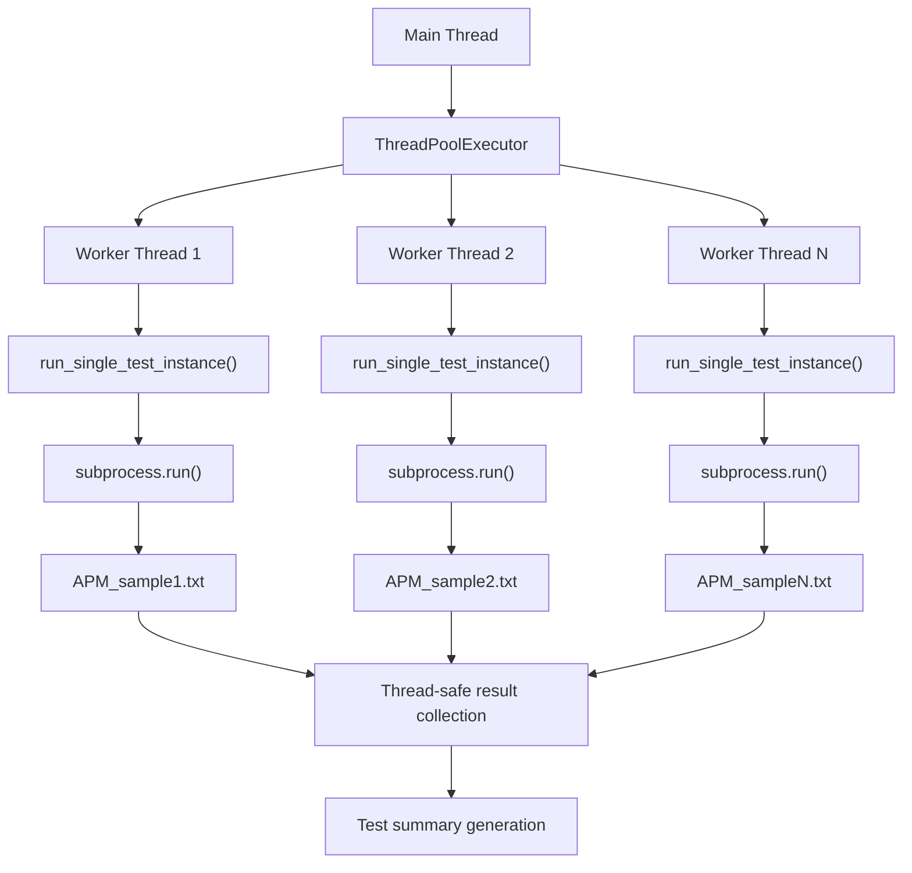

**Sources:** `run_tests.py` [run_tests.py:264-290]()

### Thread Safety Implementation

The system implements thread safety through several mechanisms:

```python
print_lock = threading.Lock()

def safe_print(*args, **kwargs):
    """Thread-safe print function"""
    with print_lock:
        print(*args, **kwargs)
```

**Sources:** `run_tests.py` [run_tests.py:39-44]()

## Test Execution and Output Management

Each test instance runs in isolation with comprehensive error handling and output capture.

### Test Instance Execution Flow

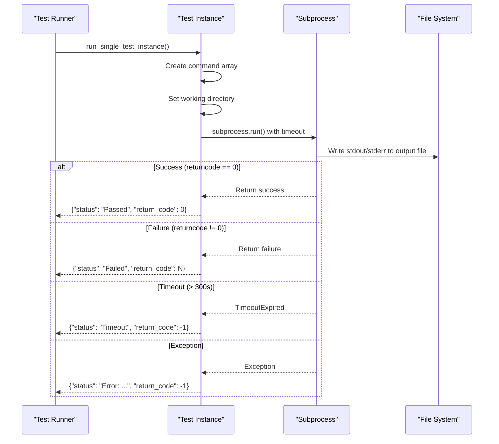

**Sources:** `run_tests.py` [run_tests.py:90-124]()

### Output File Naming Convention

The system generates structured output files for each test execution:

| File Pattern | Description | Example |
|-------------|-------------|---------|
| `APM_{executable}.txt` | Single run output | `APM_vectorAdd.txt` |
| `APM_{executable}.run{N}.txt` | Multiple runs output | `APM_recursiveGaussian.run1.txt` |

**Sources:** `run_tests.py` [run_tests.py:247-250]()

## CTest Integration for libNVVM Samples

The libNVVM samples (category 7) use CMake's CTest framework in addition to `run_tests.py` for specialized testing requirements. This dual-system approach handles compilation workflows with fixture dependencies.

### CTest Fixture Architecture

CTest fixtures establish execution order dependencies between tests. The libNVVM samples use this to ensure compilation utilities are available before dependent tests run.

Fixture Dependency Pattern for libNVVM Tests:

```mermaid
graph TB
    ptxgen["ptxgen executable"] --> ptxgenTest["ptxgenTest (FIXTURES_SETUP)"]
    
    ptxgenTest --> syscalls_malloc["test-syscalls-malloc-free"]
    ptxgenTest --> syscalls_vprintf["test-syscalls-vprintf"]
    ptxgenTest --> shared_mem["test-cuda-shared-memory-shared_memory"]
    ptxgenTest --> extern_shared["test-cuda-shared-memory-extern_shared_memory"]
    
    syscalls_malloc --> syscalls_ll1["syscalls/malloc-free.ll"]
    syscalls_vprintf --> syscalls_ll2["syscalls/vprintf.ll"]
    shared_mem --> shared_ll1["shared_memory.ll"]
    extern_shared --> shared_ll2["extern_shared_memory.ll"]
    
    style ptxgenTest fill:#f9f9f9
```

**Sources:** `Samples/7_libNVVM/ptxgen/CMakeLists.txt` [Samples/7_libNVVM/ptxgen/CMakeLists.txt:29-32](), `Samples/7_libNVVM/syscalls/CMakeLists.txt` [Samples/7_libNVVM/syscalls/CMakeLists.txt:28-37](), `Samples/7_libNVVM/cuda-shared-memory/CMakeLists.txt` [Samples/7_libNVVM/cuda-shared-memory/CMakeLists.txt:30-40]()

### CTest Configuration in CMakeLists.txt

The libNVVM samples configure CTest fixtures through CMake properties:

**Fixture Setup (`ptxgen`):**
```cmake
add_test(NAME ptxgenTest
   COMMAND ptxgen "${CMAKE_CURRENT_SOURCE_DIR}/test.ll"
   WORKING_DIRECTORY "${CMAKE_CURRENT_BINARY_DIR}")
set_tests_properties(ptxgenTest PROPERTIES FIXTURES_SETUP PTXGENTEST)
```

**Fixture Requirements (dependent tests):**
```cmake
add_test(NAME test-syscalls-malloc-free
    COMMAND "${CMAKE_CURRENT_BINARY_DIR}/../ptxgen/ptxgen" "${CMAKE_CURRENT_SOURCE_DIR}/malloc-free.ll"
    WORKING_DIRECTORY "${CMAKE_CURRENT_BINARY_DIR}")

set_tests_properties(test-syscalls-malloc-free test-syscalls-vprintf
                     PROPERTIES FIXTURES_REQUIRED PTXGENTEST)
```

**Sources:** `Samples/7_libNVVM/ptxgen/CMakeLists.txt` [Samples/7_libNVVM/ptxgen/CMakeLists.txt:29-32](), `Samples/7_libNVVM/syscalls/CMakeLists.txt` [Samples/7_libNVVM/syscalls/CMakeLists.txt:28-37]()

### CTest Execution Model

```mermaid
sequenceDiagram
    participant User as "Developer"
    participant CTest as "CTest Runner"
    participant ptxgen as "ptxgen Test"
    participant syscalls as "Syscalls Tests"
    participant cuda_shared as "CUDA Shared Memory Tests"
    
    User->>CTest: ctest
    CTest->>CTest: Analyze fixture dependencies
    CTest->>ptxgen: Run ptxgenTest (FIXTURES_SETUP)
    
    alt ptxgen succeeds
        ptxgen-->>CTest: Success
        CTest->>syscalls: Run test-syscalls-malloc-free
        CTest->>syscalls: Run test-syscalls-vprintf
        CTest->>cuda_shared: Run test-cuda-shared-memory-shared_memory
        CTest->>cuda_shared: Run test-cuda-shared-memory-extern_shared_memory
        syscalls-->>CTest: Results
        cuda_shared-->>CTest: Results
    else ptxgen fails
        ptxgen-->>CTest: Failure
        CTest->>CTest: Skip dependent tests
    end
    
    CTest-->>User: Test summary
```

**Sources:** `Samples/7_libNVVM/CMakeLists.txt` [Samples/7_libNVVM/CMakeLists.txt:30](), `Samples/7_libNVVM/ptxgen/CMakeLists.txt` [Samples/7_libNVVM/ptxgen/CMakeLists.txt:29-32]()

### Relationship Between run_tests.py and CTest

The testing infrastructure provides two complementary testing approaches:

| Testing System | Scope | Execution Method | Configuration |
|---------------|-------|------------------|---------------|
| `run_tests.py` | All samples across categories 0-8 | Python-based parallel execution | `test_args.json` |
| CTest | libNVVM samples (category 7) | CMake test framework with fixtures | `CMakeLists.txt` files |

Both systems validate sample functionality but serve different purposes:
- `run_tests.py` provides uniform testing across all sample categories with flexible configuration.
- CTest enables build-time testing and fixture-based dependency management for compilation workflows.

**Sources:** `run_tests.py` [run_tests.py:1-307](), `Samples/7_libNVVM/CMakeLists.txt` [Samples/7_libNVVM/CMakeLists.txt:1-145]()

## Command Line Interface

The test runner provides a flexible command-line interface for different testing scenarios:

### Available Command Line Options

| Option | Default | Description |
|--------|---------|-------------|
| `--dir` | `.` | Root directory to search for executables |
| `--config` | None | JSON configuration file path |
| `--output` | `.` | Output directory for test results |
| `--parallel` | `1` | Number of parallel tests to run |
| `--args` | None | Global arguments passed to all executables |

**Sources:** `run_tests.py` [run_tests.py:166-174]()

### Usage Examples

```bash
# Basic execution
python run_tests.py

# Custom configuration and output
python run_tests.py --config test_args.json --output test_results

# Parallel execution with global arguments
python run_tests.py --parallel 4 --args --device=0

# Search specific directory
python run_tests.py --dir build/Samples --parallel 8
```

**Sources:** `run_tests.py` [run_tests.py:165-174]()

---

# Page: Common Utilities and Helper Functions

# Common Utilities and Helper Functions

<details>
<summary>Relevant source files</summary>

The following files were used as context for generating this wiki page:

- [Common/helper_cuda.h](Common/helper_cuda.h)
- [Common/helper_cuda_drvapi.h](Common/helper_cuda_drvapi.h)
- [Common/helper_functions.h](Common/helper_functions.h)
- [Common/helper_math.h](Common/helper_math.h)
- [Common/helper_string.h](Common/helper_string.h)
- [Common/helper_timer.h](Common/helper_timer.h)

</details>


The `Common/` directory provides a comprehensive set of utility libraries and helper functions used across all CUDA samples. These utilities abstract common CUDA operations, error handling, device management, and inter-process communication, significantly reducing code duplication and improving sample readability.

For information about the build system that compiles these utilities with samples, see [Build System](#2). For details on how samples use these utilities in specific contexts, see individual category pages such as [Introduction Samples (Category 0)](#4) or [Advanced CUDA Features (Category 3)](#5).

## Overview of Common Utilities Architecture

The Common utilities are organized into distinct header files, each targeting a specific CUDA API level or functionality domain. Most headers are header-only implementations, included directly by samples via `#include` statements.

### Common Utilities Organization

```mermaid
graph TB
    subgraph "Common Directory Structure"
        CommonDir["Common/"]
        
        CommonDir --> RuntimeAPI["helper_cuda.h<br/>Runtime API Helpers"]
        CommonDir --> DriverAPI["helper_cuda_drvapi.h<br/>Driver API Helpers"]
        CommonDir --> IPC["helper_multiprocess.h/.cpp<br/>IPC & Process Management"]
        CommonDir --> MathHelpers["helper_math.h<br/>Vector Math Operators"]
        CommonDir --> StringHelpers["helper_string.h<br/>String & CmdLine Parsing"]
        CommonDir --> TimerHelpers["helper_timer.h<br/>StopWatch Performance Timers"]
        CommonDir --> GeneralHelpers["helper_functions.h<br/>Aggregate Header"]
    end
    
    subgraph "Functionality Domains"
        RuntimeAPI --> ErrorHandling["Error Checking & Translation<br/>checkCudaErrors macro<br/>_cudaGetErrorEnum functions"]
        RuntimeAPI --> DeviceMgmt["Device Management<br/>gpuDeviceInit<br/>gpuGetMaxGflopsDeviceId"]
        
        DriverAPI --> DriverError["Driver API Error Checking<br/>checkCudaErrors for CUresult"]
        DriverAPI --> FatbinUtils["Fatbin Loading<br/>findFatbinPath"]
        
        IPC --> SharedMem["Shared Memory<br/>sharedMemoryCreate<br/>sharedMemoryOpen"]
        IPC --> IPCSockets["IPC Sockets<br/>ipcSendShareableHandles"]
        
        MathHelpers --> VecOps["float3/float4 operators<br/>dot, cross, length, normalize"]
    end
    
    style CommonDir fill:#f9f9f9,stroke:#333,stroke-width:2px
    style RuntimeAPI fill:#e1f5ff,stroke:#333,stroke-width:2px
    style DriverAPI fill:#fff4e1,stroke:#333,stroke-width:2px
    style IPC fill:#e8f5e9,stroke:#333,stroke-width:2px
```

**Sources:** [Common/helper_cuda.h:29-32](), [Common/helper_cuda_drvapi.h:28-31](), [Common/helper_multiprocess.h:28-31](), [Common/helper_math.h:28-40](), [Common/helper_timer.h:28-30](), [Common/helper_functions.h:28-31]()

## Runtime API Helpers (helper_cuda.h)

The `helper_cuda.h` header provides high-level abstractions for CUDA Runtime API operations, focusing on error handling, device management, and error string translation across multiple CUDA libraries.

### Error Checking and Translation
The `checkCudaErrors` macro is the primary mechanism for validating API return codes. It utilizes overloaded `_cudaGetErrorEnum` functions to translate library-specific status codes into human-readable strings for the following libraries:
*   **CUDA Runtime & Driver**: `cudaError_t` and `CUresult` [Common/helper_cuda.h:52-66]().
*   **cuBLAS**: `cublasStatus_t` [Common/helper_cuda.h:68-105]().
*   **cuFFT**: `cufftResult`, including new CUDA 13.0+ errors like `CUFFT_NVJITLINK_FAILURE` [Common/helper_cuda.h:107-168]().
*   **cuSPARSE & cuSOLVER**: `cusparseStatus_t` and `cusolverStatus_t` [Common/helper_cuda.h:170-230]().
*   **NPP & nvJPEG**: `NppStatus` and `nvjpegStatus_t` [Common/helper_cuda.h:265-583]().

### Device Management
Functions like `findCudaDevice(int argc, const char **argv)` parse command-line arguments (e.g., `-device=N`) to initialize a specific GPU or automatically select the highest-performance device via `gpuGetMaxGflopsDeviceId()` [Common/helper_cuda.h:809-941]().

For details, see [Runtime API Helpers (helper_cuda.h)](#3.1).

## Driver API Helpers (helper_cuda_drvapi.h)

The `helper_cuda_drvapi.h` header provides parallel functionality to `helper_cuda.h` but for the CUDA Driver API (`cuda.h`).

### Driver API Error Checking
It defines an inline version of `__checkCudaErrors` specifically for `CUresult` types, using `cuGetErrorString` to retrieve error descriptions [Common/helper_cuda_drvapi.h:65-80]().

### SM-to-Cores Mapping
The function `_ConvertSMVer2CoresDRV` maps Streaming Multiprocessor (SM) versions to CUDA core counts. It supports architectures from Kepler (SM 3.0) to Blackwell (SM 12.x) [Common/helper_cuda_drvapi.h:91-143]().

For details, see [Driver API Helpers (helper_cuda_drvapi.h)](#3.2).

## Multi-Process and IPC Utilities

The `helper_multiprocess.h` and `helper_multiprocess.cpp` files provide cross-platform abstractions for inter-process communication and shared memory management.

### Shared Memory and Process Spawning
*   **Shared Memory**: Abstracted via `sharedMemoryCreate` and `sharedMemoryOpen`, using `shm_open` on Unix and `CreateFileMapping` on Windows [Common/helper_multiprocess.cpp:32-119]().
*   **Process Management**: `spawnProcess` and `waitProcess` provide a unified interface for `fork/exec` (Unix) and `CreateProcess` (Windows) [Common/helper_multiprocess.cpp:121-169]().

### IPC Sockets
The library implements `ipcSendShareableHandles` and `ipcRecvShareableHandles` to exchange CUDA memory handles between processes. It uses Unix Domain Sockets with `SCM_RIGHTS` on Linux/QNX and Mailslots with `DuplicateHandle` on Windows [Common/helper_multiprocess.cpp:171-560]().

For details, see [Multi-Process and IPC Utilities](#3.3).

## Graphics, Math, and NPP Utility Headers

Additional headers in `Common/` provide specialized support for graphics interoperability, mathematical operations, and image processing.

### Mathematical Utilities
*   **helper_math.h**: Implements common mathematical operations (dot, cross, length, lerp) for CUDA vector types like `float3` and `float4`, modeled after the Cg standard library [Common/helper_math.h:28-37]().
*   **nvMath.h / nvMatrix.h**: Provide more complex matrix and quaternion math for graphics-heavy samples.

### Performance and String Utilities
*   **helper_timer.h**: Defines the `StopWatchInterface` and platform-specific implementations (`StopWatchWin`, `StopWatchLinux`) for high-precision performance measurement [Common/helper_timer.h:44-155]().
*   **helper_string.h**: Contains string parsing utilities like `checkCmdLineFlag` and `getCmdLineArgumentInt` used by almost every sample to process user input [Common/helper_string.h:127-210]().

For details, see [Graphics and NPP Utility Headers](#3.4).

**Sources:** [Common/helper_math.h:28-37](), [Common/helper_timer.h:44-155](), [Common/helper_string.h:127-210](), [Common/helper_functions.h:51-53]()

---

# Page: Runtime API Helpers (helper_cuda.h)

# Runtime API Helpers (helper_cuda.h)

<details>
<summary>Relevant source files</summary>

The following files were used as context for generating this wiki page:

- [Common/helper_cuda.h](Common/helper_cuda.h)
- [Common/helper_functions.h](Common/helper_functions.h)
- [Common/helper_image.h](Common/helper_image.h)
- [Common/helper_math.h](Common/helper_math.h)
- [Common/helper_string.h](Common/helper_string.h)
- [Common/helper_timer.h](Common/helper_timer.h)

</details>


## Purpose and Scope

This document describes the Runtime API helper utilities provided by [Common/helper_cuda.h:1-988](). These helpers provide high-level abstractions for CUDA Runtime API operations, including comprehensive error checking, device initialization, and error string translation across multiple CUDA libraries. This header is used by most samples in the repository that utilize the CUDA Runtime API.

For Driver API equivalents, see **3.2 Driver API Helpers (helper_cuda_drvapi.h)**. For multi-process and IPC utilities, see **3.3 Multi-Process and IPC Utilities**.

## Overview

The `helper_cuda.h` header provides three primary categories of functionality:

| Category | Key Functions/Macros | Purpose |
|----------|---------------------|---------|
| **Error Handling** | `checkCudaErrors`, `getLastCudaError`, `printLastCudaError` | Automatic error checking with file/line reporting. |
| **Device Management** | `gpuDeviceInit`, `findCudaDevice`, `gpuGetMaxGflopsDeviceId` | Device initialization and selection. |
| **Error Translation** | `_cudaGetErrorEnum` (overloaded) | Convert error codes to human-readable strings. |
| **SM Utilities** | `_ConvertSMVer2Cores`, `_ConvertSMVer2ArchName` | Map SM versions to cores/architecture names. |

**Sources:** [Common/helper_cuda.h:28-32](), [Common/helper_cuda.h:586-633]()

## Error Handling System

### Error Checking Macros

The header defines three primary macros for error handling. These macros bridge the gap between CUDA API return codes and human-readable diagnostic output.

**Diagram: Error Handling Macro Flow**

```mermaid
graph TB
    UserCode["User Code:<br/>checkCudaErrors(cudaMalloc(...))"]
    CheckMacro["checkCudaErrors macro<br/>[helper_cuda.h:598]"]
    CheckFunc["check&lt;T&gt; template function<br/>[helper_cuda.h:586-593]"]
    GetErrorEnum["_cudaGetErrorEnum<br/>(overloaded for error type)"]
    Success["Return to caller"]
    Failure["fprintf error to stderr<br/>exit(EXIT_FAILURE)"]
    
    UserCode --> CheckMacro
    CheckMacro --> CheckFunc
    CheckFunc --> GetErrorEnum
    GetErrorEnum --> CheckFunc
    CheckFunc -->|"result != 0"| Failure
    CheckFunc -->|"result == 0"| Success
```

**Sources:** [Common/helper_cuda.h:586-598]()

#### checkCudaErrors
Defined at [Common/helper_cuda.h:598](), this macro wraps any CUDA Runtime API call and automatically checks the return value. It captures the function call as a string using stringification (`#val`) and passes the file and line number for error reporting.

#### getLastCudaError
Defined at [Common/helper_cuda.h:601](), this macro checks for asynchronous errors after kernel launches by calling `cudaGetLastError()`. This is critical since kernel launches return `void` and do not provide immediate error codes.

#### printLastCudaError
Defined at [Common/helper_cuda.h:619](), this is a non-fatal variant that prints errors to `stderr` but does not exit the application, allowing for recovery or logging.

**Sources:** [Common/helper_cuda.h:595-633]()

## Error String Translation

The header provides overloaded `_cudaGetErrorEnum` functions to translate error codes from multiple CUDA libraries into human-readable strings. Each library has conditional compilation based on its specific header guard.

**Diagram: Error String Translation Architecture**

```mermaid
graph TB
    subgraph "Library Error Sources"
        RuntimeErr["cudaError_t<br/>[helper_cuda.h:53]"]
        DriverErr["CUresult<br/>[helper_cuda.h:60]"]
        BlasErr["cublasStatus_t<br/>[helper_cuda.h:70]"]
        FFTErr["cufftResult<br/>[helper_cuda.h:109]"]
        SparseErr["cusparseStatus_t<br/>[helper_cuda.h:172]"]
        SolverErr["cusolverStatus_t<br/>[helper_cuda.h:208]"]
        RandErr["curandStatus_t<br/>[helper_cuda.h:242]"]
        JPEGErr["nvjpegStatus_t<br/>[helper_cuda.h:290]"]
        NPPErr["NppStatus<br/>[helper_cuda.h:326]"]
    end
    
    subgraph "Translation Layer"
        Overloads["_cudaGetErrorEnum Overloads"]
    end
    
    RuntimeErr --> Overloads
    DriverErr --> Overloads
    BlasErr --> Overloads
    FFTErr --> Overloads
    SparseErr --> Overloads
    SolverErr --> Overloads
    RandErr --> Overloads
    JPEGErr --> Overloads
    NPPErr --> Overloads
    
    Overloads --> CheckFunc["check&lt;T&gt; template<br/>[helper_cuda.h:586]"]
```

**Sources:** [Common/helper_cuda.h:52-583]()

### Library Error Code Coverage

| Library | Header Guard | Error Type | Lines | Translation Method |
|---------|-------------|------------|-------|--------------------|
| **CUDA Runtime** | `__DRIVER_TYPES_H__` | `cudaError_t` | 53-55 | `cudaGetErrorName()` |
| **CUDA Driver** | `CUDA_DRIVER_API` | `CUresult` | 60-65 | `cuGetErrorName()` |
| **cuBLAS** | `CUBLAS_API_H_` | `cublasStatus_t` | 70-104 | Switch statement |
| **cuFFT** | `_CUFFT_H_` | `cufftResult` | 109-167 | Switch statement |
| **cuSPARSE** | `CUSPARSEAPI` | `cusparseStatus_t` | 172-203 | Switch statement |
| **cuSOLVER** | `CUSOLVER_COMMON_H_` | `cusolverStatus_t` | 208-237 | Switch statement |
| **cuRAND** | `CURAND_H_` | `curandStatus_t` | 242-285 | Switch statement |
| **nvJPEG** | `NVJPEGAPI` | `nvjpegStatus_t` | 290-321 | Switch statement |
| **NPP** | `NV_NPPIDEFS_H` | `NppStatus` | 326-582 | Extensive switch |

**Sources:** [Common/helper_cuda.h:52-583]()

## Device Management Functions

The header provides functions for GPU device initialization and selection based on command-line arguments or performance metrics.

**Diagram: Device Selection and Initialization Flow**

```mermaid
graph TB
    Start["Application Start"]
    FindCuda["findCudaDevice(argc, argv)<br/>[helper_cuda.h:882]"]
    CmdLine{"Command line<br/>--device=N?"}
    GpuDevInit["gpuDeviceInit(devID)<br/>[helper_cuda.h:759]"]
    MaxGflops["gpuGetMaxGflopsDeviceId()<br/>[helper_cuda.h:809]"]
    
    CheckCount{"Device count<br/>&gt; 0?"}
    CheckMode{"Compute mode<br/>prohibited?"}
    CheckCap{"Compute capability<br/>&gt;= 1.0?"}
    
    SetDevice["cudaSetDevice(devID)"]
    Success["Return device ID"]
    Fail["exit(EXIT_FAILURE)"]
    
    Start --> FindCuda
    FindCuda --> CmdLine
    CmdLine -->|"Yes"| GpuDevInit
    CmdLine -->|"No"| MaxGflops
    
    GpuDevInit --> CheckCount
    MaxGflops --> CheckCount
    CheckCount -->|"No"| Fail
    CheckCount -->|"Yes"| CheckMode
    CheckMode -->|"Yes"| Fail
    CheckMode -->|"No"| CheckCap
    CheckCap -->|"No"| Fail
    CheckCap -->|"Yes"| SetDevice
    SetDevice --> Success
```

**Sources:** [Common/helper_cuda.h:757-913]()

### Key Functions

*   **`gpuDeviceInit(int devID)`**: Validates the device count, checks if the compute mode is prohibited, and ensures compute capability is at least 1.0 before calling `cudaSetDevice(devID)` [Common/helper_cuda.h:759-806]().
*   **`gpuGetMaxGflopsDeviceId()`**: Iterates through all available devices and selects the one with the highest theoretical GFLOPS based on `multiProcessorCount * sm_per_multiproc * clockRate` [Common/helper_cuda.h:809-879]().
*   **`findCudaDevice(int argc, const char **argv)`**: The primary entry point for samples. It parses `--device=N` using `checkCmdLineFlag` from `helper_string.h` [Common/helper_string.h:127-151](). If no flag is present, it defaults to the highest performance device [Common/helper_cuda.h:882-913]().

**Sources:** [Common/helper_cuda.h:759-913](), [Common/helper_string.h:127-151]()

## SM Version Utility Functions

These utilities map hardware compute capability (major/minor version) to architecture names and physical core counts.

### _ConvertSMVer2Cores
Maps SM versions to core counts per SM. For example, SM 8.0 (Ampere) has 64 cores per SM, while SM 8.6/8.9 (Ampere/Ada) has 128 [Common/helper_cuda.h:646-699]().

### _ConvertSMVer2ArchName
Maps SM versions to marketing names (e.g., SM 9.0 is "Hopper", SM 7.5 is "Turing") [Common/helper_cuda.h:701-754]().

**Sources:** [Common/helper_cuda.h:646-754]()

## Image and Math Helpers

While `helper_cuda.h` focuses on the API, other headers in the `Common/` directory provide domain-specific support:

*   **`helper_image.h`**: Provides `sdkLoadPGM` and `__loadPPM` for reading image data into buffers [Common/helper_image.h:136-214]().
*   **`helper_math.h`**: Implements standard math operations for CUDA vector types (`float2`, `float3`, `make_float4`, etc.) which are not provided by the default CUDA headers [Common/helper_math.h:88-252]().
*   **`helper_timer.h`**: Defines the `StopWatchInterface` and `StopWatchWin`/`StopWatchLinux` classes for high-resolution performance measurement [Common/helper_timer.h:44-155]().

**Sources:** [Common/helper_image.h:136-214](), [Common/helper_math.h:88-252](), [Common/helper_timer.h:44-155]()

---

# Page: Driver API Helpers (helper_cuda_drvapi.h)

# Driver API Helpers (helper_cuda_drvapi.h)

<details>
<summary>Relevant source files</summary>

The following files were used as context for generating this wiki page:

- [Common/drvapi_error_string.h](Common/drvapi_error_string.h)
- [Common/helper_cuda_drvapi.h](Common/helper_cuda_drvapi.h)
- [Common/helper_cusolver.h](Common/helper_cusolver.h)
- [Common/nvrtc_helper.h](Common/nvrtc_helper.h)

</details>


## Purpose and Scope

This document describes the CUDA Driver API helper utilities provided in [Common/helper_cuda_drvapi.h](). These helpers provide low-level device management, error checking, and module loading functions for applications using the CUDA Driver API (`cuda.h`) rather than the CUDA Runtime API. For Runtime API equivalents, see [Runtime API Helpers (helper_cuda.h)](#3.1).

## Overview

The Driver API helpers provide parallel functionality to the Runtime API helpers but operate on Driver API types (`CUresult`, `CUdevice`, `CUcontext`, `CUmodule`) rather than Runtime API types (`cudaError_t`, device integers). These helpers are essential for samples using explicit Driver API control, including samples that use JIT compilation, dynamic loading, or require fine-grained context management.

### Comparison with Runtime API Helpers

```mermaid
graph TB
    subgraph "Application Layer"
        App["CUDA Application"]
    end
    
    subgraph "Helper Layer"
        RuntimeHelpers["helper_cuda.h<br/>Runtime API Helpers"]
        DriverHelpers["helper_cuda_drvapi.h<br/>Driver API Helpers"]
    end
    
    subgraph "CUDA Layer"
        RuntimeAPI["CUDA Runtime API<br/>cudart library<br/>cudaError_t, cudaMalloc, etc."]
        DriverAPI["CUDA Driver API<br/>cuda library<br/>CUresult, cuMemAlloc, etc."]
    end
    
    App --> RuntimeHelpers
    App --> DriverHelpers
    RuntimeHelpers --> RuntimeAPI
    DriverHelpers --> DriverAPI
    RuntimeAPI -.uses internally.-> DriverAPI
    
    RuntimeHelpers -.parallel functions.-> DriverHelpers
```

**Key Equivalents:**

| Runtime API Helper | Driver API Helper | Primary Type |
|-------------------|-------------------|--------------|
| `gpuDeviceInit()` | `gpuDeviceInitDRV()` | `int` vs `CUdevice` |
| `gpuGetMaxGflopsDeviceId()` | `gpuGetMaxGflopsDeviceIdDRV()` | `int` vs `CUdevice` |
| `findCudaDevice()` | `findCudaDeviceDRV()` | `int` vs `CUdevice` |
| `checkCudaErrors(cudaError_t)` | `checkCudaErrors(CUresult)` | Error enum types |
| `_ConvertSMVer2Cores()` | `_ConvertSMVer2CoresDRV()` | Same algorithm |

**Sources:** [Common/helper_cuda_drvapi.h:46-88](), [Common/helper_cuda_drvapi.h:91-143]()

## Error Handling

### checkCudaErrors Macro

The `checkCudaErrors` macro provides automatic error checking for all Driver API calls with file and line information. It is guarded by `#ifdef __cuda_cuda_h__` to ensure it is only used when the Driver API is available [Common/helper_cuda_drvapi.h:62]().

```mermaid
graph LR
    DriverCall["Driver API Call<br/>e.g., cuMemAlloc"]
    Macro["checkCudaErrors()"]
    Check{"CUresult ==<br/>CUDA_SUCCESS?"}
    Success["Continue Execution"]
    Error["cuGetErrorString()"]
    Print["fprintf stderr"]
    Exit["exit(EXIT_FAILURE)"]
    
    DriverCall --> Macro
    Macro --> Check
    Check -->|Yes| Success
    Check -->|No| Error
    Error --> Print
    Print --> Exit
```

**Implementation:**
[Common/helper_cuda_drvapi.h:65-79]() defines the core error checking function:

```cpp
#define checkCudaErrors(err) __checkCudaErrors(err, __FILE__, __LINE__)

inline void __checkCudaErrors(CUresult err, const char *file, const int line) {
  if (CUDA_SUCCESS != err) {
    const char *errorStr = NULL;
    cuGetErrorString(err, &errorStr);
    fprintf(stderr,
            "checkCudaErrors() Driver API error = %04d \"%s\" from file <%s>, "
            "line %i.\n",
            err, errorStr, file, line);
    exit(EXIT_FAILURE);
  }
}
```

For manual error string lookup, the library also provides `drvapi_error_string.h`, which contains a comprehensive mapping of `CUresult` codes to strings, such as `CUDA_ERROR_OUT_OF_MEMORY` [Common/drvapi_error_string.h:64]().

**Sources:** [Common/helper_cuda_drvapi.h:65-79](), [Common/drvapi_error_string.h:46-203]()

## Device Initialization and Selection

### gpuDeviceInitDRV Function

[Common/helper_cuda_drvapi.h:148-197]() initializes a specific CUDA device using the Driver API. It parses command line arguments to allow users to target specific GPUs.

**Key Operations:**
1. **Initialize Driver**: Calls `cuInit(0)` [Common/helper_cuda_drvapi.h:151]().
2. **Count Devices**: Calls `cuDeviceGetCount(&deviceCount)` [Common/helper_cuda_drvapi.h:153]().
3. **Parse Arguments**: Searches for `device=` in command line using `getCmdLineArgumentInt` [Common/helper_cuda_drvapi.h:161]().
4. **Retrieve Handle**: Obtains the `CUdevice` handle via `cuDeviceGet(&cuDevice, dev)` [Common/helper_cuda_drvapi.h:178]().
5. **Verify Mode**: Checks if the device is in `CU_COMPUTEMODE_PROHIBITED` [Common/helper_cuda_drvapi.h:185]().

**Sources:** [Common/helper_cuda_drvapi.h:148-197]()

### gpuGetMaxGflopsDeviceIdDRV Function

[Common/helper_cuda_drvapi.h:200-269]() selects the highest-performance device based on GFLOPS computation.

**Performance Calculation Logic:**
The function queries device attributes using `cuDeviceGetAttribute` for `CU_DEVICE_ATTRIBUTE_MULTIPROCESSOR_COUNT` and `CU_DEVICE_ATTRIBUTE_CLOCK_RATE` [Common/helper_cuda_drvapi.h:208-209](). It then calculates theoretical performance:
`compute_perf = multiProcessorCount * cores_per_sm * clockRate`.

**Sources:** [Common/helper_cuda_drvapi.h:200-269]()

## Architecture and Core Counting

### SM Version to Cores Conversion

The `_ConvertSMVer2CoresDRV()` function maps GPU architecture (SM version) to CUDA core counts per streaming multiprocessor (SM).

[Common/helper_cuda_drvapi.h:91-143]() defines the mapping table:

| SM Version (Hex) | Architecture | Cores per SM |
|------------------|--------------|--------------|
| 0x30-0x37        | Kepler       | 192          |
| 0x50-0x53        | Maxwell      | 128          |
| 0x60             | Pascal GP100 | 64           |
| 0x61-0x62        | Pascal       | 128          |
| 0x70, 0x72, 0x75 | Volta/Turing | 64           |
| 0x80             | Ampere A100  | 64           |
| 0x86-0x90        | Ampere/Hopper| 128          |
| 0xa0-0xc1        | Blackwell    | 128          |

**Sources:** [Common/helper_cuda_drvapi.h:91-143]()

### getCudaAttribute Template

[Common/helper_cuda_drvapi.h:83-87]() provides a type-safe wrapper for device attribute queries:

```cpp
template <class T>
inline void getCudaAttribute(T *attribute, CUdevice_attribute device_attribute,
                             int device) {
  checkCudaErrors(cuDeviceGetAttribute(attribute, device_attribute, device));
}
```

**Sources:** [Common/helper_cuda_drvapi.h:83-87]()

## Fatbin and Module Loading

### NVRTC Compilation Helpers

For samples using Just-In-Time (JIT) compilation, `nvrtc_helper.h` provides utilities to compile `.cu` source files into CUBIN format at runtime.

```mermaid
graph TD
    Start["compileFileToCUBIN()"]
    Read["Read .cu source file"]
    Find["findCudaDeviceDRV()"]
    Attr["Query SM Major/Minor"]
    Options["Set --gpu-architecture=sm_XY"]
    NVRTC_C["nvrtcCreateProgram()"]
    NVRTC_K["nvrtcCompileProgram()"]
    GetCUBIN["nvrtcGetCUBIN()"]
    Module["loadCUBIN()"]
    Ctx["cuCtxCreate()"]
    Load["cuModuleLoadData()"]
    
    Start --> Read
    Read --> Find
    Find --> Attr
    Attr --> Options
    Options --> NVRTC_C
    NVRTC_C --> NVRTC_K
    NVRTC_K --> GetCUBIN
    GetCUBIN --> Module
    Module --> Ctx
    Ctx --> Load
```

**Key Functions:**
- `compileFileToCUBIN`: Reads a file, determines the current GPU's architecture, and invokes `nvrtcCompileProgram` with the correct `sm_` flag [Common/nvrtc_helper.h:50-183]().
- `loadCUBIN`: Creates a CUDA context if none exists and loads the compiled CUBIN data into a `CUmodule` using `cuModuleLoadData` [Common/nvrtc_helper.h:185-217]().

**Sources:** [Common/nvrtc_helper.h:50-217]()

### findFatbinPath Utility

[Common/helper_cuda_drvapi.h:379-409]() locates and loads pre-compiled fatbin or PTX files from the SDK file system.

**Behavior:**
1. Searches for the file using `sdkFindFilePath` [Common/helper_cuda_drvapi.h:383]().
2. If the file is a `.fatbin`, it reads the binary content into a `std::ostringstream` [Common/helper_cuda_drvapi.h:395-401]().
3. Returns the path and the loaded content for use with `cuModuleLoadData`.

**Sources:** [Common/helper_cuda_drvapi.h:379-409]()

## Mathematical and Library Helpers

### cusolver and CSR Helpers

The `helper_cusolver.h` header provides utility functions for matrix norm calculations and display, often used in conjunction with the Driver API in linear algebra samples.

**Implementation Highlights:**
- `vec_norminf`: Calculates the infinity norm of a vector [Common/helper_cusolver.h:49-56]().
- `mat_norminf`: Calculates the infinity norm of a dense matrix [Common/helper_cusolver.h:61-72]().
- `csr_mat_norminf`: Calculates the infinity norm for a Compressed Sparse Row (CSR) matrix [Common/helper_cusolver.h:77-96]().
- `second()`: A high-resolution timer implementation for performance benchmarking on Windows, Linux, and macOS [Common/helper_cusolver.h:122-164]().

**Sources:** [Common/helper_cusolver.h:49-164]()

---

# Page: Multi-Process and IPC Utilities

# Multi-Process and IPC Utilities

<details>
<summary>Relevant source files</summary>

The following files were used as context for generating this wiki page:

- [Common/helper_multiprocess.cpp](Common/helper_multiprocess.cpp)
- [Common/helper_multiprocess.h](Common/helper_multiprocess.h)
- [Common/multithreading.cpp](Common/multithreading.cpp)
- [Common/multithreading.h](Common/multithreading.h)

</details>


## Purpose and Scope

This page documents the cross-platform inter-process communication (IPC) utilities provided by [Common/helper_multiprocess.h:1-141]() and [Common/helper_multiprocess.cpp:1-561](). These utilities abstract platform differences between Windows and Unix-like systems (Linux, QNX) to enable multi-process CUDA applications.

The helper_multiprocess system provides three core capabilities:
1. **Shared memory** creation and access for CPU-side coordination between processes.
2. **IPC socket communication** for transferring CUDA shareable handles (file descriptors on Unix, NT `HANDLE`s on Windows) between processes.
3. **Process spawning and synchronization** for launching and managing child processes.

For multithreaded (single-process) coordination, the repository also provides a portable thread library in [Common/multithreading.h:1-77]() and [Common/multithreading.cpp:1-79]().

---

## Architecture Overview

### System Components and Data Flow

```mermaid
graph TB
    subgraph "Application Layer"
        Parent["Parent Process"]
        Child1["Child Process 1"]
        Child2["Child Process N"]
    end
    
    subgraph "helper_multiprocess API"
        ShmAPI["Shared Memory API<br/>sharedMemoryCreate/Open/Close"]
        IpcAPI["IPC Socket API<br/>ipcCreateSocket/OpenSocket<br/>ipcSendShareableHandles"]
        ProcAPI["Process API<br/>spawnProcess<br/>waitProcess"]
    end
    
    subgraph "Platform Abstraction Layer"
        WindowsImpl["Windows Implementation<br/>CreateFileMapping<br/>Mailslots<br/>DuplicateHandle"]
        UnixImpl["Unix Implementation<br/>shm_open/mmap<br/>Unix Domain Sockets<br/>SCM_RIGHTS"]
    end
    
    subgraph "OS Kernel"
        WinKernel["Windows Kernel<br/>Shared Sections<br/>NT Handles"]
        UnixKernel["Unix Kernel<br/>POSIX Shared Memory<br/>File Descriptors"]
    end
    
    Parent --> ShmAPI
    Parent --> IpcAPI
    Parent --> ProcAPI
    
    Child1 --> ShmAPI
    Child1 --> IpcAPI
    Child2 --> ShmAPI
    Child2 --> IpcAPI
    
    ShmAPI --> WindowsImpl
    ShmAPI --> UnixImpl
    IpcAPI --> WindowsImpl
    IpcAPI --> UnixImpl
    ProcAPI --> WindowsImpl
    ProcAPI --> UnixImpl
    
    WindowsImpl --> WinKernel
    UnixImpl --> UnixKernel
```

**Sources:** [Common/helper_multiprocess.h:1-141](), [Common/helper_multiprocess.cpp:1-170]()

---

## Core Data Structures

### Shared Memory and IPC Handles

The `sharedMemoryInfo` structure and `ipcHandle` type store platform-specific identifiers for shared resources:

```mermaid
classDiagram
    class sharedMemoryInfo {
        +void* addr
        +size_t size
        +HANDLE shmHandle (Windows)
        +int shmFd (Unix)
    }
    
    class Process {
        <<typedef>>
        Windows: PROCESS_INFORMATION
        Unix: pid_t
    }
    
    class ipcHandle_st {
        +int socket (Unix)
        +char* socketName (Unix)
        +vector~HANDLE~ hMailslot (Windows)
    }
    
    class ShareableHandle {
        <<typedef>>
        Unix: int (file descriptor)
        Windows: HANDLE
    }
    
    sharedMemoryInfo --> Process : coordinates via
    ipcHandle_st --> ShareableHandle : transfers
```

| Structure | Platform | Purpose |
|-----------|----------|---------|
| `sharedMemoryInfo` | Cross-platform | Stores mapped address, size, and platform handle [Common/helper_multiprocess.h:78-86]() |
| `Process` | Windows: `PROCESS_INFORMATION`<br/>Unix: `pid_t` | Represents spawned process [Common/helper_multiprocess.h:95-99]() |
| `ipcHandle` | Cross-platform | Socket/mailslot handle for IPC communication [Common/helper_multiprocess.h:109-121]() |
| `ShareableHandle` | Windows: `HANDLE`<br/>Unix: `int` | Transferable CUDA memory handle [Common/helper_multiprocess.h:113-118]() |

**Sources:** [Common/helper_multiprocess.h:78-141]()

---

## Shared Memory API

### Function Signatures and Platform Mappings

```mermaid
graph LR
    subgraph "Public API"
        Create["sharedMemoryCreate(name, size, info)"]
        Open["sharedMemoryOpen(name, size, info)"]
        Close["sharedMemoryClose(info)"]
    end
    
    subgraph "Windows Implementation"
        WinCreate["CreateFileMapping<br/>MapViewOfFile"]
        WinOpen["OpenFileMapping<br/>MapViewOfFile"]
        WinClose["UnmapViewOfFile<br/>CloseHandle"]
    end
    
    subgraph "Unix Implementation"
        UnixCreate["shm_open O_CREAT<br/>ftruncate<br/>mmap"]
        UnixOpen["shm_open O_RDWR<br/>mmap"]
        UnixClose["munmap<br/>close"]
    end
    
    Create --> WinCreate
    Create --> UnixCreate
    Open --> WinOpen
    Open --> UnixOpen
    Close --> WinClose
    Close --> UnixClose
```

### API Details

| Function | Parameters | Windows Implementation | Unix Implementation |
|----------|-----------|----------------------|-------------------|
| `sharedMemoryCreate` | `name`, `sz`, `info*` | [Common/helper_multiprocess.cpp:35-41]() `CreateFileMapping` + `MapViewOfFile` | [Common/helper_multiprocess.cpp:52-62]() `shm_open` + `ftruncate` + `mmap` |
| `sharedMemoryOpen` | `name`, `sz`, `info*` | [Common/helper_multiprocess.cpp:75-80]() `OpenFileMapping` + `MapViewOfFile` | [Common/helper_multiprocess.cpp:89-94]() `shm_open` + `mmap` |
| `sharedMemoryClose` | `info*` | [Common/helper_multiprocess.cpp:104-110]() `UnmapViewOfFile` + `CloseHandle` | [Common/helper_multiprocess.cpp:112-117]() `munmap` + `close` |

**Sources:** [Common/helper_multiprocess.cpp:32-119]()

---

## IPC Socket Communication

### Socket Creation and Handle Transfer Flow

```mermaid
sequenceDiagram
    participant Parent
    participant HelperAPI as helper_multiprocess
    participant Child as Child Process
    
    Note over Parent: Allocate CUDA memory<br/>Get ShareableHandles
    
    Parent->>HelperAPI: ipcCreateSocket(handle, name, processes)
    Note over HelperAPI,Parent: Creates mailslots (Win)<br/>or Unix sockets
    
    Child->>HelperAPI: ipcOpenSocket(handle)
    
    Parent->>HelperAPI: ipcSendShareableHandles(handles, processes)
    Note over HelperAPI: DuplicateHandle (Win)<br/>or sendmsg+SCM_RIGHTS (Unix)
    
    HelperAPI-->>Child: File descriptor / HANDLE
    
    Child->>HelperAPI: ipcRecvShareableHandles(handle, &handles)
    
    Note over Child: Import handles into CUDA
```

### Platform-Specific Implementations

#### Unix: Unix Domain Sockets with SCM_RIGHTS
Unix implementations use datagram sockets (`SOCK_DGRAM`) in the `AF_UNIX` domain.

| Function | Implementation Details | Lines |
|----------|----------------------|-------|
| `ipcCreateSocket` | Creates socket, binds to path in temp directory, unlinks existing path | [Common/helper_multiprocess.cpp:172-214]() |
| `ipcOpenSocket` | Creates client socket, binds to unique path using `getpid()` | [Common/helper_multiprocess.cpp:216-245]() |
| `getSocketFolder` | QNX: `/storage`, Linux: `$TMPDIR` or `/tmp` | [Common/helper_multiprocess.h:58-76]() |

#### Windows: Mailslots and Handle Duplication
Windows uses Mailslots for data transfer and `DuplicateHandle` for resource sharing.

| Function | Implementation Details | Lines |
|----------|----------------------|-------|
| `ipcCreateSocket` | Prepares a vector of `HANDLE`s for mailslots | [Common/helper_multiprocess.h:116]() |
| `ipcSendShareableHandles` | Uses `DuplicateHandle` to clone the resource handle into the child process's handle table | [Common/helper_multiprocess.h:136]() |

**Sources:** [Common/helper_multiprocess.h:58-141](), [Common/helper_multiprocess.cpp:172-245]()

---

## Process and Thread Management

### Process Spawning

The `spawnProcess` and `waitProcess` functions abstract the platform-specific process lifecycle.

| Function | Windows Implementation | Unix Implementation |
|----------|----------------------|-------------------|
| `spawnProcess` | [Common/helper_multiprocess.cpp:123-138]() `CreateProcess` with concatenated argument string | [Common/helper_multiprocess.cpp:140-148]() `fork()` followed by `execvp()` |
| `waitProcess` | [Common/helper_multiprocess.cpp:153-159]() `WaitForSingleObject` + `GetExitCodeProcess` | [Common/helper_multiprocess.cpp:161-168]() `waitpid()` loop until `WIFEXITED` |

### Multithreading Utility

A simple portable thread library is provided in `multithreading.h` for intra-process concurrency.

| Function | Windows Implementation | POSIX Implementation |
|----------|----------------------|----------------------|
| `cutStartThread` | [Common/multithreading.cpp:32-34]() `CreateThread` | [Common/multithreading.cpp:59-63]() `pthread_create` |
| `cutEndThread` | [Common/multithreading.cpp:37-40]() `WaitForSingleObject` + `CloseHandle` | [Common/multithreading.cpp:66]() `pthread_join` |
| `cutDestroyThread` | [Common/multithreading.cpp:43-46]() `TerminateThread` | [Common/multithreading.cpp:69]() `pthread_cancel` |

**Sources:** [Common/helper_multiprocess.cpp:121-169](), [Common/multithreading.cpp:1-79](), [Common/multithreading.h:35-76]()

---

## Error Handling

The library uses the `checkIpcErrors` macro to handle failures in IPC calls.

```cpp
#define checkIpcErrors(ipcFuncResult) \
    if (ipcFuncResult == -1) { fprintf(stderr, "Failure at %u %s\n", __LINE__, __FILE__); exit(EXIT_FAILURE); }
```

**Sources:** [Common/helper_multiprocess.h:105-106]()

---

# Page: Graphics and NPP Utility Headers

# Graphics and NPP Utility Headers

<details>
<summary>Relevant source files</summary>

The following files were used as context for generating this wiki page:

- [Common/UtilNPP/Exceptions.h](Common/UtilNPP/Exceptions.h)
- [Common/UtilNPP/Image.h](Common/UtilNPP/Image.h)
- [Common/UtilNPP/ImageAllocatorsCPU.h](Common/UtilNPP/ImageAllocatorsCPU.h)
- [Common/UtilNPP/ImageAllocatorsNPP.h](Common/UtilNPP/ImageAllocatorsNPP.h)
- [Common/UtilNPP/ImageIO.h](Common/UtilNPP/ImageIO.h)
- [Common/UtilNPP/ImagePacked.h](Common/UtilNPP/ImagePacked.h)
- [Common/UtilNPP/ImagesCPU.h](Common/UtilNPP/ImagesCPU.h)
- [Common/UtilNPP/ImagesNPP.h](Common/UtilNPP/ImagesNPP.h)
- [Common/UtilNPP/Pixel.h](Common/UtilNPP/Pixel.h)
- [Common/UtilNPP/Signal.h](Common/UtilNPP/Signal.h)
- [Common/UtilNPP/SignalAllocatorsCPU.h](Common/UtilNPP/SignalAllocatorsCPU.h)
- [Common/UtilNPP/SignalAllocatorsNPP.h](Common/UtilNPP/SignalAllocatorsNPP.h)
- [Common/UtilNPP/SignalsCPU.h](Common/UtilNPP/SignalsCPU.h)
- [Common/UtilNPP/SignalsNPP.h](Common/UtilNPP/SignalsNPP.h)
- [Common/dynlink_d3d11.h](Common/dynlink_d3d11.h)
- [Common/exception.h](Common/exception.h)
- [Common/helper_gl.h](Common/helper_gl.h)
- [Common/helper_nvJPEG.hxx](Common/helper_nvJPEG.hxx)
- [Common/nvMath.h](Common/nvMath.h)
- [Common/nvMatrix.h](Common/nvMatrix.h)
- [Common/nvQuaternion.h](Common/nvQuaternion.h)
- [Common/nvShaderUtils.h](Common/nvShaderUtils.h)
- [Common/nvVector.h](Common/nvVector.h)
- [Common/param.h](Common/param.h)
- [Common/paramgl.h](Common/paramgl.h)
- [Common/rendercheck_d3d11.cpp](Common/rendercheck_d3d11.cpp)
- [Common/rendercheck_d3d11.h](Common/rendercheck_d3d11.h)
- [Common/rendercheck_gl.h](Common/rendercheck_gl.h)
- [Common/rendercheck_gles.h](Common/rendercheck_gles.h)

</details>


This page documents the shared utility headers and helper libraries provided in the `Common/` directory for graphics API interoperability (OpenGL, D3D11), NVIDIA Performance Primitives (NPP) wrappers, mathematical operations, and shader management. These utilities abstract platform-specific complexities and provide common data structures used across the CUDA Samples repository.

## NPP Utility Library (UtilNPP)

The `UtilNPP` directory provides a C++ object-oriented wrapper around the NVIDIA Performance Primitives (NPP) library. It simplifies memory management, image/signal I/O, and provides type-safe abstractions for NPP data types.

### Image and Signal Abstractions
The library uses a template-based architecture to handle different data types (e.g., `Npp8u`, `Npp32f`) and channel counts.

*   **`npp::Image`**: A base class providing dimensions (`width`, `height`) and `Size` structures [Common/UtilNPP/Image.h:36-138]().
*   **`npp::ImagePacked`**: Inherits from `Image`, adding a pixel array and pitch management. It uses an allocator policy `A` to handle memory [Common/UtilNPP/ImagePacked.h:36-166]().
*   **`npp::Pixel`**: A template structure representing 1, 2, 3, or 4-channel pixels with `operator[]` access [Common/UtilNPP/Pixel.h:34-124]().
*   **`npp::Signal`**: A 1D equivalent of the image class for signal processing [Common/UtilNPP/Signal.h:36-78]().

### Memory Management and Allocators
Memory allocation is decoupled from data structures via allocator classes, allowing the same image class to represent both CPU-side and GPU-side data.

| Allocator Class | Target | Implementation Details |
| :--- | :--- | :--- |
| `ImageAllocatorCPU` | Host | Uses `new[]` and `delete[]` for 2D memory [Common/UtilNPP/ImageAllocatorsCPU.h:37-76](). |
| `ImageAllocator` | Device | Specializations use `nppiMalloc_<type>_C<N>` for padded memory or `cudaMalloc` for "tight" memory [Common/UtilNPP/ImageAllocatorsNPP.h:52-200](). |
| `SignalAllocatorCPU`| Host | Simple 1D `new[]` allocation [Common/UtilNPP/SignalAllocatorsCPU.h:38-62](). |
| `SignalAllocator` | Device | Specializations use `nppsMalloc_<type>` [Common/UtilNPP/SignalAllocatorsNPP.h:42-100](). |

### NPP Data Flow Diagram
The following diagram illustrates how the NPP utility wrappers bridge the gap between high-level C++ objects and the underlying NPP/CUDA C APIs.

**NPP Utility Architecture**
```mermaid
graph TD
    subgraph "High-Level Space (C++)"
        A["npp::ImageCPU_8u_C3"]
        B["npp::ImageNPP_8u_C3"]
        C["npp::SignalNPP_32f"]
    end

    subgraph "Abstraction Layer"
        A --> D["npp::ImagePacked"]
        B --> D
        D --> E["npp::ImageAllocator"]
        D --> F["npp::ImageAllocatorCPU"]
    end

    subgraph "Code Entity Space (C API)"
        E -- "calls" --> G["nppiMalloc_8u_C3"]
        F -- "calls" --> H["new[] / malloc"]
        C -- "calls" --> I["nppsMalloc_32f"]
    end

    B -- "copyTo" --> A
    A -- "copyFrom" --> B
```
**Sources:** [Common/UtilNPP/ImagesNPP.h:43-146](), [Common/UtilNPP/ImagesCPU.h:42-95](), [Common/UtilNPP/ImageAllocatorsNPP.h:177-198]().

### Error Handling
The NPP utilities use a custom exception hierarchy. The `NPP_ASSERT` macro throws `npp::Exception` objects containing the failed condition, filename, and line number [Common/UtilNPP/Exceptions.h:47-147]().

**Sources:** [Common/UtilNPP/Image.h](), [Common/UtilNPP/ImagePacked.h](), [Common/UtilNPP/ImageAllocatorsNPP.h](), [Common/UtilNPP/Exceptions.h](), [Common/UtilNPP/Signal.h]().

---

## Graphics Helper Utilities

These headers provide boilerplate for initializing graphics contexts and verifying rendering results against reference images.

### OpenGL Utilities
*   **`helper_gl.h`**: Provides `SDKGLGetControlPoints`, extensions checking, and basic GL context helpers.
*   **`rendercheck_gl.h`**: Implements `CheckRender` for OpenGL. It captures the framebuffer and compares it against a gold reference image to validate CUDA-graphics interop samples.

### Direct3D 11 Utilities
*   **`dynlink_d3d11.h`**: A dynamic linking wrapper for D3D11, allowing samples to run on systems without the D3D11 SDK installed by resolving function pointers at runtime.
*   **`rendercheck_d3d11.h`**: Similar to the OpenGL version, provides `CheckRenderD3D11` to validate D3D11 surface contents against reference files.

**Sources:** [Common/rendercheck_gl.h](), [Common/rendercheck_d3d11.h](), [Common/dynlink_d3d11.h]().

---

## Math and Vector Libraries

The repository includes a lightweight linear algebra library optimized for graphics and physics simulations.

### Vector and Matrix Classes
*   **`nvVector.h`**: Defines `vec2`, `vec3`, and `vec4` templates. These classes include common operations like dot product, cross product, and normalization.
*   **`nvMatrix.h`**: Implements `matrix4` for 4x4 transformations, including `identity`, `inverse`, and `transpose` functions.
*   **`nvQuaternion.h`**: Provides `quaternion` math for rotations, including spherical linear interpolation (SLERP).

### Math Interop Diagram
This diagram shows the relationship between the math utility classes and their typical usage in CUDA kernels and host-side graphics setup.

**Math Utility Integration**
```mermaid
graph LR
    subgraph "nvMath Library"
        V["nv::vec3 / nv::vec4"]
        M["nv::matrix4"]
        Q["nv::quaternion"]
    end

    subgraph "Sample Usage"
        M -- "transforms" --> V
        Q -- "converts to" --> M
        V -- "passed to" --> K["CUDA Kernels"]
        M -- "passed to" --> U["GL Uniforms"]
    end
```
**Sources:** [Common/nvVector.h](), [Common/nvMatrix.h](), [Common/nvQuaternion.h]().

---

## Shader and Parameter Utilities

*   **`nvShaderUtils.h`**: Provides helper functions for loading, compiling, and linking GLSL shaders. It includes error logging for shader compilation failures.
*   **`paramgl.h`**: A specialized version of `param.h` for OpenGL. It provides a simple UI abstraction for tweaking sample parameters (e.g., simulation constants) in real-time via the `ParamListGL` class.

**Sources:** [Common/nvShaderUtils.h](), [Common/paramgl.h]().

---

# Page: Introduction Samples (Category 0)

# Introduction Samples (Category 0)

<details>
<summary>Relevant source files</summary>

The following files were used as context for generating this wiki page:

- [cpp/0_Introduction/CMakeLists.txt](cpp/0_Introduction/CMakeLists.txt)
- [cpp/0_Introduction/README.md](cpp/0_Introduction/README.md)
- [cpp/0_Introduction/asyncAPI/asyncAPI.cu](cpp/0_Introduction/asyncAPI/asyncAPI.cu)

</details>


## Purpose and Scope

The Introduction Samples provide foundational examples demonstrating core CUDA programming concepts. These 46 samples serve as entry points for developers new to CUDA, illustrating essential GPU programming patterns including memory management, kernel launch configurations, atomic operations, and runtime compilation. 

This category covers the breadth of the CUDA programming model, from basic vector addition to sophisticated inter-process communication and multi-GPU management.

## Sample Overview

The Introduction Samples are located in the `cpp/0_Introduction` directory and contain 46 distinct sample programs [cpp/0_Introduction/CMakeLists.txt:1-46]().

### Introduction Samples Architecture

The following diagram maps the logical categories of introductory samples to the specific subdirectories in the codebase.

```mermaid
graph TD
    subgraph "Category 0: Introduction (46 Samples)"
        BasicOps["Basic Operations"]
        MemoryOps["Memory Management"]
        AtomicOps["Atomic Operations"]
        SyncOps["Synchronization"]
        NVRTCOps["Runtime Compilation"]
        AdvancedOps["Advanced Features"]
        GraphicsOps["Graphics Interop"]
        MultiOps["Multi-GPU/Process"]
    end

    BasicOps --> basic["vectorAdd<br/>vectorAddDrv<br/>matrixMul<br/>matrixMulDrv"]
    MemoryOps --> memory["vectorAddMMAP<br/>UnifiedMemoryStreams<br/>simpleZeroCopy<br/>simpleMultiCopy"]
    AtomicOps --> atomic["simpleAtomicIntrinsics<br/>simpleAtomicIntrinsics_nvrtc<br/>systemWideAtomics"]
    SyncOps --> sync["simpleAWBarrier<br/>asyncAPI<br/>simpleStreams<br/>simpleCallback"]
    NVRTCOps --> nvrtc["vectorAdd_nvrtc<br/>matrixMul_nvrtc<br/>clock_nvrtc<br/>simpleAssert_nvrtc<br/>simpleAtomicIntrinsics_nvrtc<br/>matrixMulDynlinkJIT"]
    AdvancedOps --> advanced["fp16ScalarProduct<br/>simpleCooperativeGroups<br/>simpleVoteIntrinsics<br/>simpleOccupancy<br/>simpleHyperQ"]
    GraphicsOps --> graphics["simpleCUDA2GL<br/>simpleCubemapTexture<br/>simpleTexture<br/>simpleTexture3D<br/>simpleTextureDrv<br/>simpleLayeredTexture<br/>simplePitchLinearTexture<br/>simpleSurfaceWrite"]
    MultiOps --> multi["simpleMultiGPU<br/>simpleP2P<br/>simpleIPC<br/>simpleMPI"]
```

Sources: [cpp/0_Introduction/CMakeLists.txt:1-46](), [cpp/0_Introduction/README.md:1-100]()

## Key Topic Groups

### Basic CUDA Operations and Memory Management
These samples establish the foundational "Hello World" patterns of CUDA. They cover the allocation of device memory via `cudaMalloc`, transferring data between Host and Device using `cudaMemcpy`, and the syntax for launching kernels with the `<<<...>>>` execution configuration. 

Key samples include `vectorAdd`, which demonstrates basic array addition, and `matrixMul`, which introduces shared memory usage for tiled matrix multiplication [cpp/0_Introduction/README.md:19-20](). The `asyncAPI` sample further illustrates how to overlap CPU and GPU execution using `cudaEvent_t` and `cudaMemcpyAsync` [cpp/0_Introduction/asyncAPI/asyncAPI.cu:98-115]().

For details, see [Basic CUDA Operations and Memory Management](#4.1).

### Atomic Operations and Synchronization
Atomic operations allow multiple threads to perform read-modify-write operations on shared data without race conditions. Samples like `simpleAtomicIntrinsics` demonstrate global memory atomics such as `atomicAdd` and `atomicMin` [cpp/0_Introduction/README.md:40-41](). 

Synchronization samples introduce more advanced coordination, such as `simpleAWBarrier`, which uses the `cuda::barrier` (Arrival-Wait Barrier) API to synchronize threads within or across blocks [cpp/0_Introduction/README.md:49-50]().

For details, see [Atomic Operations and Synchronization](#4.2).

### Runtime Compilation with NVRTC
The NVRTC (NVIDIA Runtime Compilation) library allows developers to compile CUDA C++ source code to PTX at runtime. This is useful for applications that generate kernels dynamically based on user input or data characteristics. 

Samples like `vectorAdd_nvrtc` and `matrixMul_nvrtc` demonstrate the workflow of loading a `.cu` file as a string, compiling it with `nvrtcCompileProgram`, and loading the resulting PTX into a module for execution [cpp/0_Introduction/README.md:22-23]().

For details, see [Runtime Compilation with NVRTC](#4.3).

### Inter-Process Communication (IPC) Samples
These samples demonstrate how to share GPU memory and events between different OS processes. `simpleIPC` shows how to use `cudaIpcGetMemHandle` and `cudaIpcOpenMemHandle` to enable zero-copy data sharing between processes on the same GPU [cpp/0_Introduction/README.md:70-71](). 

Newer samples like `vectorAddMMAP` demonstrate the `cuMemMap` API for low-level virtual memory management, allowing processes to map the same physical GPU memory into their respective virtual address spaces [cpp/0_Introduction/CMakeLists.txt:45]().

For details, see [Inter-Process Communication Samples](#4.4).

## Code-to-System Mapping

The following diagram bridges the high-level CUDA concepts to the specific API calls and variables used in the introductory samples, such as `asyncAPI`.

```mermaid
graph LR
    subgraph "Natural Language Space"
        Async["Asynchronous Execution"]
        MemMgmt["Memory Management"]
        Timing["GPU Timing"]
    end

    subgraph "Code Entity Space (asyncAPI.cu)"
        Async --> async_call["cudaMemcpyAsync()<br/>increment_kernel<<<...>>>"]
        MemMgmt --> mem_call["cudaMallocHost()<br/>cudaMalloc()<br/>cudaFree()"]
        Timing --> time_call["cudaEventRecord()<br/>cudaEventQuery()<br/>cudaEventElapsedTime()"]
    end
    
    style async_call stroke-dasharray: 5 5
    style mem_call stroke-dasharray: 5 5
    style time_call stroke-dasharray: 5 5
```

Sources: [cpp/0_Introduction/asyncAPI/asyncAPI.cu:85-139]()

## Sample Implementation Patterns

Most introductory samples follow a standard execution flow to ensure clarity for learners:

1.  **Device Initialization**: Using `findCudaDevice` to select the best available GPU [cpp/0_Introduction/asyncAPI/asyncAPI.cu:73]().
2.  **Memory Allocation**: Allocating host memory (often pinned via `cudaMallocHost`) and device memory via `cudaMalloc` [cpp/0_Introduction/asyncAPI/asyncAPI.cu:85-90]().
3.  **Kernel Launch**: Configuring grid and block dimensions (`dim3`) and launching the `__global__` function [cpp/0_Introduction/asyncAPI/asyncAPI.cu:94-114]().
4.  **Verification**: Copying results back to the host and comparing them against a CPU-based reference implementation [cpp/0_Introduction/asyncAPI/asyncAPI.cu:115-135]().
5.  **Cleanup**: Releasing all allocated resources using `cudaFree` and `cudaEventDestroy` [cpp/0_Introduction/asyncAPI/asyncAPI.cu:138-141]().

Sources: [cpp/0_Introduction/asyncAPI/asyncAPI.cu:65-144](), [cpp/0_Introduction/README.md:1-100]()

---

# Page: Basic CUDA Operations and Memory Management

# Basic CUDA Operations and Memory Management

<details>
<summary>Relevant source files</summary>

The following files were used as context for generating this wiki page:

- [cpp/0_Introduction/UnifiedMemoryStreams/CMakeLists.txt](cpp/0_Introduction/UnifiedMemoryStreams/CMakeLists.txt)
- [cpp/0_Introduction/UnifiedMemoryStreams/README.md](cpp/0_Introduction/UnifiedMemoryStreams/README.md)
- [cpp/0_Introduction/UnifiedMemoryStreams/UnifiedMemoryStreams.cu](cpp/0_Introduction/UnifiedMemoryStreams/UnifiedMemoryStreams.cu)
- [cpp/0_Introduction/asyncAPI/asyncAPI.cu](cpp/0_Introduction/asyncAPI/asyncAPI.cu)

</details>


## Purpose and Scope

This document covers the fundamental CUDA programming patterns demonstrated in Category 0 (Introduction) samples, focusing on:
- CUDA memory model and memory spaces (host vs. device).
- Memory allocation and transfer APIs (`cudaMalloc`, `cudaMemcpy`, `cudaFree`).
- Unified Memory and stream-based concurrency.
- Asynchronous execution and event-based synchronization.
- Foundational samples: `vectorAdd`, `matrixMul`, `asyncAPI`, and `UnifiedMemoryStreams`.

For atomic operations and synchronization primitives, see [4.2](). For NVRTC runtime compilation details, see [4.3](). For inter-process communication using CUDA memory, see [4.4]().

---

## CUDA Memory Model

CUDA operates on a heterogeneous computing model with distinct memory spaces:

```mermaid
graph TB
    subgraph "Host System"
        HostCode["Host Code<br/>(CPU execution)"]
        HostMem["Host Memory<br/>(system RAM)"]
        HostCode --- HostMem
    end
    
    subgraph "Device System"
        DeviceCode["Device Code<br/>(GPU kernels)"]
        DeviceMem["Device Memory<br/>(GPU VRAM)"]
        DeviceCode --- DeviceMem
    end
    
    HostCode -->|"cudaMalloc()<br/>cudaMemcpy()<br/>kernel launch"| DeviceCode
    HostMem -.->|"cudaMemcpyHostToDevice"| DeviceMem
    DeviceMem -.->|"cudaMemcpyDeviceToHost"| HostMem
    
    style HostMem stroke:#333
    style DeviceMem stroke:#333
```

**Memory Transfer Directions**

| Direction Enum | Transfer Path | Use Case |
|---------------|---------------|----------|
| `cudaMemcpyHostToDevice` | System RAM → GPU VRAM | Input data preparation |
| `cudaMemcpyDeviceToHost` | GPU VRAM → System RAM | Result retrieval |
| `cudaMemcpyDeviceToDevice` | GPU VRAM → GPU VRAM | On-device copies |
| `cudaMemcpyDefault` | Auto-detect | Works with Unified Memory |

Sources: [cpp/0_Introduction/asyncAPI/asyncAPI.cu:113-115](), general CUDA programming model.

---

## Memory Allocation and Transfer Patterns

### Standard Allocation Workflow
The canonical CUDA memory management pattern follows this sequence:

```mermaid
sequenceDiagram
    participant Host as Host Code
    participant HostMem as Host Memory
    participant DevMem as Device Memory
    participant Kernel as GPU Kernel
    
    Host->>HostMem: malloc() / cudaMallocHost()
    Host->>HostMem: Initialize data
    Host->>DevMem: cudaMalloc()
    Host->>DevMem: cudaMemcpy(HostToDevice)
    Host->>Kernel: kernel<<<grid,block>>>()
    Kernel->>DevMem: Read/Write
    Host->>HostMem: cudaMemcpy(DeviceToHost)
    Host->>DevMem: cudaFree()
    Host->>HostMem: cudaFreeHost()
```

### Code Pattern Example (Asynchronous API)
From [cpp/0_Introduction/asyncAPI/asyncAPI.cu:83-141]():

```cpp
// 1. Allocate host pinned memory
checkCudaErrors(cudaMallocHost((void **)&a, nbytes));

// 2. Allocate device memory
checkCudaErrors(cudaMalloc((void **)&d_a, nbytes));

// 3. Async Copy to device
cudaMemcpyAsync(d_a, a, nbytes, cudaMemcpyHostToDevice, 0);

// 4. Launch Kernel
increment_kernel<<<blocks, threads, 0, 0>>>(d_a, value);

// 5. Async Copy from device
cudaMemcpyAsync(a, d_a, nbytes, cudaMemcpyDeviceToHost, 0);

// 6. Cleanup
checkCudaErrors(cudaFreeHost(a));
checkCudaErrors(cudaFree(d_a));
```

Sources: [cpp/0_Introduction/asyncAPI/asyncAPI.cu:83-141]()

---

## Unified Memory and Streams

Unified Memory (UM) simplifies memory management by providing a single address space accessible from both CPU and GPU. The `UnifiedMemoryStreams` sample demonstrates how to manage UM with concurrency.

### Unified Memory Tasks
In `UnifiedMemoryStreams.cu`, data is allocated using `cudaMallocManaged` [cpp/0_Introduction/UnifiedMemoryStreams/UnifiedMemoryStreams.cu:82-84]().

```mermaid
graph TD
    TaskAlloc["cudaMallocManaged()<br/>(Managed Pointer)"]
    StreamAttach["cudaStreamAttachMemAsync()"]
    HostExec["CPU: gemv()"]
    DevExec["GPU: cublasDgemv()"]

    TaskAlloc --> StreamAttach
    StreamAttach -->|"cudaMemAttachHost"| HostExec
    StreamAttach -->|"cudaMemAttachSingle"| DevExec
```

### Visibility Control
To allow concurrent access, memory is attached to specific streams:
- **Host Access**: `cudaStreamAttachMemAsync(stream, ptr, 0, cudaMemAttachHost)` [cpp/0_Introduction/UnifiedMemoryStreams/UnifiedMemoryStreams.cu:163-165]().
- **Device Access**: `cudaStreamAttachMemAsync(stream, ptr, 0, cudaMemAttachSingle)` [cpp/0_Introduction/UnifiedMemoryStreams/UnifiedMemoryStreams.cu:179-181]().

Sources: [cpp/0_Introduction/UnifiedMemoryStreams/UnifiedMemoryStreams.cu:82-181]()

---

## Kernel Launch Syntax

### Runtime API Kernel Launch
CUDA kernels are launched using the triple-chevron syntax `<<<grid, block, shared_mem, stream>>>`:

**Execution Configuration Parameters**

| Parameter | Type | Purpose | Common Values |
|-----------|------|---------|---------------|
| `gridDim` | `dim3` or `int` | Number of blocks in grid | `(N + blockDim - 1) / blockDim` |
| `blockDim` | `dim3` or `int` | Number of threads per block | 256, 512, 1024 |
| `sharedMemBytes` | `size_t` | Dynamic shared memory bytes | 0 (default) |
| `stream` | `cudaStream_t` | CUDA stream for execution | 0 (default stream) |

From [cpp/0_Introduction/asyncAPI/asyncAPI.cu:94-114]():
```cpp
dim3 threads = dim3(512, 1);
dim3 blocks  = dim3(n / threads.x, 1);
increment_kernel<<<blocks, threads, 0, 0>>>(d_a, value);
```

Sources: [cpp/0_Introduction/asyncAPI/asyncAPI.cu:48-52](), [cpp/0_Introduction/asyncAPI/asyncAPI.cu:94-114]()

---

## Asynchronous Operations and Events

### GPU Timing and Overlap
The `asyncAPI` sample illustrates overlapping CPU and GPU execution using `cudaEvent_t`.

1. **Event Creation**: `cudaEventCreate(&start)` [cpp/0_Introduction/asyncAPI/asyncAPI.cu:99-100]().
2. **Recording**: `cudaEventRecord(start, 0)` marks a point in the stream [cpp/0_Introduction/asyncAPI/asyncAPI.cu:112]().
3. **Querying**: `cudaEventQuery(stop)` allows the CPU to check if the GPU has reached the event without blocking [cpp/0_Introduction/asyncAPI/asyncAPI.cu:123]().
4. **Elapsed Time**: `cudaEventElapsedTime(&gpu_time, start, stop)` provides high-resolution GPU timing [cpp/0_Introduction/asyncAPI/asyncAPI.cu:127]().

```mermaid
sequenceDiagram
    participant CPU
    participant Stream0
    participant GPU
    
    CPU->>Stream0: cudaEventRecord(start)
    CPU->>Stream0: cudaMemcpyAsync(H2D)
    CPU->>Stream0: increment_kernel<<<...>>>
    CPU->>Stream0: cudaMemcpyAsync(D2H)
    CPU->>Stream0: cudaEventRecord(stop)
    loop While cudaEventQuery(stop) == NotReady
        CPU->>CPU: Perform other work
    end
    GPU->>Stream0: Complete All Work
    CPU->>CPU: cudaEventElapsedTime()
```

Sources: [cpp/0_Introduction/asyncAPI/asyncAPI.cu:98-132]()

---

## Error Checking and Helper Functions

### checkCudaErrors Macro
All samples utilize `checkCudaErrors` to wrap API calls. This macro is defined in `helper_cuda.h`.

**Error Handling Flow:**
```mermaid
graph LR
    APICall["CUDA API Call"]
    CheckMacro["checkCudaErrors()"]
    ErrorCheck{"Result == Success?"}
    Continue["Continue execution"]
    PrintError["fprintf stderr<br/>with file:line"]
    Exit["exit(EXIT_FAILURE)"]
    
    APICall --> CheckMacro
    CheckMacro --> ErrorCheck
    ErrorCheck -->|"Yes"| Continue
    ErrorCheck -->|"No"| PrintError
    PrintError --> Exit
```

### Device Selection
Samples use `findCudaDevice(argc, argv)` to select the best available GPU based on compute capability or command-line arguments [cpp/0_Introduction/asyncAPI/asyncAPI.cu:73]().

Sources: [cpp/0_Introduction/asyncAPI/asyncAPI.cu:73-76](), [cpp/0_Introduction/UnifiedMemoryStreams/UnifiedMemoryStreams.cu:49]()

---

## Build System Configuration

### Sample CMakeLists.txt Structure
From [cpp/0_Introduction/UnifiedMemoryStreams/CMakeLists.txt:1-46]():

Key settings for introductory samples:
- **Architectures**: Targets SM 75 through 120 [cpp/0_Introduction/UnifiedMemoryStreams/CMakeLists.txt:11]().
- **Debug Flags**: Uses `-G` for debug and `-lineinfo` for profiling [cpp/0_Introduction/UnifiedMemoryStreams/CMakeLists.txt:13-17]().
- **C++ Standard**: Requires C++17 and CUDA 17 [cpp/0_Introduction/UnifiedMemoryStreams/CMakeLists.txt:39]().
- **Separable Compilation**: Enabled for samples requiring device-side linking [cpp/0_Introduction/UnifiedMemoryStreams/CMakeLists.txt:41]().

Sources: [cpp/0_Introduction/UnifiedMemoryStreams/CMakeLists.txt:1-53]()

---

# Page: Atomic Operations and Synchronization

# Atomic Operations and Synchronization

<details>
<summary>Relevant source files</summary>

The following files were used as context for generating this wiki page:

- [cpp/0_Introduction/CMakeLists.txt](cpp/0_Introduction/CMakeLists.txt)
- [cpp/0_Introduction/README.md](cpp/0_Introduction/README.md)

</details>


This document provides a technical overview of atomic operations and synchronization mechanisms in CUDA, focusing on the implementation and usage patterns demonstrated by the atomic operations samples within the CUDA Samples repository. These samples demonstrate atomic intrinsics, barriers, and system-wide atomics for GPU synchronization.

## Introduction to CUDA Atomic Operations

Atomic operations in CUDA are special instructions that perform read-modify-write operations on memory in a way that appears indivisible (atomic) to other threads. These operations are essential for safely manipulating shared data in massively parallel GPU environments where thousands of threads may attempt to update shared variables simultaneously.

In CUDA programming, atomic operations provide a mechanism to avoid race conditions when multiple threads access and modify the same memory location concurrently. The samples demonstrate these operations through `simpleAtomicIntrinsics.cu`, `systemWideAtomics.cu`, and `simpleAWBarrier.cu`.

#### CUDA Atomic Operations Memory Model

```mermaid
graph TD
    subgraph "Atomic Operations Sample Architecture"
        SM["Streaming Multiprocessor"]
        Warp1["Warp 1<br/>Thread 0-31"]
        Warp2["Warp 2<br/>Thread 32-63"]
        Warp3["Warp 3<br/>Thread 64-95"]
        GlobalMem["Global Memory<br/>atomicAdd()"]
        SharedMem["Shared Memory<br/>atomicInc()"]
        
        SM --> Warp1
        SM --> Warp2
        SM --> Warp3
        
        Warp1 -- "atomicAdd(&counter, 1)" --> GlobalMem
        Warp2 -- "atomicAdd(&counter, 1)" --> GlobalMem
        Warp3 -- "atomicInc(&shared_idx, N)" --> SharedMem
    end
```

Sources:
- [cpp/0_Introduction/simpleAtomicIntrinsics/CMakeLists.txt:15]()
- [cpp/0_Introduction/systemWideAtomics/CMakeLists.txt:42]()
- [cpp/0_Introduction/simpleAWBarrier/CMakeLists.txt:49]()

## Key Atomic Operation and Synchronization Samples

The CUDA Samples repository contains several examples demonstrating different aspects of atomic operations and synchronization:

### 1. Simple Atomic Intrinsics (`simpleAtomicIntrinsics`)

The `simpleAtomicIntrinsics` sample demonstrates basic CUDA atomic intrinsics with performance comparison between GPU and CPU implementations. This sample provides a baseline for understanding atomic operation performance characteristics across different memory hierarchies.

**Key source files:**
- `simpleAtomicIntrinsics.cu` - GPU atomic operations kernel implementation
- `simpleAtomicIntrinsics_cpu.cpp` - CPU reference implementation for comparison

**Build configuration:** [cpp/0_Introduction/simpleAtomicIntrinsics/CMakeLists.txt:25]() builds the executable from both source files with [cpp/0_Introduction/simpleAtomicIntrinsics/CMakeLists.txt:11]() specifying compute capabilities 75-120.

The sample demonstrates fundamental atomic operations including `atomicAdd()`, `atomicSub()`, `atomicExch()`, `atomicMin()`, `atomicMax()`, `atomicInc()`, `atomicDec()`, `atomicCAS()`, `atomicAnd()`, `atomicOr()`, and `atomicXor()`.

### 2. System-Wide Atomics (`systemWideAtomics`)

The `systemWideAtomics` sample demonstrates atomic operations that work across the entire system, enabling atomic operations between GPU and CPU for cross-device synchronization. This sample uses system-scope atomic operations to coordinate between host and device memory.

**Key source file:**
- `systemWideAtomics.cu` - System-scope atomic operations implementation

**Platform constraints:**
- [cpp/0_Introduction/systemWideAtomics/CMakeLists.txt:21-22](): Not supported on aarch64 architecture.
- [cpp/0_Introduction/systemWideAtomics/CMakeLists.txt:24-36](): Linux only implementation (uses system-scope atomics requiring unified memory addressing).

The sample demonstrates `atomicAdd_system()` and related system-scope variants that maintain coherency across CPU and GPU memory domains.

### 3. Arrive-Wait Barrier (`simpleAWBarrier`)

The `simpleAWBarrier` sample demonstrates arrive-wait barriers introduced in CUDA 11.0 for advanced thread synchronization patterns. Arrive-wait barriers provide split-phase synchronization where threads can perform useful work between the arrive and wait phases.

**Key source file:**
- `simpleAWBarrier.cu` - Arrive-wait barrier kernel implementation

**Architecture requirements:** [cpp/0_Introduction/simpleAWBarrier/CMakeLists.txt:11]() targets compute capabilities 75-120. Arrive-wait barriers require compute capability 7.0+.

**Platform constraints:** [cpp/0_Introduction/simpleAWBarrier/CMakeLists.txt:23-27](): Not supported on QNX due to platform-specific synchronization primitive requirements.

**Build features:** [cpp/0_Introduction/simpleAWBarrier/CMakeLists.txt:33]() enables `--extended-lambda` for advanced lambda expression support required by barrier primitives.

The sample uses `cooperative_groups::experimental::barrier` or direct barrier intrinsics for split-phase synchronization.

#### Atomic Operations Sample Build Architecture

```mermaid
graph TB
    subgraph "AtomicSamples [CUDA Atomic Operations Samples]"
        direction TB
        
        "SimpleAtomic [simpleAtomicIntrinsics]"
        "SimpleAtomic" --> "CudaImpl [simpleAtomicIntrinsics.cu]"
        "SimpleAtomic" --> "CpuImpl [simpleAtomicIntrinsics_cpu.cpp]"
        
        "SystemWide [systemWideAtomics]"
        "SystemWide" --> "SystemCuda [systemWideAtomics.cu]"
        "SystemWide" --> "LinuxOnly [CMAKE_SYSTEM_NAME=Linux]"
        
        "AWBarrier [simpleAWBarrier]"
        "AWBarrier" --> "BarrierCuda [simpleAWBarrier.cu]"
        "AWBarrier" --> "ExtLambda [--extended-lambda]"
        "AWBarrier" --> "QNXCheck [CMAKE_SYSTEM_NAME!=QNX]"
    end
    
    subgraph "Requirements [Build Requirements]"
        "CC75120 [CMAKE_CUDA_ARCHITECTURES 75-120]"
        "SeparableComp [CUDA_SEPARABLE_COMPILATION ON]"
        "CppStd17 [cxx_std_17]"
    end
    
    "AtomicSamples" --> "Requirements"
```

Sources:
- [cpp/0_Introduction/simpleAtomicIntrinsics/CMakeLists.txt:25-31]()
- [cpp/0_Introduction/systemWideAtomics/CMakeLists.txt:21-37]()
- [cpp/0_Introduction/simpleAWBarrier/CMakeLists.txt:31-33]()

## CUDA Atomic Intrinsics and Synchronization Primitives

CUDA provides various atomic intrinsics and synchronization mechanisms implemented in the sample applications. The samples demonstrate atomic operations on different data types and memory scopes.

### Atomic Intrinsics

| Intrinsic Function | Operation Type | Data Types | Memory Scope | Sample Implementation |
|--------------------|----------------|------------|--------------|----------------------|
| `atomicAdd()` | Read-modify-write addition | int, unsigned int, float, double, `__half` | Global, Shared | `simpleAtomicIntrinsics.cu`, `fp16ScalarProduct.cu` |
| `atomicSub()` | Read-modify-write subtraction | int, unsigned int | Global, Shared | `simpleAtomicIntrinsics.cu` |
| `atomicExch()` | Atomic exchange | int, unsigned int, float | Global, Shared | `simpleAtomicIntrinsics.cu` |
| `atomicMin()` | Atomic minimum | int, unsigned int | Global, Shared | `simpleAtomicIntrinsics.cu` |
| `atomicMax()` | Atomic maximum | int, unsigned int | Global, Shared | `simpleAtomicIntrinsics.cu` |
| `atomicInc()` | Atomic increment with wrap | unsigned int | Global, Shared | `simpleAtomicIntrinsics.cu` |
| `atomicDec()` | Atomic decrement with wrap | unsigned int | Global, Shared | `simpleAtomicIntrinsics.cu` |
| `atomicCAS()` | Compare-and-swap | int, unsigned int | Global, Shared | `simpleAtomicIntrinsics.cu` |

### System-Scope Atomic Variants

System-scope atomic operations maintain memory coherency across the entire system, enabling coordination between CPU and GPU:

| System-Scope Function | Standard Equivalent | Scope | Sample Implementation |
|-----------------------|---------------------|-------|----------------------|
| `atomicAdd_system()` | `atomicAdd()` | CPU-GPU coherent | `systemWideAtomics.cu` |
| `atomicSub_system()` | `atomicSub()` | CPU-GPU coherent | `systemWideAtomics.cu` |
| `atomicCAS_system()` | `atomicCAS()` | CPU-GPU coherent | `systemWideAtomics.cu` |

### Synchronization Primitives

| Primitive | API Function/Type | Usage Pattern | Sample Implementation |
|-----------|-------------------|---------------|----------------------|
| Arrive-Wait Barriers | `cooperative_groups::barrier` | Split-phase thread block synchronization | `simpleAWBarrier.cu` |
| Barrier Arrive | `barrier.arrive()` | Mark thread arrival at synchronization point | `simpleAWBarrier.cu` |
| Barrier Wait | `barrier.wait()` | Wait for all threads to arrive | `simpleAWBarrier.cu` |
| Half-Precision Atomics | `atomicAdd(__half*, __half)` | FP16 atomic operations | `fp16ScalarProduct.cu` |

Sources:
- [cpp/0_Introduction/README.md:40-45]()
- [cpp/0_Introduction/README.md:49-50]()
- [cpp/0_Introduction/README.md:16-18]()
- [cpp/0_Introduction/README.md:111-112]()

## Atomic Operations and Barrier Synchronization Flow

#### Atomic Intrinsics Execution Model

```mermaid
sequenceDiagram
    participant Thread as "CUDA Thread"
    participant AtomicUnit as "Atomic Execution Unit"
    participant Memory as "Global/Shared Memory"
    
    Note over Thread,Memory: simpleAtomicIntrinsics.cu: atomicAdd()
    
    Thread->>AtomicUnit: "atomicAdd(&counter, 1)"
    AtomicUnit->>Memory: "Lock memory address"
    AtomicUnit->>Memory: "Read old_value"
    AtomicUnit->>AtomicUnit: "Compute new_value = old_value + 1"
    AtomicUnit->>Memory: "Write new_value"
    AtomicUnit->>Memory: "Release lock"
    AtomicUnit->>Thread: "Return old_value"
    
    Note over Thread,Memory: simpleAWBarrier.cu: barrier synchronization
    
    Thread->>AtomicUnit: "barrier.arrive()"
    AtomicUnit->>Memory: "Increment arrival count"
    Thread->>Thread: "Perform other work"
    Thread->>AtomicUnit: "barrier.wait()"
    AtomicUnit->>Memory: "Check if all threads arrived"
    AtomicUnit->>Thread: "Proceed after all arrived"
```

#### System-Wide Atomic Synchronization Architecture

```mermaid
graph TB
    subgraph "HostSide [Host Process - systemWideAtomics.cu]"
        "CPUThread [CPU Thread]"
        "HostOp [atomicAdd_system()]"
    end
    
    subgraph "DeviceSide [GPU Device - systemWideAtomics.cu]"
        "CudaKernel [CUDA Kernel]"
        "DeviceOp [atomicAdd_system()]"
    end
    
    subgraph "MemorySystem [Unified Memory System]"
        "ManagedMem [cudaMallocManaged()]"
        "Counter [int *system_counter]"
    end
    
    "CPUThread" --> "HostOp"
    "HostOp" --> "Counter"
    "CudaKernel" --> "DeviceOp"
    "DeviceOp" --> "Counter"
    "Counter" --> "ManagedMem"
```

Sources:
- [cpp/0_Introduction/simpleAtomicIntrinsics/CMakeLists.txt:15]()
- [cpp/0_Introduction/systemWideAtomics/CMakeLists.txt:42]()
- [cpp/0_Introduction/simpleAWBarrier/CMakeLists.txt:49]()

## Hardware Architecture Requirements and Sample Support

The atomic operation samples target specific CUDA compute capabilities based on required hardware features:

### Current Sample Architecture Targeting

All atomic operation samples use the following architecture configuration from `CMAKE_CUDA_ARCHITECTURES` in [cpp/0_Introduction/simpleAtomicIntrinsics/CMakeLists.txt:11]():

```
CMAKE_CUDA_ARCHITECTURES: 75 80 86 87 89 90 100 110 120
```

### Platform-Specific Constraints

| Sample | Platform Constraint | Source |
|--------|-------------------|---------|
| `systemWideAtomics` | Linux x86_64 only | [cpp/0_Introduction/systemWideAtomics/CMakeLists.txt:21-37]() |
| `simpleAWBarrier` | No QNX support | [cpp/0_Introduction/simpleAWBarrier/CMakeLists.txt:23-27]() |

### Atomic Operation Capability Matrix

| Operation Type | Minimum Compute Capability | Sample Implementation |
|----------------|----------------------------|----------------------|
| Basic Integer Atomics | 7.5+ (Sample target) | `simpleAtomicIntrinsics.cu` |
| System-Wide Atomics | 7.5+ (Sample target) | `systemWideAtomics.cu` |
| Arrive-Wait Barriers | 7.5+ (Sample target) | `simpleAWBarrier.cu` |
| Half-Precision Atomics | 7.5+ (Sample target) | `fp16ScalarProduct.cu` |

Sources:
- [cpp/0_Introduction/simpleAtomicIntrinsics/CMakeLists.txt:11]()
- [cpp/0_Introduction/systemWideAtomics/CMakeLists.txt:11,21-37]()
- [cpp/0_Introduction/simpleAWBarrier/CMakeLists.txt:11,23-27]()

## Performance Considerations and Optimization

### Compilation Optimizations

The atomic operation samples use specific compilation flags for optimal performance and debugging:

**Debug vs Release Configuration:**

Debug mode ([cpp/0_Introduction/simpleAtomicIntrinsics/CMakeLists.txt:14-15]()):
```cmake
if(ENABLE_CUDA_DEBUG)
    set(CMAKE_CUDA_FLAGS "${CMAKE_CUDA_FLAGS} -G")
```

Release mode ([cpp/0_Introduction/simpleAtomicIntrinsics/CMakeLists.txt:16-17]()):
```cmake
else()
    set(CMAKE_CUDA_FLAGS "${CMAKE_CUDA_FLAGS} -lineinfo")
```

**Extended Lambda Support:**

[cpp/0_Introduction/simpleAWBarrier/CMakeLists.txt:33]() enables `--extended-lambda` compilation option for advanced lambda expressions used with barrier primitives.

**Separable Compilation:**

[cpp/0_Introduction/simpleAtomicIntrinsics/CMakeLists.txt:31]() enables separable compilation:
```cmake
set_target_properties(simpleAtomicIntrinsics PROPERTIES CUDA_SEPARABLE_COMPILATION ON)
```

### Best Practices for Sample-Based Optimization

1. **Benchmark with `simpleAtomicIntrinsics`**: Compare CPU vs GPU atomic performance.
2. **Test System-Wide Coordination**: Use `systemWideAtomics` for multi-device scenarios.
3. **Evaluate Barrier Patterns**: Apply `simpleAWBarrier` for complex synchronization requirements.
4. **Optimize Precision**: Consider `fp16ScalarProduct` for memory-bandwidth-limited applications.

Sources:
- [cpp/0_Introduction/simpleAtomicIntrinsics/CMakeLists.txt:14-18,31]()
- [cpp/0_Introduction/simpleAWBarrier/CMakeLists.txt:33]()
- [cpp/0_Introduction/README.md:40-51]()

---

# Page: Runtime Compilation with NVRTC

# Runtime Compilation with NVRTC

<details>
<summary>Relevant source files</summary>

The following files were used as context for generating this wiki page:

- [Common/nvrtc_helper.h](Common/nvrtc_helper.h)
- [cpp/0_Introduction/CMakeLists.txt](cpp/0_Introduction/CMakeLists.txt)
- [cpp/0_Introduction/README.md](cpp/0_Introduction/README.md)

</details>


## Purpose and Scope

This document covers the NVIDIA Runtime Compilation (NVRTC) system as demonstrated in the CUDA samples repository. NVRTC enables dynamic compilation of CUDA C++ device code at runtime, allowing applications to generate and compile CUDA kernels on-the-fly. This capability is essential for applications that need to adapt kernel code based on runtime parameters, user input, or dynamic problem characteristics.

For information about ahead-of-time compilation using `nvcc`, see the build system documentation. For advanced compilation techniques using libNVVM, see the libNVVM section.

## NVRTC Overview and Architecture

NVRTC (NVIDIA Runtime Compilation) is a library that provides an API for compiling CUDA C++ device code at runtime. Unlike traditional ahead-of-time compilation with `nvcc`, NVRTC allows applications to compile kernel source code into PTX (Parallel Thread Execution) assembly or CUBIN (CUDA Binary) during program execution. This enables applications to generate specialized kernels based on runtime parameters, perform just-in-time optimization, or support user-provided custom kernels.

**NVRTC Runtime Compilation Workflow**
```mermaid
graph TB
    subgraph "Host Application Flow"
        READ_SOURCE["Read Kernel Source\n(.cu/.cuh files)"]
        CREATE_PROGRAM["nvrtcCreateProgram()"]
        ADD_HEADERS["nvrtcAddNameExpression()"]
        COMPILE["nvrtcCompileProgram()\nwith options"]
        CHECK_LOG["nvrtcGetProgramLogSize()\nnvrtcGetProgramLog()"]
        GET_CUBIN["nvrtcGetCUBINSize()\nnvrtcGetCUBIN()"]
        DESTROY_PROG["nvrtcDestroyProgram()"]
        
        READ_SOURCE --> CREATE_PROGRAM
        CREATE_PROGRAM --> ADD_HEADERS
        ADD_HEADERS --> COMPILE
        COMPILE --> CHECK_LOG
        CHECK_LOG --> GET_CUBIN
        GET_CUBIN --> DESTROY_PROG
    end
    
    subgraph "CUDA Driver API Integration"
        DESTROY_PROG --> LOAD_MODULE["cuModuleLoadDataEx()\nLoad CUBIN/PTX into CUmodule"]
        LOAD_MODULE --> GET_FUNCTION["cuModuleGetFunction()\nGet CUfunction handle"]
        GET_FUNCTION --> LAUNCH["cuLaunchKernel()\nExecute on GPU"]
    end
    
    subgraph "Input Sources"
        KERNEL_FILES["Kernel Source Files"]
        INCLUDE_DIRS["Header Include Paths\ncooperative_groups.h"]
        COMPILE_FLAGS["Compilation Flags\n--gpu-architecture=sm_XX"]
        
        KERNEL_FILES --> READ_SOURCE
        INCLUDE_DIRS --> COMPILE
        COMPILE_FLAGS --> COMPILE
    end
```

Sources: [Common/nvrtc_helper.h:50-183](), [Common/nvrtc_helper.h:185-200](), [cpp/0_Introduction/README.md:22-24]()

## NVRTC API Workflow

The NVRTC compilation workflow follows a well-defined sequence of API calls. The utility function `compileFileToCUBIN` in `Common/nvrtc_helper.h` encapsulates this pattern for the samples.

### Compilation Phase

The `compileFileToCUBIN` function demonstrates the following API sequence:

| API Function | Purpose | Implementation in `nvrtc_helper.h` |
|--------------|---------|------------------------------------|
| `nvrtcCreateProgram()` | Creates compilation unit from source string | [Common/nvrtc_helper.h:150-151]() |
| `nvrtcCompileProgram()` | Compiles source to CUBIN/PTX | [Common/nvrtc_helper.h:153-153]() |
| `nvrtcGetProgramLogSize()` | Get compilation log size | [Common/nvrtc_helper.h:157-158]() |
| `nvrtcGetProgramLog()` | Retrieve compilation log | [Common/nvrtc_helper.h:160-160]() |
| `nvrtcGetCUBINSize()` | Get compiled binary size | [Common/nvrtc_helper.h:174-174]() |
| `nvrtcGetCUBIN()` | Retrieve compiled binary | [Common/nvrtc_helper.h:176-176]() |

### Loading and Execution Phase

After NVRTC generates the binary (CUBIN), the CUDA Driver API loads and executes it. This is implemented in `loadCUBIN`:

| Driver API Function | Purpose | Implementation in `nvrtc_helper.h` |
|---------------------|---------|------------------------------------|
| `cuModuleLoadDataEx()` | Load binary into CUDA module | [Common/nvrtc_helper.h:208-208]() |
| `cuModuleGetFunction()` | Get kernel function handle | [Common/nvrtc_helper.h:214-214]() |

**NVRTC to Driver API Data Flow**
```mermaid
graph LR
    subgraph "nvrtc_helper.h: compileFileToCUBIN"
        SOURCE["Source File"] --> NVRTC_PROG["nvrtcProgram"]
        NVRTC_PROG --> CUBIN_RES["cubinResult\nchar*"]
    end
    
    subgraph "nvrtc_helper.h: loadCUBIN"
        CUBIN_RES --> CU_MODULE["CUmodule\nmodule"]
        CU_MODULE --> CU_FUNC["CUfunction\nfunction"]
    end
    
    CU_FUNC --> LAUNCH["cuLaunchKernel"]
```

Sources: [Common/nvrtc_helper.h:50-183](), [Common/nvrtc_helper.h:185-220]()

## NVRTC Sample Structure and Build Configuration

The NVRTC samples in `cpp/0_Introduction/` follow a naming convention where the sample name is suffixed with `_nvrtc`. These samples compile only host code (C++) and link against the NVRTC and Driver libraries.

### Sample Categorization (Category 0)

| Sample | Description | Source Reference |
|--------|-------------|------------------|
| `clock_nvrtc` | Performance measurement using `clock()` via NVRTC | [cpp/0_Introduction/README.md:10-12]() |
| `matrixMul_nvrtc` | Matrix multiplication implementation using NVRTC | [cpp/0_Introduction/README.md:22-24]() |
| `simpleAssert_nvrtc` | Using `assert()` in device code via NVRTC | [cpp/0_Introduction/README.md:37-39]() |
| `simpleAtomicIntrinsics_nvrtc` | Demonstration of global memory atomics via NVRTC | [cpp/0_Introduction/README.md:43-45]() |
| `vectorAdd_nvrtc` | Basic vector addition using NVRTC | [cpp/0_Introduction/README.md:46-46]() |

Sources: [cpp/0_Introduction/CMakeLists.txt:4-46](), [cpp/0_Introduction/README.md:1-100]()

### Header and Dependency Management

NVRTC compilation often requires external headers like `cooperative_groups.h`. The `compileFileToCUBIN` function handles this by searching for the header path using `sdkFindFilePath` and adding it to the compilation options via `--include-path`.

**NVRTC Header Search Logic**
```mermaid
graph TB
    subgraph "nvrtc_helper.h: compileFileToCUBIN"
        REQ_CG{"requiresCGheaders?"}
        REQ_CG -- Yes --> FIND_PATH["sdkFindFilePath('cooperative_groups.h')"]
        FIND_PATH --> ADD_INC["Add --include-path= to compileParams"]
        ADD_INC --> COMPILE["nvrtcCompileProgram"]
    end
```

Sources: [Common/nvrtc_helper.h:108-146]()

## Implementation Details: `nvrtc_helper.h`

The `nvrtc_helper.h` header provides the core infrastructure for runtime compilation across the samples.

### Architecture Targeting
The helper automatically detects the compute capability of the best available device using `findCudaDeviceDRV` and `cuDeviceGetAttribute`. It then constructs the `--gpu-architecture=sm_XY` flag to ensure the compiled code matches the hardware.

```cpp
// Common/nvrtc_helper.h:91-103
std::string compileOptions;
compileOptions = "--gpu-architecture=sm_";
// ... logic to append major and minor capability versions ...
```

### Error Handling
The `NVRTC_SAFE_CALL` macro is used to validate NVRTC API results. If a call fails, it retrieves the error string using `nvrtcGetErrorString` and exits.

```cpp
// Common/nvrtc_helper.h:40-48
#define NVRTC_SAFE_CALL(Name, x)                                \
  do {                                                          \
    nvrtcResult result = x;                                     \
    if (result != NVRTC_SUCCESS) {                              \
      std::cerr << "\nerror: " << Name << " failed with error " \
                << nvrtcGetErrorString(result);                 \
      exit(1);                                                  \
    }                                                           \
  } while (0)
```

Sources: [Common/nvrtc_helper.h:40-48](), [Common/nvrtc_helper.h:78-103]()

## Integration with CUDA Driver API

NVRTC samples exclusively use the CUDA Driver API rather than the Runtime API for kernel management. This is because the Runtime API is designed for ahead-of-time compiled code (fatbins), whereas the Driver API provides the `cuModuleLoadDataEx` function necessary for loading PTX or CUBIN strings generated at runtime.

**Driver API Context and Module Loading**
```mermaid
graph TB
    subgraph "nvrtc_helper.h: loadCUBIN"
        FIND_DEV["findCudaDeviceDRV()"] --> GET_ATTR["cuDeviceGetAttribute()"]
        GET_ATTR --> CTX_CREATE["cuCtxCreate()"]
        CTX_CREATE --> MOD_LOAD["cuModuleLoadDataEx()"]
        MOD_LOAD --> MOD_RET["Return CUmodule"]
    end
```

Sources: [Common/nvrtc_helper.h:185-210](), [Common/nvrtc_helper.h:32-33]()

---

# Page: Inter-Process Communication Samples

# Inter-Process Communication Samples

<details>
<summary>Relevant source files</summary>

The following files were used as context for generating this wiki page:

- [Common/helper_multiprocess.cpp](Common/helper_multiprocess.cpp)
- [Common/helper_multiprocess.h](Common/helper_multiprocess.h)
- [cpp/0_Introduction/CMakeLists.txt](cpp/0_Introduction/CMakeLists.txt)

</details>


This document covers CUDA Inter-Process Communication (IPC) mechanisms that enable sharing of GPU memory and synchronization primitives between separate processes. The samples demonstrate three primary IPC approaches: basic CUDA IPC using runtime API handles, advanced memory mapping using driver API virtual memory management, and stream-ordered allocation using memory pools.

For general multiprocess helper utilities, this covers the cross-platform abstraction layer. For CUDA memory management concepts, see the advanced memory management documentation.

## IPC Mechanisms Overview

CUDA provides multiple mechanisms for inter-process communication, each suited for different use cases and memory access patterns:

Title: CUDA IPC Mechanism Comparison
```mermaid
graph TB
    subgraph "CUDA IPC Mechanisms"
        BasicIPC["Basic CUDA IPC<br/>cudaIpcGetMemHandle<br/>cudaIpcGetEventHandle"]
        MemMapIPC["Memory Mapping IPC<br/>cuMemCreate<br/>cuMemExportToShareableHandle"]
        StreamIPC["Stream-Ordered IPC<br/>cudaMemPoolCreate<br/>cudaMemPoolExportPointer"]
    end
    
    subgraph "Communication Patterns"
        SharedMem["Shared Memory<br/>shmStruct"]
        Sockets["Socket Communication<br/>ipcHandle"]
        Barriers["Barrier Synchronization<br/>barrierWait"]
    end
    
    subgraph "Platform Support"
        Linux["Linux<br/>POSIX File Descriptors"]
        Windows["Windows<br/>NT Handles"]
        QNX["QNX<br/>Limited Support"]
    end
    
    BasicIPC --> SharedMem
    MemMapIPC --> Sockets
    StreamIPC --> Sockets
    
    SharedMem --> Barriers
    Sockets --> Barriers
    
    BasicIPC --> Linux
    BasicIPC --> Windows
    MemMapIPC --> Linux
    MemMapIPC --> Windows
    StreamIPC --> Linux
```

**IPC Mechanism Comparison**

| Mechanism | API Level | Memory Type | Handle Export | Use Case |
|-----------|-----------|-------------|---------------|----------|
| Basic IPC | Runtime | `cudaMalloc` | `cudaIpcMemHandle_t` | Simple memory sharing |
| Memory Mapping | Driver | `cuMemCreate` | Platform-specific | Virtual memory control |
| Stream-Ordered | Runtime | `cudaMallocAsync` | `cudaMemPool` handles | Async allocation sharing |

Sources: [cpp/0_Introduction/simpleIPC/simpleIPC.cu:28-31](), [cpp/0_Introduction/vectorAddMMAP/vectorAddMMAP.cpp:28-31](), [Common/helper_multiprocess.h:105-121]()

## Basic CUDA IPC Implementation

The `simpleIPC` sample demonstrates fundamental CUDA IPC using runtime API handles for memory and event sharing between processes.

Title: simpleIPC Data Flow and Sync
```mermaid
graph LR
    subgraph "Parent Process"
        ParentAlloc["cudaMalloc<br/>cudaEventCreate"]
        GetHandles["cudaIpcGetMemHandle<br/>cudaIpcGetEventHandle"]
        FillSharedMem["Fill shmStruct<br/>memHandle[MAX_DEVICES]<br/>eventHandle[MAX_DEVICES]"]
    end
    
    subgraph "Child Process"
        OpenSharedMem["sharedMemoryOpen<br/>Read shmStruct"]
        OpenHandles["cudaIpcOpenMemHandle<br/>cudaIpcOpenEventHandle"]
        ProcessData["simpleKernel execution<br/>cudaStreamWaitEvent<br/>cudaEventRecord"]
    end
    
    subgraph "Synchronization"
        Barrier["barrierWait<br/>cpu_atomic_add32"]
        SharedMemory["shmStruct<br/>barrier, sense<br/>devices[MAX_DEVICES]"]
    end
    
    ParentAlloc --> GetHandles
    GetHandles --> FillSharedMem
    FillSharedMem --> SharedMemory
    
    SharedMemory --> OpenSharedMem
    OpenSharedMem --> OpenHandles
    OpenHandles --> ProcessData
    ProcessData --> Barrier
```

**Core Data Structures**

The `shmStruct` coordinates process communication [cpp/0_Introduction/simpleIPC/simpleIPC.cu:53-61]():

```c
typedef struct shmStruct_st {
    size_t               nprocesses;
    int                  barrier;
    int                  sense;
    int                  devices[MAX_DEVICES];
    cudaIpcMemHandle_t   memHandle[MAX_DEVICES];
    cudaIpcEventHandle_t eventHandle[MAX_DEVICES];
} shmStruct;
```

**Process Workflow**

1.  **Parent Process** ([cpp/0_Introduction/simpleIPC/simpleIPC.cu:203-341]()):
    *   Enumerates peer-capable devices.
    *   Allocates memory and creates events for each device.
    *   Exports handles using `cudaIpcGetMemHandle()` and `cudaIpcGetEventHandle()`.
    *   Spawns child processes with device assignments using `spawnProcess()` [Common/helper_multiprocess.cpp:121-138]().

2.  **Child Process** ([cpp/0_Introduction/simpleIPC/simpleIPC.cu:90-201]()):
    *   Opens shared memory to access handle data via `sharedMemoryOpen()` [Common/helper_multiprocess.cpp:71-101]().
    *   Imports memory and events using `cudaIpcOpenMemHandle()` and `cudaIpcOpenEventHandle()`.
    *   Executes kernels with event-based synchronization.
    *   Cleans up with `cudaIpcCloseMemHandle()`.

Sources: [cpp/0_Introduction/simpleIPC/simpleIPC.cu:53-61](), [cpp/0_Introduction/simpleIPC/simpleIPC.cu:90-201](), [cpp/0_Introduction/simpleIPC/simpleIPC.cu:203-341](), [Common/helper_multiprocess.cpp:71-101]()

## Memory Mapping IPC Architecture

The `vectorAddMMAP` sample demonstrates advanced IPC using CUDA Driver API virtual memory management with platform-specific shareable handles.

Title: cuMemMap API Pipeline
```mermaid
graph TB
    subgraph "Memory Allocation Flow"
        MemProps["CUmemAllocationProp<br/>CU_MEM_ALLOCATION_TYPE_PINNED<br/>requestedHandleTypes"]
        MemCreate["cuMemCreate<br/>Allocation granularity check"]
        ExportHandle["cuMemExportToShareableHandle<br/>Platform-specific handle"]
    end
    
    subgraph "Virtual Memory Management"
        ReserveVA["cuMemAddressReserve<br/>Contiguous VA space"]
        ImportHandle["cuMemImportFromShareableHandle<br/>From shareable handle"]
        MapMemory["cuMemMap<br/>Map to reserved VA"]
        SetAccess["cuMemSetAccess<br/>CU_MEM_ACCESS_FLAGS_PROT_READWRITE"]
    end
    
    subgraph "IPC Communication"
        SocketCreate["ipcCreateSocket<br/>Unix domain sockets"]
        SendHandles["ipcSendShareableHandles<br/>SCM_RIGHTS message"]
        RecvHandles["ipcRecvShareableHandles<br/>File descriptor transfer"]
    end
    
    MemProps --> MemCreate
    MemCreate --> ExportHandle
    ExportHandle --> SocketCreate
    SocketCreate --> SendHandles
    
    SendHandles --> RecvHandles
    RecvHandles --> ImportHandle
    ImportHandle --> ReserveVA
    ReserveVA --> MapMemory
    MapMemory --> SetAccess
```

**Platform-Specific Handle Types**

The implementation supports different handle types based on platform defined in the helper headers [Common/helper_multiprocess.h:108-119]():

*   **Linux/QNX**: `CU_MEM_HANDLE_TYPE_POSIX_FILE_DESCRIPTOR`
*   **Windows**: `CU_MEM_HANDLE_TYPE_WIN32`

**Memory Allocation and Export**:
*   Creates pinned allocations with `cuMemCreate()`.
*   Validates granularity requirements using `cuMemGetAllocationGranularity()`.
*   Exports to platform-specific handles with `cuMemExportToShareableHandle()`.

**Virtual Memory Import and Mapping**:
*   Imports handles with `cuMemImportFromShareableHandle()`.
*   Maps to reserved virtual address space with `cuMemMap()`.
*   Sets memory access permissions with `cuMemSetAccess()`.

Sources: [Common/helper_multiprocess.h:108-119](), [Common/helper_multiprocess.cpp:262-312](), [cpp/0_Introduction/vectorAddMMAP/vectorAddMMAP.cpp:28-40]()

## Cross-Platform Helper Infrastructure

The `helper_multiprocess` module provides cross-platform abstractions for shared memory, process management, and IPC handle communication.

Title: helper_multiprocess Abstraction Layer
```mermaid
graph TB
    subgraph "Shared Memory API"
        ShmCreate["sharedMemoryCreate<br/>Platform-specific implementation"]
        ShmOpen["sharedMemoryOpen<br/>Cross-process access"]
        ShmClose["sharedMemoryClose<br/>Resource cleanup"]
    end
    
    subgraph "Process Management" 
        ProcessSpawn["spawnProcess<br/>CreateProcess / fork+exec"]
        ProcessWait["waitProcess<br/>WaitForSingleObject / waitpid"]
    end
    
    subgraph "Linux IPC Implementation"
        UnixSockets["AF_UNIX sockets<br/>SCM_RIGHTS messages"]
        FDTransfer["ipcRecvShareableHandles<br/>CMSG_DATA"]
        ShmPosix["shm_open / mmap<br/>POSIX shared memory"]
    end
    
    subgraph "Windows IPC Implementation" 
        Mailslots["Named mailslots<br/>CreateMailslot"]
        HandleDup["ipcSendShareableHandles<br/>DuplicateHandle"]
        ShmWindows["CreateFileMapping<br/>MapViewOfFile"]
    end
    
    ShmCreate --> ShmPosix
    ShmCreate --> ShmWindows
    ProcessSpawn --> UnixSockets
    ProcessSpawn --> Mailslots
    
    UnixSockets --> FDTransfer
    Mailslots --> HandleDup
```

**Shared Memory Implementation**

Cross-platform shared memory abstraction defined in `sharedMemoryInfo` [Common/helper_multiprocess.h:78-86]():

```c
typedef struct sharedMemoryInfo_st {
    void *addr;
    size_t size;
#if defined(WIN32) || defined(_WIN32) || defined(WIN64) || defined(_WIN64)
    HANDLE shmHandle;
#else
    int shmFd;
#endif
} sharedMemoryInfo;
```

**IPC Handle Communication**

Platform-specific handle transfer mechanisms:

*   **Linux**: Unix domain sockets with `SCM_RIGHTS` for file descriptor passing using `ipcSendShareableHandles` [Common/helper_multiprocess.cpp:262-312](). Socket paths are managed by `getSocketFolder()` [Common/helper_multiprocess.h:60-76]().
*   **Windows**: Named mailslots with `DuplicateHandle()` for handle duplication [Common/helper_multiprocess.cpp:511-535]().

**Process Management Functions**

*   `spawnProcess()`: Cross-platform process creation using `CreateProcess` on Windows or `fork`/`execvp` on Linux [Common/helper_multiprocess.cpp:121-150]().
*   `waitProcess()`: Process completion waiting using `WaitForSingleObject` or `waitpid` [Common/helper_multiprocess.cpp:152-169]().
*   `sharedMemoryCreate()`/`sharedMemoryOpen()`: Shared memory management using `shm_open` (Linux) or `CreateFileMapping` (Windows) [Common/helper_multiprocess.cpp:32-101]().

Sources: [Common/helper_multiprocess.h:60-101](), [Common/helper_multiprocess.cpp:32-169](), [Common/helper_multiprocess.cpp:262-312](), [Common/helper_multiprocess.cpp:511-535]()

## Synchronization Patterns

IPC samples use several synchronization patterns to coordinate multi-process GPU workloads.

Title: Multi-Process Sync Logic
```mermaid
graph LR
    subgraph "Barrier Synchronization"
        CPUAtomic["cpu_atomic_add32<br/>__sync_add_and_fetch"]
        CheckIn["Check-in phase<br/>count == n"]
        CheckOut["Check-out phase<br/>count == 0"]
        SenseReversal["Sense reversal<br/>*sense = 0/1"]
    end
    
    subgraph "Event-Based Sync"
        EventRecord["cudaEventRecord<br/>Signal completion"]
        StreamWait["cudaStreamWaitEvent<br/>Wait for dependency"]
        EventSync["cudaEventSynchronize<br/>Host synchronization"]
    end
    
    subgraph "Shared Memory Coordination"
        SharedStruct["shmStruct<br/>barrier, sense, nprocesses"]
        ProcessBarrier["barrierWait<br/>Atomic coordination"]
        WorkScheduling["Round-robin buffer access<br/>(i + id) % procCount"]
    end
    
    CPUAtomic --> CheckIn
    CheckIn --> SenseReversal
    SenseReversal --> CheckOut
    
    EventRecord --> StreamWait
    StreamWait --> EventSync
    
    SharedStruct --> ProcessBarrier
    ProcessBarrier --> WorkScheduling
```

**Barrier Implementation**

The `barrierWait()` function in `simpleIPC` implements a sense-reversing barrier [cpp/0_Introduction/simpleIPC/simpleIPC.cu:71-88]():

```c
static void barrierWait(volatile int *barrier, volatile int *sense, unsigned int n) {
    int count;
    // Check-in
    count = cpu_atomic_add32(barrier, 1);
    if (count == n) *sense = 1;  // Last one in
    while (!*sense);
    
    // Check-out  
    count = cpu_atomic_add32(barrier, -1);
    if (count == 0) *sense = 0; // Last one out
    while (*sense);
}
```

**Work Coordination Pattern**

Processes access buffers in round-robin fashion with event synchronization [cpp/0_Introduction/simpleIPC/simpleIPC.cu:153-170]():

```c
for (int i = 0; i < procCount; i++) {
    int bufferId = (i + id) % procCount;
    checkCudaErrors(cudaStreamWaitEvent(stream, events[bufferId], 0));
    simpleKernel<<<blocks, threads, 0, stream>>>(ptrs[bufferId], DATA_SIZE, id);
    checkCudaErrors(cudaEventRecord(events[bufferId], stream));
    barrierWait(&shm->barrier, &shm->sense, procCount);
}
```

**Atomic Operations**

Platform-specific atomic primitives provide thread-safe coordination [cpp/0_Introduction/simpleIPC/simpleIPC.cu:45-51]():

*   **Linux/QNX**: `__sync_add_and_fetch()` GCC built-ins.
*   **Windows**: `InterlockedAdd()` Win32 API.

Sources: [cpp/0_Introduction/simpleIPC/simpleIPC.cu:45-51](), [cpp/0_Introduction/simpleIPC/simpleIPC.cu:71-88](), [cpp/0_Introduction/simpleIPC/simpleIPC.cu:153-170]()

---

# Page: Advanced CUDA Features (Category 3)

# Advanced CUDA Features (Category 3)

<details>
<summary>Relevant source files</summary>

The following files were used as context for generating this wiki page:

- [CHANGELOG.md](CHANGELOG.md)
- [CMakeLists.txt](CMakeLists.txt)

</details>


Category 3 samples demonstrate advanced CUDA programming features that enable sophisticated parallel programming patterns and dynamic execution models. This category focuses on low-level Driver API usage, runtime compilation, CUDA Graphs with conditional execution, dynamic parallelism, virtual memory management, and Tensor Core operations.

These features are typically used in advanced applications requiring fine-grained control over GPU execution, dynamic kernel generation, or specialized hardware acceleration. For foundational CUDA concepts, see [Introduction Samples (Category 0)](#4). For library integration, see [CUDA Libraries Integration (Category 4)](#6).

## Category Overview

The `cpp/3_CUDA_Features` directory contains samples demonstrating five major advanced feature categories. Recent updates in CUDA 13.0 and 13.3 have introduced support for `cudaGraphAddNode_v2` and enhanced memory management attributes.

| Feature Area | Key Samples | Minimum Compute Capability |
|--------------|-------------|---------------------------|
| Driver API & Dynamic Loading | `matrixMulDynlinkJIT` | 5.0 |
| CUDA Graphs | `graphConditionalNodes`, `graphMemoryFootprint` | 7.5 |
| Dynamic Parallelism | `cdpSimpleQuicksort`, `cdpAdvancedQuicksort` | 3.5 |
| Virtual Memory Management | `memMapIPCDrv`, `vectorAddMMAP` | 7.5 |
| Tensor Cores | `cudaTensorCoreGemm`, `tf32TensorCoreGemm` | 7.0+ |

Sources: [CHANGELOG.md:63-77](), [CMakeLists.txt:15-16]()

## Driver API and Dynamic Loading

The CUDA Driver API provides low-level access to CUDA functionality with explicit context management and module loading. The `matrixMulDynlinkJIT` sample demonstrates runtime loading of the CUDA driver library without linking against it at compile time, enabling version-independent CUDA applications.

**Driver API Sample Architecture**

```mermaid
graph TB
    subgraph "Dynamic_Library_Loading"
        A["cuda_drvapi_dynlink.c"] --> B["cuInit_v2"]
        B --> C["tcuGetProcAddress"]
        C --> D["Function_Pointer_Resolution"]
    end
    
    subgraph "Context_Management"
        E["cuDeviceGet"] --> F["cuCtxCreate_v4"]
        F --> G["cuModuleLoadDataEx"]
        G --> H["cuModuleGetFunction"]
    end
    
    subgraph "Version_Compatibility"
        I["CUDA_VERSION_MAJOR"] --> J["3.2+_through_5.0+"]
        J --> K["Runtime_Detection"]
    end
    
    D --> E
    H --> K
```

The Driver API has been updated in CUDA 13.0 to use `cuCtxCreate_v4` by default, which includes a `CUctxCreateParams` parameter [CHANGELOG.md:50-58](). This affects several samples including `matrixMulDrv` and `vectorAddMMAP`.

For detailed coverage of Driver API usage patterns and dynamic loading, see [CUDA Driver API and Dynamic Loading](#5.1).

Sources: [CHANGELOG.md:50-58](), [CMakeLists.txt:1-15]()

## CUDA Graphs and Conditional Nodes

CUDA Graphs enable defining complex GPU workloads with reduced CPU overhead. The `graphConditionalNodes` sample demonstrates conditional execution paths within graphs, supporting IF, WHILE, and SWITCH constructs.

**Graph Conditional Node Types**

```mermaid
graph LR
    subgraph "Conditional_Types"
        A["cudaGraphCondTypeIf"] --> B["simpleIfGraph"]
        C["cudaGraphCondTypeWhile"] --> D["simpleDoWhileGraph"]
        E["cudaGraphCondTypeSwitch"] --> F["simpleSwitchGraph"]
    end
    
    subgraph "Execution_Flow"
        G["cudaGraphConditionalHandleCreate"] --> H["cudaGraphAddNode_v2"]
        H --> I["cudaGraphInstantiate"]
        I --> J["cudaGraphSetConditional"]
        J --> K["cudaGraphLaunch"]
    end
    
    B --> G
    D --> G
    F --> G
```

As of CUDA 13.0, graph node management has transitioned to `cudaGraphAddNode_v2` and `cudaStreamGetCaptureInfo_v3`, which incorporate `cudaGraphEdgeData` parameters [CHANGELOG.md:75-77]().

For detailed graph construction patterns, stream capture integration, and conditional execution examples, see [CUDA Graphs and Conditional Nodes](#5.2).

Sources: [CHANGELOG.md:75-77]()

## CUDA Dynamic Parallelism

CUDA Dynamic Parallelism (CDP) enables kernels to launch child kernels directly from device code. CDP requires compute capability 3.5+ and separable compilation.

**CDP Build Requirements**

```mermaid
graph TB
    subgraph "CMake_Configuration"
        A["CUDA_SEPARABLE_COMPILATION"] --> B["ON"]
        C["extended-lambda"] --> D["Enabled"]
        E["CMAKE_CUDA_STANDARD"] --> F["17"]
    end
    
    subgraph "Architecture_Detection"
        G["CMAKE_CUDA_ARCHITECTURES"] --> H["75_to_120"]
    end
    
    subgraph "Debug_vs_Release"
        K["ENABLE_CUDA_DEBUG"] --> L["-G_flag"]
        K --> M["-lineinfo_flag"]
    end
    
    B --> G
    D --> G
    F --> G
    L --> N["cuda-gdb_support"]
    M --> O["Profiling_support"]
```

The build system enforces `CMAKE_CUDA_STANDARD 17` [CMakeLists.txt:12-13]() and utilizes `-lineinfo` by default in release builds to support profiling tools [CMakeLists.txt:20-21]().

**CDP Sample Progression**

| Sample | Algorithm | Device Launches | Complexity |
|--------|-----------|-----------------|------------|
| `cdpSimplePrint` | Basic printf | Simple | Beginner |
| `cdpSimpleQuicksort` | Recursive sort | Conditional | Intermediate |
| `cdpAdvancedQuicksort` | Optimized sort + bitonic | Multi-level | Advanced |
| `cdpBezierTessellation` | Curve tessellation | Geometric recursion | Advanced |

For detailed CDP patterns, nested kernel launches, and performance considerations, see [CUDA Dynamic Parallelism](#5.3).

Sources: [CMakeLists.txt:1-23](), [CHANGELOG.md:120-124]()

## Memory Mapping and Virtual Memory Management

The `cuMemMap` API family provides fine-grained control over virtual memory management, enabling multi-GPU memory sharing. Recent updates in CUDA 13.0 have introduced `cudaMemAdvise_v2` and `cudaMemPrefetchAsync_v2`, replacing integer device IDs with `cudaMemLocation` structures [CHANGELOG.md:78-82]().

**cuMemMap API Workflow**

```mermaid
graph TB
    subgraph "Virtual_Address_Management"
        A["cuMemAddressReserve"] --> B["Virtual_Range_Allocation"]
    end
    
    subgraph "Physical_Memory"
        D["cuMemCreate"] --> E["CUmemAllocationProp"]
        E --> F["CU_MEM_LOCATION_TYPE_DEVICE"]
    end
    
    subgraph "Mapping_and_Access"
        H["cuMemMap"] --> I["Virtual-Physical_Binding"]
        I --> J["cuMemSetAccess"]
        J --> K["CU_MEM_ACCESS_FLAGS_PROT_READWRITE"]
    end
    
    B --> D
    F --> H
    K --> L["Cross-GPU_Access"]
```

**Memory Property Configuration**

| Property | Type | Purpose |
|----------|------|---------|
| `CUmemAllocationProp.type` | `CU_MEM_ALLOCATION_TYPE_PINNED` | Host-accessible memory |
| `CUmemAllocationProp.location.type` | `CU_MEM_LOCATION_TYPE_DEVICE` | Device-local allocation |

For detailed `cuMemMap` usage patterns, IPC handle export/import, and multi-GPU memory sharing, see [Memory Mapping and Virtual Memory Management](#5.4).

Sources: [CHANGELOG.md:65-82]()

## Tensor Core Operations

Tensor Cores provide specialized hardware acceleration for matrix multiply-accumulate operations. Category 3 includes samples demonstrating various precision modes including TF32, BF16, and Integer (IMMA).

**Tensor Core Precision Types**

```mermaid
graph LR
    subgraph "Floating_Point_Formats"
        A["FP16"] --> B["SM_7.0+"]
        C["BF16"] --> D["SM_8.0+"]
        E["TF32"] --> F["SM_8.0+"]
    end
    
    subgraph "Integer_Format"
        I["INT8"] --> J["SM_7.2+"]
    end
```

**WMMA API Functions**

| Function | Purpose |
|----------|---------|
| `wmma::load_matrix_sync` | Load fragment from memory |
| `wmma::mma_sync` | Perform matrix multiply-accumulate |
| `wmma::store_matrix_sync` | Store fragment to memory |

For detailed Tensor Core programming patterns and precision selection, see [Tensor Core Operations](#5.5).

Sources: [CMakeLists.txt:15-16](), [CHANGELOG.md:4-10]()

---

# Page: CUDA Driver API and Dynamic Loading

# CUDA Driver API and Dynamic Loading

<details>
<summary>Relevant source files</summary>

The following files were used as context for generating this wiki page:

- [Common/drvapi_error_string.h](Common/drvapi_error_string.h)
- [Common/helper_cuda_drvapi.h](Common/helper_cuda_drvapi.h)
- [Common/nvrtc_helper.h](Common/nvrtc_helper.h)

</details>


## Purpose and Scope

This page documents the dynamic loading mechanism for the CUDA Driver API, as demonstrated in the `matrixMulDynlinkJIT` sample. This approach enables applications to load the CUDA driver library at runtime and resolve function pointers dynamically, providing version compatibility and optional feature loading without compile-time linkage to the CUDA driver.

**Related pages:**
- For Runtime API helpers, see [Common Utilities and Helper Functions](#3)
- For JIT compilation workflows, see [Runtime Compilation with NVRTC](#4.3) and [libNVVM Samples (Category 7)](#10)

## Dynamic Loading Architecture

The dynamic loading system provides a runtime-flexible alternative to static linking against the CUDA driver library. Applications using this approach can adapt to different CUDA driver versions installed on the system and gracefully handle missing features.

### System Components

```mermaid
graph TB
    subgraph "Application Layer"
        App["Application Code<br/>matrixMulDynlinkJIT.cu"]
    end
    
    subgraph "Dynamic Loading Layer"
        DynLink["cuda_drvapi_dynlink.c<br/>Dynamic loader implementation"]
        FuncPtrs["Function Pointer Declarations<br/>tcuInit, cuDeviceGet, etc."]
        InitFunc["cuInit() entry point<br/>Version-aware initialization"]
    end
    
    subgraph "Platform Abstraction"
        WinLoader["Windows:<br/>LoadLibrary()<br/>GetProcAddress()"]
        UnixLoader["Unix/Linux:<br/>dlopen()<br/>dlsym()"]
    end
    
    subgraph "CUDA Driver Library"
        WinDrv["nvcuda.dll<br/>Windows"]
        UnixDrv["libcuda.so.1<br/>Linux"]
        MacDrv["libcuda.dylib<br/>macOS"]
    end
    
    App --> DynLink
    DynLink --> FuncPtrs
    DynLink --> InitFunc
    
    InitFunc --> WinLoader
    InitFunc --> UnixLoader
    
    WinLoader --> WinDrv
    UnixLoader --> UnixDrv
    UnixLoader --> MacDrv
    
    style DynLink fill:#f9f9f9
    style InitFunc fill:#f9f9f9
```

**Diagram: Dynamic Loading Architecture**

Sources: [Samples/0_Introduction/matrixMulDynlinkJIT/cuda_drvapi_dynlink.c:1-668]()

### Function Pointer System

The dynamic loading layer maintains function pointers for all CUDA Driver API functions. Each function has a corresponding type definition and global pointer variable.

| Function Category | Example Type | Example Pointer | Line Reference |
|------------------|--------------|-----------------|----------------|
| Initialization | `tcuInit` | `_cuInit` | [Samples/0_Introduction/matrixMulDynlinkJIT/cuda_drvapi_dynlink.c:27-27]() |
| Device Management | `tcuDeviceGet` | `cuDeviceGet` | [Samples/0_Introduction/matrixMulDynlinkJIT/cuda_drvapi_dynlink.c:29-29]() |
| Context Management | `tcuCtxCreate` | `cuCtxCreate` | [Samples/0_Introduction/matrixMulDynlinkJIT/cuda_drvapi_dynlink.c:37-37]() |
| Memory Operations | `tcuMemAlloc` | `cuMemAlloc` | [Samples/0_Introduction/matrixMulDynlinkJIT/cuda_drvapi_dynlink.c:57-57]() |
| Module Loading | `tcuModuleLoad` | `cuModuleLoad` | [Samples/0_Introduction/matrixMulDynlinkJIT/cuda_drvapi_dynlink.c:47-47]() |
| Kernel Launching | `tcuLaunchKernel` | `cuLaunchKernel` | [Samples/0_Introduction/matrixMulDynlinkJIT/cuda_drvapi_dynlink.c:108-108]() |
| Graphics Interop | `tcuGraphicsMapResources` | `cuGraphicsMapResources` | [Samples/0_Introduction/matrixMulDynlinkJIT/cuda_drvapi_dynlink.c:155-155]() |

Sources: [Samples/0_Introduction/matrixMulDynlinkJIT/cuda_drvapi_dynlink.c:27-170]()

## Platform-Specific Library Loading

The dynamic loading implementation abstracts platform differences in library loading and symbol resolution through preprocessor macros and conditional compilation.

### Library Name Resolution

```mermaid
graph TB
    Platform{Platform<br/>Detection}
    
    Platform -->|Windows| WinLib["Library: nvcuda.dll<br/>LoadLibrary()"]
    Platform -->|macOS| MacLib["Library: /usr/local/cuda/lib/libcuda.dylib<br/>dlopen()"]
    Platform -->|Android aarch64| AndroidArm64["Library: /system/vendor/lib64/libcuda.so<br/>dlopen()"]
    Platform -->|Android arm| AndroidArm["Library: /system/vendor/lib/libcuda.so<br/>dlopen()"]
    Platform -->|Linux/QNX| LinuxLib["Library: libcuda.so.1<br/>dlopen()"]
    
    WinLib --> WinHandle["HMODULE handle"]
    MacLib --> UnixHandle["void* handle"]
    AndroidArm64 --> UnixHandle
    AndroidArm --> UnixHandle
    LinuxLib --> UnixHandle
    
    WinHandle --> WinSymbol["GetProcAddress()<br/>Symbol resolution"]
    UnixHandle --> UnixSymbol["dlsym()<br/>Symbol resolution"]
```

**Diagram: Platform-Specific Library Loading Paths**

Sources: [Samples/0_Introduction/matrixMulDynlinkJIT/cuda_drvapi_dynlink.c:228-361]()

### Windows Implementation

The Windows implementation uses the Win32 API for dynamic library management:

**Library Loading:** [Samples/0_Introduction/matrixMulDynlinkJIT/cuda_drvapi_dynlink.c:239-249]()
```c
static CUresult LOAD_LIBRARY(CUDADRIVER *pInstance)
{
    *pInstance = LoadLibrary(__CudaLibName);  // "nvcuda.dll"
    if (*pInstance == NULL) {
        printf("LoadLibrary \"%s\" failed!\n", __CudaLibName);
        exit(EXIT_FAILURE);
    }
    return CUDA_SUCCESS;
}
```

**Handle Retrieval:** [Samples/0_Introduction/matrixMulDynlinkJIT/cuda_drvapi_dynlink.c:251-260]()
```c
CUresult GET_DRIVER_HANDLE(CUDADRIVER *pInstance)
{
    *pInstance = GetModuleHandle(__CudaLibName);
    if (*pInstance) {
        return CUDA_SUCCESS;
    } else {
        return CUDA_ERROR_UNKNOWN;
    }
}
```

**Symbol Resolution Macros:** [Samples/0_Introduction/matrixMulDynlinkJIT/cuda_drvapi_dynlink.c:262-281]()
- `GET_PROC_EX`: Resolves base function names using `GetProcAddress`
- `GET_PROC_EX_V2`: Resolves `_v2` suffixed functions for CUDA 3.2+ compatibility
- `GET_PROC_EX_V3`: Resolves `_v3` suffixed functions for CUDA 4.1+ compatibility

Sources: [Samples/0_Introduction/matrixMulDynlinkJIT/cuda_drvapi_dynlink.c:228-288]()

### Unix/Linux Implementation

The Unix implementation uses POSIX dynamic linking APIs:

**Library Loading:** [Samples/0_Introduction/matrixMulDynlinkJIT/cuda_drvapi_dynlink.c:308-318]()
```c
static CUresult LOAD_LIBRARY(CUDADRIVER *pInstance)
{
    *pInstance = dlopen(__CudaLibName, RTLD_NOW);
    if (*pInstance == NULL) {
        printf("dlopen \"%s\" failed!\n", __CudaLibName);
        exit(EXIT_FAILURE);
    }
    return CUDA_SUCCESS;
}
```

**Symbol Resolution Macros:** [Samples/0_Introduction/matrixMulDynlinkJIT/cuda_drvapi_dynlink.c:331-357]()
- Uses `dlsym()` instead of `GetProcAddress()`
- Identical macro structure to Windows for version-specific function resolution

The library name varies by platform:
- **macOS:** `/usr/local/cuda/lib/libcuda.dylib` [Samples/0_Introduction/matrixMulDynlinkJIT/cuda_drvapi_dynlink.c:295-295]()
- **Android aarch64:** `/system/vendor/lib64/libcuda.so` [Samples/0_Introduction/matrixMulDynlinkJIT/cuda_drvapi_dynlink.c:298-298]()
- **Android arm:** `/system/vendor/lib/libcuda.so` [Samples/0_Introduction/matrixMulDynlinkJIT/cuda_drvapi_dynlink.c:300-300]()
- **Linux/QNX:** `libcuda.so.1` [Samples/0_Introduction/matrixMulDynlinkJIT/cuda_drvapi_dynlink.c:303-303]()

Sources: [Samples/0_Introduction/matrixMulDynlinkJIT/cuda_drvapi_dynlink.c:290-361]()

## Version-Aware Function Resolution

The `cuInit()` function implements a sophisticated version detection and function resolution strategy that adapts to the installed CUDA driver version.

### Initialization Flow

```mermaid
graph TB
    Start["cuInit(unsigned int Flags,<br/>int cudaVersion)"]
    LoadLib["LOAD_LIBRARY(&CudaDrvLib)<br/>Load nvcuda.dll / libcuda.so"]
    InitCore["Resolve cuInit → _cuInit<br/>Call _cuInit(Flags)"]
    
    GetVer["GET_PROC_OPTIONAL(cuDriverGetVersion)<br/>Query driver version"]
    CheckVer{cuDriverGetVersion<br/>available?}
    
    SetVer1["driverVer = 1000<br/>Assume CUDA 1.0"]
    SetVer2["cuDriverGetVersion(&driverVer)<br/>Get actual version"]
    
    LoadCore["Load Core Functions<br/>cuDeviceGet, cuCtxCreate, etc."]
    
    Check5000{driverVer >= 5000?}
    Load5000["Load CUDA 5.0+ functions<br/>cuMipmappedArrayCreate, etc."]
    
    Check4020{driverVer >= 4020?}
    Load4020["Load CUDA 4.2+ functions<br/>cuFuncSetSharedMemConfig, etc."]
    
    Check4010{cudaVersion >= 4010<br/>&& API >= 4010?}
    Load4010["Load CUDA 4.1+ functions<br/>cuIpcGetMemHandle, etc."]
    
    Check4000{cudaVersion >= 4000<br/>&& API >= 4000?}
    LoadV2_4000["Load _v2 variants<br/>cuCtxDestroy_v2, etc."]
    
    Check3020{cudaVersion >= 3020<br/>&& API >= 3020?}
    LoadV2_3020["Load _v2 memory functions<br/>cuMemAlloc_v2, etc."]
    LoadBase["Load base versions<br/>Original function names"]
    
    CheckDriver{driverVer checks}
    LoadDriver4000["driverVer >= 4000:<br/>cuMemHostRegister, cuLaunchKernel"]
    LoadDriver3010["driverVer >= 3010:<br/>cuSurfRefSetArray"]
    LoadDriver3000["driverVer >= 3000:<br/>Graphics interop"]
    
    Done["Return CUDA_SUCCESS"]
    
    Start --> LoadLib
    LoadLib --> InitCore
    InitCore --> GetVer
    GetVer --> CheckVer
    
    CheckVer -->|No| SetVer1
    CheckVer -->|Yes| SetVer2
    
    SetVer1 --> LoadCore
    SetVer2 --> LoadCore
    
    LoadCore --> Check5000
    Check5000 -->|Yes| Load5000
    Check5000 -->|No| Check4020
    Load5000 --> Check4020
    
    Check4020 -->|Yes| Load4020
    Check4020 -->|No| Check4010
    Load4020 --> Check4010
    
    Check4010 -->|Yes| Load4010
    Check4010 -->|No| Check4000
    Load4010 --> Check4000
    
    Check4000 -->|Yes| LoadV2_4000
    Check4000 -->|No| Check3020
    LoadV2_4000 --> Check3020
    
    Check3020 -->|Yes| LoadV2_3020
    Check3020 -->|No| LoadBase
    LoadV2_3020 --> CheckDriver
    LoadBase --> CheckDriver
    
    CheckDriver --> LoadDriver4000
    LoadDriver4000 --> LoadDriver3010
    LoadDriver3010 --> LoadDriver3000
    LoadDriver3000 --> Done
    
    style Start fill:#f9f9f9
    style LoadLib fill:#f9f9f9
    style Done fill:#f9f9f9
```

**Diagram: Version-Aware Initialization Flow in cuInit()**

Sources: [Samples/0_Introduction/matrixMulDynlinkJIT/cuda_drvapi_dynlink.c:386-668]()

### Version Compatibility Matrix

The function resolution logic supports multiple CUDA driver versions with distinct function naming conventions:

| CUDA Version | API Version Check | Key Functions Loaded | Naming Convention |
|--------------|-------------------|---------------------|-------------------|
| 1.0 | Default (1000) | Core device, context, memory functions | Base names |
| 2.0+ | `driverVer >= 2010` | `cuModuleLoadDataEx`, `cuModuleLoadFatBinary` | Base names |
| 2.3+ | `driverVer >= 2030` | `cuMemHostGetFlags`, Graphics interop | Base names |
| 3.0+ | `driverVer >= 3000` | Graphics APIs, `cuMemcpyDtoDAsync` | Base names |
| 3.1+ | `driverVer >= 3010` | `cuModuleGetSurfRef`, `cuCtxSetLimit` | Base names |
| 3.2+ | `cudaVersion >= 3020` | Context, memory, array functions | `_v2` suffix |
| 4.0+ | `cudaVersion >= 4000` | `cuCtxSetCurrent`, `cuLaunchKernel` | `_v2` suffix |
| 4.1+ | `cudaVersion >= 4010` | IPC functions: `cuIpcGetMemHandle`, etc. | Base names |
| 4.2+ | `driverVer >= 4020` | `cuFuncSetSharedMemConfig` | Base names |
| 5.0+ | `driverVer >= 5000` | `cuMipmappedArrayCreate` | Base names |

Sources: [Samples/0_Introduction/matrixMulDynlinkJIT/cuda_drvapi_dynlink.c:467-668]()

### Function Versioning Example

The CUDA Driver API uses versioned function names to maintain backward compatibility. The dynamic loader handles this through conditional resolution:

**Example: Context Creation**

For CUDA 3.2+ applications:
```c
// Line 503: Load the _v2 variant
GET_PROC_V2(cuCtxCreate);  // Resolves to "cuCtxCreate_v2"
```

For CUDA versions before 3.2:
```c
// Line 552: Load the original variant
GET_PROC(cuCtxCreate);     // Resolves to "cuCtxCreate"
```

The `GET_PROC_V2` macro appends `_v2` suffix: [Samples/0_Introduction/matrixMulDynlinkJIT/cuda_drvapi_dynlink.c:269-274]()
```c
#define GET_PROC_EX_V2(name, alias, required)                            \
    alias = (t##name *)GetProcAddress(CudaDrvLib, STRINGIFY(name##_v2)); \
    if (alias == NULL && required) {                                     \
        printf("Failed to find required function \"%s\" in %s\n",        \
               STRINGIFY(name##_v2), __CudaLibName);                     \
        return CUDA_ERROR_UNKNOWN;                                       \
    }
```

Sources: [Samples/0_Introduction/matrixMulDynlinkJIT/cuda_drvapi_dynlink.c:467-591]()

## Driver API Helper Functions

The `helper_cuda_drvapi.h` file provides high-level abstractions over the Driver API, simplifying common operations like device initialization and error checking.

### Error Checking Infrastructure

```mermaid
graph TB
    CheckErr["checkCudaErrors(err)"]
    IsSuccess{err == CUDA_SUCCESS?}
    
    GetErrStr["cuGetErrorString(err, &errorStr)"]
    
    Print["fprintf(stderr, error message)<br/>Print file, line, error code"]
    Exit["exit(EXIT_FAILURE)"]
    Continue["Continue execution"]
    
    CheckErr --> IsSuccess
    IsSuccess -->|No| GetErrStr
    IsSuccess -->|Yes| Continue
    
    GetErrStr --> Print
    Print --> Exit
    
    style CheckErr fill:#f9f9f9
    style Exit fill:#f9f9f9
```

**Diagram: Error Checking Flow in checkCudaErrors Macro**

Sources: [Common/helper_cuda_drvapi.h:65-80]()

The `checkCudaErrors` macro provides file and line information for debugging by calling the inline `__checkCudaErrors` function [Common/helper_cuda_drvapi.h:69-79](). For raw error string mappings, `drvapi_error_string.h` defines a lookup table `sCudaDrvErrorString` [Common/drvapi_error_string.h:46-203]().

### Device Initialization Functions

| Function | Purpose | Key Operations |
|----------|---------|----------------|
| `gpuDeviceInitDRV()` | Initialize specific device | `cuInit()`, parse command-line args, verify compute mode |
| `gpuGetMaxGflopsDeviceIdDRV()` | Find highest-performance device | Calculate GFLOPS for each device, select maximum |
| `findCudaDeviceDRV()` | General device selection | Command-line device or auto-select highest GFLOPS |

**Device Initialization with Command-Line Override:** [Common/helper_cuda_drvapi.h:148-197]()
```c
inline int gpuDeviceInitDRV(int ARGC, const char **ARGV) {
  int cuDevice = 0;
  int deviceCount = 0;
  checkCudaErrors(cuInit(0));
  checkCudaErrors(cuDeviceGetCount(&deviceCount));
  // ... parse -device=X ...
  checkCudaErrors(cuDeviceGet(&cuDevice, dev));
  return dev;
}
```

**Performance-Based Device Selection:** [Common/helper_cuda_drvapi.h:200-247]()
```c
inline int gpuGetMaxGflopsDeviceIdDRV() {
    // For each device, calculate:
    // compute_perf = multiProcessorCount * sm_per_multiproc * clockRate
    // Return device with maximum compute_perf
}
```

Sources: [Common/helper_cuda_drvapi.h:148-247]()

### SM Version to Cores Mapping

The `_ConvertSMVer2CoresDRV()` function maps compute capability versions to the number of CUDA cores per streaming multiprocessor:

[Common/helper_cuda_drvapi.h:91-143]()

**Architecture Mapping Table:**

| SM Version | Architecture | Cores per SM |
|------------|--------------|--------------|
| 3.0, 3.2, 3.5, 3.7 | Kepler | 192 |
| 5.0, 5.2, 5.3 | Maxwell | 128 |
| 6.0 | Pascal (P100) | 64 |
| 6.1, 6.2 | Pascal (Consumer) | 128 |
| 7.0, 7.2, 7.5 | Volta/Turing | 64 |
| 8.0 | Ampere (A100) | 64 |
| 8.6, 8.7, 8.9 | Ampere (Consumer) | 128 |
| 9.0+ | Hopper/Blackwell | 128 |

This mapping is used in performance calculations: [Common/helper_cuda_drvapi.h:234-235]()
```c
sm_per_multiproc = _ConvertSMVer2CoresDRV(major, minor);
unsigned long long compute_perf = (unsigned long long)multiProcessorCount * sm_per_multiproc * clockRate;
```

Sources: [Common/helper_cuda_drvapi.h:91-143]()

## Optional Graphics Interop Loading

The dynamic loader supports conditional compilation of graphics interoperability functions for Direct3D and OpenGL.

### Conditional Compilation Flags

```mermaid
graph LR
    subgraph "Compilation Flags"
        D3D9["CUDA_INIT_D3D9<br/>Direct3D 9 interop"]
        D3D10["CUDA_INIT_D3D10<br/>Direct3D 10 interop"]
        D3D11["CUDA_INIT_D3D11<br/>Direct3D 11 interop"]
        OpenGL["CUDA_INIT_OPENGL<br/>OpenGL interop"]
    end
    
    subgraph "Function Categories"
        D3D9 --> D3D9Funcs["cuD3D9GetDevice<br/>cuD3D9CtxCreate<br/>cuGraphicsD3D9RegisterResource"]
        D3D10 --> D3D10Funcs["cuD3D10GetDevice<br/>cuD3D10CtxCreate<br/>cuGraphicsD3D10RegisterResource"]
        D3D11 --> D3D11Funcs["cuD3D11GetDevice<br/>cuD3D11CtxCreate<br/>cuGraphicsD3D11RegisterResource"]
        OpenGL --> GLFuncs["cuGLCtxCreate<br/>cuGraphicsGLRegisterBuffer<br/>cuGraphicsGLRegisterImage"]
    end
    
    subgraph "Version Loading"
        GLFuncs --> GL2010["driverVer >= 2010:<br/>Base GL functions"]
        GLFuncs --> GL2030["driverVer >= 2030:<br/>Extended GL functions"]
        D3D11Funcs --> D3D113000["driverVer >= 3000:<br/>D3D11 support"]
    end
```

**Diagram: Graphics Interop Conditional Loading**

These features are disabled by default: [Samples/0_Introduction/matrixMulDynlinkJIT/cuda_drvapi_dynlink.c:16-21]()

**Direct3D 11 Loading:** [Samples/0_Introduction/matrixMulDynlinkJIT/cuda_drvapi_dynlink.c:616-620]()
```c
#ifdef CUDA_INIT_D3D11
    GET_PROC(cuD3D11GetDevice);
    GET_PROC(cuD3D11CtxCreate);
    GET_PROC(cuGraphicsD3D11RegisterResource);
#endif
```

**OpenGL Loading:** [Samples/0_Introduction/matrixMulDynlinkJIT/cuda_drvapi_dynlink.c:644-660]()
```c
#ifdef CUDA_INIT_OPENGL
    GET_PROC(cuGraphicsGLRegisterBuffer);
    GET_PROC(cuGraphicsGLRegisterImage);
#endif
```

Sources: [Samples/0_Introduction/matrixMulDynlinkJIT/cuda_drvapi_dynlink.c:16-666]()

## Usage Patterns

### Basic Initialization Pattern

Applications using dynamic loading follow this initialization sequence:

1. **Include dynamic loader header:** `cuda_drvapi_dynlink.h`
2. **Initialize CUDA Driver:** `cuInit(0, __CUDA_API_VERSION);` which handles library loading and function resolution.
3. **Use Driver API functions:** All resolved function pointers (e.g., `cuCtxCreate`) are now available for use.

### Runtime Compilation with NVRTC

For samples requiring JIT compilation of kernels (like `matrixMulDynlinkJIT`), `nvrtc_helper.h` provides the `compileFileToCUBIN` function [Common/nvrtc_helper.h:50-183]().

```mermaid
graph TD
    Source[".cu source file"] --> NVRTC["nvrtcCreateProgram"]
    NVRTC --> Compile["nvrtcCompileProgram<br/>with --gpu-architecture"]
    Compile --> CUBIN["nvrtcGetCUBIN"]
    CUBIN --> Load["loadCUBIN()"]
    Load --> Module["CUmodule"]
```

**Diagram: JIT Compilation Workflow**

Sources: [Common/nvrtc_helper.h:50-183]()

### Error Handling Pattern

The helper functions provide a consistent error checking pattern:

```c
// Using checkCudaErrors macro
checkCudaErrors(cuInit(0));
checkCudaErrors(cuDeviceGetCount(&deviceCount));

// Macro expands to:
// __checkCudaErrors(err, __FILE__, __LINE__)
// which prints error string and exits on failure
```

Sources: [Common/helper_cuda_drvapi.h:65-80]()

## Key Advantages and Limitations

### Advantages

1. **Version Flexibility:** Applications can run with different CUDA driver versions without recompilation.
2. **Optional Features:** Graphics interop can be conditionally loaded only when needed.
3. **Graceful Degradation:** Missing functions can be detected and handled at runtime.
4. **No Static Dependencies:** No need to link against `cuda.lib` / `libcuda.so` at build time.

### Limitations

1. **Initialization Overhead:** Library loading and function resolution occur at runtime.
2. **Error Detection Delay:** Missing functions only detected during initialization.
3. **Code Maintenance:** Must manually maintain function pointer declarations for new CUDA versions.

Sources: [Samples/0_Introduction/matrixMulDynlinkJIT/cuda_drvapi_dynlink.c:1-668](), [Common/helper_cuda_drvapi.h:1-354]()

---

# Page: CUDA Graphs and Conditional Nodes

# CUDA Graphs and Conditional Nodes

<details>
<summary>Relevant source files</summary>

The following files were used as context for generating this wiki page:

- [CHANGELOG.md](CHANGELOG.md)
- [CMakeLists.txt](CMakeLists.txt)

</details>


This document covers CUDA's conditional graph nodes feature, which enables dynamic control flow within CUDA graphs. Conditional nodes allow graphs to make runtime decisions about which subgraphs to execute based on GPU-computed conditions, enabling if-else logic, loops, and switch statements within the graph execution model.

For information about basic CUDA graph construction and execution patterns, see [Advanced CUDA Features (Category 3)](#5). For broader CUDA feature coverage, see [CUDA Driver API and Dynamic Loading](#5.1).

## Core Architecture and Concepts

CUDA conditional nodes extend the static graph execution model with dynamic control flow. The system uses conditional handles to communicate runtime decisions between kernels and the graph execution engine.

### Conditional Node Architecture

```mermaid
graph TB
    subgraph "CUDA Graph with Conditional Nodes"
        GraphRoot["cudaGraph_t root"] --> KernelA["Kernel Node A"]
        KernelA --> ConditionalNode["cudaGraphNodeTypeConditional"]
        ConditionalNode --> KernelD["Kernel Node D"]
        
        subgraph "Conditional Handle System"
            Handle["cudaGraphConditionalHandle"] --> SetCond["cudaGraphSetConditional()"]
            SetCond --> CondValue["Condition Value"]
        end
        
        subgraph "Conditional Bodies"
            ConditionalNode --> BodyGraph1["phGraph_out[0]"]
            ConditionalNode --> BodyGraph2["phGraph_out[1]"]
            BodyGraph1 --> BodyKernel1["Body Kernel C"]
            BodyGraph2 --> BodyKernel2["Body Kernel E"]
        end
        
        KernelA --> Handle
        Handle --> ConditionalNode
    end
    
    subgraph "Execution Flow"
        ExecGraph["cudaGraphExec_t"] --> Launch["cudaGraphLaunch()"]
        Launch --> RuntimeDecision["Runtime Condition Evaluation"]
        RuntimeDecision --> BodyExecution["Conditional Body Execution"]
    end
```

**Sources:** [cpp/3_CUDA_Features/graphConditionalNodes/graphConditionalNodes.cu:60-136]()

### Conditional Node Types

The CUDA conditional system supports multiple control flow patterns through different node types defined in the `cudaGraphCondType` enum:

| Conditional Type | Enum Value | Behavior | Body Graphs |
|-----------------|------------|----------|-------------|
| IF | `cudaGraphCondTypeIf` | Execute if condition is true | 1 |
| IF-ELSE | `cudaGraphCondTypeIf` | Execute first graph if true, second if false | 2 |
| WHILE | `cudaGraphCondTypeWhile` | Execute while condition is true | 1 |
| SWITCH | `cudaGraphCondTypeSwitch` | Execute graph[n] when condition equals n | Multiple |

**Sources:** [cpp/3_CUDA_Features/graphConditionalNodes/graphConditionalNodes.cu:102-106](), [cpp/3_CUDA_Features/graphConditionalNodes/graphConditionalNodes.cu:387-395](), [cpp/3_CUDA_Features/graphConditionalNodes/graphConditionalNodes.cu:491-495]()

## Conditional Handle Management

### Handle Creation and Configuration

```mermaid
graph LR
    subgraph "Handle Creation Flow"
        Graph["cudaGraph_t graph"] --> CreateHandle["cudaGraphConditionalHandleCreate()"]
        CreateHandle --> Handle["cudaGraphConditionalHandle"]
        
        subgraph "Handle Parameters"
            Handle --> DefaultValue["Default Value (optional)"]
            Handle --> AssignMode["cudaGraphCondAssignDefault"]
        end
        
        subgraph "Kernel Integration"
            Handle --> KernelParam["Kernel Parameter"]
            KernelParam --> SetFunction["cudaGraphSetConditional()"]
            SetFunction --> RuntimeValue["Runtime Condition Value"]
        end
    end
```

The `cudaGraphConditionalHandle` serves as the communication mechanism between kernels and conditional nodes. Kernels call `cudaGraphSetConditional()` to set the condition value that determines execution flow.

**Sources:** [cpp/3_CUDA_Features/graphConditionalNodes/graphConditionalNodes.cu:88-90](), [cpp/3_CUDA_Features/graphConditionalNodes/graphConditionalNodes.cu:178-179]()

## Graph Construction Patterns

### Simple IF Graph Pattern

The basic IF pattern demonstrates conditional execution based on kernel-computed conditions:

```mermaid
graph TD
    subgraph "Simple IF Graph Structure"
        NodeA["ifGraphKernelA"] --> ConditionalB["Conditional Node B"]
        ConditionalB --> NodeC["ifGraphKernelC (conditional body)"]
        
        subgraph "Condition Logic"
            MemLocation["Device Memory (*dPtr)"] --> BitwiseCheck["value = *dPtr & 0x01"]
            BitwiseCheck --> SetHandle["cudaGraphSetConditional(handle, value)"]
        end
        
        NodeA --> MemLocation
        SetHandle --> ConditionalB
    end
```

In this pattern, `ifGraphKernelA` reads device memory, performs a bitwise operation to determine oddness, and sets the conditional handle. The conditional node then executes `ifGraphKernelC` only if the condition is true.

**Sources:** [cpp/3_CUDA_Features/graphConditionalNodes/graphConditionalNodes.cu:60-66](), [cpp/3_CUDA_Features/graphConditionalNodes/graphConditionalNodes.cu:72-136]()

### Do-While Loop Pattern

The do-while pattern uses default handle values to ensure at least one execution:

```mermaid
graph TD
    subgraph "Do-While Loop Structure"
        DefaultTrue["Handle Default: true"] --> WhileNode["cudaGraphCondTypeWhile"]
        WhileNode --> LoopBody["Loop Body Graph"]
        
        subgraph "Loop Body Execution"
            LoopBody --> EmptyKernel1["doWhileEmptyKernel()"]
            EmptyKernel1 --> EmptyKernel2["doWhileEmptyKernel()"]
            EmptyKernel2 --> LoopKernel["doWhileLoopKernel()"]
        end
        
        subgraph "Loop Termination"
            LoopKernel --> Decrement["--(*dPtr)"]
            Decrement --> Check["if (value == 0)"]
            Check --> SetFalse["cudaGraphSetConditional(handle, 0)"]
            SetFalse --> WhileNode
        end
    end
```

**Sources:** [cpp/3_CUDA_Features/graphConditionalNodes/graphConditionalNodes.cu:157-163](), [cpp/3_CUDA_Features/graphConditionalNodes/graphConditionalNodes.cu:165-214]()

### Switch Graph Pattern

The switch pattern enables multi-way branching based on integer condition values:

```mermaid
graph TD
    subgraph "Switch Graph Structure"
        SwitchKernelA["switchGraphKernelA"] --> SwitchNode["cudaGraphCondTypeSwitch"]
        
        subgraph "Switch Bodies (size=4)"
            SwitchNode --> Graph0["phGraph_out[0]"]
            SwitchNode --> Graph1["phGraph_out[1]"]
            SwitchNode --> Graph2["phGraph_out[2]"]
            SwitchNode --> Graph3["phGraph_out[3]"]
            
            Graph0 --> KernelC["switchGraphKernelC"]
            Graph1 --> KernelD["switchGraphKernelD"]
            Graph2 --> KernelE["switchGraphKernelE"]
            Graph3 --> KernelF["switchGraphKernelF"]
        end
        
        subgraph "Condition Setting"
            SwitchKernelA --> ReadMem["value = *dPtr"]
            ReadMem --> SetSwitch["cudaGraphSetConditional(handle, value)"]
        end
    end
```

**Sources:** [cpp/3_CUDA_Features/graphConditionalNodes/graphConditionalNodes.cu:445-450](), [cpp/3_CUDA_Features/graphConditionalNodes/graphConditionalNodes.cu:461-525]()

## Stream Capture Integration

### Captured While Graph Construction

CUDA conditional nodes integrate with stream capture to enable dynamic graph construction:

```mermaid
graph TD
    subgraph "Stream Capture Flow"
        CaptureStream["cudaStream_t captureStream"] --> BeginCapture["cudaStreamBeginCapture()"]
        BeginCapture --> GetInfo["cudaStreamGetCaptureInfo_v3()"]
        GetInfo --> CreateHandle["cudaGraphConditionalHandleCreate()"]
        
        subgraph "Manual Node Addition"
            CreateHandle --> LaunchKernel["capturedWhileKernel<<<>>>"]
            LaunchKernel --> GetDeps["cudaStreamGetCaptureInfo_v3() for dependencies"]
            GetDeps --> AddConditional["cudaGraphAddNode_v2() conditional"]
            AddConditional --> UpdateDeps["cudaStreamUpdateCaptureDependencies()"]
        end
        
        subgraph "Body Graph Capture"
            UpdateDeps --> ContinueCapture["Continue stream capture"]
            ContinueCapture --> EndCapture["cudaStreamEndCapture()"]
            EndCapture --> BodyCapture["cudaStreamBeginCaptureToGraph() for body"]
        end
    end
```

Note that CUDA 13.0 updated the `cudaGraphAddNode` and `cudaStreamGetCaptureInfo` APIs to `v2` and `v3` respectively to include `cudaGraphEdgeData` parameters.

**Sources:** [CHANGELOG.md:75-77](), [cpp/3_CUDA_Features/graphConditionalNodes/graphConditionalNodes.cu:250-337]()

## Node Parameter Configuration

### Conditional Node Parameters Structure

```mermaid
graph LR
    subgraph "cudaGraphNodeParams Configuration"
        Params["cudaGraphNodeParams cParams"] --> NodeType["type = cudaGraphNodeTypeConditional"]
        
        subgraph "Conditional-Specific Fields"
            NodeType --> Handle["conditional.handle"]
            Handle --> CondType["conditional.type"]
            CondType --> Size["conditional.size"]
            Size --> GraphArray["conditional.phGraph_out[]"]
        end
        
        subgraph "Type-Specific Values"
            CondType --> IfType["cudaGraphCondTypeIf"]
            CondType --> WhileType["cudaGraphCondTypeWhile"] 
            CondType --> SwitchType["cudaGraphCondTypeSwitch"]
            
            Size --> SingleGraph["size = 1 (IF/WHILE)"]
            Size --> DualGraph["size = 2 (IF-ELSE)"]
            Size --> MultiGraph["size = N (SWITCH)"]
        end
    end
```

The `conditional.phGraph_out` array provides access to the body graphs that will be populated with the conditional execution logic.

**Sources:** [cpp/3_CUDA_Features/graphConditionalNodes/graphConditionalNodes.cu:102-109](), [cpp/3_CUDA_Features/graphConditionalNodes/graphConditionalNodes.cu:387-395]()

## Version Requirements and Feature Support

The conditional nodes feature has specific CUDA version requirements:

| Feature | Minimum CUDA Version | Driver Version Check |
|---------|---------------------|---------------------|
| Basic IF/WHILE nodes | CUDA 12.3 | `driverVersion >= 12030` |
| IF-ELSE and SWITCH nodes | CUDA 12.8 | `driverVersion >= 12080` |

The sample code includes runtime version checking to ensure feature availability:

```mermaid
graph TD
    subgraph "Feature Availability Check"
        GetVersion["cudaDriverGetVersion()"] --> CheckBasic["driverVersion >= 12030"]
        CheckBasic --> RunBasic["Execute IF/WHILE samples"]
        RunBasic --> CheckAdvanced["driverVersion >= 12080"]
        CheckAdvanced --> RunAdvanced["Execute IF-ELSE/SWITCH samples"]
        
        CheckBasic --> SkipBasic["Skip execution if not supported"]
        CheckAdvanced --> SkipAdvanced["Skip advanced features if not supported"]
    end
```

**Sources:** [cpp/3_CUDA_Features/graphConditionalNodes/graphConditionalNodes.cu:531-548]()

---

# Page: CUDA Dynamic Parallelism

# CUDA Dynamic Parallelism

<details>
<summary>Relevant source files</summary>

The following files were used as context for generating this wiki page:

- [CHANGELOG.md](CHANGELOG.md)
- [CMakeLists.txt](CMakeLists.txt)

</details>


## Purpose and Scope

This document describes CUDA Dynamic Parallelism (CDP), a feature that enables CUDA kernels to launch other kernels directly from device code without returning to the host. This capability allows for recursive and adaptive parallel algorithms where the amount of parallelism can be determined dynamically during execution. The document covers the five CDP samples in the repository ([cpp/3_CUDA_Features/cdp*]()), explains the build system requirements (separable compilation and device runtime library linking), and details the nested parallelism patterns demonstrated by each sample.

For information about CUDA Graphs and conditional execution patterns, see [CUDA Graphs and Conditional Nodes](#5.2). For general Driver API usage and JIT compilation, see [CUDA Driver API and Dynamic Loading](#5.1). For libNVVM's approach to device-side launches, see [Advanced NVVM Features](#10.3).

---

## Overview of Dynamic Parallelism

CUDA Dynamic Parallelism allows kernels executing on the GPU to launch additional kernels without CPU involvement. This capability eliminates the need to transfer control back to the host for launching dependent work, enabling more flexible parallel algorithms that can adapt their parallelism based on runtime data.

### Key Capabilities

| Capability | Description |
|------------|-------------|
| Device-side kernel launches | Kernels can invoke `<<<...>>>` syntax from device code |
| Nested parallelism | Child kernels can themselves launch additional kernels |
| Dynamic work generation | Amount of parallelism determined at runtime on the device |
| Recursive algorithms | Natural expression of recursive parallel algorithms (e.g., quicksort, tree traversal) |
| Adaptive computation | Kernels can conditionally launch child work based on data |

### Architecture Requirements

Dynamic Parallelism is supported on compute capability 3.5 and higher. All CDP samples in this repository target architectures SM 75-120 (Turing through Blackwell), with Tegra platforms restricted to SM 87 and 110.

**Sources:** [CMakeLists.txt:15](), [cpp/3_CUDA_Features/cdpSimpleQuicksort/CMakeLists.txt:14-18](), [cpp/3_CUDA_Features/cdpAdvancedQuicksort/CMakeLists.txt:14-18]()

---

## Build System Requirements for CDP

### Separable Compilation

All CDP samples require **separable compilation** (`CUDA_SEPARABLE_COMPILATION ON` in CMake). Separable compilation allows device code in one translation unit to call device functions or launch kernels defined in another translation unit, which is essential for the device runtime library.

**Diagram: CDP Build Configuration Flow**

```mermaid
graph TB
    SrcFile["Source File<br/>(e.g., cdpSimpleQuicksort.cu)"]
    
    SrcFile --> CompileFlags["Compilation Flags"]
    
    CompileFlags --> ExtLambda["--extended-lambda<br/>Enable device lambdas"]
    CompileFlags --> SepComp["CUDA_SEPARABLE_COMPILATION ON<br/>Enable device-side linking"]
    CompileFlags --> Std["C++17 / CUDA 17<br/>Language standards"]
    CompileFlags --> Arch["Target Architectures<br/>75-120 standard<br/>87,110 Tegra"]
    
    SepComp --> DeviceLink["Device Linking Stage"]
    DeviceLink --> LibCudaDevrt["Link with libcudadevrt<br/>Device Runtime Library"]
    
    LibCudaDevrt --> Executable["CDP-enabled Executable"]
    
    ExtLambda -.optional.-> LambdaKernels["Device-side lambda kernels"]
    
    style SepComp stroke-width:2px
    style LibCudaDevrt stroke-width:2px
```

**Sources:** [cpp/3_CUDA_Features/cdpSimpleQuicksort/CMakeLists.txt:35-39](), [cpp/3_CUDA_Features/cdpAdvancedQuicksort/CMakeLists.txt:36-40]()

### CMake Configuration Pattern

All five CDP samples follow the same CMake configuration pattern:

| Configuration | Value | Purpose |
|--------------|-------|---------|
| `CMAKE_CUDA_ARCHITECTURES` | 75 80 86 89 90 100 110 120 (standard)<br/>87 110 (Tegra) | Target GPU compute capabilities |
| `CUDA_SEPARABLE_COMPILATION` | ON | Enable device-side linking |
| `--extended-lambda` | Enabled | Allow lambdas in device code |
| `cxx_std_17` / `cuda_std_17` | Required | C++17 and CUDA 17 standards |
| `CMAKE_POSITION_INDEPENDENT_CODE` | ON | Generate position-independent code |

**Sources:** [CMakeLists.txt:9-15](), [cpp/3_CUDA_Features/cdpSimpleQuicksort/CMakeLists.txt:9-39](), [cpp/3_CUDA_Features/cdpBezierTessellation/CMakeLists.txt:9-39]()

---

## CDP Sample Catalog

The repository contains five samples demonstrating different aspects of dynamic parallelism:

**Diagram: CDP Samples and Their Use Cases**

```mermaid
graph TB
    CDP["CUDA Dynamic Parallelism"]
    
    CDP --> Simple["cdpSimplePrint<br/>cpp/3_CUDA_Features/cdpSimplePrint/"]
    CDP --> QuickBasic["cdpSimpleQuicksort<br/>cpp/3_CUDA_Features/cdpSimpleQuicksort/"]
    CDP --> QuickAdv["cdpAdvancedQuicksort<br/>cpp/3_CUDA_Features/cdpAdvancedQuicksort/"]
    CDP --> Bezier["cdpBezierTessellation<br/>cpp/3_CUDA_Features/cdpBezierTessellation/"]
    CDP --> Quad["cdpQuadtree<br/>cpp/3_CUDA_Features/cdpQuadtree/"]
    
    Simple --> SimplePurpose["Purpose: Basic device-side<br/>kernel launch demonstration"]
    QuickBasic --> QuickBasicPurpose["Purpose: Recursive quicksort<br/>with simple partitioning"]
    QuickAdv --> QuickAdvPurpose["Purpose: Optimized quicksort<br/>with bitonic sort hybrid"]
    Bezier --> BezierPurpose["Purpose: Adaptive curve tessellation<br/>based on curvature"]
    Quad --> QuadPurpose["Purpose: Spatial data structure<br/>construction on device"]
    
    SimplePurpose --> SimplePattern["Pattern: Single-level nesting"]
    QuickBasicPurpose --> QuickBasicPattern["Pattern: Recursive subdivision"]
    QuickAdvPurpose --> QuickAdvPattern["Pattern: Hybrid algorithm<br/>cdpBitonicSort.cu"]
    BezierPurpose --> BezierPattern["Pattern: Adaptive refinement<br/>BezierLineCDP.cu"]
    QuadPurpose --> QuadPattern["Pattern: Tree construction<br/>cdpQuadtree.cu"]
```

**Sources:** [cpp/3_CUDA_Features/cdpSimplePrint/CMakeLists.txt:5,33](), [cpp/3_CUDA_Features/cdpSimpleQuicksort/CMakeLists.txt:5,33](), [cpp/3_CUDA_Features/cdpAdvancedQuicksort/CMakeLists.txt:5,34](), [cpp/3_CUDA_Features/cdpBezierTessellation/CMakeLists.txt:5,33](), [cpp/3_CUDA_Features/cdpQuadtree/CMakeLists.txt:5,33]()

### Sample Descriptions

#### cdpSimplePrint
- **File:** [cpp/3_CUDA_Features/cdpSimplePrint/cdpSimplePrint.cu]()
- **Purpose:** Introductory demonstration of device-side kernel launches.
- **Pattern:** Single-level kernel nesting with basic printing.

#### cdpSimpleQuicksort
- **File:** [cpp/3_CUDA_Features/cdpSimpleQuicksort/cdpSimpleQuicksort.cu]()
- **Purpose:** Recursive parallel quicksort implementation.
- **Pattern:** Recursive kernel launches for divide-and-conquer sorting.
- **Use Case:** Demonstrates how CDP enables natural expression of recursive algorithms.

#### cdpAdvancedQuicksort
- **Files:** [cpp/3_CUDA_Features/cdpAdvancedQuicksort/cdpAdvancedQuicksort.cu](), [cpp/3_CUDA_Features/cdpAdvancedQuicksort/cdpBitonicSort.cu]()
- **Purpose:** Optimized hybrid sorting using quicksort for large segments and bitonic sort for small segments.
- **Pattern:** Switches between algorithms based on problem size.
- **Special Build:** Limited to 64 registers in debug mode ([cpp/3_CUDA_Features/cdpAdvancedQuicksort/CMakeLists.txt:24]()) to prevent resource exhaustion.
- **Use Case:** Shows performance optimization with hybrid algorithms and CDP.

#### cdpBezierTessellation
- **File:** [cpp/3_CUDA_Features/cdpBezierTessellation/BezierLineCDP.cu]()
- **Purpose:** Adaptive tessellation of Bezier curves.
- **Pattern:** Kernels evaluate curvature and recursively subdivide curves that exceed quality thresholds.
- **Use Case:** Demonstrates adaptive refinement where work generation depends on runtime geometric properties.

#### cdpQuadtree
- **File:** [cpp/3_CUDA_Features/cdpQuadtree/cdpQuadtree.cu]()
- **Purpose:** Parallel construction of quadtree spatial data structures.
- **Pattern:** Recursive subdivision of spatial regions based on point distribution.
- **Use Case:** Shows dynamic tree construction on the device.

**Sources:** [cpp/3_CUDA_Features/cdpAdvancedQuicksort/CMakeLists.txt:24,34](), [cpp/3_CUDA_Features/cdpBezierTessellation/CMakeLists.txt:5]()

---

## Device-Side Kernel Launch Semantics

### Launch Syntax

Device-side kernel launches use the same syntax as host-side launches:

```cpp
childKernel<<<gridDim, blockDim, sharedMem, stream>>>(args...);
```

Key differences from host launches:
- Launches are **asynchronous** with respect to the parent kernel.
- The parent kernel can use `cudaDeviceSynchronize()` to wait for child completion.
- Child kernels inherit certain execution configuration from parent.
- Maximum nesting depth is implementation-dependent (typically 24 levels).

### Execution Model

**Diagram: CDP Execution Flow and Synchronization**

```mermaid
graph TB
    HostLaunch["Host launches<br/>parent kernel"]
    
    HostLaunch --> ParentExec["Parent Kernel Executes"]
    
    ParentExec --> DeviceLaunch["Device-side launch<br/>childKernel<<<grid,block>>>()"]
    
    DeviceLaunch --> ParentContinue["Parent continues execution<br/>asynchronously"]
    
    ParentContinue --> SyncCheck{{"cudaDeviceSynchronize()<br/>called?"}}
    
    SyncCheck -->|Yes| WaitChild["Parent waits for<br/>all child kernels"]
    SyncCheck -->|No| ParentReturn["Parent returns"]
    
    DeviceLaunch --> ChildQueue["Child kernel queued<br/>on device"]
    ChildQueue --> ChildExec["Child Kernel Executes"]
    
    ChildExec --> ChildComplete["Child completes"]
    
    WaitChild --> ChildComplete
    ChildComplete --> ParentResume["Parent resumes or completes"]
    
    ParentReturn --> ImplicitSync["Implicit synchronization<br/>at parent return"]
    ImplicitSync --> ChildComplete
    
    ParentResume --> HostSync["Host-side cudaDeviceSynchronize()<br/>waits for entire tree"]
```

### Implicit Synchronization

- When a parent kernel returns, all child kernels it launched (directly or indirectly) are **implicitly synchronized**.
- Host-side synchronization (e.g., `cudaDeviceSynchronize()`) waits for the entire kernel tree to complete.
- This ensures correct ordering for applications that depend on kernel completion.

---

## Device Runtime Library (libcudadevrt)

### Linking Requirements

Dynamic Parallelism requires linking with the CUDA device runtime library (`libcudadevrt`). This library provides the implementation for device-side kernel launches, memory management, and synchronization primitives.

While not explicitly shown in the provided CMakeLists.txt snippets, CMake's `CUDA_SEPARABLE_COMPILATION ON` property automatically handles linking with `libcudadevrt` when required.

**Diagram: Device Runtime Library Integration**

```mermaid
graph LR
    subgraph "Compilation Units"
        CU1["cdpSimpleQuicksort.cu"]
        CU2["cdpBitonicSort.cu"]
        CU3["Other CDP sources"]
    end
    
    subgraph "Device Code Compilation"
        CU1 --> DevObj1["Device Object 1<br/>(.cu.o)"]
        CU2 --> DevObj2["Device Object 2<br/>(.cu.o)"]
        CU3 --> DevObj3["Device Object 3<br/>(.cu.o)"]
    end
    
    subgraph "Device Linking Stage"
        DevObj1 --> DevLink["nvlink"]
        DevObj2 --> DevLink
        DevObj3 --> DevLink
        LibCudaDevrt["libcudadevrt.a<br/>Device Runtime Library"] --> DevLink
    end
    
    DevLink --> FinalExe["Final Executable<br/>with CDP support"]
    
    SepComp["CUDA_SEPARABLE_COMPILATION ON"] -.enables.-> DevLink
    
    style LibCudaDevrt stroke-width:2px
    style SepComp stroke-width:2px
```

### Device Runtime API Functions

The device runtime library provides device-side equivalents of many runtime API functions:

| Host API | Device API | Purpose |
|----------|-----------|---------|
| `cudaMalloc` | `cudaMalloc` | Allocate device memory from device code |
| `cudaFree` | `cudaFree` | Free device memory from device code |
| `cudaMemcpy` | `cudaMemcpy` | Copy memory from device code |
| `cudaDeviceSynchronize` | `cudaDeviceSynchronize` | Synchronize child kernels |
| `cudaStreamCreate` | `cudaStreamCreate` | Create streams on device |

**Sources:** [CHANGELOG.md:70](), [cpp/3_CUDA_Features/cdpAdvancedQuicksort/CMakeLists.txt:40]()

---

## Common Build Configuration Elements

### Debug Mode Configuration

All CDP samples support debug mode with specific flags:

```cmake
if(ENABLE_CUDA_DEBUG)
    set(CMAKE_CUDA_FLAGS "${CMAKE_CUDA_FLAGS} -G")        # enable cuda-gdb
else()
    set(CMAKE_CUDA_FLAGS "${CMAKE_CUDA_FLAGS} -lineinfo") # profiling support
endif()
```

**Special Case:** `cdpAdvancedQuicksort` limits register usage to 64 for the `big_bitonicsort` kernel in debug mode to prevent resource exhaustion.

**Sources:** [CMakeLists.txt:17-21](), [cpp/3_CUDA_Features/cdpAdvancedQuicksort/CMakeLists.txt:22-27]()

### Platform-Specific Architecture Selection

```mermaid
graph TB
    ArchSelect["Architecture Selection"]
    
    ArchSelect --> PlatformCheck{{"Platform Check<br/>CMAKE_SYSTEM_PROCESSOR<br/>CUDAToolkit_INCLUDE_DIRS"}}
    
    PlatformCheck -->|"aarch64 + Tegra CTK"| TegraArch["CMAKE_CUDA_ARCHITECTURES<br/>87 110"]
    PlatformCheck -->|"Other platforms"| StdArch["CMAKE_CUDA_ARCHITECTURES<br/>75 80 86 89 90 100 110 120"]
    
    TegraArch --> TegraNote["Tegra/Jetson platforms<br/>Limited architecture set"]
    StdArch --> StdNote["Standard desktop GPUs<br/>Turing through Blackwell"]
```

The Tegra platform detection uses both processor architecture and CUDA Toolkit installation path to determine if the aarch64 build target is actually a Tegra/Jetson embedded platform.

**Sources:** [CMakeLists.txt:15](), [cpp/3_CUDA_Features/cdpSimpleQuicksort/CMakeLists.txt:11-18](), [cpp/3_CUDA_Features/cdpBezierTessellation/CMakeLists.txt:11-18]()

---

## Extended Lambda Support

All CDP samples enable the `--extended-lambda` compiler flag, which allows lambda functions to be used in device code:

```cmake
set(CMAKE_CUDA_FLAGS "${CMAKE_CUDA_FLAGS} --extended-lambda")
```

This is particularly useful for CDP applications because:
- Device-side kernel launches can capture variables by value.
- Lambda kernels can be passed as functors to child launches.
- Simplifies code for adaptive algorithms that need to capture runtime state.

**Sources:** [CMakeLists.txt:23](), [cpp/3_CUDA_Features/cdpSimpleQuicksort/CMakeLists.txt:35](), [cpp/3_CUDA_Features/cdpAdvancedQuicksort/CMakeLists.txt:36]()

---

## Summary

CUDA Dynamic Parallelism enables device-side kernel launches, allowing for:
- **Recursive algorithms** (quicksort, tree traversal) with natural expression.
- **Adaptive refinement** (Bezier tessellation) based on runtime data.
- **Dynamic work generation** without host synchronization.
- **Nested parallelism** with arbitrary depth.

### Build Requirements
- `CUDA_SEPARABLE_COMPILATION ON` for device-side linking.
- Implicit linking with `libcudadevrt` device runtime library.
- Compute capability 3.5+ (samples target SM 75-120).
- `--extended-lambda` for lambda support in device code.

### Sample Portfolio
- **cdpSimplePrint:** Basic device-side launch introduction.
- **cdpSimpleQuicksort:** Recursive parallel quicksort.
- **cdpAdvancedQuicksort:** Optimized hybrid quicksort/bitonic sort.
- **cdpBezierTessellation:** Adaptive curve tessellation.
- **cdpQuadtree:** Spatial data structure construction.

**Sources:** [CMakeLists.txt:15, 23](), [cpp/3_CUDA_Features/cdpSimpleQuicksort/CMakeLists.txt:5, 33, 40](), [CHANGELOG.md:70]()

---

# Page: Memory Mapping and Virtual Memory Management

# Memory Mapping and Virtual Memory Management

<details>
<summary>Relevant source files</summary>

The following files were used as context for generating this wiki page:

- [CHANGELOG.md](CHANGELOG.md)
- [Common/helper_multiprocess.h](Common/helper_multiprocess.h)

</details>


## Overview

This page documents CUDA's virtual memory management system through the `cuMemMap` family of APIs, with focus on the `memMapIPCDrv` sample. These APIs provide fine-grained control over physical memory allocation, virtual address space management, and inter-process memory sharing. Unlike traditional `cudaMalloc`, the virtual memory APIs separate physical allocation from virtual address mapping, enabling advanced use cases including IPC, multi-GPU memory layouts, and custom memory pool implementations.

**Related Pages:**
- For basic IPC using `cudaIpcGetMemHandle`, see page 4.4
- For CUDA Driver API fundamentals, see page 5.1
- For multi-process utilities, see page 3.3

**Key Samples:**
- `memMapIPCDrv` - Primary demonstration of cuMemMap with IPC [cpp/3_CUDA_Features/memMapIPCDrv/memMapIpc.cpp]()
- `vectorAddMMAP` - Multi-device memory mapping [cpp/0_Introduction/vectorAddMMAP/]()
- `simpleVulkanMMAP` - Interoperability between Vulkan and CUDA using VMM APIs [cpp/5_Domain_Specific/simpleVulkanMMAP/]()

**Sources:** [CHANGELOG.md:65](), [CHANGELOG.md:58]()

## Virtual Memory API Workflow

The cuMemMap API family separates memory operations into distinct phases: physical allocation, virtual address reservation, mapping, and access control. This separation enables advanced memory management patterns not possible with traditional allocation APIs.

### Complete API Flow Diagram

```mermaid
graph TB
    subgraph "Phase1[Phase 1: Allocation Properties]"
        PropSetup["CUmemAllocationProp setup"]
        PropType["prop.type = CU_MEM_ALLOCATION_TYPE_PINNED"]
        PropLoc["prop.location.type = CU_MEM_LOCATION_TYPE_DEVICE"]
        PropHandle["prop.requestedHandleTypes = CU_MEM_HANDLE_TYPE_*"]
        
        PropSetup --> PropType
        PropType --> PropLoc
        PropLoc --> PropHandle
    end
    
    subgraph "Phase2[Phase 2: Granularity & Allocation]"
        GetGran["cuMemGetAllocationGranularity()"]
        Granularity["Returns minimum granularity"]
        PhysAlloc["cuMemCreate(allocationHandle, size, prop)"]
        
        GetGran --> Granularity
        Granularity --> PhysAlloc
    end
    
    subgraph "Phase3[Phase 3: Virtual Address Management]"
        VirtReserve["cuMemAddressReserve(d_ptr, size, alignment)"]
        MapMem["cuMemMap(d_ptr, size, offset, handle)"]
        
        VirtReserve --> MapMem
    end
    
    subgraph "Phase4[Phase 4: Access Control]"
        AccessDesc["CUmemAccessDesc setup"]
        AccessFlags["desc.flags = CU_MEM_ACCESS_FLAGS_PROT_READWRITE"]
        SetAccess["cuMemSetAccess(d_ptr, size, desc)"]
        
        AccessDesc --> AccessFlags
        AccessFlags --> SetAccess
    end
    
    subgraph "Phase5[Phase 5: IPC Export (Optional)]"
        Export["cuMemExportToShareableHandle(shareableHandle, allocationHandle)"]
        IPCTransfer["Transfer handle via IPC mechanism"]
        Import["cuMemImportFromShareableHandle(handle, shareableHandle)"]
        
        Export --> IPCTransfer
        IPCTransfer --> Import
    end
    
    PropHandle --> GetGran
    PhysAlloc --> VirtReserve
    MapMem --> SetAccess
    PhysAlloc --> Export
    Import --> MapMem
```

**Sources:** [cpp/3_CUDA_Features/memMapIPCDrv/memMapIpc.cpp:149-197](), [cpp/3_CUDA_Features/memMapIPCDrv/memMapIpc.cpp:199-236]()

### API Lifecycle

The memory mapping lifecycle requires careful orchestration of allocation, mapping, and cleanup:

| Phase | Functions | Description |
|-------|-----------|-------------|
| **Setup** | `cuMemGetAllocationGranularity` | Query minimum allocation granularity for alignment |
| **Allocate** | `cuMemCreate` | Allocate physical memory, returns `CUmemGenericAllocationHandle` |
| **Reserve** | `cuMemAddressReserve` | Reserve contiguous virtual address range |
| **Map** | `cuMemMap` | Map physical allocation to virtual address |
| **Access** | `cuMemSetAccess` | Set read/write permissions for devices |
| **Export** | `cuMemExportToShareableHandle` | Export for IPC (file descriptor or HANDLE) |
| **Import** | `cuMemImportFromShareableHandle` | Import in another process |
| **Cleanup** | `cuMemUnmap`, `cuMemRelease`, `cuMemAddressFree` | Release resources |

**Sources:** [cpp/3_CUDA_Features/memMapIPCDrv/memMapIpc.cpp:149-256]()

## Allocation Properties and Configuration

The `CUmemAllocationProp` structure controls physical memory characteristics and IPC capabilities.

### Allocation Property Structure

```cpp
// memMapIpc.cpp demonstrates the key property configuration
CUmemAllocationProp prop = {};
prop.type = CU_MEM_ALLOCATION_TYPE_PINNED;  // Device-pinned memory
prop.location.type = CU_MEM_LOCATION_TYPE_DEVICE;
prop.location.id = deviceId;  // Backing device
prop.requestedHandleTypes = ipcHandleTypeFlag;  // Export capability
```

### Platform-Specific Handle Types

The sample supports two handle types for cross-process sharing:

| Platform | Handle Type | Value | System Primitive |
|----------|------------|-------|------------------|
| Linux/QNX | File Descriptor | `CU_MEM_HANDLE_TYPE_POSIX_FILE_DESCRIPTOR` | POSIX file descriptor |
| Windows | NT Handle | `CU_MEM_HANDLE_TYPE_WIN32` | Windows HANDLE |

```mermaid
graph TB
    subgraph "HandleType[Handle Type Selection - memMapIpc.cpp:84-88]"
        Platform{{"Platform?"}}
        LinuxType["CU_MEM_HANDLE_TYPE_POSIX_FILE_DESCRIPTOR"]
        WinType["CU_MEM_HANDLE_TYPE_WIN32"]
        
        Platform -->|"Linux/QNX"| LinuxType
        Platform -->|"Windows"| WinType
    end
    
    subgraph "PropConfig[Property Configuration - memMapIpc.cpp:156-169]"
        PropSetup["CUmemAllocationProp prop"]
        TypePinned["prop.type = CU_MEM_ALLOCATION_TYPE_PINNED"]
        Location["prop.location.id = backingDevice"]
        ReqHandle["prop.requestedHandleTypes = ipcHandleTypeFlag"]
        
        PropSetup --> TypePinned
        TypePinned --> Location
        Location --> ReqHandle
    end
    
    subgraph "Security[Windows Security - memMapIpc.cpp:123-146]"
        SecDesc["getDefaultSecurityDescriptor()"]
        SDDL["SDDL string definition"]
        ObjAttr["OBJECT_ATTRIBUTES"]
        WinMeta["prop.win32HandleMetaData"]
        
        SecDesc --> SDDL
        SDDL --> ObjAttr
        ObjAttr --> WinMeta
    end
    
    LinuxType --> PropSetup
    WinType --> PropSetup
    WinType --> SecDesc
    WinMeta --> ReqHandle
```

**Sources:** [cpp/3_CUDA_Features/memMapIPCDrv/memMapIpc.cpp:84-88](), [cpp/3_CUDA_Features/memMapIPCDrv/memMapIpc.cpp:123-146](), [cpp/3_CUDA_Features/memMapIPCDrv/memMapIpc.cpp:156-169]()

### Windows Security Descriptors

On Windows, when using `CU_MEM_HANDLE_TYPE_WIN32`, a security descriptor is required to define access rights for the shared handle:

```cpp
// Defines scope for handle transfer between processes
static const char sddl[] = "D:P(OA;;GARCSDWDWOCCDCLCSWLODTWPRPCRFA;;;WD)";
ConvertStringSecurityDescriptorToSecurityDescriptorA(sddl, SDDL_REVISION_1, &secDesc, NULL);
InitializeObjectAttributes(&objAttributes, NULL, 0, NULL, secDesc);
prop.win32HandleMetaData = &objAttributes;
```

**Sources:** [cpp/3_CUDA_Features/memMapIPCDrv/memMapIpc.cpp:128-144]()

## Granularity Requirements

Memory allocations must be aligned to the minimum granularity supported by the device. This is queried via `cuMemGetAllocationGranularity`.

### Granularity Query and Validation

```mermaid
graph TB
    subgraph "GranQuery[Granularity Query - memMapIpc.cpp:171-178]"
        Query["cuMemGetAllocationGranularity(&granularity, &prop, CU_MEM_ALLOC_GRANULARITY_MINIMUM)"]
        Check{{"allocSize % granularity == 0?"}}
        Success["Proceed with cuMemCreate()"]
        Fail["Exit with error"]
        
        Query --> Check
        Check -->|"Yes"| Success
        Check -->|"No"| Fail
    end
    
    subgraph "AllocLoop[Allocation Loop - memMapIpc.cpp:186-196]"
        ForLoop["for (i = 0; i < allocationHandles.size(); i++)"]
        Create["cuMemCreate(&allocationHandles[i], allocSize, &prop, 0)"]
        Export["cuMemExportToShareableHandle(&shareableHandles[i], allocationHandles[i], ipcHandleTypeFlag, 0)"]
        
        ForLoop --> Create
        Create --> Export
    end
    
    Success --> ForLoop
```

The granularity typically depends on the GPU architecture and memory type. Common values are 2MB (2097152 bytes) for device memory.

**Sources:** [cpp/3_CUDA_Features/memMapIPCDrv/memMapIpc.cpp:171-178](), [cpp/3_CUDA_Features/memMapIPCDrv/memMapIpc.cpp:186-196]()

## Virtual Address Reservation and Mapping

After physical allocation, virtual address space must be reserved and mapped.

### memMapIPCDrv Implementation Pattern

```mermaid
graph TB
    subgraph "ParentAlloc[Parent: memMapAllocateAndExportMemory - memMapIpc.cpp:149-197]"
        PropInit["Initialize CUmemAllocationProp"]
        GranCheck["cuMemGetAllocationGranularity()"]
        CreatePhys["cuMemCreate() for each allocation"]
        ExportHandles["cuMemExportToShareableHandle()"]
        
        PropInit --> GranCheck
        GranCheck --> CreatePhys
        CreatePhys --> ExportHandles
    end
    
    subgraph "ChildMap[Child: memMapImportAndMapMemory - memMapIpc.cpp:199-236]"
        ImportHandles["cuMemImportFromShareableHandle()"]
        ReserveVA["cuMemAddressReserve(&d_ptr, procCount * DATA_BUF_SIZE, DATA_BUF_SIZE, 0, 0)"]
        MapLoop["for each allocation: cuMemMap(d_ptr + offset, mapSize, 0, allocationHandle, 0)"]
        ReleaseHandle["cuMemRelease(allocationHandle)"]
        SetAccessAll["cuMemSetAccess(d_ptr, total_size, &accessDescriptor, 1)"]
        
        ImportHandles --> ReserveVA
        ReserveVA --> MapLoop
        MapLoop --> ReleaseHandle
        ReleaseHandle --> SetAccessAll
    end
    
    subgraph "Execution[Kernel Execution - memMapIpc.cpp:376-393]"
        ForIter["for (i = 0; i < procCount; i++)"]
        CalcPtr["CUdeviceptr ptr = d_ptr + (bufferId * DATA_BUF_SIZE)"]
        LaunchKernel["cuLaunchKernel(_memMapIpc_kernel, ...)"]
        StreamSync["cuStreamSynchronize()"]
        Barrier["barrierWait()"]
        
        ForIter --> CalcPtr
        CalcPtr --> LaunchKernel
        LaunchKernel --> StreamSync
        StreamSync --> Barrier
    end
    
    ExportHandles -.IPC Transfer.-> ImportHandles
    SetAccessAll --> ForIter
```

**Sources:** [cpp/3_CUDA_Features/memMapIPCDrv/memMapIpc.cpp:149-236](), [cpp/3_CUDA_Features/memMapIPCDrv/memMapIpc.cpp:360-393]()

### Virtual Address Reservation Parameters

The `cuMemAddressReserve` function reserves a contiguous range of virtual addresses:

```cpp
// From childProcess() in memMapIpc.cpp:362-363
CUdeviceptr d_ptr = 0ULL;
checkCudaErrors(cuMemAddressReserve(&d_ptr, procCount * DATA_BUF_SIZE, DATA_BUF_SIZE, 0, 0));
```

| Parameter | Purpose | Example Value |
|-----------|---------|---------------|
| `dptr` | Output virtual address pointer | `0ULL` (system chooses) |
| `size` | Total virtual address range | `procCount * DATA_BUF_SIZE` |
| `alignment` | Alignment requirement | `DATA_BUF_SIZE` (4MB) |
| `addr` | Preferred start address | `0` (no preference) |
| `flags` | Reserved flags | `0` |

**Sources:** [cpp/3_CUDA_Features/memMapIPCDrv/memMapIpc.cpp:362-363]()

## Access Permissions

The `CUmemAccessDesc` structure defines which devices can access the mapped memory.

### Access Descriptor Configuration

```mermaid
graph LR
    subgraph "AccessConfig[Access Configuration - memMapIpc.cpp:209-235]"
        DescSetup["CUmemAccessDesc accessDescriptor"]
        LocType["accessDescriptor.location.type = CU_MEM_LOCATION_TYPE_DEVICE"]
        LocID["accessDescriptor.location.id = mapDevice"]
        Flags["accessDescriptor.flags = CU_MEM_ACCESS_FLAGS_PROT_READWRITE"]
        SetAccess["cuMemSetAccess(d_ptr, size, &accessDescriptor, 1)"]
        
        DescSetup --> LocType
        LocType --> LocID
        LocID --> Flags
        Flags --> SetAccess
    end
    
    subgraph "ReleasePattern[Release Pattern - memMapIpc.cpp:227-231]"
        MapComplete["cuMemMap() complete"]
        Release["cuMemRelease(allocationHandle)"]
        Note["Allocation kept alive by mapping"]
        
        MapComplete --> Release
        Release --> Note
    end
    
    SetAccess --> MapComplete
```

**Sources:** [cpp/3_CUDA_Features/memMapIPCDrv/memMapIpc.cpp:209-235]()

### Access Flags

| Flag | Value | Description |
|------|-------|-------------|
| `CU_MEM_ACCESS_FLAGS_PROT_NONE` | 0x0 | No access |
| `CU_MEM_ACCESS_FLAGS_PROT_READ` | 0x1 | Read-only access |
| `CU_MEM_ACCESS_FLAGS_PROT_READWRITE` | 0x3 | Read and write access |

**Sources:** [cpp/3_CUDA_Features/memMapIPCDrv/memMapIpc.cpp:216]()

## IPC Handle Export and Import

Cross-process memory sharing is achieved through shareable handles transferred via IPC mechanisms. The repository provides `helper_multiprocess.h` to abstract these platform-specific mechanisms.

### Complete IPC Flow in memMapIPCDrv

```mermaid
graph TB
    subgraph "ParentProc[Parent Process - parentProcess()]"
        ParentInit["Device enumeration and selection"]
        AllocExport["memMapAllocateAndExportMemory()"]
        SpawnChildren["spawnProcess() for each child"]
        BarrierWait1["barrierWait()"]
        CreateSocket["ipcCreateSocket()"]
        SendHandles["ipcSendShareableHandles()"]
        CloseHandles["ipcCloseShareableHandle()"]
        WaitChildren["waitProcess()"]
        
        ParentInit --> AllocExport
        AllocExport --> SpawnChildren
        SpawnChildren --> BarrierWait1
        BarrierWait1 --> CreateSocket
        CreateSocket --> SendHandles
        SendHandles --> CloseHandles
        CloseHandles --> WaitChildren
    end
    
    subgraph "ChildProc[Child Process - childProcess()]"
        ChildInit["Open shared memory (shmStruct)"]
        BarrierWait2["barrierWait()"]
        OpenSocket["ipcOpenSocket()"]
        RecvHandles["ipcRecvShareableHandles()"]
        ImportMap["memMapImportAndMapMemory()"]
        CloseSocket["ipcCloseSocket()"]
        Execute["Kernel execution loop"]
        Verify["Verification"]
        UnmapFree["memMapUnmapAndFreeMemory()"]
        
        ChildInit --> BarrierWait2
        BarrierWait2 --> OpenSocket
        OpenSocket --> RecvHandles
        RecvHandles --> ImportMap
        ImportMap --> CloseSocket
        CloseSocket --> Execute
        Execute --> Verify
        Verify --> UnmapFree
    end
    
    SpawnChildren -.launches.-> ChildInit
    SendHandles -.transfers.-> RecvHandles
```

**Sources:** [cpp/3_CUDA_Features/memMapIPCDrv/memMapIpc.cpp:433-611](), [cpp/3_CUDA_Features/memMapIPCDrv/memMapIpc.cpp:306-431](), [Common/helper_multiprocess.h:123-140]()

### IPC Socket Mechanisms

The sample uses `helper_multiprocess` utilities for cross-platform IPC:

- **Unix/Linux**: Uses Unix domain sockets (`AF_UNIX`) and `sendmsg`/`recvmsg` with `SCM_RIGHTS` to pass file descriptors between processes [Common/helper_multiprocess.h:108-112]().
- **Windows**: Uses Mailslots and `DuplicateHandle` to share NT handles between the parent and child processes [Common/helper_multiprocess.h:113-119]().

**Sources:** [Common/helper_multiprocess.h:108-119](), [Common/helper_multiprocess.h:123-140]()

### Export Function Call Pattern

```cpp
// Parent process exports handles - memMapIpc.cpp:194-195
checkCudaErrors(cuMemExportToShareableHandle(
    (void *)&shareableHandles[i], 
    allocationHandles[i], 
    ipcHandleTypeFlag, 
    0));

// Child process imports handles - memMapIpc.cpp:221-222
checkCudaErrors(cuMemImportFromShareableHandle(
    &allocationHandles[i], 
    (void *)(uintptr_t)shareableHandles[i], 
    ipcHandleTypeFlag));
```

**Sources:** [cpp/3_CUDA_Features/memMapIPCDrv/memMapIpc.cpp:194-195](), [cpp/3_CUDA_Features/memMapIPCDrv/memMapIpc.cpp:221-222]()

## Memory Cleanup and Lifecycle Management

Proper cleanup requires unmapping virtual addresses, releasing allocation handles, and freeing virtual address space.

### Cleanup Sequence

```mermaid
graph TB
    subgraph "UnmapSequence[Unmap Sequence - memMapIpc.cpp:238-255]"
        Unmap["cuMemUnmap(dptr, size)"]
        UnmapNote["Releases mapping, frees backing if last reference"]
        AddrFree["cuMemAddressFree(dptr, size)"]
        AddrNote["Frees virtual address range for reuse"]
        
        Unmap --> UnmapNote
        UnmapNote --> AddrFree
        AddrFree --> AddrNote
    end
    
    subgraph "ParentCleanup[Parent Cleanup - memMapIpc.cpp:605-607]"
        ParentRelease["cuMemRelease(allocationHandles[i])"]
        ParentNote["Decrements reference count on allocation"]
        
        ParentRelease --> ParentNote
    end
    
    subgraph "ChildCleanup[Child Cleanup - memMapIpc.cpp:428]"
        ChildUnmap["memMapUnmapAndFreeMemory(d_ptr, size)"]
        
        ChildUnmap --> Unmap
    end
```

**Sources:** [cpp/3_CUDA_Features/memMapIPCDrv/memMapIpc.cpp:238-255](), [cpp/3_CUDA_Features/memMapIPCDrv/memMapIpc.cpp:420-428](), [cpp/3_CUDA_Features/memMapIPCDrv/memMapIpc.cpp:605-607]()

### Reference Counting Behavior

Physical allocations use reference counting:
- `cuMemCreate` initializes reference count to 1.
- `cuMemMap` does not increment reference count.
- `cuMemRelease` decrements reference count.
- `cuMemUnmap` on last mapping releases physical memory if reference count is 0.

**Sources:** [cpp/3_CUDA_Features/memMapIPCDrv/memMapIpc.cpp:227-231]()

## Process Synchronization in memMapIPCDrv

The sample uses CPU-side atomic barriers for multi-process synchronization, managed through a `sharedMemoryInfo` structure provided by `helper_multiprocess.h`.

### Barrier Implementation

```mermaid
graph TB
    subgraph "BarrierStruct[Barrier Structure - memMapIpc.cpp:61-66]"
        ShmStruct["shmStruct (shared memory)"]
        NProc["size_t nprocesses"]
        BarrierVar["int barrier"]
        SenseVar["int sense"]
        
        ShmStruct --> NProc
        ShmStruct --> BarrierVar
        ShmStruct --> SenseVar
    end
    
    subgraph "BarrierLogic[barrierWait() - memMapIpc.cpp:101-120]"
        CheckIn["count = cpu_atomic_add32(&barrier, 1)"]
        CheckLast{{"count == n?"}}
        SetSense1["*sense = 1"]
        WaitSense1["while (!*sense)"]
        CheckOut["count = cpu_atomic_add32(&barrier, -1)"]
        CheckLast2{{"count == 0?"}}
        SetSense0["*sense = 0"]
        WaitSense0["while (*sense)"]
        
        CheckIn --> CheckLast
        CheckLast -->|"Yes (last in)"| SetSense1
        CheckLast -->|"No"| WaitSense1
        SetSense1 --> WaitSense1
        WaitSense1 --> CheckOut
        CheckOut --> CheckLast2
        CheckLast2 -->|"Yes (last out)"| SetSense0
        CheckLast2 -->|"No"| WaitSense0
    end
```

**Sources:** [cpp/3_CUDA_Features/memMapIPCDrv/memMapIpc.cpp:61-66](), [cpp/3_CUDA_Features/memMapIPCDrv/memMapIpc.cpp:101-120](), [Common/helper_multiprocess.h:78-86]()

### Atomic Operations

Platform-specific atomic implementations ensure thread-safe barrier operations:

```cpp
// From memMapIpc.cpp:91-96
#if defined(__linux__) || defined(__QNX__)
#define cpu_atomic_add32(a, x) __sync_add_and_fetch(a, x)
#elif defined(WIN32) || defined(_WIN32) || defined(WIN64) || defined(_WIN64)
#define cpu_atomic_add32(a, x) InterlockedAdd((volatile LONG *)a, x)
#endif
```

**Sources:** [cpp/3_CUDA_Features/memMapIPCDrv/memMapIpc.cpp:91-96]()

## Device Capability Requirements

Virtual memory management requires specific device capabilities that must be checked at runtime using `cuDeviceGetAttribute`.

### Required Device Attributes

| Attribute | Purpose |
|-----------|---------|
| `CU_DEVICE_ATTRIBUTE_VIRTUAL_ADDRESS_MANAGEMENT_SUPPORTED` | Core VMM support |
| `CU_DEVICE_ATTRIBUTE_HANDLE_TYPE_POSIX_FILE_DESCRIPTOR_SUPPORTED` | Linux IPC support |
| `CU_DEVICE_ATTRIBUTE_HANDLE_TYPE_WIN32_HANDLE_SUPPORTED` | Windows IPC support |
| `CU_DEVICE_ATTRIBUTE_COMPUTE_MODE` | Must be `CU_COMPUTEMODE_DEFAULT` |

**Sources:** [cpp/3_CUDA_Features/memMapIPCDrv/memMapIpc.cpp:482-510](), [CHANGELOG.md:27-32]()

## Use Cases and Benefits

### Virtual Memory Advantages Over cudaMalloc

| Feature | `cudaMalloc` | `cuMemMap` APIs |
|---------|--------------|-----------------|
| Allocation Control | Opaque allocation | Separate physical allocation and VA mapping |
| IPC Sharing | Limited to `cudaIpcGetMemHandle` | Flexible handle export/import |
| Multi-GPU Layout | Device-specific pointers | Unified virtual address space |
| Memory Pools | OS-managed | Application-controlled VA reservation |
| Granular Access | Device-wide | Per-device access descriptors |

**Sources:** [cpp/3_CUDA_Features/memMapIPCDrv/memMapIpc.cpp:28-31]()

---

# Page: Tensor Core Operations

# Tensor Core Operations

<details>
<summary>Relevant source files</summary>

The following files were used as context for generating this wiki page:

- [CHANGELOG.md](CHANGELOG.md)
- [CMakeLists.txt](CMakeLists.txt)

</details>


## Purpose and Scope

This document describes the Tensor Core samples in the CUDA Samples repository, which demonstrate hardware-accelerated matrix operations available on NVIDIA GPUs starting with the Turing architecture (SM 75). Tensor Cores provide specialized matrix multiply-accumulate (MMA) operations with various precision types for high-performance computing (HPC) and machine learning (ML) workloads.

The repository includes five primary Tensor Core samples located in `cpp/3_CUDA_Features/`. Each sample demonstrates a different precision format: TF32, BF16, double-precision (DMMA), integer (IMMA), and half-precision (FP16). For general matrix operations using the cuBLAS library, see [6.1](). For an introduction to basic CUDA programming patterns, see [4.1]().

## Tensor Core Sample Catalog

The repository provides five distinct samples demonstrating different Tensor Core precision types and operation modes:

| Sample Name | Precision Type | Data Format | Primary Use Case | Location |
|-------------|----------------|-------------|------------------|----------|
| `tf32TensorCoreGemm` | TensorFloat-32 | 19-bit mantissa FP32 | Single-precision with reduced mantissa | [cpp/3_CUDA_Features/tf32TensorCoreGemm/]() |
| `bf16TensorCoreGemm` | Brain Float 16 | 16-bit floating point | Machine learning training | [cpp/3_CUDA_Features/bf16TensorCoreGemm/]() |
| `dmmaTensorCoreGemm` | Double-precision MMA | 64-bit floating point | High-precision scientific computing | [cpp/3_CUDA_Features/dmmaTensorCoreGemm/]() |
| `immaTensorCoreGemm` | Integer MMA | 8-bit signed integers | Quantized neural networks | [cpp/3_CUDA_Features/immaTensorCoreGemm/]() |
| `cudaTensorCoreGemm` | Half-precision | 16-bit floating point (FP16) | General-purpose accelerated GEMM | [cpp/3_CUDA_Features/cudaTensorCoreGemm/]() |

All samples implement General Matrix Multiply (GEMM) operations computing `D = alpha * A * B + beta * C` where matrices are of dimension `M x K * K x N = M x N`.

**Sources:** [CHANGELOG.md:18](), [CMakeLists.txt:33]()

## Sample Architecture and Compilation Flow

```mermaid
graph TB
    subgraph "Source Files"
        TF32Src["tf32TensorCoreGemm.cu"]
        BF16Src["bf16TensorCoreGemm.cu"]
        DMMASrc["dmmaTensorCoreGemm.cu"]
        IMMASrc["immaTensorCoreGemm.cu"]
        CUDASrc["cudaTensorCoreGemm.cu"]
    end
    
    subgraph "Global CMake Configuration"
        RootCMake["CMakeLists.txt<br/>Lines 15: CMAKE_CUDA_ARCHITECTURES<br/>75 80 86 87 89 90 100 110 120"]
    end
    
    subgraph "Compilation Features"
        Features["target_compile_features<br/>cxx_std_17 cuda_std_17<br/><br/>target_compile_options<br/>--extended-lambda<br/><br/>CUDA_SEPARABLE_COMPILATION ON"]
    end
    
    subgraph "Platform Handling"
        MSVCFlag["MSVC Check<br/>-Xcompiler=/Zc:preprocessor"]
        QNXCheck{{"CMAKE_SYSTEM_NAME == QNX"}}
        QNXCheck -->|Yes| Skip["Skip build<br/>Not supported on QNX"]
        QNXCheck -->|No| Proceed["Proceed with build"]
    end
    
    TF32Src --> RootCMake
    BF16Src --> RootCMake
    DMMASrc --> RootCMake
    IMMASrc --> RootCMake
    CUDASrc --> RootCMake
    
    RootCMake --> MSVCFlag
    MSVCFlag --> QNXCheck
    Proceed --> Features
    
    Features --> Executables["Compiled Executables<br/>tf32TensorCoreGemm<br/>bf16TensorCoreGemm<br/>dmmaTensorCoreGemm<br/>immaTensorCoreGemm<br/>cudaTensorCoreGemm"]
    
    subgraph "Common Utilities"
        CommonInc["cpp/Common<br/>include_directories"]
    end
    
    Features --> CommonInc
    CommonInc --> Executables
```

**Diagram: Tensor Core Sample Build Pipeline**

All Tensor Core samples follow an identical build configuration pattern with three key requirements: C++17/CUDA 17 standard compliance, extended lambda support for device code, and targeted architectures ranging from SM 75 to SM 120. The root `CMakeLists.txt` manages the global architecture settings, while individual sample subdirectories (linked via `cpp/CMakeLists.txt`) handle specific source compilation.

**Sources:** [CMakeLists.txt:1-34](), [CHANGELOG.md:20-22](), [CHANGELOG.md:103-106]()

## Architecture Support and Precision Mapping

```mermaid
graph LR
    subgraph "GPU Architectures (SM)"
        SM75["SM 75<br/>Turing"]
        SM80["SM 80<br/>Ampere (A100)"]
        SM86["SM 86<br/>Ampere (RTX 30)"]
        SM89["SM 89<br/>Ada Lovelace"]
        SM90["SM 90<br/>Hopper (H100)"]
        SM1XX["SM 100/110/120<br/>Blackwell & Future"]
    end
    
    subgraph "Tensor Core Precisions"
        FP16["FP16 Half-Precision<br/>cudaTensorCoreGemm"]
        BF16["BF16 Brain Float<br/>bf16TensorCoreGemm"]
        TF32["TF32 TensorFloat-32<br/>tf32TensorCoreGemm"]
        INT8["INT8 Integer<br/>immaTensorCoreGemm"]
        FP64["FP64 Double-Precision<br/>dmmaTensorCoreGemm"]
    end
    
    SM75 --> FP16
    SM75 --> INT8
    
    SM80 --> FP16
    SM80 --> BF16
    SM80 --> TF32
    SM80 --> INT8
    SM80 --> FP64
    
    SM86 --> FP16
    SM86 --> BF16
    SM86 --> TF32
    SM86 --> INT8
    
    SM89 --> FP16
    SM89 --> BF16
    SM89 --> TF32
    SM89 --> INT8
    
    SM90 --> FP16
    SM90 --> BF16
    SM90 --> TF32
    SM90 --> INT8
    SM90 --> FP64
    
    SM1XX --> FP16
    SM1XX --> BF16
    SM1XX --> TF32
    SM1XX --> INT8
    SM1XX --> FP64
```

**Diagram: Tensor Core Precision Support by GPU Architecture**

Tensor Core capabilities vary by GPU architecture. Turing (SM 75) introduced FP16 and INT8 operations. Ampere (SM 80) added BF16, TF32, and FP64 support. The current build system targets up to SM 120 (Blackwell architecture), ensuring these samples utilize the latest hardware instructions available in the CUDA Toolkit.

**Sources:** [CMakeLists.txt:15](), [CHANGELOG.md:3-5]()

## Warp Matrix Functions Programming Model

Tensor Core operations use the CUDA Warp Matrix Multiply-Accumulate (WMMA) API, which operates at warp granularity (32 threads). The programming model consists of three main phases:

1.  **Fragment Declaration**: Define matrix fragments distributed across warp threads using `nvcuda::wmma::fragment`.
2.  **Data Loading**: Load matrix data from global or shared memory into fragments using `nvcuda::wmma::load_matrix_sync`.
3.  **Matrix Multiply-Accumulate**: Perform hardware-accelerated computation via `nvcuda::wmma::mma_sync`.
4.  **Result Storage**: Write accumulated results back to memory using `nvcuda::wmma::store_matrix_sync`.

```mermaid
graph TB
    subgraph "WMMA API Components"
        FragA["nvcuda::wmma::fragment<br/>matrix_a"]
        FragB["nvcuda::wmma::fragment<br/>matrix_b"]
        FragAcc["nvcuda::wmma::fragment<br/>accumulator"]
    end
    
    subgraph "Execution Flow"
        Load["wmma::load_matrix_sync"]
        Compute["wmma::mma_sync"]
        Store["wmma::store_matrix_sync"]
    end
    
    subgraph "Memory Space"
        Global["Global Memory<br/>A, B, C Matrices"]
        Output["Global Memory<br/>D Matrix"]
    end
    
    Global --> Load
    Load --> FragA
    Load --> FragB
    Load --> FragAcc
    
    FragA --> Compute
    FragB --> Compute
    FragAcc --> Compute
    
    Compute --> FragAcc
    FragAcc --> Store
    Store --> Output
```

**Diagram: WMMA API Data Flow and Code Entities**

The WMMA API abstracts Tensor Core operations through type-safe fragment templates and synchronous warp-level operations. Each fragment represents a portion of a matrix distributed across the 32 threads in a warp.

**Sources:** [CHANGELOG.md:50-58](), [CHANGELOG.md:63-65]()

## Precision Type Details

### TF32 (TensorFloat-32)
TF32 format provides a 19-bit mantissa (vs 23-bit for FP32) with the same 8-bit exponent range. This allows using FP32 inputs while leveraging Tensor Core acceleration.
- **Sample**: `tf32TensorCoreGemm`
- **Architecture**: SM 80+ (Ampere and later)

### BF16 (Brain Float 16)
BF16 maintains FP32's 8-bit exponent but reduces the mantissa to 7 bits. This provides the same dynamic range as FP32 while using half the memory bandwidth.
- **Sample**: `bf16TensorCoreGemm`
- **Use Case**: Popular for machine learning training.

### DMMA (Double-Precision MMA)
Demonstrates FP64 Tensor Core operations available on A100 (SM 80) and Hopper (SM 90) GPUs.
- **Sample**: `dmmaTensorCoreGemm`
- **Use Case**: Scientific computing applications requiring high numerical precision.

### IMMA (Integer MMA)
Demonstrates 8-bit signed integer matrix operations, typically used for quantized neural network inference.
- **Sample**: `immaTensorCoreGemm`
- **Architecture**: Available from SM 75+ (Turing onwards).

### FP16 Half-Precision
The original Tensor Core precision type. FP16 provides balanced performance and accuracy for many ML and HPC applications.
- **Sample**: `cudaTensorCoreGemm`
- **Architecture**: Supported across all Tensor Core generations.

**Sources:** [CMakeLists.txt:15](), [CHANGELOG.md:3-14]()

## Build Configuration Details

All Tensor Core samples share common build requirements defined in the root `CMakeLists.txt` and inherited by the `cpp/` subdirectory:

### Required Compilation Settings
- **C++ Standard**: C++17 (`CMAKE_CXX_STANDARD 17`)
- **CUDA Standard**: CUDA 17 (`CMAKE_CUDA_STANDARD 17`)
- **Extended Lambda**: Enabled (`--extended-lambda`) for device-side lambda usage.
- **MSVC Preprocessor**: For Windows builds, `-Xcompiler=/Zc:preprocessor` is applied to comply with CCCL requirements.

### Debug vs. Release Flags
The build system provides two compilation modes controlled by `ENABLE_CUDA_DEBUG`:
- **Debug Mode**: Adds `-G` flag for `cuda-gdb` support.
- **Release Mode**: Adds `-lineinfo` flag for profiling tools (e.g., Nsight Systems) while maintaining performance.

**Sources:** [CMakeLists.txt:9-28](), [CHANGELOG.md:20-22]()

## Relationship to Other Specialized Operations

### CUDA Tile C++
Starting with CUDA 13.3, the repository includes `cpp/9_CUDA_Tile` samples, which offer a higher-level abstraction for tile-based programming, including `tileMatmul` which uses `cuda::tiles::mma` for Tensor Core acceleration.
- **Source**: [CHANGELOG.md:3-14]()

### Library Integration
Samples in `cpp/4_CUDA_Libraries/` (like `simpleCUBLASXT` or `jitLto`) demonstrate how high-level libraries and JIT compilation techniques interact with the underlying hardware, including Tensor Cores.
- **Source**: [CHANGELOG.md:45-46](), [CHANGELOG.md:66-67]()

**Sources:** [CHANGELOG.md:3-14](), [CHANGELOG.md:45-46](), [CHANGELOG.md:66-67]()

---

# Page: CUDA Libraries Integration (Category 4)

# CUDA Libraries Integration (Category 4)

<details>
<summary>Relevant source files</summary>

The following files were used as context for generating this wiki page:

- [CHANGELOG.md](CHANGELOG.md)
- [Common/helper_cusolver.h](Common/helper_cusolver.h)
- [Common/helper_nvJPEG.hxx](Common/helper_nvJPEG.hxx)

</details>


This page documents the CUDA library samples in the `cpp/4_CUDA_Libraries` directory, which demonstrate integration with NVIDIA's specialized GPU-accelerated libraries for linear algebra, FFT, image processing, random number generation, and runtime compilation. The category contains 35 samples showcasing library-specific APIs, error handling patterns, and optimization techniques.

## Overview of Category 4 Samples

The `4_CUDA_Libraries` directory demonstrates integration with the following CUDA library families:
- **cuBLAS/cuSPARSE**: Dense and sparse linear algebra operations.
- **cuFFT**: Fast Fourier Transform computations.
- **cuSOLVER**: Linear solvers and factorizations.
- **NPP (NVIDIA Performance Primitives)**: Image and signal processing.
- **nvJPEG**: JPEG encoding/decoding.
- **cuRAND**: Random number generation.
- **CCCL (CUDA C++ Core Libraries)**: Standard library primitives for CUDA (CUB, libcu++, Thrust).
- **NVRTC/nvJitLink**: Runtime compilation and link-time optimization.

### Library Categories and CMake Integration

Category 4 Library Dependency Mapping (CMake targets to sample usage):

```mermaid
graph TB
    subgraph "CUDA Libraries - CMake Targets and Samples"
        CUDAToolkit["find_package(CUDAToolkit REQUIRED)"]
        
        CUDAToolkit --> CUBLAS["CUDA::cublas"]
        CUDAToolkit --> CUSPARSE["CUDA::cusparse"]
        CUDAToolkit --> CUFFT["CUDA::cufft"]
        CUDAToolkit --> CUSOLVER["CUDA::cusolver"]
        CUDAToolkit --> CURAND["CUDA::curand"]
        CUDAToolkit --> NVRTC["CUDA::nvrtc"]
        CUDAToolkit --> NVJPEG["CUDA::nvjpeg"]
        CUDAToolkit --> NPP_Suite["NPP Library Modules"]
        CUDAToolkit --> CCCL["CCCL (via CPM)"]
        
        CUBLAS --> batchCUBLAS["batchCUBLAS
        simpleCUBLAS
        simpleCUBLAS_LU
        matrixMulCUBLAS
        simpleCUBLASXT"]
        
        CUSPARSE --> ConjGrad["conjugateGradient
        conjugateGradientPrecond
        conjugateGradientUM
        conjugateGradientCudaGraphs
        conjugateGradientMultiBlockCG
        conjugateGradientMultiDeviceCG"]
        
        CUFFT --> FFTSamples["simpleCUFFT
        simpleCUFFT_MGPU
        simpleCUFFT_2d_MGPU
        simpleCUFFT_callback"]
        
        CUSOLVER --> SolverSamples["cuSolverDn_LinearSolver
        cuSolverSp_LinearSolver
        cuSolverSp_LowlevelCholesky
        cuSolverSp_LowlevelQR
        cuSolverRf"]
        
        NPP_Suite --> NPPSamples["boxFilterNPP
        cannyEdgeDetectorNPP
        watershedSegmentationNPP
        FilterBorderControlNPP
        freeImageInteropNPP
        histEqualizationNPP"]
        
        NVJPEG --> JPEGSamples["nvJPEG
        nvJPEG_encoder"]
        
        CCCL --> CCCLSamples["cubDeviceFind
        cubDeviceSegmentedScan
        cubDeviceTransform
        libcuxxRandom
        libcuxxMdspan"]
    end
```

### Sample Distribution Table

| Library Family | CMake Target(s) | Sample Count | Primary Samples |
|---------------|----------------|--------------|-----------------|
| cuBLAS | `CUDA::cublas` | 5 | `simpleCUBLAS`, `batchCUBLAS`, `simpleCUBLASXT` |
| cuSPARSE | `CUDA::cusparse` | 6 | `conjugateGradient` variants |
| cuFFT | `CUDA::cufft` | 5 | `simpleCUFFT`, `simpleCUFFT_callback` |
| cuSOLVER | `CUDA::cusolver` | 5 | `cuSolverDn_LinearSolver`, `cuSolverSp_LinearSolver` |
| NPP | `CUDA::nppc`, `CUDA::nppisu`, etc. | 6 | `cannyEdgeDetectorNPP`, `watershedSegmentationNPP` |
| nvJPEG | `CUDA::nvjpeg` | 2 | `nvJPEG`, `nvJPEG_encoder` |
| cuRAND | `CUDA::curand` | 2 | `randomFog`, `MersenneTwisterGP11213` |
| CCCL | Fetched via CPM | 5 | `cubDeviceFind`, `libcuxxMdspan`, `libcuxxRandom` |
| NVRTC/JIT | `CUDA::nvrtc`, `CUDA::cuda_driver` | 1 | `jitLto` |

Sources: [CHANGELOG.md:3-14](), [CHANGELOG.md:45-49]()

## Error Handling for CUDA Libraries

The `helper_cuda.h` header provides centralized error handling for all CUDA libraries through the `_cudaGetErrorEnum()` function template specializations. This allows unified error checking across different library APIs using the `checkCudaErrors()` macro.

### Library Error Code Translation

Error code translation mapping from `helper_cuda.h`:

```mermaid
graph LR
    subgraph "Error Handling Architecture"
        checkCudaErrors["checkCudaErrors(val) macro"] --> check["check() template function"]
        
        check --> _cudaGetErrorEnum["_cudaGetErrorEnum() overloads"]
        
        _cudaGetErrorEnum --> CUBLAS_Errors["cublasStatus_t
        CUBLAS_STATUS_SUCCESS
        CUBLAS_STATUS_NOT_INITIALIZED"]
        
        _cudaGetErrorEnum --> CUFFT_Errors["cufftResult
        CUFFT_SUCCESS
        CUFFT_MISSING_DEPENDENCY
        CUFFT_NVRTC_FAILURE
        CUFFT_NVJITLINK_FAILURE"]
        
        _cudaGetErrorEnum --> CUSPARSE_Errors["cusparseStatus_t
        CUSPARSE_STATUS_SUCCESS"]
        
        _cudaGetErrorEnum --> CUSOLVER_Errors["cusolverStatus_t
        CUSOLVER_STATUS_SUCCESS"]
        
        _cudaGetErrorEnum --> NVJPEG_Errors["nvjpegStatus_t
        NVJPEG_STATUS_SUCCESS"]
    end
```

The error handling infrastructure supports:
- **cuBLAS errors** ([Common/helper_cuda.h:68-105]()): Status codes including architecture mismatch and execution failures.
- **cuFFT errors** ([Common/helper_cuda.h:107-168]()): Includes updated codes like `CUFFT_MISSING_DEPENDENCY` and `CUFFT_NVRTC_FAILURE` ([CHANGELOG.md:86-95]()).
- **cuSPARSE/cuSOLVER errors** ([Common/helper_cuda.h:170-238]()): Standard status codes for linear algebra solvers.
- **nvJPEG errors** ([Common/helper_cuda.h:288-322]()): Status codes for JPEG hardware acceleration.

Sources: [Common/helper_cuda.h:52-583](), [CHANGELOG.md:86-95]()

## Linear Algebra with cuBLAS and cuSPARSE

This group demonstrates dense and sparse linear algebra operations.
- **cuBLAS**: High-performance BLAS implementation. Samples include `simpleCUBLAS` and `simpleCUBLASXT` for multi-GPU GEMM ([CHANGELOG.md:45-46]()).
- **cuSPARSE**: Sparse matrix primitives. The `conjugateGradient` family demonstrates solving systems using sparse storage formats like CSR ([Common/helper_cusolver.h:77-79]()).

For details, see [Linear Algebra with cuBLAS and cuSPARSE](#6.1).

## Fast Fourier Transform with cuFFT

cuFFT samples demonstrate 1D, 2D, and 3D FFTs.
- **Callbacks**: `simpleCUFFT_callback` shows how to inject custom logic (e.g., pointwise multiplication) into the FFT load/store process ([CHANGELOG.md:102]()).
- **Multi-GPU**: `simpleCUFFT_MGPU` and `simpleCUFFT_2d_MGPU` demonstrate data decomposition across multiple devices ([CHANGELOG.md:100-101]()).

For details, see [Fast Fourier Transform with cuFFT](#6.2).

## Image Processing with NPP and nvJPEG

This group covers image manipulation and compression.
- **NPP**: Provides functions for filtering (`boxFilterNPP`), edge detection (`cannyEdgeDetectorNPP`), and segmentation (`watershedSegmentationNPP`).
- **nvJPEG**: The `nvJPEG` and `nvJPEG_encoder` samples demonstrate hardware-accelerated decoding and encoding. The `helper_nvJPEG.hxx` utility provides `writeBMP` functions for verifying output ([Common/helper_nvJPEG.hxx:61-63]()).

For details, see [Image Processing with NPP and nvJPEG](#6.3).

## Advanced Library Features

This section covers specialized libraries and modern CUDA C++ features.
- **CCCL 3.3 Features**: Includes `cubDeviceFind` for device-wide search, `libcuxxRandom` for `<cuda/std/random>` engines like `cuda::pcg64`, and `libcuxxMdspan` for DLPack interop with multi-dimensional views ([CHANGELOG.md:5-10]()).
- **JIT and LTO**: `jitLto` demonstrates Runtime Compilation (NVRTC) combined with Link-Time Optimization ([CHANGELOG.md:67]()).
- **cuRAND**: `randomFog` demonstrates random number generation for visual effects.

For details, see [Advanced Library Features](#6.4).

## Library Helper Utilities

The `Common` directory contains specialized headers to simplify library usage:
- `helper_cusolver.h`: Provides utilities for matrix norm calculations (`csr_mat_norminf`) and matrix display ([Common/helper_cusolver.h:77-115]()).
- `helper_nvJPEG.hxx`: Contains BMP writing logic (`writeBMP`, `writeBMPi`) and JPEG processing wrappers ([Common/helper_nvJPEG.hxx:61-187]()).

Sources: [Common/helper_cusolver.h:1-167](), [Common/helper_nvJPEG.hxx:1-200]()

---

# Page: Linear Algebra with cuBLAS and cuSPARSE

# Linear Algebra with cuBLAS and cuSPARSE

<details>
<summary>Relevant source files</summary>

The following files were used as context for generating this wiki page:

- [CHANGELOG.md](CHANGELOG.md)
- [Common/helper_cusolver.h](Common/helper_cusolver.h)

</details>


## Purpose and Scope

This section details the implementation and integration of NVIDIA's high-performance linear algebra libraries: **cuBLAS** (Basic Linear Algebra Subprograms) and **cuSPARSE** (Sparse Matrix operations). These libraries provide optimized kernels for dense and sparse linear algebra, which are fundamental to scientific computing and machine learning.

The documentation covers library initialization, batched operations, multi-GPU scaling, and the integration of specialized solvers like **cuSOLVER**. Key samples include various `conjugateGradient` implementations, `simpleCUBLAS`, and `CUBLASXT` for multi-GPU GEMM.

## Library Architecture and Integration

The CUDA Samples demonstrate a tiered approach to linear algebra, ranging from simple single-GPU calls to complex multi-GPU and multi-block solvers.

### Library Ecosystem Diagram

```mermaid
graph TD
    subgraph "NVIDIA Math Libraries"
        CUBLAS["cuBLAS (Dense)"]
        CUSPARSE["cuSPARSE (Sparse)"]
        CUSOLVER["cuSOLVER (Solvers)"]
    end

    subgraph "Core Samples"
        SIMPLE_BLAS["simpleCUBLAS"] -- "cublasStatus_t" --> CUBLAS
        SIMPLE_XT["simpleCUBLASXT"] -- "cublasXtHandle_t" --> CUBLAS
        CG_SAMPLES["conjugateGradient Variants"] -- "cusparseHandle_t" --> CUSPARSE
        CG_SAMPLES -- "cublasHandle_t" --> CUBLAS
    end

    subgraph "Utility Layer"
        H_CUSOLVER["helper_cusolver.h"] -- "mat_norminf" --> CUSOLVER
        H_CUDA["helper_cuda.h"] -- "checkCudaErrors" --> CUBLAS
    end

    SIMPLE_BLAS --> H_CUDA
    CG_SAMPLES --> H_CUSOLVER
```

Sources: [Common/helper_cusolver.h:38-47](), [cpp/4_CUDA_Libraries/simpleCUBLASXT/CMakeLists.txt:31-46]()

## Dense Linear Algebra (cuBLAS)

The `simpleCUBLAS` and `simpleCUBLASXT` samples demonstrate the standard interface for dense matrix operations.

### Key Features and Functions
- **simpleCUBLAS**: Demonstrates basic `cublasSgemm` and `cublasSscal` operations using `cublasHandle_t`.
- **CUBLASXT**: Showcases the "XT" interface which automatically handles data distribution across multiple GPUs for large-scale GEMM (General Matrix Multiply). It uses `cublasXtCreate` and `cublasXtSgemm`.
- **Batched Operations**: Many samples utilize `cublas<t>gemmBatched` to process thousands of small matrices simultaneously, maximizing GPU occupancy.

### Data Flow: Multi-GPU GEMM (cuBLASXT)
1. **Handle Creation**: Initialize with `cublasXtCreate`.
2. **Device Selection**: Map GPUs to the handle using `cublasXtDeviceSelect`.
3. **Execution**: Call `cublasXt<t>gemm`. The library manages host-to-device transfers and peer-to-peer (P2P) communication automatically.

Sources: [cpp/4_CUDA_Libraries/simpleCUBLASXT/CMakeLists.txt:46](), [CHANGELOG.md:46]()

## Sparse Linear Algebra (cuSPARSE)

The `cuSPARSE` library is optimized for matrices where most elements are zero. The samples focus on the **CSR (Compressed Sparse Row)** and **COO (Coordinate)** formats.

### Sparse Matrix Utilities
The header `helper_cusolver.h` provides essential utilities for sparse matrix verification:
- `csr_mat_norminf`: Calculates the infinity norm of a CSR matrix [Common/helper_cusolver.h:77-96]().
- `display_matrix`: Formats CSR data for debugging output [Common/helper_cusolver.h:98-115]().
- `cusparseMatDescr_t`: Descriptor used to define matrix properties (index base, matrix type) [Common/helper_cusolver.h:77-81]().

## Conjugate Gradient Solvers

The `conjugateGradient` samples are the most sophisticated linear algebra examples in the repository, combining `cuBLAS` for vector operations and `cuSPARSE` for Sparse Matrix-Vector multiplication (SpMV).

### Solver Variants and Implementation

| Sample Variant | Parallelism Strategy | Key APIs |
| :--- | :--- | :--- |
| `conjugateGradient` | Basic Single GPU | `cusparseSpMV`, `cublasDdot` |
| `conjugateGradientMultiBlockCG` | Cooperative Groups | `cudaLaunchCooperativeKernel` |
| `conjugateGradientMultiDeviceCG` | Multi-GPU Scaling | `cudaMemAdvise_v2`, `cudaMemPrefetchAsync_v2` |

### Multi-GPU Data Management
In `conjugateGradientMultiDeviceCG`, memory management was updated in CUDA 13.0 to use `cudaMemLocation` for better control over Unified Memory residency:
- `cudaMemAdvise_v2` is used to set preferred locations for sparse segments [CHANGELOG.md:78-80]().
- `cudaMemPrefetchAsync_v2` ensures data is local to the executing GPU before the SpMV kernel begins [CHANGELOG.md:78-80]().

Sources: [CHANGELOG.md:75-80](), [Common/helper_cusolver.h:38-47]()

## Integration with cuSOLVER

While `cuBLAS` and `cuSPARSE` provide the building blocks, `cuSOLVER` provides high-level solvers (LU, QR, Cholesky).

### Solver Utility Logic
The `testOpts` structure in `helper_cusolver.h` is used to parse command-line arguments for solver samples, including sparse matrix file paths and reordering options:
```cpp
struct testOpts {
  char *sparse_mat_filename;  // -F<filename>
  const char *testFunc;       // -R<name>
  const char *reorder;        // -P<name>
  int lda;                    // -lda<int>
};
```
Sources: [Common/helper_cusolver.h:42-47]()

## Build and Platform Configuration

### CMake Requirements
Linear algebra samples require the `CUDAToolkit` and specific library components.
- **Dependencies**: `CUDA::cublas`, `CUDA::cusparse`, and `CUDA::cusolver`.
- **Standards**: C++17 and CUDA 17 are the default for modern samples [CHANGELOG.md:8-10]().
- **Architectures**: Support ranges from SM 75 to SM 120 [CHANGELOG.md:27-34]().

### Platform-Specific Logic
- **QNX/Linux**: Time measurement in solvers uses `gettimeofday` via the `second()` helper [Common/helper_cusolver.h:141-149]().
- **Windows**: Uses `QueryPerformanceCounter` for high-resolution timing [Common/helper_cusolver.h:122-139]().

Sources: [Common/helper_cusolver.h:117-164](), [cpp/4_CUDA_Libraries/simpleCUBLASXT/CMakeLists.txt:31-46]()

---

# Page: Fast Fourier Transform with cuFFT

# Fast Fourier Transform with cuFFT

<details>
<summary>Relevant source files</summary>

The following files were used as context for generating this wiki page:

- [CHANGELOG.md](CHANGELOG.md)
- [CMakeLists.txt](CMakeLists.txt)

</details>


This page documents the CUDA samples that demonstrate Fast Fourier Transform (FFT) operations using the cuFFT library. These samples illustrate convolution via frequency-domain multiplication, load/store callbacks, and multi-GPU FFT decomposition. For general CUDA library integration patterns, see [6.1]().

## Overview

The repository contains multiple samples demonstrating cuFFT capabilities:

| Sample | Primary Feature | Multi-GPU |
|--------|----------------|-----------|
| `simpleCUFFT` | Basic 1D convolution using FFT | No |
| `simpleCUFFT_callback` | Load/store callbacks for in-transform operations | No |
| `simpleCUFFT_MGPU` | 1D convolution distributed across GPUs | Yes |
| `simpleCUFFT_2d_MGPU` | 2D convolution distributed across GPUs | Yes |
| `oceanFFT` | Ocean height field simulation with OpenGL rendering | No |

All samples demonstrate the core pattern: transform input to frequency domain, perform operations (typically multiplication), and transform back to spatial domain. The callback samples show how to eliminate intermediate kernels by embedding operations within the transform itself.

Sources: [CHANGELOG.md:98-102](), [CMakeLists.txt:33]()

## cuFFT API Workflow

### Basic Execution Pattern

```mermaid
graph TB
    subgraph "Plan Creation and Configuration"
        CreatePlan["cufftCreate(&plan)"]
        MakePlan["cufftMakePlan1d(plan, size, type, batch, &workSize)"]
        CreatePlan --> MakePlan
    end
    
    subgraph "Optional: Callback Setup"
        AllocParams["Allocate callback parameters<br/>cudaMalloc(&d_params, sizeof(params))"]
        CopyParams["Copy parameters to device<br/>cudaMemcpy(d_params, &h_params, ...)"]
        GetCallback["Get device callback pointer<br/>cudaMemcpyFromSymbol(&hostPtr, devicePtr, ...)"]
        SetCallback["cufftXtSetCallback(plan, &hostPtr,<br/>CUFFT_CB_LD_COMPLEX, &d_params)"]
        AllocParams --> CopyParams
        CopyParams --> GetCallback
        GetCallback --> SetCallback
    end
    
    subgraph "Transform Execution"
        Forward["cufftExecC2C(plan, d_input,<br/>d_output, CUFFT_FORWARD)"]
        Process["Process in frequency domain<br/>(or use callback)"]
        Inverse["cufftExecC2C(plan, d_signal,<br/>d_signal, CUFFT_INVERSE)"]
        Forward --> Process
        Process --> Inverse
    end
    
    subgraph "Cleanup"
        Destroy["cufftDestroy(plan)"]
    end
    
    MakePlan --> Forward
    SetCallback -.callback path.-> Inverse
    Inverse --> Destroy
```

**Diagram: cuFFT API Execution Flow**

The basic workflow consists of three phases: plan creation, execution, and cleanup. Plans define the transform configuration (dimensions, type, batch size) and allocate internal working memory. The callback path shown represents an optional optimization where user code executes during the transform rather than in separate kernel launches.

Sources: [CHANGELOG.md:86-102]()

### Plan Types and Transform Directions

```mermaid
graph LR
    subgraph "Transform Types"
        C2C["CUFFT_C2C<br/>Complex-to-Complex"]
        R2C["CUFFT_R2C<br/>Real-to-Complex"]
        C2R["CUFFT_C2R<br/>Complex-to-Real"]
        D2Z["CUFFT_D2Z<br/>Double Real to<br/>Double Complex"]
        Z2D["CUFFT_Z2D<br/>Double Complex to<br/>Double Real"]
        Z2Z["CUFFT_Z2Z<br/>Double Complex to<br/>Double Complex"]
    end
    
    subgraph "Directions"
        FORWARD["CUFFT_FORWARD<br/>Spatial → Frequency"]
        INVERSE["CUFFT_INVERSE<br/>Frequency → Spatial"]
    end
    
    C2C --> FORWARD
    C2C --> INVERSE
    R2C --> FORWARD
    C2R --> INVERSE
    Z2Z --> FORWARD
    Z2Z --> INVERSE
```

**Diagram: cuFFT Transform Types and Directions**

The samples primarily use `CUFFT_C2C` (complex-to-complex) transforms with both forward and inverse directions. Real-to-complex transforms exploit Hermitian symmetry to reduce memory and computation by approximately 2×.

Sources: [CHANGELOG.md:98-102]()

## Sample Implementation: simpleCUFFT_callback

### Callback Mechanism Architecture

```mermaid
graph TB
    subgraph "Host Code Preparation"
        DefineStruct["Define cb_params struct<br/>filter pointer + scale factor"]
        AllocDevParams["Allocate device memory<br/>cb_params *d_params"]
        CopyToDevice["Copy parameters to device<br/>cudaMemcpy(d_params, &h_params)"]
        GetDevPtr["Get device callback pointer<br/>cudaMemcpyFromSymbol(&hostCopyOfCallbackPtr,<br/>myOwnCallbackPtr)"]
    end
    
    subgraph "Callback Function - Device Side"
        CallbackDecl["__device__ cufftCallbackLoadC myOwnCallbackPtr =<br/>ComplexPointwiseMulAndScale"]
        CallbackImpl["__device__ cufftComplex<br/>ComplexPointwiseMulAndScale(void *a, size_t index,<br/>void *cb_info, void *sharedmem)"]
        ReadParams["Cast cb_info to cb_params*<br/>Access filter and scale"]
        Compute["result = scale * (a[index] * filter[index])"]
        CallbackImpl --> ReadParams
        ReadParams --> Compute
    end
    
    subgraph "Plan Configuration"
        SetCallback["cufftXtSetCallback(cb_plan,<br/>&hostCopyOfCallbackPtr,<br/>CUFFT_CB_LD_COMPLEX,<br/>&d_params)"]
    end
    
    subgraph "Execution"
        InverseFFT["cufftExecC2C(cb_plan, d_signal,<br/>d_signal, CUFFT_INVERSE)"]
        AutoCallback["cuFFT automatically calls<br/>ComplexPointwiseMulAndScale<br/>for each input element"]
    end
    
    DefineStruct --> AllocDevParams
    AllocDevParams --> CopyToDevice
    CopyToDevice --> GetDevPtr
    GetDevPtr --> SetCallback
    CallbackDecl -.device symbol.-> GetDevPtr
    CallbackImpl -.implements.-> CallbackDecl
    SetCallback --> InverseFFT
    InverseFFT --> AutoCallback
```

**Diagram: cuFFT Callback Registration and Invocation Flow**

Callbacks eliminate separate kernel launches by embedding pointwise operations within the FFT itself. The device function pointer is retrieved via `cudaMemcpyFromSymbol` and passed to `cufftXtSetCallback` along with user parameters. During transform execution, cuFFT invokes the callback for each element, passing the element index and user parameters.

Sources: [CHANGELOG.md:102]()

### Convolution Implementation Strategy

The samples implement convolution as frequency-domain multiplication following the convolution theorem:

**Convolution Theorem**: `(f * g)(x) = F⁻¹[F[f] · F[g]]`

Where:
- `f * g` represents spatial-domain convolution
- `F[·]` represents forward FFT
- `F⁻¹[·]` represents inverse FFT
- `·` represents element-wise multiplication

**Implementation steps**:

1. **Padding**: Extend signal and filter to handle circular convolution boundary conditions.
2. **Forward transforms**: Transform both padded signal and filter to frequency domain.
3. **Pointwise multiply and scale**: Multiply corresponding frequency bins and scale by `1/N` for proper normalization.
4. **Inverse transform**: Transform back to spatial domain.

The callback version merges step 3 into step 4, eliminating the separate multiplication kernel and associated memory traffic.

Sources: [CHANGELOG.md:98-102]()

## Multi-GPU FFT Decomposition

### Data Distribution Strategy

Multi-GPU FFT samples distribute work by partitioning the input data across devices. For 1D FFTs, each GPU processes a portion of the batch. For 2D FFTs, the data is decomposed along one dimension.

**Key architectural requirements** for multi-GPU FFT:
- Peer-to-peer memory access between GPUs.
- Explicit data transfers between forward and inverse transforms when frequency-domain processing spans multiple devices.
- Synchronization via CUDA streams or events to coordinate work across GPUs.

The samples `simpleCUFFT_MGPU` and `simpleCUFFT_2d_MGPU` demonstrate these patterns for 1D and 2D cases respectively.

Sources: [CHANGELOG.md:100-101]()

### Build Configuration for cuFFT Samples

```mermaid
graph TB
    subgraph "CMake Configuration"
        ProjDef["project(cuda-samples LANGUAGES C CXX CUDA)"]
        FindCUDA["find_package(CUDAToolkit REQUIRED)"]
        SetArch["set(CMAKE_CUDA_ARCHITECTURES 75 80 86 87 89 90 100 110 120)"]
        StdSet["set(CMAKE_CUDA_STANDARD 17)"]
    end
    
    subgraph "Compiler Options"
        Lambda["set(CMAKE_CUDA_FLAGS ... --extended-lambda)"]
        MSVC_Flag["-Xcompiler=/Zc:preprocessor (MSVC only)"]
    end
    
    subgraph "Library Linking"
        LinkCUFFT["target_link_libraries(... CUDA::cufft)"]
    end
    
    ProjDef --> FindCUDA
    FindCUDA --> SetArch
    SetArch --> StdSet
    StdSet --> Lambda
    Lambda --> MSVC_Flag
    MSVC_Flag --> LinkCUFFT
```

**Diagram: CMake Build Configuration for cuFFT Samples**

All cuFFT samples follow the standard library sample pattern: require CUDA Toolkit, target architectures SM 75-120, and use C++17/CUDA 17 standards. For MSVC builds, the `/Zc:preprocessor` flag is required for CCCL compatibility.

Sources: [CMakeLists.txt:1-28]()

## Error Handling

### cuFFT Error Codes and Translation

The repository's helper library provides error string translation for cuFFT result codes. Recent updates in CUDA 13.0 introduced new error types to handle JIT and dependency issues.

| Error Code | Meaning |
|------------|---------|
| `CUFFT_SUCCESS` | Operation completed successfully |
| `CUFFT_INVALID_PLAN` | Invalid plan handle |
| `CUFFT_ALLOC_FAILED` | Memory allocation failed |
| `CUFFT_MISSING_DEPENDENCY` | Missing required dependency (New in 13.0) |
| `CUFFT_NVRTC_FAILURE` | NVRTC compilation failure (New in 13.0) |
| `CUFFT_NVJITLINK_FAILURE` | NvJitLink linking failure (New in 13.0) |
| `CUFFT_NVSHMEM_FAILURE` | NVSHMEM operation failure (New in 13.0) |

The `checkCudaErrors` macro (defined in `helper_cuda.h`) wraps cuFFT calls and automatically checks return codes, printing file and line information on failure.

Sources: [CHANGELOG.md:86-97]()

### Usage Pattern

```cpp
// Example cuFFT Error Checking Pattern
cufftHandle plan;
checkCudaErrors(cufftCreate(&plan));
// ... configure and execute ...
checkCudaErrors(cufftDestroy(plan));
```

All cuFFT API calls should be wrapped with `checkCudaErrors` to ensure errors are caught immediately at the point of failure rather than discovered later through silent data corruption.

Sources: [CHANGELOG.md:97]()

## Platform and Architecture Support

### Architecture Targeting

All cuFFT samples target a wide range of compute capabilities to ensure compatibility across desktop and data center GPUs:
- **Standard builds**: SM 75, 80, 86, 87, 89, 90, 100, 110, 120.
- **Debug information**: Enabled via `-lineinfo` by default, or `-G` if `ENABLE_CUDA_DEBUG` is set.

Sources: [CMakeLists.txt:15-21]()

### CCCL Integration

Modern cuFFT samples integrate with the CUDA C++ Core Libraries (CCCL). For MSVC users, the standard-conforming preprocessor must be enabled using `-Xcompiler=/Zc:preprocessor` to avoid build errors.

Sources: [CHANGELOG.md:20-22](), [CMakeLists.txt:25-28]()

---

# Page: Image Processing with NPP and nvJPEG

# Image Processing with NPP and nvJPEG

<details>
<summary>Relevant source files</summary>

The following files were used as context for generating this wiki page:

- [Common/UtilNPP/Exceptions.h](Common/UtilNPP/Exceptions.h)
- [Common/UtilNPP/Image.h](Common/UtilNPP/Image.h)
- [Common/UtilNPP/ImageAllocatorsNPP.h](Common/UtilNPP/ImageAllocatorsNPP.h)
- [Common/UtilNPP/ImageIO.h](Common/UtilNPP/ImageIO.h)
- [Common/UtilNPP/ImagesNPP.h](Common/UtilNPP/ImagesNPP.h)
- [Common/data/CT_skull_512x512_8u.raw](Common/data/CT_skull_512x512_8u.raw)
- [Common/data/PCB_1280x720_8u.raw](Common/data/PCB_1280x720_8u.raw)
- [Common/data/teapot512.pgm](Common/data/teapot512.pgm)
- [Common/helper_nvJPEG.hxx](Common/helper_nvJPEG.hxx)

</details>


This document covers GPU-accelerated image processing within the CUDA samples repository using two complementary libraries: NVIDIA Performance Primitives (NPP) for image processing operations, and nvJPEG for hardware-accelerated JPEG encoding and decoding. NPP provides filtering, edge detection, histogram operations, and segmentation algorithms, while nvJPEG delivers high-performance JPEG compression and decompression functionality for both single images and batched operations.

For linear algebra operations, see page 6.1. For Fast Fourier Transform operations, see page 6.2. For additional library features including JIT compilation and random number generation, see page 6.4.

## Library Architecture Overview

The CUDA Toolkit provides two complementary libraries for image processing workloads. NPP handles general-purpose image operations through specialized modules, while nvJPEG focuses specifically on JPEG codec operations with hardware acceleration.

### Image Processing Library Organization

```mermaid
graph TB
    subgraph "NPP_Modules" ["NPP Library Modules"]
        NPPC["CUDA::nppc<br/>NPP Core"]
        NPPISU["CUDA::nppisu<br/>Image Support Utilities"]
        NPPIF["CUDA::nppif<br/>Image Filtering"]
        NPPIST["CUDA::nppist<br/>Image Statistics"]
        NPPICC["CUDA::nppicc<br/>Color Conversion"]
        NPPITC["CUDA::nppitc<br/>Threshold & Compare"]
        NPPIDEI["CUDA::nppidei<br/>Data Exchange & Init"]
        NPPIAL["CUDA::nppial<br/>Arithmetic & Logical"]
    end
    
    subgraph "nvJPEG_Library" ["nvJPEG Library"]
        NVJPEG["CUDA::nvjpeg<br/>JPEG Encode/Decode"]
        NVJPEG_BATCH["Batch Processing"]
        NVJPEG_HW["Hardware Acceleration"]
    end
    
    subgraph "NPP_Samples" ["NPP Sample Applications"]
        BoxFilter["boxFilterNPP"]
        CannyEdge["cannyEdgeDetectorNPP"]
        HistEq["histEqualizationNPP"]
        FilterBorder["FilterBorderControlNPP"]
        Watershed["watershedSegmentationNPP"]
        FreeImageInterop["freeImageInteropNPP"]
    end
    
    subgraph "nvJPEG_Samples" ["nvJPEG Sample Applications"]
        NVJPEG_DEC["nvJPEG<br/>Decoder sample"]
        NVJPEG_ENC["nvJPEG_encoder<br/>Encoder sample"]
    end
    
    subgraph "External_Deps" ["External Dependencies"]
        FreeImage["FreeImage Library"]
        CUDART["CUDA::cudart"]
    end
    
    NPPC --> BoxFilter
    NPPC --> CannyEdge
    NPPC --> HistEq
    NPPC --> FilterBorder
    NPPC --> Watershed
    NPPC --> FreeImageInterop
    
    NPPISU --> BoxFilter
    NPPISU --> CannyEdge
    NPPISU --> HistEq
    NPPISU --> FilterBorder
    
    NPPIF --> BoxFilter
    NPPIF --> CannyEdge
    NPPIF --> FilterBorder
    
    NPPIST --> HistEq
    NPPICC --> HistEq
    NPPITC --> FilterBorder
    NPPIDEI --> FilterBorder
    NPPIAL --> FilterBorder
    
    NVJPEG --> NVJPEG_DEC
    NVJPEG --> NVJPEG_ENC
    NVJPEG_BATCH --> NVJPEG_DEC
    NVJPEG_HW --> NVJPEG_DEC
    NVJPEG_HW --> NVJPEG_ENC
    
    FreeImage --> BoxFilter
    FreeImage --> CannyEdge
    FreeImage --> HistEq
    FreeImage --> FilterBorder
    FreeImage --> FreeImageInterop
    
    CUDART --> BoxFilter
    CUDART --> CannyEdge
    CUDART --> HistEq
    CUDART --> FilterBorder
    CUDART --> Watershed
    CUDART --> FreeImageInterop
    CUDART --> NVJPEG_DEC
    CUDART --> NVJPEG_ENC
```

**Sources:** `[Samples/4_CUDA_Libraries/boxFilterNPP/CMakeLists.txt:43-49]()`, `[Samples/4_CUDA_Libraries/cannyEdgeDetectorNPP/CMakeLists.txt:43-49]()`, `[Samples/4_CUDA_Libraries/histEqualizationNPP/CMakeLists.txt:43-50]()`, `[Samples/4_CUDA_Libraries/FilterBorderControlNPP/CMakeLists.txt:43-52]()`, `[Samples/4_CUDA_Libraries/nvJPEG/CMakeLists.txt:36-38]()`, `[Samples/4_CUDA_Libraries/nvJPEG_encoder/CMakeLists.txt:36-38]()`

## Sample Applications Overview

The image processing samples demonstrate both NPP operations (filtering, edge detection, segmentation) and nvJPEG operations (JPEG encoding and decoding with batch processing).

### NPP Samples

| Sample | NPP Modules Used | Primary Function | Input Data |
|--------|------------------|------------------|------------|
| `boxFilterNPP` | nppc, nppisu, nppif | Box filtering operations | teapot512.pgm |
| `cannyEdgeDetectorNPP` | nppc, nppisu, nppif | Edge detection algorithm | teapot512.pgm |
| `histEqualizationNPP` | nppc, nppisu, nppist, nppicc | Histogram equalization | teapot512.pgm |
| `FilterBorderControlNPP` | nppc, nppisu, nppif, nppitc, nppidei, nppial | Advanced filtering with border control | data/ directory |
| `watershedSegmentationNPP` | nppc | Watershed segmentation | CT_skull_512x512_8u.raw |
| `freeImageInteropNPP` | nppc, nppisu, nppif | FreeImage library integration | teapot512.pgm |

### nvJPEG Samples

| Sample | Primary Function | Key Features | Input Data |
|--------|------------------|--------------|------------|
| `nvJPEG` | JPEG decoding (single and batch) | Hardware acceleration, batch processing | images/ directory |
| `nvJPEG_encoder` | JPEG encoding | Single image encoding, quality control | images/, encode_output/ |

**Sources:** `[Samples/4_CUDA_Libraries/README.md:67-71]()`, `[Samples/4_CUDA_Libraries/nvJPEG/CMakeLists.txt:42-46]()`, `[Samples/4_CUDA_Libraries/nvJPEG_encoder/CMakeLists.txt:42-52]()`, `[Common/data/CT_skull_512x512_8u.raw:1-10]()`

## Build Configuration and Dependencies

### CMake Configuration Pattern

Both NPP and nvJPEG samples follow similar CMake configuration patterns for CUDA architectures, library linking, and dependency management. nvJPEG samples do not require FreeImage but share the same CUDA architecture targeting.

```mermaid
graph TD
    subgraph "Build_Requirements" ["Build Requirements"]
        CUDA_TOOLKIT["find_package CUDAToolkit REQUIRED"]
        FREEIMAGE["find_package FreeImage<br/>NPP only"]
        CMAKE_MIN["CMake 3.20+"]
    end
    
    subgraph "CUDA_Configuration" ["CUDA Configuration"]
        CUDA_ARCH["CMAKE_CUDA_ARCHITECTURES<br/>75 80 86 87 89 90 100 110 120"]
        CUDA_FLAGS["CMAKE_CUDA_FLAGS<br/>-Wno-deprecated-gpu-targets"]
        DEBUG_CONFIG["ENABLE_CUDA_DEBUG<br/>-G vs -lineinfo"]
        CPP_STD["cxx_std_17 cuda_std_17"]
        SEPARABLE["CUDA_SEPARABLE_COMPILATION ON"]
    end
    
    subgraph "NPP_Specific" ["NPP-Specific Configuration"]
        COMMON_DIR["include_directories<br/>../../../Common"]
        UTIL_NPP["../../../Common/UtilNPP"]
        FREEIMAGE_INCLUDES["FreeImage_INCLUDE_DIRS"]
        NPP_LIBS["CUDA::nppc CUDA::nppisu<br/>CUDA::nppif etc."]
        FREEIMAGE_LIBS["FreeImage_LIBRARIES"]
    end
    
    subgraph "nvJPEG_Specific" ["nvJPEG-Specific Configuration"]
        NVJPEG_INCLUDES["CUDAToolkit_INCLUDE_DIRS"]
        NVJPEG_LIB["CUDA::nvjpeg"]
        COMMON_NVJPEG["include_directories<br/>../../../Common"]
    end
    
    subgraph "Shared_Config" ["Shared Configuration"]
        CUDA_RT["CUDA::cudart"]
        EXTENDED_LAMBDA["--extended-lambda"]
    end
    
    CMAKE_MIN --> CUDA_TOOLKIT
    CUDA_TOOLKIT --> CUDA_ARCH
    CUDA_ARCH --> CUDA_FLAGS
    CUDA_FLAGS --> DEBUG_CONFIG
    DEBUG_CONFIG --> CPP_STD
    CPP_STD --> SEPARABLE
    
    FREEIMAGE --> FREEIMAGE_INCLUDES
    FREEIMAGE --> FREEIMAGE_LIBS
    
    COMMON_DIR --> UTIL_NPP
    NPP_LIBS --> CUDA_RT
    CUDA_RT --> FREEIMAGE_LIBS
    
    NVJPEG_LIB --> CUDA_RT
    COMMON_NVJPEG --> NVJPEG_INCLUDES
    
    EXTENDED_LAMBDA --> NPP_LIBS
    EXTENDED_LAMBDA --> NVJPEG_LIB
```

**Sources:** `[Samples/4_CUDA_Libraries/boxFilterNPP/CMakeLists.txt:1-17]()`, `[Samples/4_CUDA_Libraries/nvJPEG/CMakeLists.txt:1-17]()`, `[Samples/4_CUDA_Libraries/nvJPEG_encoder/CMakeLists.txt:1-17]()`, `[Samples/4_CUDA_Libraries/histEqualizationNPP/CMakeLists.txt:38-50]()`

### Dependency Management

NPP samples require FreeImage for image I/O operations, while nvJPEG samples handle JPEG format natively without external image libraries.

#### FreeImage Dependency (NPP Samples)

NPP samples implement conditional compilation based on FreeImage availability:

```mermaid
graph LR
    subgraph "FreeImage_Detection" ["FreeImage Detection - NPP Samples"]
        FIND_PKG["find_package FreeImage"]
        FOUND_CHECK["FreeImage_FOUND"]
    end
    
    subgraph "Build_Found" ["Build Path: Found"]
        ADD_EXEC["add_executable sampleNPP"]
        LINK_LIBS["target_link_libraries<br/>NPP + FreeImage"]
        COPY_DATA["add_custom_command POST_BUILD<br/>copy teapot512.pgm"]
        WIN32_DLL["Windows: copy FreeImage.dll<br/>to bin directory"]
    end
    
    subgraph "Build_NotFound" ["Build Path: Not Found"]
        STATUS_MSG["message STATUS<br/>FreeImage not found"]
        SKIP_BUILD["Skip sample build"]
    end
    
    subgraph "nvJPEG_Build" ["nvJPEG Build - No FreeImage"]
        NVJPEG_EXEC["add_executable nvJPEG"]
        NVJPEG_LINK["target_link_libraries<br/>CUDA::cudart CUDA::nvjpeg"]
        NVJPEG_DATA["copy images/ directory"]
    end
    
    FIND_PKG --> FOUND_CHECK
    FOUND_CHECK -->|"FreeImage_FOUND"| ADD_EXEC
    FOUND_CHECK -->|"NOT FreeImage_FOUND"| STATUS_MSG
    
    ADD_EXEC --> LINK_LIBS
    LINK_LIBS --> COPY_DATA
    COPY_DATA --> WIN32_DLL
    
    STATUS_MSG --> SKIP_BUILD
    
    NVJPEG_EXEC --> NVJPEG_LINK
    NVJPEG_LINK --> NVJPEG_DATA
```

**Sources:** `[Samples/4_CUDA_Libraries/boxFilterNPP/CMakeLists.txt:26-67]()`, `[Samples/4_CUDA_Libraries/cannyEdgeDetectorNPP/CMakeLists.txt:57-67]()`, `[Samples/4_CUDA_Libraries/nvJPEG/CMakeLists.txt:24-46]()`, `[Common/UtilNPP/ImageIO.h:34-47]()`

#### nvJPEG Native JPEG Handling

nvJPEG samples handle JPEG format directly without external dependencies:

| Sample | Input Directory | Output Directory | Data Copy Method |
|--------|----------------|------------------|------------------|
| `nvJPEG` | `images/` | N/A (decoding only) | `copy_directory` POST_BUILD |
| `nvJPEG_encoder` | `images/` | `encode_output/` | `copy_directory` POST_BUILD (both dirs) |

**Sources:** `[Samples/4_CUDA_Libraries/nvJPEG/CMakeLists.txt:42-46]()`, `[Samples/4_CUDA_Libraries/nvJPEG_encoder/CMakeLists.txt:42-52]()`, `[Common/helper_nvJPEG.hxx:28-40]()`

## Image Processing Operations

### Filtering Operations

The filtering samples demonstrate NPP's image filtering capabilities using different NPP modules.

```mermaid
graph TD
    subgraph "boxFilterNPP Application"
        BOX_INPUT["teapot512.pgm"]
        BOX_FILTER["Box Filter Algorithm"]
        BOX_OUTPUT["Filtered Output"]
    end
    
    subgraph "FilterBorderControlNPP Application"
        BORDER_INPUT["data/ directory<br/>Multiple test images"]
        BORDER_FILTER["Advanced Filter<br/>with Border Control"]
        BORDER_OUTPUT["Processed Results"]
    end
    
    subgraph "NPP Filter Functions"
        NPPIF_MOD["nppif module"]
        BORDER_CTRL["Border handling"]
        FILTER_KERNEL["Filter kernels"]
    end
    
    BOX_INPUT --> BOX_FILTER
    BOX_FILTER --> BOX_OUTPUT
    BORDER_INPUT --> BORDER_FILTER
    BORDER_FILTER --> BORDER_OUTPUT
    
    NPPIF_MOD --> BOX_FILTER
    NPPIF_MOD --> BORDER_FILTER
    BORDER_CTRL --> BORDER_FILTER
    FILTER_KERNEL --> BOX_FILTER
    FILTER_KERNEL --> BORDER_FILTER
```

**Sources:** `[Samples/4_CUDA_Libraries/boxFilterNPP/CMakeLists.txt:52-56]()`, `[Samples/4_CUDA_Libraries/FilterBorderControlNPP/CMakeLists.txt:55-59]()`, `[Common/data/teapot512.pgm:1-5]()`

### Computer Vision Operations

Advanced computer vision algorithms are demonstrated through edge detection and segmentation samples using NPP modules.

```mermaid
graph TD
    subgraph "cannyEdgeDetectorNPP_Sample" ["cannyEdgeDetectorNPP"]
        CANNY_INPUT["teapot512.pgm"]
        CANNY_EDGE["nppiFilterCannyBorder_8u_C1R"]
        CANNY_OUTPUT["Edge Map Output"]
    end
    
    subgraph "watershedSegmentationNPP_Sample" ["watershedSegmentationNPP"] 
        WATERSHED_INPUT["Image Input"]
        WATERSHED_SEG["NPP Watershed Algorithm"]
        WATERSHED_OUTPUT["Segmented Regions"]
    end
    
    subgraph "NPP_CV_Modules" ["NPP Computer Vision Modules"]
        NPPIF_CV["CUDA::nppif<br/>Image Filtering"]
        NPPC_CORE["CUDA::nppc<br/>Core Functions"]
        NPPISU_UTILS["CUDA::nppisu<br/>Support Utilities"]
    end
    
    CANNY_INPUT --> CANNY_EDGE
    CANNY_EDGE --> CANNY_OUTPUT
    WATERSHED_INPUT --> WATERSHED_SEG
    WATERSHED_SEG --> WATERSHED_OUTPUT
    
    NPPIF_CV --> CANNY_EDGE
    NPPC_CORE --> CANNY_EDGE
    NPPC_CORE --> WATERSHED_SEG
    NPPISU_UTILS --> CANNY_EDGE
```

**Sources:** `[Samples/4_CUDA_Libraries/cannyEdgeDetectorNPP/CMakeLists.txt:52-56]()`, `[Samples/4_CUDA_Libraries/README.md:10-11]()`, `[Samples/4_CUDA_Libraries/README.md:100-101]()`

## nvJPEG Library Integration

The nvJPEG library provides GPU-accelerated JPEG encoding and decoding capabilities with both single-image and batch processing modes. The library leverages hardware acceleration when available and supports various JPEG formats including baseline, progressive, and extended.

### nvJPEG Decoding Workflow

The `nvJPEG` sample demonstrates high-performance decoding using `nvjpegDecode` and hardware-specific optimizations.

```mermaid
graph LR
    subgraph "nvJPEG_Decoder" ["nvJPEG Decoder Sample"]
        JPEG_INPUT["JPEG Files<br/>images/ directory"]
        NVJPEG_HANDLE["nvjpegHandle_t"]
        DECODE_STATE["nvjpegJpegState_t"]
        DECODE_OP["nvjpegDecode"]
        OUTPUT_BUFFER["Device Output Buffer"]
        RESULT_IMAGE["Decoded Image Data"]
    end
    
    subgraph "Processing_Modes" ["Processing Modes"]
        SINGLE_MODE["Single Image Mode"]
        BATCH_MODE["Batch Processing Mode"]
    end
    
    JPEG_INPUT --> NVJPEG_HANDLE
    NVJPEG_HANDLE --> DECODE_STATE
    DECODE_STATE --> DECODE_OP
    DECODE_OP --> OUTPUT_BUFFER
    OUTPUT_BUFFER --> RESULT_IMAGE
    
    SINGLE_MODE --> DECODE_OP
    BATCH_MODE --> DECODE_OP
```

**Sources:** `[Samples/4_CUDA_Libraries/nvJPEG/CMakeLists.txt:24-38]()`, `[Common/helper_nvJPEG.hxx:38-48]()`, `[Samples/4_CUDA_Libraries/README.md:67-68]()`

### nvJPEG Encoding Workflow

The `nvJPEG_encoder` sample demonstrates the use of `nvjpegEncodeImage` with quality and subsampling parameters.

```mermaid
graph LR
    subgraph "nvJPEG_Encoder" ["nvJPEG Encoder Sample"]
        RAW_INPUT["Raw Image Data<br/>images/ directory"]
        ENCODER_HANDLE["nvjpegEncoderState_t"]
        ENCODER_PARAMS["nvjpegEncoderParams_t<br/>Quality settings"]
        ENCODE_OP["nvjpegEncodeImage"]
        JPEG_STREAM["Compressed JPEG Stream"]
        OUTPUT_FILE["encode_output/<br/>JPEG files"]
    end
    
    subgraph "Encoder_Config" ["Encoder Configuration"]
        QUALITY["Quality Level"]
        SUBSAMPLING["Chroma Subsampling"]
        HUFFMAN["Huffman Tables"]
    end
    
    RAW_INPUT --> ENCODER_HANDLE
    ENCODER_HANDLE --> ENCODER_PARAMS
    ENCODER_PARAMS --> ENCODE_OP
    ENCODE_OP --> JPEG_STREAM
    JPEG_STREAM --> OUTPUT_FILE
    
    QUALITY --> ENCODER_PARAMS
    SUBSAMPLING --> ENCODER_PARAMS
    HUFFMAN --> ENCODER_PARAMS
```

**Sources:** `[Samples/4_CUDA_Libraries/nvJPEG_encoder/CMakeLists.txt:24-38]()`, `[Samples/4_CUDA_Libraries/nvJPEG_encoder/CMakeLists.txt:48-52]()`, `[Common/helper_nvJPEG.hxx:61-85]()`

## Utility Infrastructure

### UtilNPP Helper System

The NPP samples rely on shared utilities in `Common/UtilNPP` for memory management, error handling, and image I/O abstraction.

| Class/Macro | File | Purpose |
|-------------|------|---------|
| `npp::ImageNPP` | `ImagesNPP.h` | Device-side image wrapper for NPP operations. |
| `npp::ImageCPU` | `ImagesCPU.h` | Host-side image storage and management. |
| `npp::ImageAllocator` | `ImageAllocatorsNPP.h` | Specialized memory allocators for 2D pitched data. |
| `NPP_ASSERT` | `Exceptions.h` | C++ exception-based assertion for NPP status codes. |
| `npp::loadImage` | `ImageIO.h` | FreeImage-based loader for NPP image objects. |

**Sources:** `[Common/UtilNPP/ImagesNPP.h:43-46]()`, `[Common/UtilNPP/ImageAllocatorsNPP.h:52-57]()`, `[Common/UtilNPP/Exceptions.h:140-147]()`, `[Common/UtilNPP/ImageIO.h:128-135]()`

### nvJPEG Helper Functions

The `helper_nvJPEG.hxx` utility provides file system and image format support for nvJPEG samples.

| Function | Purpose | Implementation Detail |
|----------|---------|-----------------------|
| `writeBMP` | Device-to-BMP export | Performs `cudaMemcpy2D` from device channels to host BMP format. |
| `writeBMPi` | Interleaved export | Handles interleaved RGB device data for BMP writing. |

**Sources:** `[Common/helper_nvJPEG.hxx:61-80]()`, `[Common/helper_nvJPEG.hxx:186-200]()`

## Data Management and Testing

### Test Data Distribution

NPP and nvJPEG samples use standardized test images and implement consistent data copying strategies.

```mermaid
graph LR
    subgraph "Source Data"
        TEAPOT_PGM["teapot512.pgm"]
        DATA_DIRS["data/ directories"]
        PCB_RAW["PCB_1280x720_8u.raw"]
    end
    
    subgraph "Build Process"
        CMAKE_COPY["add_custom_command<br/>POST_BUILD"]
        COPY_SINGLE["copy_if_different<br/>Single files"]
        COPY_DIR["copy_directory<br/>Entire directories"]
    end
    
    subgraph "Runtime Environment"
        BINARY_DIR["CMAKE_CURRENT_BINARY_DIR"]
        EXECUTABLE["Sample executable"]
        INPUT_FILES["Runtime input files"]
    end
    
    TEAPOT_PGM --> CMAKE_COPY
    DATA_DIRS --> CMAKE_COPY
    PCB_RAW --> CMAKE_COPY
    
    CMAKE_COPY --> COPY_SINGLE
    CMAKE_COPY --> COPY_DIR
    
    COPY_SINGLE --> BINARY_DIR
    COPY_DIR --> BINARY_DIR
    
    BINARY_DIR --> EXECUTABLE
    BINARY_DIR --> INPUT_FILES
```

**Sources:** `[Samples/4_CUDA_Libraries/boxFilterNPP/CMakeLists.txt:52-56]()`, `[Samples/4_CUDA_Libraries/FilterBorderControlNPP/CMakeLists.txt:55-59]()`, `[Common/data/PCB_1280x720_8u.raw:1-10]()`

---

# Page: Advanced Library Features

# Advanced Library Features

<details>
<summary>Relevant source files</summary>

The following files were used as context for generating this wiki page:

- [CHANGELOG.md](CHANGELOG.md)
- [Common/nvrtc_helper.h](Common/nvrtc_helper.h)

</details>


This section covers specialized and advanced functionalities of CUDA libraries that go beyond basic operations. These features include just-in-time compilation with link-time optimization (JIT LTO), modern C++ Standard Library (CCCL) integrations such as `mdspan` and `random`, and specialized numerical algorithms.

## JIT Compilation and Link-Time Optimization

The `jitLto` sample demonstrates advanced compilation techniques using NVIDIA's just-in-time linker (`nvJitLink`) combined with runtime compilation (`NVRTC`). This approach enables link-time optimization across multiple compilation units and libraries at runtime.

### JIT LTO Architecture

```mermaid
graph TD
    subgraph "JIT LTO Compilation Pipeline"
        SOURCE["Source Code"] --> NVRTC["NVRTC Runtime Compiler"]
        NVRTC --> PTX["PTX Assembly"]
        NVRTC --> CUBIN["CUBIN Objects"]
        
        LIBRARIES["CUDA Libraries"] --> LIBDEVICE["libDevice Bitcode"]
        LIBDEVICE --> NVJITLINK["nvJitLink"]
        
        PTX --> NVJITLINK
        CUBIN --> NVJITLINK
        NVJITLINK --> OPTIMIZED["LTO Optimized Binary"]
        
        OPTIMIZED --> DRIVER["CUDA Driver"]
        DRIVER --> GPU["GPU Execution"]
    end
```

The JIT LTO sample utilizes several key components:

| Component | Purpose | CMake Link Target |
|-----------|---------|-------------------|
| `NVRTC` | Runtime compilation of CUDA C++ | `CUDA::nvrtc` |
| `nvJitLink` | Link-time optimization | `${NVJITLINK_LIB}` |
| `CUDA Driver API` | Low-level GPU management | `CUDA::cuda_driver` |

The sample utilizes `nvrtcCompileProgram` to generate code and `nvJitLink` to perform the optimization [cpp/4_CUDA_Libraries/jitLto/CMakeLists.txt:38-50](). In CUDA 13.0, `jitLto` was updated to support the new `cuCtxCreate_v4` driver API requirements [CHANGELOG.md:50-67]().

**Sources:** [cpp/4_CUDA_Libraries/jitLto/CMakeLists.txt:1-51](), [CHANGELOG.md:50-67]()

## CCCL 3.3 Feature Samples

CUDA 13.3 introduced a set of samples built against the CUDA C++ Core Libraries (CCCL), demonstrating modern C++ patterns on the GPU [CHANGELOG.md:5-10]().

### libcuxxMdspan (DLPack Interop)
The `libcuxxMdspan` sample demonstrates bridging between DLPack tensors and `cuda::std::mdspan`. It features:
* `cuda::to_device_mdspan`: Converts DLPack data to a multidimensional span [CHANGELOG.md:10-10]().
* `cuda::to_dlpack_tensor`: Exports multidimensional views back to DLPack [CHANGELOG.md:10-10]().
* `cuda::shared_memory_mdspan`: Provides multidimensional views of shared memory within kernels [CHANGELOG.md:10-10]().

### libcuxxRandom
The `libcuxxRandom` sample demonstrates the use of `<cuda/std/random>` for device-side random number generation [CHANGELOG.md:9-9]().
* **Engines**: Uses `cuda::pcg64` and `cuda::std::philox4x32` [CHANGELOG.md:9-9]().
* **Distributions**: Supports uniform, normal, Poisson, and Bernoulli distributions [CHANGELOG.md:9-9]().

### CUB Device Algorithms
New samples for CUB (CUDA Unbound) demonstrate high-level device-wide primitives:
* `cubDeviceFind`: Implements `cub::DeviceFind::FindIf`, `LowerBound`, and `UpperBound` [CHANGELOG.md:6-6]().
* `cubDeviceSegmentedScan`: Implements `ExclusiveSegmentedSum` and `InclusiveSegmentedScan` with custom operators [CHANGELOG.md:7-7]().
* `cubDeviceTransform`: Demonstrates N-to-M transformations where operations return `cuda::std::tuple` [CHANGELOG.md:8-8]().

**Sources:** [CHANGELOG.md:3-14]()

## Advanced NPP Image Processing

The `watershedSegmentationNPP` sample showcases advanced image segmentation algorithms using NVIDIA Performance Primitives. Watershed segmentation is a morphological image processing technique for object detection and segmentation.

### NPP Watershed Segmentation Workflow

```mermaid
graph TD
    subgraph "NPP Watershed Segmentation Pipeline"
        INPUT["Raw Image Data"] --> NPPC["NPP Core (nppc)"]
        NPPC --> NPPISU["NPP Image Statistics (nppisu)"]
        NPPISU --> NPPIF["NPP Image Filters (nppif)"]
        
        NPPIF --> GRADIENT["Gradient Computation"]
        GRADIENT --> MARKERS["Marker Detection"]
        MARKERS --> WATERSHED["Watershed Transform"]
        WATERSHED --> SEGMENTS["Segmented Regions"]
        
        subgraph "Test Data Files"
            TEAPOT["teapot_512x512_8u_Gray.raw"]
            SKULL["CT_skull_512x512_8u_Gray.raw"] 
            ROCKS["Rocks_512x512_8u_Gray.raw"]
        end
        
        TEAPOT --> INPUT
        SKULL --> INPUT
        ROCKS --> INPUT
    end
```

The NPP library dependencies [cpp/4_CUDA_Libraries/watershedSegmentationNPP/CMakeLists.txt:41-46]() include:

| NPP Library | Function | CMake Target |
|-------------|----------|--------------|
| `nppc` | Core functions and memory management | `CUDA::nppc` |
| `nppisu` | Image statistics and utilities | `CUDA::nppisu` |
| `nppif` | Image filtering operations | `CUDA::nppif` |

**Sources:** [cpp/4_CUDA_Libraries/watershedSegmentationNPP/CMakeLists.txt:1-68]()

## Multi-Device and Multi-Block Numerical Algorithms

Advanced numerical computing samples demonstrate sophisticated conjugate gradient implementations that utilize multiple execution strategies. These samples were updated in CUDA 13.0 to use `cudaMemLocation` for `cudaMemAdvise_v2` and `cudaMemPrefetchAsync_v2` [CHANGELOG.md:78-80]().

### Conjugate Gradient Execution Models

```mermaid
graph TB
    subgraph "Multi-Block CG Implementation"
        CG_MB["conjugateGradientMultiBlockCG"] --> CUBLAS_MB["CUBLAS Operations"]
        CG_MB --> CUSPARSE_MB["CUSPARSE Sparse Matrix"]
        CG_MB --> BLOCKS["Multiple Thread Blocks"]
        BLOCKS --> SYNC["Block Synchronization"]
    end
    
    subgraph "Multi-Device CG Implementation" 
        CG_MD["conjugateGradientMultiDeviceCG"] --> CUBLAS_MD["CUBLAS Operations"]
        CG_MD --> CUSPARSE_MD["CUSPARSE Sparse Matrix"]
        CG_MD --> DEVICES["Multiple GPU Devices"]
        DEVICES --> P2P["Peer-to-Peer Communication"]
    end
    
    subgraph "Shared Library Dependencies"
        SHARED_CUBLAS["CUDA::cublas"]
        SHARED_CUSPARSE["CUDA::cusparse"]
    end
    
    CUBLAS_MB --> SHARED_CUBLAS
    CUBLAS_MD --> SHARED_CUBLAS
    CUSPARSE_MB --> SHARED_CUSPARSE
    CUSPARSE_MD --> SHARED_CUSPARSE
```

**Sources:** [cpp/4_CUDA_Libraries/conjugateGradientMultiBlockCG/CMakeLists.txt:1-44](), [cpp/4_CUDA_Libraries/conjugateGradientMultiDeviceCG/CMakeLists.txt:1-43](), [CHANGELOG.md:78-80]()

## NVRTC Helper Utilities

The `Common/nvrtc_helper.h` provides a standardized interface for runtime compilation used across advanced samples.

| Function | Description | Code Reference |
|----------|-------------|----------------|
| `compileFileToCUBIN` | Compiles a `.cu` file to CUBIN at runtime, handling architecture-specific flags. | [Common/nvrtc_helper.h:50-51]() |
| `loadCUBIN` | Loads a compiled CUBIN into a `CUmodule` using the Driver API. | [Common/nvrtc_helper.h:185-185]() |
| `NVRTC_SAFE_CALL` | Macro for error checking NVRTC API results. | [Common/nvrtc_helper.h:40-48]() |

The `compileFileToCUBIN` function automatically detects the current GPU's compute capability using `cuDeviceGetAttribute` to set the correct `--gpu-architecture=sm_` flag [Common/nvrtc_helper.h:85-104]().

**Sources:** [Common/nvrtc_helper.h:1-200]()

## Build System Integration

Advanced library features require specific build configurations and platform restrictions. For example, many advanced library samples exclude QNX platform support [cpp/4_CUDA_Libraries/jitLto/CMakeLists.txt:22-27]() due to library availability constraints:

```cmake
if(CMAKE_SYSTEM_NAME STREQUAL "QNX")
    message(STATUS "Will not build sample ${PROJECT_NAME} - not supported on QNX")
    return()
endif()
```

The samples target modern CUDA architectures (75-120) and require C++17 standard support. In CUDA 13.2, the MSVC flag `-Xcompiler=/Zc:preprocessor` was mandated for CCCL compatibility [CHANGELOG.md:20-22]().

**Sources:** [cpp/4_CUDA_Libraries/jitLto/CMakeLists.txt:11-27](), [CHANGELOG.md:20-22]()

---

# Page: Concepts and Techniques (Category 2)

# Concepts and Techniques (Category 2)

<details>
<summary>Relevant source files</summary>

The following files were used as context for generating this wiki page:

- [CHANGELOG.md](CHANGELOG.md)
- [CMakeLists.txt](CMakeLists.txt)

</details>


The `cpp/2_Concepts_and_Techniques/` directory contains 32 samples demonstrating parallel algorithms, computational patterns, and optimization techniques. These samples implement foundational GPU computing patterns: parallel primitives (reduction, scan, sort), image processing kernels (convolution, filtering, transforms), Monte Carlo simulations, and advanced memory management strategies.

Related documentation: Introduction Samples (page 4) covers basic CUDA operations; Advanced CUDA Features (page 5) covers graphs and dynamic parallelism; Graphics API Interoperability (page 8) covers rendering integration.

## Sample Organization

Category 2 samples are organized by computational domain, demonstrating parallel computing patterns and optimization strategies.

**Sample Organization Diagram**

```mermaid
graph TB
    subgraph Category2["2_Concepts_and_Techniques (32 samples)"]
        ParallelAlg["Parallel Algorithms"]
        ImageProc["Image Processing"]
        GraphicsInterop["Graphics Interop"]
        MonteCarlo["Monte Carlo"]
        MemMgmt["Memory Management"]
        AdvancedProg["Advanced Programming"]
    end
    
    ParallelAlg --> ReductionGroup["reduction<br/>reductionMultiBlockCG<br/>threadFenceReduction<br/>scan<br/>shfl_scan"]
    ParallelAlg --> SortingGroup["sortingNetworks<br/>radixSortThrust<br/>segmentationTreeThrust"]
    ParallelAlg --> MathOps["scalarProd<br/>eigenvalues<br/>histogram"]
    
    ImageProc --> ConvOps["convolutionSeparable<br/>convolutionTexture<br/>boxFilter"]
    ImageProc --> TransformOps["dct8x8<br/>imageDenoising"]
    
    GraphicsInterop --> EGLSamples["EGLStream_CUDA_CrossGPU<br/>EGLStream_CUDA_Interop"]
    
    MonteCarlo --> FinanceApps["MC_SingleAsianOptionP"]
    MonteCarlo --> PiEstimation["MC_EstimatePiP<br/>MC_EstimatePiQ<br/>MC_EstimatePiInlineP<br/>MC_EstimatePiInlineQ"]
    
    MemMgmt --> StreamAlloc["streamOrderedAllocation<br/>streamOrderedAllocationIPC<br/>streamOrderedAllocationP2P"]
    
    AdvancedProg --> LowLevel["inlinePTX<br/>inlinePTX_nvrtc<br/>FunctionPointers"]
    AdvancedProg --> Simulation["particles<br/>interval<br/>threadMigration"]
```

**Sources:** [CHANGELOG.md:43-44](), [CHANGELOG.md:59-62](), [CHANGELOG.md:84-85]()

## Parallel Algorithms and Patterns

Samples demonstrating fundamental parallel computing primitives: reduction, scan, sorting, and histogram operations. These implement data-parallel patterns using shared memory, warp-level primitives, and cooperative groups.

For detailed technical implementation of these primitives, see [Parallel Algorithms and Patterns](#7.1).

### Reduction and Scan Operations

**Reduction Implementation Strategy**

```mermaid
flowchart LR
    InputData["Input Array<br/>(device memory)"]
    
    InputData --> BasicReduction["reduction sample<br/>SharedMemoryReduction<br/>WarpShuffle<br/>CooperativeGroups"]
    InputData --> MultiBlock["reductionMultiBlockCG<br/>grid.sync()<br/>cooperative_groups"]
    InputData --> ThreadFence["threadFenceReduction<br/>__threadfence()<br/>atomic operations"]
    
    BasicReduction --> ReductionKernels["reduce_kernel variants:<br/>reduce0-reduce7"]
    MultiBlock --> SinglePass["Single kernel pass<br/>grid-level reduction"]
    ThreadFence --> MemoryOrdering["Global memory<br/>ordering guarantees"]
    
    ReductionKernels --> FinalResult["Scalar Result"]
    SinglePass --> FinalResult
    MemoryOrdering --> FinalResult
    
    ScanSample["scan sample"] --> PrefixSum["Parallel prefix sum<br/>Blelloch algorithm"]
    ShflScan["shfl_scan sample"] --> WarpShfl["__shfl_up_sync<br/>warp-level scan"]
```

| Sample | Core Functions/Techniques | Optimization Strategy |
|--------|--------------------------|----------------------|
| `reduction` | `reduce0()` through `reduce7()` kernels, `__shfl_down_sync()` | Progressive optimization from naive to highly optimized |
| `reductionMultiBlockCG` | `cooperative_groups::grid_group`, `grid.sync()` | Single-pass grid-wide reduction |
| `scan` | `scan()`, `scanExclusiveShared()` | Work-efficient parallel prefix sum |
| `shfl_scan` | `__shfl_up_sync()`, warp-level scan | Warp shuffle intrinsics for intra-warp communication |

**Sources:** [CHANGELOG.md:35-40](), [CHANGELOG.md:83-85]()

### Sorting and Histogram Algorithms

**Sorting Algorithm Implementations**

```mermaid
flowchart TD
    InputKeys["Input key-value pairs"]
    
    InputKeys --> RadixSort["radixSortThrust<br/>thrust::sort_by_key<br/>thrust::stable_sort"]
    InputKeys --> SortingNets["sortingNetworks<br/>bitonicSort<br/>oddEvenMergeSort"]
    
    RadixSort --> ThrustPrimitives["Thrust parallel<br/>sort primitives"]
    SortingNets --> NetworkKernels["bitonicSort kernel<br/>comparator networks"]
    
    ImageData["Image pixel data"] --> SegTree["segmentationTreeThrust<br/>Boruvka MST algorithm<br/>cuda::std::identity"]
    
    SegTree --> HierarchicalTree["Hierarchical segmentation<br/>tree structure"]
    
    HistInput["Input data"] --> HistSample["histogram<br/>histogram64<br/>histogram256"]
    HistSample --> BinCounting["Atomic bin counting<br/>shared memory reduction"]
```

| Sample | Key Functions/Types | Algorithm |
|--------|-------------------|-----------|
| `radixSortThrust` | `thrust::sort_by_key()`, `thrust::stable_sort()` | Radix sort using Thrust library primitives |
| `sortingNetworks` | `bitonicSort()`, `oddEvenMergeSort()` kernels | Bitonic and Batcher's odd-even merge networks |
| `segmentationTreeThrust` | `cuda::std::identity()` | Minimum spanning tree for image segmentation |
| `histogram` | `histogram64()`, `histogram256()` kernels | 64-bin and 256-bin histogram computation |

**Sources:** [CHANGELOG.md:83-85]()

## Image and Signal Processing Techniques

Image processing samples demonstrate convolution, filtering, and transform operations optimized for 2D data, using texture memory, shared memory tiling, and separable filter decomposition.

For detailed implementation of image filters and texture usage, see [Image and Signal Processing Techniques](#7.2).

### Convolution and Filtering

**Convolution Implementation Strategies**

```mermaid
flowchart LR
    InputImage["Image data<br/>(h_Input, d_Input)"]
    
    InputImage --> ConvSep["convolutionSeparable<br/>convolutionRowsGPU<br/>convolutionColumnsGPU"]
    InputImage --> ConvTex["convolutionTexture<br/>cudaBindTexture<br/>tex2D fetches"]
    InputImage --> BoxFilt["boxFilter<br/>boxFilterRGBA_kernel<br/>shared memory"]
    
    ConvSep --> SeparableDecomp["Two-pass filter:<br/>1D row + 1D column"]
    ConvTex --> TextureCaching["Hardware texture cache<br/>filtering interpolation"]
    BoxFilt --> SharedTiling["Shared memory tiles<br/>halo region loading"]
    
    SeparableDecomp --> OutputSep["Filtered output"]
    TextureCaching --> OutputTex["Filtered output"]
    SharedTiling --> OutputBox["RGBA output"]
```

| Sample | Key Kernels/Functions | Memory Access Pattern |
|--------|----------------------|----------------------|
| `convolutionSeparable` | `convolutionRowsGPU()`, `convolutionColumnsGPU()` | Coalesced global memory, separable 1D filters |
| `convolutionTexture` | `tex2D()` | Texture memory with hardware interpolation |
| `boxFilter` | `boxFilterRGBA_kernel()`, shared memory tiling | Shared memory for halo regions, OpenGL interop |

**Sources:** [CHANGELOG.md:54-57]()

### Transform and Enhancement Operations

| Sample | Core Functions | Algorithm |
|--------|----------------|-----------|
| `dct8x8` | `CUDAdct8x8()`, `CUDAquantize8x8()` | 8x8 Discrete Cosine Transform for JPEG |
| `imageDenoising` | `KNN_kernel()`, `NLM_kernel()` | K-Nearest Neighbors and Non-Local Means denoising |
| `eigenvalues` | `bisectKernel()` | Parallel bisection for tridiagonal matrix eigenvalues |

## Graphics Interoperability (EGL)

EGLStream samples demonstrate CUDA-EGL interoperability for producer-consumer data exchange, supporting both single-GPU and cross-GPU (multi-process) communication.

**EGLStream Data Flow**

```mermaid
flowchart LR
    subgraph Producer["Producer Process"]
        ProducerCUDA["cuda_producer.cpp<br/>cuEGLStreamProducerConnect"]
    end
    
    subgraph EGLInfra["EGL Infrastructure"]
        EGLStream["EGLStream object<br/>frame buffers"]
    end
    
    subgraph Consumer["Consumer Process"]
        ConsumerCUDA["cuda_consumer.cpp<br/>cuEGLStreamConsumerConnect"]
    end
    
    ProducerCUDA --> EGLStream
    EGLStream --> ConsumerCUDA
    
    CrossGPU["EGLStream_CUDA_CrossGPU<br/>Producer GPU != Consumer GPU"]
    SingleGPU["EGLStream_CUDA_Interop<br/>Single GPU system"]
```

**Sources:** [CHANGELOG.md:60-61]()

## Stream-Ordered Memory Management

Stream-ordered allocation samples demonstrate `cudaMallocAsync`/`cudaFreeAsync` APIs for asynchronous memory management and memory pool sharing.

| API | Usage | Sample |
|-----|-------|--------|
| `cudaMallocAsync` | Asynchronous stream-ordered allocation | `streamOrderedAllocation` |
| `cudaFreeAsync` | Asynchronous stream-ordered deallocation | `streamOrderedAllocation` |
| `cudaMemPoolExportToShareableHandle` | Export pool for IPC | `streamOrderedAllocationIPC` |

**Sources:** [CHANGELOG.md:44](), [CHANGELOG.md:78-80]()

## Monte Carlo Simulation Methods

Monte Carlo samples implement statistical simulations using CURAND library for random/quasi-random number generation.

| Sample | RNG Type | Kernel Approach |
|--------|----------|----------------|
| `MC_EstimatePiP` | Pseudo-random | Batch generation with `curandGenerateUniform()` |
| `MC_EstimatePiQ` | Quasi-random (Sobol) | Batch generation with Sobol sequences |
| `MC_EstimatePiInlineP` | Pseudo-random inline | `curand_uniform()` device function |
| `MC_SingleAsianOptionP` | Normal distribution | `curandGenerateNormal()` for Gaussian paths |

## Advanced Programming Patterns

Advanced samples demonstrate inline PTX assembly, device function pointers, and runtime compilation with NVRTC.

| Sample | Core Technique | Key Functions/Constructs |
|--------|---------------|------------------------|
| `inlinePTX` | Inline PTX assembly | `asm volatile("...")` |
| `inlinePTX_nvrtc` | Runtime compilation | `nvrtcCreateProgram()`, `nvrtcGetPTX()` |
| `threadMigration` | CUDA context migration | `cuCtxSetCurrent()`, `cuCtxPopCurrent()` |

**Sources:** [CHANGELOG.md:52-58](), [CHANGELOG.md:62]()

## Build Configuration

Category 2 samples utilize the root CMake build system with the following global configurations:

- **C++ Standard**: C++17 [CMakeLists.txt:9-10]()
- **CUDA Standard**: CUDA 17 [CMakeLists.txt:12-13]()
- **Architectures**: SM 75 through SM 120 [CMakeLists.txt:15]()
- **Debug Flags**: `-G` for debug builds, `-lineinfo` for release [CMakeLists.txt:17-21]()
- **MSVC Flags**: `-Xcompiler=/Zc:preprocessor` for CCCL compatibility [CMakeLists.txt:26-28]()

**Sources:** [CMakeLists.txt:1-34]()

---

# Page: Parallel Algorithms and Patterns

# Parallel Algorithms and Patterns

<details>
<summary>Relevant source files</summary>

The following files were used as context for generating this wiki page:

- [CHANGELOG.md](CHANGELOG.md)
- [Common/helper_cuda.h](Common/helper_cuda.h)

</details>


This page documents the fundamental parallel algorithm patterns demonstrated in Category 2 (Concepts and Techniques) of the CUDA Samples repository. These patterns form the building blocks for data-parallel GPU computing, including reduction, scan (prefix sum), histogram, and sorting operations. Each pattern demonstrates progressively optimized implementations using shared memory, warp-level primitives, cooperative groups, and library integrations.

For information about advanced CUDA features like cooperative groups and dynamic parallelism, see [5](). For domain-specific applications that use these patterns, see [11]().

---

## Overview of Parallel Algorithm Samples

The following samples in `cpp/2_Concepts_and_Techniques/` demonstrate core parallel primitives:

| Sample | Pattern | Key Techniques |
|--------|---------|----------------|
| `reduction` | Parallel sum reduction | Shared memory, `__shfl_down_sync`, `__reduce_add_sync`, cooperative groups |
| `reductionMultiBlockCG` | Single-pass multi-block reduction | Multi Block Cooperative Groups, compute preemption |
| `scan` | Parallel prefix sum (scan) | Bank conflict avoidance, work-efficient algorithm |
| `shfl_scan` | Warp-level scan | Shuffle intrinsics (`__shfl_up_sync`), warp primitives |
| `histogram` | Histogram computation | 64-bin and 256-bin implementations, atomic operations |
| `sortingNetworks` | Bitonic and odd-even merge sort | Sorting networks, comparison-based parallel sorting |
| `radixSortThrust` | High-performance radix sort | Thrust library, key-value pairs, integer/float keys |
| `threadFenceReduction` | Single-pass reduction with atomics | Thread fence intrinsic, global atomics |

**Diagram: Parallel Algorithm Pattern Hierarchy**

```mermaid
graph TB
    subgraph "Reduction Patterns"
        reduction["reduction<br/>Multi-kernel approach<br/>Shared memory + warp primitives"]
        reductionMBCG["reductionMultiBlockCG<br/>Single-pass<br/>Multi Block Cooperative Groups"]
        threadFence["threadFenceReduction<br/>Single-pass<br/>_threadfence() + atomics"]
    end
    
    subgraph "Scan Patterns"
        scan["scan<br/>Prefix sum<br/>Work-efficient algorithm"]
        shflscan["shfl_scan<br/>Warp-level scan<br/>__shfl_up_sync intrinsic"]
    end
    
    subgraph "Histogram and Sorting"
        histogram["histogram<br/>64-bin and 256-bin<br/>Atomic operations"]
        sortNet["sortingNetworks<br/>Bitonic & Batcher's sort<br/>Comparison networks"]
        radixThrust["radixSortThrust<br/>Radix sort<br/>Thrust library integration"]
    end
    
    reduction --> reductionMBCG
    reduction --> threadFence
    scan --> shflscan
    sortNet -.library alternative.-> radixThrust
```

Sources: [CHANGELOG.md:35-44](), [CHANGELOG.md:83-85]()

---

## Parallel Reduction Patterns

Reduction is a fundamental parallel pattern that combines multiple values into a single result using an associative operator (sum, max, min, etc.). The samples demonstrate multiple optimization levels and implementation approaches.

### Basic Reduction Architecture

The `reduction` sample demonstrates several optimization strategies with increasing sophistication:

**Diagram: Reduction Optimization Progression**

```mermaid
graph LR
    Input["Input Array<br/>N elements"]
    
    subgraph "Optimization Stages"
        K1["Kernel 1:<br/>Shared Memory<br/>Interleaved addressing"]
        K2["Kernel 2:<br/>Sequential addressing<br/>Bank conflict free"]
        K3["Kernel 3:<br/>Warp-level primitives<br/>__shfl_down_sync"]
        K4["Kernel 4:<br/>Ampere intrinsic<br/>__reduce_add_sync"]
        K5["Kernel 5:<br/>Cooperative Groups<br/>cg::reduce"]
    end
    
    Output["Output:<br/>Single reduced value"]
    
    Input --> K1
    K1 -.improved.-> K2
    K2 -.improved.-> K3
    K3 -.improved.-> K4
    K4 -.improved.-> K5
    K5 --> Output
```

Sources: [CHANGELOG.md:120-125]()

### Key Reduction Implementations

1.  **Shared Memory Reduction**: Uses thread block-level shared memory with sequential addressing to avoid bank conflicts.
2.  **Warp Shuffle Reduction**: Employs `__shfl_down_sync` to perform warp-level reduction without shared memory.
3.  **Ampere Intrinsic**: Uses `__reduce_add_sync` (SM 8.0+) for single-instruction reduction across a warp.
4.  **Cooperative Groups**: Leverages `cooperative_groups::reduce` for block-tile level reduction.

### Multi-Block Cooperative Reduction

The `reductionMultiBlockCG` sample demonstrates single-pass reduction using Multi Block Cooperative Groups, requiring SM 6.0+ with compute preemption capability.

**Diagram: Multi-Block Cooperative Groups Reduction Flow**

```mermaid
sequenceDiagram
    participant Host
    participant GridSync as "Grid-Level Synchronization"
    participant Block1 as "Thread Block 1"
    participant Block2 as "Thread Block 2"
    participant BlockN as "Thread Block N"
    participant Global as "Global Memory Result"
    
    Host->>GridSync: Launch cooperative kernel
    GridSync->>Block1: Process chunk 1
    GridSync->>Block2: Process chunk 2
    GridSync->>BlockN: Process chunk N
    
    Block1->>Block1: Local reduction
    Block2->>Block2: Local reduction
    BlockN->>BlockN: Local reduction
    
    Block1->>GridSync: grid.sync()
    Block2->>GridSync: grid.sync()
    BlockN->>GridSync: grid.sync()
    
    Note over GridSync: All blocks synchronized
    
    Block1->>Global: Atomic combine
    Block2->>Global: Atomic combine
    BlockN->>Global: Atomic combine
    
    Global->>Host: Final result
```

Sources: [CHANGELOG.md:34-44]()

---

## Parallel Scan (Prefix Sum)

Scan (prefix sum) computes cumulative results where each output element is the sum of all preceding input elements. This is a building block for stream compaction and radix sort.

### Warp-Level Scan with Shuffle Intrinsics

The `shfl_scan` sample demonstrates warp-level scan using shuffle intrinsics, which is significantly faster than shared memory approaches for warp-sized data.

**Diagram: Shuffle-Based Scan Pattern**

```mermaid
graph LR
    subgraph "Traditional Approach"
        T1["Thread reads from<br/>shared memory"]
        T2["Synchronization<br/>__syncthreads()"]
        T3["Thread writes to<br/>shared memory"]
        T1 --> T2 --> T3
    end
    
    subgraph "Shuffle Approach"
        S1["Thread holds value<br/>in register"]
        S2["Direct warp communication<br/>__shfl_up_sync()"]
        S3["No synchronization<br/>No shared memory"]
        S1 --> S2 --> S3
    end
    
    T3 -.vs.-> S3
```

The `__shfl_up_sync` intrinsic allows threads in a warp to directly exchange register values without going through shared memory, enabling faster warp-level algorithms.

Sources: [CHANGELOG.md:83-85]()

---

## Histogram Computation

The `histogram` sample demonstrates efficient parallel histogram computation for 64-bin and 256-bin histograms using atomic operations.

Key techniques:
*   **Shared memory atomics**: Each thread block maintains a local histogram in shared memory using atomic operations, then merges results to global memory.
*   **Memory coalescing**: Organizing memory access patterns to maximize bandwidth.
*   **Atomic operations**: Using `atomicAdd` to safely update histogram bins from multiple threads.

Sources: [CHANGELOG.md:40-41]()

---

## Sorting Algorithms

### Sorting Networks

The `sortingNetworks` sample implements comparison-based parallel sorting algorithms (Bitonic and Odd-Even merge sort) that are particularly efficient for small to medium-sized arrays or batches of arrays.

### Radix Sort with Thrust

The `radixSortThrust` sample demonstrates high-performance parallel radix sort using the Thrust library. Starting in CUDA 13.0, `thrust::identity<uint>()` has been replaced with `cuda::std::identity()` in these implementations [CHANGELOG.md:83-85]().

**Diagram: Thrust Radix Sort Integration**

```mermaid
graph TB
    subgraph "Thrust Library Approach"
        Input["Input Data:<br/>Keys or key-value pairs"]
        ThrustSort["thrust::sort() or<br/>thrust::sort_by_key()"]
        Config["Configuration:<br/>- Execution policy<br/>- Custom comparators"]
        Output["Sorted Output:<br/>In-place or new allocation"]
    end
    
    Input --> Config
    Config --> ThrustSort
    ThrustSort --> Output
    
    subgraph "Algorithm Details"
        Radix["Radix Sort Algorithm:<br/>Stable, O(k·n) complexity"]
        Device["Device-side execution:<br/>Optimized for GPU"]
        Radix --> Device
    end
    
    ThrustSort -.uses.-> Radix
```

Sources: [CHANGELOG.md:83-85]()

---

## CCCL and Modern Parallel Primitives

Recent updates (CUDA 13.3) have introduced advanced parallel primitives via the CUDA C++ Core Libraries (CCCL), demonstrated in `cpp/4_CUDA_Libraries/`:

*   **cubDeviceFind**: Implements `cub::DeviceFind::FindIf`, `LowerBound`, and `UpperBound` device-wide search algorithms [CHANGELOG.md:6]().
*   **cubDeviceSegmentedScan**: Implements `cub::DeviceSegmentedScan::ExclusiveSegmentedSum` and `InclusiveSegmentedScan` with custom binary operators [CHANGELOG.md:7]().
*   **cubDeviceTransform**: N-to-M `cub::DeviceTransform::Transform` where the operation returns a `cuda::std::tuple` [CHANGELOG.md:8]().

---

## Code Organization and Helper Utilities

All parallel algorithm samples leverage common helper utilities for error checking and device management. The `helper_cuda.h` header provides the `_cudaGetErrorEnum` function, which translates error codes from various CUDA APIs (Runtime, Driver, cuBLAS, cuFFT, cuSPARSE, cuSOLVER) into human-readable strings [Common/helper_cuda.h:53-228]().

**Diagram: Error Handling Flow**

```mermaid
graph LR
    API["CUDA API Call<br/>(e.g., cudaMalloc)"]
    Check["checkCudaErrors() macro"]
    Enum["_cudaGetErrorEnum()"]
    Exit["fprintf to stderr<br/>exit(EXIT_FAILURE)"]

    API --> Check
    Check --> Enum
    Enum --> Exit
```

Sources: [Common/helper_cuda.h:53-228](), [Common/helper_cuda.h:988-1004]()

---

# Page: Image and Signal Processing Techniques

# Image and Signal Processing Techniques

<details>
<summary>Relevant source files</summary>

The following files were used as context for generating this wiki page:

- [Common/UtilNPP/Signal.h](Common/UtilNPP/Signal.h)
- [Common/UtilNPP/SignalAllocatorsCPU.h](Common/UtilNPP/SignalAllocatorsCPU.h)
- [Common/UtilNPP/SignalsNPP.h](Common/UtilNPP/SignalsNPP.h)
- [Common/helper_image.h](Common/helper_image.h)
- [Common/helper_math.h](Common/helper_math.h)

</details>


## Purpose and Scope

This page documents the image and signal processing samples in Category 2 (Concepts and Techniques) of the CUDA samples repository. These samples demonstrate fundamental algorithms for image manipulation, filtering, and transformation operations on GPUs. The focus is on practical implementations of convolution filters, denoising techniques, frequency domain transforms, and efficient memory access patterns for 2D data.

For graphics interoperability and visualization examples, see [Graphics API Interoperability](#8). For NPP library-based image processing, see [Image Processing with NPP and nvJPEG](#6.3). For domain-specific applications using these techniques, see [Domain-Specific Applications (Category 5)](#11).

## Overview of Techniques

The image and signal processing samples in this category implement several fundamental algorithm classes:

| Sample | Technique | Key Features |
|--------|-----------|--------------|
| `convolutionSeparable` | Separable 2D convolution | Gaussian kernel, shared memory optimization |
| `convolutionTexture` | Texture-based convolution | Hardware texture filtering, comparison baseline |
| `boxFilter` | Box/averaging filter | Horizontal-vertical decomposition, OpenGL rendering |
| `imageDenoising` | Adaptive denoising | KNN and NLM algorithms, geometric and color distance |
| `dct8x8` | Discrete Cosine Transform | 8x8 block DCT, naive and optimized implementations |
| `FunctionPointers` | Sobel edge detection | Function pointer usage, monochrome filter |

Sources: [Samples/2_Concepts_and_Techniques/README.md:1-99]()

## Sample Architecture Patterns

```mermaid
graph TB
    subgraph "Typical Image Processing Sample Structure"
        HostCode["Host Code (.cpp)"]
        KernelCode["CUDA Kernels (.cu)"]
        GLCode["OpenGL Rendering (optional)"]
        InputData["Input Image Data"]
        OutputData["Output Image/Display"]
    end
    
    subgraph "Data Flow"
        InputData --> HostCode
        HostCode --> |"cudaMalloc, cudaMemcpy"| DevMem["Device Memory"]
        DevMem --> KernelCode
        KernelCode --> |"Filter/Transform"| DevMem
        DevMem --> |"cudaMemcpy or Graphics Interop"| HostCode
        HostCode --> OutputData
        DevMem -.-> |"cudaGraphicsMapResources"| GLCode
        GLCode -.-> OutputData
    end
    
    subgraph "Common Utilities"
        HelperCUDA["helper_cuda.h"]
        HelperString["helper_string.h"]
        HelperGL["helper_gl.h"]
        HelperImage["helper_image.h"]
    end
    
    HostCode --> HelperCUDA
    HostCode --> HelperString
    HostCode --> HelperImage
    GLCode --> HelperGL
```

**Diagram: Standard Architecture for Image Processing Samples**

Sources: [Samples/2_Concepts_and_Techniques/boxFilter/CMakeLists.txt:1-97](), [Samples/2_Concepts_and_Techniques/imageDenoising/CMakeLists.txt:1-98](), [Common/helper_image.h:29-54]()

## Convolution Techniques

### Separable Convolution (convolutionSeparable)

Separable convolution exploits the mathematical property that certain 2D filters can be decomposed into two 1D operations. A 2D Gaussian filter can be applied as two sequential 1D convolutions (horizontal, then vertical), reducing computational complexity from O(width × height × kernelSize²) to O(width × height × 2 × kernelSize).

**Implementation Strategy:**
- Two-pass algorithm: row convolution followed by column convolution
- Shared memory caching to reduce global memory bandwidth
- Gaussian kernel weights precomputed on host

The sample implements a separable convolution filter with configurable kernel radius and demonstrates the performance advantage over naive 2D convolution.

Sources: [Samples/2_Concepts_and_Techniques/README.md:7-8]()

### Texture-Based Convolution (convolutionTexture)

This sample implements the same separable convolution algorithm using CUDA texture memory instead of global memory loads. Texture memory provides:
- Hardware-accelerated interpolation
- Boundary handling (clamping, wrapping)
- Caching optimized for 2D spatial locality

**Performance Comparison:**
The sample is designed to benchmark texture memory performance against the standard global memory approach in `convolutionSeparable`, demonstrating when texture fetches provide benefits versus explicit shared memory management.

**Key Difference:**
```cpp
// Global memory approach (convolutionSeparable)
data = d_Input[idx];

// Texture memory approach (convolutionTexture)
data = tex2D(texRef, x, y);
```

Sources: [Samples/2_Concepts_and_Techniques/README.md:10-11]()

## Box Filter Implementation

The `boxFilter` sample demonstrates a simple averaging filter with horizontal-vertical decomposition and real-time OpenGL visualization.

### Box Filter Architecture

```mermaid
graph LR
    subgraph "boxFilter Components"
        main["boxFilter.cpp<br/>Main & GL setup"]
        cpu["boxFilter_cpu.cpp<br/>CPU reference"]
        kernel["boxFilter_kernel.cu<br/>CUDA kernels"]
    end
    
    subgraph "Processing Pipeline"
        input["Input Image<br/>data/"]
        hconv["Horizontal<br/>Box Filter"]
        vconv["Vertical<br/>Box Filter"]
        output["Output<br/>Display"]
    end
    
    input --> hconv
    hconv --> vconv
    vconv --> output
    
    kernel --> hconv
    kernel --> vconv
    cpu --> hconv
    cpu --> vconv
    main --> input
    main --> output
```

**Diagram: Box Filter Sample Structure**

### Build Configuration

The box filter requires OpenGL and GLUT for visualization:

| Dependency | Purpose |
|------------|---------|
| OpenGL | Graphics rendering |
| GLUT/FreeGLUT | Window management |
| GLEW | OpenGL extension loading (Windows) |

On Windows, the build system copies `freeglut.dll` and `glew32.dll`/`glew64.dll` to the output directory. The sample links against these libraries and includes headers from `Common/`.

Sources: [Samples/2_Concepts_and_Techniques/boxFilter/CMakeLists.txt:1-97]()

### Memory and Kernel Organization

```mermaid
graph TB
    subgraph "Host Memory"
        h_Input["h_Input<br/>Input image data"]
        h_OutputCPU["h_OutputCPU<br/>CPU reference result"]
        h_OutputGPU["h_OutputGPU<br/>GPU result"]
    end
    
    subgraph "Device Memory"
        d_Input["d_Input<br/>Source image"]
        d_Temp["d_Temp<br/>Intermediate buffer"]
        d_Output["d_Output<br/>Final result"]
    end
    
    subgraph "CUDA Kernels"
        boxFilterRow["d_boxfilter_x<br/>Row-wise filtering"]
        boxFilterCol["d_boxfilter_y<br/>Column-wise filtering"]
    end
    
    h_Input --> |cudaMemcpy| d_Input
    d_Input --> boxFilterRow
    boxFilterRow --> d_Temp
    d_Temp --> boxFilterCol
    boxFilterCol --> d_Output
    d_Output --> |cudaMemcpy| h_OutputGPU
    
    h_Input --> |CPU reference| h_OutputCPU
```

**Diagram: Box Filter Data Flow**

The two-pass approach (horizontal then vertical) allows each pass to maximize memory coalescing by processing rows and columns in their natural layout.

Sources: [Samples/2_Concepts_and_Techniques/README.md:4-5]()

## Image Denoising Techniques

The `imageDenoising` sample implements two adaptive denoising algorithms: K-Nearest Neighbors (KNN) and Non-Local Means (NLM).

### Denoising Sample Components

```mermaid
graph TB
    subgraph "Source Files"
        main["imageDenoisingGL.cpp<br/>Main loop & OpenGL"]
        kernel["imageDenoising.cu<br/>KNN and NLM kernels"]
        loader["bmploader.cpp<br/>BMP image I/O"]
    end
    
    subgraph "Algorithms"
        knn["KNN Filter<br/>Geometric + color distance"]
        nlm["NLM Filter<br/>Patch-based comparison"]
    end
    
    subgraph "Data Directory"
        input["data/<br/>Sample images"]
    end
    
    input --> loader
    loader --> main
    main --> knn
    main --> nlm
    knn --> |Display| main
    nlm --> |Display| main
```

**Diagram: Image Denoising Sample Architecture**

### Algorithm Characteristics

**K-Nearest Neighbors (KNN):**
- Computes both geometric distance (spatial) and color distance (intensity/RGB)
- Averages the K nearest neighbors based on combined distance metric
- Faster but less sophisticated than NLM

**Non-Local Means (NLM):**
- Compares entire patches (small neighborhoods) around pixels
- Weights contribution by patch similarity
- Better edge preservation and detail retention
- More computationally intensive
- Uses shared memory optimization for patch comparison

Both algorithms are adaptive—they adjust filtering strength based on local image characteristics, preventing over-smoothing of edges while reducing noise in uniform regions.

Sources: [Samples/2_Concepts_and_Techniques/README.md:31-32](), [Samples/2_Concepts_and_Techniques/imageDenoising/CMakeLists.txt:1-98]()

## Discrete Cosine Transform (DCT)

The `dct8x8` sample demonstrates DCT computation for 8×8 pixel blocks, a fundamental operation in JPEG compression and video codecs.

### DCT Implementation Approaches

```mermaid
graph TB
    subgraph "Input"
        blocks["8x8 Pixel Blocks"]
    end
    
    subgraph "DCT Methods"
        naive["Naive Implementation<br/>Direct definition"]
        optimized["Optimized Implementation<br/>Library-style approach"]
    end
    
    subgraph "Characteristics"
        naiveChar["• Simple to understand<br/>• Direct math translation<br/>• Lower performance"]
        optChar["• Leverages matrix properties<br/>• Reduced operations<br/>• Better performance"]
    end
    
    blocks --> naive
    blocks --> optimized
    naive --- naiveChar
    optimized --- optChar
    
    subgraph "Output"
        freqDomain["Frequency Domain<br/>Coefficients"]
    end
    
    naive --> freqDomain
    optimized --> freqDomain
```

**Diagram: DCT Implementation Strategies**

Sources: [Samples/2_Concepts_and_Techniques/README.md:13-14]()

## Signal and Image Utilities

The CUDA samples provide a set of utility classes for handling signal and image data, particularly within the NPP (NVIDIA Performance Primitives) context.

### Signal Management Classes

The `npp` namespace provides templates for signal management:
- `Signal`: Base class tracking signal size [Common/UtilNPP/Signal.h:36-78]().
- `SignalTemplate<D, A>`: Extends `Signal` with typed data and an allocator [Common/UtilNPP/Signal.h:80-163]().
- `SignalNPP<D>`: Specialized version using `SignalAllocator<D>` for device-side memory [Common/UtilNPP/SignalsNPP.h:43-97]().

### Allocators and Memory Operations

Signals can be allocated on either the CPU or GPU using specific allocator classes:
- `SignalAllocatorCPU<D>`: Uses `new[]` and `delete[]` for host memory [Common/UtilNPP/SignalAllocatorsCPU.h:38-62]().
- `SignalNPP` methods `copyTo` and `copyFrom`: Handle `DeviceToHost` and `HostToDevice` transfers [Common/UtilNPP/SignalsNPP.h:85-96]().

### Image Loading (helper_image.h)

The `helper_image.h` header provides functions for loading PGM and PPM files:
- `__loadPPM`: Low-level parser for PGM/PPM headers and raw data [Common/helper_image.h:136-210]().
- `sdkLoadPGM`: Template function to load PGM data into a specific type `T` [Common/helper_image.h:212-233]().
- `ConverterFromUByte`: Structs for converting 8-bit image data to `float` (normalized 0.0-1.0) or `unsigned char` [Common/helper_image.h:64-87]().

Sources: [Common/UtilNPP/Signal.h:1-169](), [Common/UtilNPP/SignalsNPP.h:1-114](), [Common/UtilNPP/SignalAllocatorsCPU.h:1-67](), [Common/helper_image.h:1-233]()

## Common Optimization Patterns

### Texture Memory Advantages

| Feature | Benefit for Image Processing |
|---------|------------------------------|
| 2D spatial caching | Optimized for neighborhood access patterns |
| Hardware interpolation | Free bilinear/nearest filtering |
| Boundary handling | Automatic clamping/wrapping |
| Read-only cache | Separate from global memory traffic |

### Shared Memory Tiling

```mermaid
graph TB
    subgraph "Shared Memory Tiling Pattern"
        global["Global Memory<br/>Full Image"]
        tile["Shared Memory Tile<br/>+ Halo/Border"]
        compute["Per-Thread Computation<br/>Using shared data"]
        write["Write Results<br/>Back to Global"]
    end
    
    global --> |"Coalesced load"| tile
    tile --> |"Fast access"| compute
    compute --> |"Coalesced store"| write
    
    subgraph "Halo Loading"
        center["Center Region<br/>Every thread loads"]
        border["Border/Halo Region<br/>Boundary threads load"]
    end
    
    tile --- center
    tile --- border
```

**Diagram: Shared Memory Tiling for Image Kernels**

### Math Utilities (helper_math.h)

Samples utilize `helper_math.h` for vector type operations (e.g., `float2`, `float4`) not standard in CUDA:
- Constructors: `make_float2`, `make_int4`, etc. [Common/helper_math.h:88-252]().
- Host implementations of CUDA functions like `fminf`, `fmaxf`, and `rsqrtf` for CPU reference code [Common/helper_math.h:58-82]().

Sources: [Common/helper_math.h:1-252](), [Samples/2_Concepts_and_Techniques/README.md:1-99]()

## Build System and Dependencies

### Common CMake Patterns

Each sample's `CMakeLists.txt` follows this structure:

1. **Project Setup**: Minimum CMake version 3.20, Project declaration with CUDA/C/CXX.
2. **CUDA Configuration**: Targeting architectures 75-120; using `-lineinfo` for release profiling.
3. **Include Paths**: `Common/` directory for helper headers.
4. **Compilation Features**: C++17 and CUDA 17 standard.
5. **Windows-Specific Handling**: Links against `freeglut.lib` and `glew32.lib`/`glew64.lib` and copies DLLs to output [Samples/2_Concepts_and_Techniques/boxFilter/CMakeLists.txt:22-88]().

Sources: [Samples/2_Concepts_and_Techniques/boxFilter/CMakeLists.txt:1-97](), [Samples/2_Concepts_and_Techniques/imageDenoising/CMakeLists.txt:1-98]()

---

# Page: Graphics API Interoperability

# Graphics API Interoperability

<details>
<summary>Relevant source files</summary>

The following files were used as context for generating this wiki page:

- [Common/GL/freeglut.h](Common/GL/freeglut.h)
- [Common/GL/glew.h](Common/GL/glew.h)
- [Common/helper_gl.h](Common/helper_gl.h)
- [bin/win64/Debug/freeglut.dll](bin/win64/Debug/freeglut.dll)
- [bin/win64/Debug/glew64.dll](bin/win64/Debug/glew64.dll)

</details>


## Purpose and Scope

This page documents CUDA's integration with graphics APIs to enable zero-copy data sharing and synchronized rendering between CUDA compute operations and graphics pipelines. The samples demonstrate how to map graphics resources (buffers, textures) into CUDA's address space for direct kernel access without explicit memory copies.

For detailed integration guides, see the following child pages:
- [OpenGL and EGL Integration](#8.1) — Covers `cudaGraphicsGLRegisterBuffer`, VBO mapping, and EGLStream producer-consumer patterns.
- [Direct3D Integration](#8.2) — Covers `cudaGraphicsD3D11RegisterResource`, external memory, and keyed mutex synchronization.
- [Vulkan Integration](#8.3) — Covers `cudaImportExternalMemory`, external semaphores, and `cuMemMap` interop.

For platform-specific graphics integration on NVIDIA Tegra devices (EGL, OpenGL ES), see [Tegra Platform Samples (Category 8)](#9).

## Interoperability Architecture

Graphics API interoperability enables CUDA kernels to directly read from and write to graphics resources while maintaining synchronization between the graphics and compute pipelines. The core mechanism varies by API but follows a common pattern: register the graphics resource with CUDA, map it for kernel access, execute kernels, unmap, and synchronize.

### Bridge: Natural Language to Code Entity Space

The following diagram maps high-level interoperability concepts to the specific CUDA API functions and handles used in the codebase.

```mermaid
graph TB
    subgraph "Graphics Context (Source)"
        GLContext["OpenGL Context<br/>(VBO/Texture)"]
        D3DDevice["ID3D11Device<br/>(Buffer/Texture2D)"]
        VulkanDevice["VkDevice<br/>(VkBuffer/VkImage)"]
    end
    
    subgraph "CUDA Registration Space"
        GLReg["cudaGraphicsGLRegisterBuffer"]
        D3DReg["cudaGraphicsD3D11RegisterResource"]
        ExtMem["cudaImportExternalMemory"]
    end
    
    subgraph "CUDA Resource Handle"
        Handle["cudaGraphicsResource_t"]
    end
    
    subgraph "CUDA Mapping & Access"
        Map["cudaGraphicsMapResources"]
        GetPtr["cudaGraphicsResourceGetMappedPointer"]
        ExtPtr["cudaExternalMemoryGetMappedBuffer"]
    end

    GLContext --> GLReg
    D3DDevice --> D3DReg
    VulkanDevice --> ExtMem
    
    GLReg --> Handle
    D3DReg --> Handle
    
    Handle --> Map
    Map --> GetPtr
    ExtMem --> ExtPtr
    
    GetPtr --> Kernel["CUDA Kernel Execution"]
    ExtPtr --> Kernel
```

**Sources:** [Common/helper_gl.h:67-71](), [Samples/5_Domain_Specific/marchingCubes/marchingCubes.cpp:499-507](), [Samples/5_Domain_Specific/simpleD3D11/simpleD3D11.cpp:28-30]()

## OpenGL Integration

OpenGL interoperability uses `cudaGraphicsResource` handles to wrap OpenGL buffer objects (VBOs) and textures. The primary workflow involves registering OpenGL resources, mapping them to obtain CUDA device pointers, executing kernels, and unmapping before rendering.

### Buffer Object Registration

OpenGL vertex buffer objects are registered with CUDA using `cudaGraphicsGLRegisterBuffer`. The registration establishes a mapping between the OpenGL buffer and CUDA's memory management system. The `marchingCubes` sample demonstrates this by registering position and normal VBOs [Samples/5_Domain_Specific/marchingCubes/marchingCubes.cpp:501-506]().

### Common Utility Headers

The repository provides several helper headers to abstract OpenGL setup and error handling:
- `Common/helper_gl.h`: Contains version checks and Linux-specific GL function loading via `glXGetProcAddress` [Common/helper_gl.h:56-62]().
- `Common/GL/glew.h` and `Common/GL/freeglut.h`: Provide the OpenGL Extension Wrangler and Utility Toolkit infrastructure [Common/GL/glew.h:79-81](), [Common/GL/freeglut.h:1-2]().

For details, see [OpenGL and EGL Integration](#8.1).

## Direct3D 11 Integration

Direct3D 11 interoperability uses two mechanisms:
1. **Legacy CUDA-D3D11 Interop**: Similar to OpenGL, using `cudaGraphicsD3D11RegisterResource`.
2. **External Memory API**: Modern approach using `cudaImportExternalMemory` with shareable NT handles and `IDXGIKeyedMutex` for synchronization.

### External Memory and Keyed Mutex

The modern approach imports a D3D11 resource via a shared handle. The `simpleD3D11` sample demonstrates using `cudaImportExternalMemory` and `cudaExternalMemoryGetMappedBuffer` to obtain a pointer for kernel execution [Samples/5_Domain_Specific/simpleD3D11/simpleD3D11.cpp:28-30]().

For details, see [Direct3D Integration](#8.2).

## Vulkan Integration

Vulkan interoperability uses the external memory and external semaphore extensions to share resources.

### Bridge: Vulkan-CUDA Resource Mapping

This diagram illustrates how Vulkan objects are transitioned into the CUDA execution space using the External Memory API.

```mermaid
graph LR
    subgraph "Vulkan Entity Space"
        VkMem["VkDeviceMemory<br/>(Exportable)"]
        VkSem["VkSemaphore<br/>(Opaque Win32/FD)"]
    end

    subgraph "CUDA Entity Space"
        CuExtMem["cudaExternalMemory_t"]
        CuExtSem["cudaExternalSemaphore_t"]
        CuDevPtr["CUdeviceptr / void*"]
    end

    subgraph "Mapping Logic"
        ImportMem["cudaImportExternalMemory"]
        ImportSem["cudaImportExternalSemaphore"]
        GetBuf["cudaExternalMemoryGetMappedBuffer"]
    end

    VkMem --> ImportMem
    ImportMem --> CuExtMem
    CuExtMem --> GetBuf
    GetBuf --> CuDevPtr
    
    VkSem --> ImportSem
    ImportSem --> CuExtSem
```

**Sources:** [Samples/5_Domain_Specific/simpleD3D11/simpleD3D11.cpp:28-30]() (External Memory patterns), Diagram 5 from architecture overview.

For details, see [Vulkan Integration](#8.3).

## EGL Integration (Tegra-Specific)

EGL interoperability is specific to NVIDIA Tegra/Jetson platforms. It provides integration between CUDA and EGL streams, sync objects, and images, enabling CUDA to produce or consume frames in EGL pipelines.

For detailed documentation, see [Multimedia and OpenGL ES on Tegra](#9.3).

## Build System Support

Graphics interop samples require platform-specific library detection in CMake. The system conditionally builds samples based on the presence of `OpenGL`, `GLUT`, or `Vulkan` packages.

### Windows DLL Management
On Windows, build scripts often perform post-build steps to copy necessary runtime libraries like `freeglut.dll` and `glew64.dll` to the output directory [bin/win64/Debug/freeglut.dll:1-2](), [bin/win64/Debug/glew64.dll:1-2]().

**Sources:** [Samples/2_Concepts_and_Techniques/particles/CMakeLists.txt:75-87](), [Samples/4_CUDA_Libraries/randomFog/CMakeLists.txt:87-106]()

---

# Page: OpenGL and EGL Integration

# OpenGL and EGL Integration

<details>
<summary>Relevant source files</summary>

The following files were used as context for generating this wiki page:

- [Common/GL/freeglut.h](Common/GL/freeglut.h)
- [Common/GL/freeglut_ext.h](Common/GL/freeglut_ext.h)
- [Common/GL/freeglut_std.h](Common/GL/freeglut_std.h)
- [Common/GL/glew.h](Common/GL/glew.h)
- [Common/GL/glext.h](Common/GL/glext.h)
- [Common/GL/glut.h](Common/GL/glut.h)
- [Common/GL/glxew.h](Common/GL/glxew.h)
- [Common/GL/glxext.h](Common/GL/glxext.h)
- [Common/helper_gl.h](Common/helper_gl.h)
- [Common/lib/x64/freeglut.lib](Common/lib/x64/freeglut.lib)
- [Common/lib/x64/glew64.lib](Common/lib/x64/glew64.lib)
- [Common/rendercheck_gl.h](Common/rendercheck_gl.h)
- [Common/rendercheck_gles.h](Common/rendercheck_gles.h)
- [bin/win64/Debug/freeglut.dll](bin/win64/Debug/freeglut.dll)
- [bin/win64/Debug/glew64.dll](bin/win64/Debug/glew64.dll)

</details>


## Purpose and Scope

This document covers CUDA integration with OpenGL and EGL (Embedded-System Graphics Library) APIs, enabling zero-copy interoperability between CUDA compute operations and graphics rendering. The samples demonstrate vertex buffer object (VBO) mapping, real-time particle simulations, isosurface extraction, and cross-GPU data transfer using EGL streams.

Key samples covered: `particles`, `smokeParticles`, `nbody`, `marchingCubes`, `boxFilter`, `oceanFFT`, and EGL stream samples. This page also details the common graphics infrastructure provided in `Common/GL/`, including `freeglut` and `GLEW` headers.

For Direct3D integration on Windows platforms, see page 8.2. For modern Vulkan API integration, see page 8.3.

## Common Graphics Infrastructure (Common/GL/)

The CUDA samples provide a consistent set of headers and libraries for OpenGL development across platforms, located in the `Common/GL/` directory.

### Header Libraries
- **freeglut**: A utility toolkit for window management and input handling. The `freeglut_std.h` header ensures that standard OpenGL and GLU headers are included [Common/GL/freeglut_std.h:84-85](). It also provides extension handling via `freeglut_ext.h` [Common/GL/freeglut_ext.h:1-115]().
- **GLEW (OpenGL Extension Wrangler)**: Handles loading of OpenGL extensions. The `glew.h` header must be included before any other OpenGL headers to avoid conflicts [Common/GL/glew.h:83-85]().
- **GLXEW**: The GLX Extension Wrangler for X11/Linux environments [Common/GL/glxew.h:51-69]().

### Helper Utilities
- **helper_gl.h**: Provides namespace `__HelperGL` for checking GL versions and extension support [Common/helper_gl.h:56-58](). On Linux, it includes macros like `USE_GL_FUNC` to resolve GL function pointers via `glXGetProcAddress` [Common/helper_gl.h:61-65]().
- **rendercheck_gl.h**: Contains the `CheckRender` class, which facilitates automated testing by reading back framebuffers to system memory for comparison [Common/rendercheck_gl.h:61-116](). It supports PBO (Pixel Buffer Object) readbacks for performance [Common/rendercheck_gl.h:89-95]().

Sources: [Common/GL/freeglut_std.h:1-100](), [Common/GL/glew.h:79-100](), [Common/helper_gl.h:28-128](), [Common/rendercheck_gl.h:28-116]()

## OpenGL-CUDA Interoperability Overview

CUDA-OpenGL interoperability allows CUDA kernels to directly read from and write to OpenGL resources (vertex buffers, pixel buffers, textures) without copying data between device memory spaces.

### Core Interoperability Workflow

```mermaid
graph TB
    GLContext["OpenGL Context Creation"] --> GLBuffer["glGenBuffers / glBufferData"]
    GLBuffer --> CUDARegister["cudaGraphicsGLRegisterBuffer"]
    CUDARegister --> CUDAResource["cudaGraphicsResource*"]
    
    CUDAResource --> MapResource["cudaGraphicsMapResources"]
    MapResource --> GetPointer["cudaGraphicsResourceGetMappedPointer"]
    GetPointer --> DevicePtr["Device Pointer"]
    
    DevicePtr --> CUDAKernel["CUDA Kernel Execution"]
    CUDAKernel --> UnmapResource["cudaGraphicsUnmapResources"]
    
    UnmapResource --> GLRender["OpenGL Rendering"]
    GLRender --> Display["Display Results"]
```

Sources: [Common/helper_gl.h:67-81](), [Common/rendercheck_gl.h:123-137]()

## VBO Registration and Mapping

### Registration Process

OpenGL Vertex Buffer Objects (VBOs) are registered with CUDA using `cudaGraphicsGLRegisterBuffer`. The `cudaGraphicsMapFlagsWriteDiscard` flag is commonly used to indicate CUDA will overwrite the entire buffer, allowing driver optimizations.

### Mapping and Accessing VBO Memory

```mermaid
sequenceDiagram
    participant App as "Application"
    participant GL as "OpenGL"
    participant CUDA as "CUDA Runtime"
    participant Kernel as "CUDA Kernel"
    
    App->>GL: Create VBO (glGenBuffers)
    App->>CUDA: cudaGraphicsGLRegisterBuffer
    
    loop "Each Frame"
        App->>CUDA: cudaGraphicsMapResources
        App->>CUDA: cudaGraphicsResourceGetMappedPointer
        CUDA-->>App: Device Pointer (void*)
        App->>Kernel: Launch Kernel with Device Pointer
        Kernel->>Kernel: Write to VBO
        App->>CUDA: cudaGraphicsUnmapResources
        App->>GL: Render VBO (glDrawArrays)
    end
```

Sources: [Common/helper_gl.h:67-71](), [Common/rendercheck_gl.h:78-84]()

## Particle and Simulation Samples

### particles and smokeParticles
The `particles` sample demonstrates a basic particle system where CUDA updates positions in a VBO, and OpenGL renders them as points. The `smokeParticles` sample extends this by using **Thrust** for depth sorting (essential for alpha blending smoke) and 3D noise textures.

### nbody
The `nbody` sample simulates gravitational interactions. It highlights:
- **Double Precision Support**: Using `GL_DOUBLE` vertex attributes for high-precision simulation [Common/GL/freeglut_std.h:98-110]().
- **Instanced Rendering**: Efficiently drawing large numbers of particles.

### marchingCubes
This sample extracts isosurfaces from volume data.
- **Multiple VBOs**: It maps both a Position VBO and a Normal VBO [Common/helper_gl.h:67-71]().
- **Stream Compaction**: Uses Thrust to determine the number of generated triangles before writing to the VBOs.

## EGL Integration

### EGL Stream Technology
EGL streams provide a mechanism for transferring image frames between different graphics and compute APIs, particularly useful on Tegra platforms.

```mermaid
graph TD
    EGLDisplay["EGLDisplay"] --> EGLStream["EGLStream"]
    EGLStream --> Producer["EGL Stream Producer (CUDA/GLES)"]
    EGLStream --> Consumer["EGL Stream Consumer (CUDA/GLES)"]
    
    Producer --> CUDAProducer["cuda_producer.cpp"]
    Consumer --> CUDAConsumer["cuda_consumer.cpp"]
    
    CUDAProducer --> CUgraphicsResource["CUgraphicsResource (Driver API)"]
    CUDAConsumer --> CUgraphicsResource2["CUgraphicsResource (Driver API)"]
```

### EGLSync Interop
`EGLSync` objects enable hardware-level synchronization between CUDA and EGL. This allows a CUDA producer to signal when a frame is ready for an OpenGL consumer without CPU intervention.

Sources: [Common/GL/glxew.h:101-125](), [Common/GL/glext.h:76-118]()

## Build Configuration

OpenGL samples require linking against system libraries and the provided `freeglut` and `glew` binaries.

| Platform | Library File | Source |
|----------|--------------|--------|
| Windows x64 | `freeglut.lib`, `glew64.lib` | [Common/lib/x64/freeglut.lib:1](), [Common/lib/x64/glew64.lib:1]() |
| Windows DLLs | `freeglut.dll`, `glew64.dll` | [bin/win64/Debug/freeglut.dll:1](), [bin/win64/Debug/glew64.dll:1]() |

Sources: [Common/lib/x64/freeglut.lib:1-5](), [Common/lib/x64/glew64.lib:1-28](), [Common/GL/freeglut_std.h:38-66]()

---

# Page: Direct3D Integration

# Direct3D Integration

<details>
<summary>Relevant source files</summary>

The following files were used as context for generating this wiki page:

- [Common/GL/wglew.h](Common/GL/wglew.h)
- [Common/GL/wglext.h](Common/GL/wglext.h)
- [Common/dynlink_d3d11.h](Common/dynlink_d3d11.h)
- [Common/rendercheck_d3d11.cpp](Common/rendercheck_d3d11.cpp)
- [Common/rendercheck_d3d11.h](Common/rendercheck_d3d11.h)

</details>


Direct3D integration in the CUDA Samples demonstrates interoperability between CUDA compute and Direct3D 11 graphics on Windows platforms. The primary samples are `simpleD3D11` and `simpleD3D11Texture`, which showcase buffer and texture sharing using external memory APIs, graphics resource registration, and `IDXGIKeyedMutex` synchronization.

## 1. Overview

CUDA-Direct3D interoperability allows zero-copy access to Direct3D resources from CUDA kernels. The samples demonstrate two main approaches:
- **Legacy approach**: Using `cudaGraphicsD3D11RegisterResource` for resource registration [Samples/5_Domain_Specific/simpleD3D11Texture/simpleD3D11Texture.cpp:1008-1098]().
- **Modern approach**: Using `cudaExternalMemory_t` and `cudaExternalSemaphore_t` with NT handles [Samples/5_Domain_Specific/simpleD3D11/sinewave_cuda.cu:50-95]().

**CUDA-Direct3D Interop Architecture**
```mermaid
graph TB
    subgraph "Application Layer"
        D3D11Device["ID3D11Device"]
        D3D11DeviceContext["ID3D11DeviceContext"]
    end
    
    subgraph "D3D Resources"
        D3D11Buffer["ID3D11Buffer<br/>D3D11_RESOURCE_MISC_SHARED_KEYEDMUTEX"]
        D3D11Texture2D["ID3D11Texture2D"]
        D3D11Texture3D["ID3D11Texture3D"]
        IDXGIKeyedMutex["IDXGIKeyedMutex"]
    end
    
    subgraph "CUDA Resources"
        cudaExternalMemory["cudaExternalMemory_t"]
        cudaExternalSemaphore["cudaExternalSemaphore_t"]
        cudaGraphicsResource["cudaGraphicsResource_t"]
        d_VertexBufPtr["Vertex*<br/>(device pointer)"]
    end
    
    D3D11Device -->|"CreateBuffer"| D3D11Buffer
    D3D11Device -->|"CreateTexture2D/3D"| D3D11Texture2D
    D3D11Buffer -->|"QueryInterface"| IDXGIKeyedMutex
    
    D3D11Buffer -->|"GetSharedHandle"| SharedHandle["HANDLE<br/>(NT Handle)"]
    SharedHandle -->|"cudaImportExternalMemory"| cudaExternalMemory
    SharedHandle -->|"cudaImportExternalSemaphore"| cudaExternalSemaphore
    
    D3D11Texture2D -->|"cudaGraphicsD3D11RegisterResource"| cudaGraphicsResource
    cudaGraphicsResource -->|"cudaGraphicsMapResources"| d_VertexBufPtr
```

Sources: [Samples/5_Domain_Specific/simpleD3D11/simpleD3D11.cpp:480-509](), [Samples/5_Domain_Specific/simpleD3D11Texture/simpleD3D11Texture.cpp:1008-1098]()

## 2. Sample Overview

| Sample | Resource Type | Interop Method | Synchronization |
|--------|---------------|----------------|-----------------|
| `simpleD3D11` | `ID3D11Buffer` (vertices) | External Memory API | `IDXGIKeyedMutex` |
| `simpleD3D11Texture` | `ID3D11Texture2D/3D` | Graphics Resource Registration | Implicit (Map/Unmap) |

Both samples target Windows platforms and require D3D11-capable adapters. They utilize `dynlink_d3d11.h` for runtime loading of Direct3D libraries [Common/dynlink_d3d11.h:112-158]().

**Sample File Structure**
```mermaid
graph TB
    subgraph "simpleD3D11"
        sD3D11_cpp["simpleD3D11.cpp<br/>Main application"]
        sD3D11_h["ShaderStructs.h<br/>Vertex structure"]
        sinewave_h["sinewave_cuda.h<br/>CUDA interface"]
        sinewave_cu["sinewave_cuda.cu<br/>Kernel: cudaSinewave"]
    end
    
    subgraph "simpleD3D11Texture"
        sD3D11Tex_cpp["simpleD3D11Texture.cpp<br/>Main application"]
        tex2d_cu["texture_2d.cu<br/>Kernel: cuda_texture_2d"]
        tex3d_cu["texture_3d.cu<br/>Kernel: cuda_texture_3d"]
        texcube_cu["texture_cube.cu<br/>Kernel: cuda_texture_cube"]
    end
    
    subgraph "Common Utilities"
        rendercheck["rendercheck_d3d11.h/cpp<br/>CheckRenderD3D11"]
        dynlink["dynlink_d3d11.h<br/>dynlinkLoadD3D11API"]
    end
    
    sD3D11_cpp -->|"uses"| rendercheck
    sD3D11_cpp -->|"uses"| sinewave_cu
    sD3D11Tex_cpp -->|"uses"| dynlink
    sD3D11Tex_cpp -->|"uses"| tex2d_cu
```

Sources: [Samples/5_Domain_Specific/simpleD3D11/CMakeLists.txt:25-29](), [Common/dynlink_d3d11.h:36-160]()

## 3. simpleD3D11: External Memory and Keyed Mutex

The `simpleD3D11` sample demonstrates modern interop using external memory handles and keyed mutex synchronization.

### 3.1 Resource Creation with Shared Handle
The D3D11 buffer is created with `D3D11_RESOURCE_MISC_SHARED_KEYEDMUTEX`. The shared NT handle is obtained via `IDXGIResource1::GetSharedHandle` [Samples/5_Domain_Specific/simpleD3D11/simpleD3D11.cpp:480-509]().

### 3.2 CUDA External Memory Import
The `cudaImportVertexBuffer` function in `sinewave_cuda.cu` sets up external memory using `cudaImportExternalMemory` and maps it to a device pointer via `cudaExternalMemoryGetMappedBuffer` [Samples/5_Domain_Specific/simpleD3D11/sinewave_cuda.cu:50-77]().

**cudaImportVertexBuffer Function Flow**
```mermaid
sequenceDiagram
    participant App as "Application"
    participant D3D11 as "ID3D11Buffer"
    participant DXGI as "IDXGIResource1"
    participant CUDA as "CUDA Runtime"
    
    App->>D3D11: CreateBuffer(D3D11_RESOURCE_MISC_SHARED_KEYEDMUTEX)
    App->>D3D11: QueryInterface(IDXGIResource1)
    D3D11->>DXGI: Interface pointer
    App->>DXGI: GetSharedHandle(&sharedHandle)
    DXGI->>App: NT HANDLE
    
    App->>CUDA: cudaImportExternalMemory(&extMemory, &desc)
    CUDA->>CUDA: cudaExternalMemoryGetMappedBuffer(&d_ptr, extMemory, &bufDesc)
    CUDA->>App: Vertex* device pointer
```

Sources: [Samples/5_Domain_Specific/simpleD3D11/sinewave_cuda.cu:50-77]()

### 3.3 Keyed Mutex Synchronization
`IDXGIKeyedMutex` provides cross-API synchronization. The mutex is imported as a `cudaExternalSemaphore_t` [Samples/5_Domain_Specific/simpleD3D11/sinewave_cuda.cu:79-95](). D3D11 and CUDA coordinate access by acquiring/releasing the mutex with keys (e.g., 0 and 1) [Samples/5_Domain_Specific/simpleD3D11/simpleD3D11.cpp:560-599]().

Sources: [Samples/5_Domain_Specific/simpleD3D11/sinewave_cuda.cu:79-95](), [Samples/5_Domain_Specific/simpleD3D11/simpleD3D11.cpp:560-599]()

## 4. simpleD3D11Texture: Graphics Resource Registration

The `simpleD3D11Texture` sample demonstrates the `cudaGraphicsD3D11RegisterResource` API for texture interop.

### 4.1 Resource Registration and Mapping
The sample registers `ID3D11Texture2D` or `ID3D11Texture3D` resources using `cudaGraphicsD3D11RegisterResource` [Samples/5_Domain_Specific/simpleD3D11Texture/simpleD3D11Texture.cpp:1008-1098](). To process the texture, it maps the resource, retrieves a `cudaArray_t` or device pointer, and launches a kernel.

**Registration Workflow**
```mermaid
sequenceDiagram
    participant App as "Application"
    participant D3D11 as "ID3D11Device"
    participant CUDA as "CUDA Graphics API"
    
    App->>D3D11: CreateTexture2D/3D
    App->>CUDA: cudaGraphicsD3D11RegisterResource(&cudaResource, pTexture, flags)
    
    loop Per Frame
        App->>CUDA: cudaGraphicsMapResources(1, &cudaResource)
        App->>CUDA: cudaGraphicsSubResourceGetMappedArray(&cuArray, cudaResource, 0, 0)
        Note over App, CUDA: Run CUDA Kernel (e.g., cuda_texture_2d)
        App->>CUDA: cudaGraphicsUnmapResources(1, &cudaResource)
        App->>D3D11: Draw with texture
    end
```

Sources: [Samples/5_Domain_Specific/simpleD3D11Texture/simpleD3D11Texture.cpp:1008-1098](), [Samples/5_Domain_Specific/simpleD3D11Texture/texture_2d.cu:34-49]()

## 5. Device Selection and Adapter Enumeration

The samples use DXGI to enumerate adapters and find a CUDA-capable device. The `findDXDevice` function iterates through `IDXGIAdapter` instances and verifies compatibility using `cudaD3D11GetDevice` [Samples/5_Domain_Specific/simpleD3D11/simpleD3D11.cpp:151-214]().

Sources: [Samples/5_Domain_Specific/simpleD3D11/simpleD3D11.cpp:151-214](), [Samples/5_Domain_Specific/simpleD3D11Texture/simpleD3D11Texture.cpp:309-402]()

## 6. Render Validation and CheckRenderD3D11

The `CheckRenderD3D11` class in `rendercheck_d3d11.cpp` provides utilities for automated QA [Common/rendercheck_d3d11.h:39-50]().

| Function | Description |
|----------|-------------|
| `ActiveRenderTargetToPPM` | Captures the current D3D11 render target and saves it to a PPM file [Common/rendercheck_d3d11.cpp:44-55](). |
| `ResourceToPPM` | Converts an `ID3D11Resource` (Texture2D) to a PPM file using a staging texture [Common/rendercheck_d3d11.cpp:57-107](). |
| `PPMvsPPM` | Performs a threshold comparison between two PPM files [Common/rendercheck_d3d11.cpp:109-124](). |

**ResourceToPPM Implementation Detail**
```mermaid
graph LR
    Source["Source Texture<br/>(D3D11_USAGE_DEFAULT)"] -->|"CopyResource"| Staging["Staging Texture<br/>(D3D11_USAGE_STAGING)"]
    Staging -->|"Map"| CPU_Mem["CPU Memory Pointer"]
    CPU_Mem -->|"memcpy"| PPM_Buffer["PPM Data Buffer"]
    PPM_Buffer -->|"sdkSavePPM4ub"| Disk["PPM File"]
```

Sources: [Common/rendercheck_d3d11.cpp:57-107](), [Common/rendercheck_d3d11.h:39-50]()

## 7. Build Configuration

The samples require the Windows SDK and are configured via CMake to link against `d3d11.lib` and `dxgi.lib` [Samples/5_Domain_Specific/simpleD3D11/CMakeLists.txt:1-56]().

Sources: [Samples/5_Domain_Specific/simpleD3D11/CMakeLists.txt:1-56](), [Samples/5_Domain_Specific/simpleD3D11Texture/CMakeLists.txt:1-58]()

---

# Page: Vulkan Integration

# Vulkan Integration

<details>
<summary>Relevant source files</summary>

The following files were used as context for generating this wiki page:

- [CHANGELOG.md](CHANGELOG.md)
- [Common/helper_cuda.h](Common/helper_cuda.h)

</details>


This document covers CUDA integration with the Vulkan graphics API through three samples: `simpleVulkan`, `vulkanImageCUDA`, and `simpleVulkanMMAP`. These samples demonstrate external memory sharing via `cudaImportExternalMemory`, cross-API synchronization with external semaphores, virtual memory management through `cuMemMap` APIs, and SPIR-V shader integration.

For Direct3D 11 integration on Windows, see page 8.2. For OpenGL and EGL integration, see page 8.1.

## Overview

The Vulkan integration samples demonstrate three primary interoperability patterns:

1.  **External Memory Import**: Using `cudaImportExternalMemory` to access Vulkan-allocated memory from CUDA.
2.  **External Semaphore Synchronization**: Coordinating execution between Vulkan command buffers and CUDA streams via `cudaImportExternalSemaphore`.
3.  **Virtual Memory Mapping**: Leveraging `cuMemMap` APIs for fine-grained memory control with Vulkan external memory.

All samples use the Vulkan SDK, GLFW for windowing, and require compute capability 7.5 or higher. The samples compile SPIR-V shaders (`.vert`, `.frag`) for Vulkan rendering and CUDA kernels (`.cu`) for compute operations.

## Vulkan-CUDA Interoperability Architecture

### Interop API Flow Diagram

```mermaid
graph TB
    subgraph VulkanContext["Vulkan Context"]
        vkDevice["vkDevice"]
        VkDeviceMemory["VkDeviceMemory<br/>VK_EXTERNAL_MEMORY_HANDLE_TYPE"]
        VkImage["VkImage"]
        VkBuffer["VkBuffer"]
        VkSemaphore["VkSemaphore<br/>VK_EXTERNAL_SEMAPHORE_HANDLE_TYPE"]
        
        vkDevice --> VkDeviceMemory
        vkDevice --> VkImage
        vkDevice --> VkBuffer
        vkDevice --> VkSemaphore
    end
    
    subgraph InteropLayer["CUDA Interop APIs"]
        cudaImportExternalMemory["cudaImportExternalMemory()"]
        cudaImportExternalSemaphore["cudaImportExternalSemaphore()"]
        cudaExternalMemoryGetMappedBuffer["cudaExternalMemoryGetMappedBuffer()"]
        cudaExternalMemoryGetMappedMipmappedArray["cudaExternalMemoryGetMappedMipmappedArray()"]
        cudaSignalExternalSemaphoresAsync["cudaSignalExternalSemaphoresAsync()"]
        cudaWaitExternalSemaphoresAsync["cudaWaitExternalSemaphoresAsync()"]
        
        VkDeviceMemory --> cudaImportExternalMemory
        VkSemaphore --> cudaImportExternalSemaphore
        cudaImportExternalMemory --> cudaExternalMemoryGetMappedBuffer
        cudaImportExternalMemory --> cudaExternalMemoryGetMappedMipmappedArray
    end
    
    subgraph CUDAContext["CUDA Context"]
        cudaStream_t["cudaStream_t"]
        CUdeviceptr["CUdeviceptr / cudaMipmappedArray_t"]
        CUDAKernels["CUDA Kernels<br/>SineWaveSimulation.cu<br/>MonteCarloPi.cu<br/>vulkanImageCUDA.cu"]
        
        cudaExternalMemoryGetMappedBuffer --> CUdeviceptr
        cudaExternalMemoryGetMappedMipmappedArray --> CUdeviceptr
        cudaSignalExternalSemaphoresAsync --> cudaStream_t
        cudaWaitExternalSemaphoresAsync --> cudaStream_t
        CUdeviceptr --> CUDAKernels
    end
    
    subgraph MemMapPath["cuMemMap Path - simpleVulkanMMAP"]
        cuMemCreate["cuMemCreate()"]
        cuMemMap["cuMemMap()"]
        cuMemSetAccess["cuMemSetAccess()"]
        cuMemExportToShareableHandle["cuMemExportToShareableHandle()"]
        
        cuMemCreate --> cuMemMap
        cuMemMap --> cuMemSetAccess
        cuMemCreate --> cuMemExportToShareableHandle
        cuMemExportToShareableHandle --> VkDeviceMemory
    end
```

Sources: [cpp/5_Domain_Specific/simpleVulkan/CMakeLists.txt:1-114](), [cpp/5_Domain_Specific/simpleVulkanMMAP/CMakeLists.txt:1-114](), [cpp/5_Domain_Specific/vulkanImageCUDA/CMakeLists.txt:1-114]()

## Sample Descriptions and Source Files

### Sample Overview Table

| Sample | Location | Source Files | CUDA Kernels | Shaders |
| :--- | :--- | :--- | :--- | :--- |
| `simpleVulkan` | `5_Domain_Specific/simpleVulkan/` | `main.cpp`, `VulkanBaseApp.cpp`, `SineWaveSimulation.cu` | Sine wave generation | `sinewave.vert`, `sinewave.frag`, `vert.spv`, `frag.spv` |
| `simpleVulkanMMAP` | `5_Domain_Specific/simpleVulkanMMAP/` | `main.cpp`, `VulkanBaseApp.cpp`, `MonteCarloPi.cu` | Monte Carlo Pi estimation | `montecarlo.vert`, `montecarlo.frag`, `vert.spv`, `frag.spv` |
| `vulkanImageCUDA` | `5_Domain_Specific/vulkanImageCUDA/` | `vulkanImageCUDA.cu` | Image processing | `shader.vert`, `shader.frag`, `vert.spv`, `frag.spv` |

### Sample Component Diagram

```mermaid
graph TB
    subgraph simpleVulkan["simpleVulkan Sample"]
        svMain["main.cpp"]
        svVulkanBase["VulkanBaseApp.cpp"]
        svSineWave["SineWaveSimulation.cu"]
        svVertShader["sinewave.vert / vert.spv"]
        svFragShader["sinewave.frag / frag.spv"]
        
        svMain --> svVulkanBase
        svMain --> svSineWave
        svVulkanBase --> svVertShader
        svVulkanBase --> svFragShader
    end
    
    subgraph simpleVulkanMMAP["simpleVulkanMMAP Sample"]
        mmapMain["main.cpp"]
        mmapVulkanBase["VulkanBaseApp.cpp"]
        mmapMonteCarlo["MonteCarloPi.cu"]
        mmapVertShader["montecarlo.vert / vert.spv"]
        mmapFragShader["montecarlo.frag / frag.spv"]
        
        mmapMain --> mmapVulkanBase
        mmapMain --> mmapMonteCarlo
        mmapVulkanBase --> mmapVertShader
        mmapVulkanBase --> mmapFragShader
    end
    
    subgraph vulkanImageCUDA["vulkanImageCUDA Sample"]
        viMain["vulkanImageCUDA.cu<br/>All-in-one source"]
        viInputImage["teapot1024.ppm<br/>Input texture"]
        viVertShader["shader.vert / vert.spv"]
        viFragShader["shader.frag / frag.spv"]
        
        viMain --> viInputImage
        viMain --> viVertShader
        viMain --> viFragShader
    end
    
    subgraph CommonAPIs["Common Interop APIs Used"]
        cudaImportExtMem["cudaImportExternalMemory"]
        cudaImportExtSem["cudaImportExternalSemaphore"]
        cudaGetMappedBuffer["cudaExternalMemoryGetMappedBuffer"]
        cudaSignalSem["cudaSignalExternalSemaphoresAsync"]
        cudaWaitSem["cudaWaitExternalSemaphoresAsync"]
        cuMemMapAPIs["cuMemCreate / cuMemMap<br/>simpleVulkanMMAP only"]
    end
    
    svSineWave -.uses.-> cudaImportExtMem
    svSineWave -.uses.-> cudaImportExtSem
    mmapMonteCarlo -.uses.-> cuMemMapAPIs
    viMain -.uses.-> cudaGetMappedBuffer
```

Sources: [cpp/5_Domain_Specific/simpleVulkan/CMakeLists.txt:60-101](), [cpp/5_Domain_Specific/simpleVulkanMMAP/CMakeLists.txt:59-101](), [cpp/5_Domain_Specific/vulkanImageCUDA/CMakeLists.txt:59-101]()

## Core Interoperability Mechanisms

### External Memory Import with cudaImportExternalMemory

The `cudaImportExternalMemory` API imports Vulkan-allocated memory into CUDA.

**Workflow**:
1.  Allocate Vulkan memory with `VK_EXTERNAL_MEMORY_HANDLE_TYPE_OPAQUE_FD_BIT` (Linux) or `VK_EXTERNAL_MEMORY_HANDLE_TYPE_OPAQUE_WIN32_BIT` (Windows).
2.  Export the memory handle using `vkGetMemoryFdKHR` (Linux) or `vkGetMemoryWin32HandleKHR` (Windows).
3.  Populate `cudaExternalMemoryHandleDesc` with the handle type and file descriptor/HANDLE.
4.  Call `cudaImportExternalMemory` to import into CUDA.

**Buffer Mapping**:
After import, use `cudaExternalMemoryGetMappedBuffer` to obtain a `CUdeviceptr` for kernel access.

**Image Mapping**:
For textures, use `cudaExternalMemoryGetMappedMipmappedArray` to obtain a `cudaMipmappedArray_t`.

### External Semaphore Synchronization

Cross-API synchronization uses `cudaImportExternalSemaphore` with signal/wait operations:

*   **Signal**: `cudaSignalExternalSemaphoresAsync`
*   **Wait**: `cudaWaitExternalSemaphoresAsync`

**Synchronization Pattern**:
1.  Vulkan renders to image → signals semaphore.
2.  CUDA waits on semaphore via `cudaWaitExternalSemaphoresAsync`.
3.  CUDA processes image via kernel.
4.  CUDA signals completion via `cudaSignalExternalSemaphoresAsync`.
5.  Vulkan waits on semaphore → displays result.

### Virtual Memory Management with cuMemMap (simpleVulkanMMAP)

The `simpleVulkanMMAP` sample demonstrates advanced memory mapping using the Driver API. This sample was updated for CUDA 13.0 to use `cuCtxCreate_v4` via the `CUctxCreateParams` parameter [CHANGELOG.md:50-58]().

**cuMemMap Workflow**:
1.  `cuMemCreate`: Allocate physical memory with exportable handle type.
2.  `cuMemMap`: Map physical memory to virtual address range.
3.  `cuMemSetAccess`: Configure access permissions.
4.  `cuMemExportToShareableHandle`: Export handle for Vulkan import.
5.  Vulkan imports via `vkImportMemoryFdKHR` or `vkImportMemoryWin32HandleKHR`.

### Image and Texture Interoperability (vulkanImageCUDA)

The `vulkanImageCUDA` sample processes a PPM image texture. It uses `cudaExternalMemoryGetMappedMipmappedArray` to bridge Vulkan images to CUDA kernels [cpp/5_Domain_Specific/vulkanImageCUDA/CMakeLists.txt:99-100]().

**Format Compatibility**:
Common formats include `VK_FORMAT_R8G8B8A8_UNORM` mapped to `cudaChannelFormatKindUnsigned` with 4 channels.

Sources: [CHANGELOG.md:48-58](), [cpp/5_Domain_Specific/vulkanImageCUDA/CMakeLists.txt:99-100](), [cpp/5_Domain_Specific/simpleVulkanMMAP/CMakeLists.txt:59]()

## Build System Configuration

### Dependency Detection

All three Vulkan samples use identical dependency checking logic:

**Required Dependencies** ([cpp/5_Domain_Specific/simpleVulkan/CMakeLists.txt:22-30]()):
```cmake
find_package(Vulkan)
find_package(OpenGL)
check_include_file("GLFW/glfw3.h" HAVE_GLFW3_H)
```

**Build Conditions**:
*   Sample builds only if `Vulkan_FOUND`, `OPENGL_FOUND`, and `HAVE_GLFW3_H` are all true.
*   Missing dependencies result in skip message: "Vulkan not found - will not build sample".

### GLFW Library Detection

GLFW detection differs by platform ([cpp/5_Domain_Specific/simpleVulkanMMAP/CMakeLists.txt:41-52]()):

*   **Windows and SUSE Linux**: Manually locates GLFW header and library via `find_file` and `find_library`.
*   **Other Linux Distributions**: Links system-provided `glfw` library directly.
*   **SUSE Linux Special Handling**: Explicitly links `X11` library [cpp/5_Domain_Specific/simpleVulkan/CMakeLists.txt:88-92]().

### Target Configuration and Compilation Flags

**Executable Targets**:
*   `simpleVulkan`: [cpp/5_Domain_Specific/simpleVulkan/CMakeLists.txt:60]()
*   `simpleVulkanMMAP`: [cpp/5_Domain_Specific/simpleVulkanMMAP/CMakeLists.txt:59]()
*   `vulkanImageCUDA`: [cpp/5_Domain_Specific/vulkanImageCUDA/CMakeLists.txt:59]()

**Compilation Options** ([cpp/5_Domain_Specific/vulkanImageCUDA/CMakeLists.txt:61-65]()):
*   `--extended-lambda`: Required for CUDA kernels.
*   `cxx_std_17`, `cuda_std_17`: Standards compliance.
*   `CUDA_SEPARABLE_COMPILATION ON`: Enabled for these samples.

**Linked Libraries** ([cpp/5_Domain_Specific/simpleVulkanMMAP/CMakeLists.txt:71-74]()):
*   `${Vulkan_LIBRARIES}`: Vulkan loader.
*   `OpenGL::GL`: OpenGL for GLFW context.
*   `CUDA::cuda_driver`: Required for `simpleVulkanMMAP` (Driver API).

### Post-Build Shader Copy

All samples copy SPIR-V shaders to the build directory after compilation ([cpp/5_Domain_Specific/simpleVulkan/CMakeLists.txt:94-101]()):
```cmake
add_custom_command(TARGET simpleVulkan POST_BUILD
    COMMAND ${CMAKE_COMMAND} -E copy_if_different
    ${CMAKE_CURRENT_SOURCE_DIR}/sinewave.frag
    ${CMAKE_CURRENT_SOURCE_DIR}/sinewave.vert
    ${CMAKE_CURRENT_SOURCE_DIR}/vert.spv
    ${CMAKE_CURRENT_BINARY_DIR}
)
```

### Build Dependency Diagram

```mermaid
graph TB
    subgraph BuildCheck["Build Dependency Check"]
        CheckVulkan["find_package(Vulkan)"]
        CheckOpenGL["find_package(OpenGL)"]
        CheckGLFW["check_include_file(GLFW/glfw3.h)"]
        
        CheckVulkan --> AllFound{All Found?}
        CheckOpenGL --> AllFound
        CheckGLFW --> AllFound
        
        AllFound -->|Yes| BuildTarget["Build Sample Executable"]
        AllFound -->|No| SkipBuild["Skip with status message"]
    end
    
    subgraph LinkLibs["Linked Libraries"]
        VulkanLib["Vulkan_LIBRARIES<br/>libvulkan.so / vulkan-1.dll"]
        OpenGLLib["OpenGL::GL"]
        GLFWLib["glfw / GLFW3_LIB"]
        CUDADriverLib["CUDA::cuda_driver<br/>simpleVulkanMMAP only"]
        X11Lib["X11<br/>SUSE Linux only"]
    end
    
    subgraph PostBuild["Post-Build Steps"]
        CopyShaders["Copy .vert, .frag, .spv files"]
        CopyData["Copy data files<br/>teapot1024.ppm for vulkanImageCUDA"]
    end
    
    BuildTarget --> VulkanLib
    BuildTarget --> OpenGLLib
    BuildTarget --> GLFWLib
    BuildTarget --> CopyShaders
    BuildTarget --> PostBuild
```

Sources: [cpp/5_Domain_Specific/simpleVulkan/CMakeLists.txt:22-110](), [cpp/5_Domain_Specific/simpleVulkanMMAP/CMakeLists.txt:22-110](), [cpp/5_Domain_Specific/vulkanImageCUDA/CMakeLists.txt:22-110]()

## Error Handling

Vulkan samples utilize the common helper headers for error checking. For CUDA Driver API calls (prominent in `simpleVulkanMMAP`), the `_cudaGetErrorEnum(CUresult error)` function in `helper_cuda.h` provides string translations [Common/helper_cuda.h:58-66]().

Sources: [Common/helper_cuda.h:58-66]()

---

# Page: Tegra Platform Samples (Category 8)

# Tegra Platform Samples (Category 8)

<details>
<summary>Relevant source files</summary>

The following files were used as context for generating this wiki page:

- [CHANGELOG.md](CHANGELOG.md)
- [cmake/Modules/FindNVSCI.cmake](cmake/Modules/FindNVSCI.cmake)
- [cmake/toolchains/toolchain-aarch64-linux.cmake](cmake/toolchains/toolchain-aarch64-linux.cmake)
- [cmake/toolchains/toolchain-aarch64-qnx.cmake](cmake/toolchains/toolchain-aarch64-qnx.cmake)

</details>


The Tegra Platform Samples demonstrate NVIDIA Tegra-specific hardware features and system interfaces integrated with CUDA. These samples target embedded GPU capabilities, specialized accelerators, and system communication interfaces available on Tegra SoCs (System on Chips). The samples are organized into three main categories: NvSci system communication, CUDA DLA acceleration, and multimedia processing with graphics interoperability.

## Tegra Sample Architecture Overview

The Tegra platform samples target specific hardware and software capabilities available on NVIDIA Tegra SoCs. The samples are structured around three core subsystems:

| Sample Category | Key APIs | Hardware Target | Primary Use Cases |
|----------------|----------|-----------------|------------------|
| NvSci Communication | `NvSciBufObj`, `NvSciSync`, `NvMediaDevice` | Inter-processor communication | Zero-copy data sharing, multimedia pipelines |
| CUDA DLA Integration | `cudla` library, `cuDLA*` APIs | Deep Learning Accelerator | Neural network inference acceleration |
| Graphics Interoperability | EGL, OpenGL ES, X11 | GPU rendering engines | Real-time visualization, compute graphics |

### Sample Organization and Dependencies

```mermaid
graph TB
    subgraph "Tegra Samples Build Structure"
        CMakeRoot["CMakeLists.txt"] --> SubDirs["Subcall add_subdirectory()"]
        
        SubDirs --> nvsciBufMultiplanar["cudaNvSciBufMultiplanar"]
        SubDirs --> nvSciNvMedia["cudaNvSciNvMedia"]
        SubDirs --> dlaStandalone["cuDLAStandaloneMode"]
        SubDirs --> dlaHybrid["cuDLAHybridMode"]
        SubDirs --> dlaStats["cuDLALayerwiseStats*"]
        SubDirs --> dlaError["cuDLAErrorReporting"]
        SubDirs --> eglSync["EGLSync_CUDAEvent_Interop"]
        SubDirs --> simpleGLES["simpleGLES"]
        SubDirs --> fluidsGLES["fluidsGLES"]
        SubDirs --> nbodyGLES["nbody_opengles"]
        SubDirs --> simpleEGLOutput["simpleGLES_EGLOutput"]
        
        nvsciBufMultiplanar --> |"find_package(NVSCI)"| nvsciBuf["libnvscibuf.so"]
        nvSciNvMedia --> |"find_library(NVMEDIA)"| nvmedia["libnvmedia.so"] 
        nvSciNvMedia --> nvsciBuf
        
        dlaStandalone --> |"find_library(CUDLA_LIB)"| cudla["libcudla.so"]
        dlaHybrid --> cudla
        dlaStats --> cudla
        dlaError --> cudla
        
        eglSync --> |"find_package(EGL)"| egl["EGL + X11"]
        simpleGLES --> egl
        fluidsGLES --> egl
        nbodyGLES --> egl
        simpleEGLOutput --> egl
    end
```

Sources: [cpp/8_Platform_Specific/Tegra/CMakeLists.txt:1-13]()

## Platform Requirements and Build Configuration

All Tegra samples target `aarch64` architecture on Linux and QNX. They typically target CUDA architectures `87` (Ampere) and `110` (Hopper) found in Tegra platforms like Jetson Orin and Thor.

### Cross-Compilation and Toolchains

Tegra development often involves cross-compiling from an x86_64 host. The repository provides specific toolchain files to handle this:

*   **Linux (aarch64):** Uses `toolchain-aarch64-linux.cmake` which sets `CMAKE_SYSTEM_PROCESSOR` to `aarch64` and configures the `aarch64-linux-gnu-gcc/g++` compilers [cmake/toolchains/toolchain-aarch64-linux.cmake:1-10](). It also handles `TARGET_FS` (sysroot) mapping for library and include paths [cmake/toolchains/toolchain-aarch64-linux.cmake:17-44]().
*   **QNX (aarch64):** Uses `toolchain-aarch64-qnx.cmake` which utilizes the QNX Software Development Platform (SDP) tools like `qcc` and `q++` [cmake/toolchains/toolchain-aarch64-qnx.cmake:11-20]().

### Build System Logic

The Tegra samples use a conditional build system that detects platform-specific libraries via `find_package` or `find_library` and only builds samples when dependencies are available. For example, `FindNVSCI.cmake` is used to locate `libnvscibuf.so` and `libnvscisync.so` [cmake/Modules/FindNVSCI.cmake:1-17]().

Sources: 
- [cmake/toolchains/toolchain-aarch64-linux.cmake:1-69]()
- [cmake/toolchains/toolchain-aarch64-qnx.cmake:1-38]()
- [cmake/Modules/FindNVSCI.cmake:1-62]()

## NvSci Interface and System Communication

NvSci (NVIDIA System Communication Interface) provides zero-copy data sharing and synchronization between different processors (CPU, GPU, DLA, ISP) and hardware engines on Tegra SoCs.

For details, see [NvSci Interface and System Communication](#9.1).

### Key Components:
- **NvSciBuf**: Manages memory allocation and multi-engine access attributes.
- **NvSciSync**: Handles synchronization across different hardware domains.
- **cudaNvSciBufMultiplanar**: Demonstrates importing NvSciBuf objects into CUDA as `cudaExternalMemory_t` to process multi-planar YUV data [cpp/8_Platform_Specific/Tegra/cudaNvSciBufMultiplanar/cudaNvSciBufMultiplanar.cpp:85-150]().

Sources:
- [cpp/8_Platform_Specific/Tegra/cudaNvSciBufMultiplanar/cudaNvSciBufMultiplanar.cpp:1-200]()
- [cmake/Modules/FindNVSCI.cmake:1-10]()

## CUDA DLA and Deep Learning Acceleration

The Deep Learning Accelerator (DLA) is a dedicated hardware engine on Tegra SoCs designed for fixed-function neural network inference, freeing up GPU resources.

For details, see [CUDA DLA and Deep Learning Acceleration](#9.2).

### Execution Modes:
- **Standalone Mode**: DLA execution is managed independently of the GPU, often requiring `NvSci` for buffer management.
- **Hybrid Mode**: CUDA and DLA work together, where DLA handles specific layers or sub-networks, and CUDA handles pre/post-processing.
- **Instrumentation**: Samples like `cuDLALayerwiseStats` demonstrate how to profile DLA performance at a per-layer granularity.

Sources:
- [CHANGELOG.md:73-73]()
- [cpp/8_Platform_Specific/Tegra/CMakeLists.txt:1-15]()

## Multimedia and OpenGL ES on Tegra

Multimedia samples focus on the integration of CUDA with the Tegra display subsystem and OpenGL ES (GLES), which is the standard graphics API for embedded Linux and QNX.

For details, see [Multimedia and OpenGL ES on Tegra](#9.3).

### Feature Highlights:
- **EGL Interop**: Using `EGLStream` or `EGLSync` to coordinate between CUDA and the windowing system or display controller [CHANGELOG.md:74-74]().
- **OpenGL ES**: Samples like `simpleGLES` and `fluidsGLES` demonstrate rendering CUDA-calculated data using GLES shaders.
- **EGLOutput**: Demonstrates direct-to-display rendering without a traditional window manager, often using `libdrm` for display control.

Sources:
- [CHANGELOG.md:59-62]()
- [cpp/8_Platform_Specific/Tegra/CMakeLists.txt:5-13]()

## Relationship to Other CUDA Samples

The Tegra platform samples are specialized versions of concepts found in other categories, optimized for the SoC architecture:

| Tegra Concept | Related General Category |
|---------------|--------------------------|
| NvSci Interop | [Memory Mapping and Virtual Memory Management](#5.4) |
| GLES Interop | [OpenGL and EGL Integration](#8.1) |
| DLA Acceleration | [Tensor Core Operations](#5.5) |

Sources:
- [CHANGELOG.md:1-100]()

---

# Page: NvSci Interface and System Communication

# NvSci Interface and System Communication

<details>
<summary>Relevant source files</summary>

The following files were used as context for generating this wiki page:

- [CHANGELOG.md](CHANGELOG.md)
- [cmake/Modules/FindNVSCI.cmake](cmake/Modules/FindNVSCI.cmake)

</details>


## Purpose and Scope

This document covers NVIDIA's System Communication Interface (NvSci) integration with CUDA, focusing on inter-process and inter-device communication mechanisms on Tegra and compatible platforms. The NvSci framework provides standardized APIs for efficient buffer sharing (`NvSciBuf`) and synchronization (`NvSciSync`) between processes and hardware accelerators.

Three samples demonstrate NvSci-CUDA integration:

| Sample | Location | Purpose |
|--------|----------|---------|
| `cudaNvSci` | [cpp/4_CUDA_Libraries/cudaNvSci/]() | Basic NvSciBuf operations with single-plane images |
| `cudaNvSciBufMultiplanar` | [cpp/8_Platform_Specific/Tegra/cudaNvSciBufMultiplanar/]() | Multiplanar YUV 420 image processing |
| `cudaNvSciNvMedia` | [cpp/8_Platform_Specific/Tegra/cudaNvSciNvMedia/]() | Integration with NvMedia for multimedia workflows |

For CUDA Deep Learning Accelerator integration, see page 9.2. For OpenGL ES rendering on Tegra, see page 9.3.

**Sources:** [cpp/4_CUDA_Libraries/cudaNvSci/CMakeLists.txt:1-68](), [cpp/8_Platform_Specific/Tegra/cudaNvSciBufMultiplanar/CMakeLists.txt:1-65](), [cpp/8_Platform_Specific/Tegra/cudaNvSciNvMedia/CMakeLists.txt:1-96]()

## NvSci Framework Overview

### Core Concepts

The NvSci framework provides two primary interfaces for system communication, defined in the CMake discovery module [cmake/Modules/FindNVSCI.cmake:1-9]():

| Interface | Purpose | Key Types |
|-----------|---------|-----------|
| `NvSciBuf` | Buffer allocation and sharing | `NvSciBufModule`, `NvSciBufObj`, `NvSciBufAttrList` |
| `NvSciSync` | Cross-process synchronization | `NvSciSyncModule`, `NvSciSyncObj`, `NvSciSyncAttrList` |

### Buffer Management Architecture

NvSciBuf enables zero-copy data sharing between CUDA and other system components through a hardware-agnostic communication layer. The architecture centers on buffer objects (`NvSciBufObj`) that can be shared across process boundaries and imported into different execution contexts.

**Diagram: NvSciBuf Workflow with CUDA Integration**

```mermaid
graph TB
    subgraph "NvSciBuf Object Creation"
        MODULE["NvSciBufModuleOpen()"] --> ATTR_CREATE["NvSciBufAttrListCreate()"]
        ATTR_CREATE --> ATTR_SET["Set buffer attributes<br/>(dimensions, format, layout)"]
        ATTR_SET --> RECONCILE["NvSciBufAttrListReconcile()"]
        RECONCILE --> OBJ_ALLOC["NvSciBufObjAlloc()"]
    end
    
    subgraph "CUDA Import Pipeline"
        OBJ_ALLOC --> GET_FD["NvSciBufObjGetFd()"]
        GET_FD --> HANDLE_DESC["cudaExternalMemoryHandleDesc"]
        HANDLE_DESC --> IMPORT["cudaImportExternalMemory()"]
        IMPORT --> MAP_ARRAY["cudaExternalMemoryGetMappedMipmappedArray()"]
        MAP_ARRAY --> SURFACE["cudaCreateSurfaceObject()"]
    end
    
    subgraph "GPU Processing"
        SURFACE --> KERNEL["CUDA kernel execution"]
        KERNEL --> SYNC["cudaDeviceSynchronize()"]
    end
    
    subgraph "Resource Cleanup"
        SYNC --> DESTROY_SURF["cudaDestroySurfaceObject()"]
        DESTROY_SURF --> FREE_EXT["cudaFreeExternalMemory()"]
        FREE_EXT --> OBJ_FREE["NvSciBufObjFree()"]
    end
```

**Sources:** [cpp/8_Platform_Specific/Tegra/cudaNvSciBufMultiplanar/cudaNvSciBufMultiplanar.cpp:266-287](), [cpp/4_CUDA_Libraries/cudaNvSci/CMakeLists.txt:23-47]()

## cudaNvSci Sample - Basic Buffer Management

### Overview

The `cudaNvSci` sample demonstrates fundamental NvSciBuf operations with single-plane RGB images. It performs image processing using CUDA surface objects created from NvSciBuf allocations.

**Build Configuration:**
- **Architectures**: SM 75, 80, 86, 87, 90, 110
- **Dependencies**: NvSciBuf, NvSciSync libraries (discovered via `FindNVSCI.cmake`)
- **Platform**: Linux only
- **Source Files**: `imageKernels.cu`, `cudaNvSci.cpp`, `main.cpp`

### Class Structure

**Diagram: cudaNvSci Class Architecture**

```mermaid
graph TB
    subgraph "cudaNvSci Class"
        INIT["initCuda()"] --> DEV_INIT["Device initialization<br/>cuDeviceGetUuid()"]
        INIT --> CTX_CREATE["Context creation"]
        
        RECONCILE["reconcileAttrList()"] --> ATTR_A["attrListObj[0]<br/>(Producer)"]
        RECONCILE --> ATTR_B["attrListObj[1]<br/>(Consumer)"]
        RECONCILE --> ATTR_RECONCILE["NvSciBufAttrListReconcile()"]
        
        RUN["runCudaNvSci()"] --> BUF_ALLOC["NvSciBufObjAlloc()"]
        BUF_ALLOC --> IMPORT_MEM["importExternalMemory()"]
        IMPORT_MEM --> CREATE_SURF["createSurfaceObject()"]
        CREATE_SURF --> LAUNCH["launchYUV2RGBkernels()"]
        LAUNCH --> CLEANUP["Cleanup resources"]
    end
    
    subgraph "Caller Class"
        SET_ATTR["setAttrList()"] --> IMAGE_ATTRS["Image attributes<br/>(width, height, format)"]
        IMAGE_ATTRS --> GPU_ATTRS["GPU-specific attributes<br/>(NvSciRmGpuId)"]
    end
```

### Image Processing Pipeline

The sample converts YUV images to RGB format using CUDA surface operations:

1. **Input**: PPM format image file (`teapot1024.ppm`)
2. **Processing**: YUV to RGB color space conversion kernels
3. **Output**: Processed PPM file (`teapot1024_out.ppm`)

The workflow uses `cudaSurfaceObject_t` for efficient read-modify-write operations on the NvSciBuf-backed memory.

**Sources:** [cpp/4_CUDA_Libraries/cudaNvSci/CMakeLists.txt:1-68]()

## cudaNvSciBufMultiplanar Sample - Advanced Multiplanar Processing

### Core Components and Classes

| Class | Purpose | Key Methods |
|-------|---------|-------------|
| `cudaNvSciBufMultiplanar` | Main orchestrator for multiplanar NvSci-CUDA interop | `initCuda()`, `reconcileAttrList()`, `runCudaNvSciBufPlanar()` |
| `Caller` | NvSciBuf attribute management for multiplanar arrays | `setAttrListImageMultiPlanes()`, `copyExtMemToMultiPlanarArrays()` |

### Key Data Structures

The system operates on critical data structures bridging NvSci and CUDA memory spaces:

**Diagram: cudaNvSciBufMultiplanar Data Structure Mapping**

```mermaid
graph LR
    subgraph "NvSci Data Structures"
        NVSCI_BUF["NvSciBufObj buffObj"] --> ATTR_OUT["NvSciBufAttrList attrListOut"]
        ATTR_OUT --> PLANE_DATA["Plane Metadata"]
        PLANE_DATA --> WIDTH["planeWidth[]"]
        PLANE_DATA --> HEIGHT["planeHeight[]"] 
        PLANE_DATA --> OFFSET["planeOffset[]"]
        PLANE_DATA --> SIZE["planeAlignedSize[]"]
    end
    
    subgraph "CUDA Data Structures"
        EXT_MEM["cudaExternalMemory_t extMem"] --> MIPMAP_ARRAY["cudaMipmappedArray_t multiPlanarArray[]"]
        MIPMAP_ARRAY --> LEVEL_ARRAY["cudaArray_t levelArray[]"]
        LEVEL_ARRAY --> SURFACE["cudaSurfaceObject_t surfObject[]"]
    end
    
    NVSCI_BUF --> EXT_MEM
```

**Sources:** [cpp/8_Platform_Specific/Tegra/cudaNvSciBufMultiplanar/cudaNvSciBufMultiplanar.h:83-92](), [cpp/8_Platform_Specific/Tegra/cudaNvSciBufMultiplanar/cudaNvSciBufMultiplanar.cpp:230-288]()

### Buffer Attribute Management

#### Attribute List Configuration

The `Caller::setAttrListImageMultiPlanes()` method configures NvSciBuf attributes for multiplanar YUV 420 image formats. The configuration specifies buffer type, layout, permissions, and plane characteristics:

```mermaid
graph TB
    subgraph "NvSciBuf Attribute Configuration"
        ATTR_CONFIG["setAttrListImageMultiPlanes()"] --> BUF_TYPE["NvSciBufType_Image"]
        ATTR_CONFIG --> LAYOUT["NvSciBufImage_BlockLinearType"]
        ATTR_CONFIG --> PERM["NvSciBufAccessPerm_ReadWrite"]
        ATTR_CONFIG --> GPU_ID["NvSciRmGpuId gpuid"]
        
        ATTR_CONFIG --> PLANE_CONFIG["Plane Configuration"]
        PLANE_CONFIG --> PLANE_COUNT["planeCount = 3"]
        PLANE_CONFIG --> PLANE_WIDTHS["planeWidths[] = {width, width/2, width/2}"]
        PLANE_CONFIG --> PLANE_HEIGHTS["planeHeights[] = {height, height/2, height/2}"]
        PLANE_CONFIG --> COLOR_FMTS["planeColorFmts[] = {Y8, V8, U8}"]
    end
```

The attribute reconciliation process via `NvSciBufAttrListReconcile()` ensures compatibility between different callers and creates a unified buffer specification.

**Sources:** [cpp/8_Platform_Specific/Tegra/cudaNvSciBufMultiplanar/cudaNvSciBufMultiplanar.cpp:98-139](), [cpp/8_Platform_Specific/Tegra/cudaNvSciBufMultiplanar/cudaNvSciBufMultiplanar.cpp:290-300]()

### CUDA Integration Workflow

#### External Memory Import Process

The core integration workflow converts NvSciBuf objects into CUDA-accessible memory through the external memory API:

```mermaid
graph TD
    subgraph "CUDA External Memory Import"
        NVSCI_OBJ["NvSciBufObj buffObj"] --> MEM_HANDLE_DESC["cudaExternalMemoryHandleDesc"]
        MEM_HANDLE_DESC --> IMPORT_EXT_MEM["cudaImportExternalMemory(&extMem)"]
        
        IMPORT_EXT_MEM --> MIPMAP_DESC["cudaExternalMemoryMipmappedArrayDesc"]
        MIPMAP_DESC --> CREATE_MIPMAP["cudaExternalMemoryGetMappedMipmappedArray()"]
        
        CREATE_MIPMAP --> MIPMAP_ARRAY["cudaMipmappedArray_t multiPlanarArray[]"]
        MIPMAP_ARRAY --> GET_LEVEL["cudaGetMipmappedArrayLevel()"]
        GET_LEVEL --> LEVEL_ARRAY["cudaArray_t levelArray[]"]
        
        LEVEL_ARRAY --> SURFACE_DESC["cudaResourceDesc"]
        SURFACE_DESC --> CREATE_SURFACE["cudaCreateSurfaceObject()"]
        CREATE_SURFACE --> SURFACE_OBJ["cudaSurfaceObject_t"]
    end
```

**Sources:** [cpp/8_Platform_Specific/Tegra/cudaNvSciBufMultiplanar/cudaNvSciBufMultiplanar.cpp:266-287](), [cpp/8_Platform_Specific/Tegra/cudaNvSciBufMultiplanar/imageKernels.cu:44-64]()

#### Surface Memory Operations

The `launchFlipSurfaceBitsKernel()` function demonstrates surface-based GPU processing:

```mermaid
graph LR
    subgraph "Surface Kernel Operations"
        LEVEL_ARRAYS["cudaArray_t levelArray[]"] --> SURFACE_CREATION["cudaCreateSurfaceObject()"]
        SURFACE_CREATION --> KERNEL_LAUNCH["flipSurfaceBits<<<blocks, threads>>>()"]
        
        subgraph "Kernel Execution"
            SURF_READ["surf2Dread(&data, surfObj, x, y)"]
            BIT_FLIP["data = ~data"]
            SURF_WRITE["surf2Dwrite(data, surfObj, x, y)"]
            
            SURF_READ --> BIT_FLIP
            BIT_FLIP --> SURF_WRITE
        end
        
        KERNEL_LAUNCH --> SURF_READ
    end
```

**Sources:** [cpp/8_Platform_Specific/Tegra/cudaNvSciBufMultiplanar/imageKernels.cu:30-64]()

## cudaNvSciNvMedia Sample - Multimedia Integration

### Overview

The `cudaNvSciNvMedia` sample demonstrates integration between CUDA, NvSciBuf, and NvMedia for multimedia processing workflows on Tegra platforms.

**Build Configuration:**
- **Architectures**: SM 87, 110 (Tegra-specific)
- **Dependencies**: NvSciBuf, NvSciSync, NvMedia libraries
- **Platform**: Linux on Tegra/Jetson only
- **Source Files**: `imageKernels.cu`, `cudaNvSciNvMedia.cpp`, `main.cpp`

### NvMedia Integration Architecture

**Diagram: NvMedia-CUDA Data Flow**

```mermaid
graph TB
    subgraph "NvMedia Layer"
        NVMEDIA_IN["NvMedia input<br/>(teapot.rgba)"] --> NVMEDIA_BUF["NvMedia buffer allocation"]
        NVMEDIA_BUF --> NVSCI_BUF_OBJ["NvSciBufObj"]
    end
    
    subgraph "NvSciBuf Bridge"
        NVSCI_BUF_OBJ --> GET_FD["NvSciBufObjGetFd()"]
        GET_FD --> EXPORT["Export for cross-process sharing"]
    end
    
    subgraph "CUDA Processing"
        EXPORT --> IMPORT_EXT["cudaImportExternalMemory()"]
        IMPORT_EXT --> CUDA_ARRAY["cudaMipmappedArray_t"]
        CUDA_ARRAY --> SURFACE_OBJ["cudaSurfaceObject_t"]
        SURFACE_OBJ --> KERNELS["Image processing kernels"]
    end
    
    subgraph "Output"
        KERNELS --> COPY_BACK["cudaMemcpy2DFromArray()"]
        COPY_BACK --> OUTPUT["teapot_out.rgba"]
    end
```

**Sources:** [cpp/8_Platform_Specific/Tegra/cudaNvSciNvMedia/CMakeLists.txt:1-96]()

## Cross-Process Synchronization

### NvSciSync Integration

The `FindNVSCI.cmake` module defines `NVSCISYNC_LIBRARY` [cmake/Modules/FindNVSCI.cmake:19-25](), which is used for cross-process and cross-engine synchronization.

**Diagram: NvSciSync Synchronization Pattern**

```mermaid
graph LR
    subgraph "Producer Process"
        PROD_WORK["CUDA kernel execution"] --> PROD_SIGNAL["Signal NvSciSyncObj"]
    end
    
    subgraph "NvSciSync Object"
        SYNC_OBJ["NvSciSyncObj<br/>(shared between processes)"]
    end
    
    subgraph "Consumer Process"
        CONS_WAIT["Wait on NvSciSyncObj"] --> CONS_WORK["Process data"]
    end
    
    PROD_SIGNAL --> SYNC_OBJ
    SYNC_OBJ --> CONS_WAIT
```

### Synchronization Primitives

| Primitive | Purpose | Usage |
|-----------|---------|-------|
| `NvSciSyncObj` | Synchronization object | Shared between processes/engines |
| `NvSciSyncFence` | Fence value for signaling | Represents completion point |
| `cudaImportExternalSemaphore()` | Import into CUDA | Convert NvSciSync to CUDA semaphore |

**Sources:** [cmake/Modules/FindNVSCI.cmake:1-62](), [cpp/4_CUDA_Libraries/cudaNvSci/CMakeLists.txt:23-47]()

## Error Handling and Validation

### Custom Error Checking Macros

The system implements comprehensive error checking through custom macros:

| Macro | Purpose | API Coverage |
|-------|---------|--------------|
| `checkNvSciErrors()` | NvSci API error validation | `NvSciBufModuleOpen`, `NvSciBufAttrListCreate` |
| `checkCudaDrvErrors()` | CUDA Driver API validation | `cuDriverGetVersion`, `cuDeviceGetUuid` |
| `checkCudaErrors()` | CUDA Runtime API validation | `cudaImportExternalMemory`, `cudaCreateSurfaceObject` |

**Sources:** [cpp/8_Platform_Specific/Tegra/cudaNvSciBufMultiplanar/cudaNvSciBufMultiplanar.h:43-73]()

### Platform Requirements and Dependencies

- **Architecture**: aarch64 (Tegra platforms)
- **Compute Capability**: SM 6.0 or higher
- **Libraries**: `libnvscibuf`, `libnvscisync` [cmake/Modules/FindNVSCI.cmake:11-25]()

**Sources:** [cpp/8_Platform_Specific/Tegra/cudaNvSciBufMultiplanar/main.cpp:35-59](), [cmake/Modules/FindNVSCI.cmake:1-62]()

---

# Page: CUDA DLA and Deep Learning Acceleration

# CUDA DLA and Deep Learning Acceleration

<details>
<summary>Relevant source files</summary>

The following files were used as context for generating this wiki page:

- [CHANGELOG.md](CHANGELOG.md)
- [cmake/toolchains/toolchain-aarch64-linux.cmake](cmake/toolchains/toolchain-aarch64-linux.cmake)

</details>


## Purpose and Scope

This document covers the CUDA Deep Learning Accelerator (DLA) integration samples within Category 8 (Platform-Specific/Tegra). These samples demonstrate neural network inference using the `libcudla` library, which provides access to dedicated DLA hardware accelerators on Tegra SoCs. The samples cover two operational modes: standalone DLA execution (CPU-based control without GPU) and hybrid execution (combined DLA and CUDA GPU workloads).

**Key Samples Covered:**
- `cuDLAStandaloneMode`: Pure DLA inference with NvSCI buffer management.
- `cuDLAHybridMode`: Combined DLA and CUDA GPU execution.
- `cuDLALayerwiseStatsStandalone`: Performance profiling for standalone mode.
- `cuDLALayerwiseStatsHybrid`: Performance profiling for hybrid mode.
- `cuDLAErrorReporting`: Error handling and diagnostic reporting.

For NvSCI system communication interfaces used in standalone mode, see page 9.1. For OpenGL ES integration on Tegra, see page 9.3.

## DLA Architecture and Operating Modes

The CUDA DLA system provides multiple operating modes for deep learning inference acceleration on Tegra platforms. The architecture supports both standalone DLA operation and hybrid modes that combine DLA with CUDA GPU computation.

### DLA Operating Modes

```mermaid
graph TB
    subgraph "cuDLA_Library_Architecture"
        CUDLA_LIB["libcudla.so"]
        CUDLA_LIB --> STANDALONE["Standalone Mode"]
        CUDLA_LIB --> HYBRID["Hybrid Mode"]
        CUDLA_LIB --> STATS["Layerwise Statistics"]
        CUDLA_LIB --> ERROR["Error Reporting"]
    end
    
    subgraph "Standalone_DLA_Operation"
        STANDALONE --> STANDALONE_SAMPLE["cuDLAStandaloneMode"]
        STANDALONE --> STANDALONE_STATS["cuDLALayerwiseStatsStandalone"]
        STANDALONE_SAMPLE --> NVSCI_DEP["NvSciBuf / NvSciSync"]
        STANDALONE_STATS --> NVSCI_DEP
    end
    
    subgraph "Hybrid_DLA_plus_CUDA_Operation"
        HYBRID --> HYBRID_SAMPLE["cuDLAHybridMode"]
        HYBRID --> HYBRID_STATS["cuDLALayerwiseStatsHybrid"]
        HYBRID_SAMPLE --> CUDA_RUNTIME["CUDA Runtime (cudart)"]
        HYBRID_STATS --> CUDA_RUNTIME
    end
    
    subgraph "Error_Handling"
        ERROR --> ERROR_SAMPLE["cuDLAErrorReporting"]
        ERROR_SAMPLE --> CUDA_RUNTIME
    end
    
    subgraph "Target_Architectures"
        ARCH_87["SM 87 (Orin)"]
        ARCH_110["SM 110 (Future)"]
        STANDALONE_SAMPLE --> ARCH_87
        STANDALONE_SAMPLE --> ARCH_110
        HYBRID_SAMPLE --> ARCH_87
        HYBRID_SAMPLE --> ARCH_110
    end
```

Sources: [cpp/8_Platform_Specific/Tegra/cuDLAStandaloneMode/CMakeLists.txt:11](), [cpp/8_Platform_Specific/Tegra/cuDLAHybridMode/CMakeLists.txt:11](), [cpp/8_Platform_Specific/Tegra/cuDLALayerwiseStatsStandalone/CMakeLists.txt:11](), [cpp/8_Platform_Specific/Tegra/cuDLALayerwiseStatsHybrid/CMakeLists.txt:11](), [cpp/8_Platform_Specific/Tegra/cuDLAErrorReporting/CMakeLists.txt:11]()

### Library Dependencies and Build Configuration

The cuDLA samples require specific library dependencies that vary by operating mode. The build system uses `find_library` to locate `cudla` and associated NvSci components.

| Sample | Primary Source | libcudla | NvSciBuf | NvSciSync | CUDA Runtime | Architectures |
|--------|-------------|----------|----------|-----------|--------------|---------------|
| `cuDLAStandaloneMode` | `main.cpp` | ✓ | ✓ | ✓ | ✗ | 87, 110 |
| `cuDLALayerwiseStatsStandalone` | `main.cpp` | ✓ | ✓ | ✓ | ✗ | 87, 110 |
| `cuDLAHybridMode` | `main.cu` | ✓ | ✗ | ✗ | ✓ | 87, 110 |
| `cuDLALayerwiseStatsHybrid` | `main.cu` | ✓ | ✗ | ✗ | ✓ | 87, 110 |
| `cuDLAErrorReporting` | `main.cu` | ✓ | ✗ | ✗ | ✓ | 87, 110 |

**Architecture Support:**
- **SM 87**: NVIDIA Orin series.
- **SM 110**: Next-generation Tegra architectures.

Sources: [cpp/8_Platform_Specific/Tegra/cuDLAStandaloneMode/CMakeLists.txt:24-46](), [cpp/8_Platform_Specific/Tegra/cuDLAHybridMode/CMakeLists.txt:23-42](), [cpp/8_Platform_Specific/Tegra/cuDLAStandaloneMode/CMakeLists.txt:11](), [cpp/8_Platform_Specific/Tegra/cuDLAHybridMode/CMakeLists.txt:11]()

## Build System Integration

### CMake Library Detection and Linking

The build process for cuDLA samples relies on the Tegra-specific toolchains, such as `toolchain-aarch64-linux.cmake`, which configures cross-compilation paths and sysroot settings for `aarch64-linux` or `sbsa-linux` targets [cmake/toolchains/toolchain-aarch64-linux.cmake:18-22]().

```mermaid
graph TB
    subgraph "Build_Logic_Flow"
        TOOLCHAIN["toolchain-aarch64-linux.cmake"] --> CMAKE_ROOT["Root CMakeLists.txt"]
        CMAKE_ROOT --> SAMPLE_CMAKE["Sample CMakeLists.txt"]
        
        SAMPLE_CMAKE --> FIND_CUDLA["find_library(CUDLA_LIB cudla)"]
        FIND_CUDLA --> SEARCH_PATHS["Search: CUDAToolkit_LIBRARY_DIR"]
        
        subgraph "Mode_Specific_Linking"
            FIND_CUDLA --> STANDALONE_LINK["target_link_libraries(nvscibuf nvscisync)"]
            FIND_CUDLA --> HYBRID_LINK["target_link_libraries(cudart)"]
        end
    end
```

**Library Search Paths:**
- Primary: `${CUDAToolkit_LIBRARY_DIR}` (configured via toolchain or `find_package(CUDAToolkit)`).
- Secondary: User-specified via `-DCMAKE_LIBRARY_PATH`.

Sources: [cmake/toolchains/toolchain-aarch64-linux.cmake:1-68](), [cpp/8_Platform_Specific/Tegra/cuDLAStandaloneMode/CMakeLists.txt:23-46](), [cpp/8_Platform_Specific/Tegra/cuDLAHybridMode/CMakeLists.txt:23-42]()

### Compilation Flags and Architecture Targeting

All cuDLA samples enforce consistent CUDA architecture targeting for Orin and beyond:

```cmake
set(CMAKE_CUDA_ARCHITECTURES 87 110)
set(CMAKE_CUDA_FLAGS "${CMAKE_CUDA_FLAGS} -Wno-deprecated-gpu-targets")
```

**Debug vs Release Configuration:**

| Flag | Debug Mode (`ENABLE_CUDA_DEBUG=ON`) | Release Mode |
|------|------------|--------------|
| **NVCC Flags** | `-G` (device debug symbols) | `-lineinfo` (profiling info) |

Sources: [cpp/8_Platform_Specific/Tegra/cuDLAStandaloneMode/CMakeLists.txt:11-18](), [cpp/8_Platform_Specific/Tegra/cuDLAHybridMode/CMakeLists.txt:11-17]()

## Sample Implementation Categories

### Standalone DLA Mode Samples

Standalone mode uses the DLA without initializing the GPU. It requires NvSci interfaces for memory and synchronization management.

```mermaid
graph TB
    subgraph "cuDLAStandaloneMode_Implementation"
        MAIN["main.cpp"]
        MAIN --> INIT["cudlaCreateDevice()"]
        INIT --> LOAD["cudlaModuleLoadFromMemory()"]
        LOAD --> MEM_IMPORT["cudlaImportExternalMemory(NvSciBuf)"]
        MEM_IMPORT --> SYNC_IMPORT["cudlaImportExternalSemaphore(NvSciSync)"]
        SYNC_IMPORT --> EXEC["cudlaSubmitTask()"]
    end
    
    subgraph "cuDLALayerwiseStatsStandalone"
        STATS_MAIN["main.cpp"]
        STATS_MAIN --> STATS_ENABLE["cudlaModuleEnableLayerwiseStats()"]
        STATS_ENABLE --> STATS_QUERY["cudlaModuleGetLayerwiseStats()"]
    end
```

**Standalone Mode Characteristics:**
- **Control Path**: Pure C++ (CPU) using the `cudla` library.
- **Memory**: `NvSciBuf` provides the backing memory for DLA tensors, allowing cross-process or cross-interface sharing.
- **Synchronization**: `NvSciSync` objects (fences) manage the execution flow between the CPU and DLA hardware.

Sources: [cpp/8_Platform_Specific/Tegra/cuDLAStandaloneMode/CMakeLists.txt:31](), [cpp/8_Platform_Specific/Tegra/cuDLALayerwiseStatsStandalone/CMakeLists.txt:31]()

### Hybrid DLA+CUDA Mode Samples

Hybrid mode integrates DLA tasks into a CUDA stream, allowing the GPU to perform pre-processing or post-processing while the DLA handles inference.

```mermaid
graph TB
    subgraph "cuDLAHybridMode_Implementation"
        CU_MAIN["main.cu"]
        CU_MAIN --> CUDA_INIT["cudaSetDevice()"]
        CUDA_INIT --> CUDLA_DEV["cudlaCreateDevice(CUDLA_CUDA_INTEROP_MODE)"]
        CUDLA_DEV --> STREAM["cudaStreamCreate()"]
        STREAM --> MEM_REG["cudlaMemRegister(cudaMalloc'd pointer)"]
        MEM_REG --> TASK["cudlaSubmitTask(stream)"]
        TASK --> KERNEL["CUDA Kernel (Post-processing)"]
    end
```

**Hybrid Mode Characteristics:**
- **CUDA Interop**: Uses `CUDLA_CUDA_INTEROP_MODE` during device creation.
- **Unified Memory**: DLA can access memory allocated via `cudaMalloc` after it is registered with `cudlaMemRegister`.
- **Stream Integration**: `cudlaSubmitTask` takes a `cudaStream_t`, ensuring the DLA task is ordered relative to GPU kernels.

Sources: [cpp/8_Platform_Specific/Tegra/cuDLAHybridMode/CMakeLists.txt:29](), [cpp/8_Platform_Specific/Tegra/cuDLALayerwiseStatsHybrid/CMakeLists.txt:29]()

### Error Handling and Performance Profiling

- **`cuDLAErrorReporting`**: Demonstrates usage of `cudlaGetLastError()` and `cudlaGetErrorString()` to diagnose failures in DLA task submission or module loading.
- **Layerwise Stats**: Both standalone and hybrid variants use `cudlaModuleEnableLayerwiseStats()` to enable hardware-level profiling. After inference, `cudlaModuleGetLayerwiseStats()` retrieves timing data for individual layers of the neural network.

Sources: [cpp/8_Platform_Specific/Tegra/cuDLAErrorReporting/CMakeLists.txt:29](), [cpp/8_Platform_Specific/Tegra/cuDLALayerwiseStatsHybrid/CMakeLists.txt:29]()

---

# Page: Multimedia and OpenGL ES on Tegra

# Multimedia and OpenGL ES on Tegra

<details>
<summary>Relevant source files</summary>

The following files were used as context for generating this wiki page:

- [CHANGELOG.md](CHANGELOG.md)
- [Common/rendercheck_gles.h](Common/rendercheck_gles.h)
- [cmake/Modules/FindEGL.cmake](cmake/Modules/FindEGL.cmake)

</details>


## Purpose and Scope

This document describes the multimedia and OpenGL ES integration samples for NVIDIA Tegra/Jetson embedded platforms. These samples demonstrate graphics rendering, fluid simulation, and multimedia processing using OpenGL ES (rather than desktop OpenGL), EGL context management, and NvMedia APIs. The samples target compute architectures 87 (Tegra Orin) and 110 (future Tegra platforms) and are Linux-specific.

For general NvSci buffer management and synchronization primitives, see [NvSci Interface and System Communication](#9.1). For deep learning acceleration on Tegra, see [CUDA DLA and Deep Learning Acceleration](#9.2). For desktop OpenGL interoperability (non-Tegra), see [OpenGL and EGL Integration](#8.1).

---

## OpenGL ES vs Desktop OpenGL

NVIDIA Tegra platforms use **OpenGL ES** (OpenGL for Embedded Systems) instead of desktop OpenGL. OpenGL ES is a subset of the full OpenGL API designed for embedded systems, mobile devices, and other resource-constrained environments.

### Key Architectural Differences

| Aspect | Desktop OpenGL | OpenGL ES (Tegra) |
|--------|----------------|-------------------|
| **API Surface** | Full OpenGL 4.x API | OpenGL ES 3.x subset |
| **Context Creation** | GLUT, GLFW, native windowing | EGL (Embedded Graphics Library) |
| **Shader Language** | GLSL 4.x | GLSL ES 3.x |
| **Fixed Function Pipeline** | Available (deprecated) | Removed entirely |
| **Default Framebuffer** | Implicit | Must be explicitly managed |
| **Extensions** | Desktop-specific | Embedded-specific (e.g., `EGL_ANDROID_*`) |

All Tegra samples in this section use EGL for context management and window system integration on Linux with X11.

**Sources:** [Samples/8_Platform_Specific/Tegra/simpleGLES/CMakeLists.txt:1-77](), [Samples/8_Platform_Specific/Tegra/fluidsGLES/CMakeLists.txt:1-77]()

---

## Sample Architecture Overview

```mermaid
graph TB
    subgraph "OpenGL ES Samples"
        SimpleGLES["simpleGLES<br/>Basic CUDA-GL interop"]
        FluidsGLES["fluidsGLES<br/>Fluid dynamics simulation"]
        EGLOutput["simpleGLES_EGLOutput<br/>Direct DRM rendering"]
        EGLSync["EGLSync_CUDAEvent_Interop<br/>Synchronization primitives"]
    end
    
    subgraph "Multimedia Samples"
        NvMediaSample["cudaNvSciNvMedia<br/>Multimedia processing"]
    end
    
    subgraph "Dependencies - Graphics"
        EGL["EGL Library<br/>Context management"]
        OpenGLES["OpenGL ES Library<br/>Rendering API"]
        X11["X11 Libraries<br/>Linux windowing"]
        DRM["libdrm<br/>Direct Rendering Manager"]
    end
    
    subgraph "Dependencies - CUDA"
        CUDADriver["CUDA Driver API<br/>Low-level CUDA operations"]
        CuFFT["cuFFT Library<br/>FFT operations"]
    end
    
    subgraph "Dependencies - Tegra-Specific"
        NvSci["NvSciBuf/NvSciSync<br/>Buffer & sync management"]
        NvMedia["NvMedia Library<br/>Multimedia hardware acceleration"]
    end
    
    subgraph "Shader Files"
        VertShader["mesh.vert.glsl<br/>Vertex shader"]
        FragShader["mesh.frag.glsl<br/>Fragment shader"]
    end
    
    SimpleGLES --> EGL
    SimpleGLES --> OpenGLES
    SimpleGLES --> X11
    SimpleGLES --> VertShader
    SimpleGLES --> FragShader
    
    FluidsGLES --> EGL
    FluidsGLES --> OpenGLES
    FluidsGLES --> X11
    FluidsGLES --> CuFFT
    FluidsGLES --> CUDADriver
    FluidsGLES --> VertShader
    FluidsGLES --> FragShader
    
    EGLOutput --> EGL
    EGLOutput --> OpenGLES
    EGLOutput --> X11
    EGLOutput --> DRM
    EGLOutput --> VertShader
    EGLOutput --> FragShader
    
    EGLSync --> EGL
    EGLSync --> OpenGLES
    EGLSync --> X11
    EGLSync --> CUDADriver
    
    NvMediaSample --> NvSci
    NvMediaSample --> NvMedia
    NvMediaSample --> CUDADriver
```

**Diagram: Tegra Multimedia and OpenGL ES Sample Dependencies**

All OpenGL ES samples require Linux OS and will not build on other platforms. The build system performs comprehensive dependency checking for EGL, OpenGL ES, X11, and platform-specific libraries before compilation.

**Sources:** [Samples/8_Platform_Specific/Tegra/simpleGLES/CMakeLists.txt:27-72](), [Samples/8_Platform_Specific/Tegra/fluidsGLES/CMakeLists.txt:26-72](), [Samples/8_Platform_Specific/Tegra/simpleGLES_EGLOutput/CMakeLists.txt:27-78]()

---

## Build System Configuration

### Dependency Detection

Each OpenGL ES sample uses a cascading dependency check pattern in CMake:

```mermaid
graph TD
    Start["CMakeLists.txt"]
    OSCheck{"CMAKE_SYSTEM_NAME<br/>== 'Linux'?"}
    GLCheck{"OpenGL_FOUND?"}
    EGLCheck{"EGL_FOUND?"}
    X11Check{"X11_FOUND?"}
    DRMCheck{"DRM library found?<br/>(EGLOutput only)"}
    Build["Build Executable"]
    Skip["Skip with message"]
    
    Start --> OSCheck
    OSCheck -->|No| Skip
    OSCheck -->|Yes| GLCheck
    GLCheck -->|No| Skip
    GLCheck -->|Yes| EGLCheck
    EGLCheck -->|No| Skip
    EGLCheck -->|Yes| X11Check
    X11Check -->|No| Skip
    X11Check -->|Yes| DRMCheck
    DRMCheck -->|No or N/A| Build
    DRMCheck -->|Yes| Build
```

**Diagram: Build Dependency Resolution Flow**

If any required dependency is missing, the build system outputs an informative message and skips the sample:

- Missing OpenGL: `"OpenGL not found - will not build sample 'simpleGLES'"`
- Missing EGL: `"EGL not found - will not build sample 'simpleGLES'"`
- Missing X11: `"X11 libraries not found - will not build sample 'simpleGLES'"`

**Sources:** [Samples/8_Platform_Specific/Tegra/simpleGLES/CMakeLists.txt:27-72](), [Samples/8_Platform_Specific/Tegra/fluidsGLES/CMakeLists.txt:26-72]()

### Architecture Targeting

All Tegra multimedia samples restrict CUDA architecture targeting to Tegra-specific compute capabilities:

| CMake Configuration | Value | Description |
|---------------------|-------|-------------|
| `CMAKE_CUDA_ARCHITECTURES` | `87 110` | Tegra Orin (87), Future Tegra (110) |
| `CMAKE_CUDA_FLAGS` | `-Wno-deprecated-gpu-targets` | Suppress deprecation warnings |
| Debug mode flag | `-G` | Enable cuda-gdb debugging |
| Release mode flag | `-lineinfo` | Add line information for profiling |

**Sources:** [Samples/8_Platform_Specific/Tegra/simpleGLES/CMakeLists.txt:11-18](), [Samples/8_Platform_Specific/Tegra/fluidsGLES/CMakeLists.txt:11-17]()

### Shader File Deployment

OpenGL ES samples require GLSL shader files at runtime. The build system copies these files to the output directory:

```
add_custom_command(TARGET simpleGLES POST_BUILD
    COMMAND ${CMAKE_COMMAND} -E copy_if_different
    ${CMAKE_CURRENT_SOURCE_DIR}/mesh.frag.glsl
    ${CMAKE_CURRENT_SOURCE_DIR}/mesh.vert.glsl
    ${CMAKE_CURRENT_BINARY_DIR}
)
```

This pattern is used by `simpleGLES`, `fluidsGLES`, and `simpleGLES_EGLOutput`.

**Sources:** [Samples/8_Platform_Specific/Tegra/simpleGLES/CMakeLists.txt:54-59](), [Samples/8_Platform_Specific/Tegra/fluidsGLES/CMakeLists.txt:54-60](), [Samples/8_Platform_Specific/Tegra/simpleGLES_EGLOutput/CMakeLists.txt:60-66]()

---

## simpleGLES Sample

### Purpose

The `simpleGLES` sample demonstrates basic CUDA-OpenGL ES interoperability on Tegra platforms. It shows how to:
- Initialize EGL context and surface with X11 on Linux
- Create and manage OpenGL ES resources (vertex buffers, shaders)
- Register OpenGL ES resources with CUDA
- Modify vertex data using CUDA kernels
- Render results using OpenGL ES
- Properly synchronize between CUDA and OpenGL ES operations

### Build Configuration

```
project(simpleGLES LANGUAGES C CXX CUDA)

# Dependencies
find_package(EGL)
find_package(X11)
find_package(OpenGL)

# Executable
add_executable(simpleGLES simpleGLES.cu)

# Target configuration
target_include_directories(simpleGLES PUBLIC
    ${EGL_INCLUDE_DIR}
    ${OPENGL_INCLUDE_DIR}
    ${CUDAToolkit_INCLUDE_DIRS}
)

target_link_libraries(simpleGLES
    ${EGL_LIBRARY}
    ${X11_LIBRARIES}
    ${OPENGL_LIBRARIES}
)
```

The sample requires `--extended-lambda` compilation flag for CUDA code and uses separable compilation.

**Sources:** [Samples/8_Platform_Specific/Tegra/simpleGLES/CMakeLists.txt:5-51]()

---

## fluidsGLES Sample

### Purpose

The `fluidsGLES` sample demonstrates real-time fluid dynamics simulation using CUDA and OpenGL ES rendering. It combines:
- CUDA kernels for fluid physics computation
- cuFFT library for Fast Fourier Transform operations
- OpenGL ES for real-time visualization
- CUDA Driver API for low-level resource management

### Source Files

| File | Language | Purpose |
|------|----------|---------|
| `fluidsGLES.cpp` | C++ | Host code, EGL/OpenGL ES setup, main loop |
| `fluidsGLES_kernels.cu` | CUDA | Fluid simulation kernels |
| `mesh.vert.glsl` | GLSL ES | Vertex shader for rendering |
| `mesh.frag.glsl` | GLSL ES | Fragment shader for rendering |

### Build Configuration

Unlike `simpleGLES`, this sample requires additional CUDA libraries:

```
target_link_libraries(fluidsGLES
    CUDA::cuda_driver
    CUDA::cufft
    ${EGL_LIBRARY}
    ${X11_LIBRARIES}
    ${OPENGL_LIBRARIES}
)
```

The sample uses the CUDA Driver API (`CUDA::cuda_driver`) for lower-level control over CUDA-OpenGL ES interoperability and cuFFT for frequency-domain fluid simulation.

**Sources:** [Samples/8_Platform_Specific/Tegra/fluidsGLES/CMakeLists.txt:32-52]()

---

## simpleGLES_EGLOutput Sample

### Purpose

The `simpleGLES_EGLOutput` sample demonstrates **direct rendering to display hardware** using EGL output streams and DRM (Direct Rendering Manager). This technique bypasses the X11 compositor for lower latency and direct framebuffer access.

### DRM Integration

This sample requires the `libdrm` library for direct GPU-to-display communication:

```cmake
set(DRM_INCLUDE_PATH "/usr/include/drm" "/usr/include/libdrm" ${CMAKE_INCLUDE_PATH})
set(CMAKE_LIBRARY_PATH "/usr/lib/${CMAKE_SYSTEM_PROCESSOR}-linux-gnu" ${CMAKE_LIBRARY_PATH})
find_library(DRM_LIB drm PATHS ${CMAKE_LIBRARY_PATH})

target_link_libraries(simpleGLES_EGLOutput
    ${EGL_LIBRARY}
    ${X11_LIBRARIES}
    ${OPENGL_LIBRARIES}
    ${DRM_LIB}
)
```

### EGL Output Stream Workflow

```mermaid
graph LR
    Init["Initialize EGL Display"]
    CreateStream["Create EGL Output Stream"]
    GetDRM["Query DRM Device"]
    GetCRTC["Get CRTC<br/>(Cathode Ray Tube Controller)"]
    AttachLayer["Attach Layer to CRTC"]
    RenderLoop["Render Loop:<br/>CUDA compute<br/>→ GL render<br/>→ Direct scanout"]
    
    Init --> CreateStream
    CreateStream --> GetDRM
    GetDRM --> GetCRTC
    GetCRTC --> AttachLayer
    AttachLayer --> RenderLoop
```

**Diagram: EGL Output Stream to DRM Pipeline**

This approach is particularly useful for embedded displays where traditional windowing is not needed or desired.

**Sources:** [Samples/8_Platform_Specific/Tegra/simpleGLES_EGLOutput/CMakeLists.txt:31-66]()

---

## EGL Synchronization with CUDA Events

### EGLSync_CUDAEvent_Interop Sample

The `EGLSync_CUDAEvent_Interop` sample demonstrates bi-directional synchronization between CUDA and OpenGL ES using EGL sync objects. This is critical for ensuring correct ordering of operations across the two APIs.

```mermaid
graph TB
    subgraph "CUDA Operations"
        CUDAKernel["CUDA Kernel Execution"]
        CUDAEvent["CUDA Event Record"]
    end
    
    subgraph "EGL Synchronization"
        CreateEGLSync["eglCreateSyncKHR<br/>(EGL_SYNC_CUDA_EVENT)"]
        WaitEGLSync["eglClientWaitSyncKHR"]
        DestroyEGLSync["eglDestroySyncKHR"]
    end
    
    subgraph "OpenGL ES Operations"
        GLRender["OpenGL ES Rendering"]
        GLSwapBuffers["eglSwapBuffers"]
    end
    
    CUDAKernel --> CUDAEvent
    CUDAEvent --> CreateEGLSync
    CreateEGLSync --> WaitEGLSync
    WaitEGLSync --> GLRender
    GLRender --> GLSwapBuffers
    GLSwapBuffers --> DestroyEGLSync
```

**Diagram: CUDA-EGL Synchronization Flow**

### Build Configuration

```cmake
target_link_libraries(EGLSync_CUDAEvent_Interop
    CUDA::cuda_driver
    ${EGL_LIBRARY}
    ${X11_LIBRARIES}
    ${OPENGL_LIBRARIES}
)
```

This sample uses the CUDA Driver API for fine-grained event management and EGL extensions for cross-API synchronization.

**Sources:** [Samples/8_Platform_Specific/Tegra/EGLSync_CUDAEvent_Interop/CMakeLists.txt:32-53]()

---

## NvMedia Multimedia Processing

### cudaNvSciNvMedia Sample

The `cudaNvSciNvMedia` sample demonstrates integration between CUDA, NvSci buffer management, and NvMedia multimedia hardware acceleration. NvMedia provides hardware-accelerated image/video processing capabilities specific to Tegra platforms.

### Dependency Discovery

The build system searches for NvMedia libraries in standard system locations:

```cmake
set(CMAKE_LIBRARY_PATH "/usr/lib" ${CMAKE_LIBRARY_PATH})
foreach(LIBRARY_PATH ${CMAKE_LIBRARY_PATH})
    file(GLOB_RECURSE NVMEDIA_LIB
        ${LIBRARY_PATH}/libnvmedia.so
        ${LIBRARY_PATH}/*/libnvmedia.so
    )
    if(NVMEDIA_LIB)
        break()
    endif()
endforeach()

find_path(NVMEDIA_INCLUDE_DIR nvmedia_core.h PATHS ${CMAKE_INCLUDE_PATH})
```

### Source Files and Data

| File | Type | Purpose |
|------|------|---------|
| `main.cpp` | C++ | Application entry point |
| `cudaNvSciNvMedia.cpp` | C++ | NvSci and NvMedia integration |
| `imageKernels.cu` | CUDA | Image processing kernels |
| `teapot.rgba` | Data | Input RGBA image file |
| `teapot_out.rgba` | Output | Processed image output |

### Build Configuration

```cmake
target_include_directories(cudaNvSciNvMedia PUBLIC
    ${CUDAToolkit_INCLUDE_DIRS}
    ${NVSCI_INCLUDE_DIRS}
    ${NVMEDIA_INCLUDE_DIR}
)

target_link_libraries(cudaNvSciNvMedia
    CUDA::cuda_driver
    ${NVSCI_LIBRARIES}
    ${NVMEDIA_LIB}
)
```

The sample requires both NvSci (for buffer management) and NvMedia (for hardware acceleration). If either dependency is missing, the build is skipped with an appropriate message.

**Sources:** [Samples/8_Platform_Specific/Tegra/cudaNvSciNvMedia/CMakeLists.txt:1-96]()

---

## CUDA-OpenGL ES Interoperability Pattern

All OpenGL ES samples follow a common interoperability pattern:

```mermaid
sequenceDiagram
    participant App as "Application"
    participant EGL as "EGL Context"
    participant GL as "OpenGL ES"
    participant CUDA as "CUDA"
    
    App->>EGL: eglInitialize()
    App->>EGL: eglCreateContext()
    App->>EGL: eglMakeCurrent()
    
    App->>GL: glGenBuffers()
    App->>GL: glBindBuffer()
    App->>GL: glBufferData()
    
    App->>CUDA: cudaGraphicsGLRegisterBuffer()
    Note over CUDA: Register GL buffer for CUDA access
    
    loop Render Loop
        App->>CUDA: cudaGraphicsMapResources()
        App->>CUDA: cudaGraphicsResourceGetMappedPointer()
        App->>CUDA: Launch CUDA Kernel
        Note over CUDA: Modify buffer data
        App->>CUDA: cudaGraphicsUnmapResources()
        
        App->>GL: glDrawArrays() / glDrawElements()
        Note over GL: Render using modified buffer
        
        App->>EGL: eglSwapBuffers()
    end
    
    App->>CUDA: cudaGraphicsUnregisterResource()
    App->>GL: glDeleteBuffers()
    App->>EGL: eglDestroyContext()
```

**Diagram: CUDA-OpenGL ES Interoperability Sequence**

### Key API Functions

| Function | Purpose |
|----------|---------|
| `cudaGraphicsGLRegisterBuffer()` | Register OpenGL ES buffer object with CUDA |
| `cudaGraphicsMapResources()` | Map registered resource for CUDA access |
| `cudaGraphicsResourceGetMappedPointer()` | Get device pointer to mapped resource |
| `cudaGraphicsUnmapResources()` | Unmap resource, allow OpenGL ES access |
| `cudaGraphicsUnregisterResource()` | Unregister resource on cleanup |

**Sources:** Common interoperability pattern across [Samples/8_Platform_Specific/Tegra/simpleGLES/CMakeLists.txt:1-77](), [Samples/8_Platform_Specific/Tegra/fluidsGLES/CMakeLists.txt:1-77]()

---

## Rendering Verification

For automated testing and verification of OpenGL ES rendering, the repository provides `CheckRender`, a specialized class for readbacks and image comparison.

```mermaid
classDiagram
    class CheckRender {
        <<abstract>>
        +unsigned int m_Width
        +unsigned int m_Height
        +unsigned int m_Bpp
        +GLenum m_PixelFormat
        +allocateMemory(width, height, Bpp, bUseFBO, bUsePBO)
        +bindReadback()
        +unbindReadback()
        +savePGM(zfilename, bInvert, ppReadBuf)
        +savePPM(zfilename, bInvert, ppReadBuf)
        +checkStatus(zfile, line, silent)*
        +readback(width, height)*
    }
```

**Diagram: OpenGL ES Render Verification Class Structure**

The `CheckRender` class supports:
- Pixel Buffer Object (PBO) readbacks for efficient data transfer [Common/rendercheck_gles.h:84-90]().
- Framebuffer Object (FBO) status checking [Common/rendercheck_gles.h:50-54]().
- Saving rendered frames to PGM/PPM formats for visual verification [Common/rendercheck_gles.h:134-208]().

**Sources:** [Common/rendercheck_gles.h:56-132]()

---

## Common Build Settings

All Tegra multimedia samples share these standard build configurations:

| Setting | Value | Defined In |
|---------|-------|-----------|
| `CMAKE_POSITION_INDEPENDENT_CODE` | `ON` | All samples |
| `CMAKE_CUDA_ARCHITECTURES` | `87 110` | All Tegra samples |
| C++ Standard | `cxx_std_17` | All samples |
| CUDA Standard | `cuda_std_17` | All samples |
| `CUDA_SEPARABLE_COMPILATION` | `ON` | All samples |
| CUDA Compile Option | `--extended-lambda` | All samples |
| Common Utilities Path | `../../../../Common` | All Tegra samples |

### Installation

All samples use the shared installation configuration:

```cmake
include(${CMAKE_CURRENT_SOURCE_DIR}/../../../../cmake/InstallSamples.cmake)
setup_samples_install()
```

The `setup_samples_install()` function installs executables to the standard path:
```
bin/${TARGET_ARCH}/${TARGET_OS}/${BUILD_TYPE}/
```

For Tegra samples on Linux ARM64 in Release mode, this resolves to:
```
bin/aarch64/linux/release/
```

**Sources:** [Samples/8_Platform_Specific/Tegra/simpleGLES/CMakeLists.txt:74-76](), [Samples/8_Platform_Specific/Tegra/fluidsGLES/CMakeLists.txt:74-76](), [Samples/8_Platform_Specific/Tegra/simpleGLES_EGLOutput/CMakeLists.txt:80-82](), [cmake/Modules/FindEGL.cmake:1-18]()

---

# Page: libNVVM Samples (Category 7)

# libNVVM Samples (Category 7)

<details>
<summary>Relevant source files</summary>

The following files were used as context for generating this wiki page:

- [CHANGELOG.md](CHANGELOG.md)
- [CMakeLists.txt](CMakeLists.txt)

</details>


## Purpose and Scope

This page documents the libNVVM samples in Category 7, which demonstrate low-level NVVM IR compilation and execution using the libNVVM library. These samples illustrate how to programmatically generate PTX code from NVVM IR (LLVM-based intermediate representation) and execute it using the CUDA Driver API.

For higher-level CUDA programming concepts, see [Introduction Samples (Category 0)](#4). For CUDA Driver API usage without libNVVM, see [CUDA Driver API and Dynamic Loading](#5.1). For CUDA dynamic parallelism using CUDA C++, see [CUDA Dynamic Parallelism](#5.3).

**Sources:** [cpp/7_libNVVM/README.md:1-101]()

---

## libNVVM Overview

libNVVM is NVIDIA's library for compiling NVVM IR (NVIDIA's dialect of LLVM IR) into PTX code. NVVM IR provides a stable, low-level interface for code generation that is independent of CUDA C/C++ language features. The compilation workflow involves:

1.  **NVVM IR Creation** - Generate or load `.ll` files containing NVVM IR.
2.  **libNVVM Compilation** - Use `nvvmCompileProgram` to generate PTX.
3.  **PTX Loading** - Load PTX using CUDA Driver API (`cuModuleLoadDataEx`).
4.  **Kernel Execution** - Launch kernels using `cuLaunchKernel`.

This category contains 6 samples demonstrating various aspects of this workflow. Recent updates in CUDA 13.0 updated the Driver API calls within these samples to use `cuCtxCreate_v4` by default [CHANGELOG.md:50-72]().

For details on the specific API calls and compiler flags, see [NVVM IR Compilation Pipeline](#10.1).

**Sources:** [cpp/7_libNVVM/README.md:1-32](), [cpp/7_libNVVM/simple/simple.c:125-188](), [CHANGELOG.md:50-72]()

---

## Sample Categories and Dependencies

The following table summarizes all samples in Category 7:

| Sample | Executable | Purpose | Dependencies |
| :--- | :--- | :--- | :--- |
| **simple** | `simple` | Basic NVVM IR → PTX → execution workflow | libNVVM, CUDA Driver API |
| **ptxgen** | `ptxgen` | Standalone IR-to-PTX compiler utility | libNVVM |
| **cuda-c-linking** | `cuda-c-linking` | LLVM IR generation + linking with nvcc code | libNVVM, LLVM 7-14, nvcc |
| **device-side-launch** | `dsl` | Dynamic parallelism (kernel launches kernel) | libNVVM, libcudadevrt.a |
| **uvmlite** | `uvmlite` | Unified virtual memory (managed memory) | libNVVM, UVM support |
| **cuda-shared-memory** | N/A (test only) | Shared memory usage examples | ptxgen |
| **syscalls** | N/A (test only) | Device malloc/free/vprintf | ptxgen |

**Sources:** [cpp/7_libNVVM/README.md:11-31](), [cpp/7_libNVVM/CMakeLists.txt:123-129]()

---

## libNVVM Compilation Pipeline

The libNVVM compilation pipeline involves creating a program handle, adding IR modules, and compiling with target-specific options.

For details, see [NVVM IR Compilation Pipeline](#10.1).

### Compilation and Execution Workflow

```mermaid
graph TB
    LLIR["NVVM IR File<br/>.ll or .bc"]
    LoadFile["loadProgramSource()<br/>Load IR from disk"]
    CreateProg["nvvmCreateProgram()<br/>Create compilation unit"]
    AddModule["nvvmAddModuleToProgram()<br/>Add IR module"]
    CompileOpts["Compilation Options<br/>-arch=compute_XX"]
    Compile["nvvmCompileProgram()<br/>Compile to PTX"]
    CheckError{"Compilation<br/>Success?"}
    GetLog["nvvmGetProgramLog()<br/>Retrieve error messages"]
    GetPTX["nvvmGetCompiledResult()<br/>Retrieve PTX string"]
    DestroyProg["nvvmDestroyProgram()<br/>Cleanup"]
    
    CUDAInit["cuInit(0)<br/>Initialize CUDA"]
    CreateCtx["cuCtxCreate()<br/>Create CUDA context"]
    LoadModule["cuModuleLoadDataEx()<br/>Load PTX as module"]
    GetKernel["cuModuleGetFunction()<br/>Get kernel function"]
    AllocMem["cuMemAlloc()<br/>Allocate device memory"]
    Launch["cuLaunchKernel()<br/>Execute kernel"]
    CopyBack["cuMemcpyDtoH()<br/>Copy results to host"]
    
    LLIR --> LoadFile
    LoadFile --> CreateProg
    CreateProg --> AddModule
    AddModule --> Compile
    CompileOpts --> Compile
    Compile --> CheckError
    CheckError -->|No| GetLog
    CheckError -->|Yes| GetPTX
    GetPTX --> DestroyProg
    
    DestroyProg --> CUDAInit
    CUDAInit --> CreateCtx
    CreateCtx --> LoadModule
    LoadModule --> GetKernel
    GetKernel --> AllocMem
    AllocMem --> Launch
    Launch --> CopyBack
    
    style LLIR fill:#f9f9f9
    style GetPTX fill:#f9f9f9
```

**Sources:** [cpp/7_libNVVM/simple/simple.c:125-188](), [cpp/7_libNVVM/simple/simple.c:190-251]()

---

## LLVM Integration and Linking

The `cuda-c-linking` sample demonstrates how to use the LLVM IRBuilder to generate code that is then linked with existing CUDA C++ code using the CUDA JIT linker.

For details, see [LLVM Integration and Linking](#10.2).

### Key Code Entities in libNVVM Workflow

This diagram maps the natural language concepts to specific code symbols used throughout the samples:

```mermaid
graph LR
    subgraph "Header Files"
        NVVMH["nvvm.h<br/>libNVVM API"]
        CUDAH["cuda.h<br/>CUDA Driver API"]
        BUILTINH["builtin_types.h<br/>CUDA types"]
    end
    
    subgraph "libNVVM Functions"
        CreateProg["nvvmCreateProgram"]
        AddMod["nvvmAddModuleToProgram"]
        CompileProg["nvvmCompileProgram"]
        GetSize["nvvmGetCompiledResultSize"]
        GetResult["nvvmGetCompiledResult"]
        GetLogSize["nvvmGetProgramLogSize"]
        GetLog["nvvmGetProgramLog"]
        DestroyProg["nvvmDestroyProgram"]
    end
    
    subgraph "CUDA Driver API Functions"
        cuInit["cuInit"]
        cuDeviceGet["cuDeviceGet"]
        cuCtxCreate["cuCtxCreate"]
        cuModuleLoadDataEx["cuModuleLoadDataEx"]
        cuModuleGetFunction["cuModuleGetFunction"]
        cuLaunchKernel["cuLaunchKernel"]
        cuMemAlloc["cuMemAlloc"]
        cuMemcpyDtoH["cuMemcpyDtoH"]
    end
    
    subgraph "Data Types"
        nvvmProgram["nvvmProgram<br/>Compilation unit handle"]
        nvvmResult["nvvmResult<br/>Error code"]
        CUdevice["CUdevice<br/>Device handle"]
        CUcontext["CUcontext<br/>Context handle"]
        CUmodule["CUmodule<br/>Module handle"]
        CUfunction["CUfunction<br/>Kernel function handle"]
        CUdeviceptr["CUdeviceptr<br/>Device memory pointer"]
    end
    
    NVVMH --> CreateProg
    NVVMH --> AddMod
    NVVMH --> CompileProg
    CUDAH --> cuInit
    CUDAH --> cuModuleLoadDataEx
    
    CreateProg --> nvvmProgram
    CompileProg --> nvvmResult
    cuDeviceGet --> CUdevice
    cuCtxCreate --> CUcontext
    cuModuleLoadDataEx --> CUmodule
    cuModuleGetFunction --> CUfunction
```

**Sources:** [cpp/7_libNVVM/simple/simple.c:27-33](), [cpp/7_libNVVM/simple/simple.c:125-188](), [cpp/7_libNVVM/simple/simple.c:86-101]()

---

## Advanced NVVM Features

Advanced features include dynamic parallelism, unified virtual memory, and system calls (malloc/free/vprintf) executed from within NVVM-generated kernels.

For details, see [Advanced NVVM Features](#10.3).

### Sample: uvmlite (Unified Memory)

The `uvmlite` sample demonstrates automatic coherency between host and device using `addrspace(1)` global variables in NVVM IR. It uses `cuPointerGetAttribute` with `CU_POINTER_ATTRIBUTE_IS_MANAGED` to verify memory properties [cpp/7_libNVVM/uvmlite/uvmlite.c:268-273]().

### Sample: device-side-launch (CDP)

Demonstrates linking with `libcudadevrt.a` to enable device-side kernel launches from NVVM-compiled code. The sample uses the CUDA JIT linker (`cuLinkCreate`, `cuLinkAddFile`) to resolve device runtime symbols [cpp/7_libNVVM/device-side-launch/dsl.c:216-222]().

**Sources:** [cpp/7_libNVVM/uvmlite/uvmlite.c:1-321](), [cpp/7_libNVVM/device-side-launch/dsl.c:1-261]()

---

## Build System and Testing

The libNVVM samples use a hierarchical CMake configuration. The root `CMakeLists.txt` sets standard CUDA architectures (SM 75-120) and handles MSVC-specific flags like `-Xcompiler=/Zc:preprocessor` [CMakeLists.txt:15-28]().

### Testing Infrastructure

The repository uses `run_tests.py` to exercise all samples [CHANGELOG.md:107](). For libNVVM, the `ptxgen` utility serves as a test fixture, ensuring the IR-to-PTX compiler is built before running dependent IR tests for shared memory and syscalls [cpp/7_libNVVM/ptxgen/CMakeLists.txt:29-32]().

**Sources:** [CMakeLists.txt:1-34](), [CHANGELOG.md:107](), [cpp/7_libNVVM/ptxgen/CMakeLists.txt:29-32]()

---

# Page: NVVM IR Compilation Pipeline

# NVVM IR Compilation Pipeline

<details>
<summary>Relevant source files</summary>

The following files were used as context for generating this wiki page:

- [CHANGELOG.md](CHANGELOG.md)
- [Common/nvrtc_helper.h](Common/nvrtc_helper.h)

</details>


## Purpose and Scope

This document describes the **libNVVM compilation pipeline** used to transform NVVM IR (NVIDIA's LLVM-based intermediate representation) into PTX (Parallel Thread Execution) code. The pipeline consists of a sequence of libNVVM API calls that create a compilation program, add IR modules, specify target architecture, compile to PTX, and retrieve results.

The libNVVM library provides a compiler SDK that allows developers to generate high-performance PTX from LLVM-based IR without requiring the full `nvcc` toolchain at runtime.

---

## Core libNVVM Compilation Workflow

The NVVM IR compilation pipeline follows a consistent pattern across all libNVVM samples, centered around the `nvvmProgram` handle and a series of API calls.

### Workflow Diagram

Title: libNVVM Compilation State Machine
```mermaid
graph TB
    Start["Application Entry"]
    
    CreateProg["nvvmCreateProgram(&program)<br/>Create compilation unit"]
    AddModule["nvvmAddModuleToProgram(program, ir, size, name)<br/>Add NVVM IR module"]
    BuildArch["Build architecture string<br/>'-arch=compute_XX'"]
    Compile["nvvmCompileProgram(program, numOptions, options)<br/>Compile IR to PTX"]
    
    CheckError{"nvvmResult<br/>== NVVM_SUCCESS?"}
    GetLogSize["nvvmGetProgramLogSize(program, &logSize)"]
    GetLog["nvvmGetProgramLog(program, msg)"]
    PrintError["Print error log<br/>exit(EXIT_FAILURE)"]
    
    GetSize["nvvmGetCompiledResultSize(program, &ptxSize)"]
    GetPTX["nvvmGetCompiledResult(program, ptx)"]
    Destroy["nvvmDestroyProgram(&program)"]
    
    LoadPTX["Load PTX into CUDA<br/>cuModuleLoadDataEx()"]
    End["Continue with kernel execution"]
    
    Start --> CreateProg
    CreateProg --> AddModule
    AddModule --> BuildArch
    BuildArch --> Compile
    Compile --> CheckError
    
    CheckError -->|"Error"| GetLogSize
    GetLogSize --> GetLog
    GetLog --> PrintError
    PrintError --> End
    
    CheckError -->|"Success"| GetSize
    GetSize --> GetPTX
    GetPTX --> Destroy
    Destroy --> LoadPTX
    LoadPTX --> End
```

**Sources:** [CHANGELOG.md:68-72](), [Common/nvrtc_helper.h:149-178]() (Note: `nvrtc_helper.h` shows a similar NVRTC pipeline which mirrors the libNVVM logic used in Category 7 samples).

---

## Program Creation and Initialization

### nvvmCreateProgram

The `nvvmCreateProgram` function initializes a new compilation unit represented by an `nvvmProgram` handle. This handle is used for all subsequent operations in the compilation pipeline.

| Function | Purpose | Return Type |
|----------|---------|-------------|
| `nvvmCreateProgram` | Create a new libNVVM compilation program | `nvvmResult` |

**Usage Pattern:**
As of CUDA 13.0, samples within `7_libNVVM` (such as `cuda-c-linking`, `device-side-launch`, `simple`, and `uvmlite`) have been updated to ensure compatibility with the latest Driver API requirements, including context creation parameters.

**Sources:** [CHANGELOG.md:41-72]()

---

## Adding NVVM IR Modules

### nvvmAddModuleToProgram

The `nvvmAddModuleToProgram` function adds NVVM IR source code to the compilation program. The IR can be provided in either LLVM bitcode or textual format.

| Parameter | Type | Description |
|-----------|------|-------------|
| `program` | `nvvmProgram` | The compilation program handle |
| `buffer` | `const char*` | Pointer to NVVM IR source |
| `size` | `size_t` | Size of the IR buffer in bytes |
| `name` | `const char*` | Module name for debugging/errors |

**Sources:** [CHANGELOG.md:68-72]()

---

## Compilation with Architecture Targeting

### Architecture String Construction

All samples dynamically construct the compute architecture string based on the device's compute capability. Since CUDA 13.0, samples have been updated to use `cudaDeviceGetAttribute` instead of deprecated `cudaDeviceProp` fields.

Title: Hardware Capability to Compiler Option Mapping
```mermaid
graph LR
    GetDevice["findCudaDeviceDRV(argc, argv)"]
    GetMajor["cuDeviceGetAttribute(&major,<br/>CU_DEVICE_ATTRIBUTE_COMPUTE_CAPABILITY_MAJOR)"]
    GetMinor["cuDeviceGetAttribute(&minor,<br/>CU_DEVICE_ATTRIBUTE_COMPUTE_CAPABILITY_MINOR)"]
    
    BuildString["snprintf(arch, size,<br/>'-arch=compute_%d%d', major, minor)"]
    
    Result["Architecture string:<br/>'-arch=compute_80'<br/>'-arch=compute_90'"]
    
    GetDevice --> GetMajor
    GetMajor --> GetMinor
    GetMinor --> BuildString
    BuildString --> Result
```

**Sources:** [Common/nvrtc_helper.h:82-102](), [CHANGELOG.md:27-34]()

### nvvmCompileProgram

The `nvvmCompileProgram` function performs the actual compilation of NVVM IR to PTX. It accepts an array of compiler options, most importantly the target architecture defined above.

**Sources:** [Common/nvrtc_helper.h:153]()

---

## Error Handling and Logging

### Compilation Error Recovery

When `nvvmCompileProgram` fails, libNVVM provides detailed error messages through a compilation log. This pattern is essential for debugging IR syntax errors or architecture mismatches.

Title: libNVVM Error Retrieval Pipeline
```mermaid
graph TB
    CompileCall["nvvmCompileProgram(prog, numOptions, params)"]
    CheckResult{"result ==<br/>NVVM_SUCCESS?"}
    
    Success["Continue to Result Retrieval"]
    
    GetLogSize["nvvmGetProgramLogSize(prog, &logSize)"]
    AllocBuffer["malloc(logSize + 1)"]
    GetLog["nvvmGetProgramLog(prog, log)"]
    PrintLog["std::cerr << log"]
    Exit["exit(1)"]
    
    CompileCall --> CheckResult
    CheckResult -->|"Success"| Success
    CheckResult -->|"Failed"| GetLogSize
    GetLogSize --> AllocBuffer
    AllocBuffer --> GetLog
    GetLog --> PrintLog
    PrintLog --> Exit
```

**Sources:** [Common/nvrtc_helper.h:153-171]() (Logic mirrored from NVRTC helper which implements the same protocol).

---

## PTX Retrieval and Cleanup

### Extracting Compiled PTX

After successful compilation, the PTX code (or CUBIN in some runtime compilation contexts) is extracted:

1. **Query Size:** Use `nvvmGetCompiledResultSize` to determine the buffer size.
2. **Retrieve Data:** Use `nvvmGetCompiledResult` to copy the PTX into a host buffer.
3. **Cleanup:** Use `nvvmDestroyProgram` to release libNVVM internal resources.

**Sources:** [Common/nvrtc_helper.h:173-179]()

---

## Driver API Integration (CUDA 13.0 Updates)

The output of the libNVVM pipeline is typically loaded into the CUDA Driver API. With the release of CUDA 13.0, the compilation and loading workflow requires updated context management.

- **Context Creation:** `cuCtxCreate` has been updated to `cuCtxCreate_v4` by default, requiring the `CUctxCreateParams` parameter.
- **Module Loading:** Compiled PTX is loaded using `cuModuleLoadDataEx`.

**Updated Samples in Category 7:**
- `cuda-c-linking`
- `device-side-launch`
- `simple`
- `uvmlite`

**Sources:** [CHANGELOG.md:50-72]()

---

## Key libNVVM Samples

| Sample | Feature Demonstrated |
|--------|----------------------|
| `simple` | Basic IR to PTX compilation and execution. |
| `cuda-c-linking` | Linking LLVM IR with existing CUDA C code. |
| `device-side-launch` | Compiling IR that utilizes Dynamic Parallelism. |
| `uvmlite` | NVVM IR compilation targeting Unified Virtual Memory. |
| `ptxgen` | A utility for generating PTX from NVVM IR files. |

**Sources:** [CHANGELOG.md:68-72](), [CHANGELOG.md:126-128]()

---

# Page: LLVM Integration and Linking

# LLVM Integration and Linking

<details>
<summary>Relevant source files</summary>

The following files were used as context for generating this wiki page:

- [CHANGELOG.md](CHANGELOG.md)
- [CMakeLists.txt](CMakeLists.txt)

</details>


## Purpose and Scope

This page describes how to integrate LLVM IR generation with the libNVVM compilation pipeline and link the resulting PTX with `nvcc`-compiled CUDA code. The `cuda-c-linking` sample demonstrates programmatic LLVM IR module creation, compilation to PTX via libNVVM, and runtime linking using the CUDA JIT linker to produce executable CUBIN.

The sample serves as a bridge between the LLVM compiler infrastructure and the CUDA driver's JIT capabilities, specifically showing how to resolve external symbols in LLVM-generated code by linking against pre-compiled CUDA static libraries.

**Sources:** [cpp/7_libNVVM/cuda-c-linking/cuda-c-linking.cpp:1-30](), [CHANGELOG.md:68-69]()

## LLVM Version Requirements

The `cuda-c-linking` sample requires LLVM development libraries between versions 7 and 14 inclusive. LLVM 15 introduced opaque pointers by default, which are not supported in libNVVM for architectures prior to Blackwell.

| LLVM Version | Compatibility | Notes |
|--------------|---------------|-------|
| < 7 | Not supported | Deprecated IR features |
| 7 - 14 | Supported | Recommended range for libNVVM compatibility |
| 15+ | Not supported | Opaque pointers incompatible with libNVVM 2.0 |

The build system validates this requirement and skips the sample if an incompatible LLVM version is detected or if LLVM is not found.

**Sources:** [cpp/7_libNVVM/cuda-c-linking/CMakeLists.txt:27-34]()

## LLVM IR Generation Workflow

### Module Creation with LLVM C++ APIs

The sample generates LLVM IR programmatically using LLVM's `IRBuilder` and `Module` classes. The process creates a module containing a kernel that calls an external function `mandelbrot` defined in a separate `nvcc`-compiled library.

```mermaid
graph TB
    subgraph "LLVM IR Generation [generateModule]"
        LLVMContext["LLVMContext ctx"]
        Module["Module: 'nvvm-module'"]
        DataLayout["DataLayout: 'e-p:64:64:64-...'"]
        Triple["Target Triple: 'nvptx64-nvidia-cuda'"]
        
        FuncDecl["Declare External: 'mandelbrot'"]
        KernelFunc["Define Kernel: 'kernel'"]
        EntryBlock["BasicBlock: 'entry'"]
        
        IRBuilder["IRBuilder: Instruction Emission"]
        CallInst["CreateCall: 'mandelbrot'"]
        RetVoid["CreateRetVoid"]
        
        Metadata["Metadata: 'nvvm.annotations'"]
        KernelMD["Mark as Kernel: {kernel, 1}"]
        IRVersion["NVVM IR Version: {2, 0}"]
    end
    
    LLVMContext --> Module
    Module --> DataLayout
    Module --> Triple
    Module --> FuncDecl
    Module --> KernelFunc
    KernelFunc --> EntryBlock
    EntryBlock --> IRBuilder
    IRBuilder --> CallInst
    IRBuilder --> RetVoid
    Module --> Metadata
    Metadata --> KernelMD
    Metadata --> IRVersion
```

**Key code entities:**

- `generateModule()`: Main function orchestrating the LLVM IR construction [cpp/7_libNVVM/cuda-c-linking/cuda-c-linking.cpp:85-139]().
- **Data Layout**: Configured for 64-bit NVPTX (`e-p:64:64:64-i1:8:8-i8:8:8-i16:16:16-i32:32:32-i64:64:64-f32:32:32-f64:64:64-v16:16:16-v32:32:32-v64:64:64-v128:128:128-n16:32:64`) [cpp/7_libNVVM/cuda-c-linking/cuda-c-linking.cpp:89-91]().
- **Target Triple**: Set to `nvptx64-nvidia-cuda` [cpp/7_libNVVM/cuda-c-linking/cuda-c-linking.cpp:92]().
- **External Linkage**: The `mandelbrot` function is declared with `ExternalLinkage` to allow the JIT linker to resolve it later [cpp/7_libNVVM/cuda-c-linking/cuda-c-linking.cpp:100-103]().
- **Metadata**: libNVVM requires `nvvm.annotations` to identify kernel entry points [cpp/7_libNVVM/cuda-c-linking/cuda-c-linking.cpp:112-129]().

**Sources:** [cpp/7_libNVVM/cuda-c-linking/cuda-c-linking.cpp:85-139]()

### Serialization

Once constructed, the LLVM `Module` is serialized to a textual string using `llvm::raw_string_ostream` for consumption by the libNVVM compiler.

**Sources:** [cpp/7_libNVVM/cuda-c-linking/cuda-c-linking.cpp:235-239]()

## Compilation to PTX with libNVVM

The `generatePtx()` function processes the LLVM IR string through the libNVVM compilation pipeline.

| Step | Function | Description |
|------|----------|-------------|
| 1 | `nvvmCreateProgram` | Initializes the compilation unit [cpp/7_libNVVM/cuda-c-linking/cuda-c-linking.cpp:144](). |
| 2 | `nvvmAddModuleToProgram` | Loads the LLVM IR string into the program [cpp/7_libNVVM/cuda-c-linking/cuda-c-linking.cpp:148](). |
| 3 | `nvvmCompileProgram` | Compiles IR to PTX using flags like `-arch=compute_XY` [cpp/7_libNVVM/cuda-c-linking/cuda-c-linking.cpp:156](). |
| 4 | `nvvmGetCompiledResult` | Retrieves the generated PTX string [cpp/7_libNVVM/cuda-c-linking/cuda-c-linking.cpp:175](). |

**Sources:** [cpp/7_libNVVM/cuda-c-linking/cuda-c-linking.cpp:141-180]()

## Building the Math Library with nvcc

The `mandelbrot` implementation resides in `math-funcs.cu`. This file must be compiled into a static library that the JIT linker can ingest.

### Library Build Configuration

The CMake configuration ensures the library is built for device-side linking:

[cpp/7_libNVVM/cuda-c-linking/CMakeLists.txt:56-82]()

Key settings:
- `CUDA_SEPARABLE_COMPILATION ON`: Required to produce relocatable device code [cpp/7_libNVVM/cuda-c-linking/CMakeLists.txt:82]().
- **Target Architecture**: Fixed to `compute_75` for the library to match the minimum requirement of the sample [cpp/7_libNVVM/cuda-c-linking/CMakeLists.txt:71]().

**Sources:** [cpp/7_libNVVM/cuda-c-linking/CMakeLists.txt:56-82]()

## CUDA JIT Linker Integration

### Linker Workflow

The CUDA Driver API's JIT linker (`CUlinkState`) combines the PTX (from libNVVM) and the static library (`libmathfuncs64.a`) into a single executable CUBIN.

```mermaid
graph LR
    subgraph "Inputs"
        PTX["PTX String<br/>(LLVM Kernel)"]
        StaticLib["libmathfuncs64.a<br/>(nvcc Library)"]
    end
    
    subgraph "JIT Linker [CUlinkState]"
        LinkCreate["cuLinkCreate"]
        AddPTX["cuLinkAddData<br/>CU_JIT_INPUT_PTX"]
        AddLib["cuLinkAddFile<br/>CU_JIT_INPUT_LIBRARY"]
        LinkComp["cuLinkComplete"]
    end
    
    subgraph "CUDA Runtime"
        ModLoad["cuModuleLoadDataEx"]
        FuncGet["cuModuleGetFunction"]
        Launch["cuLaunchKernel"]
    end
    
    PTX --> AddPTX
    StaticLib --> AddLib
    AddPTX --> LinkComp
    AddLib --> LinkComp
    LinkComp --> ModLoad
    ModLoad --> FuncGet
    FuncGet --> Launch
```

### Linker Options and Logging

The sample initializes the linker with specific options to capture diagnostic information:

[cpp/7_libNVVM/cuda-c-linking/cuda-c-linking.cpp:254-267]()

- `CU_JIT_INFO_LOG_BUFFER`: Stores verbose linker progress.
- `CU_JIT_ERROR_LOG_BUFFER`: Stores specific error messages if linking fails.
- `CU_JIT_LOG_VERBOSE`: Set to `1` to provide maximum detail in the info log.

**Sources:** [cpp/7_libNVVM/cuda-c-linking/cuda-c-linking.cpp:254-267]()

### Completing the Link

After adding both the PTX data (`cuLinkAddData`) and the library file (`cuLinkAddFile`), `cuLinkComplete` is called to generate the CUBIN image. This image is then loaded into the CUDA context using `cuModuleLoadDataEx`.

**Sources:** [cpp/7_libNVVM/cuda-c-linking/cuda-c-linking.cpp:268-286]()

## Execution Pipeline and Data Flow

The final execution involves launching the linked kernel. The data flow from host to device follows standard Driver API patterns.

1. **Context Initialization**: `cuCtxCreate` (v4 by default in CUDA 13.0) [CHANGELOG.md:50-69]().
2. **Device Allocation**: `cuMemAlloc` for the output buffer.
3. **Kernel Launch**: `cuLaunchKernel` using the function handle retrieved from the linked module [cpp/7_libNVVM/cuda-c-linking/cuda-c-linking.cpp:302-315]().
4. **Result Verification**: The output is copied back and compared against a host-side Mandelbrot implementation.

**Sources:** [cpp/7_libNVVM/cuda-c-linking/cuda-c-linking.cpp:292-325](), [CHANGELOG.md:50-69]()

## Build System Integration

The sample uses CMake to manage the complex dependency between LLVM and the CUDA Toolkit.

[cpp/7_libNVVM/cuda-c-linking/CMakeLists.txt:36-48]()

- **LLVM Mapping**: Uses `llvm_map_components_to_libnames` to resolve `core` and `support` libraries.
- **Library Linking**: Links the executable against `llvm_libs`, `nvvm` (libNVVM), and `cuda` (Driver API).

**Sources:** [cpp/7_libNVVM/cuda-c-linking/CMakeLists.txt:36-48]()

## Debugging and Output Options

The sample provides command-line arguments to inspect intermediate stages of the compilation and linking process:

| Argument | Effect |
|----------|--------|
| `--save-ir` | Writes the LLVM IR to `cuda-c-linking.kernel.ll` [cpp/7_libNVVM/cuda-c-linking/cuda-c-linking.cpp:229-233](). |
| `--save-ptx` | Writes the compiled PTX to `cuda-c-linking.kernel.ptx` [cpp/7_libNVVM/cuda-c-linking/cuda-c-linking.cpp:243-247](). |
| `--save-cubin` | Writes the final linked CUBIN to `cuda-c-linking.linked.cubin` [cpp/7_libNVVM/cuda-c-linking/cuda-c-linking.cpp:275-279](). |

**Sources:** [cpp/7_libNVVM/cuda-c-linking/cuda-c-linking.cpp:47-49](), [cpp/7_libNVVM/cuda-c-linking/cuda-c-linking.cpp:229-279]()

---

# Page: Advanced NVVM Features

# Advanced NVVM Features

<details>
<summary>Relevant source files</summary>

The following files were used as context for generating this wiki page:

- [CHANGELOG.md](CHANGELOG.md)
- [CMakeLists.txt](CMakeLists.txt)

</details>


## Purpose and Scope

This page documents advanced libNVVM capabilities demonstrated in the `7_libNVVM` sample collection. These samples illustrate device-side kernel launches (dynamic parallelism), unified virtual memory management, device-side system calls, and the standalone PTX generation utility.

For basic NVVM IR compilation workflow (`nvvmCreateProgram`, `nvvmCompileProgram`, PTX generation), see [NVVM IR Compilation Pipeline](#10.1). For LLVM IR integration and linking with nvcc-compiled code, see [LLVM Integration and Linking](#10.2).

**Sources:** [cpp/7_libNVVM/README.md:1-32]()

---

## Device-Side Launch and Dynamic Parallelism

### Overview

The `device-side-launch` sample demonstrates CUDA Dynamic Parallelism (CDP), enabling kernels to launch child kernels directly from device code without CPU intervention. This requires linking against `libcudadevrt`, the CUDA device runtime library.

### Device Runtime Linking Workflow

```mermaid
graph TB
    subgraph "NVVM IR Compilation"
        LLFile["dsl-gpu64.ll<br/>NVVM IR with<br/>device-side launch"]
        NVVMProg["nvvmCreateProgram()<br/>nvvmAddModuleToProgram()"]
        NVVMComp["nvvmCompileProgram()<br/>with -arch=compute_XX"]
        PTXOut["PTX Output"]
    end
    
    subgraph "CUDA JIT Linker"
        LinkCreate["cuLinkCreate()<br/>Initialize link state"]
        AddPTX["cuLinkAddData()<br/>CU_JIT_INPUT_PTX"]
        AddDevRT["cuLinkAddFile()<br/>CU_JIT_INPUT_LIBRARY<br/>libcudadevrt.a"]
        LinkComplete["cuLinkComplete()<br/>Generate CUBIN"]
    end
    
    subgraph "Module Load & Execute"
        LoadCUBIN["cuModuleLoadData()<br/>Load linked CUBIN"]
        GetFunc["cuModuleGetFunction()<br/>Get kernel entry point"]
        Launch["cuLaunchKernel()<br/>Execute kernel"]
    end
    
    LLFile --> NVVMProg
    NVVMProg --> NVVMComp
    NVVMComp --> PTXOut
    PTXOut --> LinkCreate
    LinkCreate --> AddPTX
    AddPTX --> AddDevRT
    AddDevRT --> LinkComplete
    LinkComplete --> LoadCUBIN
    LoadCUBIN --> GetFunc
    GetFunc --> Launch
```

**Sources:** [cpp/7_libNVVM/device-side-launch/dsl.c:94-231](), [cpp/7_libNVVM/device-side-launch/CMakeLists.txt:29-30]()

### Implementation Details

The `dsl.c` sample implements the complete workflow:

| Stage | Function | Purpose |
|-------|----------|---------|
| **IR Loading** | `loadProgramSource()` | Reads `dsl-gpu64.ll` from disk |
| **PTX Generation** | `generatePTX()` | Compiles NVVM IR to PTX using libNVVM |
| **Device Runtime Lookup** | `getLibCudaDevRtName()` | Locates `libcudadevrt` path (from CMake) |
| **Linking** | `cuLinkCreate/AddData/AddFile/Complete()` | Links PTX with device runtime |
| **Execution** | `cuModuleLoadData()`, `cuLaunchKernel()` | Loads and executes kernel |

The device runtime library path is injected at compile time via CMake preprocessor definition:

[cpp/7_libNVVM/device-side-launch/CMakeLists.txt:29-30]()
```cmake
set_property(SOURCE dsl.c
             PROPERTY COMPILE_DEFINITIONS LIBCUDADEVRT="${CUDADEVRT_LIB}")
```

The linking sequence creates a single CUBIN containing both the kernel code and the device runtime functions needed for child kernel launches. Note that in CUDA 13.0, `cuCtxCreate` was updated to `cuCtxCreate_v4`, which is used during context initialization for these samples [CHANGELOG.md:50-72]().

**Sources:** [cpp/7_libNVVM/device-side-launch/dsl.c:1-261](), [cpp/7_libNVVM/device-side-launch/CMakeLists.txt:1-70](), [CHANGELOG.md:50-72]()

---

## Unified Virtual Memory (UVM)

### Overview

The `uvmlite` sample demonstrates Unified Virtual Memory (UVM), where memory is automatically migrated between host and device as needed. A single pointer can be accessed from both host and device code without explicit `cudaMemcpy` operations.

### UVM Architecture and Capabilities

```mermaid
graph TB
    subgraph "Device Capability Checks"
        DevInit["cudaDeviceInit()"]
        CheckUVM["CU_DEVICE_ATTRIBUTE_MANAGED_MEMORY"]
        CheckUVA["CU_DEVICE_ATTRIBUTE_UNIFIED_ADDRESSING"]
    end
    
    subgraph "Managed Memory Variables"
        IRFile["uvmlite64.ll<br/>Contains managed globals:<br/>xxx, yyy"]
        ModLoad["cuModuleLoadDataEx()<br/>Load PTX module"]
        GetGlobal["cuModuleGetGlobal()<br/>Get device pointers"]
    end
    
    subgraph "Pointer Attribute Queries"
        IsManaged["CU_POINTER_ATTRIBUTE_IS_MANAGED<br/>Verify managed memory"]
        HostPtr["CU_POINTER_ATTRIBUTE_HOST_POINTER<br/>Get host-accessible pointer"]
    end
    
    subgraph "Unified Access"
        HostAccess["Host accesses *p_xxx, *p_yyy<br/>Direct pointer dereference"]
        KernelLaunch["cuLaunchKernel()<br/>Kernel accesses same pointers"]
        AutoMigration["Automatic migration<br/>between host and device"]
    end
    
    DevInit --> CheckUVM
    DevInit --> CheckUVA
    IRFile --> ModLoad
    ModLoad --> GetGlobal
    GetGlobal --> IsManaged
    GetGlobal --> HostPtr
    HostPtr --> HostAccess
    HostAccess --> KernelLaunch
    KernelLaunch --> AutoMigration
    AutoMigration --> HostAccess
```

**Sources:** [cpp/7_libNVVM/uvmlite/uvmlite.c:151-198](), [cpp/7_libNVVM/uvmlite/uvmlite.c:260-286]()

### Device Attribute Verification

The sample verifies UVM support through device attributes. In CUDA 13.0, many legacy `cudaDeviceProp` fields were replaced with `cudaDeviceGetAttribute` calls [CHANGELOG.md:27-33]().

| Attribute | Purpose | Query Result |
|-----------|---------|--------------|
| `CU_DEVICE_ATTRIBUTE_MANAGED_MEMORY` | Supports managed memory allocation | Must be non-zero |
| `CU_DEVICE_ATTRIBUTE_UNIFIED_ADDRESSING` | Host and device share address space | Must be non-zero |

[cpp/7_libNVVM/uvmlite/uvmlite.c:180-196]()

### Managed Memory Access Pattern

The `uvmlite` sample demonstrates bidirectional access to managed variables:

1. **Device Initialization**: Variables `xxx` and `yyy` are defined in `uvmlite64.ll`.
2. **Host Access**: Host reads initial values, then modifies them directly.
3. **Kernel Access**: Kernel further modifies the same variables.
4. **Host Verification**: Host reads final values without explicit copy operations.

The pointer attribute `CU_POINTER_ATTRIBUTE_IS_MANAGED` confirms that a given `CUdeviceptr` points to managed memory [cpp/7_libNVVM/uvmlite/uvmlite.c:268-274](). The pointer attribute `CU_POINTER_ATTRIBUTE_HOST_POINTER` returns the host-accessible pointer for a device pointer [cpp/7_libNVVM/uvmlite/uvmlite.c:279-286]().

**Sources:** [cpp/7_libNVVM/uvmlite/uvmlite.c:1-321](), [cpp/7_libNVVM/uvmlite/CMakeLists.txt:1-73](), [CHANGELOG.md:27-33]()

---

## Device-Side System Calls

### Overview

The `syscalls` directory contains NVVM IR programs demonstrating device-side system calls: `malloc`, `free`, and `vprintf`. These functions enable dynamic memory allocation and formatted output directly from kernel code.

### Supported System Calls

| System Call | IR File | Purpose |
|-------------|---------|---------|
| `malloc` / `free` | `malloc-free.ll` | Dynamic device memory allocation/deallocation |
| `vprintf` | `vprintf.ll` | Formatted output from kernel code |

These NVVM IR files are compiled using the `ptxgen` utility rather than having dedicated host wrappers.

### Testing Infrastructure

The `syscalls` tests use CMake's CTest framework with fixture dependencies. The `run_tests.py` utility added in CUDA 12.9 is used to exercise these samples [CHANGELOG.md:107]().

```mermaid
graph LR
    subgraph "Test Fixtures"
        PTXGenBuild["ptxgen executable<br/>FIXTURES_SETUP: PTXGENTEST"]
    end
    
    subgraph "Syscall Tests"
        TestMallocFree["test-syscalls-malloc-free<br/>ptxgen malloc-free.ll"]
        TestVprintf["test-syscalls-vprintf<br/>ptxgen vprintf.ll"]
    end
    
    PTXGenBuild -->|"FIXTURES_REQUIRED"| TestMallocFree
    PTXGenBuild -->|"FIXTURES_REQUIRED"| TestVprintf
```

The fixture dependency ensures `ptxgen` is built before syscall tests execute [cpp/7_libNVVM/syscalls/CMakeLists.txt:28-37]().

**Sources:** [cpp/7_libNVVM/syscalls/CMakeLists.txt:1-55](), [cpp/7_libNVVM/README.md:28-29](), [CHANGELOG.md:107]()

---

## PTX Generation Utility (ptxgen)

### Overview

`ptxgen` is a standalone command-line tool that compiles NVVM IR files to PTX. It serves as both a utility for manual PTX generation and as the basis for testing other NVVM IR samples.

### Command-Line Interface

```mermaid
graph LR
    subgraph "Input"
        IRFiles["NVVM IR files<br/>(.ll or .bc)<br/>Multiple files supported"]
        Options["Compilation options<br/>e.g., -arch=compute_75"]
    end
    
    subgraph "ptxgen Processing"
        Link["Link all input files<br/>into single module"]
        LibDevice["Link libDevice library"]
        Verify["Verify IR conformance<br/>to NVVM IR spec"]
        Compile["nvvmCompileProgram()"]
    end
    
    subgraph "Output"
        PTXStdout["PTX code<br/>(stdout)"]
        MsgsStderr["Warnings/Errors<br/>(stderr)"]
    end
    
    IRFiles --> Link
    Options --> Compile
    Link --> LibDevice
    LibDevice --> Verify
    Verify --> Compile
    Compile --> PTXStdout
    Compile --> MsgsStderr
```

**Sources:** [cpp/7_libNVVM/ptxgen/README.md:1-28]()

### Implementation and Linking

`ptxgen` automatically links with the `libDevice` library. The `LIBNVVM_HOME` path is embedded at compile time via CMake to locate this library [cpp/7_libNVVM/ptxgen/CMakeLists.txt:44-49]().

In the repository-wide `CMakeLists.txt`, standard compilation options are defined, including `CMAKE_CUDA_ARCHITECTURES` ranging from SM 75 to 120 [CMakeLists.txt:15](). `ptxgen` respects these architecture targets when generating PTX.

### Integration with Test Infrastructure

`ptxgen` serves as the foundation for testing other libNVVM samples. The executable is designated as a CTest fixture [cpp/7_libNVVM/ptxgen/CMakeLists.txt:29-32](). This fixture is required by multiple test suites including `cuda-shared-memory` and `syscalls`.

**Sources:** [cpp/7_libNVVM/ptxgen/README.md:1-28](), [cpp/7_libNVVM/ptxgen/CMakeLists.txt:1-75](), [CMakeLists.txt:15]()

---

## Sample Build and Installation

All advanced NVVM samples share a common build pattern. Since CUDA 12.8, the repository uses a three-tier CMake architecture [CHANGELOG.md:116]().

```mermaid
graph TB
    subgraph "Build Configuration"
        CMakeRoot["cpp/7_libNVVM/CMakeLists.txt<br/>Find CUDA, libNVVM, LLVM"]
        SampleCMake["Sample CMakeLists.txt<br/>Define executable, tests"]
    end
    
    subgraph "Post-Build Steps"
        CopyLL["Copy .ll files to<br/>executable directory"]
        CopyDLL["Copy nvvm64_40_0.dll<br/>(Windows only)"]
    end
    
    subgraph "Installation Paths"
        CheckVar{"CUDA_SAMPLES_INSTALL_DIR<br/>defined?"}
        UnifiedInstall["Install to<br/>CUDA_SAMPLES_INSTALL_DIR<br/>(unified build)"]
        StandaloneInstall["Install to bin/<br/>(standalone build)"]
    end
    
    CMakeRoot --> SampleCMake
    SampleCMake --> CopyLL
    SampleCMake --> CopyDLL
    SampleCMake --> CheckVar
    CheckVar -->|Yes| UnifiedInstall
    CheckVar -->|No| StandaloneInstall
```

**Sources:** [cpp/7_libNVVM/CMakeLists.txt:131-144](), [cpp/7_libNVVM/simple/CMakeLists.txt:43-59](), [CHANGELOG.md:116]()

---

# Page: Domain-Specific Applications (Category 5)

# Domain-Specific Applications (Category 5)

<details>
<summary>Relevant source files</summary>

The following files were used as context for generating this wiki page:

- [CHANGELOG.md](CHANGELOG.md)
- [Common/helper_math.h](Common/helper_math.h)

</details>


## Purpose and Scope

This page provides a high-level overview of specialized CUDA applications that demonstrate the technology in real-world scenarios. These samples, located in the `cpp/5_Domain_Specific` directory, showcase how GPU parallelism solves complex problems in financial modeling, physics simulation, fluid dynamics, and medical imaging.

For detailed technical deep-dives into specific domains, please refer to the following child pages:
*   [Physics Simulation and Particle Systems](#11.1) — Covers N-body simulations, particle dynamics, and smoke effects.
*   [Fluid Dynamics and Visualization](#11.2) — Covers Navier-Stokes solvers and FFT-based ocean simulation.
*   [Volume Rendering and Medical Imaging](#11.3) — Covers Isosurface extraction (Marching Cubes) and 3D ray casting.

## Overview of Domain-Specific Application Categories

The domain-specific samples bridge the gap between low-level CUDA primitives and complex, industry-specific algorithms. They often integrate multiple CUDA features, such as `cuFFT` for signal processing, `Thrust` for data management, and Graphics API interop for real-time visualization.

```mermaid
graph TD
    subgraph "Domain-Specific CUDA Applications (Category 5)"
        [Finance] --> [BlackScholes]
        [Finance] --> [MonteCarloMultiGPU]
        
        [Physics] --> [nbody]
        [Physics] --> [FDTD3d]
        
        [Fluids] --> [fluidsGL]
        [Fluids] --> [oceanFFT]
        
        [Imaging] --> [marchingCubes]
        [Imaging] --> [volumeRender]
        
        [Vision] --> [HSOpticalFlow]
        [Vision] --> [stereoDisparity]
    end

    subgraph "Code Entities"
        [BlackScholes] --- BlackScholes_kernel["BlackScholes_kernel.cu"]
        [nbody] --- BodySystem["BodySystemCUDA"]
        [fluidsGL] --- Advect["advectVelocity_k"]
        [marchingCubes] --- LaunchMC["launch_marchingCubes"]
    end
```

Sources: [CHANGELOG.md:47-49](), [Common/helper_math.h:28-37]()

## Financial Computing Applications

The financial computing samples demonstrate GPU acceleration for computationally intensive models used in quantitative finance. These applications typically involve high-dimensional integration or solving partial differential equations (PDEs).

### Options Pricing and Simulation
*   **Black-Scholes**: Implements the Black-Scholes PDE for European options. The sample includes both standard and NVRTC versions (e.g., `BlackScholes_nvrtc.cpp`).
*   **Monte Carlo Multi-GPU**: Demonstrates distributed simulation across multiple devices using quasi-random number generators (Sobol sequences) to price complex derivatives.
*   **Binomial Options**: Uses a tree-based approach for American options, showcasing dynamic programming patterns on the GPU.

Sources: [CHANGELOG.md:38-40](), [CHANGELOG.md:46]()

## Physics Simulation and Particle Systems

These samples focus on simulating physical phenomena where large numbers of independent entities interact, a workload perfectly suited for SIMT (Single Instruction, Multiple Threads) architectures.

*   **N-Body Simulation**: A classic gravitational simulation where every particle interacts with every other particle. It demonstrates O(N²) complexity optimized through shared memory tiles.
*   **FDTD3d**: Implements the Finite Difference Time Domain method for Maxwell's equations, showcasing 3D stencil operations.
*   **Smoke Particles**: Combines particle physics with volumetric rendering techniques.

For details, see [Physics Simulation and Particle Systems](#11.1).

## Fluid Dynamics and Visualization

Fluid dynamics samples solve the Navier-Stokes equations to simulate incompressible flow. These often require a combination of grid-based solvers and spectral methods.

*   **fluidsGL**: An interactive simulation where the user can disturb a fluid grid. It uses a stable fluids solver and maps CUDA buffers directly to OpenGL for zero-copy rendering.
*   **oceanFFT**: Simulates a realistic ocean surface using Fast Fourier Transforms (via `cuFFT`) to generate height maps from frequency-domain wave spectra.

For details, see [Fluid Dynamics and Visualization](#11.2).

## Volume Rendering and Medical Imaging

This sub-category focuses on the visualization and processing of 3D volumetric data, commonly found in CT or MRI scans.

*   **Marching Cubes**: Extracts a polygonal isosurface from a 3D scalar field. This sample demonstrates the use of prefix sums (scan) to manage variable output geometry per thread.
*   **Volume Render**: Uses 3D texture sampling and ray casting to render semi-transparent volumes.
*   **SimpleTexture3D**: A foundational sample showing how to bind and sample from `cudaArray` 3D textures.

For details, see [Volume Rendering and Medical Imaging](#11.3).

## Computer Vision and Signal Processing

Several samples demonstrate high-level vision algorithms that serve as building blocks for robotics and autonomous systems.

*   **HSOpticalFlow**: Implements the Horn-Schunck variational method for estimating motion vectors between frames.
*   **Stereo Disparity**: Computes depth maps from stereo image pairs using block-matching techniques.
*   **Recursive Gaussian**: Shows how to implement a Gaussian blur with O(1) complexity relative to the filter radius using recursive filtering.

Sources: [Common/helper_math.h:88-103]() (Vector types used in Vision)

## Domain-Specific Math Utilities

Many of these applications rely on `Common/helper_math.h`, which provides Cg-style operator overloading for CUDA vector types (e.g., `float3`, `float4`). This allows developers to write concise mathematical expressions like `a + b * c` for vectors within kernels.

```mermaid
graph LR
    subgraph "helper_math.h"
        [Vector Ops] --> [make_float2]
        [Vector Ops] --> [make_float3]
        [Vector Ops] --> [make_float4]
        [Math Functions] --> [fminf/fmaxf]
        [Math Functions] --> [rsqrtf]
    end
    [nbody] -.-> [Vector Ops]
    [fluidsGL] -.-> [Vector Ops]
```

Sources: [Common/helper_math.h:58-81](), [Common/helper_math.h:135-158]()

---

# Page: Physics Simulation and Particle Systems

# Physics Simulation and Particle Systems

<details>
<summary>Relevant source files</summary>

The following files were used as context for generating this wiki page:

- [CHANGELOG.md](CHANGELOG.md)
- [Common/helper_math.h](Common/helper_math.h)
- [Common/nvMath.h](Common/nvMath.h)
- [Common/nvVector.h](Common/nvVector.h)

</details>


## Purpose and Scope

This page documents the physics simulation and particle system samples in the CUDA Samples repository. These samples demonstrate real-time particle physics using CUDA for computation and OpenGL for visualization. The primary samples covered are:

- **nbody** - N-body gravitational simulation with up to millions of particles.
- **particles** - Generic particle system framework with Thrust integration.
- **smokeParticles** - Advanced particle effects with noise textures and depth sorting.

For fluid dynamics simulations using FFT, see [Fluid Dynamics and Visualization](#11.2). For volume rendering techniques, see [Volume Rendering and Medical Imaging](#11.3). For graphics API interoperability patterns, see [Graphics API Interoperability](#8).

---

## Particle System Architecture

The particle system architecture follows a CUDA-OpenGL interop pattern where particle data resides in GPU memory and is accessed by both CUDA kernels (for physics updates) and OpenGL shaders (for rendering).

### High-Level System Components

```mermaid
graph TB
    subgraph "Host Application"
        PS["ParticleSystem<br/>Management class"]
        Emitters["Particle Emitters<br/>discEmitter()<br/>sphereEmitter()"]
        Config["SimParams<br/>Configuration"]
    end
    
    subgraph "GPU Memory"
        PosVBO["Position VBO<br/>float4* (x,y,z,age)"]
        VelVBO["Velocity VBO<br/>float4* (vx,vy,vz,lifetime)"]
        SortKeys["Sort Keys<br/>float* depth values"]
        Indices["Particle Indices<br/>uint*"]
        NoiseTex["3D Noise Texture<br/>cudaTextureObject_t"]
    end
    
    subgraph "CUDA Kernels"
        Integrate["integrateSystem()<br/>integrate_functor"]
        CalcDepth["calcDepth()<br/>calcDepth_functor"]
        Sort["sortParticles()<br/>Thrust sort_by_key"]
    end
    
    subgraph "OpenGL Rendering"
        VShader["Vertex Shader<br/>Point sprite sizing"]
        PShader["Pixel Shader<br/>Texture splatting"]
        GLRender["Rendering<br/>glDrawArrays()"]
    end
    
    PS --> Emitters
    PS --> Config
    Config --> PosVBO
    Config --> VelVBO
    
    Emitters --> PosVBO
    Emitters --> VelVBO
    
    PosVBO --> Integrate
    VelVBO --> Integrate
    NoiseTex --> Integrate
    
    Integrate --> PosVBO
    Integrate --> VelVBO
    
    PosVBO --> CalcDepth
    CalcDepth --> SortKeys
    
    SortKeys --> Sort
    Indices --> Sort
    
    PosVBO --> VShader
    Indices --> VShader
    VShader --> PShader
    PShader --> GLRender
```

**Sources:** `ParticleSystem` class and simulation parameters are defined in [cpp/5_Domain_Specific/smokeParticles/ParticleSystem.cpp:1-403](). Integration kernels and depth sorting are implemented in [cpp/5_Domain_Specific/smokeParticles/ParticleSystem_cuda.cu:1-161](). Rendering logic for particles is found in [cpp/5_Domain_Specific/nbody/render_particles.cpp:1-377]().

### Data Structures

| Structure | Location | Fields | Purpose |
|-----------|----------|--------|---------|
| `float4` position | GPU VBO | `(x, y, z, age)` | Particle position and age. |
| `float4` velocity | GPU VBO | `(vx, vy, vz, lifetime)` | Particle velocity and lifetime. |
| `SimParams` | Constant memory | gravity, damping, noiseSpeed, time | Simulation parameters. |
| `GpuArray<T>` | Helper class | device/host pointers, VBO ID | Manages CPU-GPU data transfer. |
| `cudaGraphicsResource` | CUDA-GL interop | VBO mapping handle | Zero-copy access to OpenGL buffers. |

**Sources:** Particle system headers and parameters are defined in [cpp/5_Domain_Specific/smokeParticles/ParticleSystem.cuh]() and initialized in [cpp/5_Domain_Specific/smokeParticles/ParticleSystem.cpp:58-78]().

---

## N-body Simulation

The `nbody` sample implements gravitational N-body simulation using CUDA, computing pairwise forces between particles. This demonstrates real-time physics for astronomical simulations.

### N-body Algorithm Flow

```mermaid
graph TB
    Init["Initialize Positions<br/>Random or clustered distribution"]
    
    subgraph "Per-Frame Update"
        ComputeForces["computeNBodyForces()<br/>All-pairs force calculation"]
        Integrate["integrateNBodySystem()<br/>Update positions/velocities"]
        UpdateVBO["Update GL VBO<br/>cudaGraphicsMapResources()"]
    end
    
    subgraph "Rendering"
        DepthSort["Optional: Depth sort<br/>for alpha blending"]
        RenderSprites["Render point sprites<br/>with Gaussian texture"]
    end
    
    Init --> ComputeForces
    ComputeForces --> Integrate
    Integrate --> UpdateVBO
    UpdateVBO --> DepthSort
    DepthSort --> RenderSprites
    RenderSprites --> ComputeForces
```

### Rendering Configuration

The `ParticleRenderer` class handles visualization with multiple display modes defined in [cpp/5_Domain_Specific/nbody/render_particles.cpp:59-119]():

| Mode | Description | Implementation |
|------|-------------|----------------|
| `PARTICLE_POINTS` | Simple points | `glPointSize()`, solid color. |
| `PARTICLE_SPRITES` | Textured sprites | Point sprites with Gaussian texture blend. |
| `PARTICLE_SPRITES_COLOR` | Colored sprites | Per-particle color from VBO. |

The renderer supports both single-precision (`float`) and double-precision (`double`) positions via the `m_bFp64Positions` flag [cpp/5_Domain_Specific/nbody/render_particles.cpp:59-119]().

### Vertex and Fragment Shaders

```mermaid
graph LR
    VBO["Position VBO<br/>float4/double4"]
    
    subgraph "Vertex Shader"
        VSInput["gl_Vertex<br/>gl_Point.size"]
        VSCalc["Calculate point size<br/>based on depth"]
        VSOutput["gl_Position<br/>gl_PointSize"]
    end
    
    subgraph "Fragment Shader"
        FSInput["gl_TexCoord<br/>gl_SecondaryColor"]
        FSSample["Sample splatTexture<br/>Gaussian falloff"]
        FSBlend["Blend with color<br/>Alpha composite"]
        FSOutput["gl_FragColor"]
    end
    
    VBO --> VSInput
    VSInput --> VSCalc
    VSCalc --> VSOutput
    VSOutput --> FSInput
    FSInput --> FSSample
    FSSample --> FSBlend
    FSBlend --> FSOutput
```

**Sources:** Shader setup and execution are detailed in [cpp/5_Domain_Specific/nbody/render_particles.cpp:243-284]() and [cpp/5_Domain_Specific/nbody/render_particles.cpp:165-241]().

---

## Generic Particle System Framework

The `particles` sample provides a reusable framework for particle effects with configurable parameters and emitters.

### Particle System Class Hierarchy

```mermaid
graph TB
    PS["ParticleSystem"]
    GpuArray["GpuArray&lt;T&gt;<br/>Template helper class"]
    
    PS --> PosArray["m_pos: GpuArray&lt;float4&gt;<br/>Position and age"]
    PS --> VelArray["m_vel: GpuArray&lt;float4&gt;<br/>Velocity and lifetime"]
    PS --> KeysArray["m_sortKeys: GpuArray&lt;float&gt;<br/>Depth sort keys"]
    PS --> IndicesArray["m_indices: GpuArray&lt;uint&gt;<br/>Sorted indices"]
    PS --> Params["m_params: SimParams<br/>Simulation config"]
    
    PosArray --> GpuArray
    VelArray --> GpuArray
    KeysArray --> GpuArray
    IndicesArray --> GpuArray
    
    PS --> Methods["Public Methods:<br/>step(deltaTime)<br/>depthSort()<br/>reset(config)<br/>addSphere()<br/>discEmitter()<br/>sphereEmitter()"]
```

**Sources:** Class structure and members are defined in [cpp/5_Domain_Specific/smokeParticles/ParticleSystem.h]() and implemented in [cpp/5_Domain_Specific/smokeParticles/ParticleSystem.cpp:58-102]().

### GpuArray Template

The `GpuArray<T>` template manages bidirectional data transfer and VBO creation:

| Method | Purpose | CUDA API |
|--------|---------|----------|
| `alloc(size, useVBO, useReadBack)` | Allocate GPU/host memory. | `cudaMalloc()`, `glGenBuffers()`. |
| `map()` | Map VBO for CUDA access. | `cudaGraphicsMapResources()`. |
| `unmap()` | Unmap VBO. | `cudaGraphicsUnmapResources()`. |
| `copy(direction)` | Copy between host/device. | `cudaMemcpy()`. |
| `swap()` | Swap read/write pointers. | Double buffering. |

**Sources:** Implementation details are found in [cpp/5_Domain_Specific/smokeParticles/ParticleSystem.cuh]().

---

## Thrust Integration for Parallel Operations

The particle samples extensively use Thrust for parallel algorithms, avoiding manual kernel implementations for common operations.

### Thrust-Based Particle Integration

```mermaid
graph TB
    subgraph "Thrust Integration Pattern"
        DevPtr["thrust::device_ptr&lt;float4&gt;<br/>Wrap raw pointers"]
        ZipIter["thrust::zip_iterator<br/>Combine multiple arrays"]
        Functor["integrate_functor<br/>Per-particle operation"]
        ForEach["thrust::for_each<br/>Parallel execution"]
    end
    
    OldPos["oldPos: float4*"]
    NewPos["newPos: float4*"]
    OldVel["oldVel: float4*"]
    NewVel["newVel: float4*"]
    
    OldPos --> DevPtr
    NewPos --> DevPtr
    OldVel --> DevPtr
    NewVel --> DevPtr
    
    DevPtr --> ZipIter
    ZipIter --> ForEach
    Functor --> ForEach
    
    ForEach --> Result["Updated positions<br/>and velocities"]
```

### Integration Functor Implementation

The `integrate_functor` is a callable object used with `thrust::for_each`. It applies physics such as velocity integration and noise perturbation [cpp/5_Domain_Specific/smokeParticles/ParticleSystem_cuda.cu:122-134](). Note that `thrust::identity` has been replaced by `cuda::std::identity` in newer CUDA versions [CHANGELOG.md:83]().

**Sources:** Functor usage and logic are in [cpp/5_Domain_Specific/smokeParticles/ParticleSystem_cuda.cu:122-134]() and [cpp/5_Domain_Specific/smokeParticles/particles_kernel_device.cuh]().

### Thrust Sort for Depth Ordering

Depth sorting is implemented using Thrust's `sort_by_key`:

| Step | Thrust Operation | Purpose |
|------|------------------|---------|
| 1. Calculate depth | `thrust::for_each` with `calcDepth_functor` | Compute distance from camera. |
| 2. Initialize indices | `thrust::sequence` | Create [0, 1, 2, ..., N-1]. |
| 3. Sort by depth | `thrust::sort_by_key(keys, indices)` | Reorder indices by depth. |
| 4. Render | `glDrawElements(indices)` | Back-to-front rendering. |

**Sources:** Sorting logic is found in [cpp/5_Domain_Specific/smokeParticles/ParticleSystem_cuda.cu:136-158]() and [cpp/5_Domain_Specific/smokeParticles/ParticleSystem.cpp:133-150]().

---

## Smoke Particle Effects

The `smokeParticles` sample extends the generic particle system with noise-based motion and aging effects.

### Smoke Particle Simulation Pipeline

```mermaid
graph TB
    subgraph "Initialization"
        CreateNoise["createNoiseTexture(64,64,64)<br/>Random 3D vector field"]
        SetParams["setParameters(&m_params)<br/>Copy to constant memory"]
        InitEmitter["sphereEmitter(pos,vel,r,n)<br/>Initial particle burst"]
    end
    
    subgraph "Per-Frame Update"
        MapVBOs["map() position/velocity VBOs"]
        
        subgraph "Physics Integration"
            SampleNoise["Sample noiseTex<br/>3D texture lookup"]
            ApplyForces["Apply gravity + noise<br/>v += (gravity + noise) * dt"]
            UpdatePos["Update position<br/>p += v * dt"]
            AgeParticles["Age particles<br/>age += dt"]
            KillOld["Kill old particles<br/>if age > lifetime"]
        end
        
        UnmapVBOs["unmap() VBOs"]
        SwapBuffers["swap() read/write pointers"]
    end
    
    subgraph "Optional Depth Sort"
        CalcDepthKeys["calcDepth(pos, sortKeys)<br/>dot(pos, sortVector)"]
        SortByKey["sortParticles(keys, indices)<br/>Thrust sort_by_key"]
    end
    
    subgraph "Rendering"
        BindVBOs["Bind position + color VBOs"]
        RenderSorted["glDrawElements(indices)<br/>Back-to-front order"]
    end
    
    CreateNoise --> SetParams
    SetParams --> InitEmitter
    InitEmitter --> MapVBOs
    
    MapVBOs --> SampleNoise
    SampleNoise --> ApplyForces
    ApplyForces --> UpdatePos
    UpdatePos --> AgeParticles
    AgeParticles --> KillOld
    KillOld --> UnmapVBOs
    UnmapVBOs --> SwapBuffers
    
    SwapBuffers --> CalcDepthKeys
    CalcDepthKeys --> SortByKey
    SortByKey --> BindVBOs
    BindVBOs --> RenderSorted
    
    RenderSorted --> MapVBOs
```

**Sources:** Pipeline implementation is found in [cpp/5_Domain_Specific/smokeParticles/ParticleSystem_cuda.cu:74-119]() and [cpp/5_Domain_Specific/smokeParticles/ParticleSystem.cpp:105-130]().

### Noise Texture Generation

The 3D noise texture provides turbulent motion via trilinear interpolation sampling [cpp/5_Domain_Specific/smokeParticles/ParticleSystem_cuda.cu:74-119]().

| Property | Value | Purpose |
|----------|-------|---------|
| Dimensions | 64×64×64 | Tileable 3D volume. |
| Format | `float4` | Random 3D vector + extra channel. |
| Values | `[-1, 1]` per component | Normalized direction vectors. |
| Filtering | `cudaFilterModeLinear` | Smooth interpolation. |
| Addressing | `cudaAddressModeWrap` | Seamless tiling. |

**Sources:** Noise texture logic is in [cpp/5_Domain_Specific/smokeParticles/ParticleSystem_cuda.cu:74-119]().

---

## Particle Emitters

The particle system provides multiple emitter types for generating particles with specific distributions.

### Emitter Types and Implementations

```mermaid
graph TB
    subgraph "Disc Emitter"
        DiscInput["Input: pos, vel, vx, vy, r, n"]
        DiscCalc["Calculate: delta = randCircle() * r<br/>p = pos + delta.x*vx + delta.y*vy"]
        DiscOutput["Output: n particles in disc"]
    end
    
    subgraph "Sphere Emitter"
        SphereInput["Input: pos, vel, spread, r, n"]
        SphereCalc["Calculate: x = randSphere()<br/>p = pos + x*r<br/>v = vel + randSphere()*spread"]
        SphereOutput["Output: n particles in sphere"]
    end
    
    subgraph "Grid Initialization"
        GridInput["Input: start, size, spacing, jitter"]
        GridCalc["For each (x,y,z) in grid:<br/>pos = start + spacing*(x,y,z) + random*jitter"]
        GridOutput["Output: Regular grid distribution"]
    end
    
    subgraph "Sphere on Grid"
        SphereGridInput["Input: pos, r, spacing"]
        SphereGridCalc["For each point in cube:<br/>if distance <= r*spacing: add particle"]
        SphereGridOutput["Output: Filled sphere shape"]
    end
```

### Emitter Method Signatures

| Method | Parameters | Use Case |
|--------|------------|----------|
| `discEmitter()` | `pos, vel, vx, vy, r, n, lifetime` | Flat circular emitter (e.g., fountain). |
| `sphereEmitter()` | `pos, vel, spread, r, n, lifetime` | Volumetric burst (e.g., explosion). |
| `initGrid()` | `start, size, spacing, jitter, vel` | Regular grid initialization. |
| `addSphere()` | `pos, vel, r, spacing, lifetime` | Add sphere to existing particles. |

**Sources:** Emitter logic is implemented in [cpp/5_Domain_Specific/smokeParticles/ParticleSystem.cpp:295-369]() and [cpp/5_Domain_Specific/smokeParticles/ParticleSystem.cpp:193-265]().

---

## CUDA-OpenGL Interoperability

All particle samples use zero-copy memory sharing between CUDA and OpenGL for efficient rendering.

### VBO Registration and Mapping

```mermaid
graph TB
    subgraph "Initialization Phase"
        CreateVBO["glGenBuffers(&vbo)<br/>glBufferData(size, NULL, GL_DYNAMIC_DRAW)"]
        RegisterVBO["cudaGraphicsGLRegisterBuffer(<br/>&resource, vbo,<br/>cudaGraphicsMapFlagsWriteDiscard)"]
    end
    
    subgraph "Compute Phase"
        MapResource["cudaGraphicsMapResources(1, &resource)"]
        GetPointer["cudaGraphicsResourceGetMappedPointer(<br/>&d_ptr, &size, resource)"]
        LaunchKernel["CUDA Kernel(d_ptr)<br/>Update particle data"]
        UnmapResource["cudaGraphicsUnmapResources(1, &resource)"]
    end
    
    subgraph "Render Phase"
        BindVBO["glBindBuffer(GL_ARRAY_BUFFER, vbo)"]
        SetPointer["glVertexPointer(4, GL_FLOAT, 0, 0)"]
        DrawArrays["glDrawArrays(GL_POINTS, 0, n)<br/>or glDrawElements(indices)"]
    end
    
    CreateVBO --> RegisterVBO
    RegisterVBO --> MapResource
    MapResource --> GetPointer
    GetPointer --> LaunchKernel
    LaunchKernel --> UnmapResource
    UnmapResource --> BindVBO
    BindVBO --> SetPointer
    SetPointer --> DrawArrays
    DrawArrays --> MapResource
```

**Sources:** Interop logic is found in [cpp/5_Domain_Specific/smokeParticles/ParticleSystem.cuh]() and [cpp/5_Domain_Specific/nbody/render_particles.cpp:66-163]().

### Double Buffering Strategy

The particle system uses double buffering for position and velocity arrays to prevent read-write hazards [cpp/5_Domain_Specific/smokeParticles/ParticleSystem.cpp:105-130]().

---

## Performance Considerations

| Technique | Implementation | Benefit |
|-----------|----------------|---------|
| Zero-copy interop | `cudaGraphicsGLRegisterBuffer()` | Eliminates CPU-GPU transfers. |
| Thrust algorithms | `thrust::for_each`, `thrust::sort_by_key` | Optimized parallel primitives. |
| Constant memory | `__constant__ SimParams` | Cached parameter access. |
| Texture memory | 3D noise texture | Cached, interpolated lookups. |
| Double buffering | Separate read/write pointers | Avoids synchronization stalls. |
| Optional depth sort | `m_doDepthSort` flag | Trade accuracy for performance. |

**Sources:** Performance strategies are implemented in [cpp/5_Domain_Specific/smokeParticles/ParticleSystem_cuda.cu:122-158]() and [cpp/5_Domain_Specific/smokeParticles/ParticleSystem.cpp:133-150]().

---

# Page: Fluid Dynamics and Visualization

# Fluid Dynamics and Visualization

<details>
<summary>Relevant source files</summary>

The following files were used as context for generating this wiki page:

- [CHANGELOG.md](CHANGELOG.md)
- [Common/helper_math.h](Common/helper_math.h)

</details>


## Purpose and Scope

This page documents CUDA-based fluid dynamics simulation samples in Category 5 (Domain-Specific Applications), focusing on FFT-based ocean surface simulation and particle-based fluid visualization techniques. These samples demonstrate real-time computational fluid dynamics using CUDA for physics calculations and OpenGL for rendering. For general physics simulation patterns including N-body systems, see [Physics Simulation and Particle Systems](#11.1). For volume rendering techniques, see [Volume Rendering and Medical Imaging](#11.3).

The primary sample covered is `oceanFFT`, which implements Tessendorf's FFT-based ocean surface synthesis algorithm using the cuFFT library. Additional coverage includes particle-based fluid visualization approaches used in smoke and fluid effects.

**Key Samples:**
- **oceanFFT**: FFT-based ocean wave simulation with real-time heightmap generation.
- **smokeParticles**: Particle system with fluid-like motion using 3D noise textures and depth sorting.
- **fluidsGL**: 2D fluid simulation solving Navier-Stokes equations on a grid with FFT-based pressure projection.

---

## FFT-Based Ocean Simulation Architecture

The `oceanFFT` sample implements a complete pipeline for simulating and rendering ocean surfaces using Fast Fourier Transforms. The simulation operates in frequency space for efficiency, converting to the spatial domain only for rendering.

### System Overview

```mermaid
graph TB
    subgraph "Initialization Phase"
        Phillips["Phillips Spectrum Generation<br/>generate_h0()"]
        Phillips --> H0["Initial Heightfield (Frequency)<br/>d_h0: float2[spectrumW x spectrumH]<br/>256x257 complex values"]
    end
    
    subgraph "Per-Frame Simulation"
        Spectrum["Wave Spectrum Synthesis<br/>cudaGenerateSpectrumKernel()"]
        H0 --> Spectrum
        Spectrum --> Ht["Time-Evolved Spectrum<br/>d_ht: float2[meshSize x meshSize]<br/>256x256 complex values"]
        
        Ht --> FFT["Inverse FFT<br/>cufftExecC2C(CUFFT_INVERSE)"]
        FFT --> HtSpatial["Spatial Domain Heightfield<br/>d_ht (after FFT)"]
        
        HtSpatial --> UpdateHeight["Height Update<br/>cudaUpdateHeightmapKernel()"]
        UpdateHeight --> HeightVBO["Height Vertex Buffer<br/>heightVertexBuffer<br/>float[meshSize x meshSize]"]
        
        HtSpatial --> CalcSlope["Slope Calculation<br/>cudaCalculateSlopeKernel()"]
        CalcSlope --> SlopeVBO["Slope Vertex Buffer<br/>slopeVertexBuffer<br/>float2[meshSize x meshSize]"]
    end
    
    subgraph "Rendering Pipeline"
        PosVBO["Position VBO<br/>posVertexBuffer"]
        HeightVBO --> Shader["GLSL Vertex/Fragment Shaders"]
        SlopeVBO --> Shader
        PosVBO --> Shader
        IndexBuf["Index Buffer<br/>indexBuffer"] --> Shader
        Shader --> Display["OpenGL Display<br/>Textured mesh surface"]
    end
```

Sources: [cpp/4_CUDA_Libraries/oceanFFT/oceanFFT.cpp:1-435]()

### Core Data Structures and Resources

| Resource | Type | Dimensions | Purpose |
|----------|------|------------|---------|
| `d_h0` | `float2*` | 260 x 257 | Initial frequency-space heightfield (Phillips spectrum) |
| `d_ht` | `float2*` | 256 x 256 | Time-evolved frequency spectrum / spatial heightfield |
| `d_slope` | `float2*` | 256 x 256 | Surface slope for lighting calculations |
| `heightVertexBuffer` | `GLuint` (VBO) | 256 x 256 floats | Per-vertex height displacement |
| `slopeVertexBuffer` | `GLuint` (VBO) | 256 x 256 float2 | Per-vertex slope (dx, dy) for shading |
| `posVertexBuffer` | `GLuint` (VBO) | 256 x 256 | Base mesh XZ positions |
| `fftPlan` | `cufftHandle` | 256 x 256 | cuFFT plan for 2D C2C transform |

Sources: [cpp/4_CUDA_Libraries/oceanFFT/oceanFFT.cpp:82-118]()

---

## Phillips Spectrum Wave Generation

The ocean surface is synthesized using the Phillips spectrum, which models realistic ocean waves based on wind parameters. The spectrum is generated once during initialization and then evolved over time.

### Phillips Spectrum Function

The Phillips spectrum $P(K_x, K_y)$ is computed as:

$$P(K_x, K_y) = A \frac{\exp(-1/(k^2 L^2))}{k^4} (w \cdot k)^2$$

Where:
- $k = \sqrt{K_x^2 + K_y^2}$ is the wave number magnitude.
- $L = V^2 / g$ is the largest possible wave (wind-dependent).
- $w = (\cos(V_{dir}), \sin(V_{dir}))$ is the wind direction vector.
- $A$ is the wave scale amplitude factor.
- $g$ is gravitational constant (9.81 m/s²).

```mermaid
graph LR
    subgraph "Simulation Parameters"
        G["g = 9.81f<br/>Gravity"]
        A["A = 1e-7f<br/>Wave scale"]
        PatchSize["patchSize = 100<br/>Physical size (m)"]
        WindSpeed["windSpeed = 100.0f"]
        WindDir["windDir = π/3<br/>Wind direction"]
        DirDepend["dirDepend = 0.07f<br/>Opposite wave suppression"]
    end
    
    G --> Phillips["phillips(Kx, Ky, Vdir, V, A, dir_depend)"]
    A --> Phillips
    WindSpeed --> Phillips
    WindDir --> Phillips
    DirDepend --> Phillips
    
    Phillips --> Spectrum["P(Kx, Ky)<br/>Energy per wave number"]
    Gauss["gauss()<br/>Gaussian random"] --> H0Complex["h0(Kx, Ky) = (Er + i·Ei) · √P · √(1/2)"]
    Spectrum --> H0Complex
    
    H0Complex --> H0Array["h_h0 array<br/>(spectrumW × spectrumH)"]
```

Sources: [cpp/4_CUDA_Libraries/oceanFFT/oceanFFT.cpp:330-406]()

### Initialization Implementation

The `generate_h0()` function creates the base spectrum:

**Key Steps:**
1. **Wave number calculation**: For each grid point $(x, y)$, compute normalized wave numbers $(K_x, K_y)$ based on patch size [cpp/4_CUDA_Libraries/oceanFFT/oceanFFT.cpp:385-395]().
2. **Phillips spectrum evaluation**: Calculate spectral energy $P(K_x, K_y)$ using wind parameters [cpp/4_CUDA_Libraries/oceanFFT/oceanFFT.cpp:396-397]().
3. **Random phase initialization**: Generate Gaussian random numbers $E_r$ and $E_i$ for real and imaginary components [cpp/4_CUDA_Libraries/oceanFFT/oceanFFT.cpp:399-400]().
4. **Complex amplitude**: Compute $h_0(K_x, K_y) = (E_r + iE_i) \cdot \sqrt{P/2}$ [cpp/4_CUDA_Libraries/oceanFFT/oceanFFT.cpp:401-403]().

The spectrum uses a size of `(meshSize+4) × (meshSize+1)` (260×257) to handle FFT boundary conditions, while the output mesh is `meshSize × meshSize` (256×256).

Sources: [cpp/4_CUDA_Libraries/oceanFFT/oceanFFT.cpp:380-406]()

---

## FFT Pipeline and Kernel Execution

The core simulation loop transforms the frequency-space wave spectrum to spatial domain heightfield each frame using a multi-stage CUDA/cuFFT pipeline.

### Per-Frame Execution Flow

```mermaid
sequenceDiagram
    participant Main as runCuda()
    participant GenKernel as cudaGenerateSpectrumKernel
    participant cuFFT as cufftExecC2C
    participant HeightKernel as cudaUpdateHeightmapKernel
    participant SlopeKernel as cudaCalculateSlopeKernel
    participant VBO as OpenGL VBOs
    
    Main->>GenKernel: d_h0, d_ht, animTime
    Note over GenKernel: Evolve spectrum with<br/>dispersion relation<br/>ω(k) = √(g·k)
    GenKernel-->>Main: d_ht (frequency domain)
    
    Main->>cuFFT: d_ht (in-place transform)
    Note over cuFFT: 2D Inverse FFT<br/>256×256 C2C
    cuFFT-->>Main: d_ht (spatial domain)
    
    Main->>VBO: Map heightVertexBuffer
    VBO-->>Main: g_hptr
    
    Main->>HeightKernel: g_hptr, d_ht, meshSize
    Note over HeightKernel: Copy heights to VBO<br/>normalize by mesh size²
    HeightKernel-->>Main: Updated heights
    
    Main->>VBO: Map slopeVertexBuffer
    VBO-->>Main: g_sptr
    
    Main->>SlopeKernel: g_hptr, g_sptr, meshSize
    Note over SlopeKernel: Compute gradients<br/>(∂h/∂x, ∂h/∂y)<br/>using finite differences
    SlopeKernel-->>Main: Slope vectors
    
    Main->>VBO: Unmap both VBOs
```

Sources: [cpp/4_CUDA_Libraries/oceanFFT/oceanFFT.cpp:411-435]()

### Wave Spectrum Evolution

The `cudaGenerateSpectrumKernel` evolves the initial spectrum over time using the dispersion relation:

**Dispersion Relation**: $\omega(k) = \sqrt{g \cdot k}$

For each wave number $(K_x, K_y)$:
1. Compute wave frequency: $\omega = \sqrt{g \cdot \sqrt{K_x^2 + K_y^2}}$ [cpp/4_CUDA_Libraries/oceanFFT/oceanFFT_kernel.cu:44-46]().
2. Compute phase evolution: $e^{i\omega t}$ and $e^{-i\omega t}$ [cpp/4_CUDA_Libraries/oceanFFT/oceanFFT_kernel.cu:51-54]().
3. Combine with initial spectrum: $h(k, t) = h_0(k)e^{i\omega t} + h_0^*(-k)e^{-i\omega t}$ [cpp/4_CUDA_Libraries/oceanFFT/oceanFFT_kernel.cu:56-61]().

This ensures the resulting heightfield is real-valued after FFT.

Sources: [cpp/4_CUDA_Libraries/oceanFFT/oceanFFT_kernel.cu:35-65]()

---

## CUDA-OpenGL Interoperability

The ocean simulation uses CUDA-OpenGL interop to efficiently transfer computed heightfield and slope data to vertex buffers for rendering without CPU roundtrips.

### VBO Mapping and Resource Management

```mermaid
graph TB
    subgraph "Initialization"
        Create["createVBO(&heightVertexBuffer, size)"]
        Create --> GLBuf["OpenGL Buffer Object<br/>glGenBuffers, glBufferData"]
        GLBuf --> Register["cudaGraphicsGLRegisterBuffer()<br/>cuda_heightVB_resource"]
        Register --> WriteDiscard["cudaGraphicsMapFlagsWriteDiscard"]
    end
    
    subgraph "Per-Frame Access"
        Map["cudaGraphicsMapResources()"]
        Map --> GetPtr["cudaGraphicsResourceGetMappedPointer()<br/>→ g_hptr"]
        GetPtr --> KernelWrite["CUDA Kernel Writes<br/>cudaUpdateHeightmapKernel(g_hptr, ...)"]
        KernelWrite --> Unmap["cudaGraphicsUnmapResources()"]
        Unmap --> GLRender["OpenGL Rendering<br/>glDrawElements()"]
        GLRender --> NextFrame["Next Frame"]
        NextFrame --> Map
    end
```

**Key API Sequence:**

1. **VBO Creation**: `createVBO()` allocates OpenGL buffer with `GL_ARRAY_BUFFER` target [cpp/4_CUDA_Libraries/oceanFFT/oceanFFT.cpp:278-285]().
2. **Registration**: `cudaGraphicsGLRegisterBuffer()` with `cudaGraphicsMapFlagsWriteDiscard` hint [cpp/4_CUDA_Libraries/oceanFFT/oceanFFT.cpp:304-306]().
3. **Mapping**: `cudaGraphicsMapResources()` acquires CUDA access, blocking OpenGL [cpp/4_CUDA_Libraries/oceanFFT/oceanFFT.cpp:422-423]().
4. **Pointer Retrieval**: `cudaGraphicsResourceGetMappedPointer()` returns device pointer [cpp/4_CUDA_Libraries/oceanFFT/oceanFFT.cpp:424-427]().
5. **Kernel Execution**: Direct CUDA kernel writes to mapped device memory.
6. **Unmapping**: `cudaGraphicsUnmapResources()` releases to OpenGL for rendering [cpp/4_CUDA_Libraries/oceanFFT/oceanFFT.cpp:433-434]().

This avoids expensive `cudaMemcpy` calls and host-side staging buffers.

Sources: [cpp/4_CUDA_Libraries/oceanFFT/oceanFFT.cpp:304-314](), [cpp/4_CUDA_Libraries/oceanFFT/oceanFFT.cpp:422-434]()

---

## Mesh Generation and Rendering

The ocean surface is rendered as a regular grid mesh with dynamic height displacement. The mesh topology is static, while vertex attributes are updated each frame.

### Mesh Structure

```mermaid
graph LR
    subgraph "Static Geometry"
        CreatePos["createMeshPositionVBO()<br/>meshSize × meshSize vertices"]
        CreatePos --> PosData["XZ positions on regular grid<br/>Y = 0 (flat)"]
        
        CreateIndex["createMeshIndexBuffer()<br/>(meshSize-1)² quads"]
        CreateIndex --> IndexData["Triangle strip indices<br/>2 triangles per quad"]
    end
    
    subgraph "Dynamic Attributes"
        Heights["heightVertexBuffer<br/>Per-vertex Y displacement"]
        Slopes["slopeVertexBuffer<br/>Per-vertex (∂h/∂x, ∂h/∂y)"]
    end
    
    subgraph "Vertex Shader"
        PosData --> VS["Vertex Shader"]
        Heights --> VS
        VS --> WorldPos["World Position<br/>pos.xz (from VBO)<br/>pos.y = height"]
    end
    
    subgraph "Fragment Shader"
        Slopes --> FS["Fragment Shader"]
        FS --> Normal["Surface Normal<br/>n = normalize((-dx, 1, -dy))"]
        Normal --> Lighting["Lighting Calculation<br/>n · lightDir"]
    end
```

**Vertex Layout:**
- **Position VBO** (attribute 0): `vec3` for XZ coordinates, Y always 0 [cpp/4_CUDA_Libraries/oceanFFT/oceanFFT.cpp:287-302]().
- **Height VBO** (attribute 1): `float` for Y displacement.
- **Slope VBO** (attribute 2): `vec2` for surface gradients.

The mesh uses `(meshSize-1) × (meshSize-1) × 2` triangles for a 256×256 grid.

Sources: [cpp/4_CUDA_Libraries/oceanFFT/oceanFFT.cpp:166-168](), [cpp/4_CUDA_Libraries/oceanFFT/oceanFFT.cpp:287-302]()

---

## Particle-Based Fluid Visualization

The `smokeParticles` sample demonstrates an alternative particle-based approach to fluid-like motion visualization, using 3D noise to simulate turbulence.

### Particle Integration with 3D Noise

```mermaid
graph TB
    subgraph "Particle System State"
        Pos["Position Array<br/>m_pos: GpuArray<float4><br/>xyz + age"]
        Vel["Velocity Array<br/>m_vel: GpuArray<float4><br/>xyz + lifetime"]
    end
    
    subgraph "3D Noise Texture"
        CreateNoise["createNoiseTexture(64, 64, 64)"]
        CreateNoise --> NoiseData["Random float4 values<br/>[-1, 1] range<br/>3D texture"]
        NoiseData --> TexObj["cudaTextureObject_t<br/>noiseTex"]
    end
    
    subgraph "Integration Kernel"
        IntKernel["integrateSystem()<br/>Thrust for_each"]
        Pos --> IntKernel
        Vel --> IntKernel
        TexObj --> IntKernel
        
        IntKernel --> Lookup["3D Texture Lookup<br/>tex3D(noiseTex, pos * noiseFreq)"]
        Lookup --> Force["Curl Noise Force<br/>F = noise_curl(pos)"]
        Force --> Update["Velocity Update<br/>v += (F + gravity) * dt"]
        Update --> PosUpdate["Position Update<br/>pos += v * dt<br/>age += dt"]
    end
    
    PosUpdate --> NewPos["Updated Position<br/>m_pos.swap()"]
    Update --> NewVel["Updated Velocity<br/>m_vel.swap()"]
```

**Integration Implementation**:
- **3D Texture Lookup**: Samples noise from a volume texture to compute pseudo-random velocity fields [cpp/5_Domain_Specific/smokeParticles/ParticleSystem_cuda.cu:90-95]().
- **Euler Integration**: Updates velocity with gravity and damping, then updates position [cpp/5_Domain_Specific/smokeParticles/ParticleSystem_cuda.cu:105-115]().
- **Aging**: Increments particle age and checks against lifetime [cpp/5_Domain_Specific/smokeParticles/ParticleSystem_cuda.cu:116-117]().

Sources: [cpp/5_Domain_Specific/smokeParticles/ParticleSystem_cuda.cu:74-119](), [cpp/5_Domain_Specific/smokeParticles/ParticleSystem_cuda.cu:122-134]()

### Depth Sorting for Transparency

For correct alpha blending of translucent particles, the system sorts particles back-to-front relative to the camera.

```mermaid
graph LR
    CalcDepth["calcDepth()<br/>Compute dot(pos, sortVector)"]
    CalcDepth --> Keys["Depth Keys Array<br/>m_sortKeys"]
    CalcDepth --> Indices["Original Indices<br/>m_indices"]
    
    Keys --> Sort["sortParticles()<br/>thrust::sort_by_key()"]
    Indices --> Sort
    
    Sort --> Sorted["Sorted Indices<br/>Back-to-front order"]
    Sorted --> Render["Render with Index Buffer<br/>Farthest particles first"]
```

The `calcDepth()` function projects particle positions onto the view direction vector to compute depth keys [cpp/5_Domain_Specific/smokeParticles/ParticleSystem_cuda.cu:136-150](). `thrust::sort_by_key` is then used to sort indices based on these keys [cpp/5_Domain_Specific/smokeParticles/ParticleSystem_cuda.cu:152-158]().

Sources: [cpp/5_Domain_Specific/smokeParticles/ParticleSystem_cuda.cu:136-158](), [cpp/5_Domain_Specific/smokeParticles/ParticleSystem.cpp:133-150]()

---

## Build Configuration

Samples in this category utilize the unified CMake build system and require graphics API libraries.

### oceanFFT Dependencies

The `oceanFFT` sample links against:
- **cuFFT**: For spectral wave evolution and inverse FFT.
- **OpenGL/GLUT**: For real-time rendering and window management.
- **helper_cuda.h**: For CUDA error checking and device initialization [Common/helper_cuda.h:1-100]().

Sources: [cpp/4_CUDA_Libraries/oceanFFT/CMakeLists.txt:1-100]()

### Compilation and Targeting

- **Architecture Support**: Built for SM 75 through SM 120 [CHANGELOG.md:3-14]().
- **Standard**: C++17 and CUDA 17 are the baseline for the repository.
- **Formatting**: All samples follow consistent formatting (120-column limit) [CHANGELOG.md:108-109]().

Sources: [CHANGELOG.md:3-120]()

---

# Page: Volume Rendering and Medical Imaging

# Volume Rendering and Medical Imaging

<details>
<summary>Relevant source files</summary>

The following files were used as context for generating this wiki page:

- [CHANGELOG.md](CHANGELOG.md)
- [Common/data/CT_skull_512x512_8u.raw](Common/data/CT_skull_512x512_8u.raw)
- [Common/data/CT_skull_512x512_8u_Gray.raw](Common/data/CT_skull_512x512_8u_Gray.raw)
- [Common/data/teapot_512x512_8u.raw](Common/data/teapot_512x512_8u.raw)
- [Common/helper_image.h](Common/helper_image.h)

</details>


## Purpose and Scope

This page documents the volume rendering and medical imaging samples in Category 5, focusing on GPU-accelerated techniques for visualizing 3D volumetric data. The primary samples covered are **marchingCubes**, which demonstrates isosurface extraction from volume datasets, **volumeRender**, which implements ray casting, and **simpleTexture3D**, showing basic 3D texture sampling. These samples leverage CUDA-OpenGL interoperability for real-time visualization of medical and scientific data.

For physics simulation and particle rendering, see [11.1](). For fluid dynamics visualization, see [11.2](). For general OpenGL integration patterns, see [8.1]().

## Marching Cubes Algorithm (marchingCubes)

The marching cubes algorithm extracts geometric isosurfaces from 3D scalar field data by evaluating the field at the corners of a regular grid of voxels. Each voxel can generate 0-5 triangles depending on how the isosurface intersects it, determined by lookup tables indexed by the voxel's corner configuration.

The sample implements a multi-stage GPU pipeline that processes volume data through classification, compaction, and triangle generation stages, using CUDA kernels and the Thrust library for efficient parallel processing.

**Algorithm Pipeline Architecture**

```mermaid
graph TB
    VolumeData["Volume Data<br/>(d_volume: uchar*)"]
    
    VolumeData --> Stage1["Stage 1: Classify Voxels<br/>launch_classifyVoxel()"]
    
    Stage1 --> VoxelVerts["d_voxelVerts<br/>(vertex count per voxel)"]
    Stage1 --> VoxelOccupied["d_voxelOccupied<br/>(occupancy flags)"]
    
    VoxelOccupied --> Stage2["Stage 2: Scan Occupied<br/>ThrustScanWrapper()"]
    Stage2 --> VoxelOccupiedScan["d_voxelOccupiedScan<br/>(prefix sum)"]
    
    VoxelOccupied --> Stage3["Stage 3: Compact Voxels<br/>launch_compactVoxels()"]
    VoxelOccupiedScan --> Stage3
    Stage3 --> CompactArray["d_compVoxelArray<br/>(active voxel indices)"]
    
    VoxelVerts --> Stage4["Stage 4: Scan Vertices<br/>ThrustScanWrapper()"]
    Stage4 --> VertsScan["d_voxelVertsScan<br/>(vertex offsets)"]
    
    CompactArray --> Stage5["Stage 5: Generate Triangles<br/>launch_generateTriangles()"]
    VertsScan --> Stage5
    Stage5 --> PosVBO["posVbo (GL_ARRAY_BUFFER)<br/>vertex positions"]
    Stage5 --> NormalVBO["normalVbo (GL_ARRAY_BUFFER)<br/>vertex normals"]
    
    PosVBO --> Render["Stage 6: OpenGL Rendering<br/>glDrawElements()"]
    NormalVBO --> Render
```

Sources: `marchingCubes.cpp` logic overview.

### Volume Data Management

The sample loads raw volume data and stores it in device memory. A 3D CUDA texture object provides optimized access for kernel operations. The repository provides several medical datasets such as `CT_skull_512x512_8u.raw` [Common/data/CT_skull_512x512_8u.raw:1-1]() and `teapot_512x512_8u.raw` [Common/data/teapot_512x512_8u.raw:1-1]().

| Component | Type | Purpose |
|-----------|------|---------|
| `d_volume` | `uchar*` | Device memory storing raw volume data |
| Volume texture | `cudaTextureObject_t` | 3D texture for optimized sampling in kernels |
| `gridSize` | `uint3` | Dimensions of voxel grid (e.g., 32x32x32) |
| `voxelSize` | `float3` | Physical size of each voxel |
| `isoValue` | `float` | Threshold value for isosurface extraction |

### Intermediate Processing Buffers

The algorithm requires several device arrays to track voxel states and vertex data during the multi-stage pipeline.

**Memory Layout for Marching Cubes Processing**

```mermaid
graph LR
    subgraph "Per-Voxel Data (numVoxels elements)"
        VV["d_voxelVerts<br/>uint[numVoxels]<br/>vertices per voxel"]
        VO["d_voxelOccupied<br/>uint[numVoxels]<br/>0 or 1 flag"]
        VOS["d_voxelOccupiedScan<br/>uint[numVoxels]<br/>prefix sum"]
        VVS["d_voxelVertsScan<br/>uint[numVoxels]<br/>vertex start index"]
        CA["d_compVoxelArray<br/>uint[numVoxels]<br/>compacted indices"]
    end
    
    subgraph "Vertex Output (maxVerts elements)"
        POS["d_pos/posVbo<br/>float4[maxVerts]<br/>position + w"]
        NORM["d_normal/normalVbo<br/>float4[maxVerts]<br/>normal + w"]
    end
    
    subgraph "Lookup Tables"
        EDGE["d_edgeTable<br/>uint[256]<br/>edge configuration"]
        TRI["d_triTable<br/>uint[256*16]<br/>triangle vertices"]
        NVERTS["d_numVertsTable<br/>uint[256]<br/>vertex counts"]
    end
```

### OpenGL-CUDA Resource Mapping

The sample uses CUDA-OpenGL interoperability to directly write vertex data into OpenGL Vertex Buffer Objects (VBOs), avoiding host-device memory copies.

| Resource | OpenGL Object | CUDA Handle | Data Type |
|----------|--------------|-------------|-----------|
| Position VBO | `posVbo` | `cuda_posvbo_resource` | `float4*` (x,y,z,w) |
| Normal VBO | `normalVbo` | `cuda_normalvbo_resource` | `float4*` (nx,ny,nz,w) |

## Kernel Execution Pipeline

### Stage 1: Voxel Classification

The `launch_classifyVoxel` kernel evaluates the volume field at each voxel's eight corners and uses lookup tables to determine vertex count and occupancy. One thread is typically assigned per voxel.

### Stage 2-3: Stream Compaction

The algorithm uses Thrust's exclusive scan to compact the sparse voxel array, eliminating empty voxels from further processing. This optimization significantly reduces workload for the expensive triangle generation stage.

**Compaction Process:**
1. Exclusive scan of `d_voxelOccupied` produces `d_voxelOccupiedScan`.
2. Read back the last element to get the `activeVoxels` count.
3. `launch_compactVoxels` builds `d_compVoxelArray` containing only active voxel indices.

**Code Entity Flow for Stream Compaction**

```mermaid
graph TB
    Start["computeIsosurface()"]
    
    Start --> Scan1["ThrustScanWrapper()<br/>(d_voxelOccupiedScan, d_voxelOccupied)"]
    
    Scan1 --> Readback["cudaMemcpy() readback<br/>lastElement, lastScanElement"]
    
    Readback --> CalcActive["activeVoxels = lastElement + lastScanElement"]
    
    CalcActive --> CheckZero{"activeVoxels == 0?"}
    CheckZero -->|Yes| Return["totalVerts = 0<br/>return early"]
    CheckZero -->|No| Compact["launch_compactVoxels()<br/>(d_compVoxelArray, d_voxelOccupied, d_voxelOccupiedScan)"]
    
    Compact --> Scan2["ThrustScanWrapper()<br/>(d_voxelVertsScan, d_voxelVerts)"]
    
    Scan2 --> Generate["launch_generateTriangles()"]
```

### Stage 5: Triangle Generation

The `launch_generateTriangles` kernel generates actual triangle vertices by:
1. Re-evaluating the volume field at voxel corners.
2. Using lookup tables (`d_triTable`, `d_edgeTable`) to determine triangle configuration.
3. Interpolating vertex positions along voxel edges where the isosurface crosses.
4. Computing vertex normals from volume gradients.
5. Writing directly to mapped VBO pointers.

## Volume Ray Casting (volumeRender)

While `marchingCubes` extracts geometry, `volumeRender` demonstrates **Direct Volume Rendering (DVR)** using ray casting. It samples a 3D texture along rays projected from the camera through each pixel.

### Ray Casting Implementation
1. **Ray Setup**: For each pixel, a ray is generated starting at the camera position and passing through the view plane.
2. **Volume Intersection**: The ray is clipped against the volume's bounding box to find entry and exit points.
3. **Sampling Loop**: The kernel steps along the ray, sampling the 3D texture using `tex3D<float>`.
4. **Compositing**: Samples are mapped to color/opacity via a 1D transfer function texture and accumulated using front-to-back alpha blending.

## 3D Texture Sampling (simpleTexture3D)

The `simpleTexture3D` sample serves as the foundational demonstration of 3D texture capabilities in CUDA.

### Key Features
- **3D Array Allocation**: Uses `cudaMalloc3DArray` to allocate memory optimized for 3D spatial locality.
- **Texture Objects**: Demonstrates `cudaCreateTextureObject` with `cudaResourceDesc` and `cudaTextureDesc`.
- **Filtering**: Shows hardware-accelerated trilinear interpolation by setting `filterMode` to `cudaFilterModeLinear`.
- **Data Conversion**: Includes utilities for converting raw 8-bit data to normalized floats using `ConverterFromUByte` [Common/helper_image.h:69-87]().

## CUDA-OpenGL Interoperability

### Resource Registration and Mapping

The samples demonstrate proper CUDA-OpenGL interop workflow for zero-copy access to graphics resources.

**Interop Workflow**

```mermaid
graph TB
    Create["createVBO(&posVbo, size)<br/>glGenBuffers, glBufferData"]
    
    Create --> Register["cudaGraphicsGLRegisterBuffer()<br/>(&cuda_posvbo_resource, posVbo,<br/>cudaGraphicsMapFlagsWriteDiscard)"]
    
    Register --> Map["cudaGraphicsMapResources()<br/>(1, &cuda_posvbo_resource, 0)"]
    
    Map --> GetPtr["cudaGraphicsResourceGetMappedPointer()<br/>((void**)&d_pos, &num_bytes, resource)"]
    
    GetPtr --> KernelWrite["Kernel writes directly to d_pos<br/>launch_generateTriangles(d_pos, ...)"]
    
    KernelWrite --> Unmap["cudaGraphicsUnmapResources()<br/>(1, &cuda_posvbo_resource, 0)"]
    
    Unmap --> GLRender["OpenGL rendering<br/>glBindBuffer, glDrawElements"]
```

## Performance Optimization Techniques

- **Early Ray Termination**: In `volumeRender`, ray casting stops once accumulated opacity reaches a threshold (e.g., 0.99), saving significant compute.
- **Empty Space Skipping**: Marching cubes uses stream compaction to avoid processing voxels that do not contain the isosurface.
- **Texture Caching**: All three samples rely on the GPU's texture cache to handle the non-linear memory access patterns typical of 3D spatial sampling.

## Initialization and Configuration

### Volume Data Loading
The samples use `sdkLoadPGM` [Common/helper_image.h:212-232]() or custom raw loaders to bring medical data into memory. The repository includes a variety of datasets:
- `CT_skull_512x512_8u.raw` [Common/data/CT_skull_512x512_8u.raw:1-1]()
- `CT_skull_512x512_8u_Gray.raw` [Common/data/CT_skull_512x512_8u_Gray.raw:1-1]()
- `teapot_512x512_8u.raw` [Common/data/teapot_512x512_8u.raw:1-1]()

Sources: `Common/data/`, `Common/helper_image.h`.

---

# Page: Python CUDA Samples

# Python CUDA Samples

<details>
<summary>Relevant source files</summary>

The following files were used as context for generating this wiki page:

- [CHANGELOG.md](CHANGELOG.md)
- [README.md](README.md)

</details>


The Python CUDA samples demonstrate how to leverage NVIDIA GPUs directly from Python using the [CUDA Python](https://nvidia.github.io/cuda-python/) ecosystem. These samples provide high-performance alternatives to traditional Python processing by bridging the gap between Python's ease of use and the raw power of the CUDA Driver and Runtime APIs.

The collection is organized into four distinct categories that mirror the C++ sample structure, ranging from basic device queries to complex distributed multi-GPU systems. Unlike the C++ samples, these are not built via CMake; instead, they rely on a `pip`-based dependency model defined in per-sample `requirements.txt` files [CHANGELOG.md:16-18]().

## Python CUDA Architecture

The samples primarily utilize two high-level Python interfaces to interact with the GPU:

1.  **`cuda.core`**: Provides a Pythonic wrapper around the CUDA Driver and Runtime APIs. It allows for explicit device management, memory allocation, and kernel launching [CHANGELOG.md:11-12]().
2.  **`cuda.compute`**: A high-level API (part of the `cuda-cccl` package) that enables Just-In-Time (JIT) compilation of Python callables (lambdas) into GPU kernels for operations like reductions and transforms [CHANGELOG.md:11-13]().

### Code Entity Mapping
The following diagram illustrates how Python code entities interact with the underlying CUDA hardware abstraction layer.

**Python-to-CUDA Mapping**
```mermaid
graph TD
    subgraph "Python Space"
        A["Python Script (.py)"]
        B["cuda.core (API)"]
        C["cuda.compute (JIT)"]
        D["Python Lambda/Callable"]
    end

    subgraph "Code Entities"
        E["cuda.core.Device"]
        F["cuda.core.Module"]
        G["cuda.compute.reduce_into"]
        H["cuda.compute.unary_transform"]
    end

    subgraph "GPU Hardware"
        I["Streaming Multiprocessor (SM)"]
        J["Device Memory (VRAM)"]
    end

    A --> B
    A --> C
    C --> D
    B --> E
    B --> F
    C --> G
    C --> H
    E --> I
    F --> I
    G --> J
    H --> J
```
Sources: [CHANGELOG.md:11-18]()

---

## 12.1 Getting Started with Python CUDA
This category introduces the foundational concepts of GPU programming in Python. It covers environment setup, device enumeration, and basic memory management patterns. Key samples include `vectorAdd` and `deviceQuery`, which demonstrate the transition from CPU-bound Python code to GPU-accelerated execution.

**Key Concepts:**
*   **Device Management**: Using `cuda.core.Device` to identify and select GPUs.
*   **Memory Patterns**: Implementing basic `cudaMalloc` and `cudaMemcpy` equivalents in Python.
*   **Runtime Compilation**: Compiling CUDA C++ kernels from within Python strings using NVRTC.

For details, see [Getting Started with Python CUDA (Category 1)](#12.1).

---

## 12.2 Core Concepts in Python CUDA
This section explores advanced GPU features and optimized programming patterns. It highlights the use of `cuda.compute` for writing GPU kernels directly in Python without needing external C++ files.

**Key Concepts:**
*   **JIT Compilation**: Using Python lambdas with `reduce_into` and `inclusive_scan` [CHANGELOG.md:12-13]().
*   **Hardware Features**: SM partitioning via `greenContext` and graph-based execution with `cudaGraphs` [CHANGELOG.md:11-12]().
*   **Modern CUDA Features**: Utilizing `tmaTensorMap` for Tensor Memory Accelerator operations.

For details, see [Core Concepts in Python CUDA (Category 2)](#12.2).

---

## 12.3 Framework Interop and Distributed Computing
These samples demonstrate how Python CUDA integrates into the broader data science and HPC ecosystem. This includes zero-copy data exchange with deep learning frameworks and scaling across multiple GPUs.

**Key Concepts:**
*   **Framework Interop**: Custom kernel integration for **PyTorch** and **TensorFlow** autograd pipelines.
*   **Distributed Execution**: Multi-GPU gradient averaging using MPI and `cuda.core`.
*   **IPC**: Inter-process communication for shared memory pools across Python processes.

For details, see [Framework Interoperability and Distributed Computing](#12.3).

---

## Python Sample Execution Flow

The following diagram shows the typical workflow for running a Python-based CUDA sample compared to the C++ build-and-run cycle.

**Execution Pipeline**
```mermaid
sequenceDiagram
    participant User
    participant Pip as "pip (Package Manager)"
    participant Py as "Python Interpreter"
    participant CUDA as "CUDA Python (cuda.core/compute)"
    participant GPU as "NVIDIA GPU"

    User->>Pip: install -r requirements.txt
    Pip-->>User: Dependencies Resolved
    User->>Py: python sample_name.py
    Py->>CUDA: Initialize Context/Device
    CUDA->>GPU: Allocate Memory
    Py->>CUDA: JIT Compile / Load Kernel
    CUDA->>GPU: Launch Kernel
    GPU-->>Py: Result Data
    Py-->>User: Output
```
Sources: [CHANGELOG.md:17-18]()

| Category | Purpose | Primary APIs |
| :--- | :--- | :--- |
| **Getting Started** | Basic syntax and setup | `cuda.core` |
| **Core Concepts** | Advanced algorithms and JIT | `cuda.compute`, `Numba` |
| **Framework Interop** | DL Framework integration | `DLPack`, `cuda.core.Stream` |
| **Distributed** | Multi-GPU and IPC | `MPI`, `cuda.core.IpcHandle` |

Sources: [CHANGELOG.md:11-18]()

---

# Page: Getting Started with Python CUDA (Category 1)

# Getting Started with Python CUDA (Category 1)

<details>
<summary>Relevant source files</summary>

The following files were used as context for generating this wiki page:

- [CHANGELOG.md](CHANGELOG.md)
- [README.md](README.md)

</details>


This page documents the introductory Python CUDA samples, which demonstrate the foundational use of the `cuda.core` and `cuda.compute` APIs to interface Python with NVIDIA GPUs. These samples provide a bridge for developers moving from C++ CUDA to Python, illustrating how to manage devices, compile kernels at runtime, and handle memory using Pythonic patterns.

## Overview of Python CUDA Integration

The Python samples utilize the [CUDA Python](https://nvidia.github.io/cuda-python/) ecosystem. Unlike the C++ samples, these are not built via CMake; instead, they are executed as standalone scripts after installing dependencies via `pip` [CHANGELOG.md:17-18]().

The "Getting Started" category (Category 1) focuses on:
*   **`cuda.core`**: Direct bindings to the CUDA Driver and Runtime APIs.
*   **Runtime Compilation**: Using `cuda.nvrtc` to compile C++ CUDA kernels into PTX or CUBIN from within Python strings.
*   **Interoperability**: Using **CuPy** for array management and memory allocation.
*   **Unified Memory**: Leveraging managed memory for simplified data movement.

### Core Implementation Pattern
The following diagram illustrates the standard workflow for a Python CUDA application using the `cuda.core` API.

**Python CUDA Execution Flow**
```mermaid
graph TD
    subgraph "Host (Python)"
        A["Define Kernel String (C++ Source)"] --> B["NVRTC Compilation (cuda.nvrtc)"]
        B --> C["Load Module (cuda.core.cuModuleLoadData)"]
        C --> D["Get Function (cuda.core.cuModuleGetFunction)"]
        E["Allocate Memory (CuPy/cuda.core)"] --> F["Prepare Arguments"]
        F --> G["Launch Kernel (cuda.core.cuLaunchKernel)"]
        G --> H["Synchronize & Retrieve Data"]
    end

    subgraph "Device (GPU)"
        G -.-> I["Execute CUDA Kernel"]
    end
```
**Sources:** [CHANGELOG.md:11-13](), [CHANGELOG.md:17-18]()

---

## Key Introductory Samples

The category includes 8 primary samples that demonstrate different facets of the API.

| Sample Name | Key APIs / Features Demonstrated | Data Flow Pattern |
|:---|:---|:---|
| `deviceQuery` | `cuda.core.cudaGetDeviceProperties` | Host-only metadata retrieval. |
| `vectorAdd` | `nvrtc`, `cuLaunchKernel`, `cupy` | Explicit Host-to-Device (H2D) and D2H. |
| `blurImageUnifiedMemory` | `cuda.core.cudaMallocManaged` | Zero-copy / Managed Memory access. |
| `helloWorld` | `cuda.core` context initialization | Basic driver API setup. |

### 1. Vector Addition (`vectorAdd`)
This sample is the Python equivalent of the foundational C++ `vectorAdd`. It demonstrates the "Manual" workflow:
1.  **Memory**: Uses `cupy.empty` to allocate device memory [CHANGELOG.md:17-17]().
2.  **Compilation**: The kernel is stored as a Python string and compiled using `nvrtc` to generate PTX.
3.  **Execution**: The PTX is loaded into a module, and `cuLaunchKernel` is called with a specific `LaunchConfig`.

### 2. Device Query (`deviceQuery`)
This script enumerates all available CUDA devices and prints technical specifications. It mirrors the C++ `deviceQuery` utility by calling `cudaGetDeviceProperties` and `cudaDeviceGetAttribute` [CHANGELOG.md:27-33]().

### 3. Image Blurring with Unified Memory (`blurImageUnifiedMemory`)
Demonstrates the use of **Unified Memory (UM)**. In this pattern, the programmer does not need to call explicit `memcpy` functions. The sample uses `cudaMallocManaged` to create a buffer accessible by both the CPU (for image loading/saving) and the GPU (for the blur kernel).

**Unified Memory Data Flow**
```mermaid
graph LR
    subgraph "System Memory Space"
        UM["cudaMallocManaged Buffer"]
    end

    subgraph "CPU (Python/Pillow)"
        Load["Load Image"] --> UM
        UM --> Save["Save Result"]
    end

    subgraph "GPU (CUDA Kernel)"
        UM -- "Auto Migration" --> Kernel["Blur Filter"]
        Kernel -- "Auto Migration" --> UM
    end
```
**Sources:** [CHANGELOG.md:35-40](), [CHANGELOG.md:78-82]()

---

## Technical Components

### API Bridge: `cuda.core`
The `cuda.core` package provides the low-level bindings. Key entities used across Category 1 samples include:
*   **`Device`**: Represents the physical GPU hardware.
*   **`Context`**: The execution environment for the GPU.
*   **`Module`**: A container for compiled kernel code (PTX/CUBIN).
*   **`Function`**: A specific `__global__` entry point within a Module.
*   **`Stream`**: A queue of operations for asynchronous execution.

### Runtime Compilation (NVRTC)
Because Python is interpreted, CUDA kernels must be compiled at runtime. The samples utilize the `cuda.nvrtc` module to transform C++ source code into a format the Driver API can execute.

**Code Entity Association: Compilation to Launch**
```mermaid
graph TD
    subgraph "Code Entity Space"
        S["Kernel String (C++ Source)"]
        Prog["nvrtcProgram"]
        PTX["PTX Code (Bytes)"]
        Mod["CUmodule"]
        Func["CUfunction"]
    end

    subgraph "Functions (cuda.core / nvrtc)"
        S -->|"nvrtcCreateProgram"| Prog
        Prog -->|"nvrtcCompileProgram"| PTX
        PTX -->|"cuModuleLoadData"| Mod
        Mod -->|"cuModuleGetFunction"| Func
    end
```
**Sources:** [CHANGELOG.md:50-58](), [CHANGELOG.md:124-125]()

### Memory Management Patterns
Category 1 samples demonstrate three primary ways to handle memory in Python:

1.  **CuPy Interop**: Using `cupy.ndarray` to handle allocations. CuPy arrays provide a `__cuda_array_interface__` which allows `cuda.core` to retrieve the underlying device pointer.
2.  **Raw Driver API**: Using `cuMemAlloc` and `cuMemcpyHtoD` for fine-grained control.
3.  **Managed Memory**: Using `cudaMallocManaged` for simplified programming models where the CUDA driver handles page migrations between host and device [CHANGELOG.md:78-82]().

---

## Infrastructure and Utilities

The Python samples rely on a shared utility directory located at `python/Utilities` [CHANGELOG.md:17-17](). These utilities provide boilerplate for:
*   **Error Checking**: Pythonic wrappers around CUDA return codes (similar to `checkCudaErrors` in C++).
*   **Argument Parsing**: Standardized command-line handling for selecting GPUs or setting problem sizes.
*   **Image I/O**: Helper functions for loading and saving images in samples like `blurImageUnifiedMemory`.

**Sources:**
* `CHANGELOG.md:11-13`
* `CHANGELOG.md:17-18`
* `CHANGELOG.md:27-33`
* `CHANGELOG.md:35-40`
* `CHANGELOG.md:50-58`
* `CHANGELOG.md:78-82`
* `CHANGELOG.md:124-125`
* `README.md:86-91`

---

# Page: Core Concepts in Python CUDA (Category 2)

# Core Concepts in Python CUDA (Category 2)

<details>
<summary>Relevant source files</summary>

The following files were used as context for generating this wiki page:

- [CHANGELOG.md](CHANGELOG.md)
- [README.md](README.md)

</details>


The Python CUDA Core Concepts samples demonstrate advanced programming patterns, specialized hardware features, and high-level abstractions available through the `cuda-python` and `cuda-cccl` packages. These samples bridge the gap between low-level hardware control and Python's high-level syntax, covering areas such as streaming patterns, graph-based execution, SM partitioning, and JIT compilation.

## Overview of Category 2 Samples

The Core Concepts category (located in `python/2_CoreConcepts/`) focuses on 20 samples that showcase the depth of the Python CUDA ecosystem [CHANGELOG.md:11-14](). Unlike the "Getting Started" category which focuses on basic memory movement, these samples implement complex algorithms and hardware-specific optimizations.

### Key Functional Areas
| Area | Key APIs / Components | Description |
|:---|:---|:---|
| **cuda.compute** | `reduce_into`, `unary_transform`, `inclusive_scan` | High-level algorithmic primitives using Python lambdas [CHANGELOG.md:12-13](). |
| **Hardware Partitioning** | `greenContext` | Demonstrates SM partitioning and resource isolation. |
| **Execution Graphs** | `cudaGraphs` | Captures and executes dependencies as a single graph object. |
| **Memory Patterns** | `tmaTensorMap`, `processCheckpoint` | Advanced memory management and checkpointing strategies. |
| **Search Algorithms** | `binarySearch` | Parallel `upper_bound` and `lower_bound` implementations [CHANGELOG.md:13-13](). |

## High-Level Algorithmic Primitives (cuda.compute)

The `cuda.compute` module (provided by the `cuda-cccl` package) allows developers to drive GPU-accelerated algorithms directly from Python using regular callables or lambdas [CHANGELOG.md:12-13]().

### Primitive Operations
The library provides several standard parallel patterns:
*   **`unary_transform`**: Applies a Python function to every element in a sequence.
*   **`reduce_into`**: Performs a parallel reduction (e.g., sum, max) into a destination buffer.
*   **`inclusive_scan`**: Computes a prefix sum or similar associative operation across an array.
*   **`binarySearch`**: Implements `lower_bound` and `upper_bound`, verified against `numpy.searchsorted` for correctness [CHANGELOG.md:13-13]().

### Code Entity Space: cuda.compute Workflow
The following diagram illustrates how Python-defined logic is transformed into executable GPU code via the `cuda.compute` pipeline.

**Figure 1: Python Lambda to GPU Execution Flow**
```mermaid
graph TD
    subgraph "Python Space"
        A["Python Lambda / Callable"] --> B["cuda.compute API call"]
        B --> C["JIT Compiler (Numba/CCCL)"]
    end

    subgraph "CUDA Runtime Space"
        C --> D["PTX/SASS Generation"]
        D --> E["Kernel Launch"]
    end

    subgraph "Data Entities"
        F["Device Buffer (Input)"] --> E
        E --> G["Device Buffer (Output)"]
    end

    style A stroke-width:2px
    style E stroke-width:2px
```
**Sources:** [CHANGELOG.md:11-14](), [README.md:17-18]()

## Advanced Execution Patterns

### CUDA Graphs
The `cudaGraphs` sample demonstrates how to replace a sequence of stream-based kernel launches with a single graph execution. This reduces CPU launch overhead and allows the CUDA driver to optimize the execution path based on the dependency graph.

### SM Partitioning (greenContext)
The `greenContext` sample explores SM (Streaming Multiprocessor) partitioning. This technique allows a developer to isolate specific GPU resources for different tasks, effectively creating "green contexts" that can run with guaranteed resource availability, minimizing interference between concurrent kernels.

### TMA and Tensor Maps
With the introduction of Hopper architecture features, the `tmaTensorMap` sample demonstrates the use of the Tensor Memory Accelerator (TMA). This hardware unit automates the transfer of multi-dimensional tensors between global memory and shared memory, bypassing standard load/store instructions and improving efficiency for deep learning kernels.

## System Integration and Data Flow

The Python CUDA samples rely on a specific infrastructure that integrates `cuda.core` (Driver API wrappers) and `cuda.compute` (high-level primitives).

**Figure 2: Python CUDA Component Interaction**
```mermaid
graph LR
    subgraph "User Script"
        US["Sample Script (.py)"]
    end

    subgraph "CUDA Python Layers"
        CORE["cuda.core (Driver API)"]
        COMP["cuda.compute (CCCL Primitives)"]
        UTIL["python/Utilities/"]
    end

    subgraph "External Backends"
        NUMBA["Numba (JIT)"]
        CUPY["CuPy (Interop)"]
    end

    US --> CORE
    US --> COMP
    US --> UTIL
    COMP --> NUMBA
    CORE --> CUPY
```
**Sources:** [CHANGELOG.md:17-19](), [README.md:17-18]()

## Implementation Details

### JIT Compilation via Numba
Many Category 2 samples utilize **Numba** to compile Python functions into PTX at runtime. This allows the samples to maintain the flexibility of Python while achieving near-native performance. The `cuda.compute` module leverages this to handle the Python lambdas passed to functions like `unary_transform` [CHANGELOG.md:12-13]().

### Error Handling and Utilities
The samples share a common set of utilities located in `python/Utilities/`. These provide:
*   Standardized device initialization.
*   Memory allocation helpers.
*   Performance measurement wrappers.
*   Integration with the `run_tests.py` infrastructure [CHANGELOG.md:107-107]().

### Requirements and Execution
Each sample in this category includes a `requirements.txt` file for its specific dependencies (e.g., `cuda-python`, `numba`, `numpy`). Unlike the C++ samples, these are not managed by the root CMake build system and must be run using a standard Python interpreter after installing dependencies [CHANGELOG.md:17-18]().

**Sources:**
*   [CHANGELOG.md:11-14]() (Python 13.3 samples)
*   [CHANGELOG.md:16-19]() (Python 13.2 directory structure)
*   [README.md:17-18]() (General Python sample instructions)

---

# Page: Framework Interoperability and Distributed Computing

# Framework Interoperability and Distributed Computing

<details>
<summary>Relevant source files</summary>

The following files were used as context for generating this wiki page:

- [CHANGELOG.md](CHANGELOG.md)
- [Common/helper_multiprocess.h](Common/helper_multiprocess.h)

</details>


This section covers the Python-based CUDA samples that demonstrate integration with deep learning frameworks (PyTorch, TensorFlow) and multi-GPU distributed computing patterns. These samples utilize the `cuda.core` and `cuda.compute` Python APIs to bridge high-level Python workflows with low-level CUDA performance.

## Framework Interoperability

The interoperability samples demonstrate how to integrate custom CUDA kernels into existing deep learning pipelines, specifically focusing on PyTorch and TensorFlow. A key aspect is the ability to share GPU memory buffers and CUDA streams between the framework and custom CUDA code without unnecessary host-device synchronizations.

### PyTorch Integration (customPyTorchKernel)
The `customPyTorchKernel` sample demonstrates integrating a custom CUDA kernel into the PyTorch autograd system. It shows how to:
1.  **Stream Sharing**: Access the current PyTorch CUDA stream using `torch.cuda.current_stream()` and pass it to `cuda.core` operations to ensure kernel execution is ordered correctly within the PyTorch execution graph.
2.  **Tensor Access**: Retrieve the data pointer from a `torch.Tensor` and wrap it for use in a CUDA kernel.
3.  **Autograd Function**: Implement a `torch.autograd.Function` that calls custom CUDA kernels for both the forward and backward passes.

### TensorFlow Integration (customTensorFlowKernel)
Similar to the PyTorch implementation, the `customTensorFlowKernel` sample demonstrates:
1.  **DLPack Interop**: Using DLPack as a standardized way to share tensors between TensorFlow and CUDA Python.
2.  **Stream Integration**: Ensuring that CUDA kernels launched via `cuda.core` are synchronized with TensorFlow's internal stream management.

### Data Flow: Framework to CUDA Kernel
The following diagram illustrates the data flow when wrapping a framework tensor for a custom CUDA kernel.

**Framework to CUDA Entity Mapping**
```mermaid
graph TD
    subgraph "Python Framework Space (PyTorch/TF)"
        A["torch.Tensor / tf.Tensor"] -- "data_ptr() / __cuda_array_interface__" --> B["Device Memory Pointer"]
        C["torch.cuda.Stream"] -- "cuda_stream" --> D["Stream Handle"]
    end

    subgraph "CUDA Python Space (cuda.core)"
        B --> E["CUdeviceptr"]
        D --> F["CUstream"]
        E & F --> G["cuLaunchKernel"]
    end

    subgraph "Kernel Space"
        G --> H["Custom CUDA Kernel (PTX/CUBIN)"]
    end
```
**Sources:** [CHANGELOG.md:16-18](), [CHANGELOG.md:11-13]()

---

## Distributed Computing and Multi-GPU Patterns

Distributed computing samples focus on communication between multiple GPUs, either within a single node or across a network using MPI (Message Passing Interface).

### Inter-Process Communication (ipcMemoryPool)
The `ipcMemoryPool` sample demonstrates the use of CUDA IPC (Inter-Process Communication) to share memory between different processes on the same node. It utilizes `cuMemMap` APIs to export and import memory handles.

Key functions involved in this workflow (often abstracted in `helper_multiprocess.h` for cross-platform support):
*   `sharedMemoryCreate`: Creates a shared memory segment for process synchronization [Common/helper_multiprocess.h:88-88]().
*   `ipcSendShareableHandles`: Transfers CUDA memory handles from a producer process to consumer processes [Common/helper_multiprocess.h:135-136]().
*   `ipcRecvShareableHandles`: Receives handles in the consumer process [Common/helper_multiprocess.h:132-133]().

### Multi-GPU Gradient Averaging (multiGPUGradientAverage)
This sample implements a common pattern in distributed deep learning: All-Reduce gradient averaging. It combines MPI for orchestration and `cuda.core` for GPU operations.

*   **Host-Staging Pattern**: Data is staged from the GPU to the host, communicated via MPI, and then moved back to the GPU.
*   **Direct GPU Communication**: Demonstrates how to use MPI in conjunction with CUDA streams to overlap communication and computation.

### Simple Peer-to-Peer (simpleP2P)
The `simpleP2P` sample demonstrates direct memory access between two GPUs over NVLink or PCIe without staging through the host. It uses `cudaDeviceEnablePeerAccess` (in C++ equivalents) or the corresponding `cuda.core` attributes to allow one GPU to read/write another GPU's memory directly.

---

## IPC and Multi-Process Infrastructure

The samples rely on a robust set of utilities defined in `Common/helper_multiprocess.h` to handle the complexities of cross-process communication and synchronization across Linux, QNX, and Windows.

### Multi-Process Utility Mapping
The following diagram maps the high-level IPC concepts to the specific structures and functions used in the codebase.

**IPC Utility Entity Mapping**
```mermaid
graph LR
    subgraph "Process Management"
        A["spawnProcess"] --> B["Process (pid_t / HANDLE)"]
        C["waitProcess"] --> B
    end

    subgraph "Shared Memory"
        D["sharedMemoryInfo"] --- E["shmFd / shmHandle"]
        F["sharedMemoryCreate"] --> D
        G["sharedMemoryOpen"] --> D
    end

    subgraph "Handle Exchange"
        H["ipcHandle"] --- I["socket / hMailslot"]
        J["ipcSendShareableHandles"] --> H
        K["ipcRecvShareableHandles"] --> H
    end
```

### Key IPC Components
| Entity | Description | File Reference |
| :--- | :--- | :--- |
| `sharedMemoryInfo` | Structure containing the address, size, and OS-specific handle for shared memory. | [Common/helper_multiprocess.h:78-86]() |
| `ipcHandle` | Abstracted handle for the communication channel (Unix domain socket on Linux/QNX, Mailslot on Windows). | [Common/helper_multiprocess.h:109-121]() |
| `ShareableHandle` | OS-specific type for a handle that can be sent across processes (`int` for FDs, `HANDLE` for Windows). | [Common/helper_multiprocess.h:113-118]() |
| `getSocketFolder` | Returns the temporary directory for IPC sockets, handling QNX `/storage` and Linux `/tmp` differences. | [Common/helper_multiprocess.h:58-76]() |

**Sources:** [Common/helper_multiprocess.h:1-141](), [CHANGELOG.md:57-62]()

---

# Page: CUDA Tile Samples (Category 9)

# CUDA Tile Samples (Category 9)

<details>
<summary>Relevant source files</summary>

The following files were used as context for generating this wiki page:

- [CHANGELOG.md](CHANGELOG.md)
- [CMakeLists.txt](CMakeLists.txt)

</details>


## Purpose and Scope

This page documents the **CUDA Tile C++** samples introduced in CUDA 13.3, located under `cpp/9_CUDA_Tile`. These samples demonstrate a modern, tile-based programming model for GPUs using the `cuda::tiles` APIs. This abstraction allows developers to write kernels that operate on multi-dimensional "tiles" of data rather than individual threads, simplifying complex operations like Matrix Multiplication (MMA), Layer Normalization, and Sparse Matrix-Vector multiplication.

**Sources:** [CHANGELOG.md:3-4](), [cpp/9_CUDA_Tile/README.md:1-15]()

---

## Tile Programming Model Overview

The `cuda::tiles` library provides a high-level C++ interface for managing data movement and computation on GPU tiles. Key concepts include:

1.  **Tile Views**: Using `cuda::tiles::partition_view` to slice global or shared memory into manageable chunks.
2.  **Masked Operations**: Built-in support for masked loads and stores to handle boundary conditions without manual thread-level branching.
3.  **MMA Abstraction**: High-level `cuda::tiles::mma` functions that abstract away the complexity of Tensor Core instructions.
4.  **Interoperability**: Data is passed between standard SIMT kernels and Tile kernels via global device memory.

**Sources:** [cpp/9_CUDA_Tile/README.md:20-45]()

---

## Sample Categories

The Tile samples are divided into two primary groups: foundational operations and advanced algorithms.

### Tile Fundamentals and Basic Operations
These samples introduce the core syntax and data movement patterns of the Tile API.
*   **helloTile**: A basic introductory sample.
*   **tileVectorAdd**: Demonstrates simple element-wise operations on tiles.
*   **tileTranspose**: Shows how to use tile views for matrix transposition.

For details, see [Tile Fundamentals and Basic Operations](#13.1).

### Advanced Tile Algorithms
These samples demonstrate high-performance implementations of common machine learning and linear algebra primitives.
*   **tileMatmul**: FP16 matrix multiplication with FP32 accumulation using `cuda::tiles::mma`.
*   **tileMatmulAutotuner**: Demonstrates using NVRTC to autotune tile sizes for specific hardware.
*   **tileBmm**: Batched Matrix Multiplication utilizing persistent thread blocks.
*   **tileLayerNorm**: Persistent Layer Normalization with row-wise reductions.
*   **tileRope**: Rotary Position Embedding (RoPE) implementation.
*   **tileSpMV**: Sparse Matrix-Vector multiplication.

For details, see [Advanced Tile Algorithms](#13.2).

**Sources:** [cpp/9_CUDA_Tile/README.md:50-85]()

---

## Code Entity Mapping

The following diagram maps the Tile programming concepts to the specific C++ entities and file structures used in the samples.

```mermaid
graph TD
    subgraph "Tile API Entities"
        TV["cuda::tiles::tview<br/>Tile View Object"]
        PV["cuda::tiles::partition_view<br/>Data Partitioning"]
        MMA["cuda::tiles::mma<br/>Tensor Core Operations"]
        LDS["cuda::tiles::load / store<br/>Data Movement"]
    end
    
    subgraph "Sample Implementation"
        Kern["Tile Kernel<br/>__global__ void kernel(...)"]
        Launch["Kernel Launch<br/>tile_kernel<<<...>>>"]
        Shared["Shared Memory<br/>__shared__ tile_storage"]
    end

    subgraph "Filesystem Space"
        BaseDir["cpp/9_CUDA_Tile/"]
        Matmul["tileMatmul/"]
        Norm["tileLayerNorm/"]
    end

    PV --> TV
    TV --> LDS
    LDS --> MMA
    TV --> Kern
    Kern --> Launch
    Launch --> BaseDir
    Matmul --> BaseDir
    Norm --> BaseDir
```

**Sources:** [cpp/9_CUDA_Tile/README.md:10-60]()

---

## System Workflow: From SIMT to Tiles

This diagram illustrates how data flows from standard CUDA memory into the Tile abstraction and back.

```mermaid
graph LR
    subgraph "Global Memory (SIMT Space)"
        GMem["Device Memory<br/>float* d_data"]
    end

    subgraph "Tile Abstraction (Tile Space)"
        View["cuda::tiles::partition_view"]
        TLoad["cuda::tiles::load_masked"]
        Compute["cuda::tiles::mma / reduce"]
        TStore["cuda::tiles::store_masked"]
    end

    subgraph "Result"
        Out["Final Output<br/>d_result"]
    end

    GMem --> View
    View --> TLoad
    TLoad --> Compute
    Compute --> TStore
    TStore --> Out
```

**Sources:** [cpp/9_CUDA_Tile/README.md:30-55]()

---

## Build System Integration

The Tile samples are integrated into the top-level CMake build system. They require C++17 and CUDA 13.3 or later.

| Requirement | Value | Citation |
| :--- | :--- | :--- |
| **CUDA Version** | 13.3+ | [CHANGELOG.md:3-4]() |
| **C++ Standard** | C++17 | [CMakeLists.txt:9-10]() |
| **CUDA Standard** | CUDA 17 | [CMakeLists.txt:12-13]() |
| **Architectures** | SM 75 - 120 | [CMakeLists.txt:15]() |

**Sources:** [CMakeLists.txt:1-15](), [CHANGELOG.md:3-4]()

---

# Page: Tile Fundamentals and Basic Operations

# Tile Fundamentals and Basic Operations

<details>
<summary>Relevant source files</summary>

The following files were used as context for generating this wiki page:

- [CHANGELOG.md](CHANGELOG.md)
- [CMakeLists.txt](CMakeLists.txt)

</details>


This page documents the foundational concepts and implementation details of the **CUDA Tile C++** library, introduced in CUDA 13.3. It focuses on the basic operations required to transition from traditional SIMT (Single Instruction, Multiple Threads) programming to tile-based programming, specifically covering the `helloTile`, `tileVectorAdd`, and `tileTranspose` samples.

The CUDA Tile library provides a high-level abstraction for performing collective operations on multi-dimensional blocks of data, abstracting away the complexities of manual shared memory management and thread synchronization.

## Overview of Tile Programming Model

The tile programming model allows developers to treat a logical group of threads as a single entity that operates on a "tile" of data. This approach simplifies the implementation of algorithms that exhibit high spatial locality, such as matrix transformations and stencil operations.

### Key Concepts
*   **Partitioning**: Dividing global memory arrays into manageable chunks (tiles) using `cuda::tiles::partition_view`.
*   **SIMT to Tile Transition**: Launching a standard CUDA kernel (SIMT) and then invoking a Tile kernel within it to perform collective operations.
*   **Boundary Handling**: Using masked loads and stores to safely handle data at the edges of arrays where the tile size does not perfectly divide the total data size.

Sources: [CHANGELOG.md:3-4](), [cpp/9_CUDA_Tile/README.md:1-15]() (Note: README path inferred from CHANGELOG structure).

## Tile Kernel Launch and Data Flow

Data passing between the SIMT environment and Tile kernels occurs through global device memory. A typical workflow involves partitioning a global memory pointer into a view of tiles and then processing those tiles within a kernel.

### Data Flow Architecture

The following diagram illustrates how data moves from global memory into tile-based operations and back.

**Diagram: Tile Data Interaction Flow**
```mermaid
graph TD
    subgraph "Global Memory (HBM)"
        GM_Data["Global Data Array [N]"]
    end

    subgraph "SIMT Kernel Context"
        P_View["cuda::tiles::partition_view"]
        Idx["ThreadBlock/Grid Indexing"]
    end

    subgraph "Tile Operation Context"
        T_Load["cuda::tiles::load (Masked)"]
        T_Compute["Tile Logic (e.g., VectorAdd, Transpose)"]
        T_Store["cuda::tiles::store (Masked)"]
    end

    GM_Data --> P_View
    P_View --> T_Load
    T_Load --> T_Compute
    T_Compute --> T_Store
    T_Store --> GM_Data
```
Sources: [cpp/9_CUDA_Tile/tileVectorAdd/tileVectorAdd.cu:45-80](), [cpp/9_CUDA_Tile/tileTranspose/tileTranspose.cu:50-95]().

## Basic Tile Operations

### 1. helloTile
The `helloTile` sample serves as the "Hello World" for the library. It demonstrates the minimal syntax required to define a tile, load data into it, and perform a simple operation. It highlights the use of `cuda::tiles::tiled_partition` to define the scope of threads participating in the tile operation.

### 2. tileVectorAdd
This sample implements a standard vector addition using tiles. It demonstrates how to handle arbitrary vector lengths that are not multiples of the tile size.

*   **`cuda::tiles::partition_view`**: Used to divide the input vectors `A` and `B` and output vector `C` into tiles of size `TILE_SIZE`.
*   **Masked Operations**: To prevent out-of-bounds memory access, the kernel uses `cuda::tiles::load` and `cuda::tiles::store` with a predicate mask generated based on the remaining elements in the vector.

**Code Entity Association: tileVectorAdd**
```mermaid
graph LR
    subgraph "Code Entities"
        PV["cuda::tiles::partition_view"]
        T_ADD["cuda::tiles::add"]
        T_LOAD["cuda::tiles::load"]
        T_STORE["cuda::tiles::store"]
    end

    subgraph "System Roles"
        Chunking["Data Chunking/Partitioning"]
        Load["Boundary-Safe Memory Read"]
        Compute["Collective Vector Addition"]
        Store["Boundary-Safe Memory Write"]
    end

    PV --- Chunking
    T_LOAD --- Load
    T_ADD --- Compute
    T_STORE --- Store
```
Sources: [cpp/9_CUDA_Tile/tileVectorAdd/tileVectorAdd.cu:10-100]().

### 3. tileTranspose
The `tileTranspose` sample demonstrates a 2D tile operation. Matrix transposition is a classic example where tile-based programming simplifies the complex indexing typically required to achieve coalesced memory access and avoid shared memory bank conflicts.

*   **2D Partitioning**: Uses `cuda::tiles::partition_view` with a 2D tile shape (e.g., 32x32).
*   **Internal Transpose**: The `cuda::tiles::transpose` function handles the internal data shuffling within the tile, often utilizing optimized paths in shared memory or register files automatically.

Sources: [cpp/9_CUDA_Tile/tileTranspose/tileTranspose.cu:15-110]().

## Implementation Details

### Boundary Handling with Masked Loads/Stores
When the total number of elements $N$ is not divisible by the tile size $T$, the last tile will be partially filled. The CUDA Tile library handles this via:
1.  **Coordinate-based masking**: Calculating if a specific element within a tile index falls within the global array bounds.
2.  **API Integration**: Passing the mask to `cuda::tiles::load` and `cuda::tiles::store`.

### Build Configuration
Tile samples require C++17 and CUDA 17 or higher, as enforced by the root `CMakeLists.txt`.

| Feature | Requirement | File Pointer |
| :--- | :--- | :--- |
| C++ Standard | C++17 | [CMakeLists.txt:9-10]() |
| CUDA Standard | CUDA 17 | [CMakeLists.txt:12-13]() |
| Architecture Support | SM 75 to SM 120 | [CMakeLists.txt:15]() |

Sources: [CMakeLists.txt:1-15](), [CHANGELOG.md:3-10]().

---

# Page: Advanced Tile Algorithms

# Advanced Tile Algorithms

<details>
<summary>Relevant source files</summary>

The following files were used as context for generating this wiki page:

- [CHANGELOG.md](CHANGELOG.md)
- [Common/nvrtc_helper.h](Common/nvrtc_helper.h)

</details>


The Advanced Tile Algorithms section covers complex computational patterns implemented using the `cuda::tiles` API introduced in CUDA 13.3 [CHANGELOG.md:3-4](). These samples demonstrate high-performance kernels for linear algebra, normalization, and sparse computations, utilizing persistent thread blocks and hardware-accelerated Matrix Multiply-Accumulate (MMA) operations.

## Matrix Multiplication with `cuda::tiles::mma`

The `tileMatmul` sample demonstrates a high-performance GEMM implementation using FP16 inputs and FP32 accumulation. The core of the computation leverages `cuda::tiles::mma` to interface with Tensor Cores.

### Implementation Details
*   **Data Partitioning**: The implementation uses `cuda::tiles::partition_view` to divide global memory matrices into manageable tiles for processing within the CTA.
*   **MMA Operation**: It utilizes `cuda::tiles::mma` for performing the inner loop product, ensuring that the accumulation happens in higher precision (FP32) to maintain numerical stability while benefiting from FP16 throughput.
*   **Boundary Handling**: Masked loads and stores are used via the tile API to handle cases where matrix dimensions are not perfect multiples of the tile size.

### tileMatmulAutotuner
The `tileMatmulAutotuner` extends this by utilizing NVRTC (Runtime Compilation) to search for optimal tile dimensions ($M, N, K$) for a specific GPU architecture. It uses `compileFileToCUBIN` [Common/nvrtc_helper.h:50-51]() to generate and evaluate different kernel variants at runtime.

**Sources:** [CHANGELOG.md:3-4](), [Common/nvrtc_helper.h:50-183]()

## Batched Matrix Multiplication (tileBmm)

The `tileBmm` sample implements Batched Matrix Multiplication using **persistent blocks**. Unlike standard GEMM where each block handles one tile of the output, persistent blocks loop over multiple batches to reduce the overhead of kernel launches and improve hardware utilization.

### Data Flow for Persistent Blocks
1.  **Grid Launch**: A fixed number of blocks is launched, typically matching the number of Multiprocessors (SMs).
2.  **Work Queue**: Blocks use atomic operations or grid-level indexing to fetch the next available batch/tile index.
3.  **Tile Execution**: Each block performs the MMA sequence for its assigned batch.
4.  **Looping**: The block loops back to the queue until all batches in the batch-dimension are processed.

**Sources:** [CHANGELOG.md:3-4]()

## Persistent Layer Normalization (tileLayerNorm)

`tileLayerNorm` implements a persistent version of the Layer Normalization algorithm. This is a critical component in Transformer architectures.

### Key Features
*   **Row Reductions**: Uses `cuda::tiles` primitives to perform efficient reductions across the hidden dimension (rows) to calculate mean and variance.
*   **Persistence**: By keeping data in registers or shared memory across different stages of the normalization (mean calculation $\rightarrow$ variance calculation $\rightarrow$ scaling), the implementation minimizes global memory round-trips.
*   **Mathematical Flow**:
    *   $\mu = \frac{1}{N} \sum x_i$
    *   $\sigma^2 = \frac{1}{N} \sum (x_i - \mu)^2$
    *   $\hat{x}_i = \frac{x_i - \mu}{\sqrt{\sigma^2 + \epsilon}} \cdot \gamma + \beta$

**Sources:** [CHANGELOG.md:3-4]()

## Rotary Position Embedding (tileRope)

The `tileRope` sample demonstrates the implementation of Rotary Position Embedding (RoPE), a technique used to inject positional information into the hidden states of Large Language Models (LLMs).

### Algorithm Logic
The tile implementation applies a rotation matrix to pairs of elements in the feature vector. For a pair $(x_1, x_2)$, the transformation is:
$$ \begin{pmatrix} x_1 \\ x_2 \end{pmatrix} \rightarrow \begin{pmatrix} \cos \theta & -\sin \theta \\ \sin \theta & \cos \theta \end{pmatrix} \begin{pmatrix} x_1 \\ x_2 \end{pmatrix} $$
The `cuda::tiles` API allows for vectorized loads of these pairs and efficient application of the trigonometric functions across the tile.

**Sources:** [CHANGELOG.md:3-4]()

## Sparse Matrix-Vector Multiplication (tileSpMV)

`tileSpMV` demonstrates Sparse Matrix-Vector multiplication using the Tile API. This is particularly challenging due to the irregular memory access patterns of sparse formats (like CSR).

### Architectural Mapping
The diagram below illustrates how the Tile API maps logical matrix partitions to physical hardware entities in these advanced algorithms.

**Tile-to-Hardware Mapping**
```mermaid
graph TD
    subgraph "Global Memory Space"
        GM_A["Matrix A (Global)"]
        GM_B["Matrix B (Global)"]
    end

    subgraph "CTA (Thread Block) Execution"
        direction TB
        PV["cuda::tiles::partition_view"]
        TSM["Shared Memory Tile"]
        MMA["cuda::tiles::mma Engine"]
    end

    GM_A -- "Masked Load" --> PV
    PV --> TSM
    TSM -- "Tensor Core Ops" --> MMA
    MMA -- "Accumulate FP32" --> TSM
    TSM -- "Masked Store" --> GM_A
```

**Component Interaction for tileMatmulAutotuner**
```mermaid
graph LR
    subgraph "Host (CPU)"
        AT["Autotuner Logic"]
        NVRTC["nvrtcCompileProgram"]
        LC["loadCUBIN"]
    end

    subgraph "Device (GPU)"
        K["Compiled Tile Kernel"]
        PERF["Performance Metrics"]
    end

    AT -- "Source + Tile Params" --> NVRTC
    NVRTC -- "CUBIN" --> LC
    LC -- "cuModuleLoad" --> K
    K -- "Execution Time" --> PERF
    PERF -- "Feedback" --> AT
```

**Sources:** [Common/nvrtc_helper.h:150-183](), [CHANGELOG.md:3-4]()

## Summary of Advanced Algorithms

| Sample | Input Precision | Accumulation | Key API Component |
| :--- | :--- | :--- | :--- |
| `tileMatmul` | FP16 | FP32 | `cuda::tiles::mma` |
| `tileBmm` | FP16 | FP32 | Persistent Blocks + MMA |
| `tileLayerNorm` | FP32/FP16 | FP32 | Row-wise Reductions |
| `tileSpMV` | Mixed | FP32 | Masked Loads/Stores |
| `tileRope` | FP16/BF16 | FP32 | Vectorized Rotations |

**Sources:** [CHANGELOG.md:3-14]()

---

# Page: Performance and Utilities (Categories 1 and 6)

# Performance and Utilities (Categories 1 and 6)

<details>
<summary>Relevant source files</summary>

The following files were used as context for generating this wiki page:

- [CHANGELOG.md](CHANGELOG.md)
- [CMakeLists.txt](CMakeLists.txt)

</details>


This page provides a high-level overview of the CUDA samples dedicated to system introspection, device property queries, and performance optimization. These samples are organized into two primary categories: **Category 1 (Utilities)**, which focuses on hardware and software environment discovery, and **Category 6 (Performance)**, which demonstrates techniques for maximizing throughput and minimizing latency in CUDA applications.

## Overview of Categories

The samples in these categories serve as both diagnostic tools and optimization blueprints for developers.

*   **Category 1 (Utilities):** These samples demonstrate how to programmatically query the GPU's capabilities, architecture, and the topological relationship between multiple GPUs in a system. They utilize both the CUDA Runtime and Driver APIs.
*   **Category 6 (Performance):** These samples focus on benchmarking specific hardware features and software patterns. They cover critical performance topics such as memory alignment, matrix transposition strategies, Unified Memory efficiency, and the overhead scaling of CUDA Graphs.

For a detailed breakdown of these categories, see the child pages:
*   [Device Query and Topology Utilities (Category 1)](#14.1)
*   [Performance Benchmarks and Optimization Samples (Category 6)](#14.2)

## System and Device Introspection

The utility samples provide the foundation for writing portable CUDA code that adapts to different hardware configurations. As of CUDA 13.0, many legacy `cudaDeviceProp` fields have been deprecated in favor of the more robust `cudaDeviceGetAttribute` system [CHANGELOG.md:27-34]().

### Hardware Topology and Properties
The codebase uses specific API patterns to bridge the gap between high-level system views and low-level hardware attributes:

| Code Entity | Purpose | API Used |
|:---|:---|:---|
| `deviceQuery` | Enumerates device properties via Runtime API | `cudaGetDeviceProperties` |
| `deviceQueryDrv` | Enumerates device properties via Driver API | `cuDeviceGetAttribute` |
| `topologyQuery` | Maps NVLink and PCIe connectivity | `cudaDeviceGetP2PAttribute` |

### Code-to-System Mapping
The following diagram illustrates how the utility samples map software queries to physical hardware entities.

**Diagram: Utility Query Mapping**
```mermaid
graph TD
    subgraph "Natural Language Space"
        A["Hardware Topology"]
        B["Compute Capability"]
        C["Memory Clock"]
    end

    subgraph "Code Entity Space"
        D["topologyQuery"]
        E["deviceQuery"]
        F["cudaDeviceGetAttribute"]
        G["cudaDevAttrMemoryClockRate"]
    end

    A --- D
    B --- E
    C --- F
    F --- G
```
Sources: [CHANGELOG.md:27-42](), [cpp/1_Utilities/deviceQuery/ (implied by context)]()

## Performance Optimization and Benchmarking

Category 6 samples provide quantitative data on how different programming choices affect GPU performance. These benchmarks often utilize CUDA Events for high-precision timing.

### Key Optimization Strategies
*   **Memory Access:** Samples like `alignedTypes` demonstrate the performance delta between aligned and misaligned memory transactions.
*   **Memory Migration:** `UnifiedMemoryPerf` benchmarks the efficiency of Unified Memory compared to traditional pageable or pinned memory, utilizing updated APIs like `cudaMemAdvise_v2` [CHANGELOG.md:78-82]().
*   **Graph Overhead:** `cudaGraphsPerfScaling` measures how the overhead of the CUDA Graph API scales as the complexity and size of the graph increase.

**Diagram: Performance Benchmark Flow**
```mermaid
graph LR
    subgraph "Performance Metrics"
        M1["Throughput"]
        M2["Latency"]
        M3["Scaling"]
    end

    subgraph "Sample Entities"
        S1["alignedTypes"]
        S2["transpose"]
        S3["cudaGraphsPerfScaling"]
        S4["UnifiedMemoryPerf"]
    end

    S1 --> M1
    S2 --> M1
    S3 --> M2
    S4 --> M3
```
Sources: [CHANGELOG.md:78-82](), [cpp/6_Performance/ (implied by context)]()

## Infrastructure Support

Both categories rely on the root `CMakeLists.txt` configuration for standard-conforming compilation. For instance, C++17 and CUDA 17 are required standards [CMakeLists.txt:9-13](). Furthermore, performance-sensitive builds typically avoid the `-G` flag (which enables debug symbols but disables optimizations) in favor of `-lineinfo` to maintain profiling capabilities without sacrificing throughput [CMakeLists.txt:17-21]().

Sources: [CMakeLists.txt:9-21](), [CHANGELOG.md:3-109]()

---

# Page: Device Query and Topology Utilities (Category 1)

# Device Query and Topology Utilities (Category 1)

<details>
<summary>Relevant source files</summary>

The following files were used as context for generating this wiki page:

- [CHANGELOG.md](CHANGELOG.md)
- [Common/helper_cuda.h](Common/helper_cuda.h)

</details>


This section documents the utilities within the CUDA Samples repository designed for device enumeration, capability querying, and hardware topology discovery. These samples serve as the primary reference for developers to understand the available compute resources and the interconnect architecture (NVLink/PCIe) between multiple GPUs.

## Overview of Category 1 Utilities

Category 1 samples focus on system introspection using both the CUDA Runtime API and the CUDA Driver API. As of CUDA 13.0, several fields in the `cudaDeviceProp` struct have been deprecated in favor of the more extensible `cudaDeviceGetAttribute` system [CHANGELOG.md:26-34]().

| Sample | API Used | Primary Purpose |
| :--- | :--- | :--- |
| `deviceQuery` | Runtime API | Detailed enumeration of GPU properties and limits. |
| `deviceQueryDrv` | Driver API | Driver-level enumeration, including SM-to-core mapping. |
| `topologyQuery` | Runtime API | Detection of P2P (Peer-to-Peer) capabilities and NVLink topology. |

Sources: [CHANGELOG.md:26-42](), [cpp/1_Utilities/deviceQuery/deviceQuery.cpp:1-20]()

## deviceQuery: Runtime API Enumeration

The `deviceQuery` sample demonstrates how to use the CUDA Runtime API to retrieve hardware specifications. It is the standard tool for verifying a CUDA installation and identifying device capabilities such as compute capability, memory clock rates, and warp sizes.

### Key Implementation Details
The sample utilizes `cudaGetDeviceCount` to determine the number of CUDA-capable adapters and iterates through them using `cudaGetDeviceProperties` [cpp/1_Utilities/deviceQuery/deviceQuery.cpp:50-70](). 

**Modern Attribute Querying:**
In accordance with CUDA 13.0 updates, the sample has transitioned from legacy `cudaDeviceProp` fields to `cudaDeviceGetAttribute` for specific metrics [CHANGELOG.md:27-33]():
*   **Clock Rate:** `cudaDevAttrClockRate`
*   **Memory Clock:** `cudaDevAttrMemoryClockRate`
*   **GPU Overlap:** `cudaDevAttrGpuOverlap`
*   **Compute Mode:** `cudaDevAttrComputeMode`

### Data Flow: Runtime Query
Title: Runtime API Device Property Retrieval
```mermaid
graph TD
    Start["main()"] --> GetCount["cudaGetDeviceCount(&deviceCount)"]
    GetCount --> Loop["Loop i < deviceCount"]
    Loop --> SetDev["cudaSetDevice(i)"]
    SetDev --> GetProp["cudaGetDeviceProperties(&deviceProp, i)"]
    GetProp --> GetAttr["cudaDeviceGetAttribute(&val, attr, i)"]
    GetAttr --> Print["Display Properties (Name, SM Count, Mem, etc.)"]
    Print --> Loop
    Loop --> End["Exit"]
```
Sources: [cpp/1_Utilities/deviceQuery/deviceQuery.cpp:45-100](), [CHANGELOG.md:26-34]()

## deviceQueryDrv: Driver API Enumeration

The `deviceQueryDrv` sample provides the same functionality as `deviceQuery` but utilizes the **CUDA Driver API**. This is useful for applications that manage CUDA contexts manually or need to query device information without linking against the Runtime library.

### Core Functions and Mapping
The Driver API uses `cuDeviceGet` to handles and `cuDeviceGetAttribute` for specific properties. A key utility provided in the `Common` headers used by this sample is the conversion of Compute Capability to CUDA Core counts.

*   **`_ConvertSMVer2Cores`**: A helper function in `helper_cuda.h` (and `helper_cuda_drvapi.h`) that maps the major/minor SM version to the number of processing cores per multiprocessor [Common/helper_cuda.h:890-950]().

### Entity Mapping: Driver API vs Code Symbols
Title: Driver API Entity Association
```mermaid
graph LR
    subgraph "Driver API Space"
        CUdev["CUdevice"]
        CUattr["CUdevice_attribute"]
    end

    subgraph "Code Implementation"
        Init["cuInit(0)"]
        GetC["cuDeviceGetCount(&cnt)"]
        GetD["cuDeviceGet(&dev, i)"]
        GetA["cuDeviceGetAttribute(&val, ATTR, dev)"]
    end

    CUdev -- "Handled by" --> GetD
    CUattr -- "Queried via" --> GetA
    Init -- "Required for" --> GetC
```
Sources: [Common/helper_cuda.h:58-66](), [Common/helper_cuda.h:890-910]()

## topologyQuery: Multi-GPU Topology

The `topologyQuery` utility is critical for high-performance multi-GPU applications. It determines the physical and logical relationship between GPUs, specifically identifying if they can share memory via Peer-to-Peer (P2P) access and if they are connected via high-speed NVLink or the PCIe bus.

### Topology Detection Logic
1.  **P2P Support:** Uses `cudaDeviceCanAccessPeer` to check if GPU $A$ can directly access the memory of GPU $B$.
2.  **NVLink Detection:** Queries attributes to determine the link type between devices.
3.  **Affinity:** Checks CPU affinity for each GPU to optimize host-to-device transfers.

### Implementation Pattern
The sample builds a connectivity matrix to represent the system topology.

| Feature | Function/Attribute |
| :--- | :--- |
| **Peer Access** | `cudaDeviceCanAccessPeer(&accessible, dev, peer)` |
| **P2P Atomicity** | `cudaDeviceGetAttribute(..., cudaDevAttrComputeCapabilityMajor, ...)` |
| **P2P Weight** | Evaluation of `cudaP2PAttrPerformanceRank` (where available) |

Sources: [CHANGELOG.md:34-40](), [Common/helper_cuda.h:1050-1100]()

## Error Handling in Utilities

All Category 1 utilities rely on the `checkCudaErrors` macro defined in `helper_cuda.h`. This macro wraps API calls and provides immediate feedback if a query fails, which is essential when probing hardware that may have restricted compute modes or driver mismatches.

*   **`_cudaGetErrorEnum`**: Overloaded function for both `cudaError_t` (Runtime) and `CUresult` (Driver) to return string descriptions of errors [Common/helper_cuda.h:53-66]().
*   **`EXIT_WAIVED`**: A specific return code (2) used when a sample is skipped due to insufficient hardware (e.g., querying P2P on a single-GPU system) [Common/helper_cuda.h:43-45]().

Sources: [Common/helper_cuda.h:31-66](), [Common/helper_cuda.h:1050-1060]()

---

# Page: Performance Benchmarks and Optimization Samples (Category 6)

# Performance Benchmarks and Optimization Samples (Category 6)

<details>
<summary>Relevant source files</summary>

The following files were used as context for generating this wiki page:

- [CHANGELOG.md](CHANGELOG.md)
- [Common/helper_cuda.h](Common/helper_cuda.h)
- [Common/helper_timer.h](Common/helper_timer.h)

</details>


This page details the performance-focused samples located in the `cpp/6_Performance` directory of the CUDA Samples repository. These samples demonstrate techniques for measuring throughput, optimizing memory access patterns, evaluating Unified Memory performance, and scaling CUDA Graph operations.

## Overview of Performance Measurement
The primary mechanism for timing GPU operations in these samples is the use of **CUDA Events** (`cudaEvent_t`). Unlike CPU timers, CUDA events provide sub-millisecond precision for asynchronous device operations by inserting markers into the CUDA stream.

### Key Timing Utilities
Samples often utilize the following infrastructure for benchmarking:
*   **CUDA Events**: `cudaEventCreate`, `cudaEventRecord`, and `cudaEventElapsedTime` are used to measure the duration between two points in a GPU stream [Common/helper_cuda.h:320-350]().
*   **StopWatchInterface**: A cross-platform CPU timer abstraction used to measure wall-clock time for host-side operations [Common/helper_timer.h:44-67]().

---

## Memory Access and Throughput

### alignedTypes
The `alignedTypes` sample demonstrates the performance impact of memory alignment on global memory throughput. It compares the bandwidth achieved when accessing data using naturally aligned types (e.g., `float4`) versus misaligned structures.

*   **Implementation**: The sample launches kernels that perform simple copy operations using different data structures.
*   **Optimization Strategy**: To maximize throughput, memory accesses should be coalesced. This occurs when all threads in a warp access a contiguous block of memory that is aligned to the size of the access (typically 32, 64, or 128 bytes).
*   **Key Insight**: Using built-in CUDA vector types like `int2` or `float4` ensures the compiler generates instructions that utilize the full bus width (up to 128-bit loads/stores).

### transpose
The `transpose` sample is a comprehensive study of matrix transpose optimization. It demonstrates how to avoid **Shared Memory Bank Conflicts** and maximize global memory coalescing.

| Strategy | Technique |
| :--- | :--- |
| **Simple Copy** | Baseline for memory throughput. |
| **Naive Transpose** | High bank conflicts and non-coalesced writes. |
| **Coalesced Transpose** | Uses shared memory to reorder data so both reads and writes are coalesced. |
| **No Bank Conflicts** | Uses padding in shared memory (e.g., `[TILE_DIM][TILE_DIM + 1]`) to eliminate bank conflicts. |

**Sources:** `cpp/6_Performance/transpose/`, `cpp/6_Performance/alignedTypes/`

---

## Unified Memory Performance
The `UnifiedMemoryPerf` sample benchmarks the performance characteristics of **Unified Memory (UM)** compared to traditional pageable and pinned (page-locked) memory.

### Performance Comparisons
The sample evaluates three main memory allocation strategies:
1.  **Pageable Memory**: Standard `malloc` memory, which requires a staging buffer during `cudaMemcpy`.
2.  **Pinned Memory**: Allocated via `cudaMallocHost`, allowing for Higher-bandwidth DMA transfers and asynchronous copies.
3.  **Unified Memory**: Allocated via `cudaMallocManaged`, providing a single pointer accessible from both CPU and GPU.

### Optimization APIs
The sample demonstrates the use of "Hints" to minimize page fault overhead:
*   **`cudaMemAdvise`**: Used to provide the driver with information about data usage (e.g., `cudaMemAdviseSetReadMostly`) [CHANGELOG.md:78-82]().
*   **`cudaMemPrefetchAsync`**: Manually migrates data to a specific device before a kernel launch to avoid on-demand page faulting [CHANGELOG.md:78-82]().

**Sources:** `CHANGELOG.md:78-82()`, `cpp/6_Performance/UnifiedMemoryPerf/`

---

## Scaling and Graph API

### cudaGraphsPerfScaling
This sample demonstrates the performance benefits of the **CUDA Graphs API** when dealing with complex task dependencies and frequent kernel launches. It measures how graph instantiation and execution scale as the number of nodes in the graph increases.

*   **Workflow**:
    1.  **Capture/Creation**: Building a graph using `cudaStreamBeginCapture` or the explicit `cudaGraphAddNode` API [CHANGELOG.md:75-77]().
    2.  **Instantiation**: Using `cudaGraphInstantiate` to create an executable graph object.
    3.  **Execution**: Launching the graph via `cudaGraphLaunch`.
*   **Scaling Metric**: The sample compares the overhead of launching many small kernels via traditional streams versus a single graph launch.

### LargeKernelParameter
Demonstrates how to pass large amounts of data to a kernel using the `__grid_constant__` qualifier or by leveraging the increased constant memory limits for kernel parameters in newer SM architectures.

---

## System Interaction Diagrams

### Performance Benchmarking Data Flow
This diagram illustrates how `StopWatchWin` and `cudaEvent_t` are used to measure different parts of the execution pipeline.

```mermaid
graph TD
    subgraph "Host (CPU)"
        A["StopWatchWin::start()"] --> B["Host Processing"]
        B --> C["cudaEventRecord(start)"]
        F["cudaEventRecord(stop)"] --> G["cudaEventSynchronize(stop)"]
        G --> H["cudaEventElapsedTime()"]
        H --> I["StopWatchWin::stop()"]
    end

    subgraph "Device (GPU)"
        C -.-> D["Kernel Execution"]
        D -.-> F
    end

    style A stroke-dasharray: 5 5
    style I stroke-dasharray: 5 5
```
**Sources:** [Common/helper_timer.h:80-155](), [Common/helper_cuda.h:320-350]()

### Unified Memory Optimization Pattern
This diagram bridges the natural language concept of "Data Prefetching" to the specific CUDA Runtime API calls used in `UnifiedMemoryPerf`.

```mermaid
graph LR
    subgraph "Logic Space"
        Direction["Define Access Pattern"]
        PreMove["Pre-position Data"]
    end

    subgraph "Code Entity Space (UnifiedMemoryPerf)"
        Advise["cudaMemAdvise()"]
        Prefetch["cudaMemPrefetchAsync()"]
        ManagedPtr["cudaMallocManaged()"]
    end

    Direction --> Advise
    PreMove --> Prefetch
    ManagedPtr -.-> Advise
    Advise -.-> Prefetch
```
**Sources:** [CHANGELOG.md:78-82](), `cpp/6_Performance/UnifiedMemoryPerf/`

---

## Optimization Summary Table

| Optimization Area | Key Code Entity / API | Impact |
| :--- | :--- | :--- |
| **Memory Alignment** | `float4`, `int2` | Increases global memory throughput by ensuring coalescing. |
| **Shared Memory** | `__shared__`, `padding` | Eliminates bank conflicts in matrix operations like `transpose`. |
| **Host-Device Transfer** | `cudaMallocHost` | Enables faster DMA transfers and async copies. |
| **Task Scheduling** | `cudaGraphLaunch` | Reduces CPU-side launch overhead for complex dependency chains. |
| **UM Latency** | `cudaMemPrefetchAsync` | Eliminates page fault overhead at kernel launch time. |

**Sources:** `cpp/6_Performance/`, `CHANGELOG.md:78-82()`, `Common/helper_cuda.h:51-66()`

---

# Page: Developer Workflow and Code Quality

# Developer Workflow and Code Quality

<details>
<summary>Relevant source files</summary>

The following files were used as context for generating this wiki page:

- [.clang-format](.clang-format)
- [.gitignore](.gitignore)
- [.pre-commit-config.yaml](.pre-commit-config.yaml)
- [CONTRIBUTING.md](CONTRIBUTING.md)

</details>


This page documents the standardized processes for contributing to the CUDA Samples repository, maintaining code consistency through automated formatting, and ensuring high-quality peer reviews. The repository leverages modern DevOps tools like `pre-commit` and `clang-format` to enforce these standards across C++, CUDA, and Python source code.

## Contributing Process

The CUDA Samples repository follows a standard **fork-and-pull** model for community and internal contributions. Developers are expected to work in isolated feature branches and submit pull requests against the `master` branch.

The lifecycle of a contribution typically involves:
1.  **Forking and Cloning**: Creating a personal copy of the repository.
2.  **Branching**: Developing features or fixes in dedicated branches [CONTRIBUTING.md:15-19]().
3.  **Verification**: Building and testing changes locally to ensure no regressions [CONTRIBUTING.md:23-27]().
4.  **Submission**: Opening a Pull Request (PR) with a clear description of changes [CONTRIBUTING.md:39-44]().

For detailed instructions on branch naming, commit conventions, and the peer review process using **Conventional Comments**, see [Contributing Guidelines](#15.1).

### Contribution Workflow

The following diagram illustrates the transition from local development to the integrated codebase.

**Contribution Lifecycle**
```mermaid
graph TD
    subgraph "Local Environment"
        A["git fork & clone"] --> B["git checkout -b feature"]
        B --> C["Edit Code"]
        C --> D["pre-commit run"]
        D --> E["Build & Test"]
    end
    
    subgraph "GitHub Space"
        E --> F["Push to Fork"]
        F --> G["Open PR to master"]
        G --> H["CI Checks (Formatting/Build)"]
        H --> I["Peer Review (Conventional Comments)"]
        I --> J["Merge to master"]
    end
```
**Sources:** [CONTRIBUTING.md:9-94]()

## Code Formatting and Quality Control

To maintain a uniform style across a diverse set of samples, the repository enforces strict formatting rules. These rules are applied automatically using `pre-commit` hooks, which prevent malformed code from being committed.

Key components of the quality stack include:
*   **clang-format**: Used for all C++ and CUDA (`.cu`, `.cuh`) files, configured for C++17 standards and a 120-character column limit [.clang-format:29-46]().
*   **ruff**: Utilized for Python sample linting and formatting [.pre-commit-config.yaml:107-116]().
*   **General Hooks**: Includes `end-of-file-fixer`, `trailing-whitespace`, and `mixed-line-ending` checks [.pre-commit-config.yaml:13-84]().

For details on configuring these tools and running them locally, see [Code Formatting and Pre-commit Hooks](#15.2).

### Formatting Configuration Entities

This diagram maps the formatting tools to the specific file types they govern within the repository structure.

**Formatting Tool Mapping**
```mermaid
graph LR
    subgraph "Configuration Files"
        PCC[".pre-commit-config.yaml"]
        CFG[".clang-format"]
    end

    subgraph "Formatters & Linters"
        CF["clang-format"]
        RF["ruff / ruff-format"]
        EF["end-of-file-fixer"]
    end

    subgraph "Source Entities"
        CPP["*.cpp / *.h / *.cu / *.cuh"]
        PY["python/*.py"]
        MD["*.md / *.txt"]
    end

    PCC --> CF
    PCC --> RF
    PCC --> EF
    CFG -.-> CF
    
    CF --> CPP
    RF --> PY
    EF --> MD
    EF --> CPP
    EF --> PY
```
**Sources:** [.pre-commit-config.yaml:85-117](), [.clang-format:1-49]()

## Automation with Pre-commit Hooks

The repository simplifies the developer experience by providing a `pre-commit` configuration. Developers can install these hooks locally so that formatting is validated automatically upon every `git commit` [CONTRIBUTING.md:79-85]().

| Tool | Scope | Primary Files |
| :--- | :--- | :--- |
| `clang-format` | C++/CUDA Style | `.cpp`, `.h`, `.cu`, `.cuh`, `.inl` |
| `ruff` | Python Linting | `python/**/*.py` |
| `ruff-format` | Python Style | `python/**/*.py` |
| `end-of-file-fixer` | File Integrity | All text-based source files |

**Note**: Certain directories, such as `Common/` and binary data folders, are excluded from specific formatting hooks to preserve legacy utility code or binary integrity [.pre-commit-config.yaml:102-105]().

**Sources:** [.pre-commit-config.yaml:12-117](), [CONTRIBUTING.md:45-89]()

---

# Page: Contributing Guidelines

# Contributing Guidelines

<details>
<summary>Relevant source files</summary>

The following files were used as context for generating this wiki page:

- [.gitignore](.gitignore)
- [CONTRIBUTING.md](CONTRIBUTING.md)

</details>


This page outlines the technical workflow and quality standards for contributing to the NVIDIA CUDA Samples repository. The project follows a structured open-source contribution model to ensure that all samples maintain high educational value and technical correctness across various CUDA categories.

## Contribution Model: Fork-and-Pull

The repository utilizes the standard GitHub fork-and-pull model for all external and internal contributions. This ensures that the `master` branch remains stable while features and bug fixes are developed in isolation.

### Step 1: Repository Initialization
Contributors must first create a personal fork of the repository on GitHub and clone it locally to their development environment [CONTRIBUTING.md:9-11]().

### Step 2: Feature Branching
All changes should be performed in a dedicated feature branch rather than the local `master` branch. This facilitates cleaner history and allows for multiple concurrent contributions [CONTRIBUTING.md:15-19]().

### Step 3: Development and Validation
Before committing, contributors are required to build the samples and execute the testing infrastructure to ensure no regressions are introduced [CONTRIBUTING.md:23-27](). 
*   **Build Artifacts**: Generated binaries and build directories are ignored by the version control system to prevent repository bloat [/.gitignore:1-3]().
*   **Testing**: Validation should be performed using the local build system before pushing changes.

### Data Flow of a Contribution

The following diagram illustrates the lifecycle of a contribution from local development to the upstream repository.

**Contribution Workflow Diagram**
```mermaid
graph TD
    subgraph "Upstream (NVIDIA/cuda-samples)"
        UP_MASTER["master branch"]
    end

    subgraph "Contributor Fork"
        FORK_MASTER["master branch"]
        FEAT_BRANCH["feature-branch"]
    end

    subgraph "Local Environment"
        LOCAL_CODE["Source Code Changes"]
        PRE_COMMIT["pre-commit hooks"]
        BUILD_TEST["Build & Test Validation"]
    end

    UP_MASTER -- "Fork" --> FORK_MASTER
    FORK_MASTER -- "Clone" --> LOCAL_CODE
    LOCAL_CODE -- "git checkout -b" --> FEAT_BRANCH
    FEAT_BRANCH -- "Code Formatting" --> PRE_COMMIT
    PRE_COMMIT -- "Success" --> BUILD_TEST
    BUILD_TEST -- "Push" --> FEAT_BRANCH
    FEAT_BRANCH -- "Pull Request" --> UP_MASTER
```
**Sources:** [CONTRIBUTING.md:9-44](), [/.gitignore:1-11]()

---

## Commit and Submission Standards

To maintain a clean and navigable project history, the following conventions are enforced.

### Commit Messages
Commits should include a brief, descriptive summary of the changes [CONTRIBUTING.md:29-33](). While the repository is flexible, it is recommended that messages clearly state the scope (e.g., "Common:", "Category 0:", "Python:") to aid maintainers during the review process.

### Pull Request (PR) Submission
PRs must target the `master` branch of the original NVIDIA repository [CONTRIBUTING.md:39-42]().
*   **Description**: The PR description must clearly articulate the purpose, context, and any specific implementation details of the changes [CONTRIBUTING.md:43-44]().
*   **Verification**: Contributors can use `git commit --no-verify` to bypass local checks, but this is discouraged as CI systems will likely reject the PR if standards are not met [CONTRIBUTING.md:87-89]().

---

## Peer Review Process

Once a Pull Request is submitted, it enters the peer review phase where maintainers evaluate the code for technical accuracy, performance, and adherence to CUDA best practices.

### Automated Review Assignment
Maintainers are automatically assigned to incoming PRs to begin the evaluation process [CONTRIBUTING.md:90-92]().

### Conventional Comments
The project encourages the use of **Conventional Comments** to provide structured, actionable feedback. This framework helps distinguish between mandatory changes, suggestions, and minor nitpicks.

| Label | Purpose |
| :--- | :--- |
| **suggestion** | Proposes an alternative implementation that might be better. |
| **issue** | Highlights a bug or a violation of project standards that must be fixed. |
| **question** | Requests clarification on a specific code block. |
| **thought** | Shares a non-blocking observation or idea. |
| **nitpick** | Small, often stylistic changes that are not critical. |

**Sources:** [CONTRIBUTING.md:90-94]()

### Communication Flow in Peer Review

The following diagram maps the interaction between the Contributor and the Reviewer during the PR lifecycle.

**PR Review Interaction**
```mermaid
sequenceDiagram
    participant C as Contributor
    participant M as Maintainer (Reviewer)
    participant CI as CI Pipeline

    C->>M: Submit PR to 'master'
    M->>CI: Trigger Automated Checks
    CI-->>M: Pass/Fail Results
    M->>C: Conventional Comment (e.g., "issue: fix memory leak")
    C->>C: Apply Fixes & Format Code
    C->>M: Push Updates
    M->>M: Verify Changes
    M->>C: Approve & Merge
```
**Sources:** [CONTRIBUTING.md:47-50](), [CONTRIBUTING.md:90-95]()

---

## Quality Assurance and Formatting

Code quality is enforced through automated tooling and strict formatting rules defined in the repository's configuration.

*   **Pre-commit Hooks**: The repository uses `pre-commit` to run linters and formatters (like `clang-format` and `ruff`) before code is committed [CONTRIBUTING.md:47-53]().
*   **Formatting Standards**: C++ and CUDA code must adhere to the standards defined in `.clang-format`, which includes a 120-column limit and specific brace wrapping rules [CONTRIBUTING.md:53]().
*   **Manual Execution**: Contributors can run all checks manually using `pre-commit run --all-files` to ensure the entire local state is compliant [CONTRIBUTING.md:73-77]().

**Sources:** [CONTRIBUTING.md:45-85]()

---

# Page: Code Formatting and Pre-commit Hooks

# Code Formatting and Pre-commit Hooks

<details>
<summary>Relevant source files</summary>

The following files were used as context for generating this wiki page:

- [.clang-format](.clang-format)
- [.pre-commit-config.yaml](.pre-commit-config.yaml)

</details>


This page details the automated code quality and formatting infrastructure used in the NVIDIA CUDA Samples repository. To ensure consistency across the diverse set of C++, CUDA, and Python samples, the repository utilizes `clang-format` for C-family languages and `ruff` for Python, orchestrated by the `pre-commit` framework.

## Formatting Configuration

The repository enforces a standardized style for C++17 and CUDA code via a `.clang-format` configuration file. This ensures that contributions from multiple developers maintain a uniform appearance, which is critical for a repository serving as a learning resource.

### C++ and CUDA Styles (`.clang-format`)
The C++ formatting is optimized for readability on modern displays with a 120-character column limit and specific brace-wrapping rules.

| Feature | Setting | Description |
|:---|:---|:---|
| **Language Standard** | `c++17` | Targets C++17 features and syntax. [ .clang-format:46-46]() |
| **Column Limit** | `120` | Extended width to accommodate long CUDA kernel launches and template declarations. [ .clang-format:29-29]() |
| **Indentation** | `4` spaces | Uses spaces exclusively; no tabs allowed. [ .clang-format:39-48]() |
| **Alignment** | Consecutive | Aligns assignments, declarations, and macros vertically. [ .clang-format:4-6]() |
| **Pointer Alignment** | `Right` | Places the asterisk next to the variable name (e.g., `int *ptr`). [ .clang-format:41-41]() |

#### Custom Brace Wrapping
The project uses a `Custom` brace-breaking style, which mandates braces on new lines for classes, functions, and structs, while keeping them on the same line for control statements like `if` or `while`.

*   **New Line Braces:** `AfterClass`, `AfterFunction`, `AfterStruct`, `AfterUnion`, `AfterExternBlock`. [ .clang-format:14-19]()
*   **Same Line Braces:** `AfterControlStatement` (set to `false`). [ .clang-format:15-15]()
*   **Keywords:** `BeforeElse` and `BeforeCatch` are set to `true`, forcing them to the next line after the closing brace. [ .clang-format:20-21]()

**Sources:**
*   [.clang-format:1-49]()

---

## Pre-commit Hook Infrastructure

The repository uses `pre-commit` to run automated checks before every commit. This prevents malformed code or trailing whitespace from entering the version control history.

### Workflow Diagram: Pre-commit Execution
This diagram illustrates how the `pre-commit` tool intercepts a `git commit` command and routes files to specific formatters based on their extension and location.

**Pre-commit Logic Flow**
```mermaid
graph TD
    "GitCommit"["git commit"] --> "PreCommitHook"["pre-commit run"]
    "PreCommitHook" --> "GeneralHooks"["General Fixers"]
    "PreCommitHook" --> "ClangFormat"["clang-format (C++/CUDA)"]
    "PreCommitHook" --> "Ruff"["Ruff (Python)"]

    subgraph "GeneralHooks"["General Fixers"]
        "EOF"["end-of-file-fixer"]
        "WS"["trailing-whitespace"]
        "LineEnd"["mixed-line-ending"]
    end

    subgraph "ClangFormat"["clang-format (C++/CUDA)"]
        "CF_Logic"["Target: .c, .cpp, .cu, .cuh, .h"]
        "CF_Exclude"["Exclude: Common/"]
    end

    subgraph "Ruff"["Ruff (Python)"]
        "R_Lint"["ruff lint (--fix)"]
        "R_Fmt"["ruff format"]
        "R_Target"["Target: python/*.py"]
    end
```
**Sources:**
*   [.pre-commit-config.yaml:12-117]()

### Hook Definitions

The configuration in `.pre-commit-config.yaml` defines three main categories of hooks:

1.  **Standard Fixers:** Uses `pre-commit-hooks` to handle `end-of-file-fixer`, `mixed-line-ending`, and `trailing-whitespace`. These apply to `.txt`, `.md`, `.cpp`, `.cu`, `.py`, and `.json` files, but explicitly exclude binary data files (e.g., `.raw`, `.bin`, `.nv12`) and the `Common/` utility directory. [ .pre-commit-config.yaml:13-84]()
2.  **C++/CUDA Formatter:** Uses `mirrors-clang-format` (v19.1.6). It targets source files (`.c`, `.cpp`, `.cu`, `.cuh`, `.cxx`, `.h`, `.hpp`, `.inl`, `.mm`) and uses the `.clang-format` file in the root directory via the `-style=file` argument. [ .pre-commit-config.yaml:85-106]()
3.  **Python Formatter & Linter:** Uses `ruff` to lint and format Python samples. It is restricted to the `python/` directory and is configured to automatically fix linting errors where possible. [ .pre-commit-config.yaml:107-117]()

### Exclusion Rules
The `Common/` directory is excluded from `clang-format` and general fixers to maintain the original formatting of shared utility headers (e.g., `helper_cuda.h`). [ .pre-commit-config.yaml:24-24](), [ .pre-commit-config.yaml:104-105]()

---

## Local Execution

Developers should run the formatting checks locally before submitting a Pull Request.

### System Mapping: Command to Code Entity
This table maps user-facing commands to the underlying configurations and tools defined in the codebase.

| User Action | Tool Invoked | Primary Configuration | Code Path |
|:---|:---|:---|:---|
| `pre-commit install` | `pre-commit` | `.pre-commit-config.yaml` | Setup git hooks |
| `pre-commit run --all-files` | `clang-format` | `.clang-format` | [ .clang-format:1-49]() |
| `pre-commit run ruff` | `ruff` | `.pre-commit-config.yaml` | [ .pre-commit-config.yaml:110-116]() |

### Running Formatting Manually
If `pre-commit` is not installed as a git hook, it can be executed manually:

1.  **Install pre-commit:** `pip install pre-commit`
2.  **Run on all files:** `pre-commit run --all-files`
3.  **Run specific hook:** `pre-commit run clang-format --all-files`

The `clang-format` hook specifically uses the `-i` (in-place) flag, meaning it will modify your local files to match the standard. [ .pre-commit-config.yaml:106-106]()

**Sources:**
*   [.pre-commit-config.yaml:85-117]()
*   [.clang-format:1-49]()

---

# Page: Glossary

# Glossary

<details>
<summary>Relevant source files</summary>

The following files were used as context for generating this wiki page:

- [CHANGELOG.md](CHANGELOG.md)
- [CMakeLists.txt](CMakeLists.txt)
- [Common/GL/freeglut_std.h](Common/GL/freeglut_std.h)
- [Common/GL/glew.h](Common/GL/glew.h)
- [Common/helper_cuda.h](Common/helper_cuda.h)
- [Common/helper_cuda_drvapi.h](Common/helper_cuda_drvapi.h)
- [Common/helper_multiprocess.h](Common/helper_multiprocess.h)
- [Common/nvrtc_helper.h](Common/nvrtc_helper.h)

</details>


This glossary defines codebase-specific terms, CUDA jargon, and abbreviations used throughout the NVIDIA CUDA Samples repository. It serves as a technical reference for onboarding engineers to understand the implementation details of common utilities and domain-specific concepts.

## Core CUDA Concepts and Jargon

### SM (Streaming Multiprocessor)
The fundamental processing unit on an NVIDIA GPU. Each SM contains a set of CUDA cores, registers, and shared memory. The codebase frequently converts SM versions to core counts to estimate performance or verify compatibility.
*   **Implementation:** `_ConvertSMVer2CoresDRV` maps SM major/minor versions to core counts [Common/helper_cuda_drvapi.h:91-143]().
*   **Usage:** Used in `gpuGetMaxGflopsDeviceIdDRV` to identify the most powerful GPU on a system [Common/helper_cuda_drvapi.h:200-240]().

### Compute Capability
A version number (e.g., 7.5, 8.0) that identifies the features supported by the GPU hardware.
*   **Code Reference:** Targeted in `CMakeLists.txt` via `CMAKE_CUDA_ARCHITECTURES` [CMakeLists.txt:15-15]().
*   **Utility:** `checkCudaErrors(cuDeviceGetAttribute(&major, CU_DEVICE_ATTRIBUTE_COMPUTE_CAPABILITY_MAJOR, cuDevice))` [Common/nvrtc_helper.h:85-88]().

### NVRTC (Runtime Compilation)
A library for compiling CUDA C++ source code to PTX or CUBIN at runtime, allowing for kernel specialization based on runtime parameters.
*   **Key Function:** `compileFileToCUBIN` automates the process of reading a `.cu` file, setting architecture flags, and calling `nvrtcCompileProgram` [Common/nvrtc_helper.h:50-183]().
*   **Macro:** `NVRTC_SAFE_CALL` provides error checking for NVRTC-specific result codes [Common/nvrtc_helper.h:40-48]().

## Common Utilities (Common/ Directory)

### Error Handling Macros
The codebase uses standardized macros to wrap CUDA API calls and ensure consistent error reporting and process termination on failure.

| Macro | API Targeted | Source |
| :--- | :--- | :--- |
| `checkCudaErrors(err)` | Runtime API (`cudaError_t`) | [Common/helper_cuda.h:258-270]() |
| `checkCudaErrors(err)` | Driver API (`CUresult`) | [Common/helper_cuda_drvapi.h:65-80]() |
| `NVRTC_SAFE_CALL(Name, x)` | NVRTC API (`nvrtcResult`) | [Common/nvrtc_helper.h:40-48]() |
| `checkIpcErrors(res)` | Multi-process / IPC helpers | [Common/helper_multiprocess.h:105-106]() |

### IPC (Inter-Process Communication)
Abstractions for sharing GPU memory handles and synchronizing between different OS processes.
*   **ShareableHandle:** A platform-agnostic type for IPC handles (`int` on Linux/QNX, `HANDLE` on Windows) [Common/helper_multiprocess.h:109-119]().
*   **Socket Abstraction:** `ipcHandle` wraps Unix domain sockets or Windows Mailslots for handle exchange [Common/helper_multiprocess.h:109-122]().

### GPU Architecture Mapping
The codebase maintains a static mapping of hardware architectures to their physical properties.

**Natural Language to Code Entity Mapping: Architecture Resolution**

```mermaid
graph TD
    subgraph "Natural Language Space"
        A["'Find best GPU'"]
        B["'How many cores?'"]
    end

    subgraph "Code Entity Space"
        A --> C["gpuGetMaxGflopsDeviceIdDRV()"]
        C --> D["cuDeviceGetAttribute()"]
        B --> E["_ConvertSMVer2CoresDRV()"]
        E --> F["sSMtoCores struct array"]
    end
    
    style A stroke-dasharray: 5 5
    style B stroke-dasharray: 5 5
```
*Sources: [Common/helper_cuda_drvapi.h:91-143](), [Common/helper_cuda_drvapi.h:200-240]()*

## Build and Infrastructure Terms

### CUBIN (CUDA Binary)
A text-based or binary representation of a compiled CUDA kernel.
*   **Generation:** `nvrtcGetCUBIN` retrieves the compiled binary from an `nvrtcProgram` [Common/nvrtc_helper.h:174-178]().
*   **Loading:** `loadCUBIN` uses the Driver API `cuModuleLoadData` to prepare the kernel for execution [Common/nvrtc_helper.h:185-212]().

### CCCL (CUDA C++ Core Libraries)
A collection of libraries (Thrust, CUB, libcu++) that provide standard-like C++ primitives for GPU programming.
*   **Integration:** The samples use `CPM` to fetch specific CCCL versions, such as v3.3.3 [CHANGELOG.md:5-5]().
*   **Modernization:** `thrust::identity` is replaced with `cuda::std::identity` to comply with CUDA 13.0 standards [CHANGELOG.md:83-83]().

### Graphics Interoperability
Headers and utilities for sharing data between CUDA and graphics APIs.
*   **FreeGLUT/GLEW:** The repository bundles `freeglut_std.h` and `glew.h` to provide cross-platform windowing and OpenGL extension management [Common/GL/freeglut_std.h:1-111](), [Common/GL/glew.h:1-186]().

## Platform Specifics

### Tegra / Jetson
NVIDIA's embedded SoC platform.
*   **NvSci:** NVIDIA Software Communication Interface, used for cross-process and cross-API (e.g., CUDA to NvMedia) buffer sharing [CHANGELOG.md:73-74]().
*   **cuDLA:** CUDA Deep Learning Accelerator, allowing CUDA kernels to interact with the dedicated DLA hardware [Wiki TOC 9.2]().

**Natural Language to Code Entity Mapping: NVRTC Workflow**

```mermaid
flowchart LR
    subgraph "Natural Language Space"
        Input["'CUDA Source File'"]
        Process["'JIT Compilation'"]
        Output["'Executable Kernel'"]
    end

    subgraph "Code Entity Space"
        Input --> F["compileFileToCUBIN()"]
        F --> G["nvrtcCreateProgram()"]
        G --> H["nvrtcCompileProgram()"]
        H --> I["nvrtcGetCUBIN()"]
        I --> J["loadCUBIN()"]
        J --> K["cuModuleLoadData()"]
        K --> Output
    end

    style Input stroke-dasharray: 5 5
    style Process stroke-dasharray: 5 5
    style Output stroke-dasharray: 5 5
```
*Sources: [Common/nvrtc_helper.h:50-183](), [Common/nvrtc_helper.h:185-212]()*

## Abbreviations

| Abbreviation | Full Term | Description |
| :--- | :--- | :--- |
| **PTX** | Parallel Thread Execution | Low-level virtual machine and instruction set architecture (ISA). |
| **IPC** | Inter-Process Communication | Mechanisms for processes to share data/synchronize [Common/helper_multiprocess.h:28-141](). |
| **VBO** | Vertex Buffer Object | An OpenGL feature for storing vertex data on the GPU. |
| **UVM** | Unified Virtual Memory | A single memory address space accessible from both CPU and GPU. |
| **LTO** | Link Time Optimization | Optimization across translation units, demonstrated in `jitLto` [CHANGELOG.md:67-67](). |

*Sources: [CHANGELOG.md:1-116](), [CMakeLists.txt:1-34](), [Common/helper_cuda.h:1-270](), [Common/helper_cuda_drvapi.h:1-240](), [Common/helper_multiprocess.h:1-141](), [Common/nvrtc_helper.h:1-212]()*