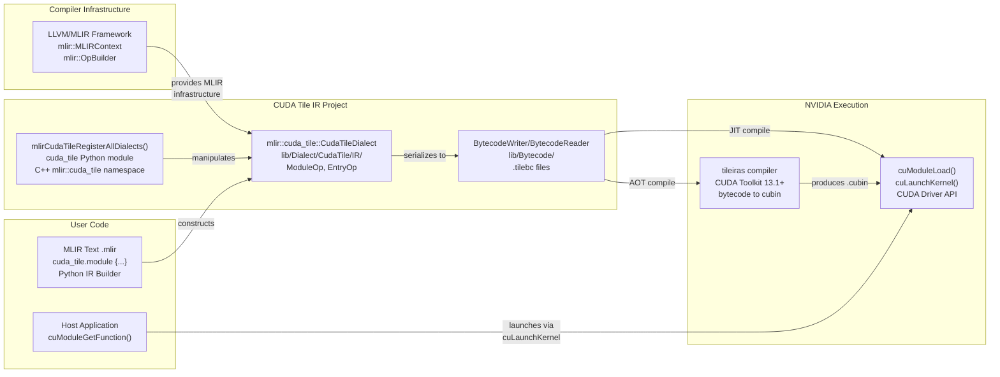
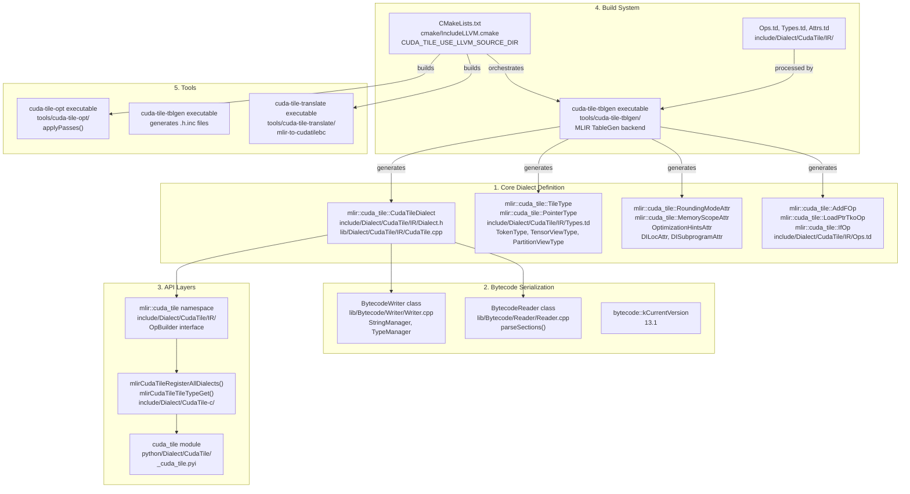
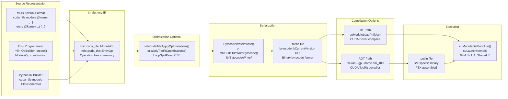
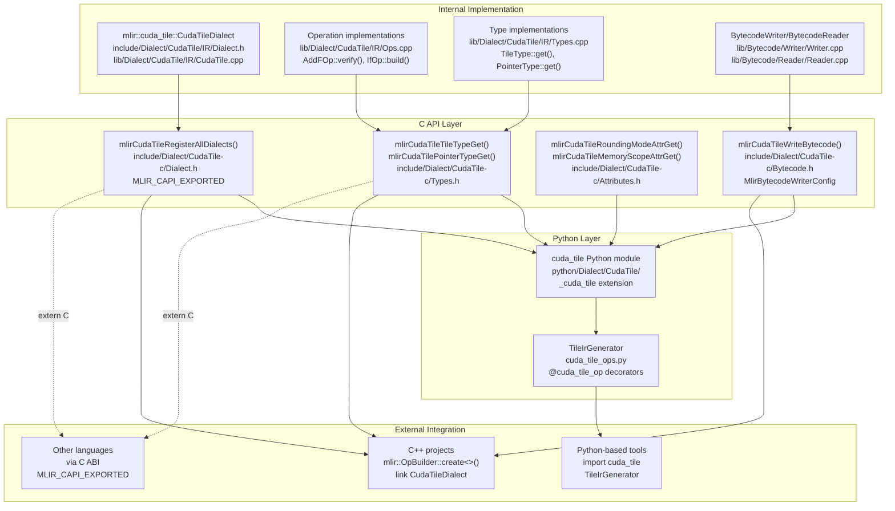
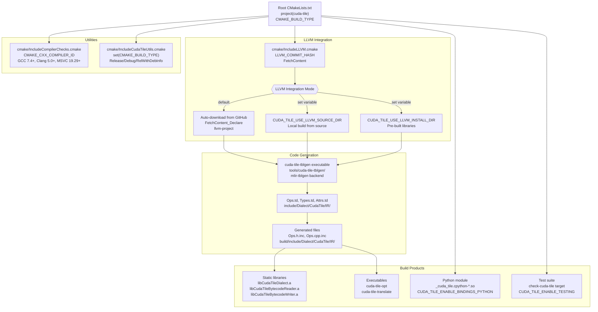

<!-- source: DeepWiki mcp.deepwiki.com · repo NVIDIA/cuda-tile · page 1 Overview · fetched 2026-10-26 -->

# Overview

Relevant source files

The following files were used as context for generating this wiki page:

- [README.md](README.md)

This document provides a high-level introduction to the CUDA Tile IR project, explaining its purpose as an MLIR-based intermediate representation for CUDA kernel optimization, its relationship to LLVM/MLIR and the CUDA Toolkit, and its major architectural components.

For detailed build instructions, see [Building from Source](#2.1). For dialect-specific information, see [Core Dialect](#3). For execution details, see [Execution Pipeline](#9).

## Purpose

CUDA Tile IR is an MLIR-based intermediate representation and compiler infrastructure for expressing and optimizing tile-based computations on NVIDIA GPUs. The project provides a domain-specific dialect within the MLIR framework that simplifies the development of high-performance CUDA kernels through first-class abstractions for tiling patterns, memory hierarchy management, and GPU-specific optimizations targeting tensor core units.

This implementation is aligned with CUDA Toolkit version 13.1 and provides a complete ecosystem including a dialect definition, bytecode serialization format, optimization passes, and language bindings (C++, C, Python).

**Sources:** [README.md:1-12]()

## System Context

CUDA Tile IR occupies a specific position in the compilation pipeline between high-level compiler infrastructure (LLVM/MLIR) and low-level GPU execution (CUDA Toolkit):

**System Context Diagram**

**Sources:** [README.md:1-12](), [lib/Dialect/CudaTile/IR/CudaTile.cpp](), [lib/Bytecode/Writer/Writer.cpp](), [lib/Bytecode/Reader/Reader.cpp]()

The project sits at the intersection of three domains:
- **LLVM/MLIR ecosystem**: Provides compiler infrastructure (`mlir::MLIRContext`, `mlir::OpBuilder`) and dialect framework
- **CUDA Toolkit**: Provides GPU compilation (`tileiras` tool) and runtime execution
- **User applications**: Consume the IR through C++ (`mlir::cuda_tile` namespace), C API (`mlirCudaTile*` functions), or Python (`cuda_tile` module)

## Major Components

CUDA Tile IR consists of five major subsystems:

**Component Architecture Diagram**

**Sources:** [README.md:14-25](), [lib/Dialect/CudaTile/IR/CudaTile.cpp](), [include/Dialect/CudaTile/IR/Types.td](), [include/Dialect/CudaTile/IR/Ops.td](), [lib/Bytecode/Writer/Writer.cpp](), [lib/Bytecode/Reader/Reader.cpp]()

### Component Descriptions

| Component | Location | Key Classes/Functions | Purpose |
|-----------|----------|----------------------|---------|
| **Core Dialect** | `include/Dialect/CudaTile/IR/`, `lib/Dialect/CudaTile/IR/` | `mlir::cuda_tile::CudaTileDialect`, `TileType`, `PointerType`, `AddFOp`, `LoadPtrTkoOp` | Defines the MLIR dialect with types, attributes, and operations for tile-based computations |
| **Bytecode System** | `lib/Bytecode/` | `BytecodeWriter`, `BytecodeReader`, `StringManager`, `TypeManager`, `bytecode::kCurrentVersion` | Provides binary serialization/deserialization with version 13.1 format and compatibility guarantees |
| **C++ API** | `include/Dialect/CudaTile/IR/` | `mlir::cuda_tile` namespace, `mlir::OpBuilder` interface | Internal implementation API using `mlir::cuda_tile` namespace |
| **C API** | `include/Dialect/CudaTile-c/` | `mlirCudaTileRegisterAllDialects()`, `mlirCudaTileTileTypeGet()`, `mlirCudaTileWriteBytecode()` | Language-agnostic API with `MLIR_CAPI_EXPORTED` functions prefixed with `mlirCudaTile*` |
| **Python Bindings** | `python/` | `cuda_tile` module, `_cuda_tile` extension module | Python wrappers for IR construction and manipulation (optional component) |
| **Build System** | `cmake/`, `CMakeLists.txt` | `CUDA_TILE_USE_LLVM_SOURCE_DIR`, `CUDA_TILE_ENABLE_BINDINGS_PYTHON` | CMake-based configuration supporting three LLVM integration modes |
| **Tools** | `tools/` | `cuda-tile-opt`, `cuda-tile-translate`, `cuda-tile-tblgen` executables | Command-line utilities: `cuda-tile-opt` (optimization), `cuda-tile-translate` (bytecode conversion), `cuda-tile-tblgen` (code generation) |

**Sources:** [README.md:14-25](), [README.md:144-210](), [include/Dialect/CudaTile/IR/Dialect.h](), [lib/Bytecode/Writer/Writer.cpp](), [include/Dialect/CudaTile-c/Dialect.h]()

## Compilation and Execution Flow

The typical workflow from source IR to GPU execution follows this pipeline:

**Compilation and Execution Pipeline Diagram**

**Sources:** [README.md:212-339](), [lib/Bytecode/Writer/Writer.cpp](), [include/Dialect/CudaTile-c/Bytecode.h]()

### Pipeline Stages

1. **Source Construction**: IR can be created from:
   - MLIR textual syntax using `cuda_tile.module` and `entry` operations
   - C++ programmatically via `mlir::OpBuilder::create<mlir::cuda_tile::ModuleOp>()` and related builder methods
   - Python via the `cuda_tile` module using `TileIrGenerator` class

2. **Optimization** (Optional): The `mlirCudaTileApplyOptimizations()` C API function or `applyTileIROptimizations()` Python function applies transformation passes including:
   - `LoopSplitPass` at [lib/Dialect/CudaTile/Transforms/LoopSplit.cpp]()
   - Common subexpression elimination (CSE)
   - Canonicalization patterns

3. **Bytecode Serialization**: 
   - C++ API: `BytecodeWriter::write()` method at [lib/Bytecode/Writer/Writer.cpp]()
   - C API: `mlirCudaTileWriteBytecode()` function at [include/Dialect/CudaTile-c/Bytecode.h]()
   - Both serialize IR to `.tilebc` binary format at version `bytecode::kCurrentVersion` (13.1)

4. **Compilation Paths**:
   - **JIT**: Bytecode is loaded directly via CUDA Driver API `cuModuleLoad("example.tilebc")` for just-in-time compilation
   - **AOT**: The `tileiras` tool (CUDA Toolkit) compiles bytecode to architecture-specific `.cubin` files using `tileiras --gpu-name sm_100 example.tilebc -o example.cubin`

5. **Execution**: Both paths converge at `cuModuleGetFunction()` followed by `cuLaunchKernel()` with specific constraints:
   - Grid dimensions: 1×1×1 (sets Tile Grid dimensions)
   - Block dimensions: 1×1×1 (unused, must be 1×1×1)
   - Shared memory: 0 bytes (unused, must be 0)

**Sources:** [README.md:212-339](), [README.md:296-314](), [lib/Bytecode/Writer/Writer.cpp](), [include/Dialect/CudaTile-c/Bytecode.h](), [lib/Dialect/CudaTile/Transforms/LoopSplit.cpp]()

## LLVM/MLIR Integration

CUDA Tile IR is built on top of the MLIR framework and requires a compatible LLVM/MLIR installation. The project supports three integration modes:

| Mode | CMake Variable | Description |
|------|----------------|-------------|
| **Auto-download** | (default) | CMake downloads LLVM sources from GitHub at the commit specified in `cmake/IncludeLLVM.cmake:29` |
| **Source directory** | `CUDA_TILE_USE_LLVM_SOURCE_DIR` | Links against locally built LLVM at a compatible commit |
| **Install directory** | `CUDA_TILE_USE_LLVM_INSTALL_DIR` | Uses pre-built LLVM libraries from an installation directory |

The exact required LLVM commit is defined at [cmake/IncludeLLVM.cmake:29]() and must match for source/install directory modes.

**Sources:** [README.md:69-102](), Diagram 2

## CUDA Toolkit Integration

CUDA Tile IR requires CUDA Toolkit 13.1 or higher for execution. The integration occurs through:

- **tileiras compiler**: Compiles `.tilebc` bytecode files to SM-specific `.cubin` binaries
- **CUDA Driver API**: Loads bytecode (JIT) or cubin (AOT) and executes kernels via `cuModuleLoad()` and `cuLaunchKernel()`
- **Execution constraints**: CUDA Tile IR kernels must be launched with grid dimensions of 1x1x1 and 0 bytes of shared memory

**Sources:** [README.md:11-12](), [README.md:226-227](), [README.md:296-314]()

## API Architecture

CUDA Tile IR provides a three-layer API architecture for different integration scenarios:

**API Layer Architecture Diagram**

**Sources:** [README.md:144-210](), [include/Dialect/CudaTile/IR/Dialect.h](), [include/Dialect/CudaTile-c/Dialect.h](), [include/Dialect/CudaTile-c/Types.h](), [include/Dialect/CudaTile-c/Bytecode.h](), [python/Dialect/CudaTile/]()

### API Layer Purposes

- **C++ Internal API** (`mlir::cuda_tile` namespace): Used for direct integration in C++ projects, provides full access to dialect implementation including:
  - Type creation: `mlir::cuda_tile::TileType::get()`, `mlir::cuda_tile::PointerType::get()`
  - Operation builders: `mlir::OpBuilder::create<mlir::cuda_tile::AddFOp>()`
  - Bytecode I/O: `BytecodeWriter::write()`, `BytecodeReader::read()`
  
- **C API** (`mlirCudaTile*` functions): Language-agnostic interface with `MLIR_CAPI_EXPORTED` linkage defined at [include/Dialect/CudaTile-c/](), enables FFI from other languages with functions like:
  - `mlirCudaTileRegisterAllDialects(MlirContext)`
  - `mlirCudaTileTileTypeGet(MlirContext, intptr_t numElements, MlirType* elementTypes)`
  - `mlirCudaTileWriteBytecode(MlirModule, MlirStringCallback, void*)`

- **Python Bindings**: High-level interface for programmatic IR construction, manipulation, and testing (optional, controlled by `CUDA_TILE_ENABLE_BINDINGS_PYTHON` CMake variable) including:
  - `cuda_tile` module with `TileIrGenerator` class
  - `@cuda_tile_op` decorators for operation wrappers
  - High-level `Tile` class with operator overloading

**Sources:** [README.md:104-118](), [include/Dialect/CudaTile-c/Dialect.h](), [include/Dialect/CudaTile-c/Types.h](), [include/Dialect/CudaTile-c/Bytecode.h](), [python/Dialect/CudaTile/]()

## Build System Overview

The CMake build system handles complex dependencies and code generation:

**Build System Architecture Diagram**

**Sources:** [README.md:36-133](), [CMakeLists.txt](), [cmake/IncludeLLVM.cmake](), [cmake/IncludeCompilerChecks.cmake]()

The build system performs three critical functions:
1. **LLVM/MLIR Integration**: Downloads (via `FetchContent`) or locates LLVM at the commit specified in [cmake/IncludeLLVM.cmake:29]()
2. **Compiler Validation**: Checks `CMAKE_CXX_COMPILER_ID` to ensure GCC 7.4+, Clang 5.0+, or MSVC 19.29+ via [cmake/IncludeCompilerChecks.cmake]()
3. **Code Generation**: Runs `cuda-tile-tblgen` (MLIR TableGen backend) on `.td` definition files at [include/Dialect/CudaTile/IR/]() to generate `.h.inc` and `.cpp.inc` files

**Sources:** [README.md:36-133](), [CMakeLists.txt](), [cmake/IncludeLLVM.cmake](), [cmake/IncludeCompilerChecks.cmake]()

## Key Features

CUDA Tile IR provides several key capabilities:

- **Tile-based type system**: First-class types defined in [include/Dialect/CudaTile/IR/Types.td]():
  - `mlir::cuda_tile::TileType` for fixed-shape tensors with power-of-2 dimensions
  - `mlir::cuda_tile::PointerType` for typed memory pointers
  - `mlir::cuda_tile::TokenType` for memory operation ordering
  - `mlir::cuda_tile::TensorViewType` for dynamic-shape global memory references
  - `mlir::cuda_tile::PartitionViewType` for grid-partitioned views

- **Memory model**: Explicit memory ordering and scope semantics via attributes:
  - `MemoryOrderingSemantics`: `WEAK`, `RELAXED`, `ACQUIRE`, `RELEASE`, `ACQ_REL`
  - `MemoryScope`: `TL_BLK`, `DEVICE`, `SYS`
  - Token-ordered operations (suffix `_tko`): `LoadPtrTkoOp`, `StoreViewTkoOp`, `AtomicCasTkoOp`

- **Optimization passes**: Located in [lib/Dialect/CudaTile/Transforms/]():
  - `LoopSplitPass` at [lib/Dialect/CudaTile/Transforms/LoopSplit.cpp]()
  - Common subexpression elimination (CSE)
  - Canonicalization patterns

- **Debug information**: DWARF-compatible debug info attributes:
  - `mlir::cuda_tile::DILocAttr` for source locations
  - `mlir::cuda_tile::DISubprogramAttr` for function metadata
  - `mlir::cuda_tile::DIFileAttr` for file references

- **Assumption predicates**: Predicates for enabling compiler optimizations:
  - `mlir::cuda_tile::AssumeDivByOp` for divisibility assumptions
  - `mlir::cuda_tile::AssumeSameElementsOp` for element equality
  - `mlir::cuda_tile::AssumeBoundedOp` for value bounds

- **Architecture-specific hints**: `mlir::cuda_tile::OptimizationHintsAttr` for controlling:
  - CTA count and distribution
  - TMA (Tensor Memory Accelerator) usage
  - Latency tolerance
  - Occupancy targets

- **Stable bytecode format**: Version `bytecode::kCurrentVersion` (13.1) with FROZEN opcode policy ensuring backward compatibility in section-based format (Header, String, Type, Constant, Debug, Func)

**Sources:** [README.md:1-12](), [include/Dialect/CudaTile/IR/Types.td](), [include/Dialect/CudaTile/IR/Attrs.td](), [lib/Dialect/CudaTile/Transforms/LoopSplit.cpp](), [lib/Bytecode/Writer/Writer.cpp]()

## License

CUDA Tile IR is licensed under Apache License v2.0 with LLVM Exceptions, matching the LLVM project's licensing model. This allows embedding compiled portions of the software into object form without full Apache 2.0 compliance and enables combination with GPLv2 software.

**Sources:** [LICENSE.txt:1-8](), [README.md:351-354]()

---

