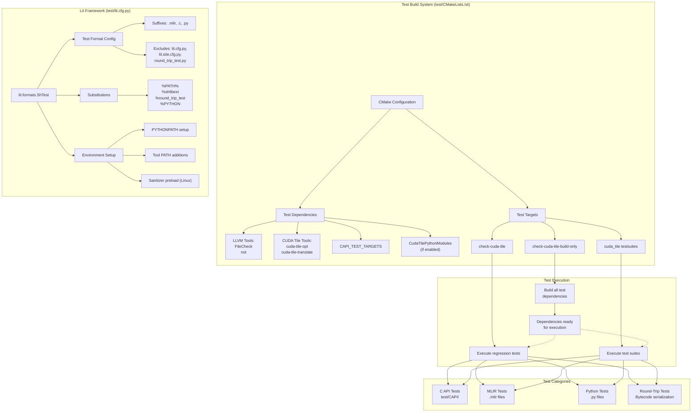
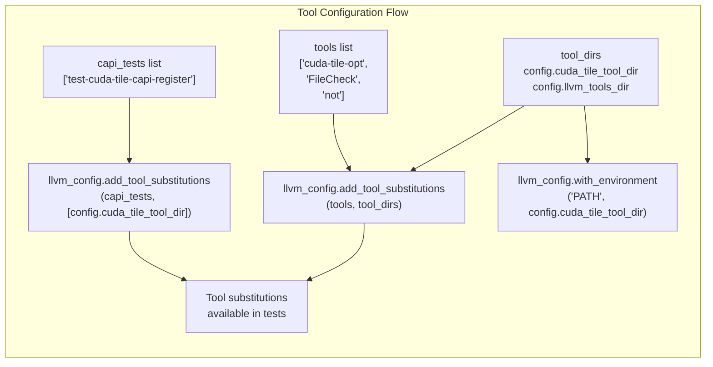

<!-- source: DeepWiki mcp.deepwiki.com · repo NVIDIA/cuda-tile · page 10 Testing and Validation · fetched 2026-10-26 -->

# Testing and Validation

<details>
<summary>Relevant source files</summary>

The following files were used as context for generating this wiki page:

- [test/CMakeLists.txt](test/CMakeLists.txt)
- [test/lit.cfg.py](test/lit.cfg.py)

</details>


This page provides comprehensive documentation of the CUDA Tile IR testing infrastructure, including the test build system, Lit test framework configuration, and test execution pipeline. The testing system validates all components of the CUDA Tile stack: the core dialect, bytecode serialization, optimization passes, Python bindings, and C API.

For information about specific test categories including C API tests, see [10.3](#10.3). For build system architecture that underlies test compilation, see [6](#6). For Python bindings being tested, see [5.3](#5.3).

## Testing Infrastructure Overview

The CUDA Tile IR testing infrastructure is built on LLVM's Lit (LLVM Integrated Tester) framework and provides validation across multiple layers of the system. The architecture consists of three primary components:

1. **Test Build System** - CMake configuration that defines test dependencies, targets, and build-only vs. execution separation
2. **Lit Test Framework** - Python-based test runner with format definitions, tool substitutions, and environment configuration
3. **Test Suites** - Organized collections of tests covering C API, MLIR IR, Python bindings, and bytecode round-trip validation

### Test Infrastructure Architecture



**Sources:** [test/CMakeLists.txt:1-60](), [test/lit.cfg.py:1-99]()

## Test Build Configuration

The test build system is defined in [test/CMakeLists.txt]() and configures all dependencies, targets, and build options required for testing.

### Core Dependencies

The build system establishes dependencies on both LLVM utilities and CUDA Tile-specific tools:

| Category | Tools | Purpose |
|----------|-------|---------|
| LLVM Utilities | `FileCheck`, `not` | Text pattern matching and negative test handling |
| CUDA Tile Tools | `cuda-tile-opt`, `cuda-tile-translate` | IR optimization and bytecode translation |
| C API Tests | `${CAPI_TEST_TARGETS}` | Dialect registration validation binaries |
| Python Modules | `CudaTilePythonModules` | Python bindings (conditional on `CUDA_TILE_ENABLE_BINDINGS_PYTHON`) |

These dependencies are collected in the `MLIR_TEST_DEPENDS` variable defined at [test/CMakeLists.txt:28-38]():

```cmake
set(MLIR_TEST_DEPENDS
  FileCheck
  not
  cuda-tile-opt
  cuda-tile-translate
  ${CAPI_TEST_TARGETS}
)

if(CUDA_TILE_ENABLE_BINDINGS_PYTHON)
  list(APPEND MLIR_TEST_DEPENDS CudaTilePythonModules)
endif()
```

### Test Targets

Three primary test targets are defined:

1. **`check-cuda-tile-build-only`** - Builds all test dependencies without executing tests. This target is useful for CI/CD pipelines that separate build and test phases [test/CMakeLists.txt:44-46]().

2. **`check-cuda-tile`** - Executes the full regression test suite using Lit [test/CMakeLists.txt:48-52]().

3. **`cuda_tile` testsuites** - Additional test suite collections defined via `add_lit_testsuites` [test/CMakeLists.txt:54-56]().

### Platform Detection

The build system detects the host platform and compiler to configure sanitizer support in tests:

```cmake
if(CMAKE_HOST_SYSTEM_NAME STREQUAL "Linux")
  set(HOST_OS "linux")
elseif(CMAKE_HOST_SYSTEM_NAME STREQUAL "Windows")
  set(HOST_OS "windows")
else()
  set(HOST_OS "${CMAKE_HOST_SYSTEM_NAME}")
endif()
set(HOST_CC "${CMAKE_C_COMPILER}")
set(HOST_CXX "${CMAKE_CXX_COMPILER}")
```

These values are passed to the Lit configuration via `configure_lit_site_cfg` [test/CMakeLists.txt:19-24](), which generates `lit.site.cfg.py` from `lit.site.cfg.py.in`.

**Sources:** [test/CMakeLists.txt:1-60]()

## Lit Framework Configuration

The Lit test framework configuration is defined in [test/lit.cfg.py]() and establishes test format, file suffixes, substitutions, and environment variables.

### Test Format and File Types

The framework uses `lit.formats.ShTest` for shell-based test execution [test/lit.cfg.py:13](). Tests are identified by the following file suffixes:

```python
config.suffixes = [".mlir", ".c", ".py"]
```

Certain files are explicitly excluded from test execution [test/lit.cfg.py:19]():

```python
config.excludes = ["lit.cfg.py", "lit.site.cfg.py", "round_trip_test.py"]
```

The `round_trip_test.py` script is excluded because it is invoked via substitution rather than directly executed as a test.

### Test Substitutions

Substitutions enable portable test specifications across platforms. The following substitutions are defined:

| Substitution | Purpose | Definition |
|--------------|---------|------------|
| `%PATH%` | Current PATH environment variable | [test/lit.cfg.py:27]() |
| `%shlibext` | Platform-specific shared library extension | [test/lit.cfg.py:28]() |
| `%round_trip_test` | Cross-platform round-trip test script | [test/lit.cfg.py:61]() |
| `%PYTHON` | Python executable with sanitizer preload | [test/lit.cfg.py:83]() |

The `%round_trip_test` substitution is platform-aware [test/lit.cfg.py:40-51]():

```python
python_executable = config.python_executable
if platform.system() == "Windows":
    # On Windows, use Python to run the shared cross-platform script
    round_trip_script = (
        f'"{python_executable}" "{config.test_source_root}/round_trip_test.py"'
    )
else:
    # On Unix/Linux, use the shell script
    round_trip_script = f"{config.test_source_root}/Dialect/CudaTile/round_trip_test.sh"
```

### Tool Path Configuration



The C API test binaries are registered separately from the main tools [test/lit.cfg.py:30-32]():

```python
capi_tests = ["test-cuda-tile-capi-register"]
llvm_config.add_tool_substitutions(capi_tests, [config.cuda_tile_tool_dir])
```

Standard tools (LLVM and CUDA Tile) are registered with multiple search directories [test/lit.cfg.py:34-58]():

```python
tool_dirs = [
    config.cuda_tile_tool_dir,
    config.llvm_tools_dir,
]

tools = [
    "cuda-tile-opt",
    "FileCheck",
    "not",
]

llvm_config.add_tool_substitutions(tools, tool_dirs)
```

**Sources:** [test/lit.cfg.py:1-99]()

## Python Test Environment

When Python bindings are enabled (`config.enable_bindings_python` is true), the Lit framework configures the Python environment for test execution.

### PYTHONPATH Configuration

The framework adds multiple directories to `PYTHONPATH` [test/lit.cfg.py:86-98]():

```python
if config.enable_bindings_python:
    python_paths = [
        # Build directory (always needed for cuda_tile bindings)
        os.path.join(config.cuda_tile_obj_root, "python_packages"),
        # Test source python utilities
        os.path.join(config.test_source_root, "python"),
    ]
    # Also add install directory if available (CI pipelines)
    if config.cuda_tile_install_dir:
        python_paths.insert(
            0, os.path.join(config.cuda_tile_install_dir, "python_packages")
        )
    llvm_config.with_environment("PYTHONPATH", python_paths, append_path=True)
```

This configuration ensures that tests can import both:
- The compiled `cuda_tile` Python modules from the build tree
- Test utility modules from `test/python/`
- Installed modules from the install tree (for CI validation)

### Sanitizer Support

When LLVM is built with sanitizers enabled on Linux, the Python executable requires special configuration to preload the Address Sanitizer (ASAN) runtime library [test/lit.cfg.py:70-82]():

```python
if config.llvm_use_sanitizer and "linux" in config.host_os.lower():

    def preload(lib_name: str) -> str:
        return f"$({config.host_cxx} -print-file-name={lib_name})"

    preload_libs = [
        preload("libclang_rt.asan.so" if "clang" in config.host_cxx else "libasan.so")
    ]
    preload_path = f'LD_PRELOAD="{" ".join(preload_libs)}"'
    quoted_python_executable = f"{preload_path} {quoted_python_executable}"
```

This preload is necessary because Python extensions built with sanitizers must have the ASAN runtime loaded before the Python interpreter starts. The issue is documented at https://github.com/google/sanitizers/issues/1086.

**Sources:** [test/lit.cfg.py:70-98]()

## Test Execution Flow

```mermaid
sequenceDiagram
    participant Developer
    participant CMake["CMake Build System"]
    participant BuildTarget["check-cuda-tile-build-only"]
    participant TestTarget["check-cuda-tile"]
    participant Lit["Lit Framework"]
    participant Tests["Test Files (.mlir, .c, .py)"]
    participant Tools["cuda-tile-opt, FileCheck, etc."]
    
    Developer->>CMake: "ninja check-cuda-tile-build-only"
    CMake->>BuildTarget: "Execute target"
    BuildTarget->>Tools: "Build all dependencies"
    Tools-->>BuildTarget: "All tools built"
    BuildTarget-->>Developer: "Build complete (no tests run)"
    
    Developer->>CMake: "ninja check-cuda-tile"
    CMake->>TestTarget: "Execute target"
    TestTarget->>BuildTarget: "Ensure dependencies built"
    TestTarget->>Lit: "Run test suite"
    
    Lit->>Lit: "Load lit.cfg.py"
    Lit->>Lit: "Apply substitutions"
    Lit->>Lit: "Set environment (PYTHONPATH, PATH)"
    
    Lit->>Tests: "Discover tests (*.mlir, *.c, *.py)"
    
    loop For each test file
        Tests->>Lit: "Test command with RUN: directives"
        Lit->>Tools: "Execute command with substitutions"
        Tools->>Tools: "Process input, verify output"
        Tools-->>Lit: "Test result (pass/fail)"
    end
    
    Lit-->>TestTarget: "Test summary"
    TestTarget-->>Developer: "Results displayed"
```

The typical test execution workflow follows these steps:

1. **Build Phase** - `check-cuda-tile-build-only` builds all dependencies without running tests. This is useful for CI systems to separate build from test execution.

2. **Discovery Phase** - Lit discovers all test files matching the configured suffixes (`.mlir`, `.c`, `.py`) in the test directory tree, excluding files in the `config.excludes` list.

3. **Configuration Phase** - Lit loads `lit.cfg.py`, applies substitutions (e.g., replacing `%round_trip_test` with the platform-specific script path), and configures environment variables (PYTHONPATH, PATH, sanitizer preloads).

4. **Execution Phase** - For each test file, Lit executes the commands specified in `RUN:` directives, applying substitutions and passing output through verification tools like `FileCheck`.

5. **Reporting Phase** - Lit aggregates results and reports pass/fail status for each test and overall suite.

**Sources:** [test/CMakeLists.txt:44-56](), [test/lit.cfg.py:1-99]()

## Test Categories

The CUDA Tile test suite is organized into several categories, each validating different system components:

### C API Tests

Located in `test/CAPI/`, these tests validate the C API (CAPI) for dialect registration and interoperability. The primary test binary is `test-cuda-tile-capi-register`, which verifies that the CudaTile dialect can be registered and accessed via the C interface. These tests are critical for language bindings beyond Python (e.g., Rust, Julia).

The C API test targets are defined in [test/CAPI/CMakeLists.txt]() and collected into the `CAPI_TEST_TARGETS` variable, which is then added to test dependencies.

### MLIR Tests

Files with the `.mlir` suffix contain textual MLIR IR that tests dialect operations, type system, attributes, and optimization passes. These tests typically use the `RUN:` directive format:

```mlir
// RUN: cuda-tile-opt %s | FileCheck %s
```

Common test patterns include:
- Parsing and printing (round-trip validation)
- Operation verification
- Canonicalization patterns
- Type inference and constraints

### Python Tests

Files with the `.py` suffix test the Python bindings, including:
- Type and attribute construction via Python API
- Operation creation using decorators and the `Tile` class
- IR generation via `TileIrGenerator`
- Bytecode serialization (`writeBytecode`)

Python tests use the `%PYTHON` substitution to ensure the correct Python interpreter is invoked with sanitizer support if needed.

### Round-Trip Tests

Round-trip tests validate bytecode serialization and deserialization integrity. These tests serialize MLIR IR to bytecode format (`.tilebc`), then deserialize it back to MLIR IR and verify that the result matches the original.

The `%round_trip_test` substitution is configured to use platform-specific scripts [test/lit.cfg.py:40-51]():
- On Windows: `python round_trip_test.py`
- On Unix/Linux: `round_trip_test.sh`

**Sources:** [test/CMakeLists.txt:26-38](), [test/lit.cfg.py:16-19](), [test/lit.cfg.py:40-51]()

## Test Dependency Matrix

The following table summarizes which test categories depend on which build components:

| Test Category | FileCheck | not | cuda-tile-opt | cuda-tile-translate | CAPI Binaries | Python Modules |
|---------------|-----------|-----|---------------|---------------------|---------------|----------------|
| C API Tests | ✓ | ✓ | - | - | ✓ | - |
| MLIR Tests | ✓ | ✓ | ✓ | ✓ | - | - |
| Python Tests | ✓ | ✓ | - | - | - | ✓ |
| Round-Trip Tests | ✓ | ✓ | ✓ | ✓ | - | Optional |

All dependencies are built as part of the `check-cuda-tile-build-only` target, ensuring consistent build state before test execution.

**Sources:** [test/CMakeLists.txt:28-38]()

## Configuration Variables

The Lit site configuration is generated from `lit.site.cfg.py.in` and receives the following variables from CMake:

| Variable | Source | Purpose |
|----------|--------|---------|
| `config.cuda_tile_obj_root` | Build directory | Root of build output (for finding Python packages) |
| `config.cuda_tile_tool_dir` | Build/bin directory | Location of cuda-tile-opt, cuda-tile-translate |
| `config.llvm_tools_dir` | LLVM build/bin | Location of FileCheck, not |
| `config.test_source_root` | test/ directory | Source location of test files |
| `config.llvm_shlib_ext` | Platform-dependent | Shared library extension (.so, .dll, .dylib) |
| `config.enable_bindings_python` | `CUDA_TILE_ENABLE_BINDINGS_PYTHON` | Whether Python bindings are enabled |
| `config.host_os` | `CMAKE_HOST_SYSTEM_NAME` | Host operating system |
| `config.host_cxx` | `CMAKE_CXX_COMPILER` | C++ compiler path (for sanitizer detection) |
| `config.llvm_use_sanitizer` | LLVM build config | Whether sanitizers are enabled |

These variables are canonicalized and passed to the template via `llvm_canonicalize_cmake_booleans` and `configure_lit_site_cfg` [test/CMakeLists.txt:15-24]().

**Sources:** [test/CMakeLists.txt:1-24]()

---

