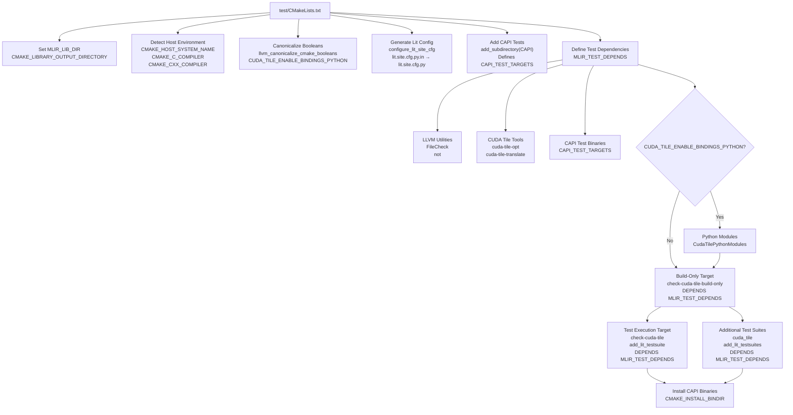
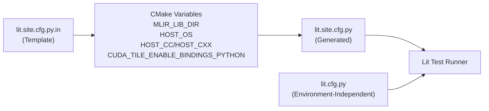
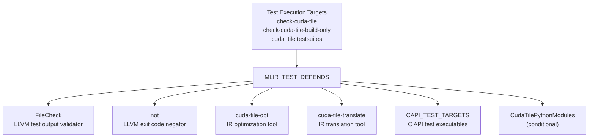
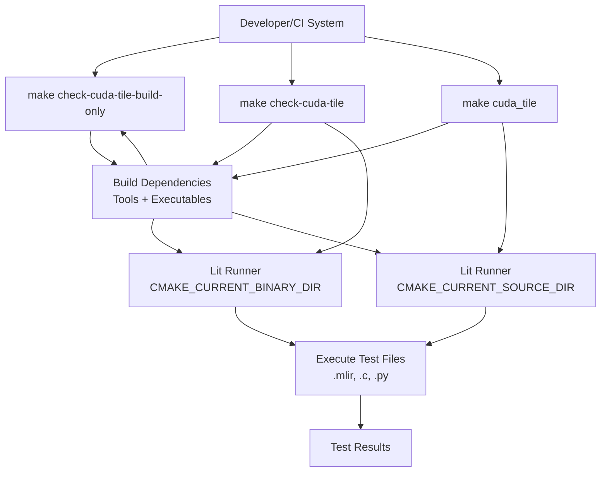
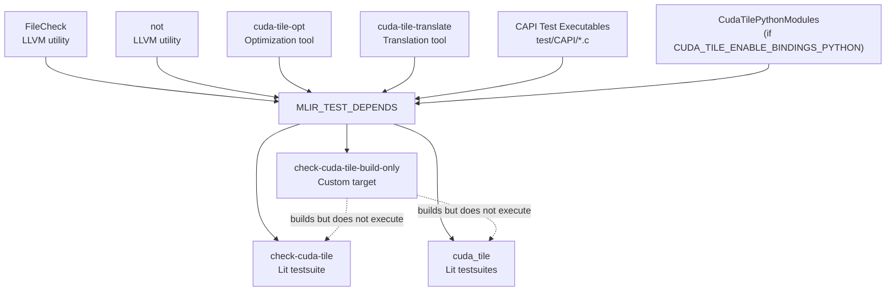

<!-- source: DeepWiki mcp.deepwiki.com · repo NVIDIA/cuda-tile · page 10.1 Test Build Configuration · fetched 2026-10-26 -->

# Test Build Configuration

<details>
<summary>Relevant source files</summary>

The following files were used as context for generating this wiki page:

- [test/CMakeLists.txt](test/CMakeLists.txt)

</details>


This document explains the CMake configuration system for CUDA Tile IR's testing infrastructure, located in [test/CMakeLists.txt](). It covers how test dependencies are defined, how the build system detects host environment properties for sanitizer configuration, how lit test framework configuration is generated, and how test execution targets are structured. For details about the lit test framework configuration itself, see [Lit Test Framework](#10.2). For information about C API test implementation, see [C API Testing](#10.3).

## Configuration Overview

The test build configuration system performs four primary functions:
1. Detects and records host environment properties (OS, compilers) for sanitizer support
2. Generates lit test framework configuration from templates
3. Defines test dependencies including LLVM utilities and CUDA Tile tools
4. Creates test execution targets that can be used independently or in CI pipelines

**CMake Test Configuration Flow**



Sources: [test/CMakeLists.txt:1-60]()

## Library Path Configuration

The test system configures `MLIR_LIB_DIR` to point to the CMake library output directory. This variable is passed to the lit configuration template and used by test scripts to locate shared libraries at runtime.

```cmake
set(MLIR_LIB_DIR ${CMAKE_LIBRARY_OUTPUT_DIRECTORY})
```

This configuration ensures that tests can find compiled libraries regardless of whether the build uses single or multi-configuration generators.

Sources: [test/CMakeLists.txt:1-2]()

## Host Environment Detection

The build system detects and records host environment properties used for sanitizer configuration in lit tests. This information is written into the generated lit configuration file.

**Detected Properties:**

| Property | CMake Variable | Purpose |
|----------|---------------|---------|
| Host OS | `CMAKE_HOST_SYSTEM_NAME` | Mapped to `HOST_OS` variable (linux, windows, or system name) |
| C Compiler | `CMAKE_C_COMPILER` | Stored in `HOST_CC` for sanitizer preload detection |
| C++ Compiler | `CMAKE_CXX_COMPILER` | Stored in `HOST_CXX` for sanitizer preload detection |

The OS detection logic normalizes system names:

```cmake
if(CMAKE_HOST_SYSTEM_NAME STREQUAL "Linux")
  set(HOST_OS "linux")
elseif(CMAKE_HOST_SYSTEM_NAME STREQUAL "Windows")
  set(HOST_OS "windows")
else()
  set(HOST_OS "${CMAKE_HOST_SYSTEM_NAME}")
endif()
```

These variables enable the lit configuration to set up appropriate sanitizer preloads on Linux systems when tests are built with sanitizers enabled.

Sources: [test/CMakeLists.txt:4-13]()

## Boolean Canonicalization

The `CUDA_TILE_ENABLE_BINDINGS_PYTHON` option is canonicalized using LLVM's `llvm_canonicalize_cmake_booleans()` function. This converts CMake boolean values (ON/OFF, TRUE/FALSE, 1/0) to canonical Python boolean strings (True/False) that can be used directly in the Python-based lit configuration.

```cmake
llvm_canonicalize_cmake_booleans(
  CUDA_TILE_ENABLE_BINDINGS_PYTHON
)
```

After canonicalization, the variable can be substituted directly into `lit.site.cfg.py` without additional conversion logic.

Sources: [test/CMakeLists.txt:15-17]()

## Lit Configuration Generation

The build system generates `lit.site.cfg.py` from a template file using CMake variable substitution. This generated file contains build-specific configuration (paths, enabled features) while the main `lit.cfg.py` contains environment-independent test configuration.

**Configuration File Generation:**

```cmake
configure_lit_site_cfg(
  ${CMAKE_CURRENT_SOURCE_DIR}/lit.site.cfg.py.in
  ${CMAKE_CURRENT_BINARY_DIR}/lit.site.cfg.py
  MAIN_CONFIG
  ${CMAKE_CURRENT_SOURCE_DIR}/lit.cfg.py
)
```

**Configuration Flow:**



The `configure_lit_site_cfg()` function performs CMake variable substitution on the template file, replacing `@VARIABLE@` placeholders with actual values from the build configuration.

Sources: [test/CMakeLists.txt:19-24]()

## CAPI Test Subdirectory

The CAPI tests are built through a subdirectory inclusion that defines test executables for C API validation:

```cmake
add_subdirectory(CAPI)
```

This subdirectory defines `CAPI_TEST_TARGETS`, a list of executable targets that validate the C API dialect registration and functionality. These targets are added to the overall test dependency list and installed as part of the test infrastructure. See [C API Testing](#10.3) for details about the test implementation.

Sources: [test/CMakeLists.txt:26]()

## Test Dependencies

The `MLIR_TEST_DEPENDS` variable defines all targets that must be built before tests can execute. This includes LLVM utilities, CUDA Tile tools, CAPI test executables, and optionally Python modules.

**Test Dependency Architecture:**



### LLVM Utilities

**FileCheck**: Pattern matching utility for validating test output against expected patterns. Tests use `FileCheck` to verify that IR transformations, optimizations, and code generation produce expected results.

**not**: Utility that inverts exit codes. Used in tests that verify error conditions, where successful error detection means the tested tool should fail.

### CUDA Tile Tools

**cuda-tile-opt**: Applies optimization passes to CUDA Tile IR. Tests use this tool to verify pass behavior, canonicalization patterns, and IR transformations.

**cuda-tile-translate**: Translates between IR formats (MLIR text format, bytecode). Tests use this tool to validate serialization/deserialization and format conversion.

### CAPI Test Targets

C API test executables defined in the CAPI subdirectory. These executables validate C API functionality including dialect registration, type creation, and interoperability.

### Python Modules (Conditional)

When `CUDA_TILE_ENABLE_BINDINGS_PYTHON` is enabled, the `CudaTilePythonModules` target is added to dependencies. This ensures Python binding modules are built before Python tests execute.

**Dependency Definition:**

```cmake
set(MLIR_TEST_DEPENDS
  FileCheck
  not
  cuda-tile-opt
  cuda-tile-translate
  ${CAPI_TEST_TARGETS}
)

if(CUDA_TILE_ENABLE_BINDINGS_PYTHON)
  list(APPEND MLIR_TEST_DEPENDS CudaTilePythonModules)
endif()
```

Sources: [test/CMakeLists.txt:28-38]()

## Test Execution Targets

The build system defines three types of test targets with different purposes:

### Build-Only Target

The `check-cuda-tile-build-only` target builds all test dependencies without executing tests. This target is useful in CI/CD pipelines where build and test execution are separated into distinct stages, allowing for better resource management and failure isolation.

```cmake
add_custom_target(check-cuda-tile-build-only
  DEPENDS ${MLIR_TEST_DEPENDS}
)
```

**Use Case:** A CI bot can invoke this target during the build phase to ensure all tools and test executables compile successfully, then later invoke the test execution target on a different machine or in a different job.

### Regression Test Target

The `check-cuda-tile` target runs the main regression test suite using the lit framework. It depends on all test dependencies and executes tests from the build directory.

```cmake
add_lit_testsuite(check-cuda-tile "Running the cuda_tile regression tests"
  ${CMAKE_CURRENT_BINARY_DIR}
  DEPENDS ${MLIR_TEST_DEPENDS}
)
set_target_properties(check-cuda-tile PROPERTIES FOLDER "Tests")
```

This target is organized into the "Tests" folder in IDEs that support target folders.

### Additional Test Suites

The `cuda_tile` test suites are defined from the source directory, allowing for additional test organization and execution:

```cmake
add_lit_testsuites(cuda_tile ${CMAKE_CURRENT_SOURCE_DIR}
  DEPENDS ${MLIR_TEST_DEPENDS}
)
```

**Test Target Execution Flow:**



Sources: [test/CMakeLists.txt:40-56]()

## CAPI Test Binary Installation

CAPI test executables are installed to the CMake installation binary directory, making them available for standalone testing or use by external projects:

```cmake
install(TARGETS ${CAPI_TEST_TARGETS} RUNTIME DESTINATION ${CMAKE_INSTALL_BINDIR})
```

This installation enables:
- Execution of C API validation tests in installed environments
- Verification of C API compatibility in downstream projects
- Standalone testing without full build tree access

The `RUNTIME DESTINATION` ensures executables are placed in the appropriate binary directory based on platform conventions (e.g., `bin/` on Unix-like systems).

Sources: [test/CMakeLists.txt:58-60]()

## Target Dependency Summary

**Complete Test Target Dependency Graph:**



This architecture allows flexible test execution strategies:
- **Full test run:** `make check-cuda-tile` or `make cuda_tile`
- **Build verification only:** `make check-cuda-tile-build-only`
- **Manual test execution:** Build with `check-cuda-tile-build-only`, then run lit manually with custom filters

Sources: [test/CMakeLists.txt:1-60]()

---

