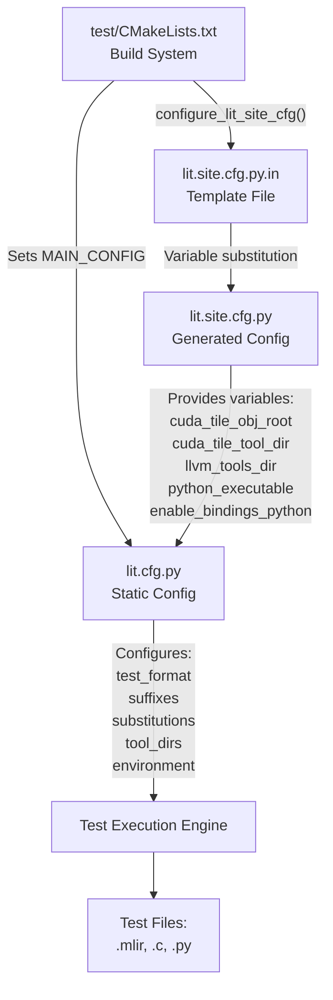
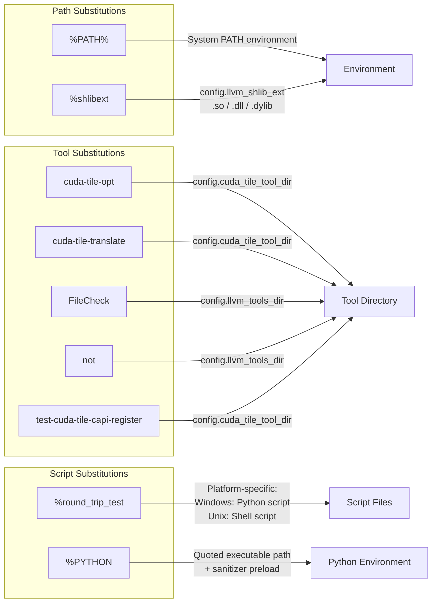
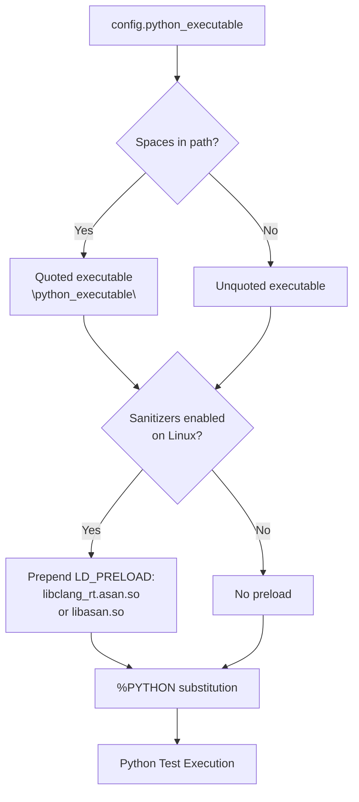
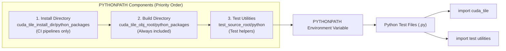
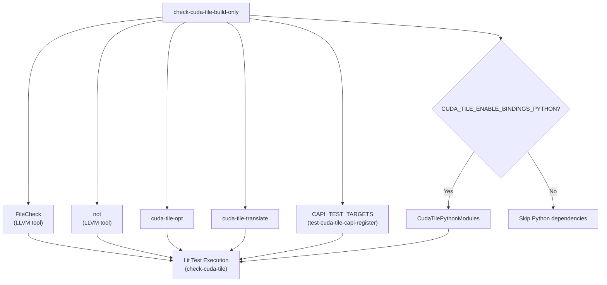

<!-- source: DeepWiki mcp.deepwiki.com · repo NVIDIA/cuda-tile · page 10.2 Lit Test Framework · fetched 2026-10-26 -->

# Lit Test Framework

<details>
<summary>Relevant source files</summary>

The following files were used as context for generating this wiki page:

- [test/CMakeLists.txt](test/CMakeLists.txt)
- [test/lit.cfg.py](test/lit.cfg.py)

</details>


## Purpose and Scope

This document covers the Lit (LLVM Integrated Tester) configuration for CUDA Tile IR, including test format specifications, tool path management, substitution variables, and Python environment setup. The Lit framework provides the test execution engine that runs `.mlir`, `.c`, and `.py` test files with proper tool integration and environment configuration.

For information about test build system setup and dependencies, see [Test Build Configuration](#10.1). For C API-specific test structure, see [C API Testing](#10.3).

---

## Configuration Architecture

The Lit test framework for CUDA Tile is configured through two primary files working in tandem: `lit.site.cfg.py` (generated from template) and `lit.cfg.py` (static configuration). The CMake build system orchestrates this setup by populating template variables and establishing test dependencies.



**Configuration Flow**

Sources: [test/CMakeLists.txt:19-24]()

The CMake function `configure_lit_site_cfg()` processes the template file by substituting CMake variables (e.g., `CUDA_TILE_ENABLE_BINDINGS_PYTHON`, `HOST_OS`, `HOST_CC`, `HOST_CXX`, `MLIR_LIB_DIR`) into the generated site configuration. This generated file serves as the data source for the static configuration.

---

## Test Format and File Suffixes

The Lit framework is configured to use shell-based test execution with support for multiple file types representing different test categories.

### Test Suite Configuration

Sources: [test/lit.cfg.py:10-16](), [test/lit.cfg.py:21-25]()

| Configuration Item | Value | Description |
|-------------------|-------|-------------|
| `config.name` | `"CUDA_TILE"` | Test suite identifier |
| `config.test_format` | `lit.formats.ShTest` | Shell-based test execution |
| `config.suffixes` | `[".mlir", ".c", ".py"]` | Recognized test file extensions |
| `config.excludes` | `["lit.cfg.py", "lit.site.cfg.py", "round_trip_test.py"]` | Files excluded from test discovery |
| `config.test_source_root` | `os.path.dirname(__file__)` | Location of test source files |
| `config.test_exec_root` | `config.cuda_tile_obj_root/test` | Build directory for test execution |

### ShTest Format

The `lit.formats.ShTest` format interprets test files as shell scripts with embedded `RUN:` commands. Each test file contains directives that specify command execution and output validation:

```
// RUN: cuda-tile-opt %s | FileCheck %s
// CHECK: cuda_tile.add
```

The shell execution behavior is controlled by `llvm_config.use_lit_shell`, which determines whether Lit uses its internal shell interpreter or delegates to the system shell.

---

## Substitution System

Lit provides a text substitution mechanism that enables platform-independent test writing by replacing variables with actual paths and commands at runtime.

### Core Substitutions



Sources: [test/lit.cfg.py:27-28](), [test/lit.cfg.py:40-61](), [test/lit.cfg.py:66-83]()

### Path and Extension Substitutions

| Substitution | Purpose | Source Variable |
|-------------|---------|-----------------|
| `%PATH%` | System PATH environment variable | `config.environment["PATH"]` |
| `%shlibext` | Platform-specific shared library extension | `config.llvm_shlib_ext` (`.so`, `.dll`, or `.dylib`) |

### Tool Path Resolution

The framework registers tool substitutions in two categories:

**LLVM Tools** (from `config.llvm_tools_dir`):
- `FileCheck` - Pattern matching utility for test output validation
- `not` - Command negation utility

**CUDA Tile Tools** (from `config.cuda_tile_tool_dir`):
- `cuda-tile-opt` - IR optimization and transformation tool
- `cuda-tile-translate` - IR-to-bytecode translation tool
- `test-cuda-tile-capi-register` - C API registration test binary

Tool directories are searched in priority order as specified in the `tool_dirs` list [test/lit.cfg.py:34-37]().

### Round-Trip Test Script Substitution

The `%round_trip_test` substitution provides cross-platform support for bytecode serialization/deserialization validation:

**Windows**: Uses Python executable to invoke the shared script
```python
"%PYTHON%" "test/round_trip_test.py"
```

**Unix/Linux**: Uses shell script (with fallback to shared Python script)
```bash
test/Dialect/CudaTile/round_trip_test.sh
```

This platform-specific handling ensures consistent round-trip testing across different operating systems [test/lit.cfg.py:40-51]().

---

## Python Test Environment Configuration

Python tests require careful environment setup to locate bindings, utilities, and handle sanitizer libraries.

### Python Executable Configuration



Sources: [test/lit.cfg.py:66-83]()

The Python executable substitution (`%PYTHON`) undergoes conditional processing:

1. **Path Quoting**: If the Python executable path contains spaces, it is wrapped in double quotes to prevent shell parsing errors
2. **Sanitizer Preloading** (Linux only): When `config.llvm_use_sanitizer` is enabled and the host OS is Linux, the AddressSanitizer runtime library is preloaded via `LD_PRELOAD` environment variable

This addresses a known issue where Python C extensions (like Nanobind-based bindings) fail to properly initialize under sanitizers without explicit runtime preloading (see [sanitizers issue #1086](https://github.com/google/sanitizers/issues/1086)).

### PYTHONPATH Configuration

When Python bindings are enabled (`config.enable_bindings_python` is true), the framework configures `PYTHONPATH` to include multiple directories in priority order:



Sources: [test/lit.cfg.py:86-98]()

**Path Priority**:
1. **Install Directory** (highest): `${cuda_tile_install_dir}/python_packages` - Used in CI environments where CUDA Tile is pre-installed
2. **Build Directory**: `${cuda_tile_obj_root}/python_packages` - Always included, contains freshly built bindings
3. **Test Utilities** (lowest): `${test_source_root}/python` - Contains test helper modules

The `llvm_config.with_environment()` function appends these paths to any existing `PYTHONPATH` entries, ensuring test utilities and bindings are discoverable while preserving system Python paths.

---

## Sanitizer Runtime Configuration

For Linux builds with sanitizers enabled, the test framework must preload sanitizer runtime libraries before executing Python tests. This is necessary because Python's dynamic loading mechanism can interfere with sanitizer initialization.

### Sanitizer Detection and Library Selection

```mermaid
graph TB
    CheckSanitizer{"config.llvm_use_sanitizer<br/>enabled?"}
    CheckOS{"Host OS is Linux?"}
    
    CheckSanitizer -->|No| NoAction["No sanitizer configuration"]
    CheckSanitizer -->|Yes| CheckOS
    
    CheckOS -->|No| NoAction
    CheckOS -->|Yes| DetectCompiler{"Compiler type?"}
    
    DetectCompiler -->|"Contains 'clang'"| ClangLib["libclang_rt.asan.so"]
    DetectCompiler -->|"Other (GCC)"| GCCLib["libasan.so"]
    
    ClangLib --> ResolveLib["Resolve library path:<br/>$($HOST_CXX -print-file-name=...)"]
    GCCLib --> ResolveLib
    
    ResolveLib --> SetPreload["Set LD_PRELOAD environment<br/>before Python executable"]
    
    SetPreload --> PythonSubst["%PYTHON = LD_PRELOAD=\"...\" python"]
```

Sources: [test/lit.cfg.py:70-81]()

The library name is determined by inspecting `config.host_cxx`:
- **Clang-based compilers**: Use `libclang_rt.asan.so`
- **GCC-based compilers**: Use `libasan.so`

The actual library path is resolved using the compiler's `-print-file-name` option, which outputs the full path to the sanitizer runtime library provided with the compiler toolchain.

**Example resulting substitution**:
```bash
LD_PRELOAD="/usr/lib/clang/15.0.0/lib/linux/libclang_rt.asan-x86_64.so" "/usr/bin/python3"
```

This preload ensures the AddressSanitizer runtime initializes before any Python C extensions are loaded, preventing initialization race conditions.

---

## Environment Path Modifications

The framework modifies the `PATH` environment variable to ensure test tools are discoverable during test execution.

Sources: [test/lit.cfg.py:63]()

The `llvm_config.with_environment("PATH", config.cuda_tile_tool_dir, append_path=True)` call appends the CUDA Tile tool directory to the system PATH. This enables direct invocation of tools like `cuda-tile-opt` and `cuda-tile-translate` from test scripts without requiring absolute paths.

**Path modification strategy**:
- Appends rather than prepends to preserve system tool precedence
- Ensures both `config.cuda_tile_tool_dir` and `config.llvm_tools_dir` are accessible via the `tool_dirs` configuration
- Tools registered via `llvm_config.add_tool_substitutions()` receive explicit path resolution regardless of PATH environment

---

## Test Discovery and Exclusion

The Lit framework walks the test source tree and identifies files matching the configured suffixes while respecting exclusion rules.

Sources: [test/lit.cfg.py:15-19]()

**Inclusion criteria**: Files with extensions `.mlir`, `.c`, or `.py` in the test source root and subdirectories

**Exclusion list**:
- `lit.cfg.py` - Test configuration file itself
- `lit.site.cfg.py` - Generated site configuration
- `round_trip_test.py` - Shared utility script invoked via substitution, not a standalone test

This exclusion mechanism prevents the test runner from attempting to execute configuration and utility scripts as test cases.

---

## Integration with Test Build System

The Lit configuration consumes variables provided by the CMake build system through the generated site configuration.

### CMake Variable Export

Sources: [test/CMakeLists.txt:1-24]()

Key variables exported to `lit.site.cfg.py`:

| CMake Variable | Purpose | Lit Config Usage |
|---------------|---------|------------------|
| `MLIR_LIB_DIR` | MLIR library output directory | Shared library discovery |
| `HOST_OS` | Host operating system identifier | Sanitizer configuration platform check |
| `HOST_CC` | C compiler path | Sanitizer runtime library resolution |
| `HOST_CXX` | C++ compiler path | Sanitizer runtime library resolution |
| `CUDA_TILE_ENABLE_BINDINGS_PYTHON` | Python bindings enabled flag | Python environment configuration |

The `llvm_canonicalize_cmake_booleans()` function [test/CMakeLists.txt:15-17]() ensures boolean CMake variables are properly converted to Python-compatible values (ON/OFF → True/False).

### Test Dependency Chain



Sources: [test/CMakeLists.txt:28-52]()

The `check-cuda-tile-build-only` target [test/CMakeLists.txt:44-46]() serves as a dependency aggregation point, ensuring all test prerequisites are built before test execution. This separation enables CI systems to distribute build and test phases across different machines or stages.

The `check-cuda-tile` target [test/CMakeLists.txt:48-52]() depends on the same dependency set and invokes the Lit test runner on the binary directory (`CMAKE_CURRENT_BINARY_DIR`), executing all discovered test files.

---

