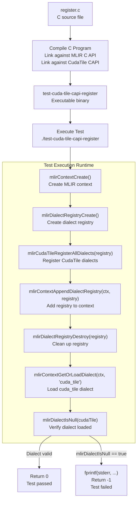
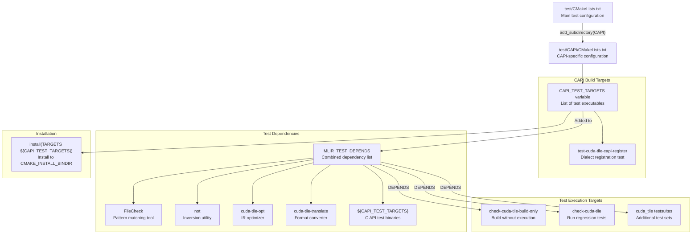
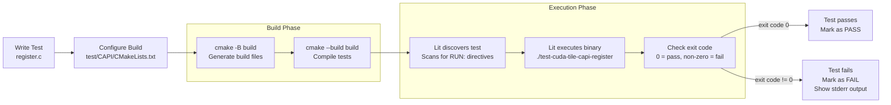

<!-- source: DeepWiki mcp.deepwiki.com · repo NVIDIA/cuda-tile · page 10.3 C API Testing · fetched 2026-10-26 -->

# C API Testing

<details>
<summary>Relevant source files</summary>

The following files were used as context for generating this wiki page:

- [test/CAPI/register.c](test/CAPI/register.c)
- [test/CMakeLists.txt](test/CMakeLists.txt)

</details>


## Purpose and Scope

This document covers the C API (CAPI) testing infrastructure for CUDA Tile IR. C API tests validate that the C language bindings for CUDA Tile IR function correctly, particularly for dialect registration and type creation. These tests ensure interoperability with non-C++ languages and verify the stability of the C API surface.

For information about the broader testing infrastructure, see [Test Build Configuration](#10.1) and [Lit Test Framework](#10.2). For documentation of the C API itself, see [C API](#5.2).

**Sources:** [test/CAPI/register.c:1-31](), [test/CMakeLists.txt:26-60]()

## Overview

The C API testing system validates the correctness of CUDA Tile's C bindings through standalone C programs that exercise the CAPI. Unlike MLIR textual tests that use FileCheck pattern matching, C API tests are compiled executable programs that perform explicit validation and return success/failure status codes.

The current test suite focuses on dialect registration, which is fundamental to all CUDA Tile IR operations. The tests verify that:
- C API functions are callable from pure C code
- Dialect registration completes without errors
- Registered dialects can be loaded and accessed
- Error conditions are properly detected and reported

**Sources:** [test/CAPI/register.c:1-31]()

## Test Structure and Organization

The C API tests are organized in the `test/CAPI/` directory, separate from MLIR-based Lit tests. Each test is a standalone C source file that compiles to an executable.

**Directory Structure:**

| Component | Location | Purpose |
|-----------|----------|---------|
| Test Sources | `test/CAPI/*.c` | C source files for individual tests |
| Build Configuration | `test/CAPI/CMakeLists.txt` | CMake configuration for CAPI tests |
| Headers | `include/cuda_tile-c/*.h` | C API headers under test |

The test files follow a consistent pattern:
- Include required C API headers
- Implement a `main()` function
- Perform test operations using C API functions
- Return 0 on success, non-zero on failure
- Use `fprintf(stderr, ...)` to report errors

**Sources:** [test/CAPI/register.c:1-31](), [test/CMakeLists.txt:26]()

## Test Execution Flow

The following diagram shows how a C API test executes, from source compilation through validation:



**Sources:** [test/CAPI/register.c:13-30]()

## Dialect Registration Test Implementation

The primary C API test validates dialect registration through `test/CAPI/register.c`. This test exercises the core functionality required for all CUDA Tile IR operations.

### Test Code Structure

```
register.c
├── Include Headers
│   └── cuda_tile-c/Registration.h
├── main() Function
│   ├── Create MLIR Context (mlirContextCreate)
│   ├── Create Dialect Registry (mlirDialectRegistryCreate)
│   ├── Register All Dialects (mlirCudaTileRegisterAllDialects)
│   ├── Append Registry to Context (mlirContextAppendDialectRegistry)
│   ├── Destroy Registry (mlirDialectRegistryDestroy)
│   ├── Load Dialect (mlirContextGetOrLoadDialect)
│   └── Validate Result (mlirDialectIsNull check)
└── Return Status (0 = success, -1 = failure)
```

### Key C API Functions Used

| Function | Purpose | Lines |
|----------|---------|-------|
| `mlirContextCreate()` | Creates a new MLIR context | [test/CAPI/register.c:14]() |
| `mlirDialectRegistryCreate()` | Creates a dialect registry | [test/CAPI/register.c:16]() |
| `mlirCudaTileRegisterAllDialects()` | Registers CUDA Tile dialects | [test/CAPI/register.c:17]() |
| `mlirContextAppendDialectRegistry()` | Adds registry to context | [test/CAPI/register.c:18]() |
| `mlirDialectRegistryDestroy()` | Cleans up registry | [test/CAPI/register.c:19]() |
| `mlirContextGetOrLoadDialect()` | Loads a specific dialect | [test/CAPI/register.c:21-22]() |
| `mlirDialectIsNull()` | Checks if dialect is null | [test/CAPI/register.c:24]() |

### Error Detection

The test implements a simple error detection mechanism:

```c
if (mlirDialectIsNull(cudaTile)) {
    fprintf(stderr, "failed to load cuda_tile dialect!");
    return -1;
}
```

This validates that:
1. The dialect registration succeeded
2. The dialect name "cuda_tile" is correct
3. The context can locate and load the registered dialect

**Sources:** [test/CAPI/register.c:8-30]()

## Build System Integration

The C API tests integrate with the CMake build system through a two-level configuration:



### CMake Variables

| Variable | Value | Purpose |
|----------|-------|---------|
| `CAPI_TEST_TARGETS` | List of CAPI test executables | Populated by `test/CAPI/CMakeLists.txt` |
| `MLIR_TEST_DEPENDS` | Combined test dependencies | Includes CAPI tests and LLVM tools |

### Build Targets

| Target | Command | Purpose |
|--------|---------|---------|
| `check-cuda-tile-build-only` | `cmake --build . --target check-cuda-tile-build-only` | Build test dependencies without executing |
| `check-cuda-tile` | `cmake --build . --target check-cuda-tile` | Build and run all regression tests |
| `cuda_tile` | `cmake --build . --target cuda_tile` | Build additional test suites |

**Sources:** [test/CMakeLists.txt:26-60]()

## Integration with Lit Test Framework

While C API tests are standalone executables, they integrate with the Lit test framework through RUN directives embedded in comments:

```c
// RUN: test-cuda-tile-capi-register
```

This directive tells Lit to execute the `test-cuda-tile-capi-register` binary and check its exit code. A return value of 0 indicates success; any non-zero return indicates failure.

The Lit configuration in `test/lit.cfg.py` recognizes `.c` file suffixes and can execute the corresponding compiled binaries. For more details on Lit configuration, see [Lit Test Framework](#10.2).

**Sources:** [test/CAPI/register.c:11]()

## Test Lifecycle

The following diagram shows the complete lifecycle of a C API test from development to execution:



**Sources:** [test/CAPI/register.c:11-30](), [test/CMakeLists.txt:48-56]()

## Adding New C API Tests

To add a new C API test:

1. **Create test source file** in `test/CAPI/`:
   - Name it descriptively (e.g., `types.c`, `operations.c`)
   - Include required C API headers
   - Implement `main()` function with test logic
   - Add RUN directive comment

2. **Update `test/CAPI/CMakeLists.txt`**:
   - Add executable target for the new test
   - Link against required C API libraries
   - Add target to `CAPI_TEST_TARGETS` variable

3. **Implement test logic**:
   - Use MLIR C API functions
   - Use CUDA Tile C API functions from `cuda_tile-c/` headers
   - Return 0 on success, non-zero on failure
   - Print error messages to stderr on failure

4. **Run the test**:
   - Build: `cmake --build build --target check-cuda-tile-build-only`
   - Execute: `cmake --build build --target check-cuda-tile`

### Example Test Pattern

```c
#include "cuda_tile-c/Registration.h"
#include "cuda_tile-c/Types.h"
#include <stdio.h>

// RUN: test-cuda-tile-capi-types

int main(int argc, char **argv) {
    MlirContext ctx = mlirContextCreate();
    
    // Register dialects
    MlirDialectRegistry registry = mlirDialectRegistryCreate();
    mlirCudaTileRegisterAllDialects(registry);
    mlirContextAppendDialectRegistry(ctx, registry);
    mlirDialectRegistryDestroy(registry);
    
    // Test type creation
    MlirType intType = mlirCudaTileInt32TypeGet(ctx);
    if (mlirTypeIsNull(intType)) {
        fprintf(stderr, "failed to create Int32 type!");
        return -1;
    }
    
    // Additional validation...
    
    return 0;
}
```

This pattern ensures consistency across C API tests and facilitates debugging when tests fail.

**Sources:** [test/CAPI/register.c:1-31]()

## Test Installation

C API test binaries are installed to the system installation directory, making them available for external testing and validation:

```cmake
install(TARGETS ${CAPI_TEST_TARGETS} 
        RUNTIME DESTINATION ${CMAKE_INSTALL_BINDIR})
```

This allows:
- External validation of CUDA Tile IR installations
- Regression testing against installed versions
- Integration testing in downstream projects

Installed test binaries can be executed directly without requiring the source tree or build directory.

**Sources:** [test/CMakeLists.txt:59]()