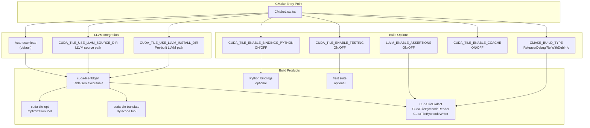
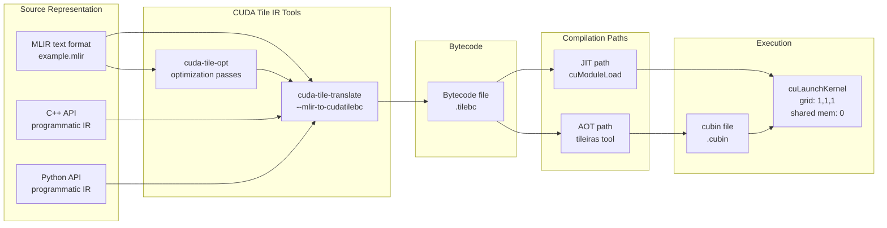
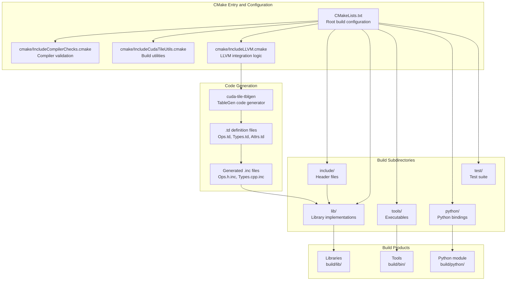

<!-- source: DeepWiki mcp.deepwiki.com · repo NVIDIA/cuda-tile · page 2 Getting Started · fetched 2026-10-26 -->

# Getting Started

<details>
<summary>Relevant source files</summary>

The following files were used as context for generating this wiki page:

- [README.md](README.md)

</details>


This page provides an overview of prerequisites, initial setup, and basic usage patterns for CUDA Tile IR. It covers the essential information needed to begin working with the project, including dependencies, quick start commands, and configuration options.

For detailed build instructions, see [Building from Source](#2.1). For integrating CUDA Tile IR into existing projects, see [Integration Methods](#2.2). For a complete walkthrough of writing and executing a CUDA Tile IR program, see [First Example](#2.3).

## Prerequisites

### Required Dependencies

The following dependencies are required to build and use CUDA Tile IR:

| Dependency | Minimum Version | Purpose |
|------------|----------------|---------|
| CMake | 3.20.0 | Build system configuration |
| C++ Compiler | C++17 compatible | Compilation (see compiler table below) |
| LLVM/MLIR | Specific commit | Compiler infrastructure |

**Supported Compilers:**

| Compiler | Minimum Version | Validation |
|----------|----------------|------------|
| GCC | 7.4+ | Checked in [cmake/IncludeCompilerChecks.cmake]() |
| Clang | 5.0+ | Checked in [cmake/IncludeCompilerChecks.cmake]() |
| MSVC | 19.29+ | Checked in [cmake/IncludeCompilerChecks.cmake]() |

The C++ standard is set to C++17 in [CMakeLists.txt:8]().

### Optional Dependencies

| Dependency | Purpose | Configuration Flag |
|------------|---------|-------------------|
| Python 3.6+ | Python bindings | `CUDA_TILE_ENABLE_BINDINGS_PYTHON` |
| Ninja | Faster builds | `-G Ninja` |
| ccache | Build caching | `CUDA_TILE_ENABLE_CCACHE` |
| CUDA Toolkit 13.1+ | Kernel execution | Runtime only |

### LLVM/MLIR Compatibility

CUDA Tile IR requires LLVM/MLIR at a specific compatible commit. The exact commit hash is defined in [cmake/IncludeLLVM.cmake:29](). This version alignment ensures compatibility with CUDA Toolkit 13.1.

**Sources:** [README.md:37-44](), [CMakeLists.txt:4-9](), [cmake/IncludeCompilerChecks.cmake]()

## Quick Start

The simplest way to get started is to let the build system automatically download and build LLVM/MLIR from source:

```bash
# Configure with automatic LLVM download
cmake -G Ninja -S . -B build \
  -DCMAKE_BUILD_TYPE=Release \
  -DLLVM_ENABLE_ASSERTIONS=OFF \
  -DCUDA_TILE_ENABLE_BINDINGS_PYTHON=ON

# Build all targets
cmake --build build

# Run tests (requires CUDA_TILE_ENABLE_TESTING=ON)
cmake --build build --target check-cuda-tile
```

This configuration will:
1. Download LLVM/MLIR sources from GitHub at the compatible commit
2. Build LLVM/MLIR and CUDA Tile IR
3. Enable Python bindings for programmatic IR manipulation
4. Produce tools in `build/bin/` and libraries in `build/lib/`

**Sources:** [README.md:47-65](), [CMakeLists.txt:1-29]()

## Configuration Options

### CMake Variables

The following diagram shows the key CMake configuration variables and how they relate to build outputs:



**Key Configuration Variables:**

| Variable | Default | Description |
|----------|---------|-------------|
| `CUDA_TILE_USE_LLVM_INSTALL_DIR` | Unset | Path to pre-built LLVM installation |
| `CUDA_TILE_USE_LLVM_SOURCE_DIR` | Unset | Path to LLVM source directory |
| `CUDA_TILE_ENABLE_BINDINGS_PYTHON` | OFF | Enable Python bindings |
| `CUDA_TILE_ENABLE_TESTING` | OFF | Enable test suite |
| `CUDA_TILE_ENABLE_CCACHE` | OFF | Enable ccache for faster rebuilds |
| `CMAKE_BUILD_TYPE` | - | Release/Debug/RelWithDebInfo |
| `LLVM_ENABLE_ASSERTIONS` | - | Enable LLVM assertions (Debug builds) |

The variables are validated in [CMakeLists.txt:56-62](), where mutually exclusive options are checked.

**Sources:** [CMakeLists.txt:16-41](), [README.md:67-103]()

## Development Workflow

The following diagram illustrates the typical development workflow from source files to kernel execution:



**Workflow Steps:**

1. **IR Creation**: Write CUDA Tile IR in textual MLIR format, or construct it programmatically using C++ or Python APIs
2. **Optimization** (optional): Apply transformation passes using `cuda-tile-opt`
3. **Bytecode Generation**: Use `cuda-tile-translate` to produce `.tilebc` bytecode files
4. **Compilation**:
   - **JIT Path**: Load bytecode directly with `cuModuleLoad` for runtime compilation
   - **AOT Path**: Use `tileiras` tool to compile bytecode to architecture-specific cubin files
5. **Execution**: Launch kernels using CUDA Driver API with `cuLaunchKernel`

The tools are built as subdirectories referenced in [CMakeLists.txt:152-174]().

**Sources:** [README.md:212-339](), [CMakeLists.txt:139-144]()

## Build System Components

Understanding the build system structure helps when troubleshooting or customizing the build:



**Key Build Files:**

- [CMakeLists.txt](): Root build configuration, sets C++17 standard, includes cmake utilities
- [cmake/IncludeCompilerChecks.cmake](): Validates compiler versions (GCC 7.4+, Clang 5.0+, MSVC 19.29+)
- [cmake/IncludeCudaTileUtils.cmake](): Build type configuration and utility functions
- [cmake/IncludeLLVM.cmake](): LLVM/MLIR integration with three pathways (install dir, source dir, auto-download)

**Build Subdirectories** (referenced in [CMakeLists.txt:172-181]()):

- `tools/cuda-tile-tblgen`: Must be built first, provides TableGen code generation
- `include/`: Header files and TableGen definitions
- `lib/`: Core dialect and bytecode implementations
- `tools/`: User-facing executables (`cuda-tile-opt`, `cuda-tile-translate`)
- `python/`: Python bindings (if `CUDA_TILE_ENABLE_BINDINGS_PYTHON=ON`)
- `test/`: Test suite (if `CUDA_TILE_ENABLE_TESTING=ON`)

**Sources:** [CMakeLists.txt:1-197](), [cmake/IncludeLLVM.cmake](), [cmake/IncludeCompilerChecks.cmake]()

## Directory Structure

The project follows this organization:

```
cuda-tile/
├── CMakeLists.txt              # Root build configuration
├── cmake/                      # CMake utilities and configuration
│   ├── IncludeLLVM.cmake      # LLVM integration logic
│   ├── IncludeCompilerChecks.cmake
│   └── IncludeCudaTileUtils.cmake
├── include/                    # Public headers
│   └── cuda-tile/             # Dialect definitions
├── lib/                        # Implementation files
│   ├── CAPI/                  # C API implementations
│   ├── Dialect/               # Core dialect
│   └── Bytecode/              # Bytecode reader/writer
├── tools/                      # Executables
│   ├── cuda-tile-tblgen/      # TableGen tool
│   ├── cuda-tile-opt/         # Optimization tool
│   └── cuda-tile-translate/   # Bytecode tool
├── python/                     # Python bindings (optional)
└── test/                       # Test suite (optional)
```

The source and binary directories are tracked as CMake variables:
- `CUDA_TILE_SOURCE_DIR`: Set in [CMakeLists.txt:16]()
- `CUDA_TILE_BINARY_DIR`: Set in [CMakeLists.txt:18]()
- `CUDA_TILE_INSTALL_DIR`: Set in [CMakeLists.txt:20]()

**Sources:** [CMakeLists.txt:16-21](), [CMakeLists.txt:134-144]()

## Next Steps

After completing the basic setup:

1. **Build from Source**: For detailed build instructions including cross-compilation and advanced options, see [Building from Source](#2.1)

2. **Integration**: To integrate CUDA Tile IR into your own project, see [Integration Methods](#2.2)

3. **First Example**: For a complete walkthrough of writing, compiling, and executing a CUDA Tile IR program, see [First Example](#2.3)

4. **Core Dialect**: To understand the operations, types, and attributes available, see [Core Dialect](#3)

5. **API Reference**: For programmatic usage via C++, C, or Python APIs, see [API Reference](#5)

**Sources:** [README.md:1-355]()

---

