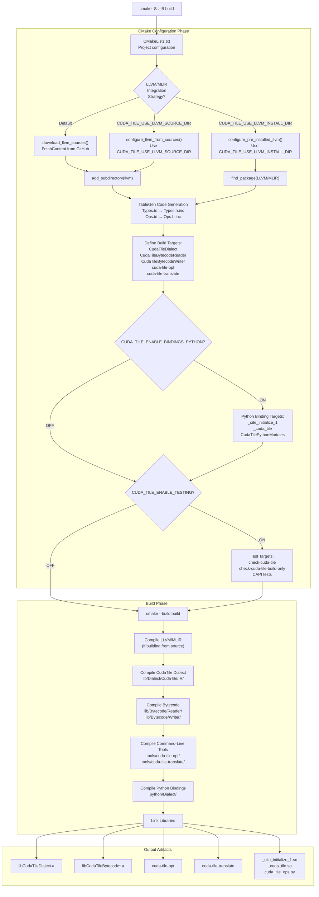
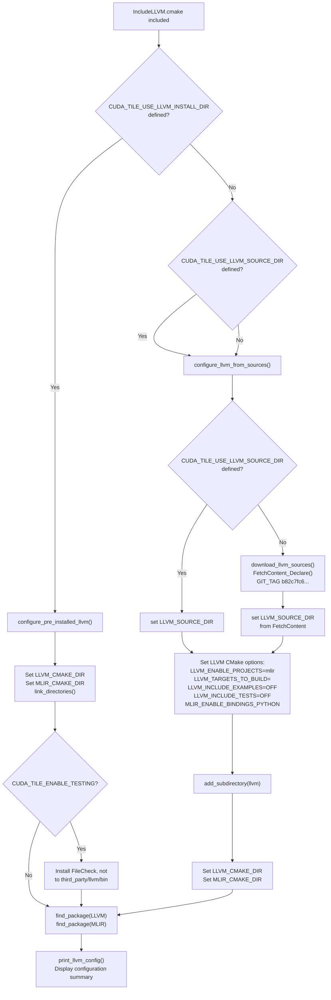
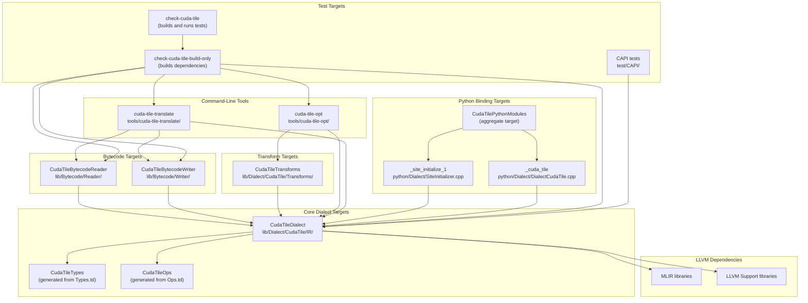

<!-- source: DeepWiki mcp.deepwiki.com · repo NVIDIA/cuda-tile · page 2.1 Building from Source · fetched 2026-10-26 -->

# Building from Source

<details>
<summary>Relevant source files</summary>

The following files were used as context for generating this wiki page:

- [README.md](README.md)
- [cmake/IncludeLLVM.cmake](cmake/IncludeLLVM.cmake)

</details>


This page provides detailed instructions for building CUDA Tile IR from source, including prerequisite setup, CMake configuration, and build verification. This covers the compilation process of CUDA Tile itself as a standalone project. For information about integrating CUDA Tile into your own projects, see [Integration Methods](#2.2).

## Prerequisites

CUDA Tile requires the following dependencies to build from source:

| Dependency | Minimum Version | Notes |
|------------|-----------------|-------|
| CMake | 3.20.0 | Build system configuration |
| C++ Compiler | C++17 compatible | GCC, Clang, or MSVC |
| Python | 3.6+ | Required for Python bindings and test infrastructure |
| LLVM/MLIR | Specific commit | Exact commit: `b82c7fc65229c8b2b6a964f023f6ec59b3cf9210` |
| Ninja | (optional) | Recommended for faster parallel builds |

The LLVM/MLIR dependency is the most critical. CUDA Tile is pinned to a specific LLVM commit hash defined in [cmake/IncludeLLVM.cmake:29](). This version requirement is strict because CUDA Tile depends on MLIR APIs that may change between commits.

**Sources:** [README.md:37-44](), [cmake/IncludeLLVM.cmake:29]()

## Build Process Overview

The following diagram shows the complete build process flow, from initial CMake configuration through final artifact generation:



**Sources:** [cmake/IncludeLLVM.cmake:25-163](), [README.md:48-133]()

## Quick Start Build

The fastest way to build CUDA Tile from source with automatic LLVM/MLIR download:

```bash
# Configure the build
cmake -G Ninja -S . -B build \
  -DCMAKE_BUILD_TYPE=Release \
  -DLLVM_ENABLE_ASSERTIONS=OFF \
  -DCUDA_TILE_ENABLE_BINDINGS_PYTHON=ON

# Build all targets
cmake --build build

# Run tests
cmake --build build --target check-cuda-tile
```

This configuration:
- Uses Ninja generator for parallel builds
- Builds release mode with optimizations enabled
- Disables LLVM assertions for better performance
- Enables Python bindings
- Automatically downloads LLVM/MLIR sources from GitHub at the pinned commit

**Sources:** [README.md:48-65]()

## Build Configuration Options

### Core Build Settings

| CMake Variable | Default | Description |
|----------------|---------|-------------|
| `CMAKE_BUILD_TYPE` | (none) | Build type: `Debug`, `Release`, `RelWithDebInfo`, `MinSizeRel` |
| `CMAKE_C_COMPILER` | System default | C compiler path |
| `CMAKE_CXX_COMPILER` | System default | C++ compiler path |
| `CMAKE_INSTALL_PREFIX` | `/usr/local` | Installation directory |

### LLVM/MLIR Integration Options

These options control how CUDA Tile integrates with LLVM/MLIR. For detailed explanations of each method, see [Integration Methods](#2.2).

| CMake Variable | Description |
|----------------|-------------|
| `CUDA_TILE_USE_LLVM_SOURCE_DIR` | Path to local LLVM sources. If set, builds LLVM from these sources instead of downloading. |
| `CUDA_TILE_USE_LLVM_INSTALL_DIR` | Path to pre-built LLVM installation. If set, links against pre-compiled libraries. |
| `LLVM_ENABLE_ASSERTIONS` | Enable LLVM assertions. Recommended `OFF` for release builds, `ON` for debugging. |

When neither `CUDA_TILE_USE_LLVM_SOURCE_DIR` nor `CUDA_TILE_USE_LLVM_INSTALL_DIR` is set, the build system automatically invokes `download_llvm_sources()` from [cmake/IncludeLLVM.cmake:25-52]() which uses CMake's `FetchContent` to download LLVM sources at commit `b82c7fc65229c8b2b6a964f023f6ec59b3cf9210`.

**Sources:** [cmake/IncludeLLVM.cmake:57-127](), [cmake/IncludeLLVM.cmake:133-163](), [README.md:69-103]()

### Feature Control Options

| CMake Variable | Default | Description |
|----------------|---------|-------------|
| `CUDA_TILE_ENABLE_BINDINGS_PYTHON` | `OFF` | Enable Python bindings. When building LLVM from source, automatically sets `MLIR_ENABLE_BINDINGS_PYTHON=ON`. |
| `CUDA_TILE_ENABLE_TESTING` | `ON` | Enable test targets and test tool installation. |
| `CUDA_TILE_ENABLE_CCACHE` | `OFF` | Enable ccache for faster recompilation. When building LLVM from source, propagates to `LLVM_CCACHE_BUILD`. |

**Sources:** [cmake/IncludeLLVM.cmake:90-98](), [cmake/IncludeLLVM.cmake:104-117](), [README.md:104-133]()

### LLVM Build Configuration

When building LLVM from source (either via auto-download or local sources), the macro `configure_llvm_from_sources()` applies these settings to minimize build time:

```cmake
# Disabled to reduce build time
LLVM_INCLUDE_EXAMPLES=OFF
LLVM_INCLUDE_TESTS=OFF
LLVM_INCLUDE_BENCHMARKS=OFF
LLVM_BUILD_EXAMPLES=OFF

# Only build MLIR, not other LLVM tools
LLVM_ENABLE_PROJECTS="mlir"

# Don't build any code generation targets
LLVM_TARGETS_TO_BUILD=""

# Build and install utility tools for testing
LLVM_BUILD_UTILS=ON
LLVM_INSTALL_UTILS=ON
```

The build system also disables precompiled headers (`CMAKE_DISABLE_PRECOMPILE_HEADERS=ON`) to avoid flag mismatches between LLVM and CUDA Tile targets, particularly around debug flags like `NDEBUG`.

**Sources:** [cmake/IncludeLLVM.cmake:76-102]()

## LLVM/MLIR Configuration Macro Flow

The following diagram shows the internal CMake macro execution flow based on configuration options:



**Sources:** [cmake/IncludeLLVM.cmake:57-163]()

## Build Target Hierarchy

After configuration, CMake generates the following build targets:



**Sources:** [cmake/IncludeLLVM.cmake:104-117]()

## Building the Project

After configuration, build all targets:

```bash
# Build all targets
cmake --build build

# Build with explicit parallelism (for Make generator)
cmake --build build -j 8

# Build specific target
cmake --build build --target CudaTileDialect

# Build only Python bindings
cmake --build build --target CudaTilePythonModules

# Build command-line tools
cmake --build build --target cuda-tile-opt cuda-tile-translate
```

**Common build targets:**

| Target | Description |
|--------|-------------|
| `all` | Default target, builds everything except tests |
| `CudaTileDialect` | Core dialect library only |
| `CudaTileBytecodeReader` | Bytecode deserialization library |
| `CudaTileBytecodeWriter` | Bytecode serialization library |
| `cuda-tile-opt` | Optimization tool for applying transformation passes |
| `cuda-tile-translate` | Translation tool for MLIR ↔ bytecode conversion |
| `CudaTilePythonModules` | All Python binding modules (if enabled) |
| `check-cuda-tile-build-only` | Build test dependencies without running tests |
| `check-cuda-tile` | Build and execute full test suite |

## Build Artifacts

After a successful build, artifacts are organized in the build directory:

| Location | Contents |
|----------|----------|
| `build/lib/` | Static libraries: `libCudaTileDialect.a`, `libCudaTileBytecodeReader.a`, `libCudaTileBytecodeWriter.a`, etc. |
| `build/bin/` | Command-line tools: `cuda-tile-opt`, `cuda-tile-translate`, `FileCheck`, `not` |
| `build/include/` | Generated headers: `Types.h.inc`, `Ops.h.inc`, `Dialect.h.inc` |
| `build/python/` | Python binding shared libraries: `_site_initialize_1.so`, `_cuda_tile.so` |
| `build/tools/` | Tool-specific build artifacts |
| `build/llvm-project-build/` | LLVM/MLIR build artifacts (if building from source) |

The Python bindings require special PYTHONPATH setup to use from the build directory. For details on Python binding usage, see [Python Operations API](#5.3.3).

## Testing the Build

CUDA Tile uses LLVM's `lit` (LLVM Integrated Tester) framework for testing. Tests are enabled by default via `CUDA_TILE_ENABLE_TESTING=ON`.

**Run all tests:**
```bash
cmake --build build --target check-cuda-tile
```

**Build test dependencies without running:**
```bash
cmake --build build --target check-cuda-tile-build-only
```

The test system validates:
- MLIR textual format parsing and printing
- Bytecode serialization/deserialization round-trips
- Optimization pass correctness
- Python binding functionality
- C API registration and type creation

For comprehensive information about the testing infrastructure, see [Testing and Validation](#10).

**Sources:** [README.md:135-142]()

## Troubleshooting Common Build Issues

### LLVM Version Mismatch

**Error:** `Compatible LLVM commit not found` or LLVM linking errors.

**Solution:** Ensure your LLVM sources or pre-built libraries match commit `b82c7fc65229c8b2b6a964f023f6ec59b3cf9210`. Check [cmake/IncludeLLVM.cmake:29]() for the exact commit hash.

### Python Binding Errors

**Error:** `Could not find MLIR Python bindings` or Nanobind compilation failures.

**Solution:** When using pre-built LLVM, ensure it was built with `-DMLIR_ENABLE_BINDINGS_PYTHON=ON`. When building from source, this is automatically handled by [cmake/IncludeLLVM.cmake:97]().

### Out of Memory During LLVM Build

**Error:** Compiler killed or out-of-memory during LLVM compilation.

**Solution:** Limit parallel jobs: `cmake --build build -j 4`. Consider using pre-built LLVM libraries via `CUDA_TILE_USE_LLVM_INSTALL_DIR` to avoid building LLVM entirely.

### Cross-Compilation Not Supported

**Error:** `Cross-compilation is not supported when building LLVM from sources`.

**Solution:** Cross-compilation is only supported when using pre-built LLVM libraries via `CUDA_TILE_USE_LLVM_INSTALL_DIR`. See [cmake/IncludeLLVM.cmake:58-60]().

### Test Tools Not Found

**Error:** `FileCheck not found` or `lit configuration failed`.

**Solution:** Ensure `CUDA_TILE_ENABLE_TESTING=ON` during configuration. This triggers installation of test tools to `third_party/llvm/bin/` via [cmake/IncludeLLVM.cmake:107-116]() and [cmake/IncludeLLVM.cmake:146-153]().

**Sources:** [cmake/IncludeLLVM.cmake:58-60](), [cmake/IncludeLLVM.cmake:97](), [cmake/IncludeLLVM.cmake:136-141]()

---

