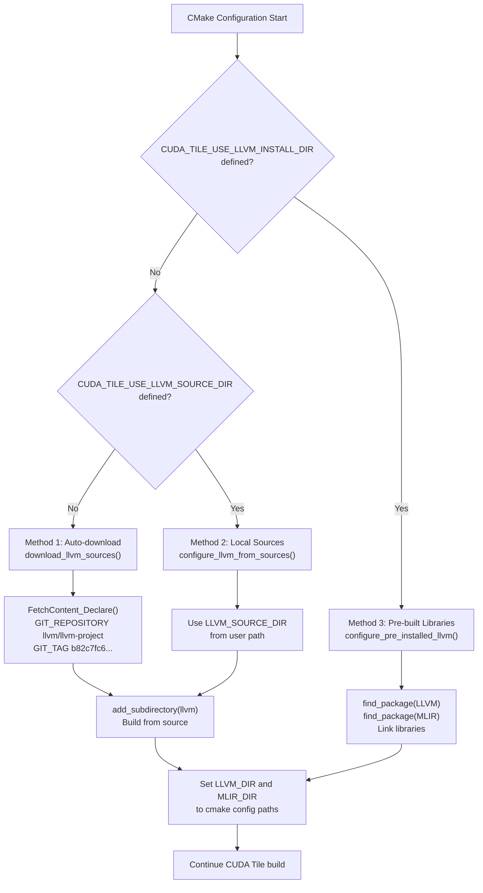
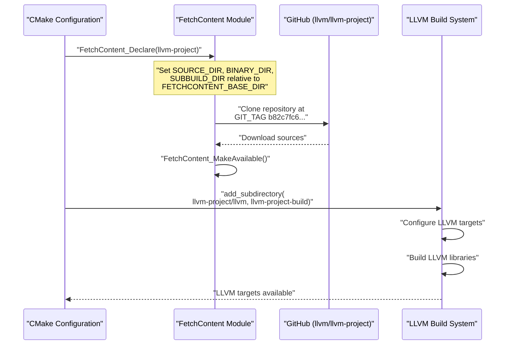
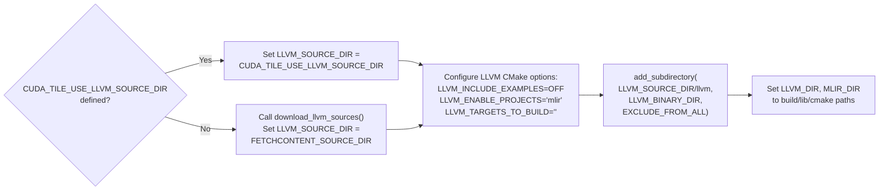
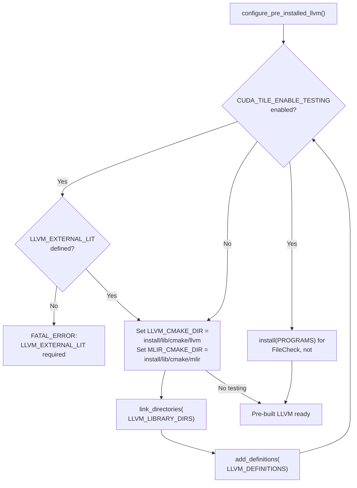
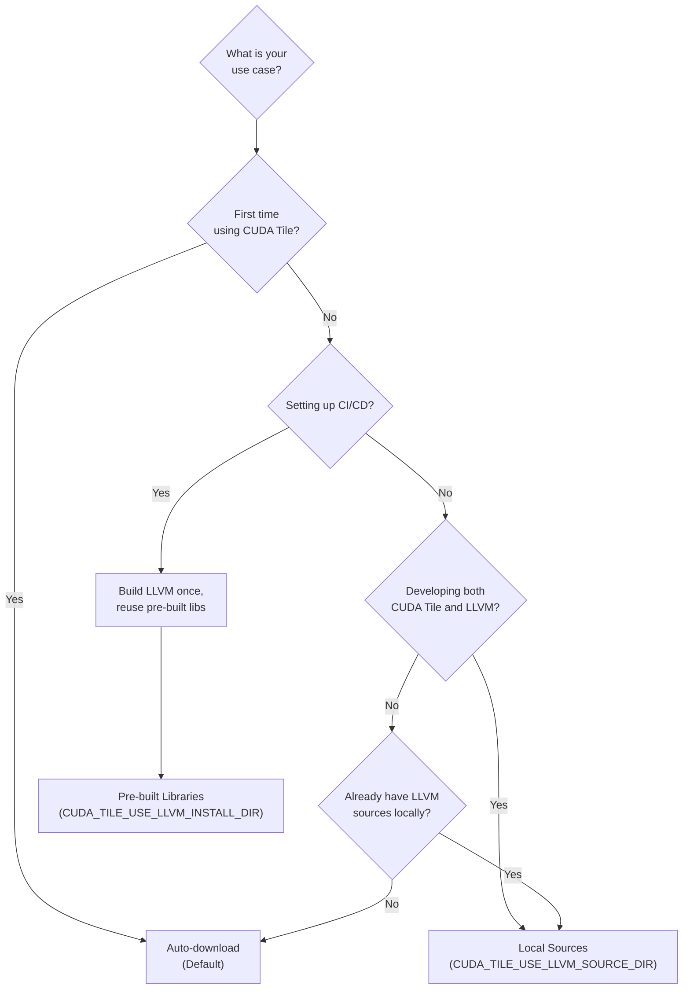

<!-- source: DeepWiki mcp.deepwiki.com · repo NVIDIA/cuda-tile · page 2.2 Integration Methods · fetched 2026-10-26 -->

# Integration Methods

<details>
<summary>Relevant source files</summary>

The following files were used as context for generating this wiki page:

- [README.md](README.md)
- [cmake/IncludeLLVM.cmake](cmake/IncludeLLVM.cmake)

</details>


## Purpose and Scope

This page documents the three methods for integrating LLVM/MLIR dependencies into CUDA Tile IR builds. CUDA Tile requires MLIR (part of the LLVM project) at a specific compatible commit hash. The build system provides flexible integration strategies to accommodate different development workflows and CI/CD environments.

For information about integrating the **CUDA Tile project itself** into downstream applications, see [Building from Source](#2.1). For Python-specific binding configuration, see [Python Build System](#5.3.1).

**Sources:** [cmake/IncludeLLVM.cmake:1-164](), [README.md:69-102]()

---

## Overview of Integration Methods

CUDA Tile supports three mutually exclusive methods for obtaining LLVM/MLIR dependencies, controlled via CMake configuration variables:

| Method | CMake Variable | Use Case | Build Time | Setup Complexity |
|--------|---------------|----------|------------|------------------|
| **Auto-download** | None (default) | Quick start, CI environments | Longest (~2+ hours) | Minimal |
| **Local Sources** | `CUDA_TILE_USE_LLVM_SOURCE_DIR` | Active development, customization | Long (~2+ hours) | Medium |
| **Pre-built Libraries** | `CUDA_TILE_USE_LLVM_INSTALL_DIR` | Production, CI optimization | Fast (~10 minutes) | Highest |

All three methods require LLVM/MLIR at the specific commit hash defined in [cmake/IncludeLLVM.cmake:29]() (currently `b82c7fc65229c8b2b6a964f023f6ec59b3cf9210`). The build system performs version validation to ensure compatibility.

**Sources:** [cmake/IncludeLLVM.cmake:25-163](), [README.md:69-102]()

---

## Integration Method Selection Flow



**Sources:** [cmake/IncludeLLVM.cmake:25-163]()

---

## Method 1: Auto-download from GitHub

### Configuration

The auto-download method is the **default** when no LLVM-related CMake variables are set. It requires no manual setup of LLVM dependencies.

```bash
cmake -G Ninja -S . -B build -DCMAKE_BUILD_TYPE=Release
```

### Implementation Details

The `download_llvm_sources()` macro ([cmake/IncludeLLVM.cmake:25-52]()) uses CMake's `FetchContent` module to clone the LLVM project from GitHub:



### Key Variables Set

The macro configures the following FetchContent variables ([cmake/IncludeLLVM.cmake:35-39]()):

- `FETCHCONTENT_BASE_DIR`: `${CUDA_TILE_BINARY_DIR}`
- `FETCHCONTENT_SOURCE_DIR`: `llvm-project`
- `FETCHCONTENT_BINARY_DIR`: `llvm-project-build`
- `FETCHCONTENT_SUBBUILD_DIR`: `llvm-project-subbuild`
- `FETCHCONTENT_QUIET`: `FALSE` (enables progress output)

The downloaded sources are placed in `${CUDA_TILE_BINARY_DIR}/llvm-project/`, and the build artifacts in `${CUDA_TILE_BINARY_DIR}/llvm-project-build/`.

### Advantages and Limitations

**Advantages:**
- Zero setup required beyond CMake and a C++ compiler
- Guarantees correct LLVM version automatically
- Ideal for first-time users and CI environments

**Limitations:**
- Longest build time (LLVM compilation takes 2+ hours)
- Requires stable internet connection during configuration
- No cross-compilation support ([cmake/IncludeLLVM.cmake:58-60]())

**Sources:** [cmake/IncludeLLVM.cmake:25-52](), [cmake/IncludeLLVM.cmake:57-127](), [README.md:75-82]()

---

## Method 2: Local LLVM Sources

### Configuration

This method builds LLVM/MLIR from existing sources on the filesystem, useful when developing both CUDA Tile and LLVM simultaneously or when offline builds are required.

```bash
cmake -G Ninja -S . -B build \
  -DCMAKE_BUILD_TYPE=Release \
  -DCUDA_TILE_USE_LLVM_SOURCE_DIR=/path/to/llvm-project
```

### Version Requirements

The local LLVM sources **must** be at the compatible commit hash. The build system does not perform automatic version checking for local sources, so users must ensure correctness. Verify with:

```bash
cd /path/to/llvm-project
git log -1 --format=%H
# Should output: b82c7fc65229c8b2b6a964f023f6ec59b3cf9210
```

### Implementation Details

The `configure_llvm_from_sources()` macro ([cmake/IncludeLLVM.cmake:57-127]()) handles both auto-download and local sources:



### LLVM Build Configuration

When building from sources (either downloaded or local), the macro sets minimal LLVM configuration options ([cmake/IncludeLLVM.cmake:76-98]()):

| CMake Variable | Value | Purpose |
|----------------|-------|---------|
| `LLVM_INCLUDE_EXAMPLES` | `OFF` | Skip example targets |
| `LLVM_INCLUDE_TESTS` | `OFF` | Skip LLVM test suite |
| `LLVM_INCLUDE_BENCHMARKS` | `OFF` | Skip benchmark targets |
| `LLVM_BUILD_EXAMPLES` | `OFF` | Don't build examples |
| `LLVM_ENABLE_ASSERTIONS` | `OFF` | Release mode default |
| `LLVM_ENABLE_PROJECTS` | `"mlir"` | Only MLIR, not Clang/LLD/etc |
| `LLVM_TARGETS_TO_BUILD` | `""` | No backend targets (MLIR only) |
| `CMAKE_DISABLE_PRECOMPILE_HEADERS` | `ON` | Avoid flag mismatches |
| `LLVM_BUILD_UTILS` | `ON` | Build FileCheck, not, etc. |
| `LLVM_INSTALL_UTILS` | `ON` | Install test utilities |
| `MLIR_INCLUDE_TESTS` | `OFF` | Skip MLIR tests |
| `MLIR_ENABLE_BINDINGS_PYTHON` | `${CUDA_TILE_ENABLE_BINDINGS_PYTHON}` | Match CUDA Tile setting |

This minimal configuration significantly reduces build time by avoiding unnecessary LLVM components.

### Ccache Propagation

When `CUDA_TILE_ENABLE_CCACHE` is enabled, the setting propagates to the LLVM build ([cmake/IncludeLLVM.cmake:91-93]()):

```cmake
if(CUDA_TILE_ENABLE_CCACHE)
  set(LLVM_CCACHE_BUILD ON CACHE BOOL "")
endif()
```

**Sources:** [cmake/IncludeLLVM.cmake:57-127](), [README.md:84-92]()

---

## Method 3: Pre-built LLVM Libraries

### Configuration

This method links against pre-compiled LLVM/MLIR libraries, drastically reducing CUDA Tile build time. Recommended for production builds and CI optimization.

```bash
cmake -G Ninja -S . -B build \
  -DCMAKE_BUILD_TYPE=Release \
  -DCUDA_TILE_USE_LLVM_INSTALL_DIR=/path/to/llvm/install
```

When testing is enabled, the `LLVM_EXTERNAL_LIT` variable must also be provided:

```bash
cmake -G Ninja -S . -B build \
  -DCMAKE_BUILD_TYPE=Release \
  -DCUDA_TILE_USE_LLVM_INSTALL_DIR=/path/to/llvm/install \
  -DLLVM_EXTERNAL_LIT=/path/to/llvm/install/bin/llvm-lit
```

### Version Requirements

Pre-built LLVM libraries **must**:
1. Be built from commit `b82c7fc65229c8b2b6a964f023f6ec59b3cf9210`
2. Include MLIR components
3. If Python bindings are needed, be built with `-DMLIR_ENABLE_BINDINGS_PYTHON=ON`

The build system validates version compatibility through CMake package configuration files.

### Implementation Details

The `configure_pre_installed_llvm()` macro ([cmake/IncludeLLVM.cmake:133-163]()) sets up paths and links libraries:



### CMake Package Discovery

The macro sets `LLVM_DIR` and `MLIR_DIR` to the CMake package config directories ([cmake/IncludeLLVM.cmake:155-158]()):

```cmake
set(LLVM_CMAKE_DIR ${CUDA_TILE_USE_LLVM_INSTALL_DIR}/lib/cmake/llvm)
set(LLVM_DIR "${LLVM_CMAKE_DIR}")
set(MLIR_CMAKE_DIR ${CUDA_TILE_USE_LLVM_INSTALL_DIR}/lib/cmake/mlir)
set(MLIR_DIR "${MLIR_CMAKE_DIR}")
```

These paths allow subsequent `find_package(LLVM)` and `find_package(MLIR)` calls to locate the installation.

### Test Tool Installation

When testing is enabled, the macro installs LLVM utilities (`FileCheck`, `not`) from the pre-built installation to `third_party/llvm/bin/` ([cmake/IncludeLLVM.cmake:146-153]()):

```cmake
foreach(_TOOL_NAME ${LLVM_TOOLS_TO_INSTALL})
  install(
    PROGRAMS ${CUDA_TILE_USE_LLVM_INSTALL_DIR}/bin/${_TOOL_NAME}${CMAKE_EXECUTABLE_SUFFIX}
    DESTINATION third_party/llvm/bin
  )
endforeach()
```

This ensures test infrastructure has access to required LLVM tools without rebuilding them.

### Python Bindings Requirement

When `CUDA_TILE_ENABLE_BINDINGS_PYTHON=ON`, the pre-built LLVM must have been compiled with MLIR Python bindings enabled. The build system does not validate this automatically, so users must ensure their LLVM build includes `-DMLIR_ENABLE_BINDINGS_PYTHON=ON`.

**Sources:** [cmake/IncludeLLVM.cmake:133-163](), [README.md:94-102](), [README.md:116-119]()

---

## Test Utility Handling

All three integration methods ensure LLVM test utilities (`FileCheck`, `not`) are available when `CUDA_TILE_ENABLE_TESTING=ON`. The handling differs by method:

| Method | Utility Source | Installation Mechanism |
|--------|---------------|------------------------|
| Auto-download / Local | Built from source | CMake targets, installed via `install(TARGETS)` |
| Pre-built | Copied from installation | Shell programs, installed via `install(PROGRAMS)` |

### Source-built Utilities

For source-based builds, custom targets ensure the utilities are always built ([cmake/IncludeLLVM.cmake:107-116]()):

```cmake
foreach(_TOOL_NAME ${LLVM_TOOLS_TO_INSTALL})
  add_custom_target(llvm-test-tool-${_TOOL_NAME} ALL DEPENDS ${_TOOL_NAME})
  
  install(TARGETS ${_TOOL_NAME}
    RUNTIME DESTINATION third_party/llvm/bin
  )
endforeach()
```

The `DEPENDS ${_TOOL_NAME}` ensures the utility is built even though the parent LLVM directory uses `EXCLUDE_FROM_ALL`.

### Pre-built Utilities

For pre-built LLVM, utilities are copied from the installation directory ([cmake/IncludeLLVM.cmake:148-152]()):

```cmake
install(
  PROGRAMS ${CUDA_TILE_USE_LLVM_INSTALL_DIR}/bin/${_TOOL_NAME}${CMAKE_EXECUTABLE_SUFFIX}
  DESTINATION third_party/llvm/bin
)
```

**Sources:** [cmake/IncludeLLVM.cmake:3](), [cmake/IncludeLLVM.cmake:104-153]()

---

## Configuration Diagnostics

The `print_llvm_config()` macro ([cmake/IncludeLLVM.cmake:5-23]()) outputs LLVM/MLIR configuration details during CMake configuration. It displays:

| Variable | Description |
|----------|-------------|
| `LLVM_ENABLE_ASSERTIONS` | Assertion mode (ON/OFF) |
| `LLVM_ENABLE_RTTI` | Runtime type information enabled |
| `LLVM_CONFIG_HAS_RTTI` | RTTI detected in config |
| `LLVM_ENABLE_EH` | Exception handling enabled |
| `LLVM_SOURCE_DIR` | LLVM source directory path |
| `LLVM_BINARY_DIR` | LLVM build directory path |
| `LLVM_INCLUDE_DIRS` | LLVM header directories |
| `MLIR_INCLUDE_DIRS` | MLIR header directories |
| `LLVM_LIBRARY_DIR` | LLVM library directory |
| `MLIR_ENABLE_BINDINGS_PYTHON` | Python bindings status |
| `MLIR_ENABLE_EXECUTION_ENGINE` | Execution engine availability |
| `LLVM_LIT` | Lit test runner path |
| `LLVM_EXTERNAL_LIT` | External lit tool path (pre-built only) |

This macro is called after LLVM configuration completes to aid debugging and validation.

**Sources:** [cmake/IncludeLLVM.cmake:5-23]()

---

## Method Comparison and Recommendations

### Decision Matrix



### Recommended Workflows

**Development Workflow:**
1. First build: Use auto-download to establish baseline
2. Subsequent builds: Build LLVM once, then use pre-built libraries
3. LLVM modifications: Use local sources with `CUDA_TILE_USE_LLVM_SOURCE_DIR`

**CI/CD Workflow:**
1. Cache pre-built LLVM artifacts between runs
2. Use `CUDA_TILE_USE_LLVM_INSTALL_DIR` for fast builds
3. Rebuild LLVM cache only when commit hash changes

**Offline Development:**
1. Clone LLVM repository manually at correct commit
2. Use `CUDA_TILE_USE_LLVM_SOURCE_DIR` for builds
3. Sources remain available without network access

**Sources:** [README.md:69-133](), [cmake/IncludeLLVM.cmake:25-163]()

---

