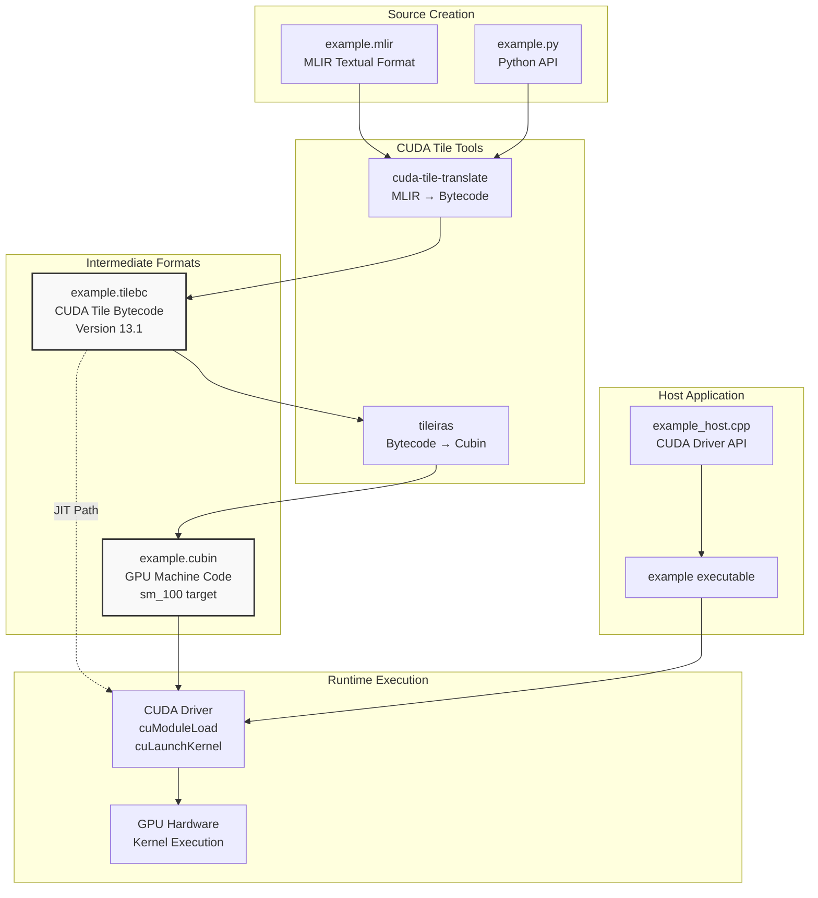
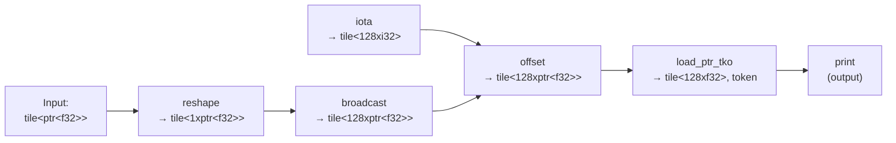
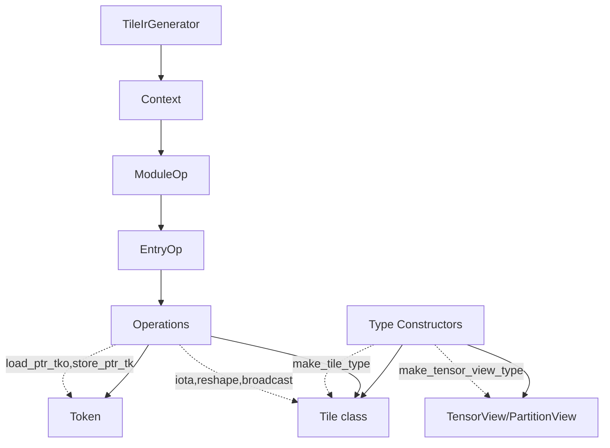
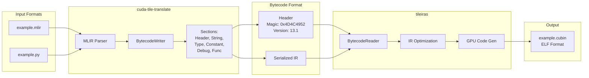
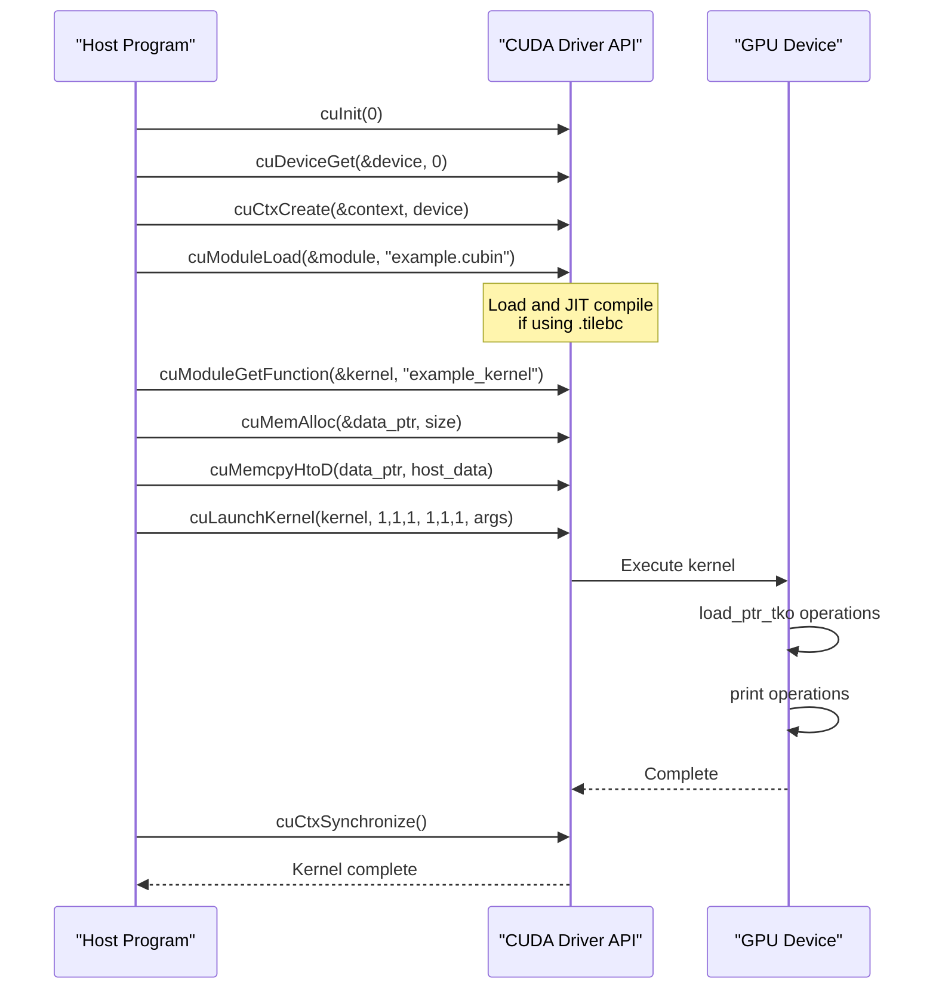
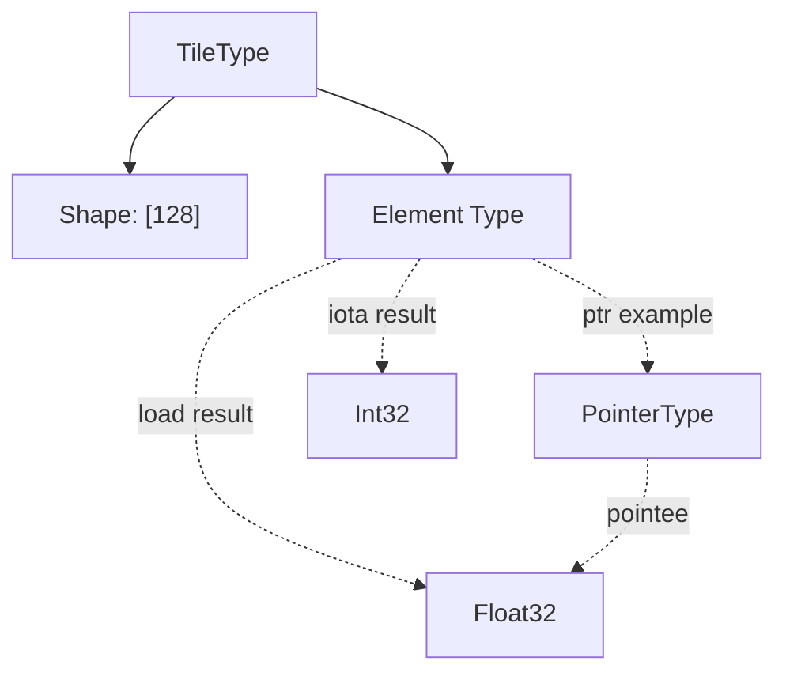

<!-- source: DeepWiki mcp.deepwiki.com · repo NVIDIA/cuda-tile · page 2.3 First Example · fetched 2026-10-26 -->

# First Example

<details>
<summary>Relevant source files</summary>

The following files were used as context for generating this wiki page:

- [README.md](README.md)
- [python/cuda_tile/dialects/cuda_tile_ops.py](python/cuda_tile/dialects/cuda_tile_ops.py)

</details>


This page walks through creating, compiling, and executing a simple CUDA Tile IR kernel. Two approaches are demonstrated: writing IR directly in MLIR textual format, and using the Python API to generate IR programmatically. Both approaches produce the same bytecode output and follow the same compilation and execution pipeline.

For information about building the tools referenced here, see [Building from Source](#2.1). For details on the Python API beyond this introductory example, see [Python Operations API](#5.3.3).

---

## Example Overview

The example kernel performs a simple operation: loading 128 floating-point values from a pointer and printing them. This demonstrates fundamental CUDA Tile IR concepts including:

- Entry point definition with kernel arguments
- Tile creation and manipulation (`iota`, `reshape`, `broadcast`, `offset`)
- Memory operations (`load_ptr_tko` with token ordering)
- Output operations (`print`)

The kernel accepts a single argument: a pointer to f32 data (`tile<ptr<f32>>`), loads 128 elements from sequential memory locations, and prints the resulting tile.

---

## Complete Workflow Diagram



**Sources:** [README.md:212-339]()

---

## Approach 1: MLIR Textual Format

### Writing the MLIR Program

The kernel is defined in MLIR textual format with the following structure:

```mlir
cuda_tile.module @example_module {
    entry @example_kernel(%data_pr : tile<ptr<f32>>) {
        print "Running example module\n"
        %offsets = iota : tile<128xi32>
        %data_ptr_reshaped = reshape %data_pr : tile<ptr<f32>> -> tile<1xptr<f32>>
        %data_ptr_broadcasted = broadcast %data_ptr_reshaped : tile<1xptr<f32>> -> tile<128xptr<f32>>
        %data_ptr_tensor = offset %data_ptr_broadcasted, %offsets : tile<128xptr<f32>>, tile<128xi32> -> tile<128xptr<f32>>
        %data, %token = load_ptr_tko weak %data_ptr_tensor : tile<128xptr<f32>> -> tile<128xf32>, token
        print "Data: %f\n", %data : tile<128xf32>
        return
    }
}
```

#### Key Operations

| Operation | Purpose | Result Type |
|-----------|---------|-------------|
| `cuda_tile.module` | Top-level container for kernel definitions | Module with symbol `@example_module` |
| `entry` | Kernel entry point with public visibility | Function accepting `tile<ptr<f32>>` |
| `iota` | Generate sequence [0, 1, 2, ..., 127] | `tile<128xi32>` |
| `reshape` | Convert scalar pointer to rank-1 tile | `tile<1xptr<f32>>` |
| `broadcast` | Replicate pointer across 128 elements | `tile<128xptr<f32>>` |
| `offset` | Add integer offsets to pointers | `tile<128xptr<f32>>` |
| `load_ptr_tko` | Load from pointers with token ordering | `tile<128xf32>`, `token` |
| `print` | Output string or tensor data | void |

**Sources:** [README.md:230-245](), [python/cuda_tile/dialects/cuda_tile_ops.py:2291-2300](), [python/cuda_tile/dialects/cuda_tile_ops.py:2323-2465]()

### MLIR Operation Flow



**Sources:** [README.md:230-245]()

---

## Approach 2: Python API

### Writing the Python Program

The same kernel can be generated using the Python API:

```python
from cuda_tile.dialects import cuda_tile_ops as ct
from cuda_tile.ir import Context, Location

# Initialize IR context
generator = ct.TileIrGenerator()

with generator.tile_ir_start(), generator.location():
    with generator.create_tile_ir_module("example_module"):
        # Define entry point
        ptr_type = ct.make_tile_type(ct.PointerType.get(ct.Float32.mlir_type), [])
        
        with generator.create_entry("example_kernel", [ptr_type]):
            args = generator.entry.body.arguments
            data_pr = ct.Tile(args[0], ptr_type)
            
            # Print header
            ct.printf("Running example module\n", [])
            
            # Generate offset sequence
            offsets = ct.iota(128, ct.Int32)
            
            # Prepare pointer tile
            data_ptr_reshaped = ct.reshape([1], data_pr)
            data_ptr_broadcasted = ct.broadcast([128], data_ptr_reshaped)
            data_ptr_tensor = ct.add(data_ptr_broadcasted, offsets)
            
            # Load data
            result_type = ct.make_tile_type(ct.Float32, [128])
            data, token = ct.load_ptr_tko(
                result_type, 
                data_ptr_tensor,
                memory_ordering_semantics=ct.MemoryOrderingSemantics.WEAK,
                return_token=True
            )
            
            # Print data
            ct.printf("Data: %f\n", [data])

# Print generated IR
generator.print_ir(enable_location=False)
```

### Python API Component Hierarchy



**Sources:** [python/cuda_tile/dialects/cuda_tile_ops.py:4201-4265](), [python/cuda_tile/dialects/cuda_tile_ops.py:1140-1162](), [python/cuda_tile/dialects/cuda_tile_ops.py:667-823]()

### Key Python API Functions

| Function | Purpose | Return Type |
|----------|---------|-------------|
| `TileIrGenerator()` | Initialize IR generation context | Generator instance |
| `tile_ir_start()` | Create MLIR context | Context manager |
| `create_tile_ir_module()` | Create module container | InsertionPoint |
| `create_entry()` | Define kernel entry point | EntryContext |
| `make_tile_type()` | Construct tile type | TileType |
| `iota()` | Generate integer sequence | Tile |
| `reshape()` | Change tile shape | Tile |
| `broadcast()` | Replicate tile elements | Tile |
| `load_ptr_tko()` | Load with token ordering | Tuple[Tile, Token] |

**Sources:** [python/cuda_tile/dialects/cuda_tile_ops.py:4201-4265](), [python/cuda_tile/dialects/cuda_tile_ops.py:2916-2928](), [python/cuda_tile/dialects/cuda_tile_ops.py:2590-2595](), [python/cuda_tile/dialects/cuda_tile_ops.py:2323-2465]()

---

## Compilation Pipeline

### Step 1: MLIR to Bytecode

The `cuda-tile-translate` tool converts MLIR textual format to CUDA Tile bytecode:

```bash
cuda-tile-translate example.mlir \
  --bytecode-version=13.1 \
  --mlir-to-cudatilebc \
  --no-implicit-module \
  -o example.tilebc
```

**Key flags:**
- `--bytecode-version=13.1`: Target bytecode format version
- `--mlir-to-cudatilebc`: Specify conversion direction
- `--no-implicit-module`: Expect explicit module declaration
- `-o example.tilebc`: Output bytecode file

**Sources:** [README.md:327]()

### Step 2: Bytecode to Cubin (AOT)

The `tileiras` tool compiles bytecode to GPU machine code:

```bash
tileiras --gpu-name sm_100 example.tilebc -o example.cubin
```

**Note:** Replace `sm_100` with your target GPU architecture (e.g., `sm_80`, `sm_90`, `sm_103`, `sm_120`).

**Sources:** [README.md:328-330]()

### Compilation Pipeline Components



**Sources:** [README.md:327-330]()

---

## Host Program Integration

### C++ Host Code

The host program loads and executes the compiled kernel using CUDA Driver API:

```cpp
#include <cuda.h>
#include <cuda_runtime_api.h>

// Error checking macro
#define CUDA_CHECK(call) do { \
    CUresult err = call; \
    if (err != CUDA_SUCCESS) { \
        const char *errStr; \
        cuGetErrorString(err, &errStr); \
        fprintf(stderr, "CUDA error at %s:%d: %s\n", __FILE__, __LINE__, errStr); \
        exit(1); \
    } \
} while (0)

// Input data (128 floats: 0, 5, 10, ..., 635)
float data[128] = {0, 5, 10, 15, /* ... */, 635};

int main() {
    CUdevice cuDevice;
    CUcontext cuContext;
    CUmodule cuModule;
    CUfunction example_kernel;
    CUstream stream;
    
    // Initialize CUDA
    CUDA_CHECK(cuInit(0));
    CUDA_CHECK(cuDeviceGet(&cuDevice, 0));
    CUDA_CHECK(cuCtxCreate(&cuContext, NULL, 0, cuDevice));
    CUDA_CHECK(cuStreamCreate(&stream, CU_STREAM_DEFAULT));
    
    // Load compiled kernel (cubin or tilebc)
    CUDA_CHECK(cuModuleLoad(&cuModule, "example.cubin"));
    CUDA_CHECK(cuModuleGetFunction(&example_kernel, cuModule, "example_kernel"));
    
    // Allocate device memory and copy input
    CUdeviceptr data_ptr;
    CUDA_CHECK(cuMemAlloc(&data_ptr, sizeof(data)));
    CUDA_CHECK(cuMemcpyHtoD(data_ptr, data, sizeof(data)));
    
    // Launch kernel
    void *kernel_args[] = {&data_ptr};
    CUDA_CHECK(cuLaunchKernel(
        example_kernel,
        1, 1, 1,        // grid dims (Tile Grid dimensions)
        1, 1, 1,        // block dims (must be 1,1,1 for CUDA Tile)
        0,              // shared memory (unused, must be 0)
        stream,
        kernel_args,
        NULL
    ));
    
    CUDA_CHECK(cuCtxSynchronize());
    
    // Cleanup
    CUDA_CHECK(cuModuleUnload(cuModule));
    CUDA_CHECK(cuCtxDestroy(cuContext));
    
    return 0;
}
```

### CUDA Driver API Key Functions

| Function | Purpose |
|----------|---------|
| `cuInit()` | Initialize CUDA driver |
| `cuDeviceGet()` | Get device handle by index |
| `cuCtxCreate()` | Create CUDA context on device |
| `cuModuleLoad()` | Load .cubin or .tilebc module |
| `cuModuleGetFunction()` | Get kernel function by name |
| `cuMemAlloc()` | Allocate device memory |
| `cuMemcpyHtoD()` | Copy host to device memory |
| `cuLaunchKernel()` | Launch kernel on GPU |

**Important constraints for CUDA Tile kernels:**
- Block dimensions must be `(1, 1, 1)`
- Shared memory must be `0`
- Grid dimensions correspond to Tile Grid dimensions

**Sources:** [README.md:247-323]()

### Host Execution Flow



**Sources:** [README.md:282-316]()

---

## Building and Running

### Prerequisites

- CUDA Toolkit 13.1+ with compatible driver
- CUDA Tile IR tools built (see [Building from Source](#2.1))
- Supported CUDA device

**Sources:** [README.md:222-227]()

### Complete Build and Execute Sequence

```bash
# 1. Compile MLIR to bytecode
cuda-tile-translate example.mlir \
  --bytecode-version=13.1 \
  --mlir-to-cudatilebc \
  --no-implicit-module \
  -o example.tilebc

# 2. Compile bytecode to cubin (AOT)
tileiras --gpu-name sm_100 example.tilebc -o example.cubin

# 3. Compile host program
g++ example_host.cpp -o example \
  -I/usr/local/cuda/include \
  -L/usr/local/cuda/lib64 \
  -lcuda

# 4. Execute
./example
```

**Alternative (JIT compilation):** Skip step 2 and use `example.tilebc` directly in the host program. The CUDA driver will JIT-compile the bytecode at load time via `cuModuleLoad()`.

**Sources:** [README.md:326-334]()

### Expected Output

```
Running example module
Data: [0.000000, 5.000000, 10.000000, 15.000000, 20.000000, ..., 630.000000, 635.000000]
```

The kernel prints a header message followed by the 128 loaded floating-point values.

**Sources:** [README.md:335-339]()

---

## Type System Reference

### TileType Structure



| Type Expression | Meaning |
|-----------------|---------|
| `tile<ptr<f32>>` | Scalar tile containing a pointer to f32 |
| `tile<128xi32>` | 1D tile of 128 signed 32-bit integers |
| `tile<1xptr<f32>>` | 1D tile of 1 pointer element |
| `tile<128xptr<f32>>` | 1D tile of 128 pointer elements |
| `tile<128xf32>` | 1D tile of 128 32-bit floats |

**Sources:** [README.md:234-241](), [python/cuda_tile/dialects/cuda_tile_ops.py:1140-1162]()

---

## Memory Ordering Semantics

The `load_ptr_tko` operation uses token ordering for memory operations. In this example, `weak` semantics are used, which provides no cross-thread synchronization guarantees but is sufficient for single-thread access patterns.

### Memory Ordering Options

| Semantic | Synchronization | Use Case |
|----------|-----------------|----------|
| `WEAK` | None | Single-thread, no aliasing |
| `RELAXED` | Within scope | Atomic without ordering |
| `ACQUIRE` | Acquire fence | Load synchronization |
| `RELEASE` | Release fence | Store synchronization |
| `ACQ_REL` | Both fences | Read-modify-write |

**Sources:** [python/cuda_tile/dialects/cuda_tile_ops.py:197-207](), [python/cuda_tile/dialects/cuda_tile_ops.py:2323-2465]()

---

## Summary

This example demonstrates the complete CUDA Tile IR workflow:

1. **IR Creation:** Write kernel logic using MLIR textual syntax or Python API
2. **Translation:** Convert to bytecode using `cuda-tile-translate`
3. **Compilation:** Generate GPU code using `tileiras` (AOT) or CUDA driver (JIT)
4. **Execution:** Load and launch via CUDA Driver API

Both the MLIR and Python approaches generate equivalent IR and follow identical compilation paths. Choose MLIR textual format for direct IR manipulation or the Python API for programmatic generation with validation and type safety.

**Sources:** [README.md:212-339](), [python/cuda_tile/dialects/cuda_tile_ops.py:4201-4265]()

---

