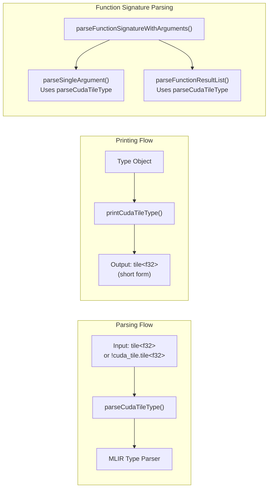
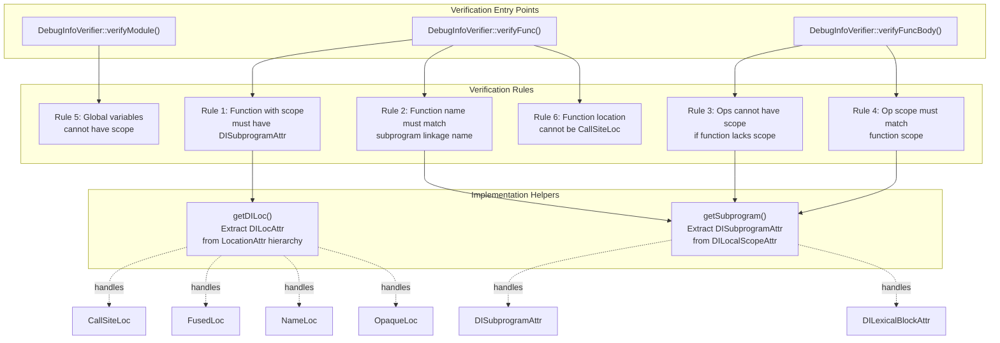
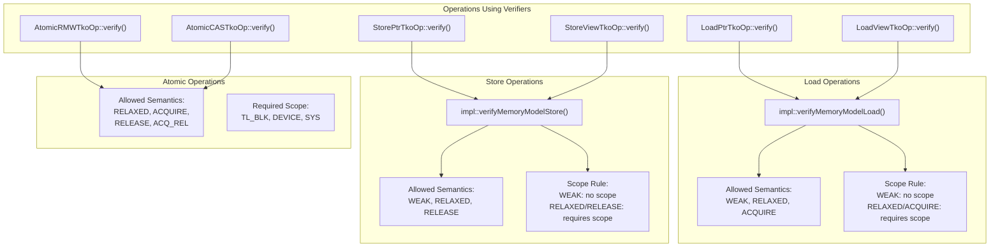
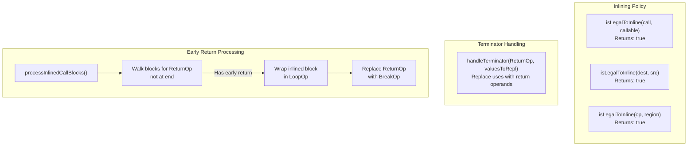

<!-- source: DeepWiki mcp.deepwiki.com · repo NVIDIA/cuda-tile · page 3 Core Dialect · fetched 2026-10-26 -->

# Core Dialect

<details>
<summary>Relevant source files</summary>

The following files were used as context for generating this wiki page:

- [lib/Dialect/CudaTile/IR/CudaTile.cpp](lib/Dialect/CudaTile/IR/CudaTile.cpp)

</details>


## Purpose and Scope

The CudaTile dialect is the central MLIR dialect that defines the intermediate representation for GPU kernel optimization in CUDA Tile IR. It provides a comprehensive set of types, attributes, and operations specifically designed for expressing GPU computations with precise memory semantics, tensor operations, and control flow.

This page covers the overall dialect structure, initialization, custom parsing/printing mechanisms, and core verification infrastructure. For detailed information on specific components:
- Type system details: see [Type System](#3.1)
- Attribute system details: see [Attribute System](#3.2)
- Operation categories: see [Operations](#3.3)
- Dialect interfaces: see [Dialect Interfaces](#3.4)

**Sources:** [lib/Dialect/CudaTile/IR/CudaTile.cpp:1-4252]()

## Dialect Architecture

The CudaTile dialect is organized into several interconnected subsystems that work together to provide a complete IR for GPU kernels.

```mermaid
graph TB
    subgraph "CudaTileDialect Registration"
        Init["CudaTileDialect::initialize()"]
        Init --> RegTypes["registerTypes()"]
        Init --> RegAttrs["registerAttributes()"]
        Init --> AddOps["addOperations&lt;...&gt;()"]
        Init --> AddIfaces["addInterfaces&lt;...&gt;()"]
    end
    
    subgraph "Type System"
        TileType["TileType<br/>Fixed-shape tensors"]
        PointerType["PointerType<br/>Memory pointers"]
        TensorViewType["TensorViewType<br/>Dynamic tensors"]
        PartitionViewType["PartitionViewType<br/>Grid partitions"]
        TokenType["TokenType<br/>Ordering constraints"]
    end
    
    subgraph "Attribute System"
        RoundingModeAttr["RoundingModeAttr<br/>FP rounding control"]
        MemorySemanticsAttr["MemoryOrderingSemanticsAttr<br/>WEAK/RELAXED/ACQUIRE/RELEASE/ACQ_REL"]
        MemoryScopeAttr["MemoryScopeAttr<br/>TL_BLK/DEVICE/SYS"]
        OptHintsAttr["OptimizationHintsAttr<br/>Threshold configuration"]
        DebugInfoAttrs["Debug Info Attrs<br/>DILocAttr, DISubprogramAttr"]
    end
    
    subgraph "Operations"
        ArithOps["Arithmetic Ops<br/>AddFOp, MulFOp, DivFOp"]
        MemOps["Memory Ops<br/>LoadPtrTkoOp, StoreViewTkoOp<br/>AtomicRMWTkoOp"]
        ControlOps["Control Flow Ops<br/>IfOp, ForOp, LoopOp<br/>BreakOp, ContinueOp"]
        TensorOps["Tensor Ops<br/>MmaFOp, ReduceOp, ScanOp<br/>BroadcastOp, ReshapeOp"]
        ViewOps["View Ops<br/>MakeTensorViewOp<br/>MakePartitionViewOp"]
    end
    
    subgraph "Interfaces"
        InlinerIface["CudaTileinlinerInterface<br/>Function inlining support"]
        OpAsmIface["CudaTileOpAsmInterface<br/>Custom printing/aliasing"]
    end
    
    subgraph "Verification"
        DebugVerifier["DebugInfoVerifier<br/>Function/module scope validation"]
        MemModelVerifier["Memory Model Verifiers<br/>verifyMemoryModelLoad/Store"]
        OpVerifiers["Operation Verifiers<br/>Type checking, shape validation"]
    end
    
    RegTypes --> TileType
    RegTypes --> PointerType
    RegTypes --> TensorViewType
    RegTypes --> PartitionViewType
    RegTypes --> TokenType
    
    RegAttrs --> RoundingModeAttr
    RegAttrs --> MemorySemanticsAttr
    RegAttrs --> MemoryScopeAttr
    RegAttrs --> OptHintsAttr
    RegAttrs --> DebugInfoAttrs
    
    AddOps --> ArithOps
    AddOps --> MemOps
    AddOps --> ControlOps
    AddOps --> TensorOps
    AddOps --> ViewOps
    
    AddIfaces --> InlinerIface
    AddIfaces --> OpAsmIface
    
    MemOps -.uses.-> TokenType
    MemOps -.uses.-> MemorySemanticsAttr
    MemOps -.uses.-> MemoryScopeAttr
    ArithOps -.uses.-> RoundingModeAttr
    
    OpVerifiers --> ArithOps
    OpVerifiers --> MemOps
    OpVerifiers --> ControlOps
    OpVerifiers --> TensorOps
    
    MemModelVerifier --> MemOps
    DebugVerifier -.validates.-> DebugInfoAttrs
```



**Sources:** [lib/Dialect/CudaTile/IR/CudaTile.cpp:4243-4251](), [lib/Dialect/CudaTile/IR/CudaTile.cpp:1217-1222]()

## Dialect Initialization

The dialect is initialized through the `CudaTileDialect::initialize()` method, which registers all components:

| Component | Registration Method | Description |
|-----------|-------------------|-------------|
| Types | `registerTypes()` | Registers `TileType`, `PointerType`, `TensorViewType`, `PartitionViewType`, `TokenType` |
| Attributes | `registerAttributes()` | Registers `RoundingModeAttr`, `MemoryOrderingSemanticsAttr`, `MemoryScopeAttr`, etc. |
| Operations | `addOperations<...>()` | Adds all dialect operations from TableGen-generated code |
| Interfaces | `addInterfaces<...>()` | Adds `CudaTileinlinerInterface` and `CudaTileOpAsmInterface` |

The initialization follows the standard MLIR dialect pattern, with operations defined via TableGen and verification/canonicalization logic implemented in C++.

**Sources:** [lib/Dialect/CudaTile/IR/CudaTile.cpp:4243-4251]()

## Custom Type Parsing and Printing

The dialect implements custom parsing and printing to support both short-form (`tile<f32>`) and long-form (`!cuda_tile.tile<f32>`) type syntax within `cuda_tile.module` operations.



### Function Signature Parsing

The dialect provides specialized function signature parsing to enable proper type resolution within operation contexts:

- **`parseFunctionSignatureWithArguments()`** - Custom parser that handles argument lists with cuda_tile types ([lib/Dialect/CudaTile/IR/CudaTile.cpp:190-200]())
- **`printFunctionSignatureWithCudaTileTypes()`** - Custom printer for function signatures ([lib/Dialect/CudaTile/IR/CudaTile.cpp:243-251]())

This custom parsing is necessary because standard MLIR `parseFunctionSignatureWithArguments()` uses generic type parsing that ignores `OpAsmOpInterface::getDefaultDialect()`, breaking short-form type resolution within `cuda_tile.module` operations.

**Key Implementation Details:**

- `validateSSANameConsistency()` ensures all arguments either have or lack SSA names consistently ([lib/Dialect/CudaTile/IR/CudaTile.cpp:75-88]())
- `parseSingleArgument()` handles individual argument parsing with type and attribute support ([lib/Dialect/CudaTile/IR/CudaTile.cpp:91-121]())
- `parseFunctionArgumentList()` supports variadic arguments ([lib/Dialect/CudaTile/IR/CudaTile.cpp:124-145]())

**Sources:** [lib/Dialect/CudaTile/IR/CudaTile.cpp:58-251]()

## Custom Attribute Parsing

The dialect provides specialized parsers for several attribute types to improve usability:

### Rounding Mode Parsing

Multiple parsing functions handle different rounding mode constraints:

| Parser Function | Allowed Modes | Default Mode | Use Case |
|----------------|---------------|--------------|----------|
| `parseIEEERoundingMode()` | `nearest_even`, `zero`, `negative_inf`, `positive_inf` | `nearest_even` | Float-to-float conversions |
| `parseIntegerRoundingMode()` | `nearest_int_to_zero` | `nearest_int_to_zero` | Float-to-integer conversions |
| `parseDivFOpRoundingMode()` | IEEE modes + `approx`, `full` | `nearest_even` | Division operations |
| `parseSqrtOpRoundingMode()` | IEEE modes + `approx` | `nearest_even` | Square root operations |

The parsing supports optional `rounding<mode>` syntax, defaulting to the specified mode if omitted.

### Memory Semantics Parsing

The `parseMemoryAttributes()` function parses both memory ordering semantics and scope ([lib/Dialect/CudaTile/IR/CudaTile.cpp:1023-1065]()):

```
weak                    // WEAK ordering, no scope allowed
relaxed tl_blk         // RELAXED ordering, thread-block scope
acquire device         // ACQUIRE ordering, device scope
release sys            // RELEASE ordering, system scope
```

Validation ensures that `WEAK` semantics cannot specify a scope, while `RELAXED`, `ACQUIRE`, `RELEASE`, and `ACQ_REL` require one.

### Assumption Predicate Parsing

The `parseAssumePredicate()` function supports both full attribute syntax (`#cuda_tile.div_by<8>`) and shortened syntax (`div_by<8>`) for assumption operations ([lib/Dialect/CudaTile/IR/CudaTile.cpp:888-941]()).

**Sources:** [lib/Dialect/CudaTile/IR/CudaTile.cpp:624-961](), [lib/Dialect/CudaTile/IR/CudaTile.cpp:1023-1074]()

## Dense Element Parsing

The dialect implements custom parsing for `DenseIntOrFPElementsAttr` to support both scalar and nested array literals with automatic shape inference:

```
constant <f32: 42.0> : tile<f32>                           // Scalar
constant <i32: [1, 2, 3, 4]> : tile<4xi32>                 // 1D array
constant <f16: [[1.0, 2.0], [3.0, 4.0]]> : tile<2x2xf16>   // 2D array
```

The parser (`parseDenseIntOrFPElementsAttr()`) performs:

1. **Type-aware parsing** - Uses prefix element type to determine integer vs. float parsing ([lib/Dialect/CudaTile/IR/CudaTile.cpp:311-330]())
2. **Integer bounds validation** - Validates integer values fit within target type bitwidth ([lib/Dialect/CudaTile/IR/CudaTile.cpp:258-287]())
3. **Recursive shape inference** - Infers shape from nested array structure ([lib/Dialect/CudaTile/IR/CudaTile.cpp:385-467]())
4. **Shape consistency checking** - Validates all array elements have consistent shapes ([lib/Dialect/CudaTile/IR/CudaTile.cpp:415-421]())
5. **Result shape verification** - Ensures inferred shape matches declared tile type ([lib/Dialect/CudaTile/IR/CudaTile.cpp:499-530]())

**Sources:** [lib/Dialect/CudaTile/IR/CudaTile.cpp:254-619]()

## Debug Information Verification

The `DebugInfoVerifier` class implements comprehensive validation of debug information attributes across modules, functions, and operations.



### Verification Rules

The verifier enforces six key invariants:

1. **Function Scope Constraint** - If a function has debug info scope, it must be a `DISubprogramAttr` ([lib/Dialect/CudaTile/IR/CudaTile.cpp:1103-1108]())

2. **Name Consistency** - Function name must match the subprogram's linkage name ([lib/Dialect/CudaTile/IR/CudaTile.cpp:1111-1117]())

3. **Operation Scope Dependency** - Operations cannot have debug scope if the containing function lacks one ([lib/Dialect/CudaTile/IR/CudaTile.cpp:1137-1144]())

4. **Scope Matching** - Operation debug scope must exactly match function scope ([lib/Dialect/CudaTile/IR/CudaTile.cpp:1146-1153]())

5. **Global Variable Restriction** - Global variables (module-level operations other than functions) cannot have debug scope ([lib/Dialect/CudaTile/IR/CudaTile.cpp:1164-1168]())

6. **Location Type Constraint** - Function locations cannot be `CallSiteLoc` ([lib/Dialect/CudaTile/IR/CudaTile.cpp:1095-1098]())

### Helper Functions

- **`getDILoc()`** - Recursively extracts `DILocAttr` from MLIR location hierarchies, handling `CallSiteLoc`, `FusedLoc`, `NameLoc`, and `OpaqueLoc` ([lib/Dialect/CudaTile/IR/CudaTile.cpp:1184-1201]())

- **`getSubprogram()`** - Extracts `DISubprogramAttr` from `DILocalScopeAttr`, recursively traversing `DILexicalBlockAttr` ([lib/Dialect/CudaTile/IR/CudaTile.cpp:1174-1181]())

**Integration:** Debug info verification is invoked through:
- `impl::verifyFuncDebugInfo()` for function-level checks ([lib/Dialect/CudaTile/IR/CudaTile.cpp:1204-1206]())
- `impl::verifyFuncBodyDebugInfo()` for operation-level checks ([lib/Dialect/CudaTile/IR/CudaTile.cpp:1208-1211]())

**Sources:** [lib/Dialect/CudaTile/IR/CudaTile.cpp:1090-1211]()

## Memory Model Verification

The dialect implements strict verification of memory ordering semantics to ensure correct synchronization behavior.



### Load Verification

The `impl::verifyMemoryModelLoad()` function validates load operations ([lib/Dialect/CudaTile/IR/CudaTile.cpp:3102-3129]()):

- **Allowed orderings:** `WEAK`, `RELAXED`, `ACQUIRE`
- **Scope requirements:**
  - `WEAK`: Must not specify scope
  - `RELAXED` / `ACQUIRE`: Must specify scope (`TL_BLK`, `DEVICE`, or `SYS`)

### Store Verification

The `impl::verifyMemoryModelStore()` function validates store operations ([lib/Dialect/CudaTile/IR/CudaTile.cpp:4062-4089]()):

- **Allowed orderings:** `WEAK`, `RELAXED`, `RELEASE`
- **Scope requirements:**
  - `WEAK`: Must not specify scope
  - `RELAXED` / `RELEASE`: Must specify scope

### Atomic Operation Verification

Atomic operations (`AtomicRMWTkoOp`, `AtomicCASTkoOp`) require:
- **Orderings:** `RELAXED`, `ACQUIRE`, `RELEASE`, `ACQ_REL` ([lib/Dialect/CudaTile/IR/CudaTile.cpp:1354-1362](), [lib/Dialect/CudaTile/IR/CudaTile.cpp:1393-1401]())
- **Scope:** Always required (no `WEAK` semantics allowed)
- **Type constraints:** Element types must be 32-bit or 64-bit integers or floats

**Sources:** [lib/Dialect/CudaTile/IR/CudaTile.cpp:3102-3129](), [lib/Dialect/CudaTile/IR/CudaTile.cpp:4062-4089](), [lib/Dialect/CudaTile/IR/CudaTile.cpp:1299-1403]()

## Dialect Interfaces

The dialect implements two key MLIR interfaces to customize behavior:

### Inliner Interface

The `CudaTileinlinerInterface` enables inlining of function calls with special handling for early returns ([lib/Dialect/CudaTile/IR/CudaTile.cpp:4142-4219]()):



**Key Features:**

1. **Universal inlining** - All operations, regions, and calls are legal to inline ([lib/Dialect/CudaTile/IR/CudaTile.cpp:4145-4159]())

2. **Return handling** - `ReturnOp` operands replace the call's results ([lib/Dialect/CudaTile/IR/CudaTile.cpp:4161-4166]())

3. **Early return transformation** - When inlining functions with early returns:
   - Wraps inlined code in a `LoopOp` ([lib/Dialect/CudaTile/IR/CudaTile.cpp:4206-4210]())
   - Converts `ReturnOp` to `BreakOp` to exit the loop ([lib/Dialect/CudaTile/IR/CudaTile.cpp:4184-4189]())
   - Preserves control flow semantics ([lib/Dialect/CudaTile/IR/CudaTile.cpp:4168-4218]())

### OpAsm Interface

The `CudaTileOpAsmInterface` provides custom aliasing for debug info attributes ([lib/Dialect/CudaTile/IR/CudaTile.cpp:4225-4239]()):

```cpp
// Generates aliases like:
// #di_file = ...
// #di_subprogram = ...
// #di_compile_unit = ...
```

Supported attributes: `DICompileUnitAttr`, `DIFileAttr`, `DILexicalBlockAttr`, `DISubprogramAttr`

The interface outputs the mnemonic for each attribute type and returns `OverridableAlias`, allowing MLIR's printer to generate readable aliases.

**Sources:** [lib/Dialect/CudaTile/IR/CudaTile.cpp:4142-4239]()

## Control Flow Canonicalization

The dialect implements extensive canonicalization patterns for `IfOp` to optimize control flow:

### Canonicalization Patterns

| Pattern | Description | Implementation |
|---------|-------------|----------------|
| `RemoveStaticCondition` | Eliminates `IfOp` with constant condition, inlining appropriate branch | [lib/Dialect/CudaTile/IR/CudaTile.cpp:2487-2505]() |
| `ConvertToSelect` | Converts `IfOp` to `SelectOp` for scalar tiles when possible | [lib/Dialect/CudaTile/IR/CudaTile.cpp:2512-2603]() |
| `RemoveUnusedResults` | Eliminates unused results from `IfOp` | [lib/Dialect/CudaTile/IR/CudaTile.cpp:2607-2674]() |
| `ReplaceYieldWithValue` | Replaces result with condition or constant when branches yield `true`/`false` | [lib/Dialect/CudaTile/IR/CudaTile.cpp:2678-2739]() |
| `CombineIfs` | Merges consecutive `IfOp` operations with related conditions | [lib/Dialect/CudaTile/IR/CudaTile.cpp:2743-2891]() |
| `CombineNestedIfs` | Combines nested `IfOp` into single `IfOp` with `&&` condition | [lib/Dialect/CudaTile/IR/CudaTile.cpp:2918-3027]() |
| `RemoveEmptyElseBranch` | Removes empty else blocks when `IfOp` has no results | [lib/Dialect/CudaTile/IR/CudaTile.cpp:2894-2914]() |
| `MoveTerminatorToParent` | Extracts else-block when both branches end in terminator | [lib/Dialect/CudaTile/IR/CudaTile.cpp:3032-3050]() |

### Special Terminator Handling

The canonicalization patterns support `IfOp` with non-`YieldOp` terminators (`ReturnOp`, `ContinueOp`, `BreakOp`):

- **`ConvertToSelect`** - Handles cases where one branch yields and the other has a terminator ([lib/Dialect/CudaTile/IR/CudaTile.cpp:2523-2536]())
- **`CombineIfs`** - Skips branch combination when first `IfOp` ends with terminator ([lib/Dialect/CudaTile/IR/CudaTile.cpp:2786-2789]())
- **`MoveTerminatorToParent`** - Extracts reachable else-block when both branches terminate ([lib/Dialect/CudaTile/IR/CudaTile.cpp:3032-3050]())

**Sources:** [lib/Dialect/CudaTile/IR/CudaTile.cpp:2390-3057]()

## Aggregate Operation Verification

The dialect provides common verification infrastructure for operations with aggregation semantics (`ReduceOp`, `ScanOp`):

```mermaid
graph TB
    subgraph "Verification Functions"
        VerifyAggOp["verifyAggregateOp()<br/>Validates operands, results,<br/>dimension, identities"]
        VerifyAggRegions["verifyAggregateOpRegions()<br/>Validates reduction region"]
    end
    
    subgraph "Region Verification Checks"
        BlockArgs["Block must have<br/>2 * num_operands arguments"]
        ArgTypes["All block args must be<br/>0-rank TileType"]
        PairwiseTypes["Arg types must match pairwise<br/>(current, previous)"]
        OperandMatch["Block arg types must match<br/>operand element types"]
        TermTypes["Terminator operands must match<br/>operand element types"]
        PureOps["Only pure operations allowed<br/>in reduction region"]
        
        VerifyAggRegions --> BlockArgs
        VerifyAggRegions --> ArgTypes
        VerifyAggRegions --> PairwiseTypes
        VerifyAggRegions --> OperandMatch
        VerifyAggRegions --> TermTypes
        VerifyAggRegions --> PureOps
    end
    
    subgraph "Operand Verification Checks"
        NumOperands["At least 1 operand required"]
        MatchCount["#operands == #results"]
        DimInBounds["Dimension in valid range"]
        IdentityCheck["If provided:<br/>#identities == #operands<br/>types match operand elements"]
        
        VerifyAggOp --> NumOperands
        VerifyAggOp --> MatchCount
        VerifyAggOp --> DimInBounds
        VerifyAggOp --> IdentityCheck
    end
    
    subgraph "Operations Using Verifiers"
        ReduceOp["ReduceOp::verify()"]
        ReduceOpRegions["ReduceOp::verifyRegions()"]
        ScanOp["ScanOp::verify()"]
        ScanOpRegions["ScanOp::verifyRegions()"]
    end
    
    ReduceOp --> VerifyAggOp
    ReduceOpRegions --> VerifyAggRegions
    ScanOp --> VerifyAggOp
    ScanOpRegions --> VerifyAggRegions
```



### Region Structure

Aggregate operations define a single-block region with specific structure ([lib/Dialect/CudaTile/IR/CudaTile.cpp:3682-3789]()):

```mlir
reduce(%arg0, %arg1) dim=0 {
^bb0(%current0: tile<f32>, %previous0: tile<f32>,
     %current1: tile<i32>, %previous1: tile<i32>):
  // Reduction computation
  %result0 = cuda_tile.add_f %current0, %previous0
  %result1 = cuda_tile.add_i %current1, %previous1
  yield %result0, %result1
}
```

**Block Arguments:** For N operands, block has 2*N arguments in pattern: `[current_0, previous_0, current_1, previous_1, ...]`

### Verification Rules

1. **Block argument count** - Must equal 2 * number of operands ([lib/Dialect/CudaTile/IR/CudaTile.cpp:3690-3693]())

2. **Argument types** - All block arguments must be 0-rank `TileType` ([lib/Dialect/CudaTile/IR/CudaTile.cpp:3696-3703]())

3. **Pairwise type matching** - Types must match for each (current, previous) pair ([lib/Dialect/CudaTile/IR/CudaTile.cpp:3713-3727]())

4. **Element type consistency** - Block argument element types must match operand element types ([lib/Dialect/CudaTile/IR/CudaTile.cpp:3730-3744]())

5. **Terminator validation** - `YieldOp` must have N operands matching operand element types ([lib/Dialect/CudaTile/IR/CudaTile.cpp:3746-3768]())

6. **Pure operations only** - Region can only contain pure (side-effect-free) operations ([lib/Dialect/CudaTile/IR/CudaTile.cpp:3769-3788]())

7. **Identity validation** - If provided, identity attributes must match operand count and types ([lib/Dialect/CudaTile/IR/CudaTile.cpp:3809-3836]())

**Sources:** [lib/Dialect/CudaTile/IR/CudaTile.cpp:3682-3866](), [lib/Dialect/CudaTile/IR/CudaTile.cpp:3872-3880](), [lib/Dialect/CudaTile/IR/CudaTile.cpp:4011-4020]()

---

