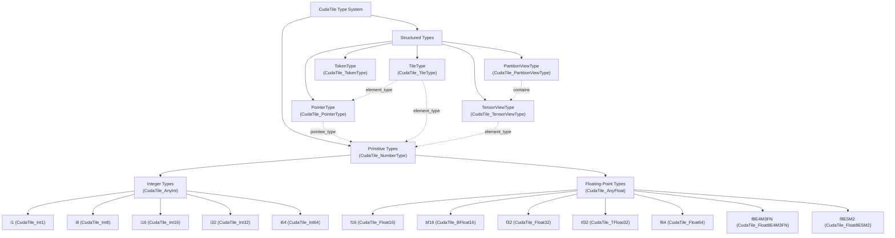
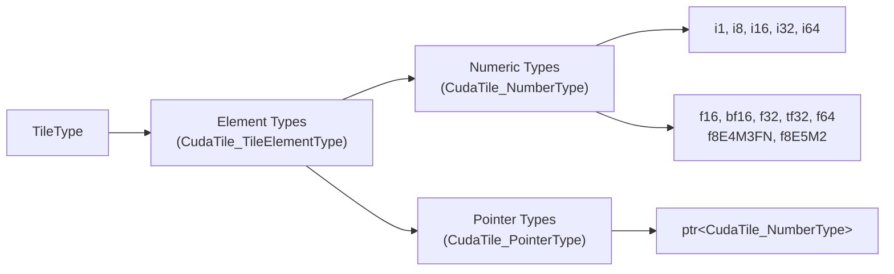
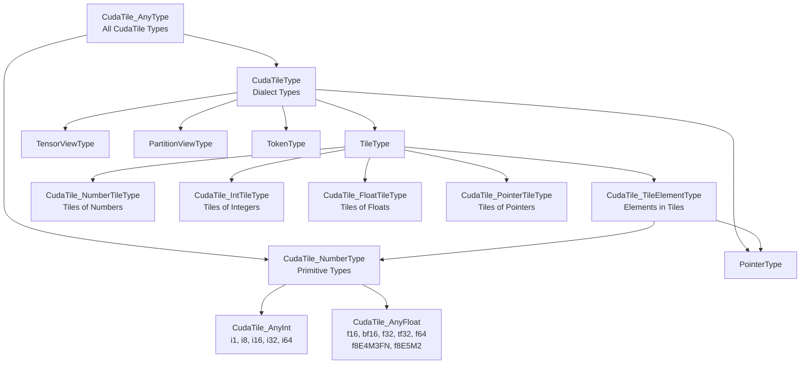
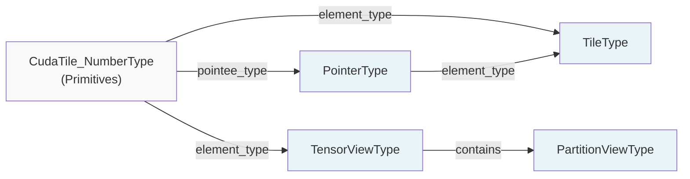

<!-- source: DeepWiki mcp.deepwiki.com · repo NVIDIA/cuda-tile · page 3.1 Type System · fetched 2026-10-26 -->

# Type System

<details>
<summary>Relevant source files</summary>

The following files were used as context for generating this wiki page:

- [include/cuda_tile/Dialect/CudaTile/IR/Types.td](include/cuda_tile/Dialect/CudaTile/IR/Types.td)
- [lib/Dialect/CudaTile/IR/CudaTile.cpp](lib/Dialect/CudaTile/IR/CudaTile.cpp)

</details>


This document provides a comprehensive reference for the CudaTile type system, which defines the data types used to represent values in CUDA Tile IR. The type system includes primitive types (integers and floating-point numbers), structured types for representing tensors and memory references (TileType, TensorViewType, PartitionViewType), and specialized types for memory operations (PointerType, TokenType).

For information about how types are used in operations, see [Operations](#3.3). For details on the C++ and Python APIs for constructing types, see [C++ API](#5.1) and [Python Bindings](#5.3).

## Type Hierarchy Overview

The CudaTile type system is organized into two main categories: primitive types that represent individual scalar values, and structured types that represent collections of values or memory abstractions.

**Diagram: CudaTile Type Hierarchy**



Sources: [include/cuda_tile/Dialect/CudaTile/IR/Types.td:1-332]()

## Primitive Types

Primitive types represent individual scalar numeric values. All primitive types are grouped under the `CudaTile_NumberType` constraint, which can be used as element types in structured types.

### Integer Types

The CudaTile dialect supports five integer types with varying bit widths. Integer types are defined with specific semantic interpretations for certain operations.

| Type | TableGen Definition | Bit Width | Description |
|------|-------------------|-----------|-------------|
| `i1` | `CudaTile_Int1` | 1 bit | Boolean values interpreted as 0 or 1 (unsigned) or 0 or -1 (signed two's complement) |
| `i8` | `CudaTile_Int8` | 8 bits | 8-bit signed or unsigned integer |
| `i16` | `CudaTile_Int16` | 16 bits | 16-bit signed or unsigned integer |
| `i32` | `CudaTile_Int32` | 32 bits | 32-bit signed or unsigned integer |
| `i64` | `CudaTile_Int64` | 64 bits | 64-bit signed or unsigned integer |

#### i1 Semantics

The `i1` type has special semantics defined in [include/cuda_tile/Dialect/CudaTile/IR/Types.td:22-27]():

- **Unsigned interpretation**: Values 0 and 1 (represented as `0b00000000` and `0b00000001`)
- **Signed interpretation**: Values 0 and -1 (two's complement for 1-bit: `0b00000000` and `0b11111111`)
- **Canonicalization**: `i1` values are canonicalized to `0x00` (false) or `0x01` (true) before storage and after loading from memory
- Operations on `i1` values must preserve LSB-only semantics

#### Integer Bounds Utilities

The dialect provides helper functions for computing integer bounds defined in [lib/Dialect/CudaTile/IR/CudaTile.cpp:37-56]():

- `getMaxSignedValueForBitwidth(int64_t n)`: Returns maximum signed value for n-bit integers
- `getMinSignedValueForBitwidth(int64_t n)`: Returns minimum signed value for n-bit integers  
- `getMaxUnsignedValueForBitwidth(int64_t n)`: Returns maximum unsigned value for n-bit integers

Sources: [include/cuda_tile/Dialect/CudaTile/IR/Types.td:18-40](), [lib/Dialect/CudaTile/IR/CudaTile.cpp:37-56]()

### Floating-Point Types

The CudaTile dialect supports seven floating-point types, including standard IEEE formats and specialized formats for machine learning workloads.

| Type | TableGen Definition | Bit Width | Description |
|------|-------------------|-----------|-------------|
| `f16` | `CudaTile_Float16` | 16 bits | IEEE 754 half-precision floating-point |
| `bf16` | `CudaTile_BFloat16` | 16 bits | Brain floating-point (1 sign, 8 exponent, 7 mantissa) |
| `f32` | `CudaTile_Float32` | 32 bits | IEEE 754 single-precision floating-point |
| `tf32` | `CudaTile_TFloat32` | 19 bits | TensorFloat-32 format (1 sign, 8 exponent, 10 mantissa) |
| `f64` | `CudaTile_Float64` | 64 bits | IEEE 754 double-precision floating-point |
| `f8E4M3FN` | `CudaTile_Float8E4M3FN` | 8 bits | 8-bit floating-point (1 sign, 4 exponent, 3 mantissa, FN encoding) |
| `f8E5M2` | `CudaTile_Float8E5M2` | 8 bits | 8-bit floating-point (1 sign, 5 exponent, 2 mantissa) |

#### Machine Learning Float Types

The specialized 8-bit floating-point types (`f8E4M3FN` and `f8E5M2`) are designed for efficient machine learning operations:

- **f8E4M3FN**: Optimized for forward propagation with higher precision mantissa
- **f8E5M2**: Optimized for backward propagation with extended exponent range

Sources: [include/cuda_tile/Dialect/CudaTile/IR/Types.td:42-68]()

## PointerType

The `PointerType` represents a typed pointer to a single location in global device memory. Unlike traditional C-style pointers, CUDA Tile pointers are always typed with the element type they point to.

**Type Definition**: `!cuda_tile.ptr<elementType>`

### Parameters

| Parameter | Type | Description |
|-----------|------|-------------|
| `pointeeType` | `CudaTile_NumberType` | The type of element the pointer references |

### Assembly Format

Syntax: `ptr<elementType>`

Examples:
- `!cuda_tile.ptr<f32>` - Pointer to f32
- `!cuda_tile.ptr<i64>` - Pointer to i64
- `!cuda_tile.ptr<bf16>` - Pointer to bf16

### Usage Pattern

PointerType is primarily used in two contexts:

1. **Element type in TileType**: A tile can contain pointers, enabling scatter/gather operations
   ```
   !cuda_tile.tile<4x!cuda_tile.ptr<i8>>
   ```

2. **Atomic operations**: Atomic memory operations require pointer tiles as operands

Sources: [include/cuda_tile/Dialect/CudaTile/IR/Types.td:70-90]()

## TileType

The `TileType` is the fundamental tensor type in CUDA Tile IR, representing a fixed-shape, statically-sized multi-dimensional array of elements. TileType implements the MLIR `ShapedTypeInterface`, making it compatible with standard MLIR shape-aware operations.

**Type Definition**: `!cuda_tile.tile<shapeSpec x elementType>`

### Parameters

| Parameter | Type | Description |
|-----------|------|-------------|
| `shape` | `ArrayRef<int64_t>` | Static shape dimensions (all must be power-of-2) |
| `elementType` | `CudaTile_TileElementType` | Element type (any `CudaTile_NumberType` or `CudaTile_PointerType`) |

### Shape Constraints

All shape dimensions must be powers of two. This constraint is verified in the type verification logic and ensures efficient memory access patterns on GPU hardware.

Valid examples:
- `!cuda_tile.tile<16x32xf32>` ✓ (16 and 32 are powers of 2)
- `!cuda_tile.tile<8x8x8xi32>` ✓ (8 is power of 2)
- `!cuda_tile.tile<f16>` ✓ (scalar tile, rank 0)

Invalid examples:
- `!cuda_tile.tile<5x4xf32>` ✗ (5 and 4 are not powers of 2... actually 4 is, but 5 isn't)
- `!cuda_tile.tile<15x16xf64>` ✗ (15 is not power of 2)

### Supported Element Types

TileType supports two categories of element types:

1. **Numeric types** (`CudaTile_NumberType`): All primitive integer and floating-point types
2. **Pointer types** (`CudaTile_PointerType`): Enables tiles of pointers for scatter/gather operations

**Diagram: TileType Element Type Relationships**



### ShapedTypeInterface Implementation

TileType implements `ShapedTypeInterface` [include/cuda_tile/Dialect/CudaTile/IR/Types.td:132-141](), providing:

- `hasRank()`: Always returns `true` (TileType is always ranked)
- `getShape()`: Returns the static shape array
- `getElementType()`: Returns the element type
- `cloneWith()`: Creates a new TileType with modified shape and/or element type

### Rank-Specific Type Constraints

The dialect defines several rank-constrained tile type predicates for use in operation constraints:

- `CudaTile_RankedTileOf<allowedTypes, ranks>`: Tile with specific ranks
- `CudaTile_ScalarTileOf<elementType>`: Rank-0 (scalar) tile of specific element type

Examples:
- `CudaTile_RankedTileOf<[f32], [2]>`: 2D tile of f32
- `CudaTile_ScalarTileOf<i64>`: Scalar tile (rank 0) of i64

Sources: [include/cuda_tile/Dialect/CudaTile/IR/Types.td:92-171]()

## TensorViewType

The `TensorViewType` represents a reference to a tensor in global device memory with potentially dynamic shape and stride information. Unlike TileType which has fully static shape, TensorViewType can have dynamic dimensions denoted by `?`.

**Type Definition**: `!cuda_tile.tensor_view<shapeSpec x elementType, strides=[strideSpec]>`

### Parameters

| Parameter | Type | Description |
|-----------|------|-------------|
| `elementType` | `CudaTile_NumberType` | Element type of the tensor |
| `shape` | `ArrayRef<int64_t>` | Size of each dimension (can contain `kDynamic` for dynamic dims) |
| `strides` | `ArrayRef<int64_t>` | Stride of each dimension (can contain `kDynamic` for dynamic strides) |

### Dynamic Dimensions

TensorViewType uses `ShapedType::kDynamic` (typically `-1`) to represent dimensions whose values are determined at runtime. The type provides utility methods defined in [include/cuda_tile/Dialect/CudaTile/IR/Types.td:215-223]():

- `kDynamic`: Constant representing dynamic dimension value
- `dynamicShapeAmount()`: Returns count of dynamic shape dimensions
- `dynamicStrideAmount()`: Returns count of dynamic stride dimensions

### Assembly Format

The assembly format explicitly shows both shape and strides:

```
tensor_view<shape_0 x shape_1 x ... x shape_n x elementType, strides=[stride_0, stride_1, ..., stride_n]>
```

Examples:
- `!cuda_tile.tensor_view<1024x1024xf16, strides=[1024,1]>` - Fully static row-major 2D tensor
- `!cuda_tile.tensor_view<32x16x32xf16, strides=[512,1,16]>` - 3D tensor with custom strides
- `!cuda_tile.tensor_view<?x?xf16, strides=[?,1]>` - Dynamic height and width, dynamic leading stride
- `!cuda_tile.tensor_view<?x16xf32, strides=[1,?]>` - Dynamic first dimension, static second dimension

### Stride Semantics

Strides specify the offset in elements when incrementing the index of each dimension by one:

- **Row-major layout**: Strides decrease from outer to inner dimensions
  - Example: `shape=[M,N], strides=[N,1]`
- **Column-major layout**: Strides increase from outer to inner dimensions
  - Example: `shape=[M,N], strides=[1,M]`
- **Custom layouts**: Arbitrary stride patterns for complex memory layouts
  - Example: `shape=[B,M,N], strides=[M*N,1,M]` for batched column-major

Sources: [include/cuda_tile/Dialect/CudaTile/IR/Types.td:176-227]()

## PartitionViewType

The `PartitionViewType` represents a view into a TensorViewType where the tensor is conceptually divided into a grid of tiles. This type is fundamental for expressing tile-level parallelism and is used extensively in load/store operations.

**Type Definition**: `!cuda_tile.partition_view<tile=(tileShape), tensor_view=tensorViewType, dim_map=[mapping], padding_value=paddingValue>`

### Parameters

| Parameter | Type | Required | Description |
|-----------|------|----------|-------------|
| `tile_shape` | `DenseI32ArrayAttr` | Yes | Shape of each tile in the partition |
| `tensor_view` | `CudaTile_TensorViewType` | Yes | Underlying tensor view being partitioned |
| `dim_map` | `ArrayRef<int32_t>` | No | Mapping from tile dimensions to tensor dimensions (defaults to identity) |
| `padding_value` | `PaddingValueAttr` | No | Value for out-of-bounds accesses |

### TileView Interface

PartitionViewType implements the `CudaTile_TileView` interface [include/cuda_tile/Dialect/CudaTile/IR/Types.td:237-238](), which defines:

- **Index space rank**: Number of dimensions in the underlying tensor_view
- **Tile size**: As specified by `tile_shape`

This interface allows operations to abstract over different view types uniformly.

### Dimension Mapping

The `dim_map` parameter specifies how tile dimensions map to tensor_view dimensions, enabling transposed or reordered tile layouts:

- **Identity mapping** (default): `dim_map=[0, 1, 2, ...]` - Tile dimensions directly correspond to tensor dimensions
- **Transposed mapping**: `dim_map=[1, 0]` - 2D tiles are transposed relative to tensor layout
- **Custom mapping**: Arbitrary permutations for complex access patterns

Examples:
```
// Identity mapping (default)
!cuda_tile.partition_view<
  tile=(2x2),
  tensor_view=!cuda_tile.tensor_view<16x16xf32, strides=[16,1]>
>

// Transposed mapping
!cuda_tile.partition_view<
  tile=(2x2),
  tensor_view=!cuda_tile.tensor_view<16x16xf32, strides=[16,1]>,
  dim_map=[1, 0]
>
```

### Padding Values

When accessing elements outside the bounds of the underlying tensor_view, the padding_value attribute specifies the returned value [include/cuda_tile/Dialect/CudaTile/IR/Types.td:260-269]():

| Padding Value | Description |
|---------------|-------------|
| `zero` | Zero (0.0 or 0) |
| `neg_zero` | Negative zero (-0.0) |
| `nan` | Not-a-Number (NaN) |
| `pos_inf` | Positive infinity (+∞) |
| `neg_inf` | Negative infinity (-∞) |

If `padding_value` is not specified, out-of-bounds accesses return an unspecified value.

Example with padding:
```
!cuda_tile.partition_view<
  tile=(2x2),
  padding_value = nan,
  tensor_view=!cuda_tile.tensor_view<16x16xf32, strides=[16,1]>
>
```

### Power-of-Two Constraint

Like TileType, PartitionViewType requires all tile dimensions to be powers of two [include/cuda_tile/Dialect/CudaTile/IR/Types.td:270]().

Sources: [include/cuda_tile/Dialect/CudaTile/IR/Types.td:232-310]()

## TokenType

The `TokenType` is a special type that does not represent a runtime value. Instead, it serves to explicitly model ordering dependencies between memory operations within a tile.

**Type Definition**: `!cuda_tile.token`

### Purpose and Semantics

Tokens are used exclusively for ordering token-ordered operations (operations with the `_tko` suffix), such as:

- `load_ptr_tko`: Load from pointer with token ordering
- `store_view_tko`: Store to view with token ordering  
- `atomic_cas_tko`: Atomic compare-and-swap with token ordering
- `atomic_rmw_tko`: Atomic read-modify-write with token ordering

**Key properties** [include/cuda_tile/Dialect/CudaTile/IR/Types.td:318-321]():

1. **Not a runtime value**: Tokens have no runtime representation and incur no overhead
2. **Ordering constraint**: Token dependencies enforce execution order of memory operations
3. **Tile-local**: Token dependencies only apply within a single tile's execution context

### Usage Pattern

Token-ordered operations typically:
1. Accept an input token operand
2. Return a result token along with their actual result value
3. Form chains of dependent memory operations

Example operation signature pattern:
```
load_ptr_tko(pointers, token_in) -> (result_value, token_out)
store_view_tko(view, data, token_in) -> token_out
```

For detailed information on how tokens are used in memory operations, see [Memory Operations](#3.3.2).

Sources: [include/cuda_tile/Dialect/CudaTile/IR/Types.td:312-322]()

## Type Constraints and Composition

The type system defines several composite type constraints used throughout the dialect for operation type checking.

**Diagram: Type Constraint Hierarchy**



### Tile Type Constraints

The dialect defines several specialized tile type constraints for use in operation definitions:

| Constraint | Definition | Usage |
|------------|------------|-------|
| `CudaTile_IntTileType` | Tiles with integer element types | Integer arithmetic operations |
| `CudaTile_FloatTileType` | Tiles with floating-point element types (including tf32, f8) | Floating-point arithmetic |
| `CudaTile_BaseFloatTileType` | Tiles with standard float types (f16, bf16, f32, f64) | Operations not supporting specialized formats |
| `CudaTile_NumberTileType` | Tiles with any numeric element type | Generic numeric operations |
| `CudaTile_PointerTileType` | Tiles with pointer element types | Memory access operations |

### Element Type Nesting Rules

The type system enforces specific nesting rules:

1. **PointerType pointee**: Must be `CudaTile_NumberType` (cannot point to structured types)
2. **TileType element**: Can be `CudaTile_NumberType` or `CudaTile_PointerType` (one level of nesting)
3. **TensorViewType element**: Must be `CudaTile_NumberType` (cannot contain pointers or tiles)
4. **PartitionViewType contains**: Must be `CudaTile_TensorViewType`

**Diagram: Type Nesting Relationships**



Sources: [include/cuda_tile/Dialect/CudaTile/IR/Types.td:65-68,96-100,328-360]()

## Type Verification

Type verification is implemented in the dialect to ensure type constraints are satisfied at IR construction time. Verification logic is generated from TableGen definitions with additional custom verification where needed.

### TileType Verification

TileType verification [lib/Dialect/CudaTile/IR/CudaTile.cpp]() checks:
- All shape dimensions are positive
- All shape dimensions are powers of two
- Element type is valid (`CudaTile_TileElementType`)

### TensorViewType Verification  

TensorViewType verification checks:
- Shape and stride arrays have the same length (rank consistency)
- Static dimensions are positive
- Power-of-two constraint on static shape dimensions
- Element type is `CudaTile_NumberType`

### PartitionViewType Verification

PartitionViewType verification checks:
- Tile shape dimensions are powers of two
- `dim_map` length matches tile rank (if specified)
- `dim_map` values are valid indices into tensor_view rank
- No duplicate values in `dim_map` (must be a permutation)
- Underlying tensor_view type is valid

Sources: [include/cuda_tile/Dialect/CudaTile/IR/Types.td:125,226,309]()

## Type System Code Map

This section maps type system concepts to specific code entities for reference.

| Type Concept | TableGen Definition | C++ Class | Definition Location |
|-------------|-------------------|-----------|-------------------|
| Integer Types | `CudaTile_Int1`, `CudaTile_Int8`, etc. | MLIR built-in integer types | [include/cuda_tile/Dialect/CudaTile/IR/Types.td:28-32]() |
| Float Types | `CudaTile_Float16`, `CudaTile_Float32`, etc. | MLIR built-in float types | [include/cuda_tile/Dialect/CudaTile/IR/Types.td:46-53]() |
| PointerType | `CudaTile_PointerType` | `mlir::cuda_tile::PointerType` | [include/cuda_tile/Dialect/CudaTile/IR/Types.td:74-90]() |
| TileType | `CudaTile_TileType` | `mlir::cuda_tile::TileType` | [include/cuda_tile/Dialect/CudaTile/IR/Types.td:102-142]() |
| TensorViewType | `CudaTile_TensorViewType` | `mlir::cuda_tile::TensorViewType` | [include/cuda_tile/Dialect/CudaTile/IR/Types.td:176-227]() |
| PartitionViewType | `CudaTile_PartitionViewType` | `mlir::cuda_tile::PartitionViewType` | [include/cuda_tile/Dialect/CudaTile/IR/Types.td:233-310]() |
| TokenType | `CudaTile_TokenType` | `mlir::cuda_tile::TokenType` | [include/cuda_tile/Dialect/CudaTile/IR/Types.td:316-322]() |
| Type Parsing | `parseCudaTileType()` | Custom parser function | [lib/Dialect/CudaTile/IR/CudaTile.cpp:113,156,171]() |
| Type Printing | `printCudaTileType()` | Custom printer function | [lib/Dialect/CudaTile/IR/CudaTile.cpp:216,230,234]() |

Sources: [include/cuda_tile/Dialect/CudaTile/IR/Types.td:1-332](), [lib/Dialect/CudaTile/IR/CudaTile.cpp:113-234]()

---

