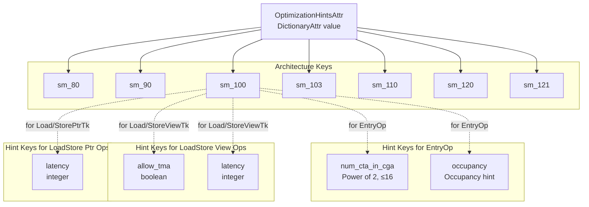
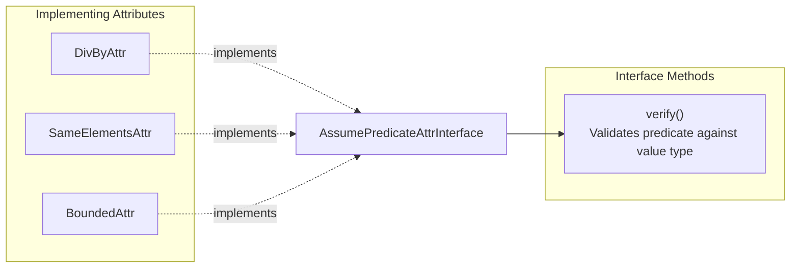
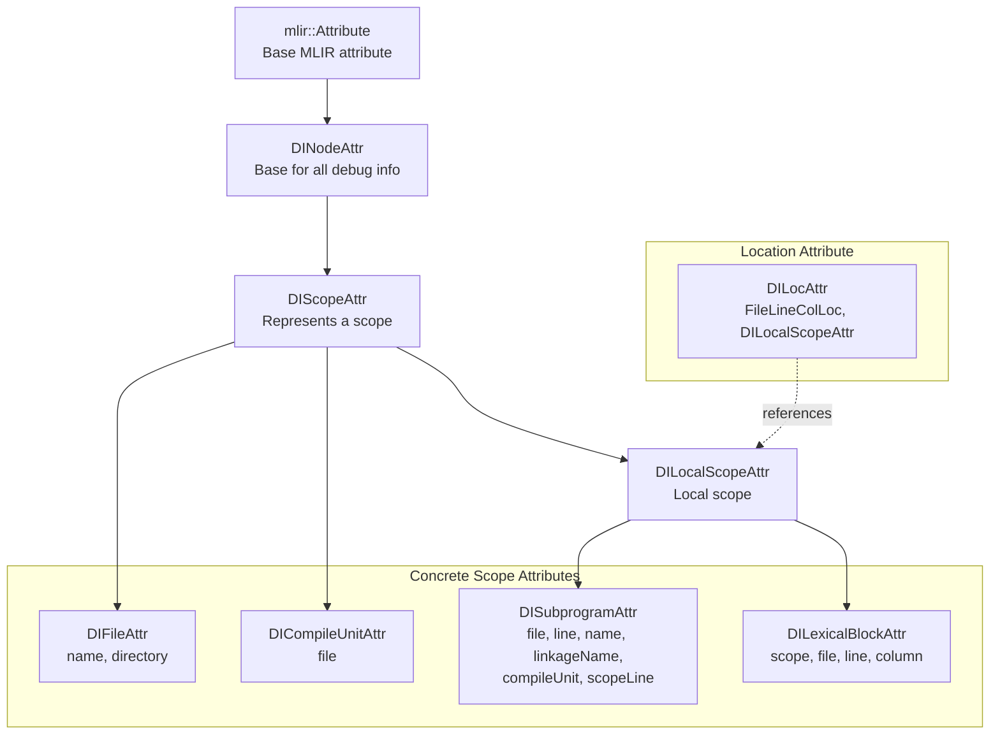
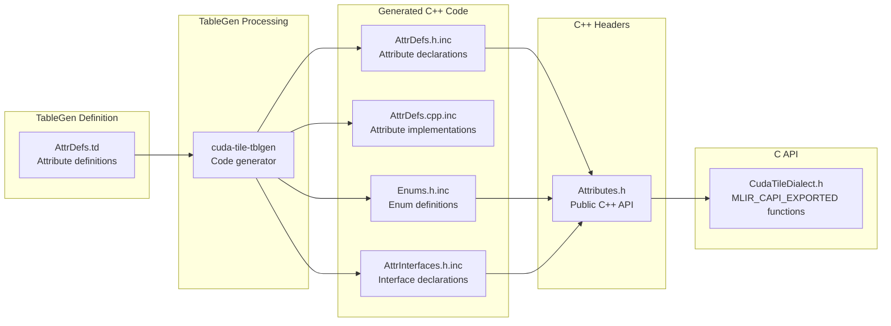

<!-- source: DeepWiki mcp.deepwiki.com · repo NVIDIA/cuda-tile · page 3.2 Attribute System · fetched 2026-10-26 -->

# Attribute System

<details>
<summary>Relevant source files</summary>

The following files were used as context for generating this wiki page:

- [lib/Dialect/CudaTile/IR/CudaTile.cpp](lib/Dialect/CudaTile/IR/CudaTile.cpp)
- [python/Dialect/DialectCudaTile.cpp](python/Dialect/DialectCudaTile.cpp)
- [python/SiteInitializer.cpp](python/SiteInitializer.cpp)

</details>


## Purpose and Scope

The attribute system provides metadata and compiler hints for operations in the CUDA Tile dialect. Attributes control operation semantics, enable optimizations, specify memory ordering guarantees, and attach debug information. This document covers all attribute types defined in the dialect, their structure, validation rules, and usage patterns.

For information about operations that use these attributes, see [Operations](#3.3). For details about the C and Python APIs for working with attributes, see [C API](#5.2) and [Python Bindings](#5.3).

**Sources:** [include/cuda_tile/Dialect/CudaTile/IR/AttrDefs.td:1-600]()

---

## Attribute Type Taxonomy

```mermaid
graph TB
    subgraph "Attribute Categories"
        EnumAttrs["Enumeration Attributes"]
        StructAttrs["Structured Attributes"]
        AssumeAttrs["Assumption Predicate Attributes"]
        DebugAttrs["Debug Info Attributes"]
    end
    
    subgraph "Enumeration Attributes"
        RoundingMode["RoundingModeAttr<br/>Controls FP rounding behavior"]
        CompPred["ComparisonPredicateAttr<br/>eq, ne, lt, le, gt, ge"]
        CompOrder["ComparisonOrderingAttr<br/>ordered, unordered"]
        MemScope["MemoryScopeAttr<br/>tl_blk, device, sys"]
        MemOrder["MemoryOrderingSemanticsAttr<br/>weak, relaxed, acquire, release, acq_rel"]
        PaddingVal["PaddingValueAttr<br/>zero, neg_zero, nan, pos_inf, neg_inf"]
        AtomicMode["AtomicRMWModeAttr<br/>and, or, xor, add, max, min, xchg"]
        Overflow["IntegerOverflowAttr<br/>none, nsw, nuw, nw"]
        Signedness["SignednessAttr<br/>signed, unsigned"]
    end
    
    subgraph "Structured Attributes"
        OptHints["OptimizationHintsAttr<br/>Architecture-specific hints<br/>num_cta_in_cga, allow_tma, latency"]
    end
    
    subgraph "Assumption Predicates"
        DivBy["DivByAttr<br/>Divisibility assumptions"]
        SameElems["SameElementsAttr<br/>Element repetition patterns"]
        Bounded["BoundedAttr<br/>Integer range bounds"]
    end
    
    subgraph "Debug Info Attributes"
        DILoc["DILocAttr<br/>Source location with scope"]
        DIFile["DIFileAttr<br/>Source file information"]
        DICompileUnit["DICompileUnitAttr<br/>Compilation unit scope"]
        DISubprogram["DISubprogramAttr<br/>Function scope"]
        DILexicalBlock["DILexicalBlockAttr<br/>Lexical block scope"]
    end
    
    subgraph "Interfaces"
        AssumeIface["AssumePredicateAttrInterface<br/>Validates assume predicates"]
    end
    
    EnumAttrs --> RoundingMode
    EnumAttrs --> CompPred
    EnumAttrs --> CompOrder
    EnumAttrs --> MemScope
    EnumAttrs --> MemOrder
    EnumAttrs --> PaddingVal
    EnumAttrs --> AtomicMode
    EnumAttrs --> Overflow
    EnumAttrs --> Signedness
    
    StructAttrs --> OptHints
    
    AssumeAttrs --> DivBy
    AssumeAttrs --> SameElems
    AssumeAttrs --> Bounded
    
    DebugAttrs --> DILoc
    DebugAttrs --> DIFile
    DebugAttrs --> DICompileUnit
    DebugAttrs --> DISubprogram
    DebugAttrs --> DILexicalBlock
    
    DivBy -.implements.-> AssumeIface
    SameElems -.implements.-> AssumeIface
    Bounded -.implements.-> AssumeIface
```



**Sources:** [include/cuda_tile/Dialect/CudaTile/IR/AttrDefs.td:1-600](), [include/cuda_tile/Dialect/CudaTile/IR/Attributes.h:1-49]()

---

## Enumeration Attributes

Enumeration attributes represent a fixed set of named values. They are defined using the `CudaTileI32EnumAttr` base class in TableGen and compiled to efficient C++ enum classes.

### RoundingModeAttr

Controls floating-point and integer rounding behavior for arithmetic operations.

| Enum Value | Mnemonic | Description |
|------------|----------|-------------|
| `NEAREST_EVEN` | `nearest_even` | Round to nearest, ties to even |
| `ZERO` | `zero` | Round towards zero (truncate) |
| `NEGATIVE_INF` | `negative_inf` | Round towards negative infinity |
| `POSITIVE_INF` | `positive_inf` | Round towards positive infinity |
| `APPROX` | `approx` | Approximate rounding mode |
| `FULL` | `full` | Full precision rounding mode |
| `NEAREST_INT_TO_ZERO` | `nearest_int_to_zero` | Round towards zero to nearest integer |

**Assembly Format:** `rounding<value>`

The assembly format varies by operation type:
- **IEEE operations** (add, sub, mul): Omits `rounding<nearest_even>` as default; other modes printed explicitly
- **Division operations** (div): Supports all modes; defaults to `nearest_even`
- **Square root operations** (sqrt): Supports IEEE modes plus `approx`; defaults to `nearest_even`
- **Integer conversion operations** (ftoi, itof): Only allows `nearest_int_to_zero`; defaults to this mode

**Example Usage:**
```mlir
%result = cuda_tile.mulf %a, %b rounding<nearest_even> : !cuda_tile.tile<128xf32>
%div = cuda_tile.divf %a, %b rounding<zero> : !cuda_tile.tile<128xf32>
%sqrt = cuda_tile.sqrtf %a rounding<approx> : !cuda_tile.tile<128xf32>
%int = cuda_tile.ftoi %f rounding<nearest_int_to_zero> : !cuda_tile.tile<128xf32> -> !cuda_tile.tile<128xi32>
```

**Implementation Details:**

Custom parsing and printing logic is implemented in [lib/Dialect/CudaTile/IR/CudaTile.cpp:699-882]():
- `parseDivFOpRoundingMode` / `printDivFOpRoundingMode` - For division operations
- `parseSqrtOpRoundingMode` / `printSqrtOpRoundingMode` - For sqrt operations
- `parseIEEERoundingMode` / `printIEEERoundingMode` - For IEEE arithmetic operations
- `parseIntegerRoundingMode` / `printIntegerRoundingMode` - For integer conversions

**Sources:** [include/cuda_tile/Dialect/CudaTile/IR/AttrDefs.td:135-155](), [include/cuda_tile-c/Dialect/CudaTileDialect.h:164-177](), [lib/Dialect/CudaTile/IR/CudaTile.cpp:699-882]()

---

### ComparisonPredicateAttr and ComparisonOrderingAttr

Specify comparison semantics for comparison operations.

#### ComparisonPredicateAttr

| Enum Value | Mnemonic | Description |
|------------|----------|-------------|
| `EQUAL` | `equal` | Equal comparison |
| `NOT_EQUAL` | `not_equal` | Not equal comparison |
| `LESS_THAN` | `less_than` | Less than comparison |
| `LESS_THAN_OR_EQUAL` | `less_than_or_equal` | Less than or equal comparison |
| `GREATER_THAN` | `greater_than` | Greater than comparison |
| `GREATER_THAN_OR_EQUAL` | `greater_than_or_equal` | Greater than or equal comparison |

#### ComparisonOrderingAttr

| Enum Value | Mnemonic | Description |
|------------|----------|-------------|
| `UNORDERED` | `unordered` | Unordered comparison (NaN handling) |
| `ORDERED` | `ordered` | Ordered comparison |

**Assembly Format:** `comparison_predicate<value>`, `comparison_ordering<value>`

**Sources:** [include/cuda_tile/Dialect/CudaTile/IR/AttrDefs.td:164-196](), [include/cuda_tile-c/Dialect/CudaTileDialect.h:178-207]()

---

### Memory Semantics Attributes

Control memory ordering and synchronization guarantees for load, store, and atomic operations. See [Memory Model](#8.1) for detailed semantics.

#### MemoryScopeAttr

Specifies the communication scope for memory operations.

| Enum Value | Mnemonic | Description |
|------------|----------|-------------|
| `TL_BLK` | `tl_blk` | Concurrent accesses within tile block |
| `DEVICE` | `device` | Concurrent accesses within device (GPU) |
| `SYS` | `sys` | Concurrent accesses across system (all devices) |

#### MemoryOrderingSemanticsAttr

Specifies concurrency assumptions for memory operations.

| Enum Value | Mnemonic | Description |
|------------|----------|-------------|
| `WEAK` | `weak` | No concurrent accesses |
| `RELAXED` | `relaxed` | Concurrent access without happens-before |
| `ACQUIRE` | `acquire` | Acquire semantics (synchronizes with release) |
| `RELEASE` | `release` | Release semantics (synchronizes with acquire) |
| `ACQ_REL` | `acq_rel` | Combined acquire-release semantics |

**Assembly Format:** Custom parsing combines both attributes

Token-ordered memory operations use custom syntax that combines both ordering semantics and scope:

```mlir
// Format: ordering_semantics [scope]
%data = cuda_tile.load_ptr_tko %ptr, %token acquire device
  : !cuda_tile.ptr<f32>, !cuda_tile.token -> !cuda_tile.tile<128xf32>, !cuda_tile.token
```

**Parsing Rules** ([lib/Dialect/CudaTile/IR/CudaTile.cpp:1023-1074]()):
1. Memory ordering semantics keyword is required (weak, relaxed, acquire, release, acq_rel)
2. Memory scope is optional for all modes except `weak`
3. If `weak` semantics is specified, no scope should be provided (validation error if present)
4. Valid scope values: `tl_blk`, `device`, `sys`

**Example Usage:**
```mlir
// Weak ordering - no scope allowed
%0 = cuda_tile.load_view_tko %view, %token weak : ...

// Relaxed with device scope
%1 = cuda_tile.load_view_tko %view, %token relaxed device : ...

// Acquire without explicit scope
%2 = cuda_tile.load_view_tko %view, %token acquire : ...

// Release with system scope
%3 = cuda_tile.store_view_tko %view, %data, %token release sys : ...
```

**Sources:** [include/cuda_tile/Dialect/CudaTile/IR/AttrDefs.td:412-440](), [include/cuda_tile-c/Dialect/CudaTileDialect.h:222-252](), [lib/Dialect/CudaTile/IR/CudaTile.cpp:1023-1074]()

---

### PaddingValueAttr

Specifies the value returned for out-of-bounds memory accesses in load operations.

| Enum Value | Mnemonic | Description | Valid Types |
|------------|----------|-------------|-------------|
| `zero` | `zero` | Zero value | All types |
| `neg_zero` | `neg_zero` | Negative zero | Floating-point only |
| `nan` | `nan` | NaN | Floating-point only |
| `pos_inf` | `pos_inf` | Positive infinity | Floating-point only |
| `neg_inf` | `neg_inf` | Negative infinity | Floating-point only |

**Assembly Format:** `padding_value<value>`

**Sources:** [include/cuda_tile/Dialect/CudaTile/IR/AttrDefs.td:442-467](), [include/cuda_tile-c/Dialect/CudaTileDialect.h:253-266]()

---

### AtomicRMWModeAttr

Specifies the modification operation for atomic read-modify-write operations.

| Enum Value | Mnemonic | Description |
|------------|----------|-------------|
| `AND` | `and` | Bitwise AND |
| `OR` | `or` | Bitwise OR |
| `XOR` | `xor` | Bitwise XOR |
| `ADD` | `add` | Integer addition |
| `ADDF` | `addf` | Floating-point addition |
| `MAX` | `max` | Maximum |
| `MIN` | `min` | Minimum |
| `UMAX` | `umax` | Unsigned maximum |
| `UMIN` | `umin` | Unsigned minimum |
| `XCHG` | `xchg` | Exchange |

**Assembly Format:** Mode has default value of `add` if not specified.

**Sources:** [include/cuda_tile/Dialect/CudaTile/IR/AttrDefs.td:202-219](), [include/cuda_tile-c/Dialect/CudaTileDialect.h:267-280]()

---

### IntegerOverflowAttr

Provides compiler assumptions about integer overflow behavior for optimization purposes.

| Enum Value | Mnemonic | Description |
|------------|----------|-------------|
| `NONE` | `none` | No assumptions about overflow |
| `NSW` | `no_signed_wrap` | No overflow when interpreting as signed |
| `NUW` | `no_unsigned_wrap` | No overflow when interpreting as unsigned |
| `NW` | `no_wrap` | No overflow for signed or unsigned interpretation |

**Note:** If overflow occurs at runtime despite the attribute value, behavior is undefined.

**Assembly Format:** `overflow<value>`

**Sources:** [include/cuda_tile/Dialect/CudaTile/IR/AttrDefs.td:37-61](), [include/cuda_tile-c/Dialect/CudaTileDialect.h:281-295]()

---

### SignednessAttr

Specifies the signedness interpretation for integer operands.

| Enum Value | Mnemonic | Description |
|------------|----------|-------------|
| `Unsigned` | `unsigned` | Treat operands as unsigned integers |
| `Signed` | `signed` | Treat operands as signed integers |

**Assembly Format:** `signedness<value>`

**Sources:** [include/cuda_tile/Dialect/CudaTile/IR/AttrDefs.td:19-31](), [include/cuda_tile-c/Dialect/CudaTileDialect.h:296-309]()

---

## OptimizationHintsAttr

The `OptimizationHintsAttr` provides architecture-specific compiler hints as nested dictionaries. Hints are organized by target architecture (e.g., `sm_100`, `sm_120`) and vary by operation type.

### Structure



### Supported Hints by Operation

| Optimization Hint | `cuda_tile.entry` | `load_view_tko`, `store_view_tko` | `load_ptr_tko`, `store_ptr_tko` |
|-------------------|-------------------|-----------------------------------|----------------------------------|
| `num_cta_in_cga` | ✓ | ✗ | ✗ |
| `occupancy` | ✓ | ✗ | ✗ |
| `allow_tma` | ✗ | ✓ | ✗ |
| `latency` | ✗ | ✓ | ✓ |

### Assembly Format

```mlir
optimization_hints<
  sm_100 = {num_cta_in_cga = 8, occupancy = 2},
  sm_120 = {num_cta_in_cga = 16}
>
```

### C API Functions

The C API provides builder functions for creating optimization hints:

- `mlirCudaTileOptimizationHintsAttrGetEmpty()` - Creates empty hints
- `mlirCudaTileOptimizationHintsAttrGetEntryOpHint()` - Creates EntryOp hints
- `mlirCudaTileOptimizationHintsAttrGetLoadStoreOpHint()` - Creates LoadStore hints

### Verification

The attribute implements custom verification logic to ensure:
- Only allowed architecture keys are used
- Hint keys are appropriate for the operation type
- Values are within valid ranges (e.g., `num_cta_in_cga` is power of 2, ≤16)

**Sources:** [include/cuda_tile/Dialect/CudaTile/IR/AttrDefs.td:67-129](), [include/cuda_tile-c/Dialect/CudaTileDialect.h:310-335]()

---

## Assumption Predicate Attributes

Assumption predicate attributes are used with the `cuda_tile.assume` operation to provide compiler hints about data properties. All three assumption attributes implement the `AssumePredicateAttrInterface` for validation.

### AssumePredicateAttrInterface



### Custom Parsing and Printing

Assumption predicate attributes support both full and shortened assembly syntax:

```mlir
// Full syntax with dialect prefix
%0 = cuda_tile.assume #cuda_tile.div_by<16>, %ptrs : !cuda_tile.tile<128x!cuda_tile.ptr<f32>>

// Shortened syntax without prefix (parsed by custom logic)
%1 = cuda_tile.assume div_by<16>, %ptrs : !cuda_tile.tile<128x!cuda_tile.ptr<f32>>
```

The custom parser in [lib/Dialect/CudaTile/IR/CudaTile.cpp:888-960]() implements `parseAssumePredicate` which:
1. First attempts to parse full attribute syntax with `#cuda_tile.` prefix
2. If that fails, tries to parse shortened keyword syntax (`div_by`, `same_elements`, `bounded`)
3. Uses attribute-specific parsers (e.g., `DivByAttr::parse`) for each case

The custom printer `printAssumePredicate` strips the `#cuda_tile.` prefix when printing to produce the shortened form.

**Sources:** [include/cuda_tile/Dialect/CudaTile/IR/AttrDefs.td:221-410](), [include/cuda_tile/Dialect/CudaTile/IR/Interfaces.td](), [lib/Dialect/CudaTile/IR/CudaTile.cpp:888-960]()

---

### DivByAttr

Specifies divisibility assumptions for tile elements or tensor view base addresses.

#### Syntax

```
div_by<$divisor (, every $every^ along $along)?>
```

#### Parameters

- `divisor` (uint64_t): Positive power of 2
- `every` (optional int64_t): Group size for divisibility pattern
- `along` (optional int64_t): Dimension along which to apply pattern

#### Semantics

**For Tiles:**
- Without `every`/`along`: All elements satisfy divisibility
- With `every`/`along`: First element of each group satisfies divisibility; other elements monotonically increase by 1 (or by pointee byte width for pointer tiles)

**For TensorView:**
- Base address satisfies divisibility
- `every`/`along` parameters are not allowed

#### Examples

```mlir
// Example 1: Each pointer divisible by 16
%0 = cuda_tile.assume #cuda_tile.div_by<16>, %ptrs
    : !cuda_tile.tile<128x!cuda_tile.ptr<f32>>

// Example 2: 2D tile with groups of 4 along dimension 1
// First element of each group divisible by 4
%0 = cuda_tile.assume #cuda_tile.div_by<4, every 4 along 1>, %t
    : !cuda_tile.tile<4x8xi32>

// Example 3: Tensor view base address divisible by 128
%0 = cuda_tile.assume #cuda_tile.div_by<128>, %view
    : !cuda_tile.tensor_view<f32, [1024], [1]>
```

**Important Note:** For integer tiles, `every` is a property of signed interpretation. Values wrapping around when interpreted as signed integers violate the assumption.

**Sources:** [include/cuda_tile/Dialect/CudaTile/IR/AttrDefs.td:221-324]()

---

### SameElementsAttr

Specifies repetition patterns within tiles of integers or pointers.

#### Syntax

```
same_elements<$values>
```

#### Parameters

- `values` (DenseI64ArrayAttr): Array of group sizes, one per dimension

#### Semantics

For each dimension with size N and group size C:
- Dimension is divided into N/C groups of size C
- Elements within each group are identical
- Last group may have fewer than C elements if N % C ≠ 0

A value of 1 means no grouping (size-1 groups always have "same elements").

#### Example

```mlir
// 4x8 tile with groups of [2, 4]
// Rows grouped by 2, columns grouped by 4
%0 = cuda_tile.constant <i16: [[0, 0, 0, 0, 10, 10, 10, 10],
                               [0, 0, 0, 0, 10, 10, 10, 10],
                               [5, 5, 5, 5, 93, 93, 93, 93],
                               [5, 5, 5, 5, 93, 93, 93, 93]]>
    : tile<4x8xi16>
%1 = cuda_tile.assume #cuda_tile.same_elements<[2, 4]>, %0
    : !cuda_tile.tile<4x8xi16>
```

**Sources:** [include/cuda_tile/Dialect/CudaTile/IR/AttrDefs.td:326-376]()

---

### BoundedAttr

Specifies inclusive lower and upper bounds for signed integer tile elements.

#### Syntax

```
bounded<(lb|?), (ub|?)>
```

#### Parameters

- `lb` (optional int64_t): Lower bound (inclusive)
- `ub` (optional int64_t): Upper bound (inclusive)

#### Constraints

- Either or both bounds can be unspecified (`?`)
- If both specified: lb ≤ ub
- Bounds must be within valid range of element type

#### Example

```mlir
// All elements are non-negative (signed interpretation)
%1 = cuda_tile.assume #cuda_tile.bounded<0, ?>, %0
    : !cuda_tile.tile<4x8xi16>

// Elements bounded between -100 and 100
%2 = cuda_tile.assume #cuda_tile.bounded<-100, 100>, %0
    : !cuda_tile.tile<4x8xi16>
```

**Sources:** [include/cuda_tile/Dialect/CudaTile/IR/AttrDefs.td:378-410]()

---

## Debug Information Attributes

Debug information attributes attach source-level metadata to operations. They form a hierarchy of scopes and locations compatible with DWARF debug info standards.

### Debug Info Class Hierarchy



### DIFileAttr

Represents a source file with name and directory.

**Parameters:**
- `name` (StringAttr): File name
- `directory` (StringAttr): Directory path

**Assembly Format:**
```mlir
di_file<"example.cu" in "/path/to/source">
```

### DICompileUnitAttr

Represents a compilation unit, the root scope for all declarations in a source file.

**Parameters:**
- `file` (DIFileAttr): Associated source file

**Assembly Format:**
```mlir
di_compile_unit<file = di_file<"example.cu" in "/path/to/source">>
```

### DISubprogramAttr

Represents a function in the source language.

**Parameters:**
- `file` (DIFileAttr): Source file
- `line` (unsigned): Line number of function definition
- `name` (StringAttr): Function name
- `linkageName` (StringAttr): Mangled/linkage name
- `compileUnit` (DICompileUnitAttr): Containing compilation unit
- `scopeLine` (optional unsigned): Line number of scope start

**Assembly Format:**
```mlir
di_subprogram<
  file = di_file<"kernel.cu" in "/src">,
  line = 42,
  name = "myKernel",
  linkageName = "_Z8myKernelv",
  compileUnit = di_compile_unit<...>,
  scopeLine = 43
>
```

### DILexicalBlockAttr

Represents a lexical block (e.g., nested scope from conditional statement).

**Parameters:**
- `scope` (DILocalScopeAttr): Parent scope
- `file` (DIFileAttr): Source file
- `line` (unsigned): Line number
- `column` (optional unsigned): Column number

**Assembly Format:**
```mlir
di_lexical_block<
  scope = di_subprogram<...>,
  file = di_file<...>,
  line = 50,
  column = 5
>
```

### DILocAttr

A location attribute that combines a source location with a debug scope. This is used as the location attribute on operations to connect them to their debug info context.

**Parameters:**
- `sourceLoc` (FileLineColLoc): Source file, line, and column
- `scope` (DILocalScopeAttr): Associated debug scope

**Assembly Format:**
```mlir
di_loc<"kernel.cu":42:10 in di_subprogram<...>>
```

**Usage Example:**
```mlir
%result = cuda_tile.add %a, %b : !cuda_tile.tile<128xf32>
  loc(#cuda_tile.di_loc<"kernel.cu":42:10 in #di_subprogram<...>>)
```

**Sources:** [include/cuda_tile/Dialect/CudaTile/IR/AttrDefs.td:469-598](), [include/cuda_tile/Dialect/CudaTile/IR/Attributes.h:18-42]()

---

## C API for Attributes

The C API provides language-agnostic access to attribute creation and manipulation through `MLIR_CAPI_EXPORTED` functions.

### Enumeration Attribute C API Pattern

All enumeration attributes follow a consistent C API pattern:

```c
// Type checking
bool mlirCudaTileAttributeIsA<Name>Attr(MlirAttribute attr);

// Construction from string
MlirAttribute mlirCudaTile<Name>AttrGet(MlirContext ctx, MlirStringRef value);

// Value extraction
MlirStringRef mlirCudaTile<Name>AttrGetValue(MlirAttribute attr);
```

### Example: RoundingModeAttr C API

```c
// Check if attribute is a RoundingModeAttr
bool mlirCudaTileAttributeIsARoundingModeAttr(MlirAttribute attr);

// Create RoundingModeAttr with "nearest_even"
MlirAttribute mlirCudaTileRoundingModeAttrGet(
    MlirContext ctx, 
    mlirStringRefCreateFromCString("nearest_even")
);

// Get the value string from RoundingModeAttr
MlirStringRef mlirCudaTileRoundingModeAttrGetValue(MlirAttribute attr);
```

### OptimizationHintsAttr C API

Special builder functions for structured hints:

```c
// Create empty optimization hints
MlirAttribute mlirCudaTileOptimizationHintsAttrGetEmpty(MlirContext ctx);

// Create hints for cuda_tile.entry operation
MlirAttribute mlirCudaTileOptimizationHintsAttrGetEntryOpHint(
    MlirContext ctx,
    MlirStringRef arch,      // e.g., "sm_100"
    int32_t numCta,          // num_cta_in_cga value (0 if unused)
    int32_t occupancy        // occupancy value (0 if unused)
);

// Create hints for load/store view operations
MlirAttribute mlirCudaTileOptimizationHintsAttrGetLoadStoreOpHint(
    MlirContext ctx,
    MlirStringRef arch,      // e.g., "sm_100"
    int8_t allowTma,         // allow_tma boolean (0/1, or 0 if unused)
    int32_t latency          // latency value (0 if unused)
);
```

### DenseI32ArrayAttr Helpers

Utilities for working with integer array attributes (used by `PartitionViewType` and others):

```c
// Create DenseI32ArrayAttr
MlirAttribute mlirCudaTileDenseI32ArrayAttrGet(
    MlirContext ctx, 
    intptr_t numElements, 
    const int32_t *values
);

// Query number of elements
intptr_t mlirCudaTileDenseI32ArrayAttrGetNumElements(MlirAttribute attr);

// Get element at position
int32_t mlirCudaTileDenseI32ArrayAttrGetElement(
    MlirAttribute attr, 
    intptr_t pos
);
```

### Complete C API Function List

| Attribute Type | Type Check | Construction | Value Access |
|----------------|------------|--------------|--------------|
| RoundingMode | `mlirCudaTileAttributeIsARoundingModeAttr` | `mlirCudaTileRoundingModeAttrGet` | `mlirCudaTileRoundingModeAttrGetValue` |
| ComparisonOrdering | `mlirCudaTileAttributeIsAComparisonOrderingAttr` | `mlirCudaTileComparisonOrderingAttrGet` | `mlirCudaTileComparisonOrderingAttrGetValue` |
| ComparisonPredicate | `mlirCudaTileAttributeIsAComparisonPredicateAttr` | `mlirCudaTileComparisonPredicateAttrGet` | `mlirCudaTileComparisonPredicateAttrGetValue` |
| MemoryOrderingSemantics | `mlirCudaTileAttributeIsAMemoryOrderingSemanticsAttr` | `mlirCudaTileMemoryOrderingSemanticsAttrGet` | `mlirCudaTileMemoryOrderingSemanticsAttrGetValue` |
| MemoryScope | `mlirCudaTileAttributeIsAMemoryScopeAttr` | `mlirCudaTileMemoryScopeAttrGet` | `mlirCudaTileMemoryScopeAttrGetValue` |
| PaddingValue | `mlirCudaTileAttributeIsAPaddingValueAttr` | `mlirCudaTilePaddingValueAttrGet` | `mlirCudaTilePaddingValueAttrGetValue` |
| AtomicRMWMode | `mlirCudaTileAttributeIsAAtomicRMWModeAttr` | `mlirCudaTileAtomicRMWModeAttrGet` | `mlirCudaTileAtomicRMWModeAttrGetValue` |
| IntegerOverflow | `mlirCudaTileAttributeIsAIntegerOverflowAttr` | `mlirCudaTileIntegerOverflowAttrGet` | `mlirCudaTileIntegerOverflowAttrGetValue` |
| Signedness | `mlirCudaTileAttributeIsASignednessAttr` | `mlirCudaTileSignednessAttrGet` | `mlirCudaTileSignednessAttrGetValue` |
| OptimizationHints | `mlirCudaTileAttributeIsAOptimizationHintsAttr` | `mlirCudaTileOptimizationHintsAttrGetEmpty`<br/>`mlirCudaTileOptimizationHintsAttrGetEntryOpHint`<br/>`mlirCudaTileOptimizationHintsAttrGetLoadStoreOpHint` | — |

**Sources:** [include/cuda_tile-c/Dialect/CudaTileDialect.h:164-335]()

---

## Python API for Attributes

The Python bindings provide high-level wrappers for creating and manipulating attributes. All attribute classes are exposed through the `_cuda_tile` extension module.

### Python Attribute Classes

Each attribute type is exposed as a Python class with the following pattern:

```python
from mlir.ir import *
from mlir.dialects import cuda_tile

# Create attribute using class method
attr = cuda_tile.RoundingModeAttr.get("nearest_even", context)

# Access attribute value
value = attr.value  # Returns "nearest_even"
```

### Complete Python Attribute API

| Attribute Type | Python Class | Constructor | Properties |
|----------------|--------------|-------------|------------|
| RoundingMode | `RoundingModeAttr` | `.get(value, context)` | `value` |
| MemoryOrderingSemantics | `MemoryOrderingSemanticsAttr` | `.get(value, context)` | `value` |
| MemoryScope | `MemoryScopeAttr` | `.get(value, context)` | `value` |
| PaddingValue | `PaddingValueAttr` | `.get(value, context)` | `value` |
| AtomicRMWMode | `AtomicRMWModeAttr` | `.get(value, context)` | `value` |
| IntegerOverflow | `IntegerOverflowAttr` | `.get(value, context)` | `value` |
| Signedness | `SignednessAttr` | `.get(value, context)` | `value` |
| ComparisonOrdering | `ComparisonOrderingAttr` | `.get(value, context)` | `value` |
| ComparisonPredicate | `ComparisonPredicateAttr` | `.get(value, context)` | `value` |
| OptimizationHints | `OptimizationHintsAttr` | `.getEntryOpHint(arch, num_cta, occupancy, context)`<br/>`.getLoadStoreOpHint(arch, allow_tma, latency, context)` | — |

### OptimizationHintsAttr Python API

The `OptimizationHintsAttr` class provides specialized constructors for different operation types:

```python
from mlir.dialects._cuda_tile import OptimizationHintsAttr

# Create hints for entry operation
entry_hints = OptimizationHintsAttr.getEntryOpHint(
    cls=OptimizationHintsAttr,
    arch="sm_100",
    num_cta=8,
    occupancy=2,
    context=ctx
)

# Create hints for load/store operations
loadstore_hints = OptimizationHintsAttr.getLoadStoreOpHint(
    cls=OptimizationHintsAttr,
    arch="sm_100",
    allow_tma=True,  # Optional, can be None
    latency=128,
    context=ctx
)
```

### Error Handling

Python bindings validate attribute values and raise exceptions for invalid inputs:

```python
# Valid creation
attr = cuda_tile.MemoryScopeAttr.get("device", ctx)

# Invalid value raises std::invalid_argument -> Python exception
try:
    invalid = cuda_tile.MemoryScopeAttr.get("invalid_scope", ctx)
except Exception as e:
    print(f"Error: {e}")  # "Invalid memory scope: invalid_scope"
```

### Implementation Details

Python bindings are implemented in [python/Dialect/DialectCudaTile.cpp:348-601]() using the Nanobind framework:

1. **Type checking predicates**: `mlirCudaTileAttributeIsA<Name>Attr()` checks if an `MlirAttribute` is of the specific type
2. **Constructor methods**: `.get()` class methods create attributes from string values
3. **Property accessors**: Read-only properties return attribute values as Python strings
4. **Fallback handling**: Invalid enum values fall back to safe defaults (e.g., "nearest_even" for rounding modes) or raise exceptions

**Sources:** [python/Dialect/DialectCudaTile.cpp:348-601]()

---

## Attribute Code Generation Flow



**Sources:** [include/cuda_tile/Dialect/CudaTile/IR/AttrDefs.td:1-600](), [include/cuda_tile/Dialect/CudaTile/IR/Attributes.h:1-49](), [include/cuda_tile-c/Dialect/CudaTileDialect.h:164-335]()

---

