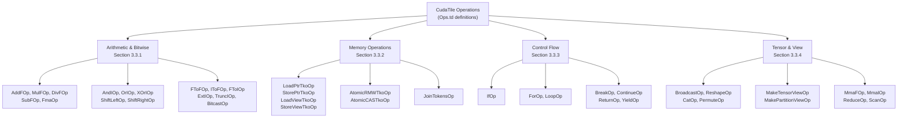
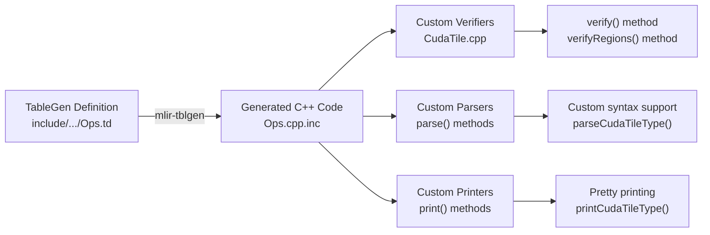
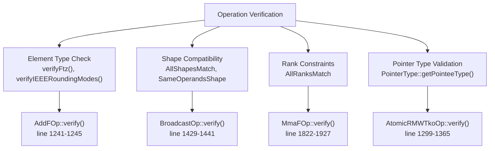
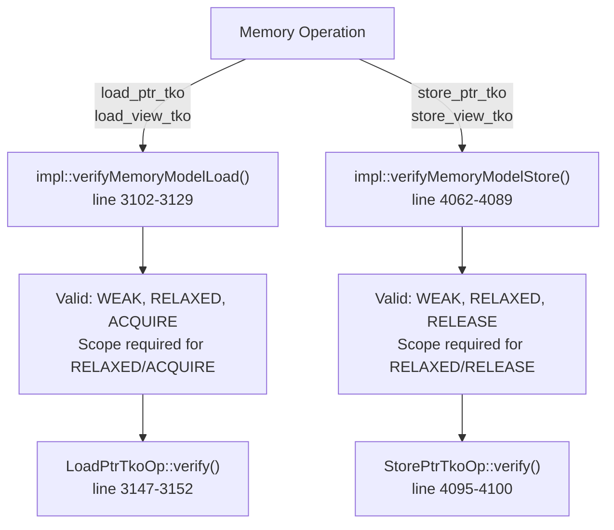
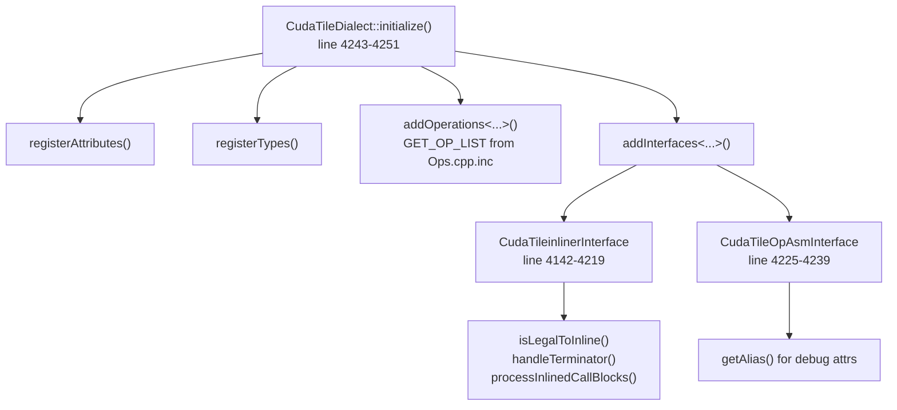
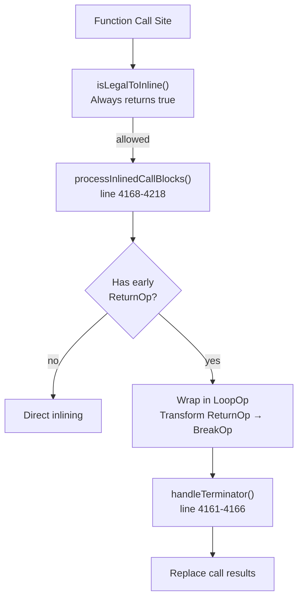
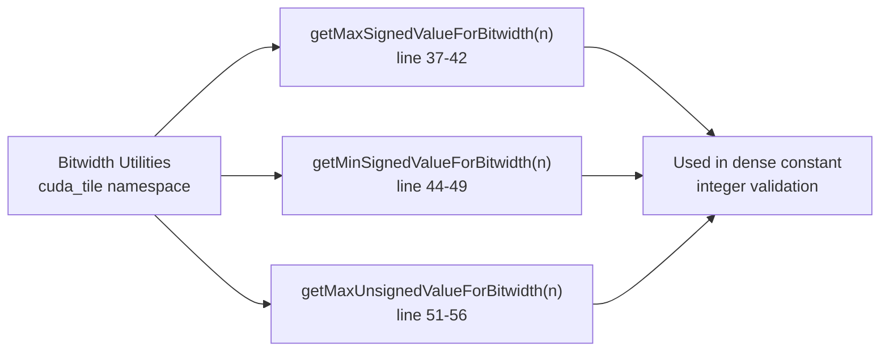
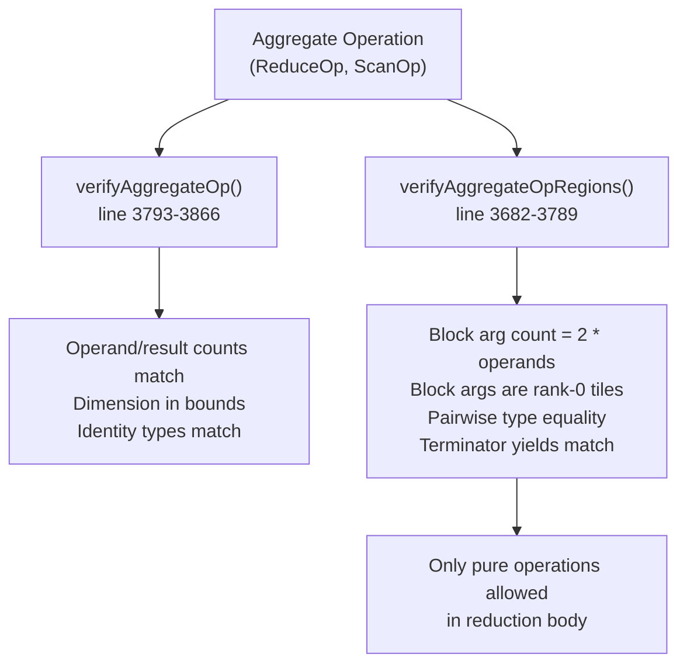

<!-- source: DeepWiki mcp.deepwiki.com · repo NVIDIA/cuda-tile · page 3.3 Operations · fetched 2026-10-26 -->

# Operations

<details>
<summary>Relevant source files</summary>

The following files were used as context for generating this wiki page:

- [lib/Dialect/CudaTile/IR/CudaTile.cpp](lib/Dialect/CudaTile/IR/CudaTile.cpp)

</details>


## Purpose and Scope

This page provides an overview of the operation categories in the CudaTile dialect and the infrastructure for defining, parsing, and verifying operations. Operations are the fundamental building blocks of CUDA Tile IR, representing computations, memory accesses, control flow constructs, and tensor manipulations.

For detailed documentation of specific operation categories, see:
- **Arithmetic and bitwise operations**: [3.3.1](#3.3.1)
- **Memory operations**: [3.3.2](#3.3.2)
- **Control flow operations**: [3.3.3](#3.3.3)
- **Tensor and view operations**: [3.3.4](#3.3.4)

For information about the type system used by operations, see [3.1](#3.1). For attributes that configure operation behavior, see [3.2](#3.2).

## Operation Categories

The CudaTile dialect organizes operations into four primary categories based on their semantic role:

| Category | Purpose | Example Operations |
|----------|---------|-------------------|
| **Arithmetic & Bitwise** | Element-wise numeric computations and bit manipulation | `add_f`, `mul_f`, `div_f`, `and_i`, `or_i`, `shift_left` |
| **Memory** | Token-ordered loads, stores, and atomic operations | `load_ptr_tko`, `store_view_tko`, `atomic_cas_tko`, `atomic_rmw_tko` |
| **Control Flow** | Conditional execution and loops | `if`, `for`, `loop`, `break`, `continue`, `return` |
| **Tensor & View** | Tensor manipulation and view creation | `broadcast`, `reshape`, `cat`, `mma`, `reduce`, `scan` |

**Sources:** [lib/Dialect/CudaTile/IR/CudaTile.cpp:1-4252]()

### Operation Category Hierarchy



**Sources:** [lib/Dialect/CudaTile/IR/CudaTile.cpp:1224-4252]()

## Operation Definition and Verification Framework

CudaTile operations follow MLIR's TableGen-based operation definition pattern. Each operation is defined in TableGen (`.td` files) and has associated C++ verification logic in `CudaTile.cpp`.

### Operation Lifecycle



**Sources:** [lib/Dialect/CudaTile/IR/CudaTile.cpp:1217-1221]()

### Key Verification Patterns

The dialect implements several common verification patterns used across operations:

#### 1. Type Constraint Verification

Operations verify that operand and result types satisfy their constraints:



**Sources:** 
- [lib/Dialect/CudaTile/IR/CudaTile.cpp:1228-1245]() (IEEE rounding verification)
- [lib/Dialect/CudaTile/IR/CudaTile.cpp:1429-1441]() (broadcast shape verification)
- [lib/Dialect/CudaTile/IR/CudaTile.cpp:1822-1927]() (MMA shape/type verification)
- [lib/Dialect/CudaTile/IR/CudaTile.cpp:1299-1365]() (atomic operation verification)

#### 2. Region Verification

Operations with regions (e.g., control flow, reduce/scan) verify their nested blocks:

| Operation | Region Verification | Key Checks |
|-----------|-------------------|------------|
| `ForOp` | `verifyRegions()` at line 2048 | Induction variable type matches bounds, iter_values match init types |
| `IfOp` | `verify()` at line 2326 | Then/else regions have compatible yield types |
| `ReduceOp` | `verifyRegions()` at line 3872 | Block arguments match operand types, terminator yields correct types |
| `EntryOp` | `verifyRegions()` at line 2283 | Function body debug info consistency |

**Sources:**
- [lib/Dialect/CudaTile/IR/CudaTile.cpp:2048-2061]() (ForOp region verification)
- [lib/Dialect/CudaTile/IR/CudaTile.cpp:2326-2379]() (IfOp verification)
- [lib/Dialect/CudaTile/IR/CudaTile.cpp:3872-3875]() (ReduceOp region verification)
- [lib/Dialect/CudaTile/IR/CudaTile.cpp:2283-2287]() (EntryOp region verification)

#### 3. Memory Ordering Semantics Verification

Memory operations use helper functions to verify memory ordering semantics:



**Sources:**
- [lib/Dialect/CudaTile/IR/CudaTile.cpp:3102-3129]() (load memory model verification)
- [lib/Dialect/CudaTile/IR/CudaTile.cpp:4062-4089]() (store memory model verification)
- [lib/Dialect/CudaTile/IR/CudaTile.cpp:3147-3152]() (LoadPtrTkoOp verification)
- [lib/Dialect/CudaTile/IR/CudaTile.cpp:4095-4100]() (StorePtrTkoOp verification)

## Custom Parsing and Printing Infrastructure

CudaTile operations use custom parsers and printers to support dialect-specific syntax, particularly for type notation without the `!cuda_tile.` prefix within `cuda_tile.module` operations.

### Function Signature Parsing

Custom function signature parsing enables short-form type syntax in function-like operations:

```mermaid
graph LR
    Input["Function Signature Input<br/>(arg0: tile&lt;f32&gt;, ...)"]
    
    Parser["parseFunctionSignatureWithArguments()<br/>line 190-200"]
    ArgList["parseFunctionArgumentList()<br/>line 124-145"]
    SingleArg["parseSingleArgument()<br/>line 91-121"]
    
    TypeParser["parseCudaTileType()<br/>Supports short-form types"]
    
    Result["Parsed Arguments<br/>with Type Information"]
    
    Input --> Parser
    Parser --> ArgList
    ArgList --> SingleArg
    SingleArg --> TypeParser
    TypeParser --> Result
    
    Printer["printFunctionSignatureWithCudaTileTypes()<br/>line 243-251"]
    Output["Printed Signature<br/>(arg0: tile&lt;f32&gt;, ...)"]
    
    Result --> Printer
    Printer --> Output
```



**Sources:**
- [lib/Dialect/CudaTile/IR/CudaTile.cpp:190-200]() (main signature parser)
- [lib/Dialect/CudaTile/IR/CudaTile.cpp:124-145]() (argument list parser)
- [lib/Dialect/CudaTile/IR/CudaTile.cpp:91-121]() (single argument parser)
- [lib/Dialect/CudaTile/IR/CudaTile.cpp:243-251]() (signature printer)

### Dense Constant Parsing

The `ConstantOp` uses custom parsing for dense tensor literals with type prefix notation:

```
constant <f32: [1.0, 2.0, 3.0]> : tile<3xf32>
constant <i32: [[1, 2], [3, 4]]> : tile<2x2xi32>
```

**Sources:**
- [lib/Dialect/CudaTile/IR/CudaTile.cpp:305-575]() (dense attribute parser)
- [lib/Dialect/CudaTile/IR/CudaTile.cpp:578-605]() (dense attribute printer)

### Attribute Parsing Utilities

Several attribute types have custom parsers to support convenient syntax:

| Attribute Type | Parser Function | Syntax Example |
|----------------|-----------------|----------------|
| `RoundingModeAttr` | `parseIEEERoundingMode()` at line 863 | `rounding<nearest_even>` or omitted |
| `SignednessAttr` | `parseSignedness()` at line 624 | `signed` or `unsigned` |
| `ComparisonPredicateAttr` | `parseComparisonPredicate()` at line 647 | `equal`, `less_than`, etc. |
| `AssumePredicateAttrInterface` | `parseAssumePredicate()` at line 888 | `div_by<8>`, `bounded` |
| `MemoryOrderingSemantics` | `parseMemoryAttributes()` at line 1023 | `relaxed device`, `weak` |

**Sources:**
- [lib/Dialect/CudaTile/IR/CudaTile.cpp:863-882]() (IEEE rounding mode parser)
- [lib/Dialect/CudaTile/IR/CudaTile.cpp:624-636]() (signedness parser)
- [lib/Dialect/CudaTile/IR/CudaTile.cpp:647-664]() (comparison predicate parser)
- [lib/Dialect/CudaTile/IR/CudaTile.cpp:888-941]() (assume predicate parser)
- [lib/Dialect/CudaTile/IR/CudaTile.cpp:1023-1065]() (memory attributes parser)

## Operation Registration and Dialect Integration

Operations are registered with the CudaTile dialect during initialization and integrate with MLIR infrastructure through dialect interfaces.

### Dialect Initialization



**Sources:**
- [lib/Dialect/CudaTile/IR/CudaTile.cpp:4243-4251]() (dialect initialization)
- [lib/Dialect/CudaTile/IR/CudaTile.cpp:4142-4219]() (inliner interface)
- [lib/Dialect/CudaTile/IR/CudaTile.cpp:4225-4239]() (ASM interface for debug info)

### Inliner Interface

The `CudaTileinlinerInterface` enables function inlining and handles early returns by transforming them into loop breaks:



**Sources:**
- [lib/Dialect/CudaTile/IR/CudaTile.cpp:4145-4159]() (isLegalToInline methods)
- [lib/Dialect/CudaTile/IR/CudaTile.cpp:4161-4166]() (handleTerminator)
- [lib/Dialect/CudaTile/IR/CudaTile.cpp:4168-4218]() (processInlinedCallBlocks with early return handling)

## Common Verification Utilities

The dialect provides several shared verification utilities used across multiple operations:

### Bitwidth Helper Functions



**Sources:**
- [lib/Dialect/CudaTile/IR/CudaTile.cpp:37-56]() (bitwidth utility functions)
- [lib/Dialect/CudaTile/IR/CudaTile.cpp:258-287]() (usage in integer bounds validation)

### Debug Info Verification

The `DebugInfoVerifier` class enforces consistency rules for debug information across functions and operations:

| Rule | Verification Method | Description |
|------|---------------------|-------------|
| Rule 1 | `verifyFunc()` at line 1093 | Functions with scope must have subprogram scope |
| Rule 2 | `verifyFunc()` at line 1093 | Function name must match subprogram linkage name |
| Rule 3 | `verifyFuncBody()` at line 1122 | Ops cannot have scope if function lacks scope |
| Rule 4 | `verifyFuncBody()` at line 1122 | Operation scope must match function scope |
| Rule 5 | `verifyModule()` at line 1161 | Global variables must not have scope |
| Rule 6 | `verifyFunc()` at line 1093 | Function location must not be CallSiteLoc |

**Sources:**
- [lib/Dialect/CudaTile/IR/CudaTile.cpp:1080-1202]() (DebugInfoVerifier class)
- [lib/Dialect/CudaTile/IR/CudaTile.cpp:1204-1211]() (verification entry points)

### Aggregate Operation Verification

Reduce and scan operations share common verification logic:



**Sources:**
- [lib/Dialect/CudaTile/IR/CudaTile.cpp:3793-3866]() (verifyAggregateOp)
- [lib/Dialect/CudaTile/IR/CudaTile.cpp:3682-3789]() (verifyAggregateOpRegions)
- [lib/Dialect/CudaTile/IR/CudaTile.cpp:3872-3880]() (ReduceOp verification)
- [lib/Dialect/CudaTile/IR/CudaTile.cpp:4011-4020]() (ScanOp verification)

---

