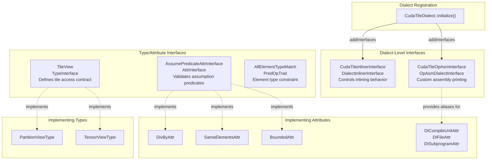
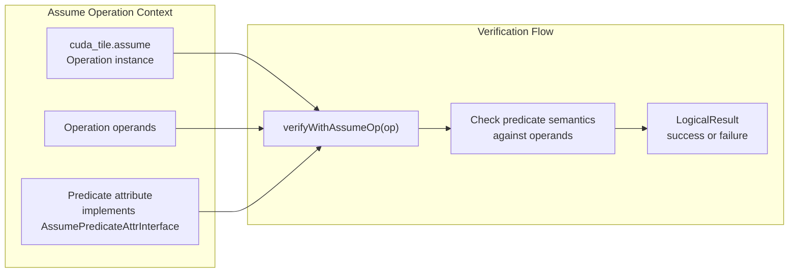
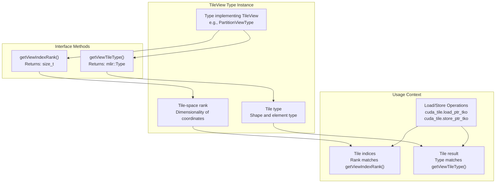
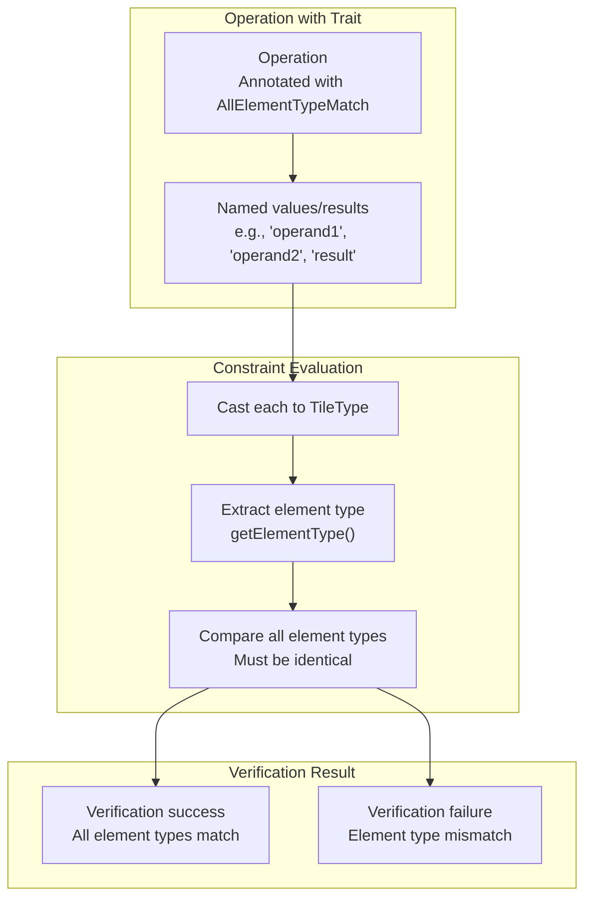
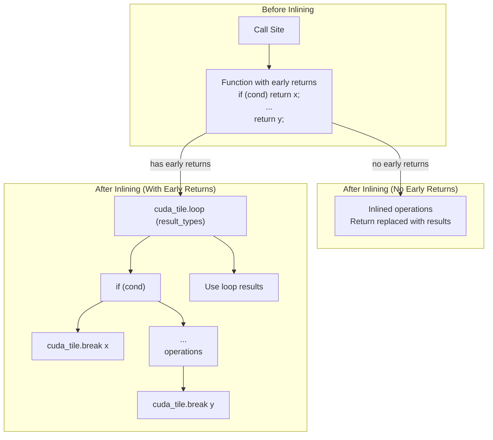
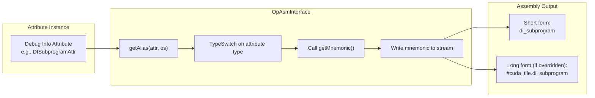
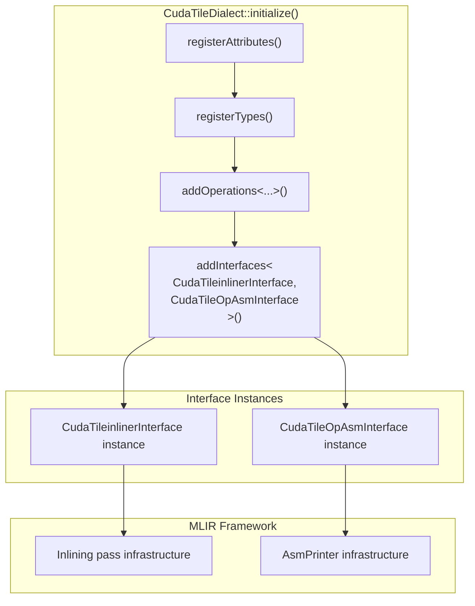
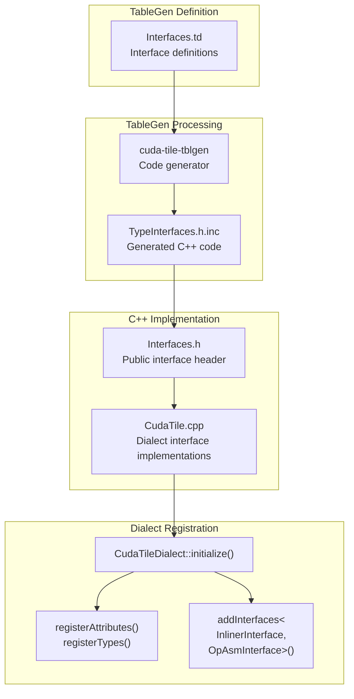
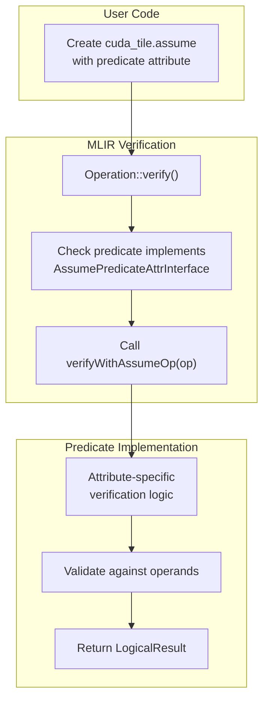
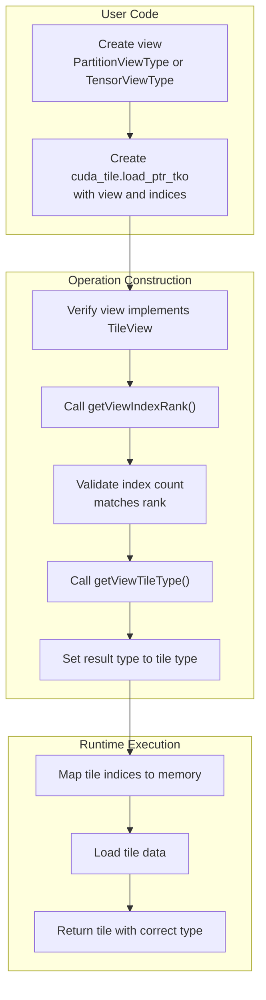

<!-- source: DeepWiki mcp.deepwiki.com · repo NVIDIA/cuda-tile · page 3.4 Dialect Interfaces · fetched 2026-10-26 -->

# Dialect Interfaces

Relevant source files

The following files were used as context for generating this wiki page:

- [lib/Dialect/CudaTile/IR/CudaTile.cpp](lib/Dialect/CudaTile/IR/CudaTile.cpp)

This document describes the interface system in the CudaTile MLIR dialect. Interfaces define contracts that types, attributes, operations, and dialects must implement to enable generic functionality and semantic guarantees. The CudaTile dialect implements four primary categories of interfaces:

1. **Dialect Interfaces**: Control dialect-wide behaviors (inlining, assembly printing)
2. **Type Interfaces**: Define contracts for types (`TileView`)
3. **Attribute Interfaces**: Define contracts for attributes (`AssumePredicateAttrInterface`)
4. **Operation Traits**: Constrain operation properties (`AllElementTypeMatch`)

For information about the concrete attributes that implement `AssumePredicateAttrInterface`, see [Attribute System](#3.2). For information about types that implement `TileView`, see [Type System](#3.1). For usage of interfaces in operations, see [Operations](#3.3).

## Overview

The CudaTile dialect defines interfaces at multiple levels to enforce behavioral contracts and enable MLIR framework integration. Dialect-level interfaces integrate with MLIR's transformation and analysis infrastructure (inlining, printing). Type and attribute interfaces enable polymorphic operations without requiring knowledge of specific implementing classes. The dialect uses MLIR's TableGen-based interface system to generate C++ code that enforces these contracts at compile time and runtime.

**CudaTile Interface Architecture**

Sources: [lib/Dialect/CudaTile/IR/CudaTile.cpp:4142-4251](), [include/cuda_tile/Dialect/CudaTile/IR/Interfaces.td:1-73]()

## AssumePredicateAttrInterface

The `AssumePredicateAttrInterface` is an attribute interface that must be implemented by all attributes used as predicates in `cuda_tile.assume` operations. This interface ensures that assumption predicates can be validated in the context of their use, enabling semantic checks beyond basic type constraints.

### Interface Definition

| Property | Value |
|----------|-------|
| Interface Type | `AttrInterface` |
| C++ Namespace | `::mlir::cuda_tile` |
| TableGen Name | `CudaTile_AssumePredicateAttrInterface` |
| Implementing Attributes | `DivByAttr`, `SameElementsAttr`, `BoundedAttr` |

### Methods

The interface defines a single method for validation:

**`verifyWithAssumeOp(::mlir::Operation *op) -> LogicalResult`**

Verifies the attribute in the context of a given `cuda_tile.assume` operation. Returns `success()` if the attribute is semantically valid on the operation, or `failure()` otherwise. This method allows each predicate attribute to implement custom validation logic based on the specific operation and operands.

**Interface Method Contract**

### Example Implementations

The following attributes implement `AssumePredicateAttrInterface`:

- **`DivByAttr`**: Asserts that a value is divisible by a specified divisor
- **`SameElementsAttr`**: Asserts that two values have identical elements
- **`BoundedAttr`**: Asserts that a value is bounded within a specified range

Each implementation provides custom validation logic in its `verifyWithAssumeOp` method to ensure the predicate is meaningful for the given operands.

Sources: [include/cuda_tile/Dialect/CudaTile/IR/Interfaces.td:13-28]()

## TileView Interface

The `TileView` interface is a type interface that represents a view within a memory region from which tiles can be loaded or stored. It abstracts the mapping between abstract tile-space coordinates and concrete memory layouts, enabling polymorphic tile access operations.

### Interface Definition

| Property | Value |
|----------|-------|
| Interface Type | `TypeInterface` |
| C++ Namespace | `::mlir::cuda_tile` |
| TableGen Name | `CudaTile_TileView` |
| Implementing Types | `PartitionViewType`, `TensorViewType` |

### Semantic Contract

Types implementing `TileView` must satisfy the following invariant:

> **Views must always access tiles of the same type no matter the index.**

This guarantees that tile type information is statically known and does not depend on dynamic indices. The invariant enables type-safe tile operations and optimization passes that reason about tile shapes.

### Methods

**`getViewIndexRank() -> size_t`**

Returns the rank of tile indices, which represents the dimensionality of the tile-space coordinate system. For example, a 2D tile grid would return rank 2.

**`getViewTileType() -> ::mlir::Type`**

Returns the type of tiles loaded from or stored to the view. The return type should be `cuda_tile::TileType`, but the interface uses `::mlir::Type` to avoid circular dependencies between TableGen definitions.

**TileView Method Contract**

### Example Usage

The `TileView` interface is primarily used by memory operations:

- **`cuda_tile.load_ptr_tko`**: Loads tiles from a view using tile-space indices
- **`cuda_tile.store_ptr_tko`**: Stores tiles to a view using tile-space indices

These operations accept any type implementing `TileView`, enabling polymorphic tile access patterns without operation-specific type handling.

Sources: [include/cuda_tile/Dialect/CudaTile/IR/Interfaces.td:30-63]()

## AllElementTypeMatch Trait

`AllElementTypeMatch` is a predicate-based operation trait that constrains multiple operands or results to have matching element types when they are `TileType` instances. This trait is implemented using MLIR's `PredOpTrait` mechanism.

### Trait Definition

| Property | Value |
|----------|-------|
| Base Class | `PredOpTrait` |
| Predicate | `AllMatchSameOperatorPred` |
| Element Type Extraction | `llvm::cast<mlir::cuda_tile::TileType>($_self.getType()).getElementType()` |

### Behavior

The trait verifies that all specified operands/results have the same element type by:

1. Casting each value's type to `cuda_tile::TileType`
2. Extracting the element type using `getElementType()`
3. Comparing all extracted element types for equality

**AllElementTypeMatch Constraint**

### Example

An operation declared with `AllElementTypeMatch<"all operands have matching element types", ["operand1", "operand2", "result"]>` will be verified to ensure that `operand1`, `operand2`, and `result` all have tiles with the same element type (e.g., all `f32`, or all `i32`).

Sources: [include/cuda_tile/Dialect/CudaTile/IR/Interfaces.td:65-70]()

## Inliner Interface

The `CudaTileinlinerInterface` implements MLIR's `DialectInlinerInterface` to control how CudaTile operations are inlined into other operations. This interface enables function inlining optimization passes to work correctly with CudaTile-specific control flow.

### Interface Implementation

| Property | Value |
|----------|-------|
| Base Interface | `mlir::DialectInlinerInterface` |
| Implementation Class | `CudaTileinlinerInterface` |
| Registration | `CudaTileDialect::initialize()` |
| Source Location | [lib/Dialect/CudaTile/IR/CudaTile.cpp:4142-4219]() |

### Methods

**`isLegalToInline(Operation *call, Operation *callable, bool wouldBeCloned) -> bool`**

Returns `true` to indicate that CudaTile operations can be inlined. This permissive policy allows all calls to be inlined.

**`isLegalToInline(Region *dest, Region *src, bool wouldBeCloned, IRMapping &valueMapping) -> bool`**

Returns `true` to allow inlining regions. No additional restrictions are imposed on region inlining.

**`isLegalToInline(Operation *op, Region *region, bool wouldBeCloned, IRMapping &mapping) -> bool`**

Returns `true` to allow inlining operations into regions without restriction.

**`handleTerminator(Operation *op, ValueRange valuesToRepl) -> void`**

Handles the inlined function's return operation by replacing uses of the call's results with the return operation's operands. This is called for `cuda_tile.return` operations.

**`processInlinedCallBlocks(Operation *call, iterator_range<Region::iterator> inlinedBlocks) -> void`**

Transforms early returns in inlined functions by:
1. Scanning for `cuda_tile.return` operations before the final return
2. Wrapping the inlined block in a `cuda_tile.loop` operation
3. Converting early returns to `cuda_tile.break` operations that exit the loop
4. Preserving return values through loop results

**Inlining Transformation for Early Returns**

Sources: [lib/Dialect/CudaTile/IR/CudaTile.cpp:4142-4219]()

## OpAsm Dialect Interface

The `CudaTileOpAsmInterface` implements MLIR's `OpAsmDialectInterface` to customize the assembly (textual) printing of CudaTile attributes. This interface provides human-readable mnemonics for debug information attributes.

### Interface Implementation

| Property | Value |
|----------|-------|
| Base Interface | `mlir::OpAsmDialectInterface` |
| Implementation Class | `CudaTileOpAsmInterface` |
| Registration | `CudaTileDialect::initialize()` |
| Source Location | [lib/Dialect/CudaTile/IR/CudaTile.cpp:4225-4239]() |

### Methods

**`getAlias(Attribute attr, raw_ostream &os) -> AliasResult`**

Provides custom aliases for debug information attributes. Returns `OverridableAlias` for supported attributes, allowing users to override the alias if needed. Returns `NoAlias` for other attributes.

**Supported Debug Info Attributes**

| Attribute Type | Mnemonic Output |
|----------------|-----------------|
| `DICompileUnitAttr` | Uses attribute's defined mnemonic |
| `DIFileAttr` | Uses attribute's defined mnemonic |
| `DILexicalBlockAttr` | Uses attribute's defined mnemonic |
| `DISubprogramAttr` | Uses attribute's defined mnemonic |

The implementation uses a `TypeSwitch` to match attribute types and extract their mnemonics using the `getMnemonic()` static method on each attribute class.

**Debug Info Attribute Aliasing**

Sources: [lib/Dialect/CudaTile/IR/CudaTile.cpp:4225-4239]()

## Dialect Interface Registration

The CudaTile dialect registers all dialect-level interfaces during initialization. The registration occurs in `CudaTileDialect::initialize()` using the `addInterfaces` template method.

**Registration Code Flow**

Sources: [lib/Dialect/CudaTile/IR/CudaTile.cpp:4243-4251]()

## Generated Code and Integration

The interface definitions in `Interfaces.td` are processed by MLIR's TableGen tool (`cuda-tile-tblgen`) to generate C++ header files. The generated code is included through `TypeInterfaces.h.inc`.

**Code Generation and Registration Flow**

### Header Structure

The main header file [include/cuda_tile/Dialect/CudaTile/IR/Interfaces.h:1-16]() provides a minimal interface that includes:

- MLIR core headers for `Location` and `Types`
- Generated interface declarations from `TypeInterfaces.h.inc`

This design separates hand-written interface declarations from generated code, maintaining clean separation of concerns in the build system.

### Integration with MLIR

Interfaces integrate with MLIR at multiple levels:

1. **Dialect-level interfaces** (Inliner, OpAsm) are registered during `CudaTileDialect::initialize()` and queried by MLIR transformation and printing infrastructure
2. **Type/attribute interfaces** are registered with MLIR's type and attribute systems through TableGen-generated registration code
3. **Operations** that use interfaces can polymorphically invoke interface methods without knowing concrete types
4. **Verification passes** automatically invoke interface-defined verification methods during operation verification

Sources: [include/cuda_tile/Dialect/CudaTile/IR/Interfaces.h:1-16](), [include/cuda_tile/Dialect/CudaTile/IR/Interfaces.td:1-73](), [lib/Dialect/CudaTile/IR/CudaTile.cpp:4243-4251]()

## Interface Usage Patterns

### Assumption Validation Pattern

Operations like `cuda_tile.assume` use `AssumePredicateAttrInterface` to validate predicates:

### Tile View Access Pattern

Memory operations use `TileView` interface to abstract tile access:

Sources: [include/cuda_tile/Dialect/CudaTile/IR/Interfaces.td:1-73]()

---

