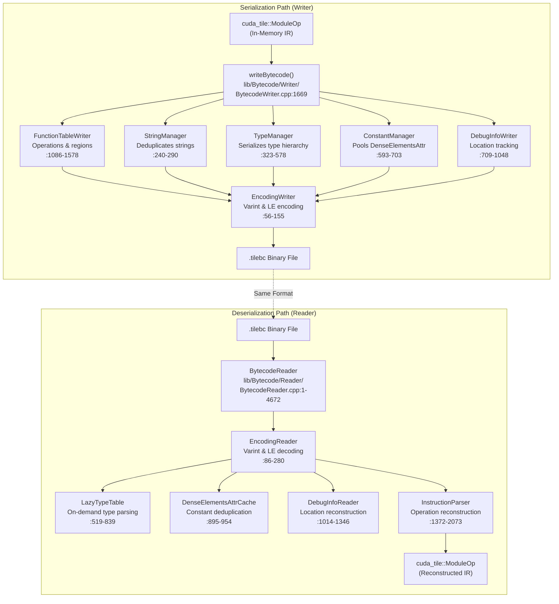
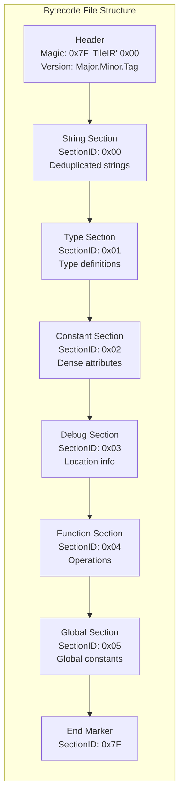
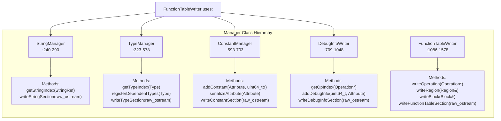
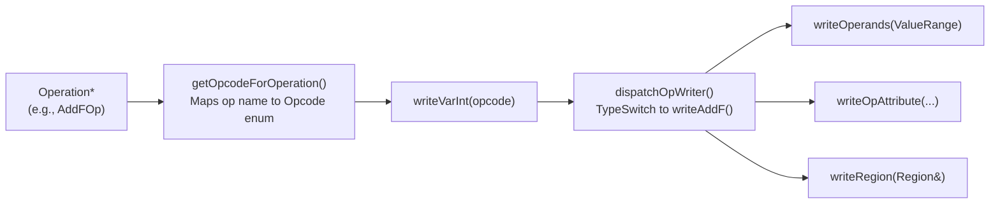
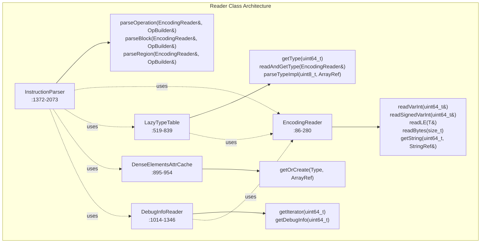

<!-- source: DeepWiki mcp.deepwiki.com · repo NVIDIA/cuda-tile · page 4 Bytecode System · fetched 2026-10-26 -->

# Bytecode System

<details>
<summary>Relevant source files</summary>

The following files were used as context for generating this wiki page:

- [lib/Bytecode/Reader/BytecodeReader.cpp](lib/Bytecode/Reader/BytecodeReader.cpp)
- [lib/Bytecode/Writer/BytecodeWriter.cpp](lib/Bytecode/Writer/BytecodeWriter.cpp)

</details>


The Bytecode System provides efficient serialization and deserialization of CUDA Tile IR modules into a compact binary format. This system enables persistent storage, network transmission, and just-in-time compilation of MLIR IR without relying on textual MLIR format. The bytecode format uses a section-based architecture with variable-length encoding and lazy loading optimizations.

For information about using the bytecode format with command-line tools, see [Bytecode Translation Tools](#4.5). For details on the bytecode format specification, see [Bytecode Format Specification](#4.1).

## Architecture Overview

The bytecode system consists of two primary subsystems: serialization (Writer) and deserialization (Reader), each implemented with a set of specialized manager classes.



**Sources:** [lib/Bytecode/Writer/BytecodeWriter.cpp:1-1712](), [lib/Bytecode/Reader/BytecodeReader.cpp:1-4672]()

## File Format Structure

The bytecode format consists of a header followed by an ordered sequence of sections. Each section is self-describing with a section ID, length, and optional alignment.

### Format Layout



**Sources:** [lib/Bytecode/Reader/BytecodeReader.cpp:60-79](), [lib/Bytecode/Writer/BytecodeWriter.cpp:30-49]()

### Section Types

| Section ID | Name | Description | Alignment |
|------------|------|-------------|-----------|
| 0x00 | String | Deduplicated string table with offset array | 4 bytes |
| 0x01 | Type | Type definitions with lazy parsing support | 4 bytes |
| 0x02 | Constant | Dense element attributes in raw binary form | 8 bytes |
| 0x03 | Debug | Debug information and location tracking | 4 bytes |
| 0x04 | Function | Operation bytecode and function metadata | 8 bytes |
| 0x05 | Global | Global constant declarations | Variable |
| 0x7F | EndOfBytecode | Termination marker | None |

**Sources:** [lib/Bytecode/Reader/BytecodeReader.cpp:286-367](), [../BytecodeEnums.h]()

## Serialization System (Writer)

The writer system transforms in-memory MLIR IR into compact bytecode through a multi-pass architecture using specialized manager classes.

### Manager Classes and Responsibilities



**Sources:** [lib/Bytecode/Writer/BytecodeWriter.cpp:240-290, 323-578, 593-703, 709-1048, 1086-1578]()

### String Deduplication

The `StringManager` maintains a `MapVector<StringRef, uint64_t>` to deduplicate all strings in the module. Each unique string is assigned a sequential index used for references throughout the bytecode.

**String Section Format:**
```
numStrings [varint]
padding    [align to 4 bytes]
offsets    [uint32_t array]
data       [concatenated strings]
```

**Sources:** [lib/Bytecode/Writer/BytecodeWriter.cpp:240-290](), [lib/Bytecode/Reader/BytecodeReader.cpp:371-421]()

### Type Serialization

The `TypeManager` recursively serializes the type hierarchy, ensuring dependent types are registered before parent types. It uses `TypeTag` enumerations to identify type kinds.

#### Type Tag Mapping

| Type | TypeTag | Encoding |
|------|---------|----------|
| `IntegerType` (i1) | `I1` | Tag only |
| `IntegerType` (i8/i16/i32/i64) | `I8/I16/I32/I64` | Tag only |
| `Float16Type` | `F16` | Tag only |
| `BFloat16Type` | `BF16` | Tag only |
| `Float32Type` | `F32` | Tag only |
| `FloatTF32Type` | `TF32` | Tag only |
| `Float64Type` | `F64` | Tag only |
| `Float8E4M3FNType` | `F8E4M3FN` | Tag only |
| `Float8E5M2Type` | `F8E5M2` | Tag only |
| `cuda_tile::TileType` | `Tile` | Tag + elementTypeIndex + shape |
| `cuda_tile::PointerType` | `Pointer` | Tag + pointeeTypeIndex |
| `cuda_tile::TensorViewType` | `TensorView` | Tag + elementTypeIndex + shape + strides |
| `cuda_tile::PartitionViewType` | `PartitionView` | Tag + tileShape + tensorViewIndex + dimMap + padding |
| `FunctionType` | `Func` | Tag + inputTypes + resultTypes |
| `cuda_tile::TokenType` | `Token` | Tag only |

**Sources:** [lib/Bytecode/Writer/BytecodeWriter.cpp:389-548](), [lib/Bytecode/Reader/BytecodeReader.cpp:580-831]()

### Constant Pool Management

The `ConstantManager` extracts `DenseElementsAttr` into a constant pool with index-based references. Dense attributes are serialized as raw binary data with a varint size prefix.

**Constant Serialization Logic:**
```cpp
// Writer side
serializeAttribute(DenseElementsAttr attr, EncodingWriter &writer) {
  ArrayRef<char> rawData = attr.getRawData();
  writer.writeVarInt(rawData.size());
  writer.write(rawData.data(), rawData.size());
}
```

**Sources:** [lib/Bytecode/Writer/BytecodeWriter.cpp:593-703](), [lib/Bytecode/Reader/BytecodeReader.cpp:883-1005]()

### Debug Information Tracking

The `DebugInfoWriter` serializes location attributes and maintains a per-operation mapping for instruction-level location tracking. It uses reserved indices for common locations like `UnknownLoc`.

#### Debug Info Tags

| Attribute Type | DebugTag | Fields |
|----------------|----------|--------|
| `DICompileUnitAttr` | `DICompileUnit` | fileIndex |
| `DIFileAttr` | `DIFile` | nameIndex, directoryIndex |
| `DILexicalBlockAttr` | `DILexicalBlock` | scopeIndex, fileIndex, line, column |
| `DILocAttr` | `DILoc` | scopeIndex, filenameIndex, line, column |
| `DISubprogramAttr` | `DISubprogram` | fileIndex, line, nameIndex, linkageNameIndex, compileUnitIndex, scopeLine |
| `CallSiteLoc` | `CallSite` | calleeIndex, callerIndex |
| `UnknownLoc` | `Unknown` | (reserved index) |

**Sources:** [lib/Bytecode/Writer/BytecodeWriter.cpp:899-1040](), [lib/Bytecode/Reader/BytecodeReader.cpp:1141-1335]()

### Operation Encoding

The `FunctionTableWriter` serializes operations using generated opcode dispatchers. Each operation type has a custom serialization function that encodes operands, attributes, and nested regions.



**Sources:** [lib/Bytecode/Writer/BytecodeWriter.cpp:1091-1398](), [StaticOpcodes.inc](), [Bytecode.inc]()

## Deserialization System (Reader)

The reader system reconstructs MLIR IR from bytecode using a lazy loading strategy for types and an iterative parsing approach for operations.

### Core Reader Classes



**Sources:** [lib/Bytecode/Reader/BytecodeReader.cpp:86-280, 519-839, 895-954, 1014-1346, 1372-2073]()

### Lazy Type Resolution

The `LazyTypeTable` parses types on-demand and caches results to avoid redundant parsing. It maintains a `typeCache` vector indexed by type ID and detects circular dependencies during parsing.

**Type Parsing Flow:**
```cpp
Type getType(uint64_t typeIndex) {
  // Check cache
  if (typeCache[typeIndex])
    return typeCache[typeIndex];
    
  // Detect recursion
  if (currentlyParsing.count(typeIndex))
    return Type();
    
  // Parse and cache
  currentlyParsing.insert(typeIndex);
  Type parsedType = parseTypeImpl(...);
  typeCache[typeIndex] = parsedType;
  currentlyParsing.erase(typeIndex);
  
  return parsedType;
}
```

**Sources:** [lib/Bytecode/Reader/BytecodeReader.cpp:529-564]()

### Header and Section Parsing

The reader validates the magic number `{0x7F, 'T', 'i', 'l', 'e', 'I', 'R', 0x00}` and version, then iteratively parses sections until reaching the `EndOfBytecode` marker.

**Header Format:**
```
magic   [8 bytes]
major   [uint8_t]
minor   [uint8_t]
tag     [uint16_t]
```

**Section Header Format:**
```
idAndIsAligned  [uint8_t]  // Lower 7 bits = ID, high bit = hasAlignment
length          [varint]
alignment       [varint]   // Only if high bit of idAndIsAligned is set
padding         [bytes]    // Alignment padding bytes (0xCF)
```

**Sources:** [lib/Bytecode/Reader/BytecodeReader.cpp:35-45, 296-367]()

### Operation Reconstruction

The `InstructionParser` reads operation opcodes and dispatches to generated parsing functions. Each operation parser reconstructs operands, attributes, result types, and nested regions.

#### Attribute Parsing Strategy

Attributes use different encoding strategies based on their type:

| Attribute Type | Encoding Strategy |
|----------------|-------------------|
| `BoolAttr` | Inline (1 byte) |
| `IntegerAttr` | Inline (varint) or type index + varint |
| `FloatAttr` | Inline (APInt representation) or type index + APInt |
| `TypeAttr` | Type index |
| `StringAttr` | String index |
| `DenseElementsAttr` | Constant pool index |
| `ArrayAttr` | Inline array of self-contained attributes |
| `DictionaryAttr` | Inline dictionary of key-value pairs |
| Enum attributes (e.g., `RoundingModeAttr`) | Varint encoding of enum value |

**Sources:** [lib/Bytecode/Reader/BytecodeReader.cpp:1585-1942](), [lib/Bytecode/Writer/BytecodeWriter.cpp:1139-1303]()

### Value Index Management

During function body parsing, the reader maintains a `valueIndexList` that maps indices to `mlir::Value` objects. Block arguments and operation results are assigned sequential indices within each function scope.

**Value Index Scoping:**
```
Function Entry:
  valueIndexList = [arg0, arg1, ...]
  
Block Entry:
  Save originalSize
  Append block arguments to valueIndexList
  
Operation Parsed:
  Append operation results to valueIndexList
  
Block Exit:
  Restore valueIndexList to originalSize
```

**Sources:** [lib/Bytecode/Reader/BytecodeReader.cpp:1432-1494, 1497-1522]()

## Encoding Schemes

The bytecode format uses variable-length integers (varints) and little-endian fixed-width encoding to minimize file size while maintaining platform portability.

### Variable-Length Integer (VarInt)

Varints encode integers using 7 bits per byte with a continuation bit. Signed varints use zigzag encoding to efficiently represent negative values.

**VarInt Encoding Algorithm:**
```
do {
  byte = value & 0x7F;
  value >>= 7;
  if (value != 0)
    byte |= 0x80;  // Set continuation bit
  emit(byte);
} while (value != 0);
```

**Signed VarInt (Zigzag Encoding):**
```
encoded = (value << 1) ^ (value >> 63)
```

This encoding maps signed integers as follows:
- `0` → `0`
- `-1` → `1`
- `1` → `2`
- `-2` → `3`

**Sources:** [lib/Bytecode/Writer/BytecodeWriter.cpp:68-94](), [lib/Bytecode/Reader/BytecodeReader.cpp:91-121]()

### Little-Endian Fixed-Width Encoding

Multi-byte integers (e.g., `uint32_t`, `uint64_t`) are encoded in little-endian byte order for consistency across platforms.

**Encoding Example (uint32_t):**
```
value = 0x12345678
bytes = [0x78, 0x56, 0x34, 0x12]
```

**Sources:** [lib/Bytecode/Writer/BytecodeWriter.cpp:97-110](), [lib/Bytecode/Reader/BytecodeReader.cpp:124-139]()

### APInt and APFloat Encoding

Arbitrary precision integers are encoded based on bit width:
- **≤ 8 bits**: Single byte
- **≤ 64 bits**: Signed varint
- **> 64 bits**: Number of active words + signed varint array

Floating-point values are encoded as APInt representations of their IEEE 754 bit patterns.

**Sources:** [lib/Bytecode/Writer/BytecodeWriter.cpp:209-228](), [lib/Bytecode/Reader/BytecodeReader.cpp:1529-1583]()

## Section Format Details

### String Section Format

```
numStrings  [varint]
padding     [to 4-byte boundary]
offsets     [uint32_t * numStrings]
data        [concatenated string bytes]
```

Offsets point to the start of each string in the data region. Strings are stored without null terminators.

**Sources:** [lib/Bytecode/Writer/BytecodeWriter.cpp:233-290](), [lib/Bytecode/Reader/BytecodeReader.cpp:371-421]()

### Type Section Format

```
numTypes    [varint]
padding     [to 4-byte boundary]
offsets     [uint32_t * numTypes]
typeData    [concatenated type encodings]
```

Each type encoding begins with a `TypeTag` followed by type-specific data. Types reference other types by index.

**Sources:** [lib/Bytecode/Writer/BytecodeWriter.cpp:296-378](), [lib/Bytecode/Reader/BytecodeReader.cpp:508-879]()

### Constant Section Format

```
numConstants  [varint]
padding       [to 8-byte boundary]
offsets       [uint64_t * numConstants]
constantData  [concatenated attribute encodings]
```

Dense element attributes are serialized as raw binary buffers with endianness conversion for big-endian platforms.

**Sources:** [lib/Bytecode/Writer/BytecodeWriter.cpp:583-703](), [lib/Bytecode/Reader/BytecodeReader.cpp:883-1005]()

### Debug Section Format

```
diOpsNum        [varint]           # Number of operations with debug info
padding         [to 4-byte boundary]
diIndexOffsets  [uint32_t * diOpsNum]  # Offset into diIndices per op
diIndicesNum    [varint]           # Total number of debug info indices
padding         [to 8-byte boundary]
diIndices       [uint64_t * diIndicesNum]  # Indices to debug attributes
diAttrNum       [varint]           # Total number of debug attributes
padding         [to 4-byte boundary]
diOffsets       [uint32_t * diAttrNum]  # Offset into diData per attribute
diData          [concatenated debug attribute encodings]
```

This multi-level indirection enables each operation to reference multiple debug attributes (e.g., location stack frames).

**Sources:** [lib/Bytecode/Writer/BytecodeWriter.cpp:746-835](), [lib/Bytecode/Reader/BytecodeReader.cpp:2077-2178]()

### Function Section Format

```
numFunctions  [varint]
functionEntry*
```

**Function Entry:**
```
nameIndex          [varint]
signatureIndex     [varint]
entryFlag          [uint8_t]  # Bit 0: Visibility, Bit 1: IsKernel
functionLocIndex   [varint]
optimizationHints? [self-contained attribute]  # Only if flag set
bodyLength         [varint]
functionBody       [instruction stream]
```

**Instruction Format:**
```
opcode          [varint]
operandCount    [varint]  # May be omitted for fixed-operand ops
operandIndices  [varint*]
resultTypes     [type indices]
attributes      [inline or indexed]
regions         [nested region bytecode]
```

**Sources:** [lib/Bytecode/Writer/BytecodeWriter.cpp:1054-1502](), [lib/Bytecode/Reader/BytecodeReader.cpp:2180-2424]()

### Global Section Format

```
numGlobals  [varint]
globalEntry*
```

**Global Entry:**
```
symbolNameIndex  [varint]
typeIndex        [varint]
constantIndex    [varint]
alignment        [varint]
```

Global constants are stored in the constant pool and referenced by index.

**Sources:** [lib/Bytecode/Writer/BytecodeWriter.cpp:1581-1622]()

## Versioning and Compatibility

The bytecode format uses semantic versioning with a three-component version: `major.minor.tag`.

**Version Structure:**
- **Major**: Incompatible format changes
- **Minor**: Backward-compatible additions
- **Tag**: Patch-level fixes

**Current Version:** `BytecodeVersion::kCurrentVersion` defined in [cuda_tile/Bytecode/Common/Version.h]()

**Minimum Supported Version:** `BytecodeVersion::kMinSupportedVersion`

The reader validates version compatibility during header parsing and rejects unsupported versions.

**Sources:** [lib/Bytecode/Reader/BytecodeReader.cpp:296-323](), [lib/Bytecode/Writer/BytecodeWriter.cpp:167-188]()

## Error Handling

Both reader and writer use MLIR's diagnostic infrastructure (`emitError`) to report errors with location context. The reader emits errors with byte offsets for debugging:

```cpp
InFlightDiagnostic emitError() const {
  return ::emitError(UnknownLoc::get(&context))
         << "error at offset " << offset << ": ";
}
```

Common error categories:
- **Format errors**: Invalid magic number, unsupported version
- **Data corruption**: Section length exceeds buffer size, invalid indices
- **Semantic errors**: Type mismatches, unsupported operation types
- **Verification errors**: Invalid IR structure after reconstruction

**Sources:** [lib/Bytecode/Reader/BytecodeReader.cpp:263-266](), [lib/Bytecode/Writer/BytecodeWriter.cpp:1632-1667]()

---

