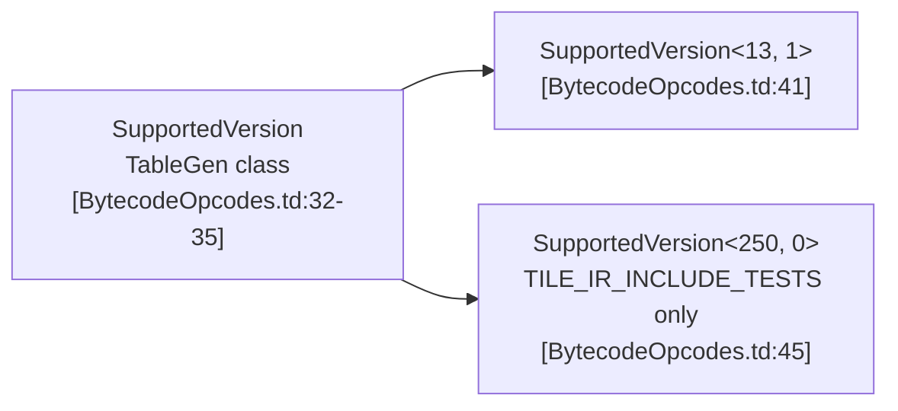
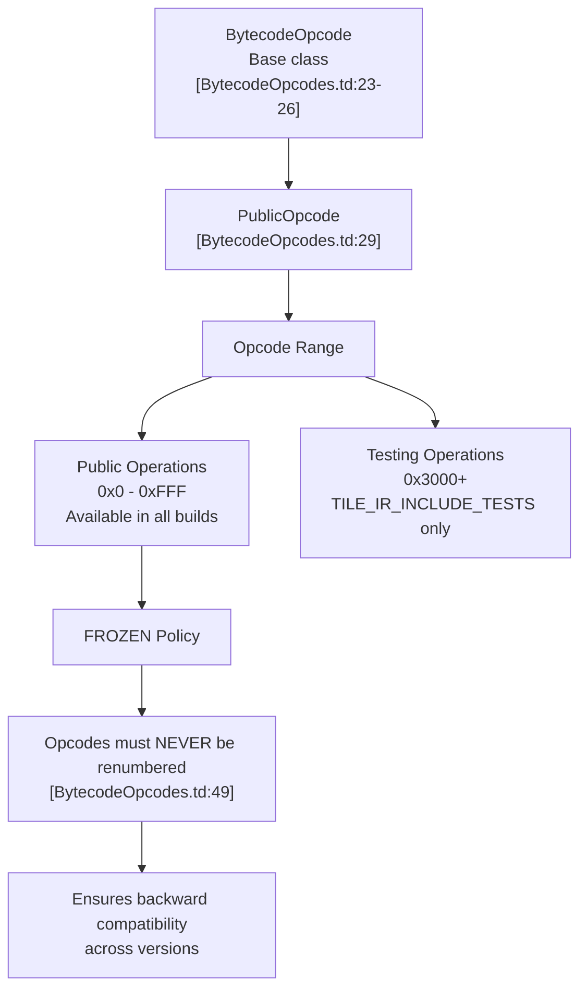
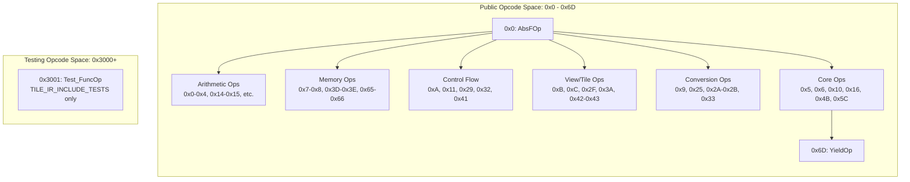
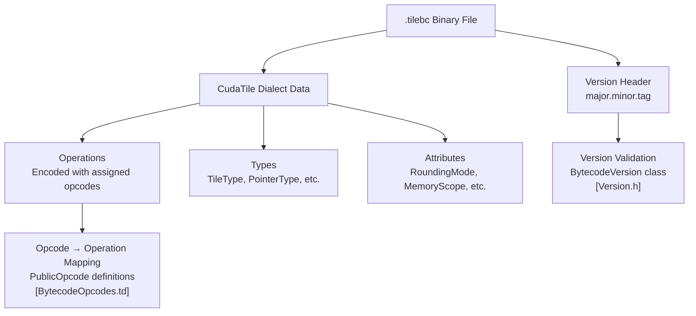
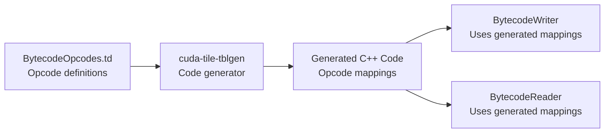

<!-- source: DeepWiki mcp.deepwiki.com · repo NVIDIA/cuda-tile · page 4.1 Bytecode Format Specification · fetched 2026-10-26 -->

# Bytecode Format

<details>
<summary>Relevant source files</summary>

The following files were used as context for generating this wiki page:

- [lib/Bytecode/Reader/BytecodeReader.cpp](lib/Bytecode/Reader/BytecodeReader.cpp)
- [lib/Bytecode/Writer/BytecodeWriter.cpp](lib/Bytecode/Writer/BytecodeWriter.cpp)

</details>


This page describes the binary bytecode format used by CUDA Tile IR for serializing MLIR modules. It covers the version encoding scheme, opcode assignment policy, and the structure of the bytecode representation. For information about reading bytecode files, see [Reading Bytecode](#4.2). For writing bytecode, see [Writing Bytecode](#4.3). For versioning strategies and compatibility guarantees, see [Versioning and Compatibility](#4.4).

## Overview

The CUDA Tile IR bytecode format is a binary serialization format for MLIR modules that ensures backward compatibility through explicit opcode assignments and a strict versioning scheme. The bytecode is designed to be consumed by the CUDA Toolkit's `tileiras` compiler and can be loaded directly via CUDA's driver API.

The format consists of:
- **Version Header**: Encodes the bytecode format version as `major.minor.tag`
- **Operation Opcodes**: Frozen numeric identifiers for each operation
- **Type and Attribute Encoding**: Serialized representations of dialect types and attributes

## Version Encoding

The bytecode version is represented by the `BytecodeVersion` class, which encodes three components:

| Component | Type | Description |
|-----------|------|-------------|
| Major | `uint8_t` | Major version, corresponds to CUDA Toolkit major version |
| Minor | `uint8_t` | Minor version, corresponds to CUDA Toolkit minor version |
| Tag | `uint16_t` | Optional tag for pre-release or experimental versions |

```mermaid
graph TB
    BytecodeVersionClass["BytecodeVersion class<br/>[Version.h:19-92]"]
    
    Components["Version Components"]
    verMajor["verMajor: uint8_t<br/>[Version.h:85]"]
    verMinor["verMinor: uint8_t<br/>[Version.h:88]"]
    verTag["verTag: uint16_t<br/>[Version.h:91]"]
    
    Methods["Access Methods"]
    getMajor["getMajor()<br/>[Version.h:31]"]
    getMinor["getMinor()<br/>[Version.h:34]"]
    getTag["getTag()<br/>[Version.h:37]"]
    toString["toString()<br/>[Version.h:56-60]"]
    
    Constructors["Construction"]
    defaultCtor["BytecodeVersion()<br/>defaults to kCurrentCompatibilityVersion<br/>[Version.h:23]"]
    fromVersion["fromVersion(major, minor, tag)<br/>[Version.h:27-28]"]
    
    BytecodeVersionClass --> Components
    Components --> verMajor
    Components --> verMinor
    Components --> verTag
    
    BytecodeVersionClass --> Methods
    Methods --> getMajor
    Methods --> getMinor
    Methods --> getTag
    Methods --> toString
    
    BytecodeVersionClass --> Constructors
    Constructors --> defaultCtor
    Constructors --> fromVersion
```

**Diagram: BytecodeVersion Class Structure**

The `toString()` method formats the version as `"major.minor.tag"` or `"major.minor"` if the tag is zero.

**Sources:** [include/cuda_tile/Bytecode/Common/Version.h:19-92]()

### Version Constants

Three key version constants are defined in the `BytecodeVersion` class:

| Constant | Purpose |
|----------|---------|
| `kCurrentCompatibilityVersion` | Widest compatibility within a CUDA Toolkit major version (default) |
| `kCurrentVersion` | Most recent version of CUDA Tile IR |
| `kMinSupportedVersion` | Oldest version that can still be read |

**Sources:** [include/cuda_tile/Bytecode/Common/Version.h:66-77]()

### Supported Versions

The TableGen definition file explicitly declares supported bytecode versions:



**Diagram: Declared Supported Versions**

Version 13.1 corresponds to CUDA Toolkit 13.1+. Version 250.0 is only available when `TILE_IR_INCLUDE_TESTS` is defined and is used for testing purposes.

**Sources:** [include/cuda_tile/Dialect/CudaTile/IR/BytecodeOpcodes.td:32-46]()

## Opcode Assignment Scheme

The bytecode format uses explicit opcode assignments to ensure backward compatibility. Each operation in the CudaTile dialect is assigned a unique numeric identifier that **must never change** once assigned.



**Diagram: Opcode Assignment Architecture**

### Opcode Ranges

| Range | Purpose | Availability |
|-------|---------|--------------|
| `0x0` - `0xFFF` | Public operations | All builds |
| `0x3000+` | Testing operations | `TILE_IR_INCLUDE_TESTS` builds only |

**Sources:** [include/cuda_tile/Dialect/CudaTile/IR/BytecodeOpcodes.td:23-35](), [include/cuda_tile/Dialect/CudaTile/IR/BytecodeOpcodes.td:52-53]()

### The FROZEN Policy

The bytecode opcodes follow a **FROZEN** policy, as explicitly documented in the file header:

> "Explicit opcode assignments to ensure backward compatibility across versions."
>
> "PUBLIC OPERATIONS (0x0 - 0xFFF) - These are available in all builds and must never be renumbered for backward compatibility."

This policy guarantees that:
1. Once an opcode is assigned, it is permanent
2. Bytecode files written with older versions remain readable by newer versions
3. The numeric value directly maps to the operation type during deserialization

**Sources:** [include/cuda_tile/Dialect/CudaTile/IR/BytecodeOpcodes.td:1-53]()

## Operation-to-Opcode Mapping

Each CudaTile operation is mapped to a specific opcode through the `PublicOpcode` TableGen definition. The mapping uses the syntax:

```tablegen
def : PublicOpcode<OperationClass, HexadecimalValue>;
```

### Sample Opcode Assignments

The following table shows representative opcode assignments for different operation categories:

| Operation | Opcode | Category | Line |
|-----------|--------|----------|------|
| `CudaTile_AbsFOp` | `0x0` | Arithmetic (Floating-point) | [BytecodeOpcodes.td:54]() |
| `CudaTile_AbsIOp` | `0x1` | Arithmetic (Integer) | [BytecodeOpcodes.td:55]() |
| `CudaTile_AddFOp` | `0x2` | Arithmetic (Floating-point) | [BytecodeOpcodes.td:56]() |
| `CudaTile_AddIOp` | `0x3` | Arithmetic (Integer) | [BytecodeOpcodes.td:57]() |
| `CudaTile_AtomicRMWTkoOp` | `0x8` | Memory (Atomic) | [BytecodeOpcodes.td:62]() |
| `CudaTile_BreakOp` | `0xA` | Control Flow | [BytecodeOpcodes.td:64]() |
| `CudaTile_ContinueOp` | `0x11` | Control Flow | [BytecodeOpcodes.td:71]() |
| `CudaTile_EntryOp` | `0x16` | Core | [BytecodeOpcodes.td:76]() |
| `CudaTile_ForOp` | `0x29` | Control Flow | [BytecodeOpcodes.td:83]() |
| `CudaTile_IfOp` | `0x32` | Control Flow | [BytecodeOpcodes.td:92]() |
| `CudaTile_LoadPtrTkoOp` | `0x3D` | Memory (Load) | [BytecodeOpcodes.td:97]() |
| `CudaTile_LoopOp` | `0x41` | Control Flow | [BytecodeOpcodes.td:101]() |
| `CudaTile_ModuleOp` | `0x4B` | Core | [BytecodeOpcodes.td:111]() |
| `CudaTile_ReturnOp` | `0x5C` | Core | [BytecodeOpcodes.td:128]() |
| `CudaTile_StorePtrTkoOp` | `0x65` | Memory (Store) | [BytecodeOpcodes.td:137]() |
| `CudaTile_YieldOp` | `0x6D` | Core | [BytecodeOpcodes.td:145]() |

**Sources:** [include/cuda_tile/Dialect/CudaTile/IR/BytecodeOpcodes.td:54-145]()

### Complete Opcode Listing

The bytecode format defines opcodes for all CudaTile operations, organized sequentially from `0x0` to `0x6D`. The complete mapping includes:

- **Arithmetic Operations**: `0x0` - `0x4`, `0x14` - `0x15`, `0x28`, `0x45` - `0x50`, `0x54`, `0x59` - `0x5A`, `0x67` - `0x6A`
- **Memory Operations**: `0x7` - `0x8`, `0x3D` - `0x3E`, `0x65` - `0x66`
- **Control Flow**: `0xA`, `0x11`, `0x29`, `0x32`, `0x41`, `0x5C`, `0x6D`
- **View/Tile Operations**: `0xB`, `0xC`, `0x26`, `0x34` - `0x3B`, `0x42` - `0x43`, `0x51`, `0x53`, `0x5B`, `0x58`, `0x5E`, `0x5F`
- **Conversion Operations**: `0x9`, `0x25`, `0x2A` - `0x2B`, `0x33`, `0x56` - `0x57`, `0x6B`
- **Core Operations**: `0x5`, `0x6`, `0x10`, `0x16`, `0x2C` - `0x31`, `0x3C`, `0x44`, `0x4B`, `0x55`



**Diagram: Opcode Space Organization**

**Sources:** [include/cuda_tile/Dialect/CudaTile/IR/BytecodeOpcodes.td:54-150]()

### Testing Operations

Testing operations are assigned opcodes in the `0x3000+` range and are only available when the `TILE_IR_INCLUDE_TESTS` preprocessor macro is defined:

```tablegen
#ifdef TILE_IR_INCLUDE_TESTS
def : PublicOpcode<CudaTile_Test_FuncOp, 0x3001>;
#endif // TILE_IR_INCLUDE_TESTS
```

This separation ensures that testing infrastructure does not pollute the public opcode space and allows the testing operations to be excluded from production builds.

**Sources:** [include/cuda_tile/Dialect/CudaTile/IR/BytecodeOpcodes.td:147-150]()

## Binary Format Structure

The bytecode file (`.tilebc`) contains a binary-encoded representation of the MLIR module. While the exact binary layout is managed by MLIR's bytecode infrastructure, the CUDA Tile IR layer is responsible for:



**Diagram: Bytecode File Structure**

### Key Responsibilities

The bytecode format layer is responsible for:

1. **Version Encoding**: Embedding the bytecode version in the file header
2. **Opcode Assignment**: Mapping each operation to its frozen numeric identifier
3. **Validation**: Ensuring opcodes are valid for the target bytecode version
4. **Type/Attribute Serialization**: Encoding dialect-specific types and attributes

The actual reading and writing of the binary format is handled by the `BytecodeReader` and `BytecodeWriter` classes (see [Reading Bytecode](#4.2) and [Writing Bytecode](#4.3)).

**Sources:** [include/cuda_tile/Bytecode/Common/Version.h:1-102](), [include/cuda_tile/Dialect/CudaTile/IR/BytecodeOpcodes.td:1-152]()

## Integration with MLIR Infrastructure

The CUDA Tile IR bytecode format integrates with MLIR's bytecode infrastructure through TableGen-based code generation. The `BytecodeOpcodes.td` file is processed by `cuda-tile-tblgen` to generate:

- C++ code for opcode-to-operation mapping
- Validation code to ensure opcodes are within supported ranges
- Version-specific serialization logic



**Diagram: Code Generation Flow**

This approach ensures that the opcode assignments are single-sourced from the TableGen definition and automatically propagated to all bytecode reading and writing code.

**Sources:** [include/cuda_tile/Dialect/CudaTile/IR/BytecodeOpcodes.td:1-16]()

## Compatibility Guarantees

The bytecode format provides the following compatibility guarantees:

| Guarantee | Description |
|-----------|-------------|
| **Forward Compatibility** | Older readers can skip unknown operations in newer bytecode |
| **Backward Compatibility** | Newer readers can always read older bytecode (opcode stability) |
| **Version Validation** | Bytecode version is validated before deserialization |
| **Opcode Stability** | Once assigned, opcodes never change (FROZEN policy) |

The `BytecodeVersion` comparison operators (`operator<`, `operator==`) enable readers to determine compatibility:

```cpp
bool operator<(const BytecodeVersion &other) const {
  if (verMajor != other.verMajor)
    return verMajor < other.verMajor;
  if (verMinor != other.verMinor)
    return verMinor < other.verMinor;
  return verTag < other.verTag;
}
```

This allows code to check if a bytecode file's version falls within the supported range (`kMinSupportedVersion` to `kCurrentVersion`).

**Sources:** [include/cuda_tile/Bytecode/Common/Version.h:40-53]()

---

