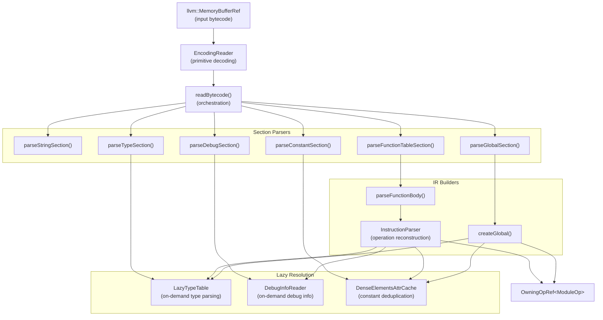
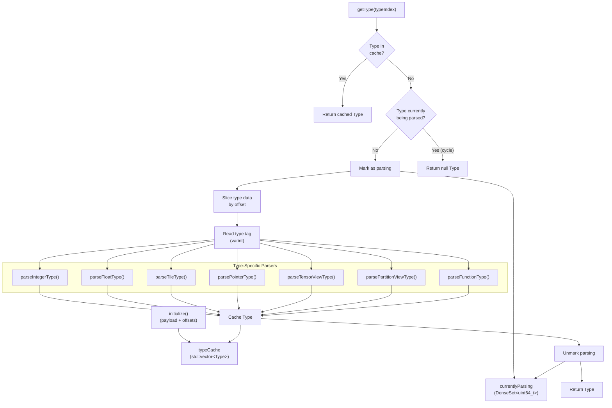
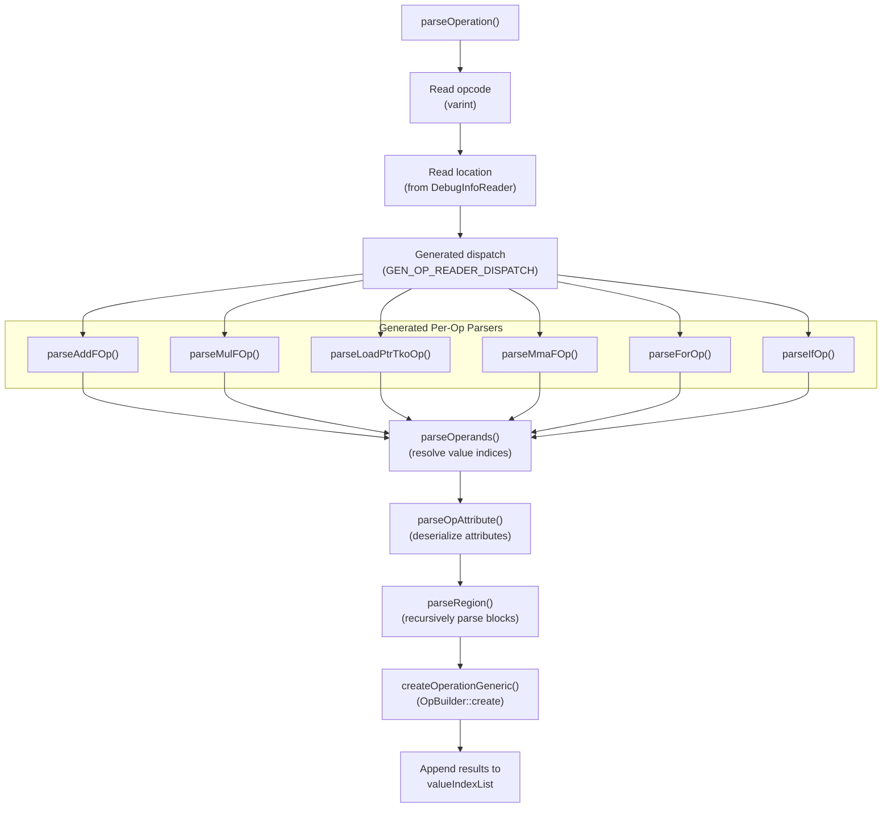
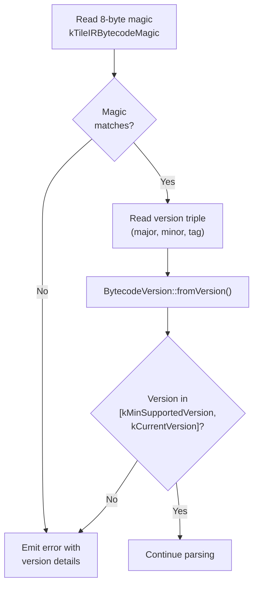
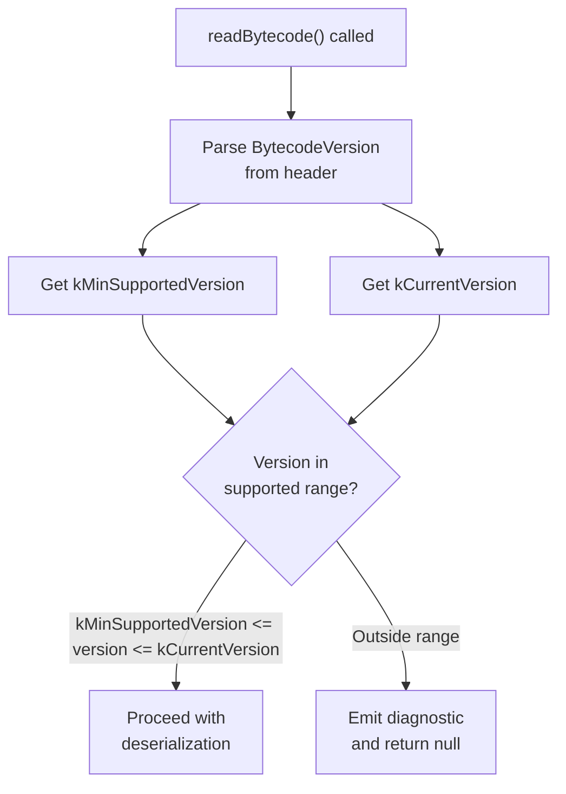

<!-- source: DeepWiki mcp.deepwiki.com · repo NVIDIA/cuda-tile · page 4.2 Bytecode Deserialization · fetched 2026-10-26 -->

# Bytecode Deserialization

<details>
<summary>Relevant source files</summary>

The following files were used as context for generating this wiki page:

- [lib/Bytecode/Reader/BytecodeReader.cpp](lib/Bytecode/Reader/BytecodeReader.cpp)

</details>


## Purpose and Scope

This page documents the BytecodeReader architecture and the internal mechanisms for deserializing CUDA Tile IR bytecode files (`.tilebc`) back into in-memory MLIR modules. The system implements section-based parsing, lazy type resolution, and incremental IR reconstruction to efficiently transform binary bytecode into a fully-functional `cuda_tile::ModuleOp`.

For the bytecode format specification, see [Bytecode Format Specification](#4.1). For information about writing bytecode, see [Bytecode Serialization](#4.3). For version compatibility details, see [Versioning and Compatibility](#4.4).

## Overview

The bytecode deserialization system is implemented in `BytecodeReader.cpp` and consists of several cooperating components that transform binary `.tilebc` files into `cuda_tile::ModuleOp` instances. The architecture uses a multi-pass approach: first discovering all sections in the bytecode stream, then parsing them in dependency order (strings before types, types before operations), and finally reconstructing the complete IR hierarchy.

Key design principles:
- **Section-based parsing**: Bytecode is organized into independent sections (String, Type, Constant, Debug, Func, Global) that can be parsed separately
- **Lazy resolution**: Types and debug information are parsed on-demand to minimize memory usage and startup time
- **Stateless operation**: The reader operates on immutable memory buffers without modifying global state beyond the provided `MLIRContext`
- **Validation-first**: Format validation, version checking, and alignment verification occur before IR reconstruction

Sources: [lib/Bytecode/Reader/BytecodeReader.cpp:1-20](), [lib/Bytecode/Reader/BytecodeReader.cpp:2568-2720]()

## BytecodeReader Architecture

The deserialization system is organized into several key components that work together to reconstruct IR from binary bytecode.

**Architecture: Component Relationships**



Sources: [lib/Bytecode/Reader/BytecodeReader.cpp:86-280](), [lib/Bytecode/Reader/BytecodeReader.cpp:519-839](), [lib/Bytecode/Reader/BytecodeReader.cpp:1014-1346](), [lib/Bytecode/Reader/BytecodeReader.cpp:1372-2073](), [lib/Bytecode/Reader/BytecodeReader.cpp:2568-2720]()

### EncodingReader: Primitive Data Decoding

The `EncodingReader` class (lines 86-280) provides low-level primitives for reading encoded data from byte buffers. It handles:

| Method Category | Purpose | Key Methods |
|----------------|---------|-------------|
| **VarInt Decoding** | Read variable-length integers | `readVarInt()`, `readSignedVarInt()` |
| **Fixed-Size Reading** | Read little-endian integers/floats | `readLE<T>()` for integral/floating-point types |
| **Byte Array Reading** | Read raw byte sequences | `readBytes()`, `readLEVarSize()` |
| **String Table Access** | Resolve string indices | `readAndGetString()`, `getString()` |
| **Alignment Handling** | Skip padding bytes | `skipPadding()` |
| **Error Reporting** | Emit diagnostics with offset context | `emitError()` |

EncodingReader instances are created per-section and inherit the string table from the main reader for consistent string resolution across all sections.

Sources: [lib/Bytecode/Reader/BytecodeReader.cpp:86-280]()

### Section Discovery and Storage

The main `readBytecode()` function implements a two-phase approach:

**Phase 1: Section Discovery**
- Parse section headers sequentially (lines 2586-2646)
- Store each section's payload in `sectionPayloads` array indexed by section ID
- Validate section alignment requirements (strings/types require 4-byte alignment, constants/debug/functions require 8-byte alignment)
- Detect end-of-bytecode marker

**Phase 2: Dependency-Order Parsing**
- Parse sections in dependency order: String → Type → Constant → Global → Function → Debug (lines 2656-2695)
- Initialize lazy resolution tables (`LazyTypeTable`, `DebugInfoReader`)
- Construct IR objects using resolved dependencies

Sources: [lib/Bytecode/Reader/BytecodeReader.cpp:2568-2720]()

## Public API Functions

The BytecodeReader provides three public API functions in the `mlir::cuda_tile` namespace:

| Function Signature | Purpose | Return Type |
|-------------------|---------|-------------|
| `isTileIRBytecode(llvm::MemoryBufferRef)` | Validate bytecode magic number | `bool` |
| `isTileIRBytecode(const char*)` | Validate bytecode magic number (C-style) | `bool` |
| `getBytecodeSize(const char*)` | Determine bytecode module size | `std::optional<size_t>` |
| `readBytecode(llvm::MemoryBufferRef, MLIRContext&)` | Deserialize to MLIR module | `OwningOpRef<ModuleOp>` |

**Validation: Magic Number Check**

The `isTileIRBytecode()` functions check for the 8-byte magic number: `{0x7F, 'T', 'i', 'l', 'e', 'I', 'R', 0x00}` at the start of the buffer without performing full deserialization.

Sources: [lib/Bytecode/Reader/BytecodeReader.cpp:35-55](), [include/cuda_tile/Bytecode/Reader/BytecodeReader.h:18-27]()

## Section Parsing

Each section type has a dedicated parsing function that extracts its payload and populates corresponding data structures.

### String Section Parsing

`parseStringSection()` (lines 379-421) deserializes the string table used throughout the bytecode:

**String Section Format:**
- Number of strings (varint)
- Padding to 4-byte alignment
- Array of `uint32_t` offsets (one per string, pointing into concatenated data)
- Concatenated string data (null-terminated or length-delimited)

The parser reads the offset array directly from the payload using pointer reinterpretation (avoiding copies) and sets up the string table in the main `EncodingReader` for subsequent string lookups via index.

Sources: [lib/Bytecode/Reader/BytecodeReader.cpp:379-421]()

### Type Section Parsing

`parseTypeSection()` (lines 842-879) initializes the `LazyTypeTable` with type data but does not parse individual types immediately:

**Type Section Format:**
- Number of types (varint)
- Padding to 4-byte alignment
- Array of `uint32_t` offsets (one per type, pointing into type data)
- Concatenated type data blobs (each starts with type tag)

The function initializes `LazyTypeTable` with the offset array and type data payload. Actual type parsing is deferred until types are requested via `getType()`.

Sources: [lib/Bytecode/Reader/BytecodeReader.cpp:842-879]()

### Constant Section Parsing

`parseConstantSection()` (lines 957-1005) extracts constant data blobs:

**Constant Section Format:**
- Number of constants (varint)
- Padding to 8-byte alignment
- Array of `uint64_t` offsets (one per constant)
- Concatenated constant data (format depends on constant type)

The parser populates a `std::vector<ArrayRef<uint8_t>>` where each entry is a slice of the payload containing one constant's raw data. The `DenseElementsAttrCache` later interprets these blobs when creating `DenseElementsAttr` instances.

Sources: [lib/Bytecode/Reader/BytecodeReader.cpp:957-1005]()

### Debug Section Parsing

`parseDebugSection()` (lines 2092-2178) initializes the `DebugInfoReader` with structured debug information:

**Debug Section Format:**
- Number of operations with debug info (varint)
- Padding to 4-byte alignment
- Array of `uint32_t` index offsets (per-operation offset into debug indices array)
- Number of debug info indices (varint)
- Padding to 8-byte alignment
- Array of `uint64_t` debug indices (references to debug attributes)
- Number of debug attributes (varint)
- Padding to 4-byte alignment
- Array of `uint32_t` offsets (one per debug attribute)
- Concatenated debug attribute data

The `DebugInfoReader` lazily resolves debug attributes (DILocAttr, DISubprogramAttr, etc.) when requested during operation parsing.

Sources: [lib/Bytecode/Reader/BytecodeReader.cpp:2092-2178]()

### Function Section Parsing

`parseFunctionTableSection()` (lines 2210-2292) extracts function metadata without parsing function bodies:

**Function Entry Format (per function):**
- Name index (varint, into string table)
- Signature index (varint, into type table)
- Entry flag (byte: kernel bit, visibility bit, optimization hints bit)
- Function location index (varint, into debug info)
- Optional optimization hints attribute (if flag set)
- Function body length (varint)
- Function body data (raw bytes, parsed later)

The parser creates a `std::vector<FunctionInfo>` where each entry contains metadata and a `StringRef` to the function body data. Function bodies are parsed separately during IR construction.

Sources: [lib/Bytecode/Reader/BytecodeReader.cpp:2210-2292]()

### Global Section Parsing

`parseGlobalSection()` (lines 2432-2480) extracts global variable metadata:

**Global Entry Format (per global):**
- Symbol name index (varint, into string table)
- Value type index (varint, into type table)
- Constant value index (varint, into constant table)
- Alignment (varint)

The parser creates a `std::vector<GlobalInfo>` for later `GlobalOp` construction.

Sources: [lib/Bytecode/Reader/BytecodeReader.cpp:2432-2480]()

## Lazy Type Resolution

The `LazyTypeTable` class (lines 519-839) implements on-demand type parsing and caching to minimize memory usage and deserialization time.

**LazyTypeTable Architecture**



Sources: [lib/Bytecode/Reader/BytecodeReader.cpp:519-839]()

### Type Parsing Methods

Each type category has a dedicated parser:

| Type Tag | Parser Method | Format |
|----------|---------------|--------|
| `I1`, `I8`, `I16`, `I32`, `I64` | `parseIntegerType()` | Type tag only (no payload) |
| `F16`, `BF16`, `F32`, `TF32`, `F64`, `F8E4M3FN`, `F8E5M2` | `parseFloatType()` | Type tag only |
| `Tile` | `parseTileType()` | Element type index + rank + dimensions array |
| `Pointer` | `parsePointerType()` | Pointee type index |
| `TensorView` | `parseTensorViewType()` | Element type + shape array + strides array |
| `PartitionView` | `parsePartitionViewType()` | Tile shape + tensor_view type + dim map + optional padding |
| `Func` | `parseFunctionType()` | Num params + param type indices + num results + result type indices |
| `Token` | (Direct construction) | Type tag only |

Type parsers can recursively call `readAndGetType()` to resolve nested types (e.g., element type of `TileType`). The `currentlyParsing` set detects cycles and prevents infinite recursion.

Sources: [lib/Bytecode/Reader/BytecodeReader.cpp:581-831]()

### Recursion Detection

The `currentlyParsing` member (a `DenseSet<uint64_t>`) tracks type indices currently being parsed. When `getType()` is called:
1. Check if the index is in `currentlyParsing` → if yes, return null `Type` (cycle detected)
2. Insert index into `currentlyParsing`
3. Parse the type (may recursively call `getType()` for nested types)
4. Remove index from `currentlyParsing` (using `llvm::make_scope_exit`)
5. Cache and return the result

This mechanism handles recursive type definitions gracefully.

Sources: [lib/Bytecode/Reader/BytecodeReader.cpp:536-563]()

## IR Reconstruction

### Operation Parsing

The `InstructionParser` class (lines 1372-2073) reconstructs operations from bytecode using a generated dispatch mechanism.

**Operation Parsing Flow**



Sources: [lib/Bytecode/Reader/BytecodeReader.cpp:2051-2073]()

### Value Index List

The `valueIndexList` is a `std::vector<Value>` that maintains the mapping from bytecode value indices to MLIR `Value` objects. As operations are parsed:
1. Operation results are appended to `valueIndexList`
2. Block arguments are appended when entering blocks
3. Operands reference earlier values by index into `valueIndexList`

For blocks with regions, the `valueIndexList` is temporarily extended with block arguments and operation results, then restored to its original size upon exiting the block (lines 1490-1492).

Sources: [lib/Bytecode/Reader/BytecodeReader.cpp:1431-1494]()

### Attribute Deserialization

The `parseOpAttribute<T>()` template function (lines 1698-1942) deserializes attributes based on their C++ type:

| C++ Type | Encoding | Parser Logic |
|----------|----------|--------------|
| `BoolAttr` | Inline i1 | `parseScalarAttributeInline()` |
| `IntegerAttr` | Inline varint + type | `parseScalarAttributeInline()` |
| `FloatAttr` | Inline APInt encoding | `parseScalarAttributeInline()` |
| `TypeAttr` | Type index | `types.readAndGetType()` |
| `StringAttr` | String index | `reader.readAndGetString()` |
| `DenseI32ArrayAttr` | Array of i32 values | `readLEVarSize()` |
| `DenseI64ArrayAttr` | Array of i64 values | `readLEVarSize()` |
| `DenseElementsAttr` | Constant index | `parseConstantAttrIndex()` → cache lookup |
| `ArrayAttr` | Size + elements | Recursive calls to `parseSelfContainedOpAttribute()` |
| `DictionaryAttr` | Size + key-value pairs | String keys + recursive attribute parsing |
| Enum attributes | Varint enum value | `parseGenericEnumAttr()` |
| `std::optional<T>` | Presence byte + value | Recursive call if present |

Self-contained attributes (those with explicit tags) are parsed via `parseSelfContainedOpAttribute()` which reads the attribute tag and dispatches to the appropriate type-specific parser.

Sources: [lib/Bytecode/Reader/BytecodeReader.cpp:1698-2044]()

### Function Body Reconstruction

Function bodies are reconstructed in `parseFunctionBody()` (lines 2295-2312):
1. Create an `EncodingReader` for the function body bytes
2. Inherit the string table from the main reader
3. Initialize `valueIndexList` with function arguments
4. Parse operations sequentially using `InstructionParser::parseOperation()`
5. Each operation appends its results to `valueIndexList` for subsequent reference

The function body forms the entry block of the function operation (`EntryOp`).

Sources: [lib/Bytecode/Reader/BytecodeReader.cpp:2295-2312](), [lib/Bytecode/Reader/BytecodeReader.cpp:2315-2406]()

### Module Construction

The final module is constructed in `readBytecode()` (lines 2697-2719):
1. Create an empty `cuda_tile::ModuleOp` with name "kernels"
2. Create `GlobalOp` instances from `globalInfoList` (lines 2703-2707)
3. Create `EntryOp` instances from `functionInfoList` (lines 2708-2713)
4. Verify the complete module (line 2714)
5. Return the `OwningOpRef<ModuleOp>`

Sources: [lib/Bytecode/Reader/BytecodeReader.cpp:2697-2720]()

## Header and Version Validation

The `parseHeader()` function (lines 296-323) validates the bytecode header:
1. Read and verify 8-byte magic number: `{0x7F, 'T', 'i', 'l', 'e', 'I', 'R', 0x00}`
2. Read version triple: major (uint8), minor (uint8), tag (uint16)
3. Convert to `BytecodeVersion` instance
4. Check if version is in supported range: `[kMinSupportedVersion, kCurrentVersion]`
5. Emit error if unsupported, otherwise continue

**Version Validation Logic**



Sources: [lib/Bytecode/Reader/BytecodeReader.cpp:296-323]()

## Debug Information Deserialization

The `DebugInfoReader` class (lines 1014-1346) provides lazy resolution of debug information attributes.

### Debug Info Iterator Pattern

Debug information is associated with operations via an index. The `DebugInfoReader::Iterator` (lines 1019-1057) enables sequential retrieval of debug attributes for a given operation:

```cpp
auto iterator = debuginfo.getIterator(opIndex);
auto loc = iterator.next<LocationAttr>();  // Get location for operation
```

The iterator:
1. Starts at the operation index (which maps to an offset in `diIndexOffsets`)
2. Each call to `next<T>()` increments an internal offset and retrieves the next debug attribute
3. Returns attributes of the requested type (e.g., `LocationAttr`, `DILocAttr`)

Sources: [lib/Bytecode/Reader/BytecodeReader.cpp:1019-1059]()

### Debug Attribute Parsing

Debug attributes are parsed on-demand via `getDebugInfo()` (lines 1100-1139):
- Check cache for previously-parsed attribute
- Detect recursive parsing (prevent cycles)
- Slice debug data by offset
- Read debug tag (byte)
- Dispatch to tag-specific parser:
  - `DICompileUnit`: file attribute
  - `DIFile`: file name + directory strings
  - `DILexicalBlock`: scope + file + line + column
  - `DILoc`: scope + filename + line + column → creates `FileLineColLoc`
  - `DISubprogram`: file + line + name + linkage name + compile unit + scope line
  - `CallSite`: callee location + caller location

Reserved debug indices (e.g., `DebugReserved::UnknownLoc`) map directly to `UnknownLoc::get()` without parsing.

Sources: [lib/Bytecode/Reader/BytecodeReader.cpp:1100-1335]()

## Error Handling and Diagnostics

The bytecode reader employs comprehensive error handling at multiple levels:

### EncodingReader Error Context

The `EncodingReader::emitError()` method (lines 263-266) creates diagnostics with offset information:
```cpp
InFlightDiagnostic emitError() const {
  return ::emitError(UnknownLoc::get(&context))
         << "error at offset " << offset << ": ";
}
```

All parsing errors include the byte offset where the error occurred, aiding debugging of corrupt bytecode files.

### Error Categories

| Error Type | Detection Point | Example |
|------------|----------------|---------|
| **Magic Number Mismatch** | `parseHeader()` lines 298-305 | "invalid magic number at position 2, got 0x42 expected 0x69" |
| **Unsupported Version** | `parseHeader()` lines 315-321 | "unsupported Tile version 14.0.0, this reader supports versions [13.0.0, 13.1.0]" |
| **Section Header Corruption** | `parseSectionHeader()` lines 329-367 | "section length 1048576 exceeds remaining data size 1024" |
| **Out-of-Bounds Index** | Various index lookups | "string index 42 out of bounds", "type index 99 out of bounds" |
| **Type Validation Failure** | Type-specific parsers | "tile element type must be integer, float, or valid pointer, got: !cuda_tile.token" |
| **Operand Index Error** | `parseOperands()` lines 1420-1424 | "operand index 15 out of bounds (size=10) for operand 2" |
| **Recursive Type** | `LazyTypeTable::getType()` lines 536-537 | Returns null Type (cycle detected) |
| **Verification Failure** | Final module verification line 2714 | "verification failed for deserialized cuda_tile::ModuleOp" |

All error paths return failure indicators (`LogicalResult::failure()`, `nullptr`, `null OwningOpRef`) and emit diagnostics to the `MLIRContext`.

Sources: [lib/Bytecode/Reader/BytecodeReader.cpp:263-266](), [lib/Bytecode/Reader/BytecodeReader.cpp:296-323](), [lib/Bytecode/Reader/BytecodeReader.cpp:2714-2718]()

## Performance Characteristics

### Lazy Resolution Benefits

The lazy resolution strategy provides several performance advantages:

| Aspect | Eager Approach | Lazy Approach (Implemented) |
|--------|----------------|---------------------------|
| **Initial Parse Time** | Parse all types/debug info upfront | Parse only referenced entities |
| **Memory Usage** | All types materialized in memory | Only cache parsed types |
| **Startup Latency** | Higher (full deserialization) | Lower (parse on-demand) |
| **Cache Locality** | Poor (all data accessed) | Better (access patterns match usage) |

For large bytecode files with many unused types or debug information, lazy resolution can significantly reduce deserialization time and memory footprint.

### Deduplication Mechanisms

The `DenseElementsAttrCache` (lines 895-954) prevents duplicate creation of constant attributes:
- Cache key: `(Type, ArrayRef<uint8_t>)` pair (type + raw data)
- When the same constant data is referenced multiple times, only one `DenseElementsAttr` is created
- Subsequent references retrieve the cached instance

This is particularly important for shared constant tensors used across multiple operations.

Sources: [lib/Bytecode/Reader/BytecodeReader.cpp:895-954]()

### Section Alignment

Section alignment requirements (enforced at lines 2614-2632) ensure that arrays of fixed-size integers can be accessed directly via pointer reinterpretation without copying:
- String and Type sections: 4-byte aligned (for `uint32_t` offset arrays)
- Constant, Debug, and Function sections: 8-byte aligned (for `uint64_t` offset arrays)

This zero-copy access improves parsing performance for large offset arrays.

Sources: [lib/Bytecode/Reader/BytecodeReader.cpp:2600-2632]()

## Example Usage Patterns

### Basic Deserialization

```cpp
// Load bytecode file
auto bufferOrError = llvm::MemoryBuffer::getFile("kernel.tilebc");
if (!bufferOrError) {
    llvm::errs() << "Failed to load file\n";
    return;
}

// Validate format
if (!mlir::cuda_tile::isTileIRBytecode(**bufferOrError)) {
    llvm::errs() << "Not a valid tilebc file\n";
    return;
}

// Prepare context (must have CudaTileDialect registered)
mlir::MLIRContext context;
context.loadDialect<mlir::cuda_tile::CudaTileDialect>();

// Deserialize
auto moduleOp = mlir::cuda_tile::readBytecode(**bufferOrError, context);
if (!moduleOp) {
    llvm::errs() << "Deserialization failed\n";
    return;
}

// Use the module
moduleOp->dump();  // Print textual IR
// Apply optimization passes, extract kernels, etc.
```

### Size-Aware Loading

```cpp
const char *bytecodePtr = /* ... */;

// Check if valid bytecode
if (!mlir::cuda_tile::isTileIRBytecode(bytecodePtr)) {
    return;
}

// Get exact size for buffer allocation
auto size = mlir::cuda_tile::getBytecodeSize(bytecodePtr);
if (!size) {
    return;  // Size determination failed
}

// Allocate exact buffer and copy
std::vector<char> buffer(*size);
std::memcpy(buffer.data(), bytecodePtr, *size);

// Create buffer reference and deserialize
llvm::MemoryBufferRef bufRef(
    llvm::StringRef(buffer.data(), buffer.size()), 
    "bytecode"
);
mlir::MLIRContext context;
context.loadDialect<mlir::cuda_tile::CudaTileDialect>();
auto moduleOp = mlir::cuda_tile::readBytecode(bufRef, context);
```

Sources: [include/cuda_tile/Bytecode/Reader/BytecodeReader.h:18-27](), [lib/Bytecode/Reader/BytecodeReader.cpp:2524-2566]()

## Version Compatibility During Reading

The reader performs version validation during deserialization using the `BytecodeVersion` system. The bytecode header contains version information that is checked against supported version ranges:

**Version Validation Flow**



The version check ensures backward compatibility by supporting all versions from `BytecodeVersion::kMinSupportedVersion` through `BytecodeVersion::kCurrentVersion`. For details on version constants and compatibility policies, see [Versioning and Compatibility](#4.4).

Sources: [include/cuda_tile/Bytecode/Common/Version.h:70-77](), [include/cuda_tile/Bytecode/Reader/BytecodeReader.h:25-27]()

## API Summary Reference

| Function | Header | Return Type | Purpose |
|----------|--------|-------------|---------|
| `isTileIRBytecode(MemoryBufferRef)` | `BytecodeReader.h:19` | `bool` | Validate bytecode format |
| `isTileIRBytecode(const char*)` | `BytecodeReader.h:20` | `bool` | Validate bytecode format (C-style) |
| `getBytecodeSize(const char*)` | `BytecodeReader.h:23` | `std::optional<size_t>` | Query bytecode size |
| `readBytecode(MemoryBufferRef, MLIRContext&)` | `BytecodeReader.h:26-27` | `OwningOpRef<ModuleOp>` | Deserialize to MLIR module |

Sources: [include/cuda_tile/Bytecode/Reader/BytecodeReader.h:18-27]()

---

