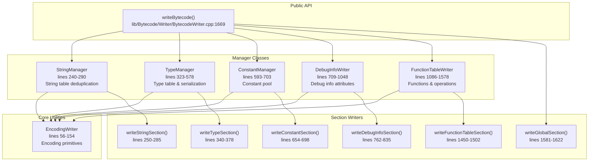
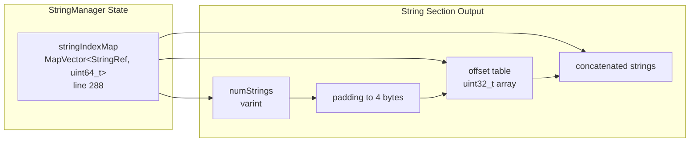
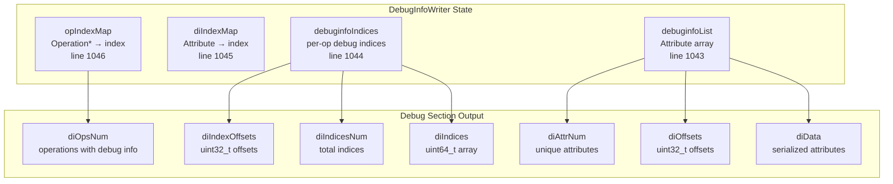
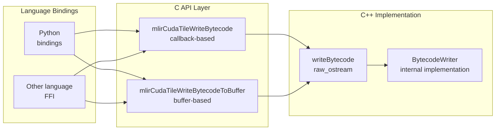

<!-- source: DeepWiki mcp.deepwiki.com · repo NVIDIA/cuda-tile · page 4.3 Bytecode Serialization · fetched 2026-10-26 -->

# Bytecode Serialization

<details>
<summary>Relevant source files</summary>

The following files were used as context for generating this wiki page:

- [lib/Bytecode/Writer/BytecodeWriter.cpp](lib/Bytecode/Writer/BytecodeWriter.cpp)

</details>


## Purpose and Scope

This page documents the internal architecture of the BytecodeWriter system, which serializes CUDA Tile IR modules to binary bytecode format. It covers the manager classes (`StringManager`, `TypeManager`, `ConstantManager`, `DebugInfoWriter`, `FunctionTableWriter`), the `EncodingWriter` utility, and the serialization orchestration process. For information about the binary bytecode format structure, see page 4.1. For reading bytecode back into MLIR modules, see page 4.2. For the public API usage and version selection, see page 4.5.

## BytecodeWriter Architecture

The BytecodeWriter system is structured around specialized manager classes that handle different aspects of serialization. Each manager is responsible for collecting, indexing, and writing a specific section of the bytecode file.

**System Architecture**



Sources: [lib/Bytecode/Writer/BytecodeWriter.cpp:1-1712]()

## EncodingWriter Utility

The `EncodingWriter` class provides low-level encoding primitives for writing data in the bytecode format. All manager classes use `EncodingWriter` to serialize their data.

**Key Methods**

| Method | Purpose | Lines |
|--------|---------|-------|
| `writeByte(uint8_t)` | Write a single byte | 61 |
| `writeVarInt(uint64_t)` | Write variable-length integer using continuation bits | 68-81 |
| `writeSignedVarInt(uint64_t)` | Write signed varint with zigzag encoding | 92-94 |
| `writeLE<T>(T)` | Write integer in little-endian format | 97-104 |
| `writeLEVarSize<T>(ArrayRef<T>)` | Write array size + elements in little-endian | 113-116 |
| `alignTo(uint64_t, uint8_t)` | Align stream to specified boundary | 138-148 |

**Encoding Details**

- **VarInt Encoding**: Uses 7 bits per byte for data, high bit indicates continuation. Encodes values up to 64 bits efficiently.
- **Zigzag Encoding**: For signed varints, applies zigzag encoding: `(value << 1) ^ (value >> 63)` to efficiently encode negative values.
- **Alignment**: Supports alignment with configurable padding byte (default `0xCF`). Tracks required alignment for section headers.

Sources: [lib/Bytecode/Writer/BytecodeWriter.cpp:56-154]()

## StringManager

The `StringManager` class maintains a deduplicated string table used throughout the bytecode. All string references (operation names, attribute values, debug info filenames) are stored once and referenced by index.

**Responsibilities**

- Deduplicate strings across the entire module
- Assign unique indices to each string
- Write the String section with offset table

**Key Methods**

| Method | Purpose | Lines |
|--------|---------|-------|
| `getStringIndex(StringRef)` | Get or create index for a string | 241-248 |
| `writeStringSection(raw_ostream&)` | Write String section to output | 250-285 |

**String Section Format**

The `writeStringSection` method generates the following structure:
1. Number of strings (varint)
2. Alignment to 4 bytes
3. Offset table (array of `uint32_t`, one per string)
4. Concatenated string data (no null terminators)

The offset table contains byte offsets into the concatenated string data, enabling random access during deserialization.

**Data Structure**



Sources: [lib/Bytecode/Writer/BytecodeWriter.cpp:240-290]()

## TypeManager

The `TypeManager` class manages the type table, serializing all unique types encountered in the module. Types are indexed and written with their structure and dependent types.

**Responsibilities**

- Track all unique types using pointer identity
- Ensure dependent types are registered before parent types
- Serialize type definitions with appropriate tags

**Key Methods**

| Method | Purpose | Lines |
|--------|---------|-------|
| `getTypeIndex(Type)` | Get or create index for a type | 326-338 |
| `writeTypeSection(raw_ostream&)` | Write Type section to output | 340-378 |
| `writeTypeIndex(Type, EncodingWriter&)` | Write type index to bytecode | 381-386 |
| `serializeType(Type, EncodingWriter&)` | Serialize type definition | 389-420 |

**Supported Types**

| Type | TypeTag | Serialization Method | Lines |
|------|---------|---------------------|-------|
| `IntegerType` (i1, i8, i16, i32, i64) | `I1`, `I8`, `I16`, `I32`, `I64` | `serializeIntegerType` | 422-440 |
| `FloatType` (f16, bf16, f32, f64, tf32, f8e4m3fn, f8e5m2) | `F16`, `BF16`, `F32`, `F64`, `TF32`, `F8E4M3FN`, `F8E5M2` | `serializeFloatType` | 442-469 |
| `TileType` | `Tile` | `serializeTileType` | 471-481 |
| `PointerType` | `Pointer` | `serializePointerType` | 483-490 |
| `TensorViewType` | `TensorView` | `serializeTensorViewType` | 492-506 |
| `PartitionViewType` | `PartitionView` | `serializePartitionViewType` | 508-527 |
| `FunctionType` | `Func` | `serializeFunctionType` | 529-548 |
| `TokenType` | `Token` | Inline at line 412-415 | 412-415 |

**Dependent Type Registration**

The `registerDependentTypes` method (lines 551-573) ensures that any types referenced by a parent type are registered first. For example:
- `TileType` registers its element type
- `PointerType` registers its pointee type
- `FunctionType` registers all input and result types

This creates a topological ordering in the type table, enabling forward references during deserialization.

Sources: [lib/Bytecode/Writer/BytecodeWriter.cpp:323-578]()

## ConstantManager

The `ConstantManager` class manages the constant pool, storing deduplicated constant attribute values that are referenced by operations.

**Responsibilities**

- Deduplicate constant attributes (DenseElementsAttr, IntegerAttr, FloatAttr, BoolAttr)
- Serialize constant data in raw binary format
- Write Constant section with offset table

**Key Methods**

| Method | Purpose | Lines |
|--------|---------|-------|
| `addConstant(Attribute, uint64_t&)` | Add or retrieve constant index | 594-609 |
| `getConstantIndex(Attribute, uint64_t&)` | Look up existing constant | 612-619 |
| `serializeAttribute(Attribute, EncodingWriter&)` | Serialize attribute to raw bytes | 629-652 |
| `writeConstantSection(raw_ostream&)` | Write Constant section | 654-698 |

**Supported Attributes**

| Attribute Type | Serialization Format | Lines |
|----------------|---------------------|-------|
| `DenseElementsAttr` | Size (varint) + raw data buffer | 630-637 |
| `IntegerAttr` | 64-bit little-endian value | 638-641 |
| `BoolAttr` | Single byte (0x00 or 0x01) | 642-645 |
| `FloatAttr` | APFloat bitcast to APInt | 646-648 |

**Constant Section Format**

If the constant pool is non-empty, the `writeConstantSection` method writes:
1. Number of constants (varint)
2. Alignment to 8 bytes
3. Offset table (array of `uint64_t`, one per constant)
4. Concatenated constant data

If the pool is empty, the section is omitted entirely (line 656-657).

Sources: [lib/Bytecode/Writer/BytecodeWriter.cpp:593-703]()

## DebugInfoWriter

The `DebugInfoWriter` class manages debug information attributes, including source locations, compile units, and subprograms. It maintains indices for operations and debug attributes.

**Responsibilities**

- Assign indices to operations for location tracking
- Deduplicate debug info attributes
- Handle reserved debug indices (e.g., `UnknownLoc`)
- Canonicalize location attributes
- Write Debug section

**Key Methods**

| Method | Purpose | Lines |
|--------|---------|-------|
| `getOpIndex(Operation*)` | Get or create operation index | 714-730 |
| `addDebugInfo(uint64_t, Attribute)` | Associate debug info with operation | 733-744 |
| `writeDebugInfoSection(raw_ostream&)` | Write Debug section | 762-835 |
| `getDebugInfoIndex(Attribute)` | Get or create debug attribute index | 839-860 |

**Debug Attribute Types**

| Attribute | DebugTag | Serialization Format | Lines |
|-----------|----------|---------------------|-------|
| `DICompileUnitAttr` | `DICompileUnit` | File index | 902-907 |
| `DIFileAttr` | `DIFile` | Filename index + directory index | 912-917 |
| `DILexicalBlockAttr` | `DILexicalBlock` | Scope + file + line + column | 924-932 |
| `DILocAttr` | `DILoc` | Scope + filename + line + column | 939-947 |
| `DISubprogramAttr` | `DISubprogram` | File + line + name + linkage name + compile unit + scope line | 956-966 |
| `CallSiteLoc` | `CallSite` | Callee index + caller index | 972-977 |
| `UnknownLoc` | `Unknown` | No data | 981-984 |

**Location Canonicalization**

The `canonicalizeLoc` method (lines 991-1013) simplifies complex location hierarchies:
- `OpaqueLoc` → unwraps to fallback location
- `NameLoc` → unwraps to child location
- `FusedLoc` → returns first canonical sub-location
- `CallSiteLoc` → canonicalizes both callee and caller
- `DILocAttr` → returned as-is

This ensures that only meaningful location information is serialized.

**Debug Section Structure**



Sources: [lib/Bytecode/Writer/BytecodeWriter.cpp:709-1048]()

## FunctionTableWriter

The `FunctionTableWriter` class is the most complex manager, responsible for serializing functions, operations, regions, and blocks. It coordinates with all other managers to write complete function definitions.

**Responsibilities**

- Build function metadata map
- Serialize operation opcodes and operands
- Handle operation attributes (inline and self-contained)
- Write regions and blocks with SSA value indexing
- Write Function Table section

**Key Methods**

| Method | Purpose | Lines |
|--------|---------|-------|
| `buildFunctionMap(ModuleOp)` | Collect all function metadata | 1420-1448 |
| `writeFunctionTableSection(raw_ostream&)` | Write Func section | 1450-1502 |
| `writeFunctionBody(FunctionOpInterface, buffer)` | Serialize function body | 1401-1417 |
| `writeOperation(Operation*, EncodingWriter&)` | Serialize single operation | 1091-1107 |
| `writeRegion(Region&, EncodingWriter&)` | Serialize region with blocks | 1508-1518 |
| `writeBlock(Block&, EncodingWriter&)` | Serialize block with arguments and ops | 1526-1559 |
| `writeOperands(ValueRange, EncodingWriter&)` | Write operand indices | 1117-1125 |

**Operation Serialization**

Each operation is serialized as:
1. Opcode (varint) - obtained from `getOpcodeForOperation` (lines 1109-1114)
2. Debug info tracking (lines 1098-1100)
3. Operation-specific data via generated writers (lines 1385-1398)
4. Result value index assignment (lines 1104-1106)

The generated writers (included from `Bytecode.inc` at line 1386) handle operation-specific attribute encoding using the `writeOpAttribute` template methods.

**Attribute Serialization**

The `writeOpAttribute` template (lines 1339-1381) handles various C++ types:
- `bool` → single byte
- Enums (RoundingMode, etc.) → varint
- Integers → varint
- `ArrayRef<int32_t>` → size + elements
- `StringRef` → string table index
- `Attribute` types → delegated to `writeSingleAttribute`

The `writeSingleAttribute` method (lines 1139-1292) dispatches to handlers for:
- `TypeAttr` → type table index
- `StringAttr` → string table index
- `IntegerAttr` → inline varint
- `FloatAttr` → APFloat representation
- `BoolAttr` → single byte
- `DenseElementsAttr` → constant pool index
- Custom attributes (`DivByAttr`, `SameElementsAttr`, `BoundedAttr`, `OptimizationHintsAttr`)
- Compound attributes (`ArrayAttr`, `DictionaryAttr`)

**SSA Value Indexing**

The writer maintains a `valueIndexMap` (line 1562) that assigns sequential indices to SSA values. Block arguments and operation results receive indices in definition order. The `writeBlock` method uses scoped indexing:
1. Save current `nextValueIndex` (line 1529)
2. Assign indices to block arguments (lines 1533-1541)
3. Process operations (assign result indices) (lines 1547-1549)
4. Remove block-local entries and restore `nextValueIndex` (lines 1552-1557)

This creates function-local SSA value numbering.

**Function Metadata**

The `FunctionMetadata` struct (lines 1565-1571) captures:
- `nameIndex` → string table index
- `signatureIndex` → type table index for FunctionType
- `functionLocIndex` → debug info index
- `isEntry` → whether function is EntryOp
- `hints` → optional OptimizationHintsAttr

Sources: [lib/Bytecode/Writer/BytecodeWriter.cpp:1086-1578]()

## Serialization Orchestration

The `writeBytecode` function (lines 1669-1711) orchestrates the complete serialization process by coordinating all manager classes and writing sections in the correct order.

**Serialization Flow**

```mermaid
graph TB
    Start["writeBytecode()<br/>line 1669"]
    
    Validate["verifySelfContainedModule()<br/>lines 1632-1667<br/>Check only CudaTile ops"]
    
    Header["writeHeader()<br/>lines 167-188<br/>Magic number + version"]
    
    InitManagers["Initialize Managers<br/>lines 1684-1687<br/>StringManager, TypeManager,<br/>ConstantManager, DebugInfoWriter"]
    
    BuildFunc["buildFunctionMap()<br/>line 1692<br/>Collect functions & populate tables"]
    
    WriteGlobal["writeGlobalSection()<br/>lines 1694-1695<br/>GlobalOp serialization"]
    
    WriteFunc["writeFunctionTableSection()<br/>lines 1697-1698<br/>Functions + operations"]
    
    WriteConst["writeConstantSection()<br/>lines 1699-1700<br/>Constant pool"]
    
    WriteDebug["writeDebugInfoSection()<br/>lines 1701-1702<br/>Debug attributes"]
    
    WriteType["writeTypeSection()<br/>lines 1703-1704<br/>Type table"]
    
    WriteString["writeStringSection()<br/>lines 1705-1706<br/>String table"]
    
    WriteEnd["Write EndOfBytecode<br/>line 1709<br/>Section marker"]
    
    Output["Output stream<br/>.tilebc file"]
    
    Start --> Validate
    Validate --> Header
    Header --> InitManagers
    InitManagers --> BuildFunc
    BuildFunc --> WriteGlobal
    WriteGlobal --> WriteFunc
    WriteFunc --> WriteConst
    WriteConst --> WriteDebug
    WriteDebug --> WriteType
    WriteType --> WriteString
    WriteString --> WriteEnd
    WriteEnd --> Output
```



**Section Ordering**

Sections are written in this specific order:
1. **Header** - Magic number + version information
2. **Global** - GlobalOp definitions with constant references
3. **Func** - Function definitions with operation bytecode
4. **Constant** - Constant pool (if non-empty)
5. **Debug** - Debug info attributes (if non-empty)
6. **Type** - Type table
7. **String** - String table
8. **EndOfBytecode** - Terminator marker

This ordering ensures forward references work correctly: when the Func section references types or constants, those tables are already populated (though not yet written). The actual Type and String sections are written last because they're fully known only after processing all functions.

**Module Validation**

The `verifySelfContainedModule` function (lines 1632-1667) enforces two constraints:
1. Module body can only contain `FunctionOpInterface` and `GlobalOp` (lines 1636-1644)
2. All operations at any nesting level must be from the CudaTile dialect (lines 1648-1664)

These checks ensure the module can be fully serialized without external dialect dependencies.

Sources: [lib/Bytecode/Writer/BytecodeWriter.cpp:1632-1711]()

## Global Section Writing

Global variables (declared with `cuda_tile.global`) are serialized in the Global section by the `writeGlobalSection` helper function (lines 1581-1622).

**Global Serialization Format**

For each `GlobalOp`:
1. Symbol name (string table index)
2. Value type (type table index)
3. Constant value (constant pool index)
4. Alignment (varint)

If no globals exist in the module, the section is omitted entirely (lines 1593-1594).

**Global Section Structure**

```
global-section =:
  numGlobals[varint]
  global-entry*

global-entry =:
  nameIndex[varint]        // Symbol name in string table
  typeIndex[varint]        // DenseElementsAttr type in type table
  constantIndex[varint]    // Constant pool index for value
  alignment[varint]        // Alignment requirement
```

Sources: [lib/Bytecode/Writer/BytecodeWriter.cpp:1581-1622]()

## Header Writing

The bytecode header is written by the `writeHeader` function (lines 167-188), which validates the requested version and writes the magic number and version fields.

**Header Format**

```
header =:
  magic[8 bytes]      // 0x7F, 'T', 'i', 'l', 'e', 'I', 'R', 0x00
  major[uint8_t]      // Major version
  minor[uint8_t]      // Minor version  
  tag[uint16_t]       // Tag version
```

The header validation (lines 170-178) ensures the requested version is between `kMinSupportedVersion` and `kCurrentVersion`.

Sources: [lib/Bytecode/Writer/BytecodeWriter.cpp:167-188]()

## Section Header Format

Each section is prefixed with a header written by `writeSectionHeader` (lines 194-206). The header encodes section ID, length, and optional alignment.

**Section Header Structure**

```
section-header =:
  idAndIsAligned[byte]    // Lower 7 bits: section ID
                          // High bit: alignment flag
  length[varint]          // Section content length in bytes
  alignment[varint]       // Optional: only if high bit set
  padding[bytes]          // Optional: alignment padding (0xCF)
```

When alignment > 1, the high bit of `idAndIsAligned` is set (line 199), `alignment` is written (line 203), and padding bytes are inserted to align the content (line 204).

Sources: [lib/Bytecode/Writer/BytecodeWriter.cpp:194-206]()

## Output Stream Management

The `writeBytecode` function accepts any LLVM `raw_ostream`, enabling flexible output destinations.

**Common Stream Types**

| Stream Type | Use Case | Construction Example |
|------------|----------|---------------------|
| `raw_fd_ostream` | Write to file on disk | `raw_fd_ostream os("output.tilebc", EC);` |
| `raw_string_ostream` | Write to std::string buffer | `std::string buffer; raw_string_ostream os(buffer);` |
| `raw_svector_ostream` | Write to SmallVector buffer | `SmallVector<char, 0> buffer; raw_svector_ostream os(buffer);` |
| `raw_pwrite_stream` | Write with seeking support | Derived streams with `pwrite` capability |

The stream is not closed by `writeBytecode`; the caller retains ownership and must manage the stream's lifetime.

**Error Handling**

Stream errors (e.g., disk full, permissions) are propagated through the LLVM stream error mechanism. The `writeBytecode` function returns `failure()` if encoding errors occur, but stream I/O errors must be checked separately via the stream's error state.

Sources: [include/cuda_tile/Bytecode/Writer/BytecodeWriter.h:16-18]()

## Usage Patterns

### Pattern 1: Maximum Compatibility (Default)

Write bytecode with the widest compatibility range by using the default `kCurrentCompatibilityVersion`:

```cpp
// Default behavior - maximum compatibility
cuda_tile::ModuleOp module = /* ... */;
raw_fd_ostream output("kernel.tilebc", errorCode);
if (failed(writeBytecode(output, module))) {
  // Handle serialization error
}
```

This pattern is appropriate for distributing bytecode to users with varying CUDA Toolkit versions within the same major version.

### Pattern 2: Latest Features

Use the latest bytecode version to access all current features:

```cpp
// Explicit latest version
cuda_tile::ModuleOp module = /* ... */;
raw_fd_ostream output("kernel.tilebc", errorCode);
if (failed(writeBytecode(output, module, BytecodeVersion::kCurrentVersion))) {
  // Handle serialization error
}
```

This pattern is appropriate when you control the execution environment and want access to the most recent IR features.

### Pattern 3: In-Memory Serialization

Serialize to memory for network transmission or embedding:

```cpp
// Serialize to memory buffer
cuda_tile::ModuleOp module = /* ... */;
SmallVector<char, 0> buffer;
raw_svector_ostream stream(buffer);
if (failed(writeBytecode(stream, module))) {
  // Handle serialization error
}
// buffer now contains bytecode data
```

This pattern is used by JIT compilation systems and network-based compilation services.

### Pattern 4: Specific Version Targeting

Target a specific version for precise compatibility control:

```cpp
// Target specific CUDA Toolkit version
cuda_tile::ModuleOp module = /* ... */;
auto version = BytecodeVersion::fromVersion(13, 1);
if (!version) {
  // Version not supported
}
raw_fd_ostream output("kernel.tilebc", errorCode);
if (failed(writeBytecode(output, module, *version))) {
  // Handle serialization error
}
```

This pattern is used when deploying to known CUDA Toolkit installations.

Sources: [include/cuda_tile/Bytecode/Writer/BytecodeWriter.h:1-23](), [include/cuda_tile/Bytecode/Common/Version.h:1-103]()

## Integration with C API

The bytecode writer functionality is exposed through the C API for language interoperability. The C API provides functions for writing bytecode to callbacks and buffers, documented in [C API](#5.2).



The C API functions wrap the C++ `writeBytecode` function, providing stable ABI for cross-language integration. Python bindings and other language FFI layers call these C functions rather than directly invoking the C++ API.

Sources: [include/cuda_tile/Bytecode/Writer/BytecodeWriter.h:1-23]()

## Relationship to Translation and Execution

The bytecode writer is a critical component in the execution pipeline. After writing bytecode, the resulting `.tilebc` files can be consumed in two ways:

- **JIT Execution**: The bytecode is loaded directly into the CUDA driver via `cuModuleLoad`, as documented in [JIT Execution](#9.1).
- **AOT Compilation**: The bytecode is compiled to SM-specific binaries using CUDA Toolkit's `tileiras` tool, as documented in [AOT Compilation](#9.2).

The `cuda-tile-translate` tool (see [Bytecode Translation](#4.5)) uses `writeBytecode` internally to convert MLIR text format to binary bytecode format as part of the build and deployment workflow.

Sources: [include/cuda_tile/Bytecode/Writer/BytecodeWriter.h:1-23]()

---

