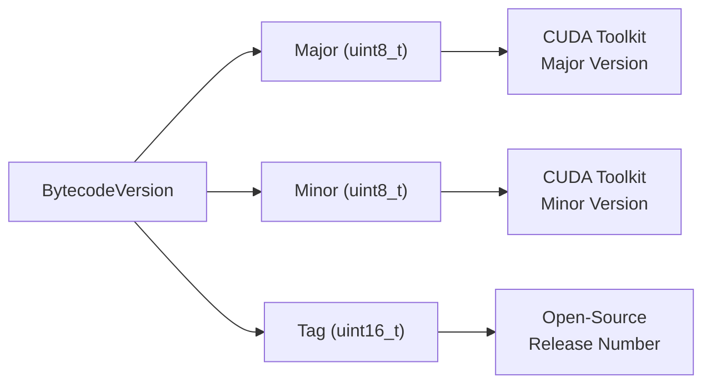
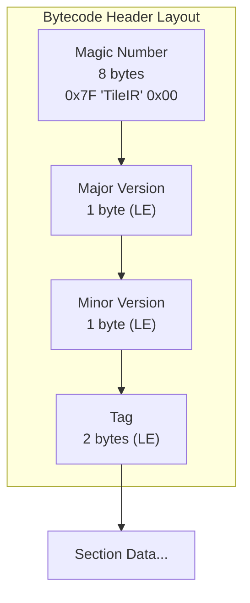
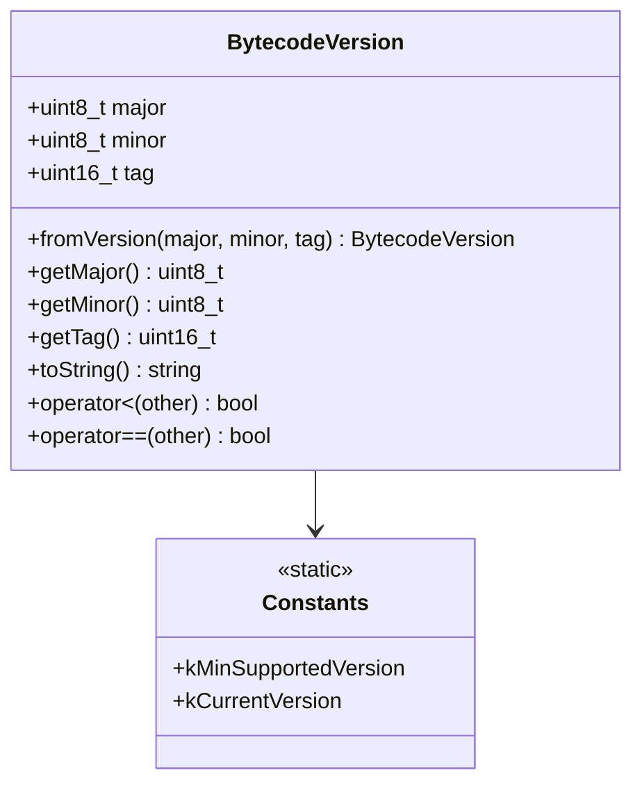
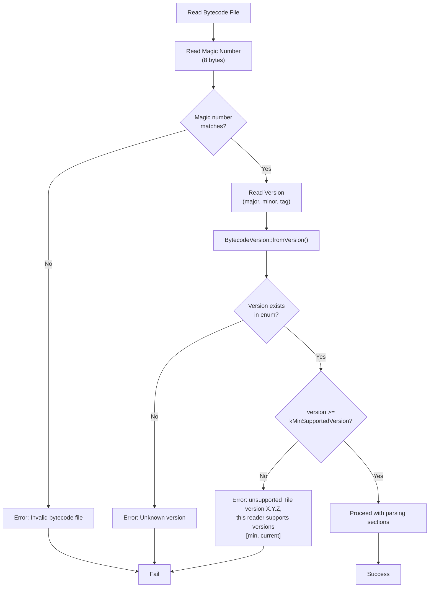
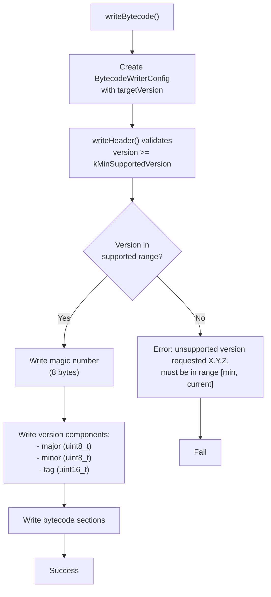
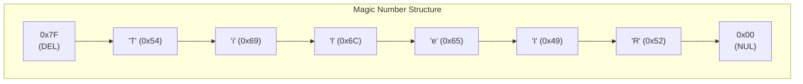
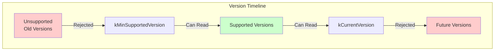
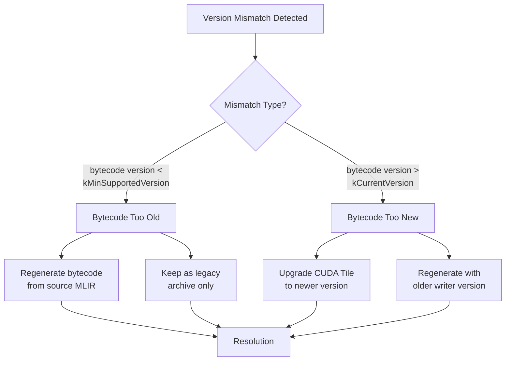
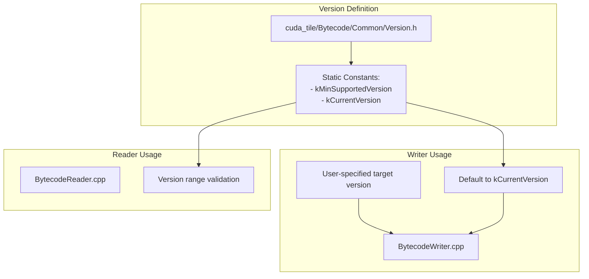

<!-- source: DeepWiki mcp.deepwiki.com · repo NVIDIA/cuda-tile · page 4.4 Versioning and Compatibility · fetched 2026-10-26 -->

# Versioning and Compatibility

<details>
<summary>Relevant source files</summary>

The following files were used as context for generating this wiki page:

- [README.md](README.md)
- [lib/Bytecode/Reader/BytecodeReader.cpp](lib/Bytecode/Reader/BytecodeReader.cpp)
- [lib/Bytecode/Writer/BytecodeWriter.cpp](lib/Bytecode/Writer/BytecodeWriter.cpp)

</details>


This page documents the bytecode versioning system used by CUDA Tile IR to ensure compatibility between bytecode files and the tools that read and write them. It covers the version format, validation mechanisms, and compatibility policies.

For information about the bytecode format structure itself, see [Bytecode Format Specification](#4.1). For details on serialization and deserialization processes, see [Bytecode Serialization](#4.3) and [Bytecode Deserialization](#4.2).

## Purpose and Scope

The CUDA Tile bytecode format includes embedded version information to enable:

1. **Detection of incompatible bytecode files** - Readers can reject bytecode generated by incompatible writers
2. **Evolution of the format** - New features can be added while maintaining backward compatibility within supported version ranges
3. **Clear compatibility boundaries** - Tools can communicate which versions they support and reject unsupported formats
4. **Alignment with CUDA Toolkit releases** - Bytecode versions track the CUDA Toolkit release schedule

## Version Format Structure

The bytecode version consists of three components encoded as separate fields:



**Version Component Semantics:**

| Component | Type | Description |
|-----------|------|-------------|
| **Major** | `uint8_t` | Corresponds to CUDA Toolkit major version (e.g., 13) |
| **Minor** | `uint8_t` | Corresponds to CUDA Toolkit minor version (e.g., 1) |
| **Tag** | `uint16_t` | Tracks independent open-source releases for a given toolkit version |

**Example:** Version `13.1.5` indicates:
- Compatible with CUDA Toolkit 13.1.x
- The 6th open-source release for toolkit version 13.1 (tag=5, zero-indexed)

When the CUDA Toolkit version advances (e.g., 13.1 → 13.2), the tag resets to 0.

Sources: [README.md:341-358]()

## Version Storage in Bytecode Header

The version information is embedded in the bytecode file header immediately following the magic number:



**Encoding Details:**
- **Magic number:** Fixed 8-byte sequence `{0x7F, 'T', 'i', 'l', 'e', 'I', 'R', 0x00}` for bytecode identification
- **Version fields:** Little-endian encoded integers (`writeLE()` / `readLE()`)
- **Total header size:** 12 bytes (8 bytes magic + 1 byte major + 1 byte minor + 2 bytes tag)

Sources: [lib/Bytecode/Writer/BytecodeWriter.cpp:39-48](), [lib/Bytecode/Writer/BytecodeWriter.cpp:180-186](), [lib/Bytecode/Reader/BytecodeReader.cpp:67-79]()

## BytecodeVersion Class API

The `BytecodeVersion` class (defined in `cuda_tile/Bytecode/Common/Version.h`) provides version management functionality:



**Key Static Members:**
- `BytecodeVersion::kMinSupportedVersion` - Oldest version the reader can parse
- `BytecodeVersion::kCurrentVersion` - Version written by the current writer

**Methods:**
- `fromVersion(major, minor, tag)` - Constructs version from components, returns `std::optional<BytecodeVersion>`
- `toString()` - Returns formatted string "major.minor.tag"
- Comparison operators for version ordering checks

Sources: [lib/Bytecode/Reader/BytecodeReader.cpp:313-321](), [lib/Bytecode/Writer/BytecodeWriter.cpp:170-178]()

## Version Validation During Deserialization

The bytecode reader performs version compatibility checks in the `parseHeader()` function:



**Version Check Implementation:**

The validation logic in [lib/Bytecode/Reader/BytecodeReader.cpp:296-323]() performs:

1. **Magic number verification** ([lib/Bytecode/Reader/BytecodeReader.cpp:298-305]())
   - Compares first 8 bytes against `kTileIRBytecodeMagic`
   - Emits error with position and expected/actual bytes if mismatch

2. **Version component reading** ([lib/Bytecode/Reader/BytecodeReader.cpp:307-311]())
   - Reads `verMajor` (uint8_t)
   - Reads `verMinor` (uint8_t)
   - Reads `tag` (uint16_t)

3. **Version object construction** ([lib/Bytecode/Reader/BytecodeReader.cpp:313-314]())
   - Calls `BytecodeVersion::fromVersion(verMajor, verMinor, tag)`
   - Returns `std::optional<BytecodeVersion>` (empty if version unknown)

4. **Range validation** ([lib/Bytecode/Reader/BytecodeReader.cpp:315-321]())
   - Checks if version >= `kMinSupportedVersion`
   - Emits detailed error message showing requested version and supported range

Sources: [lib/Bytecode/Reader/BytecodeReader.cpp:296-323]()

## Version Specification During Serialization

When writing bytecode, the target version is specified through the `BytecodeWriterConfig` structure:



**Configuration Structure:**

```cpp
struct BytecodeWriterConfig {
    BytecodeVersion bytecodeVersion;
};
```

The configuration is used in [lib/Bytecode/Writer/BytecodeWriter.cpp:167-188]() to:

1. **Validate target version** - Ensures requested version is not older than minimum supported
2. **Write header** - Encodes version components in little-endian format
3. **Control format features** - Allows conditional serialization based on target version capabilities

Sources: [lib/Bytecode/Writer/BytecodeWriter.cpp:158-161](), [lib/Bytecode/Writer/BytecodeWriter.cpp:167-188]()

## Bytecode Magic Number Verification

The magic number serves as the primary bytecode file identification mechanism, checked before version validation:



**Helper Functions:**

| Function | Purpose |
|----------|---------|
| `isTileIRBytecode(MemoryBufferRef)` | Checks if buffer starts with magic number |
| `isTileIRBytecode(const char*)` | Null-terminated string variant |

These functions ([lib/Bytecode/Reader/BytecodeReader.cpp:39-55]()) allow quick bytecode identification without full parsing.

Sources: [lib/Bytecode/Reader/BytecodeReader.cpp:35-55](), [lib/Bytecode/Writer/BytecodeWriter.cpp:180-186]()

## Compatibility Policies

### Backward Compatibility

**Within Supported Range:** A bytecode reader supports all versions from `kMinSupportedVersion` to `kCurrentVersion` inclusive.



**Guarantees:**
- Files written with version V can be read by any reader with `kMinSupportedVersion <= V <= kCurrentVersion`
- Older bytecode files (< `kMinSupportedVersion`) are explicitly rejected with clear error messages

### Forward Compatibility

The bytecode format does **not** provide forward compatibility:
- Readers reject bytecode with versions > `kCurrentVersion`
- New format features require reader upgrades
- Version checking prevents silent data corruption from unrecognized sections

### Cross-Toolkit Compatibility

The versioning scheme ties bytecode to specific CUDA Toolkit releases:

| Bytecode Version | Compatible Toolkit Versions | Restrictions |
|------------------|----------------------------|--------------|
| 13.1.X | 13.1.0, 13.1.1, ... | Minor patch releases typically compatible |
| 13.2.X | 13.2.0, 13.2.1, ... | Major/minor changes may break compatibility |
| 14.0.X | 14.0.0, 14.0.1, ... | Major version changes break compatibility |

**Note:** Toolkit patch releases (e.g., 13.1.0 → 13.1.1) rarely affect bytecode format and do not increment the bytecode tag.

Sources: [README.md:341-358]()

## Migration Strategies

### Handling Version Mismatches

When a bytecode file cannot be read due to version incompatibility:



### Recommended Practices

1. **Version Specification in Translation**
   - Use `cuda-tile-translate` with `--bytecode-version=X.Y` flag to target specific versions
   - Example: `cuda-tile-translate example.mlir --bytecode-version=13.1 --mlir-to-cudatilebc`

2. **Version Tracking in Build Systems**
   - Store bytecode version metadata alongside compiled artifacts
   - Document which CUDA Toolkit version was used for generation

3. **Testing Across Versions**
   - Validate bytecode files against minimum supported version
   - Include version compatibility tests in CI/CD pipelines

4. **Deprecation Planning**
   - Monitor when `kMinSupportedVersion` advances in new releases
   - Plan regeneration of bytecode archives before support is dropped

Sources: [README.md:327-334]()

## Version Constants and Configuration

### Build-Time Version Configuration

The bytecode version is determined at build time and embedded in the CUDA Tile libraries:



### Version Selection in API

**C++ API:**
```cpp
// Default: writes with kCurrentVersion
LogicalResult writeBytecode(raw_ostream &os, 
                            cuda_tile::ModuleOp module);

// Explicit version targeting
LogicalResult writeBytecode(raw_ostream &os,
                            cuda_tile::ModuleOp module, 
                            BytecodeVersion targetVersion);
```

**Python API:**
```python
# Default current version
module.writeBytecode(output_file)

# Specify target version
from cuda_tile import BytecodeVersion
version = BytecodeVersion.fromVersion(13, 1, 0)
module.writeBytecode(output_file, version)
```

Sources: [lib/Bytecode/Writer/BytecodeWriter.cpp:1669-1711]()

## Error Messages and Diagnostics

The version validation system provides detailed error messages for debugging:

### Reader Error Messages

| Scenario | Error Message Format |
|----------|---------------------|
| Invalid magic | `invalid magic number at position {i}, got {actual} expected {expected}` |
| Unknown version | `unsupported Tile version {major}.{minor}.{tag}, this reader supports versions [{min}, {current}]` |
| Version too old | Same as unknown version with range shown |

Example error output:
```
error at offset 8: unsupported Tile version 12.0.0, this reader supports versions [13.0.0, 13.1.5]
```

### Writer Error Messages

| Scenario | Error Message Format |
|----------|---------------------|
| Invalid target version | `unsupported version requested {major}.{minor}.{tag}, must be in range [{min}, {current}]` |

Sources: [lib/Bytecode/Reader/BytecodeReader.cpp:298-321](), [lib/Bytecode/Writer/BytecodeWriter.cpp:170-178]()

## Summary

The CUDA Tile bytecode versioning system provides:

1. **Explicit version encoding** in the bytecode header (major, minor, tag)
2. **Range-based compatibility** checking (`kMinSupportedVersion` to `kCurrentVersion`)
3. **Alignment with CUDA Toolkit** releases through major/minor version numbers
4. **Clear error messages** when version mismatches occur
5. **Forward declaration** of compatibility boundaries to enable planned migrations

By embedding version information directly in the bytecode format and validating it during deserialization, the system ensures that incompatible bytecode files are detected early with actionable error messages rather than causing silent failures or data corruption.

Sources: [lib/Bytecode/Reader/BytecodeReader.cpp:296-323](), [lib/Bytecode/Writer/BytecodeWriter.cpp:167-188](), [README.md:341-358]()

---

