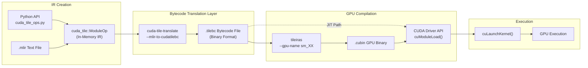
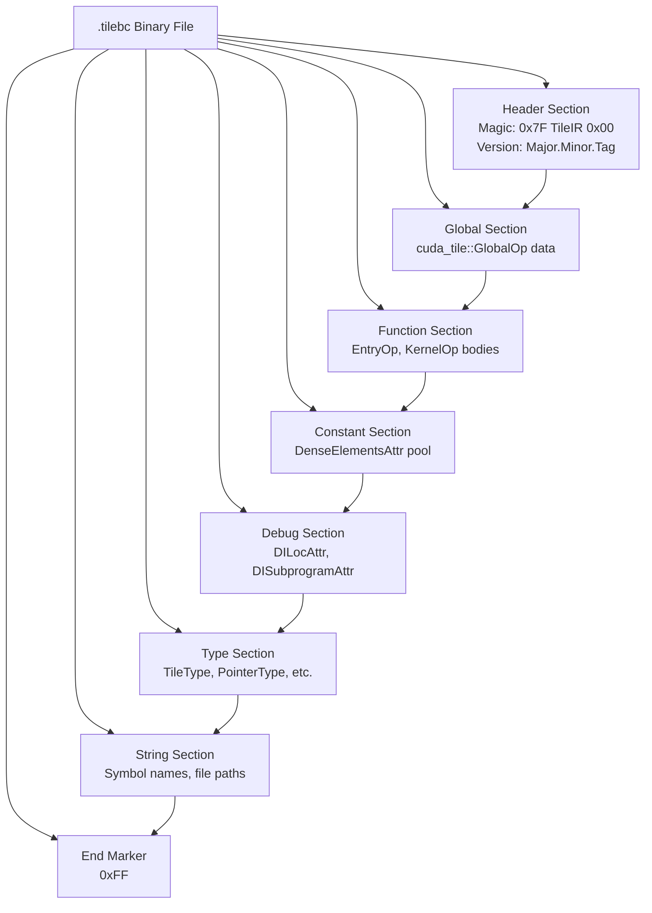
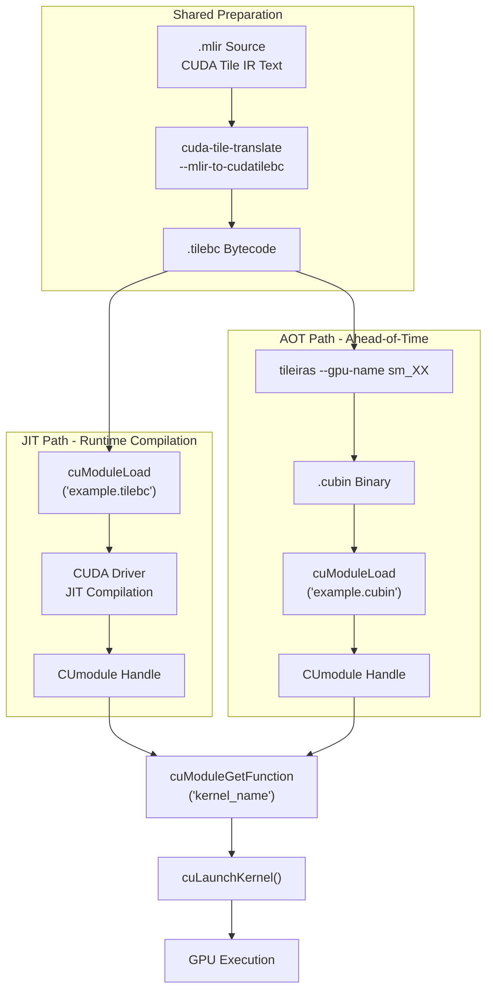
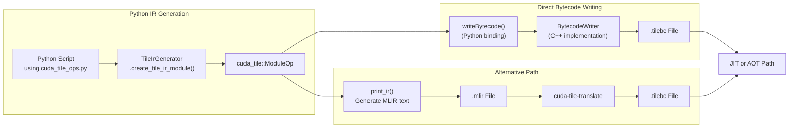
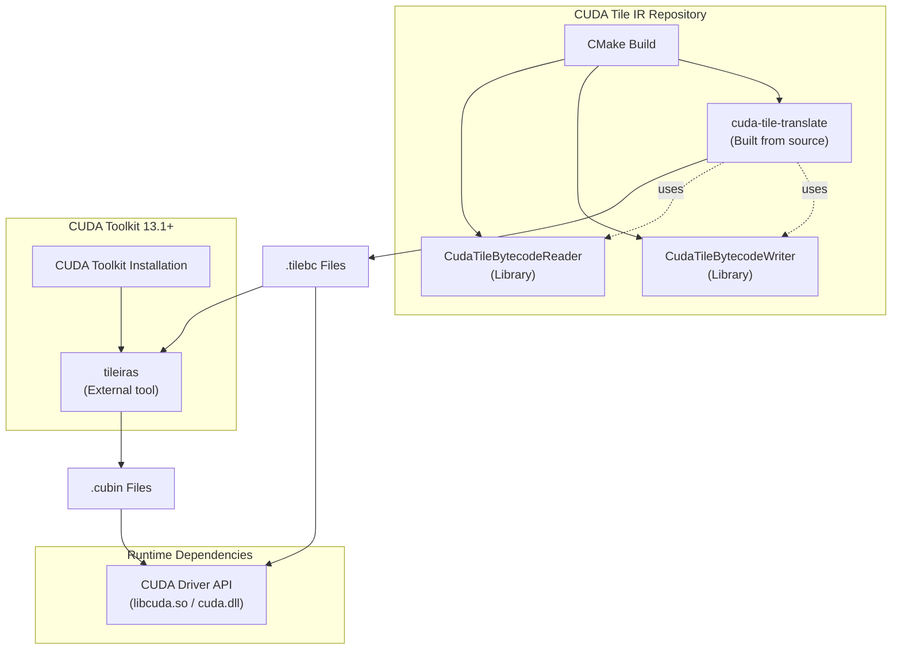

<!-- source: DeepWiki mcp.deepwiki.com · repo NVIDIA/cuda-tile · page 4.5 Bytecode Translation Tools · fetched 2026-10-26 -->

# Bytecode Translation Tools

<details>
<summary>Relevant source files</summary>

The following files were used as context for generating this wiki page:

- [README.md](README.md)
- [lib/Bytecode/Writer/BytecodeWriter.cpp](lib/Bytecode/Writer/BytecodeWriter.cpp)

</details>


This page documents the command-line tools for translating CUDA Tile IR between different representations and compiling to GPU executable code. It covers `cuda-tile-translate` for converting MLIR textual format to bytecode, and `tileiras` for ahead-of-time (AOT) compilation of bytecode to GPU machine code.

For information about the bytecode format specification itself, see [4.1](#4.1). For details on the serialization and deserialization implementation, see [4.3](#4.3) and [4.2](#4.2) respectively. For JIT and AOT execution strategies, see [9.1](#9.1) and [9.2](#9.2).

**Scope**: This page focuses on the external tool interfaces and usage patterns. It does not cover the internal implementation details of bytecode reading/writing, which are documented in sections 4.2 and 4.3.

---

## Overview

CUDA Tile IR provides two primary translation tools that work with bytecode:

| Tool | Input Format | Output Format | Purpose |
|------|-------------|---------------|---------|
| `cuda-tile-translate` | MLIR text (`.mlir`) | Bytecode (`.tilebc`) | Serialize IR to compact binary format |
| `tileiras` | Bytecode (`.tilebc`) | GPU binary (`.cubin`) | AOT compilation for specific GPU architecture |

These tools enable two distinct execution workflows:

1. **JIT Compilation Path**: CUDA driver loads `.tilebc` directly and JIT compiles at runtime
2. **AOT Compilation Path**: Pre-compile to `.cubin` using `tileiras`, then load with CUDA driver

Sources: [README.md:216-220](), [README.md:327-330]()

---

## Translation Pipeline Architecture

The following diagram shows how the bytecode translation tools fit into the overall CUDA Tile IR compilation and execution pipeline:

**Diagram: End-to-End Compilation Pipeline**



Sources: [README.md:216-334]()

---

## cuda-tile-translate

The `cuda-tile-translate` tool converts CUDA Tile IR from MLIR textual format to the binary bytecode format. This tool is built as part of the CUDA Tile IR project and uses the bytecode writer implementation.

### Purpose

- Serialize MLIR text representation to compact binary `.tilebc` format
- Enable efficient storage and transmission of IR
- Support version-specific bytecode generation
- Validate IR structure during conversion

### Command-Line Interface

**Basic Syntax**:
```bash
cuda-tile-translate <input.mlir> [options] -o <output.tilebc>
```

**Key Options**:

| Flag | Description | Example |
|------|-------------|---------|
| `--bytecode-version=X.Y` | Target bytecode version | `--bytecode-version=13.1` |
| `--mlir-to-cudatilebc` | Enable MLIR to bytecode conversion | Required for translation |
| `--no-implicit-module` | Disable automatic module wrapping | Recommended for explicit modules |
| `-o <file>` | Output file path | `-o example.tilebc` |

Sources: [README.md:327]()

### Usage Example

**Input MLIR** (`example.mlir`):
```mlir
cuda_tile.module @example_module {
    entry @example_kernel(%data_pr : tile<ptr<f32>>) {
        print "Running example module\n"
        %offsets = iota : tile<128xi32>
        %data_ptr_reshaped = reshape %data_pr : tile<ptr<f32>> -> tile<1xptr<f32>>
        %data_ptr_broadcasted = broadcast %data_ptr_reshaped : tile<1xptr<f32>> -> tile<128xptr<f32>>
        %data_ptr_tensor = offset %data_ptr_broadcasted, %offsets : tile<128xptr<f32>>, tile<128xi32> -> tile<128xptr<f32>>
        %data, %token = load_ptr_tko weak %data_ptr_tensor : tile<128xptr<f32>> -> tile<128xf32>, token
        print "Data: %f\n", %data : tile<128xf32>
        return
    }
}
```

**Translation Command**:
```bash
cuda-tile-translate example.mlir \
    --bytecode-version=13.1 \
    --mlir-to-cudatilebc \
    --no-implicit-module \
    -o example.tilebc
```

**Output**: Binary `.tilebc` file containing serialized IR with header, string table, type table, constant pool, debug info, and function bytecode sections.

Sources: [README.md:230-244](), [README.md:327]()

### Bytecode Output Structure

The generated `.tilebc` file follows the format documented in section 4.1, with the following sections written by the `BytecodeWriter`:

**Diagram: Bytecode File Structure from cuda-tile-translate**



Sources: [lib/Bytecode/Writer/BytecodeWriter.cpp:30-49](), [lib/Bytecode/Writer/BytecodeWriter.cpp:1669-1711]()

### Version Compatibility

The `--bytecode-version` flag must specify a version within the supported range. Version validation occurs during header writing:

- **Minimum Supported**: Defined by `BytecodeVersion::kMinSupportedVersion`
- **Current Version**: Defined by `BytecodeVersion::kCurrentVersion`
- **CUDA Toolkit Alignment**: Version 13.1 corresponds to CUDA Toolkit 13.1

Specifying an unsupported version results in an error during translation.

Sources: [lib/Bytecode/Writer/BytecodeWriter.cpp:167-178]()

---

## tileiras

The `tileiras` tool is part of the CUDA Toolkit and performs ahead-of-time compilation of CUDA Tile IR bytecode to GPU machine code (cubin format). Unlike `cuda-tile-translate`, this is a toolkit-provided tool rather than being built from this repository.

### Purpose

- Compile `.tilebc` bytecode to architecture-specific `.cubin` binaries
- Enable offline compilation for production deployments
- Support multiple GPU architectures (sm_XX targets)
- Optimize for specific GPU capabilities

### Command-Line Interface

**Basic Syntax**:
```bash
tileiras --gpu-name <architecture> <input.tilebc> -o <output.cubin>
```

**Key Options**:

| Flag | Description | Example |
|------|-------------|---------|
| `--gpu-name <sm_XX>` | Target GPU architecture | `--gpu-name sm_100` |
| `-o <file>` | Output cubin file path | `-o example.cubin` |

Sources: [README.md:328-329]()

### GPU Architecture Targeting

The `--gpu-name` flag specifies the compute capability of the target GPU:

| Architecture | Compute Capability | Example GPUs |
|--------------|-------------------|--------------|
| `sm_100` | 10.0 | Blackwell generation |
| `sm_90` | 9.0 | Hopper generation |
| `sm_89` | 8.9 | Ada Lovelace |
| `sm_80` | 8.0 | Ampere |

**Important**: The target architecture must match the GPU where the cubin will execute. Using an incompatible architecture will result in runtime errors from the CUDA driver.

Sources: [README.md:329]()

### Usage Example

**Compilation Command**:
```bash
tileiras --gpu-name sm_100 example.tilebc -o example.cubin
```

**Input**: `example.tilebc` - Binary bytecode from `cuda-tile-translate`

**Output**: `example.cubin` - GPU machine code binary ready for `cuModuleLoad()`

This cubin can be loaded directly by the CUDA driver API without JIT compilation overhead.

Sources: [README.md:328]()

---

## Execution Workflows

The following diagrams illustrate the two execution paths supported by the bytecode translation tools.

**Diagram: JIT vs AOT Compilation Paths**



Sources: [README.md:216-220](), [README.md:295-298]()

### JIT Path Characteristics

**Advantages**:
- Single file distribution (`.tilebc`)
- Automatic architecture adaptation
- Simpler deployment

**Trade-offs**:
- First-launch compilation overhead
- Runtime compilation dependencies
- Potential for driver version issues

**Usage Pattern**:
```cpp
CUmodule cuModule;
// Load bytecode directly - JIT compilation happens here
CUDA_CHECK(cuModuleLoad(&cuModule, "example.tilebc"));
CUDA_CHECK(cuModuleGetFunction(&example_kernel, cuModule, "example_kernel"));
```

Sources: [README.md:297]()

### AOT Path Characteristics

**Advantages**:
- Zero runtime compilation overhead
- Deterministic performance
- Explicit architecture control
- Smaller runtime dependencies

**Trade-offs**:
- Separate cubin per architecture
- Manual architecture management
- Larger deployment artifacts

**Usage Pattern**:
```cpp
CUmodule cuModule;
// Load pre-compiled cubin - no compilation overhead
CUDA_CHECK(cuModuleLoad(&cuModule, "example.cubin"));
CUDA_CHECK(cuModuleGetFunction(&example_kernel, cuModule, "example_kernel"));
```

Sources: [README.md:297](), [README.md:328-330]()

---

## Integration with Python API

When using the Python API to generate IR, bytecode can be written directly without `cuda-tile-translate` by using the `writeBytecode` function exposed through the Python bindings.

**Diagram: Python to Bytecode Workflow**



The Python binding exposes a `writeBytecode` operation helper that directly invokes the C++ `BytecodeWriter` without requiring the command-line tool.

Sources: [README.md:216-220]()

---

## Complete Example Workflow

This section demonstrates a complete workflow from MLIR source to GPU execution using both translation tools.

### Step 1: Create MLIR Source

Save to `example.mlir`:
```mlir
cuda_tile.module @example_module {
    entry @example_kernel(%data_pr : tile<ptr<f32>>) {
        print "Running example module\n"
        %offsets = iota : tile<128xi32>
        %data_ptr_reshaped = reshape %data_pr : tile<ptr<f32>> -> tile<1xptr<f32>>
        %data_ptr_broadcasted = broadcast %data_ptr_reshaped : tile<1xptr<f32>> -> tile<128xptr<f32>>
        %data_ptr_tensor = offset %data_ptr_broadcasted, %offsets : tile<128xptr<f32>>, tile<128xi32> -> tile<128xptr<f32>>
        %data, %token = load_ptr_tko weak %data_ptr_tensor : tile<128xptr<f32>> -> tile<128xf32>, token
        print "Data: %f\n", %data : tile<128xf32>
        return
    }
}
```

Sources: [README.md:230-244]()

### Step 2: Translate to Bytecode

```bash
cuda-tile-translate example.mlir \
    --bytecode-version=13.1 \
    --mlir-to-cudatilebc \
    --no-implicit-module \
    -o example.tilebc
```

**Output**: `example.tilebc` containing serialized IR

Sources: [README.md:327]()

### Step 3A: JIT Compilation (Direct Load)

Update host code to load bytecode directly:
```cpp
// Skip Step 3B, load bytecode for JIT compilation
CUDA_CHECK(cuModuleLoad(&cuModule, "example.tilebc"));
```

Sources: [README.md:297](), [README.md:330]()

### Step 3B: AOT Compilation (Pre-compile)

```bash
# Compile for specific architecture (e.g., sm_100)
tileiras --gpu-name sm_100 example.tilebc -o example.cubin
```

**Output**: `example.cubin` containing GPU machine code

Sources: [README.md:328]()

### Step 4: Host Code Integration

```cpp
#include <cuda.h>
#include <stdio.h>

int main() {
  CUdevice cuDevice;
  CUcontext cuContext;
  CUmodule cuModule;
  CUfunction example_kernel;
  CUstream stream;
  
  CUDA_CHECK(cuInit(0));
  CUDA_CHECK(cuDeviceGet(&cuDevice, 0));
  CUDA_CHECK(cuCtxCreate(&cuContext, NULL, 0, cuDevice));
  CUDA_CHECK(cuStreamCreate(&stream, CU_STREAM_DEFAULT));
  
  // Load the compiled cubin file (or .tilebc for JIT)
  CUDA_CHECK(cuModuleLoad(&cuModule, "example.cubin"));
  CUDA_CHECK(cuModuleGetFunction(&example_kernel, cuModule, "example_kernel"));
  
  // Allocate and initialize device memory
  CUdeviceptr data_ptr;
  float data[128];
  // ... initialize data ...
  CUDA_CHECK(cuMemAlloc(&data_ptr, sizeof(data)));
  CUDA_CHECK(cuMemcpyHtoD(data_ptr, data, sizeof(data)));
  
  // Launch kernel
  void *kernel_args[] = {&data_ptr};
  CUDA_CHECK(cuLaunchKernel(example_kernel,
                            1, 1, 1,        // grid dims
                            1, 1, 1,        // block dims (must be 1,1,1)
                            0,              // shared memory (must be 0)
                            stream,
                            kernel_args,
                            NULL));
  CUDA_CHECK(cuCtxSynchronize());
  
  // Clean up
  CUDA_CHECK(cuModuleUnload(cuModule));
  CUDA_CHECK(cuCtxDestroy(cuContext));
  
  return 0;
}
```

Sources: [README.md:247-323]()

### Step 5: Compilation and Execution

```bash
# Compile host program
g++ example_host.cpp -o example \
    -I/usr/local/cuda/include \
    -L/usr/local/cuda/lib64 \
    -lcuda

# Execute
./example
```

**Expected Output**:
```
Running example module
Data: [0.000000, 5.000000, 10.000000, ..., 635.000000]
```

Sources: [README.md:331-339]()

---

## Tool Dependencies and Build Integration

The bytecode translation tools have different build and deployment characteristics:

**Diagram: Tool Build and Deployment Architecture**



### cuda-tile-translate Build

Built as part of the CUDA Tile IR project:

```cmake
# Links against bytecode writer library
target_link_libraries(cuda-tile-translate PRIVATE
  CudaTileBytecodeWriter
  CudaTileBytecodeReader
  CudaTileDialect
)
```

Available after building the project with `cmake --build build`.

Sources: [README.md:60-65]()

### tileiras Distribution

Distributed as part of the CUDA Toolkit (13.1+):
- Not built from this repository
- Installed with toolkit binaries
- Requires compatible CUDA driver version
- Accessed via system PATH after toolkit installation

Sources: [README.md:218-220](), [README.md:226]()

---

## Error Handling and Diagnostics

Both tools provide diagnostic output for common error conditions.

### cuda-tile-translate Error Categories

| Error Type | Cause | Example Message |
|------------|-------|-----------------|
| Version Error | Unsupported bytecode version | `unsupported version requested 12.0, must be in range [13.1, 13.1]` |
| Validation Error | Invalid IR structure | `only function and global ops are allowed in the body` |
| Dialect Error | Non-CudaTile operations | `only ops from the 'cuda_tile' dialect are allowed` |
| Serialization Error | Unsupported attribute type | `unsupported attribute type in bytecode writer` |

The tool validates the IR structure before serialization using `verifySelfContainedModule()`, which ensures:
- Only `FunctionOpInterface` and `GlobalOp` at module level
- All operations belong to the `cuda_tile` dialect
- No external dependencies that cannot be serialized

Sources: [lib/Bytecode/Writer/BytecodeWriter.cpp:1632-1667](), [lib/Bytecode/Writer/BytecodeWriter.cpp:167-178]()

### tileiras Error Categories

Common error scenarios:
- **Architecture Mismatch**: Using cubin compiled for wrong GPU architecture
- **Toolkit Version**: Bytecode version incompatible with toolkit version
- **Invalid Bytecode**: Corrupted or malformed `.tilebc` file
- **Memory Issues**: Insufficient GPU resources for compilation

Errors from `tileiras` are reported through standard error output. The CUDA driver provides additional diagnostic information during module load.

Sources: [README.md:328-330]()

---

## Performance Considerations

### Translation Performance

**cuda-tile-translate**:
- Overhead: Linear in IR size
- Bottlenecks: String table construction, type deduplication
- Optimization: Pre-register frequently-used types and strings

**tileiras**:
- Overhead: Proportional to kernel complexity and optimization level
- Bottlenecks: Register allocation, instruction scheduling
- Optimization: Architecture-specific tuning

### Runtime Performance Impact

| Path | First Launch | Subsequent Launches | Binary Size |
|------|--------------|---------------------|-------------|
| JIT (`.tilebc`) | High (compilation) | Low (cached) | Small |
| AOT (`.cubin`) | Low | Low | Larger |

**Recommendation**: Use AOT path for production deployments where first-launch latency is critical. Use JIT path for development and when targeting multiple architectures with a single binary.

Sources: [README.md:216-220]()

---

## Summary

The bytecode translation tools provide a complete pipeline for converting CUDA Tile IR from development format (MLIR text) through intermediate representation (bytecode) to executable GPU code (cubin):

1. **cuda-tile-translate**: Serializes IR to compact bytecode format with version control
2. **tileiras**: Compiles bytecode to architecture-specific GPU machine code
3. **Integration**: Both tools support flexible deployment strategies (JIT vs AOT)

These tools bridge the gap between high-level IR representation and low-level GPU execution, enabling efficient distribution and execution of CUDA Tile kernels.

Sources: [README.md:216-339](), [lib/Bytecode/Writer/BytecodeWriter.cpp:1-1712]()

---

