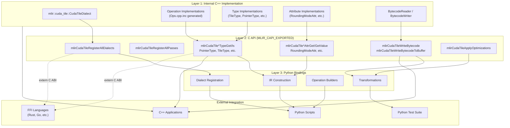
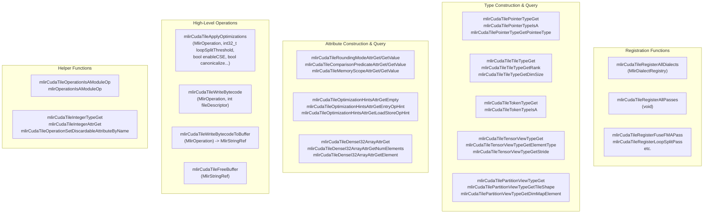
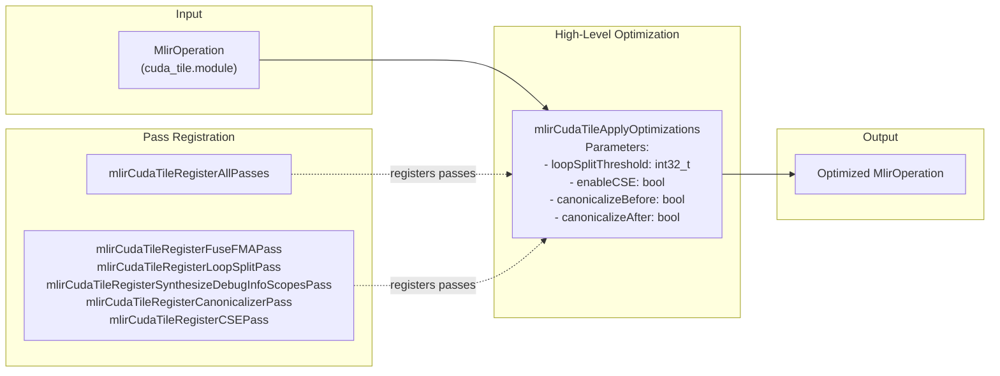
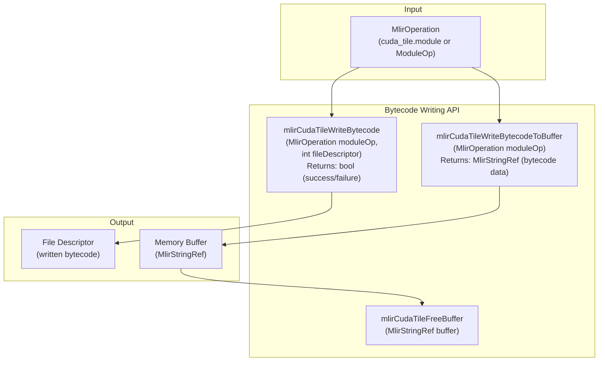
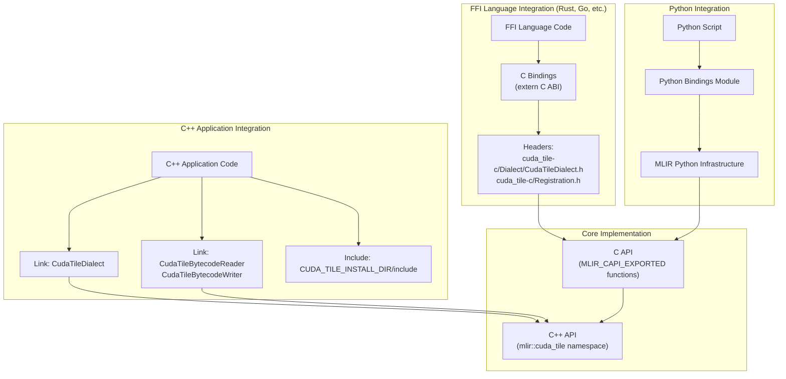

<!-- source: DeepWiki mcp.deepwiki.com · repo NVIDIA/cuda-tile · page 5 API Reference · fetched 2026-10-26 -->

# API Reference

Relevant source files

The following files were used as context for generating this wiki page:

- [lib/Dialect/CudaTile/IR/CudaTile.cpp](lib/Dialect/CudaTile/IR/CudaTile.cpp)

This document provides an overview of the CUDA Tile IR API architecture, which consists of three distinct layers designed to support different integration scenarios and user communities. For detailed documentation of each layer's specific functions and usage patterns, see the corresponding subsection pages.

The API layers are:
- **C++ API** ([5.1](#5.1)) - Internal implementation and programmatic access for C++ applications
- **C API** ([5.2](#5.2)) - Stable, language-agnostic interface following C ABI conventions
- **Python Bindings** ([5.3](#5.3)) - High-level Python interface for scripting and tooling

For information about building with these APIs, see [Integration Methods](#2.2). For information about the bytecode serialization APIs, see [Bytecode System](#4).

---

## Three-Layer Architecture

The CUDA Tile IR API follows a three-layer architecture strategy that enables broad language interoperability while maintaining a single implementation base.

Sources: [include/cuda_tile-c/Dialect/CudaTileDialect.h:1-402](), [include/cuda_tile-c/Registration.h:1-28]()

---

## C++ API Layer

The C++ API consists of the internal MLIR dialect implementation, providing direct programmatic access to all dialect components. This layer is implemented in the `mlir::cuda_tile` namespace and uses standard MLIR C++ idioms.

**Key Components:**
- `mlir::cuda_tile::CudaTileDialect` - Main dialect class
- Type classes: `TileType`, `PointerType`, `TokenType`, `TensorViewType`, `PartitionViewType`
- Attribute classes: `RoundingModeAttr`, `ComparisonPredicateAttr`, `MemoryScopeAttr`, etc.
- Operation classes: Generated from TableGen definitions
- `BytecodeReader` / `BytecodeWriter` classes

For detailed C++ API documentation, see [C++ API](#5.1).

Sources: [README.md:14-26]()

---

## C API Layer

The C API provides a stable, language-agnostic interface to CUDA Tile IR functionality. All functions are marked with `MLIR_CAPI_EXPORTED` and follow `extern "C"` linkage conventions for stable ABI compatibility. This layer enables integration from any language that supports C FFI.

### C API Function Organization

**Function Naming Conventions:**
- `mlirCudaTile{TypeName}TypeGet` - Construct a type
- `mlirCudaTile{TypeName}TypeIsA` - Type predicate check
- `mlirCudaTile{TypeName}TypeGet{Property}` - Extract type property
- `mlirCudaTile{AttrName}AttrGet` - Construct an attribute
- `mlirCudaTile{AttrName}AttrGetValue` - Extract attribute value
- `mlirCudaTileRegister*` - Registration functions

For detailed C API documentation and examples, see [C API](#5.2).

Sources: [include/cuda_tile-c/Dialect/CudaTileDialect.h:1-402](), [include/cuda_tile-c/Registration.h:1-28]()

---

## Type API Reference

The C API provides comprehensive type construction and query functions for all CUDA Tile IR types.

| Type | Construction Function | Predicate | Key Accessors |
|------|----------------------|-----------|---------------|
| `PointerType` | `mlirCudaTilePointerTypeGet` | `mlirCudaTileTypeIsAPointerType` | `mlirCudaTilePointerTypeGetPointeeType` |
| `TileType` | `mlirCudaTileTileTypeGet` | `mlirCudaTileTypeIsATileType` | `mlirCudaTileTileTypeGetRank` `mlirCudaTileTileTypeGetDimSize` `mlirCudaTileTileTypeGetElementType` |
| `TokenType` | `mlirCudaTileTokenTypeGet` | `mlirCudaTileTypeIsATokenType` | (opaque type) |
| `TensorViewType` | `mlirCudaTileTensorViewTypeGet` | `mlirCudaTileTypeIsATensorViewType` | `mlirCudaTileTensorViewTypeGetRank` `mlirCudaTileTensorViewTypeGetDimSize` `mlirCudaTileTensorViewTypeGetStride` `mlirCudaTileTensorViewTypeGetElementType` |
| `PartitionViewType` | `mlirCudaTilePartitionViewTypeGet` | `mlirCudaTileTypeIsAPartitionViewType` | `mlirCudaTilePartitionViewTypeGetTileShape` `mlirCudaTilePartitionViewTypeGetTensorView` `mlirCudaTilePartitionViewTypeGetDimMapRank` `mlirCudaTilePartitionViewTypeGetDimMapElement` `mlirCudaTilePartitionViewTypeGetPaddingValue` |

Each type also provides a `GetChecked` variant (e.g., `mlirCudaTileTileTypeGetChecked`) that performs verification and returns a null type on failure.

Sources: [include/cuda_tile-c/Dialect/CudaTileDialect.h:18-162]()

---

## Attribute API Reference

The C API provides attribute construction and query functions organized by attribute category.

| Attribute Category | Functions | Example Attributes |
|-------------------|-----------|-------------------|
| Enumeration Attributes | `mlirCudaTile{Name}AttrGet` `mlirCudaTile{Name}AttrGetValue` | `RoundingModeAttr` `ComparisonPredicateAttr` `ComparisonOrderingAttr` `MemoryScopeAttr` `MemoryOrderingSemanticsAttr` `PaddingValueAttr` `AtomicRMWModeAttr` `IntegerOverflowAttr` `SignednessAttr` |
| Optimization Hints | `mlirCudaTileOptimizationHintsAttrGetEmpty` `mlirCudaTileOptimizationHintsAttrGetEntryOpHint` `mlirCudaTileOptimizationHintsAttrGetLoadStoreOpHint` | `OptimizationHintsAttr` with architecture-specific hints |
| Array Attributes | `mlirCudaTileDenseI32ArrayAttrGet` `mlirCudaTileDenseI32ArrayAttrGetNumElements` `mlirCudaTileDenseI32ArrayAttrGetElement` | `DenseI32ArrayAttr` for dimension maps |

Sources: [include/cuda_tile-c/Dialect/CudaTileDialect.h:164-334]()

---

## Pass Management and Optimization API

The C API provides high-level functions for applying optimization passes and managing the pass pipeline.

**Pass Registration:**
- [include/cuda_tile-c/Dialect/CudaTileDialect.h:387-396]() - Individual pass registration functions
- [include/cuda_tile-c/Registration.h:21]() - `mlirCudaTileRegisterAllPasses` for bulk registration

**Optimization Application:**
- [include/cuda_tile-c/Dialect/CudaTileDialect.h:348-351]() - `mlirCudaTileApplyOptimizations` applies a configurable pass pipeline

Sources: [include/cuda_tile-c/Dialect/CudaTileDialect.h:336-396](), [include/cuda_tile-c/Registration.h:20-21]()

---

## Bytecode I/O API

The C API provides functions for writing CUDA Tile IR modules to bytecode format.

**Key Functions:**
- [include/cuda_tile-c/Dialect/CudaTileDialect.h:357-358]() - `mlirCudaTileWriteBytecode` writes to file descriptor
- [include/cuda_tile-c/Dialect/CudaTileDialect.h:364-365]() - `mlirCudaTileWriteBytecodeToBuffer` writes to memory buffer
- [include/cuda_tile-c/Dialect/CudaTileDialect.h:368]() - `mlirCudaTileFreeBuffer` frees buffer allocated by `mlirCudaTileWriteBytecodeToBuffer`

Sources: [include/cuda_tile-c/Dialect/CudaTileDialect.h:353-368]()

---

## Python Bindings Layer

The Python bindings provide a high-level, Pythonic interface to CUDA Tile IR functionality. The bindings wrap the C API and integrate with MLIR's Python bindings infrastructure, enabling programmatic IR construction, manipulation, and transformation from Python.

**Key Capabilities:**
- Dialect registration and IR context management
- Programmatic IR construction using Python syntax
- Operation building and manipulation
- Pass pipeline execution
- Bytecode reading and writing
- Integration with Python-based tools and test suites

**Example Use Cases:**
- Programmatic test generation
- Custom transformation scripts
- IR analysis and visualization tools
- Code generation workflows

For detailed Python bindings documentation and examples, see [Python Bindings](#5.3).

Sources: [README.md:20-21](), [README.md:104-119]()

---

## Integration Patterns

Different user communities integrate with CUDA Tile IR through the appropriate API layer based on their requirements.

**C++ Integration Pattern:**
- Direct linking against dialect and bytecode libraries
- Include headers from installation directory
- Full access to internal C++ API
- See [README.md:149-168]() for CMake example

**FFI Language Integration Pattern:**
- Generate bindings from C API headers
- Call functions through foreign function interface
- Stable ABI through `extern "C"` functions
- No direct access to C++ implementation

**Python Integration Pattern:**
- Import Python module (built with `CUDA_TILE_ENABLE_BINDINGS_PYTHON=ON`)
- Leverage MLIR's Python infrastructure
- High-level, Pythonic API
- See [README.md:104-119]() for build configuration

Sources: [README.md:144-210](), [include/cuda_tile-c/Dialect/CudaTileDialect.h:1-402](), [include/cuda_tile-c/Registration.h:1-28]()

---

## Helper and Utility Functions

The C API provides additional helper functions for common operations.

| Category | Functions | Purpose |
|----------|-----------|---------|
| Operation Query | `mlirCudaTileOperationIsAModuleOp` `mlirOperationIsAModuleOp` | Check if operation is a module |
| Integer Type/Attr | `mlirCudaTileIntegerTypeGet` `mlirCudaTileIntegerAttrGet` | Construct integer types and attributes |
| Attribute Manipulation | `mlirCudaTileOperationSetDiscardableAttributeByName` | Set discardable attributes on operations |

Sources: [include/cuda_tile-c/Dialect/CudaTileDialect.h:338-382]()

---

## API Versioning and Stability

**C API Stability Guarantees:**
- The C API follows `extern "C"` conventions for stable ABI
- Functions marked `MLIR_CAPI_EXPORTED` are part of the stable interface
- Function signatures and semantics remain stable across minor releases
- Bytecode version compatibility is maintained (see [Versioning and Compatibility](#4.4))

**C++ API Stability:**
- The C++ API is internal and subject to change
- Applications should prefer the C API for stable integration
- Direct C++ API usage is recommended only for tight MLIR integration

**Python Bindings Stability:**
- Python bindings follow the C API stability guarantees
- Python API surface may evolve with MLIR Python bindings infrastructure

Sources: [include/cuda_tile-c/Dialect/CudaTileDialect.h:12-14]()

---

