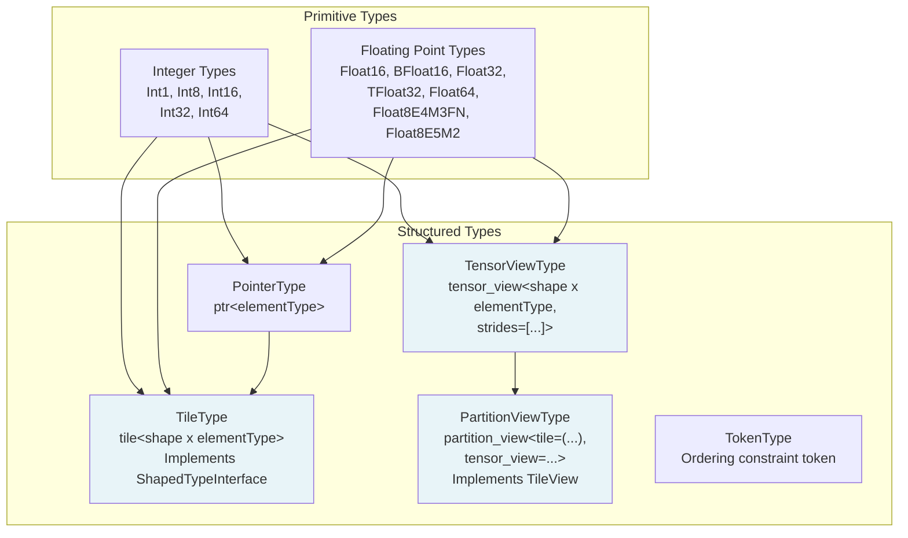
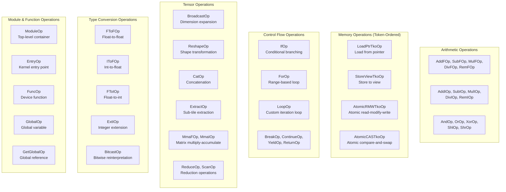
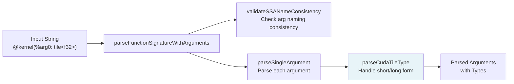
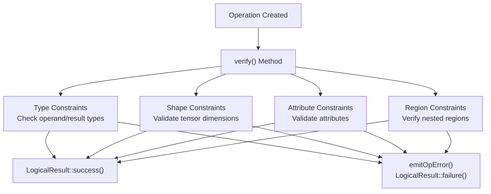
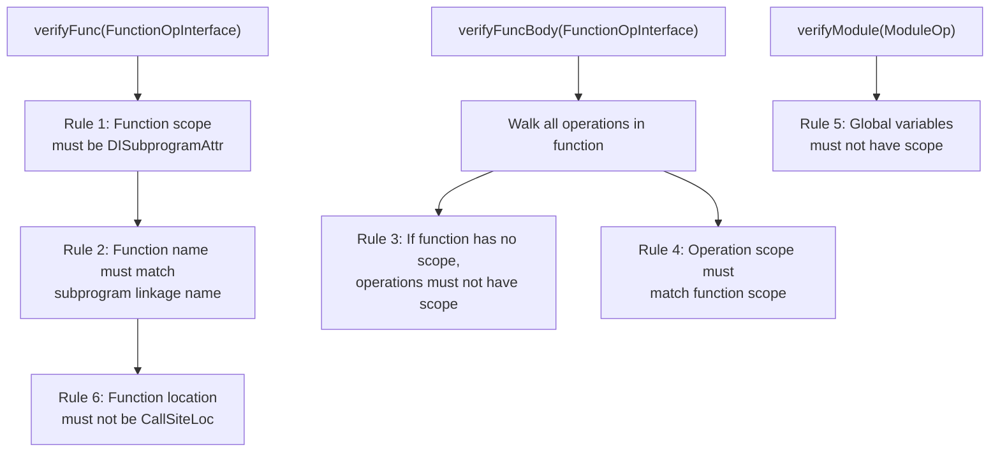

<!-- source: DeepWiki mcp.deepwiki.com · repo NVIDIA/cuda-tile · page 5.1 C++ API · fetched 2026-10-26 -->

# C++ API

<details>
<summary>Relevant source files</summary>

The following files were used as context for generating this wiki page:

- [include/cuda_tile/Dialect/CudaTile/IR/Types.td](include/cuda_tile/Dialect/CudaTile/IR/Types.td)
- [lib/Dialect/CudaTile/IR/CudaTile.cpp](lib/Dialect/CudaTile/IR/CudaTile.cpp)

</details>


## Purpose and Scope

This page documents the C++ API for the CudaTile MLIR dialect, which provides programmatic access to IR construction, type creation, and dialect operations. The C++ API is the foundational layer for working directly with CudaTile IR in C++ applications and compiler passes.

For C-compatible FFI interfaces suitable for language interoperability, see [C API](#5.2). For high-level Python interfaces built atop this C++ layer, see [Python Bindings](#5.3).

**Sources:** [lib/Dialect/CudaTile/IR/CudaTile.cpp:1-50]()

---

## Type System

### Type Hierarchy

The CudaTile type system consists of primitive types, structured types, and specialized types for GPU memory modeling.



**Diagram: CudaTile Type System Hierarchy**

**Sources:** [include/cuda_tile/Dialect/CudaTile/IR/Types.td:1-360]()

---

### Core Type Definitions

| Type | C++ Class | Description | Key Methods |
|------|-----------|-------------|-------------|
| `tile<...>` | `cuda_tile::TileType` | Fixed-shape tensor with power-of-2 dimensions | `getShape()`, `getElementType()`, `getRank()`, `cloneWith()` |
| `ptr<T>` | `cuda_tile::PointerType` | Typed pointer to global memory | `getPointeeType()` |
| `tensor_view<...>` | `cuda_tile::TensorViewType` | Dynamic-shape view into global memory | `getShape()`, `getStrides()`, `dynamicShapeAmount()` |
| `partition_view<...>` | `cuda_tile::PartitionViewType` | Grid-partitioned tile view | `getTileShape()`, `getTensorView()`, `getDimMap()`, `getPaddingValue()` |
| `token` | `cuda_tile::TokenType` | Ordering constraint (not a runtime value) | N/A |

**Sources:** [include/cuda_tile/Dialect/CudaTile/IR/Types.td:74-322]()

---

### Type Builders

#### TileType Construction

```cpp
// Using TypeBuilderWithInferredContext
auto tileType = cuda_tile::TileType::get(
    ArrayRef<int64_t>{16, 16},  // shape
    builder.getF32Type()         // element type
);

// Clone with modified shape/element type
auto newTileType = tileType.cloneWith(
    std::optional<ArrayRef<int64_t>>{{32, 32}},
    builder.getF16Type()
);
```

**Sources:** [include/cuda_tile/Dialect/CudaTile/IR/Types.td:127-141]()

#### PointerType Construction

```cpp
// Create pointer to f32
auto ptrType = cuda_tile::PointerType::get(builder.getF32Type());

// Create tile of pointers
auto tilePtrType = cuda_tile::TileType::get(
    ArrayRef<int64_t>{8, 8},
    cuda_tile::PointerType::get(builder.getI32Type())
);
```

**Sources:** [include/cuda_tile/Dialect/CudaTile/IR/Types.td:74-90]()

#### TensorViewType Construction

```cpp
// Static shape and strides
auto tensorViewType = cuda_tile::TensorViewType::get(
    builder.getContext(),
    builder.getF16Type(),           // element type
    ArrayRef<int64_t>{1024, 1024},  // shape
    ArrayRef<int64_t>{1024, 1}      // strides
);

// Dynamic dimensions (use kDynamic)
auto dynamicView = cuda_tile::TensorViewType::get(
    builder.getContext(),
    builder.getF32Type(),
    ArrayRef<int64_t>{
        cuda_tile::TensorViewType::kDynamic,  // dynamic row count
        16                                     // static col count
    },
    ArrayRef<int64_t>{1, cuda_tile::TensorViewType::kDynamic}
);
```

**Sources:** [include/cuda_tile/Dialect/CudaTile/IR/Types.td:176-227]()

---

## Operation Classes

### Operation Categories and Key Classes



**Diagram: CudaTile Operation Categories**

**Sources:** [lib/Dialect/CudaTile/IR/CudaTile.cpp:1224-2389]()

---

### Operation Builders

#### Using OpBuilder

Operations are constructed using MLIR's `OpBuilder` class. CudaTile provides custom builders for complex operations.

```cpp
// Arithmetic operation
auto addOp = builder.create<cuda_tile::AddFOp>(
    loc,                                      // location
    resultType,                               // result type
    lhs, rhs,                                 // operands
    cuda_tile::RoundingModeAttr::get(         // rounding mode
        ctx, cuda_tile::RoundingMode::NEAREST_EVEN
    ),
    builder.getBoolAttr(false)                // flush_to_zero
);

// Memory load operation
auto loadOp = builder.create<cuda_tile::LoadPtrTkoOp>(
    loc,
    resultType,                               // tile type
    pointers,                                 // tile of pointers
    token,                                    // ordering token
    mask,                                     // optional mask
    memOrderingSemantics,                     // memory semantics
    memScope                                  // memory scope
);
```

**Sources:** [lib/Dialect/CudaTile/IR/CudaTile.cpp:1224-1365]()

#### ForOp Custom Builder

The `ForOp` provides a custom builder with callback for body construction:

```cpp
void ForOp::build(
    OpBuilder &builder, 
    OperationState &result, 
    Value lb, Value ub, Value step,
    ValueRange initArgs,
    function_ref<void(OpBuilder &, Location, Value, ValueRange)> bodyBuilder
) {
    // Implementation at line 2020
}

// Usage:
builder.create<cuda_tile::ForOp>(
    loc, lb, ub, step, initArgs,
    [&](OpBuilder &b, Location loc, Value iv, ValueRange iterArgs) {
        // Body construction
        // ...
        b.create<cuda_tile::ContinueOp>(loc, updatedIterArgs);
    }
);
```

**Sources:** [lib/Dialect/CudaTile/IR/CudaTile.cpp:2020-2046]()

---

## Custom Parsing and Printing

### Function Signature Parsing

CudaTile provides custom function signature parsing to support both short-form (`tile<f32>`) and long-form (`!cuda_tile.tile<f32>`) type syntax within the dialect's default context.



**Diagram: Function Signature Parsing Flow**

**Key Functions:**

| Function | Location | Purpose |
|----------|----------|---------|
| `parseFunctionSignatureWithArguments` | [lib/Dialect/CudaTile/IR/CudaTile.cpp:190-200]() | Main entry point for parsing function signatures |
| `parseSingleArgument` | [lib/Dialect/CudaTile/IR/CudaTile.cpp:91-121]() | Parses individual function argument |
| `validateSSANameConsistency` | [lib/Dialect/CudaTile/IR/CudaTile.cpp:75-88]() | Ensures consistent SSA name usage |
| `parseCudaTileType` | Referenced in code | Handles both short and long type forms |
| `printFunctionSignatureWithCudaTileTypes` | [lib/Dialect/CudaTile/IR/CudaTile.cpp:243-251]() | Prints function signatures with custom types |

**Sources:** [lib/Dialect/CudaTile/IR/CudaTile.cpp:60-251]()

---

### Dense Attribute Parsing

Custom parsing for dense constant attributes supports array literals and splat values:

```cpp
// Parse format: constant <elementType: values> : tileType
// Example: constant <f32: [1.0, 2.0, 3.0]> : tile<3xf32>

static ParseResult parseDenseIntOrFPElementsAttr(
    OpAsmParser &parser,
    DenseIntOrFPElementsAttr &attr,
    Type &resultType
);
```

**Parsing Features:**
- Nested array literals: `<f32: [[1.0, 2.0], [3.0, 4.0]]> : tile<2x2xf32>`
- Splat values: `<i32: 42> : tile<8x8xi32>`
- Integer range validation
- Shape inference and validation

**Sources:** [lib/Dialect/CudaTile/IR/CudaTile.cpp:254-618]()

---

## Verification

### Operation Verification

All operations implement `verify()` methods to ensure IR correctness:



**Diagram: Operation Verification Flow**

**Example Verifiers:**

#### AddFOp Verification
```cpp
LogicalResult AddFOp::verify() {
  // Verify IEEE rounding modes
  if (failed(verifyIEEERoundingModes(*this)))
    return failure();
  // Verify flush-to-zero attribute
  return verifyFtz(*this, getFlushToZero());
}
```

**Sources:** [lib/Dialect/CudaTile/IR/CudaTile.cpp:1241-1245]()

#### MmaFOp Verification
```cpp
LogicalResult MmaFOp::verify() {
  // Verify matrix multiplication shapes
  if (failed(verifyMmaShapes(*this)))
    return failure();
  
  // Verify element type combinations
  // f8 x f8 -> {f16, f32}
  // f16 x f16 -> {f16, f32}
  // bf16 x bf16 -> f32
  // ...
}
```

**Sources:** [lib/Dialect/CudaTile/IR/CudaTile.cpp:1872-1927]()

#### ForOp Region Verification
```cpp
LogicalResult ForOp::verifyRegions() {
  // Verify induction variable type matches bounds
  Value indVar = getInductionVar(), lowerBound = getLowerBound();
  if (indVar.getType() != lowerBound.getType()) {
    return emitOpError("expected induction variable to be same type...");
  }
  
  // Verify loop-carried values
  return verifyLoopIterValues(*this, getResults(), getRegionIterValues());
}
```

**Sources:** [lib/Dialect/CudaTile/IR/CudaTile.cpp:2048-2061]()

---

### Debug Information Verification

The `DebugInfoVerifier` class enforces strict rules for debug information consistency:



**Diagram: Debug Information Verification Rules**

**Verification Functions:**

| Function | Location | Rules Enforced |
|----------|----------|----------------|
| `DebugInfoVerifier::verifyFunc` | [lib/Dialect/CudaTile/IR/CudaTile.cpp:1093-1119]() | Rules 1, 2, 6 |
| `DebugInfoVerifier::verifyFuncBody` | [lib/Dialect/CudaTile/IR/CudaTile.cpp:1122-1158]() | Rules 3, 4 |
| `DebugInfoVerifier::verifyModule` | [lib/Dialect/CudaTile/IR/CudaTile.cpp:1161-1170]() | Rule 5 |

**Sources:** [lib/Dialect/CudaTile/IR/CudaTile.cpp:1080-1211]()

---

## Canonicalization

### Pattern-Based Canonicalization

Operations can implement `canonicalize()` methods that return rewrite patterns:

```cpp
LogicalResult AddFOp::canonicalize(AddFOp op, PatternRewriter &rewriter) {
  return canonicalizeAddOperands(op, rewriter);
}

// Canonicalization: Move multiply to LHS for FMA fusion
LogicalResult canonicalizeAddOperands(AddFOp op, PatternRewriter &rewriter) {
  Value lhs = op.getLhs();
  Value rhs = op.getRhs();
  
  // Check if RHS is multiply but LHS is not
  bool rhsIsMul = isa_and_nonnull<MulFOp>(rhs.getDefiningOp());
  bool lhsIsMul = isa_and_nonnull<MulFOp>(lhs.getDefiningOp());
  
  // Swap to enable FMA fusion
  if (rhsIsMul && !lhsIsMul) {
    rewriter.replaceOpWithNewOp<AddFOp>(
        op, rhs, lhs, 
        op.getRoundingModeAttr(),
        op.getFlushToZeroAttr()
    );
    return success();
  }
  return failure();
}
```

**Sources:** [lib/Dialect/CudaTile/IR/CudaTile.cpp:1248-1269]()

---

## Utility Functions

### Helper Functions

| Function | Location | Purpose |
|----------|----------|---------|
| `getMaxSignedValueForBitwidth` | [lib/Dialect/CudaTile/IR/CudaTile.cpp:37-42]() | Compute max signed int for bit width |
| `getMinSignedValueForBitwidth` | [lib/Dialect/CudaTile/IR/CudaTile.cpp:44-49]() | Compute min signed int for bit width |
| `getMaxUnsignedValueForBitwidth` | [lib/Dialect/CudaTile/IR/CudaTile.cpp:51-56]() | Compute max unsigned int for bit width |
| `parseMemoryAttributes` | [lib/Dialect/CudaTile/IR/CudaTile.cpp:1023-1065]() | Parse memory ordering semantics and scope |
| `printMemoryAttributes` | [lib/Dialect/CudaTile/IR/CudaTile.cpp:1067-1074]() | Print memory attributes |
| `verifyLoopIterValues` | [lib/Dialect/CudaTile/IR/CudaTile.cpp:1961-2002]() | Verify loop-carried values |
| `verifyEarlyExitOp` | [lib/Dialect/CudaTile/IR/CudaTile.cpp:1544-1566]() | Verify break/continue nesting |

**Sources:** [lib/Dialect/CudaTile/IR/CudaTile.cpp:37-1074]()

---

## IR Construction Example

### Complete Workflow

```cpp
#include "cuda_tile/Dialect/CudaTile/IR/Dialect.h"
#include "cuda_tile/Dialect/CudaTile/IR/Ops.h"
#include "cuda_tile/Dialect/CudaTile/IR/Types.h"
#include "mlir/IR/Builders.h"
#include "mlir/IR/MLIRContext.h"

void buildSimpleKernel() {
    mlir::MLIRContext context;
    context.loadDialect<cuda_tile::CudaTileDialect>();
    
    mlir::OpBuilder builder(&context);
    auto loc = builder.getUnknownLoc();
    
    // Create module
    auto module = builder.create<cuda_tile::ModuleOp>(loc);
    builder.setInsertionPointToEnd(module.getBody());
    
    // Create tile types
    auto scalarF32 = cuda_tile::TileType::get({}, builder.getF32Type());
    auto tileF32 = cuda_tile::TileType::get({16, 16}, builder.getF32Type());
    
    // Create entry function
    auto funcType = builder.getFunctionType({scalarF32, scalarF32}, {});
    auto entry = builder.create<cuda_tile::EntryOp>(loc, "my_kernel", funcType);
    
    // Build function body
    Block *entryBlock = entry.addEntryBlock();
    builder.setInsertionPointToStart(entryBlock);
    
    Value arg0 = entryBlock->getArgument(0);
    Value arg1 = entryBlock->getArgument(1);
    
    // Create add operation
    auto addResult = builder.create<cuda_tile::AddFOp>(
        loc, scalarF32, arg0, arg1,
        cuda_tile::RoundingModeAttr::get(
            &context, cuda_tile::RoundingMode::NEAREST_EVEN
        ),
        builder.getBoolAttr(false)
    );
    
    // Create return
    builder.create<cuda_tile::ReturnOp>(loc);
}
```

**Sources:** [lib/Dialect/CudaTile/IR/CudaTile.cpp:2020-2046](), [lib/Dialect/CudaTile/IR/CudaTile.cpp:2169-2287]()

---

## Assembly Result Name Customization

Operations can customize their SSA value names in MLIR assembly via `getAsmResultNames`:

```cpp
void ConstantOp::getAsmResultNames(OpAsmSetValueNameFn setNameFn) {
  Type type = getType().getElementType();
  DenseIntOrFPElementsAttr cstAttr = getValue();
  
  // Sugar i1 constants with 'true' and 'false'
  if (auto intType = llvm::dyn_cast<IntegerType>(type)) {
    if (intType.getWidth() == 1) {
      if (llvm::all_of(cstAttr.getValues<bool>(), [](bool v) { return v; }))
        return setNameFn(getResult(), "true");
      if (llvm::all_of(cstAttr.getValues<bool>(), [](bool v) { return !v; }))
        return setNameFn(getResult(), "false");
    }
  }
  
  // Generate specialized names for splat constants
  if (cstAttr.isSplat()) {
    specialName << "cst_" << *intData->begin();
    // ...
  }
}
```

**Sources:** [lib/Dialect/CudaTile/IR/CudaTile.cpp:1492-1535]()

---

