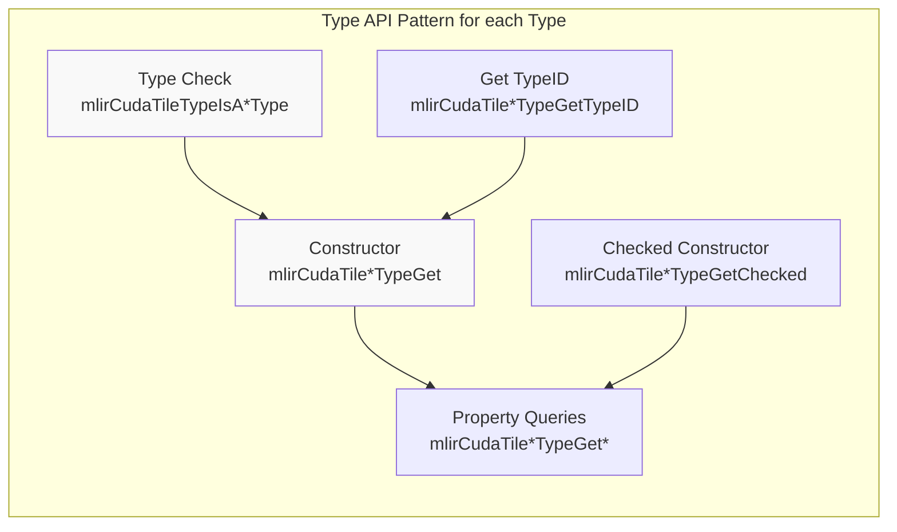
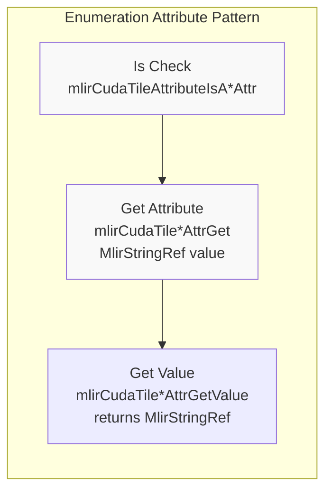
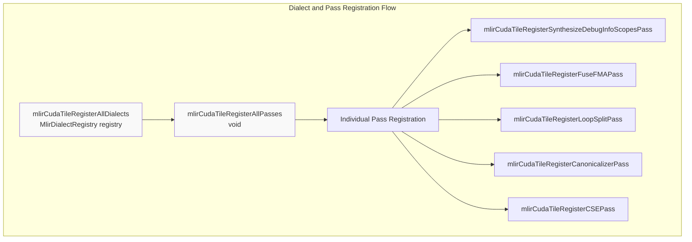
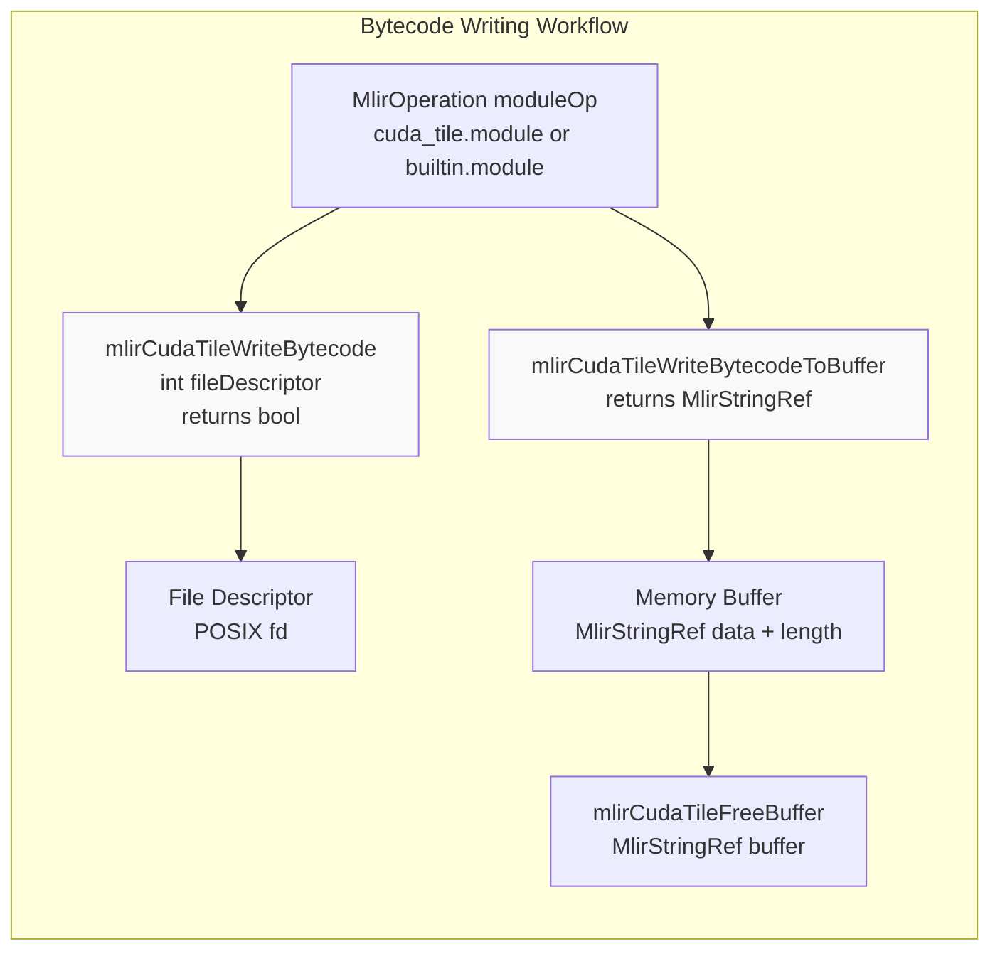
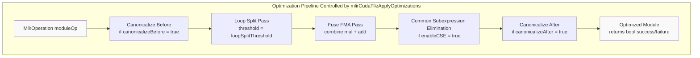
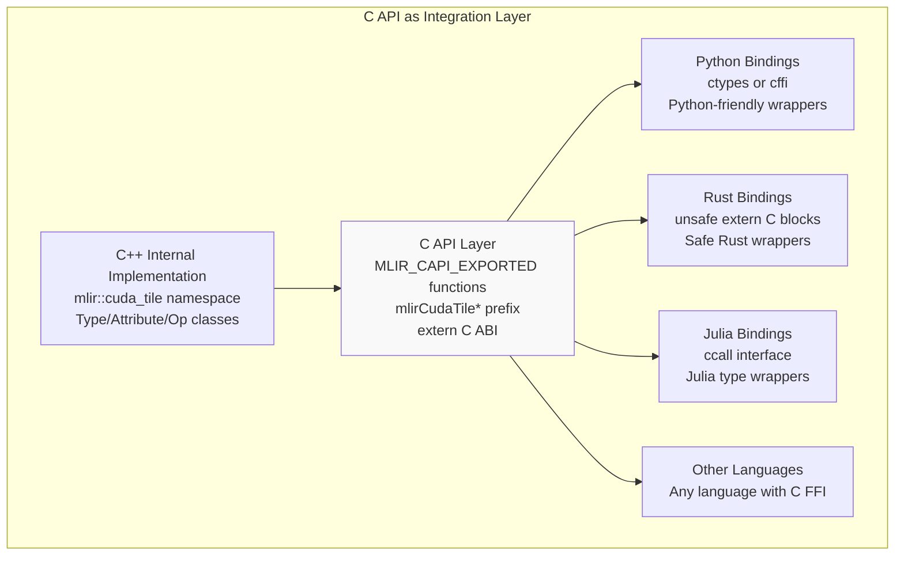

<!-- source: DeepWiki mcp.deepwiki.com · repo NVIDIA/cuda-tile · page 5.2 C API · fetched 2026-10-26 -->

# C API

<details>
<summary>Relevant source files</summary>

The following files were used as context for generating this wiki page:

- [python/Dialect/DialectCudaTile.cpp](python/Dialect/DialectCudaTile.cpp)
- [python/SiteInitializer.cpp](python/SiteInitializer.cpp)
- [test/CAPI/register.c](test/CAPI/register.c)

</details>


## Purpose and Scope

The C API provides a language-agnostic interface to the CUDA Tile IR dialect through MLIR's C API infrastructure. All functions are marked with `MLIR_CAPI_EXPORTED` and follow `extern "C"` conventions to ensure ABI stability across language boundaries. This layer enables integration with any language that supports C FFI (Foreign Function Interface), including Python, Rust, Julia, and others.

The C API covers:
- Type construction and introspection (TileType, PointerType, TokenType, TensorViewType, PartitionViewType)
- Attribute creation and manipulation (enumeration attributes, OptimizationHintsAttr)
- Dialect and pass registration
- Bytecode serialization and deserialization
- High-level optimization application

For the internal C++ API implementation, see [C++ API](#5.1). For Python-specific bindings that wrap this C API, see [Python Bindings](#5.3).

**Sources:** [include/cuda_tile-c/Dialect/CudaTileDialect.h:1-402](), [include/cuda_tile-c/Registration.h:1-28]()

## API Organization

The C API is organized into functional categories, with all functions prefixed with `mlirCudaTile` to avoid namespace conflicts. The API follows MLIR's C API conventions, using opaque handle types (`MlirType`, `MlirAttribute`, `MlirContext`, etc.) and providing type-safe construction and query functions.

### Function Categories

```mermaid
graph TB
    subgraph "C API Entry Points"
        Registration["Registration Functions<br/>mlirCudaTileRegisterAllDialects<br/>mlirCudaTileRegisterAllPasses"]
    end
    
    subgraph "Type API"
        PointerAPI["PointerType API<br/>mlirCudaTileTypeIsAPointerType<br/>mlirCudaTilePointerTypeGet<br/>mlirCudaTilePointerTypeGetPointeeType"]
        TileAPI["TileType API<br/>mlirCudaTileTypeIsATileType<br/>mlirCudaTileTileTypeGet<br/>mlirCudaTileTileTypeGetRank"]
        TokenAPI["TokenType API<br/>mlirCudaTileTypeIsATokenType<br/>mlirCudaTileTokenTypeGet"]
        TensorViewAPI["TensorViewType API<br/>mlirCudaTileTypeIsATensorViewType<br/>mlirCudaTileTensorViewTypeGet<br/>mlirCudaTileTensorViewTypeGetStride"]
        PartitionViewAPI["PartitionViewType API<br/>mlirCudaTileTypeIsAPartitionViewType<br/>mlirCudaTilePartitionViewTypeGet<br/>mlirCudaTilePartitionViewTypeGetDimMap"]
    end
    
    subgraph "Attribute API"
        EnumAttrs["Enumeration Attributes<br/>mlirCudaTileRoundingModeAttrGet<br/>mlirCudaTileComparisonPredicateAttrGet<br/>mlirCudaTileMemoryOrderingSemanticsAttrGet"]
        OptHints["OptimizationHintsAttr<br/>mlirCudaTileOptimizationHintsAttrGetEmpty<br/>mlirCudaTileOptimizationHintsAttrGetEntryOpHint<br/>mlirCudaTileOptimizationHintsAttrGetLoadStoreOpHint"]
        ArrayHelpers["Array Attribute Helpers<br/>mlirCudaTileDenseI32ArrayAttrGet<br/>mlirCudaTileDenseI32ArrayAttrGetNumElements"]
    end
    
    subgraph "Pass and Optimization API"
        PassReg["Pass Registration<br/>mlirCudaTileRegisterPasses<br/>mlirCudaTileRegisterFuseFMAPass<br/>mlirCudaTileRegisterLoopSplitPass"]
        OptApply["Optimization Application<br/>mlirCudaTileApplyOptimizations"]
    end
    
    subgraph "Bytecode I/O API"
        BytecodeWrite["Bytecode Writing<br/>mlirCudaTileWriteBytecode<br/>mlirCudaTileWriteBytecodeToBuffer<br/>mlirCudaTileFreeBuffer"]
    end
    
    Registration --> PointerAPI
    Registration --> TileAPI
    Registration --> TokenAPI
    Registration --> TensorViewAPI
    Registration --> PartitionViewAPI
    Registration --> EnumAttrs
    Registration --> OptHints
    
    PassReg --> OptApply
    OptApply --> BytecodeWrite
    
    style Registration fill:#f9f9f9
    style OptApply fill:#f9f9f9
    style BytecodeWrite fill:#f9f9f9
```



**Sources:** [include/cuda_tile-c/Dialect/CudaTileDialect.h:16-402](), [include/cuda_tile-c/Registration.h:16-22]()

### Header File Structure

| Header File | Purpose | Key Exports |
|-------------|---------|-------------|
| `cuda_tile-c/Registration.h` | Top-level registration | `mlirCudaTileRegisterAllDialects`, `mlirCudaTileRegisterAllPasses` |
| `cuda_tile-c/Dialect/CudaTileDialect.h` | Type/attribute/pass APIs | Type constructors, attribute constructors, pass registration, bytecode I/O |

**Sources:** [include/cuda_tile-c/Registration.h:1-28](), [include/cuda_tile-c/Dialect/CudaTileDialect.h:1-10]()

## Type Construction API

The Type API provides functions for constructing and introspecting CUDA Tile types. Each type follows a consistent pattern with type-checking predicates (`Is*`), TypeID queries, constructors (`*Get`), and property accessors.

### Type API Pattern



**Sources:** [include/cuda_tile-c/Dialect/CudaTileDialect.h:18-162]()

### PointerType API

PointerType represents a pointer to another type. The API consists of:

| Function | Purpose | Parameters | Return |
|----------|---------|------------|--------|
| `mlirCudaTileTypeIsAPointerType` | Type checking | `MlirType type` | `bool` |
| `mlirCudaTilePointerTypeGetTypeID` | Get TypeID | `void` | `MlirTypeID` |
| `mlirCudaTilePointerTypeGet` | Construct PointerType | `MlirContext ctx, MlirType pointeeType` | `MlirType` |
| `mlirCudaTilePointerTypeGetPointeeType` | Get pointee type | `MlirType type` | `MlirType` |

**Sources:** [include/cuda_tile-c/Dialect/CudaTileDialect.h:18-33]()

### TileType API

TileType represents a multi-dimensional tile with a fixed shape and element type. The API provides both checked and unchecked constructors:

| Function | Purpose | Parameters | Return |
|----------|---------|------------|--------|
| `mlirCudaTileTypeIsATileType` | Type checking | `MlirType type` | `bool` |
| `mlirCudaTileTileTypeGetTypeID` | Get TypeID | `void` | `MlirTypeID` |
| `mlirCudaTileTileTypeGet` | Construct TileType | `MlirContext ctx, intptr_t rank, const int64_t *shape, MlirType elementType` | `MlirType` |
| `mlirCudaTileTileTypeGetChecked` | Construct with verification | `MlirContext ctx, intptr_t rank, const int64_t *shape, MlirType elementType` | `MlirType` (null on failure) |
| `mlirCudaTileTileTypeGetElementType` | Get element type | `MlirType type` | `MlirType` |
| `mlirCudaTileTileTypeGetRank` | Get rank | `MlirType type` | `intptr_t` |
| `mlirCudaTileTileTypeGetDimSize` | Get dimension size | `MlirType type, intptr_t pos` | `int64_t` |

**Sources:** [include/cuda_tile-c/Dialect/CudaTileDialect.h:35-62]()

### TokenType API

TokenType represents a synchronization token used for ordering memory operations:

| Function | Purpose | Parameters | Return |
|----------|---------|------------|--------|
| `mlirCudaTileTypeIsATokenType` | Type checking | `MlirType type` | `bool` |
| `mlirCudaTileTokenTypeGetTypeID` | Get TypeID | `void` | `MlirTypeID` |
| `mlirCudaTileTokenTypeGet` | Construct TokenType | `MlirContext ctx` | `MlirType` |

**Sources:** [include/cuda_tile-c/Dialect/CudaTileDialect.h:64-73]()

### TensorViewType API

TensorViewType represents a tensor with explicit shape and stride information. Strides may be dynamic:

| Function | Purpose | Parameters | Return |
|----------|---------|------------|--------|
| `mlirCudaTileTypeIsATensorViewType` | Type checking | `MlirType type` | `bool` |
| `mlirCudaTileTensorViewTypeGetTypeID` | Get TypeID | `void` | `MlirTypeID` |
| `mlirCudaTileTensorViewTypeGet` | Construct TensorViewType | `MlirContext ctx, MlirType elementType, intptr_t shapeRank, const int64_t *shape, intptr_t strideRank, const int64_t *strides` | `MlirType` |
| `mlirCudaTileTensorViewTypeGetChecked` | Construct with verification | `MlirContext ctx, MlirType elementType, intptr_t shapeRank, const int64_t *shape, intptr_t strideRank, const int64_t *strides` | `MlirType` (null on failure) |
| `mlirCudaTileTensorViewTypeGetElementType` | Get element type | `MlirType type` | `MlirType` |
| `mlirCudaTileTensorViewTypeGetRank` | Get rank | `MlirType type` | `intptr_t` |
| `mlirCudaTileTensorViewTypeGetDimSize` | Get dimension size | `MlirType type, intptr_t pos` | `int64_t` |
| `mlirCudaTileTensorViewTypeGetStride` | Get stride | `MlirType type, intptr_t pos` | `int64_t` |
| `mlirCudaTileTensorViewTypeGetDynamicSize` | Get dynamic size sentinel | `void` | `int64_t` |

**Sources:** [include/cuda_tile-c/Dialect/CudaTileDialect.h:75-111]()

### PartitionViewType API

PartitionViewType is the most complex type, representing a partitioned view of a tensor with tile shape, dimension mapping, and optional padding:

| Function | Purpose | Parameters | Return |
|----------|---------|------------|--------|
| `mlirCudaTileTypeIsAPartitionViewType` | Type checking | `MlirType type` | `bool` |
| `mlirCudaTilePartitionViewTypeGetTypeID` | Get TypeID | `void` | `MlirTypeID` |
| `mlirCudaTilePartitionViewTypeGet` | Construct PartitionViewType | `MlirContext ctx, MlirAttribute tileShapeAttr, MlirType tensorViewType, intptr_t dimMapRank, const int32_t *dimMap, MlirAttribute paddingValue` | `MlirType` |
| `mlirCudaTilePartitionViewTypeGetChecked` | Construct with verification | `MlirContext ctx, MlirAttribute tileShapeAttr, MlirType tensorViewType, intptr_t dimMapRank, const int32_t *dimMap, MlirAttribute paddingValue` | `MlirType` (null on failure) |
| `mlirCudaTilePartitionViewTypeGetTileShape` | Get tile shape attribute | `MlirType type` | `MlirAttribute` |
| `mlirCudaTilePartitionViewTypeGetTensorView` | Get tensor view type | `MlirType type` | `MlirType` |
| `mlirCudaTilePartitionViewTypeGetDimMapRank` | Get dimension map rank | `MlirType type` | `intptr_t` |
| `mlirCudaTilePartitionViewTypeGetDimMapElement` | Get dimension map element | `MlirType type, intptr_t pos` | `int32_t` |
| `mlirCudaTilePartitionViewTypeGetPaddingValue` | Get padding value attribute | `MlirType type` | `MlirAttribute` (may be null) |
| `mlirCudaTilePartitionViewTypeGetViewTileType` | Get view tile type | `MlirType type` | `MlirType` |
| `mlirCudaTilePartitionViewTypeGetViewIndexRank` | Get view index rank | `MlirType type` | `intptr_t` |

**Sources:** [include/cuda_tile-c/Dialect/CudaTileDialect.h:113-162]()

## Attribute Construction API

The Attribute API provides functions for creating and querying attributes. Attributes are organized into enumeration attributes (representing predefined values) and structured attributes (like OptimizationHintsAttr).

### Enumeration Attribute Pattern

All enumeration attributes follow a consistent pattern:



**Sources:** [include/cuda_tile-c/Dialect/CudaTileDialect.h:164-309]()

### Enumeration Attributes

| Attribute Type | Constructor Function | Value Getter | Use Case |
|----------------|---------------------|--------------|----------|
| RoundingModeAttr | `mlirCudaTileRoundingModeAttrGet` | `mlirCudaTileRoundingModeAttrGetValue` | FP rounding control |
| ComparisonOrderingAttr | `mlirCudaTileComparisonOrderingAttrGet` | `mlirCudaTileComparisonOrderingAttrGetValue` | FP comparison ordering |
| ComparisonPredicateAttr | `mlirCudaTileComparisonPredicateAttrGet` | `mlirCudaTileComparisonPredicateAttrGetValue` | Comparison predicates |
| MemoryOrderingSemanticsAttr | `mlirCudaTileMemoryOrderingSemanticsAttrGet` | `mlirCudaTileMemoryOrderingSemanticsAttrGetValue` | Memory ordering semantics |
| MemoryScopeAttr | `mlirCudaTileMemoryScopeAttrGet` | `mlirCudaTileMemoryScopeAttrGetValue` | Memory scope (tl_blk/device/sys) |
| PaddingValueAttr | `mlirCudaTilePaddingValueAttrGet` | `mlirCudaTilePaddingValueAttrGetValue` | Padding value semantics |
| AtomicRMWModeAttr | `mlirCudaTileAtomicRMWModeAttrGet` | `mlirCudaTileAtomicRMWModeAttrGetValue` | Atomic RMW operation mode |
| IntegerOverflowAttr | `mlirCudaTileIntegerOverflowAttrGet` | `mlirCudaTileIntegerOverflowAttrGetValue` | Integer overflow behavior |
| SignednessAttr | `mlirCudaTileSignednessAttrGet` | `mlirCudaTileSignednessAttrGetValue` | Integer signedness |

**Sources:** [include/cuda_tile-c/Dialect/CudaTileDialect.h:164-309]()

### DenseI32ArrayAttr Helpers

Helper functions for creating and querying `DenseI32ArrayAttr`, used for dimension maps and tile shapes:

| Function | Purpose | Parameters | Return |
|----------|---------|------------|--------|
| `mlirCudaTileDenseI32ArrayAttrGet` | Create array attribute | `MlirContext ctx, intptr_t numElements, const int32_t *values` | `MlirAttribute` |
| `mlirCudaTileDenseI32ArrayAttrGetNumElements` | Get element count | `MlirAttribute attr` | `intptr_t` |
| `mlirCudaTileDenseI32ArrayAttrGetElement` | Get element value | `MlirAttribute attr, intptr_t pos` | `int32_t` |

**Sources:** [include/cuda_tile-c/Dialect/CudaTileDialect.h:208-221]()

### OptimizationHintsAttr API

OptimizationHintsAttr provides architecture-specific optimization hints for EntryOp and Load/Store operations:

| Function | Purpose | Parameters | Return |
|----------|---------|------------|--------|
| `mlirCudaTileAttributeIsAOptimizationHintsAttr` | Type checking | `MlirAttribute attr` | `bool` |
| `mlirCudaTileOptimizationHintsAttrGetEmpty` | Create empty hints | `MlirContext ctx` | `MlirAttribute` |
| `mlirCudaTileOptimizationHintsAttrGetEntryOpHint` | Create EntryOp hints | `MlirContext ctx, MlirStringRef arch, int32_t numCta, int32_t occupancy` | `MlirAttribute` |
| `mlirCudaTileOptimizationHintsAttrGetLoadStoreOpHint` | Create Load/Store hints | `MlirContext ctx, MlirStringRef arch, int8_t allowTma, int32_t latency` | `MlirAttribute` |

**Note:** Pass `0` for unused integer parameters and `false` for unused boolean parameters.

**Sources:** [include/cuda_tile-c/Dialect/CudaTileDialect.h:310-334]()

## Registration and Pass Management API

The Registration API provides functions for registering the CUDA Tile dialect and its transformation passes with MLIR infrastructure.

### Registration Functions



**Sources:** [include/cuda_tile-c/Registration.h:16-22](), [include/cuda_tile-c/Dialect/CudaTileDialect.h:384-397]()

### Registration Function Details

| Function | Purpose | Parameters | Use Case |
|----------|---------|------------|----------|
| `mlirCudaTileRegisterAllDialects` | Register CUDA Tile dialects | `MlirDialectRegistry registry` | Called during initialization to make dialect available |
| `mlirCudaTileRegisterAllPasses` | Register all CUDA Tile passes | `void` | Called to make passes available for pass manager |
| `mlirCudaTileRegisterSynthesizeDebugInfoScopesPass` | Register debug info synthesis pass | `void` | Individual pass registration |
| `mlirCudaTileRegisterFuseFMAPass` | Register FMA fusion pass | `void` | Individual pass registration |
| `mlirCudaTileRegisterLoopSplitPass` | Register loop split pass | `void` | Individual pass registration |
| `mlirCudaTileRegisterCanonicalizerPass` | Register canonicalizer pass | `void` | Individual pass registration |
| `mlirCudaTileRegisterCSEPass` | Register CSE pass | `void` | Individual pass registration |

**Note:** `mlirCudaTileRegisterAllPasses` internally calls all individual pass registration functions. Use individual functions for selective pass registration.

**Sources:** [include/cuda_tile-c/Registration.h:16-22](), [include/cuda_tile-c/Dialect/CudaTileDialect.h:384-397]()

## Bytecode I/O API

The Bytecode I/O API provides functions for serializing CUDA Tile IR modules to bytecode format (`.tilebc` files).

### Bytecode Writing Functions



**Sources:** [include/cuda_tile-c/Dialect/CudaTileDialect.h:353-368]()

### Bytecode Function Details

| Function | Purpose | Parameters | Return | Notes |
|----------|---------|------------|--------|-------|
| `mlirCudaTileWriteBytecode` | Write to file descriptor | `MlirOperation moduleOp, int fileDescriptor` | `bool` (success/failure) | Uses POSIX file descriptor |
| `mlirCudaTileWriteBytecodeToBuffer` | Write to memory buffer | `MlirOperation moduleOp` | `MlirStringRef` (bytecode data with length) | Returns empty string on failure |
| `mlirCudaTileFreeBuffer` | Free allocated buffer | `MlirStringRef buffer` | `void` | Must be called to free buffer from `WriteBytecodeToBuffer` |

**Important:** The `moduleOp` parameter must be either a `cuda_tile.module` operation or a standard `builtin.module` operation. Use `mlirCudaTileOperationIsAModuleOp` or `mlirOperationIsAModuleOp` to check the operation type before writing.

**Sources:** [include/cuda_tile-c/Dialect/CudaTileDialect.h:353-368]()

## High-Level Optimization API

The Optimization API provides a high-level function for applying a configurable sequence of transformation passes to a CUDA Tile module.

### mlirCudaTileApplyOptimizations



**Sources:** [include/cuda_tile-c/Dialect/CudaTileDialect.h:344-351]()

### Function Signature

```c
MLIR_CAPI_EXPORTED bool mlirCudaTileApplyOptimizations(
    MlirOperation moduleOp,
    int32_t loopSplitThreshold,
    bool enableCSE,
    bool canonicalizeBefore,
    bool canonicalizeAfter
);
```

### Parameters

| Parameter | Type | Purpose | Default Recommendation |
|-----------|------|---------|------------------------|
| `moduleOp` | `MlirOperation` | Module to optimize (cuda_tile.module or builtin.module) | N/A (required) |
| `loopSplitThreshold` | `int32_t` | Threshold for loop split pass | `0` (use pass default) |
| `enableCSE` | `bool` | Enable common subexpression elimination | `true` |
| `canonicalizeBefore` | `bool` | Run canonicalizer before main passes | `true` |
| `canonicalizeAfter` | `bool` | Run canonicalizer after main passes | `true` |

**Returns:** `true` on success, `false` on failure.

**Sources:** [include/cuda_tile-c/Dialect/CudaTileDialect.h:344-351]()

## Helper and Utility Functions

Additional helper functions facilitate common operations when working with the C API.

### Operation Type Checking

| Function | Purpose | Parameters | Return |
|----------|---------|------------|--------|
| `mlirCudaTileOperationIsAModuleOp` | Check if operation is cuda_tile.module | `MlirOperation op` | `bool` |
| `mlirOperationIsAModuleOp` | Check if operation is builtin.module | `MlirOperation op` | `bool` |

**Sources:** [include/cuda_tile-c/Dialect/CudaTileDialect.h:338-342]()

### Type and Attribute Creation Helpers

| Function | Purpose | Parameters | Return |
|----------|---------|------------|--------|
| `mlirCudaTileIntegerTypeGet` | Create integer type | `MlirContext ctx, unsigned width` | `MlirType` |
| `mlirCudaTileIntegerAttrGet` | Create integer attribute | `MlirType type, int64_t value` | `MlirAttribute` |
| `mlirCudaTileOperationSetDiscardableAttributeByName` | Set discardable attribute | `MlirOperation op, MlirStringRef name, MlirAttribute attr` | `void` |

**Note:** Discardable attributes are metadata that can be safely removed without affecting program semantics. They are typically used for optimization hints and debug information.

**Sources:** [include/cuda_tile-c/Dialect/CudaTileDialect.h:372-383]()

## Integration with Foreign Languages

The C API enables integration with any language supporting C FFI. The stable ABI ensures compatibility across different compiler versions and language runtimes.

### Language Integration Workflow



**Sources:** [include/cuda_tile-c/Dialect/CudaTileDialect.h:1-15](), [include/cuda_tile-c/Registration.h:1-14]()

### ABI Stability Guarantees

The C API provides the following stability guarantees:

1. **Function Signatures:** All functions use C-compatible types (`bool`, `int32_t`, pointers to opaque handles)
2. **Name Mangling:** `extern "C"` prevents C++ name mangling, ensuring consistent symbol names
3. **Opaque Handles:** Types like `MlirType`, `MlirAttribute`, `MlirOperation` are opaque pointers, hiding C++ implementation details
4. **Version Independence:** The API is designed to remain stable across MLIR/LLVM version updates

### Typical FFI Usage Pattern

1. **Load Library:** Dynamically load the shared library (`.so`, `.dylib`, `.dll`) containing the C API
2. **Declare Signatures:** Declare function signatures in the target language matching the C API
3. **Create Context:** Call `mlirContextCreate` to create an MLIR context
4. **Register Dialects:** Call `mlirCudaTileRegisterAllDialects` to register the CUDA Tile dialect
5. **Construct IR:** Use type/attribute constructor functions to build IR programmatically
6. **Apply Optimizations:** Call `mlirCudaTileApplyOptimizations` to optimize the IR
7. **Serialize:** Call `mlirCudaTileWriteBytecodeToBuffer` to generate bytecode
8. **Cleanup:** Free allocated resources with appropriate cleanup functions

**Sources:** [include/cuda_tile-c/Registration.h:16-22](), [include/cuda_tile-c/Dialect/CudaTileDialect.h:344-368]()

## Example Usage Scenarios

### Scenario 1: Type Construction from C/FFI

To construct a `tile<16x16xf32>` type:

1. Create context: `MlirContext ctx = mlirContextCreate();`
2. Register dialect: `mlirCudaTileRegisterAllDialects(mlirContextGetOrLoadDialect(ctx, "cuda_tile"));`
3. Create element type: `MlirType f32 = mlirF32TypeGet(ctx);`
4. Define shape: `int64_t shape[] = {16, 16};`
5. Create tile type: `MlirType tileType = mlirCudaTileTileTypeGet(ctx, 2, shape, f32);`

**Sources:** [include/cuda_tile-c/Dialect/CudaTileDialect.h:44-47]()

### Scenario 2: Optimization and Bytecode Generation

To optimize and serialize a module:

1. Load module: `MlirModule module = mlirModuleCreateParse(ctx, source);`
2. Get module operation: `MlirOperation moduleOp = mlirModuleGetOperation(module);`
3. Apply optimizations: `bool success = mlirCudaTileApplyOptimizations(moduleOp, 0, true, true, true);`
4. Write bytecode: `MlirStringRef bytecode = mlirCudaTileWriteBytecodeToBuffer(moduleOp);`
5. Use bytecode: Process `bytecode.data` with length `bytecode.length`
6. Cleanup: `mlirCudaTileFreeBuffer(bytecode);`

**Sources:** [include/cuda_tile-c/Dialect/CudaTileDialect.h:344-368]()

### Scenario 3: Creating Optimization Hints

To create architecture-specific optimization hints for an EntryOp:

1. Create hint: `MlirAttribute hint = mlirCudaTileOptimizationHintsAttrGetEntryOpHint(ctx, mlirStringRefCreateFromCString("sm_90"), 2, 4);`
2. Set on operation: `mlirCudaTileOperationSetDiscardableAttributeByName(entryOp, mlirStringRefCreateFromCString("opt_hints"), hint);`

**Sources:** [include/cuda_tile-c/Dialect/CudaTileDialect.h:322-326](), [include/cuda_tile-c/Dialect/CudaTileDialect.h:381-382]()

## Summary

The C API provides a comprehensive, stable interface for:

- **Type System Access:** Construct and query all five core types (PointerType, TileType, TokenType, TensorViewType, PartitionViewType)
- **Attribute System Access:** Create enumeration attributes and optimization hints
- **Pass Management:** Register and apply transformation passes
- **Bytecode I/O:** Serialize modules to bytecode format for JIT/AOT compilation
- **Language Interoperability:** Enable integration with any language supporting C FFI

All functions follow consistent naming (`mlirCudaTile*` prefix), use opaque handle types for ABI stability, and provide both checked and unchecked variants where appropriate. The API serves as the foundation for higher-level bindings in Python and other languages.

**Sources:** [include/cuda_tile-c/Dialect/CudaTileDialect.h:1-402](), [include/cuda_tile-c/Registration.h:1-28]()

---

