<!-- source: DeepWiki mcp.deepwiki.com · repo NVIDIA/cuda-tile · page 5.3 Python Bindings · fetched 2026-10-26 -->

# Python Bindings

<details>
<summary>Relevant source files</summary>

The following files were used as context for generating this wiki page:

- [python/CMakeLists.txt](python/CMakeLists.txt)
- [python/Dialect/DialectCudaTile.cpp](python/Dialect/DialectCudaTile.cpp)
- [python/SiteInitializer.cpp](python/SiteInitializer.cpp)
- [python/cuda_tile/dialects/cuda_tile_ops.py](python/cuda_tile/dialects/cuda_tile_ops.py)

</details>


This page provides comprehensive documentation for the Python bindings infrastructure of CUDA Tile IR. The Python bindings enable users to construct and manipulate MLIR IR programmatically using Python, providing a high-level interface for defining GPU kernels and operations.

For detailed information about the Python build configuration, see [Python Build System](#5.3.1). For the C++ wrapper implementation, see [Python C++ Extension Layer](#5.3.2). For the high-level Python API usage, see [Python Operations API](#5.3.3).

## Architecture Overview

The Python bindings follow a three-layer architecture that bridges Python user code to the underlying MLIR C API:

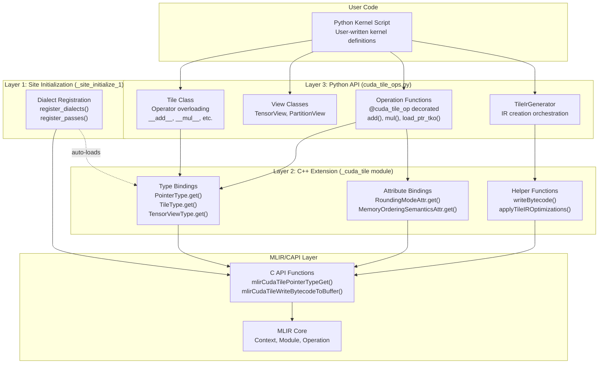

**Sources:** [python/CMakeLists.txt:1-124](), [python/cuda_tile/dialects/cuda_tile_ops.py:1-100](), [python/Dialect/DialectCudaTile.cpp:1-50]()

### Data Flow from Python to MLIR IR

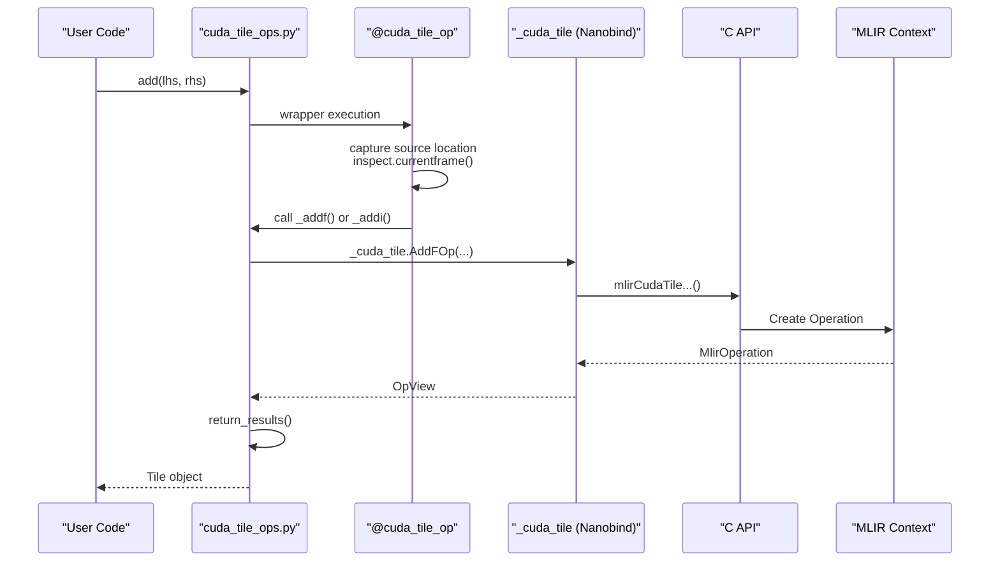

**Sources:** [python/cuda_tile/dialects/cuda_tile_ops.py:966-985](), [python/Dialect/DialectCudaTile.cpp:82-109]()

## Key Components

### Module System

The Python bindings organize code into two primary Nanobind modules:

| Module Name | Purpose | Entry Point | Registration |
|-------------|---------|-------------|--------------|
| `_site_initialize_1` | Auto-loads dialect and passes during Python import | [python/SiteInitializer.cpp:14-26]() | Automatic via MLIR site initialization |
| `_cuda_tile` | Provides type/attribute/operation bindings | [python/Dialect/DialectCudaTile.cpp:18-602]() | Imported by cuda_tile_ops.py |

**Sources:** [python/CMakeLists.txt:35-47](), [python/CMakeLists.txt:59-71]()

### Type System Bindings

The following table maps Python type classes to their C++ bindings and C API functions:

| Python Class | C++ Binding | C API Function | Type Purpose |
|--------------|-------------|----------------|--------------|
| `PointerType` | [python/Dialect/DialectCudaTile.cpp:114-138]() | `mlirCudaTilePointerTypeGet` | Single memory location typed pointer |
| `TileType` | [python/Dialect/DialectCudaTile.cpp:140-176]() | `mlirCudaTileTileTypeGetChecked` | Fixed-shape tensor with power-of-2 dims |
| `TokenType` | [python/Dialect/DialectCudaTile.cpp:178-186]() | `mlirCudaTileTokenTypeGet` | Ordering constraint for memory ops |
| `TensorViewType` | [python/Dialect/DialectCudaTile.cpp:188-257]() | `mlirCudaTileTensorViewTypeGetChecked` | Dynamic shape/stride global memory ref |
| `PartitionViewType` | [python/Dialect/DialectCudaTile.cpp:259-346]() | `mlirCudaTilePartitionViewTypeGetChecked` | Grid-partitioned view with tile mapping |

**Sources:** [python/cuda_tile/dialects/cuda_tile_ops.py:127-133]()

### Attribute System Bindings

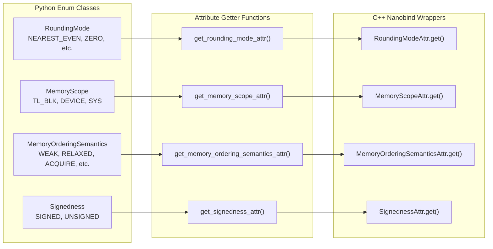

**Sources:** [python/cuda_tile/dialects/cuda_tile_ops.py:209-263](), [python/cuda_tile/dialects/cuda_tile_ops.py:265-390](), [python/Dialect/DialectCudaTile.cpp:348-602]()

## Operation Decorator System

All operations in the Python API use the `@cuda_tile_op` decorator to automatically capture source location information:

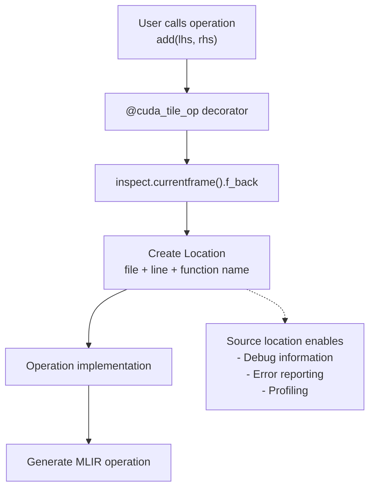

The decorator implementation at [python/cuda_tile/dialects/cuda_tile_ops.py:966-985]() wraps every operation function to inject location information:

```python
def cuda_tile_op(opFunc):
    @_wraps(opFunc)
    def wrapper(*args, **kwargs):
        loc = kwargs.pop("loc", None)
        if loc is None:
            frame = _inspect.currentframe().f_back
            file_loc = _ods_ir.Location.file(
                frame.f_code.co_filename, frame.f_lineno, 0
            )
            loc = _ods_ir.Location.name(frame.f_code.co_name, childLoc=file_loc)
        res_or_list = opFunc(*args, **kwargs, loc=loc)
        return res_or_list
    return wrapper
```

**Sources:** [python/cuda_tile/dialects/cuda_tile_ops.py:966-985]()

## High-Level API Classes

### Tile Class

The `Tile` class at [python/cuda_tile/dialects/cuda_tile_ops.py:667-829]() provides a high-level wrapper around tile values with operator overloading:

| Operator | Method | Maps To | Type Dispatch |
|----------|--------|---------|---------------|
| `+` | `__add__` | `add()` | Integer → `_addi()`, Float → `_addf()`, Pointer → `_offset()` |
| `-` | `__sub__` | `sub()` | Integer → `_subi()`, Float → `_subf()` |
| `*` | `__mul__` | `mul()` | Integer → `_muli()`, Float → `_mulf()` |
| `/` | `__truediv__` | `div()` | Integer → `divi()`, Float → `divf()` |
| `//` | `__floordiv__` | `floordivi()` | Integer only (signed floor division) |
| `<`, `>`, `==` | `__lt__`, `__gt__`, `__eq__` | `_comparison_op()` | Integer → `cmpi()`, Float → `cmpf()` |
| `&`, `\|`, `^` | `__and__`, `__or__` | `andi()`, `ori()` | Integer only (bitwise) |
| `<<`, `>>` | `__lshift__`, `__rshift__` | `shli()`, `shri()` | Integer only (shift) |

**Sources:** [python/cuda_tile/dialects/cuda_tile_ops.py:706-822]()

### TileView Hierarchy

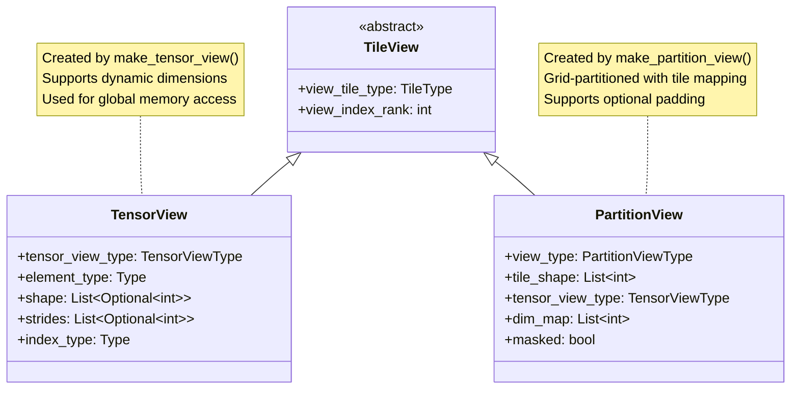

**Sources:** [python/cuda_tile/dialects/cuda_tile_ops.py:844-943]()

## Memory Operations with Tokens

Memory operations use token-ordered execution to ensure proper synchronization:

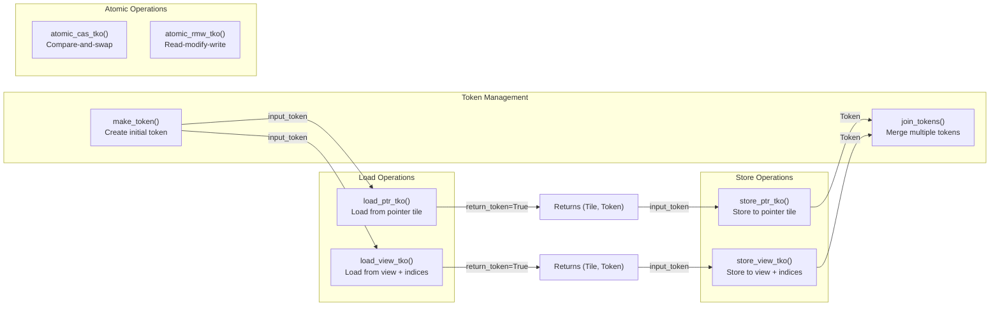

All token-ordered operations (`*_tko`) accept the following common parameters:

| Parameter | Type | Purpose | Default |
|-----------|------|---------|---------|
| `memory_ordering_semantics` | `MemoryOrderingSemantics` | Memory consistency model | `WEAK` |
| `memory_scope` | `MemoryScope` | Visibility scope | `None` (required if not WEAK) |
| `input_token` | `Token \| None` | Synchronization dependency | `None` |
| `return_token` | `bool` | Return token with result | `False` |

**Sources:** [python/cuda_tile/dialects/cuda_tile_ops.py:2323-2464](), [python/cuda_tile/dialects/cuda_tile_ops.py:2467-2554](), [python/cuda_tile/dialects/cuda_tile_ops.py:2623-2744](), [python/cuda_tile/dialects/cuda_tile_ops.py:2747-2831]()

## Control Flow Constructs

### Loop Constructs

The Python API provides three loop constructs:

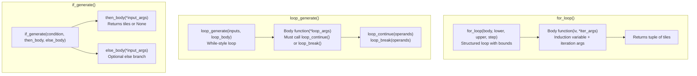

Example usage patterns:

**for_loop:** [python/cuda_tile/dialects/cuda_tile_ops.py:3189-3249]() - Structured iteration with known bounds  
**loop_generate:** [python/cuda_tile/dialects/cuda_tile_ops.py:3124-3154]() - General while-style loop with manual control flow  
**if_generate:** [python/cuda_tile/dialects/cuda_tile_ops.py:2988-3030]() - Conditional execution with optional else branch

**Sources:** [python/cuda_tile/dialects/cuda_tile_ops.py:2988-3030](), [python/cuda_tile/dialects/cuda_tile_ops.py:3124-3154](), [python/cuda_tile/dialects/cuda_tile_ops.py:3189-3249]()

## Type Conversion Operations

The API provides comprehensive type conversion functions:

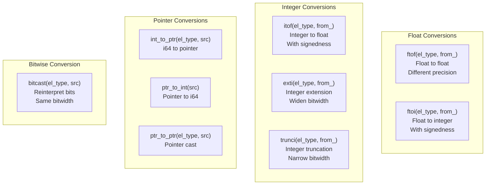

Type conversion rules and validations:

| Function | Source Type | Dest Type | Validation |
|----------|-------------|-----------|------------|
| `ftof` | Float | Float | Must differ in precision |
| `ftoi` | Float | Integer | Rounds toward zero (NEAREST_INT_TO_ZERO) |
| `itof` | Integer | Float | Uses NEAREST_EVEN rounding |
| `exti` | Integer | Integer | Dest bitwidth > source bitwidth |
| `trunci` | Integer | Integer | Source bitwidth > dest bitwidth |
| `bitcast` | Non-pointer | Non-pointer | Bitwidths must match |
| `int_to_ptr` | i64 | Pointer | Source must be i64 |
| `ptr_to_int` | Pointer | i64 | Returns i64 |

**Sources:** [python/cuda_tile/dialects/cuda_tile_ops.py:2853-2913](), [python/cuda_tile/dialects/cuda_tile_ops.py:2916-2985](), [python/cuda_tile/dialects/cuda_tile_ops.py:2302-2320](), [python/cuda_tile/dialects/cuda_tile_ops.py:2760-2812]()

## MMA (Matrix Multiply-Accumulate) Configuration System

The Python API includes an automatic MMA type validation system:

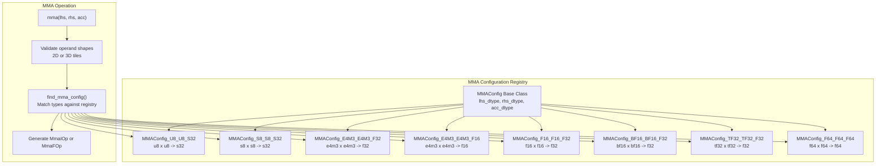

The MMA configuration system automatically discovers all `MMAConfig` subclasses at [python/cuda_tile/dialects/cuda_tile_ops.py:588-609]() and validates type combinations at [python/cuda_tile/dialects/cuda_tile_ops.py:2228-2251]().

**Sources:** [python/cuda_tile/dialects/cuda_tile_ops.py:398-625](), [python/cuda_tile/dialects/cuda_tile_ops.py:2181-2274]()

## TileIrGenerator Class

The `TileIrGenerator` class at [python/cuda_tile/dialects/cuda_tile_ops.py:4201-4265]() provides a context manager interface for IR generation:

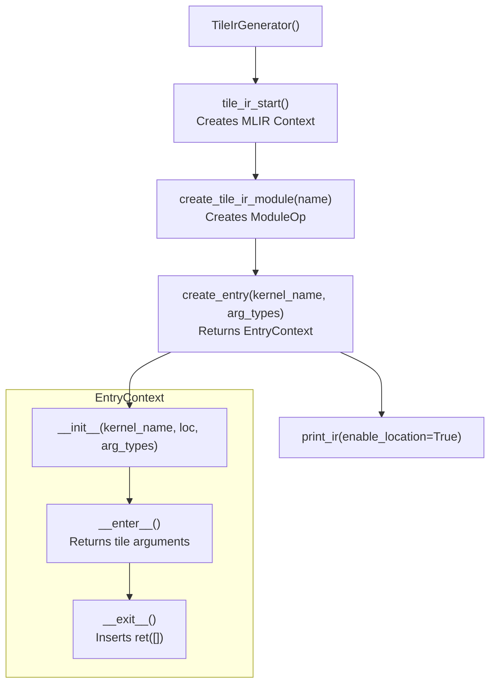

**Sources:** [python/cuda_tile/dialects/cuda_tile_ops.py:4201-4265](), [python/cuda_tile/dialects/cuda_tile_ops.py:4178-4199]()

## Helper Function System

The Python API includes several critical helper functions that bridge between Python and MLIR types:

### Type Creation Helpers

| Function | Purpose | Returns | Source |
|----------|---------|---------|--------|
| `make_tile_type(el_type, shape)` | Create TileType from element type and shape | `TileType` | [python/cuda_tile/dialects/cuda_tile_ops.py:1140-1161]() |
| `make_tensor_view_type(el_type, shape, strides)` | Create TensorViewType with optional dynamic dims | `TensorViewType` | [python/cuda_tile/dialects/cuda_tile_ops.py:1164-1198]() |
| `make_partition_view_type(tensor_view_type, tile_shape, dim_map, padding_value)` | Create PartitionViewType from tensor view | `PartitionViewType` | [python/cuda_tile/dialects/cuda_tile_ops.py:1201-1250]() |

### Result Processing

The `return_results()` function at [python/cuda_tile/dialects/cuda_tile_ops.py:1028-1079]() handles the complexity of converting MLIR operation results back to Python:

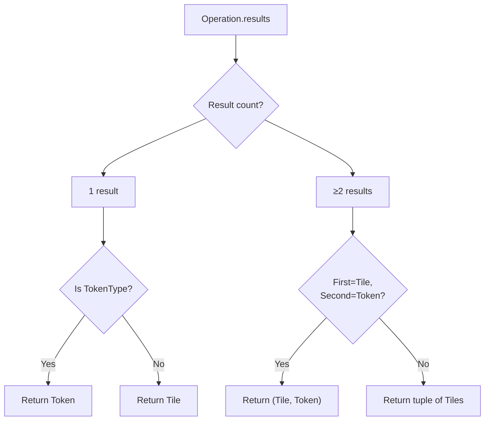

**Sources:** [python/cuda_tile/dialects/cuda_tile_ops.py:1028-1079]()

### Constant Value Flattening

The `_flatten_constants()` function at [python/cuda_tile/dialects/cuda_tile_ops.py:3786-3830]() converts nested Python lists into flat arrays with shape information:

```python
# Input: [[1, 2], [3, 4]]
# Output: shape=[2, 2], flattened_values=[1, 2, 3, 4]
```

This helper validates consistent nesting levels and is used by both `constant()` and `global_()` operations.

**Sources:** [python/cuda_tile/dialects/cuda_tile_ops.py:3786-3830](), [python/cuda_tile/dialects/cuda_tile_ops.py:3862-3888]()

## Optimization Hints Support

The Python API exposes optimization hints through the `OptimizationHintsAttr` class:

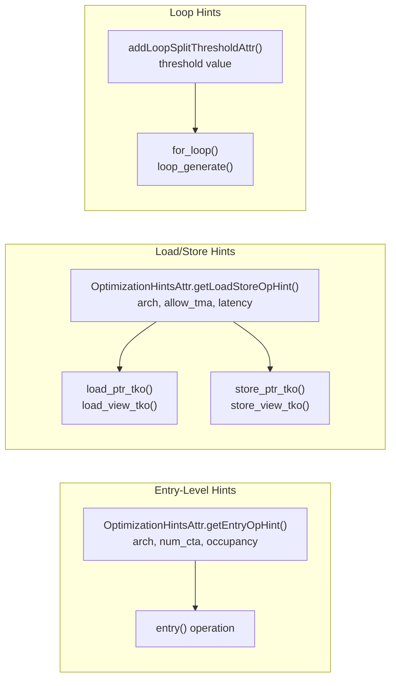

Optimization hint parameters must specify the `arch` parameter along with hint values:

| Architecture | Value |
|--------------|-------|
| `"sm_80"` | NVIDIA Ampere |
| `"sm_90"` | NVIDIA Hopper |
| `"sm_100"` | NVIDIA Blackwell |
| `"sm_103"` | NVIDIA Blackwell variant |
| `"sm_120"` | Future architecture |

**Sources:** [python/Dialect/DialectCudaTile.cpp:37-80](), [python/cuda_tile/dialects/cuda_tile_ops.py:3252-3284](), [python/cuda_tile/dialects/cuda_tile_ops.py:2717-2730]()

## Bytecode Writing

The `writeBytecode()` function at [python/Dialect/DialectCudaTile.cpp:82-109]() serializes MLIR modules to bytecode format:

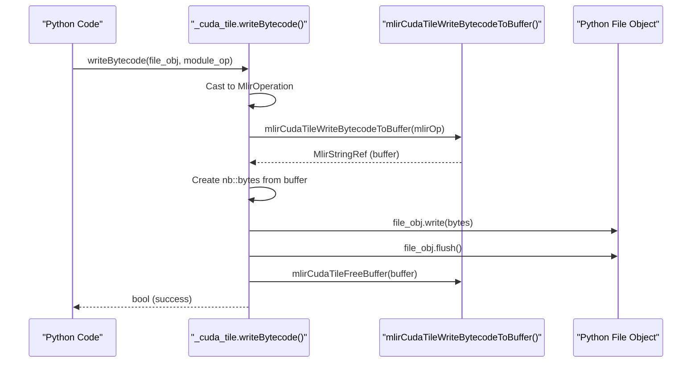

This platform-independent approach writes to a memory buffer first, then uses Python file I/O, avoiding platform-specific file descriptor handling issues.

**Sources:** [python/Dialect/DialectCudaTile.cpp:82-109]()

## Pass Application

The Python API provides `applyTileIROptimizations()` at [python/Dialect/DialectCudaTile.cpp:54-64]() with configurable options:

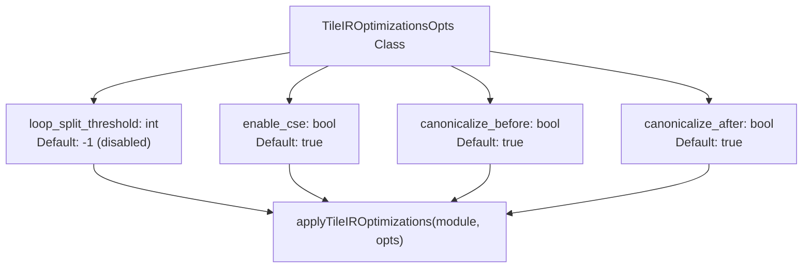

**Sources:** [python/Dialect/DialectCudaTile.cpp:37-64]()

---

