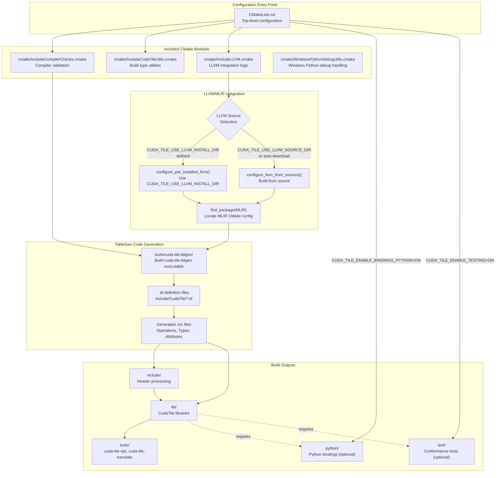
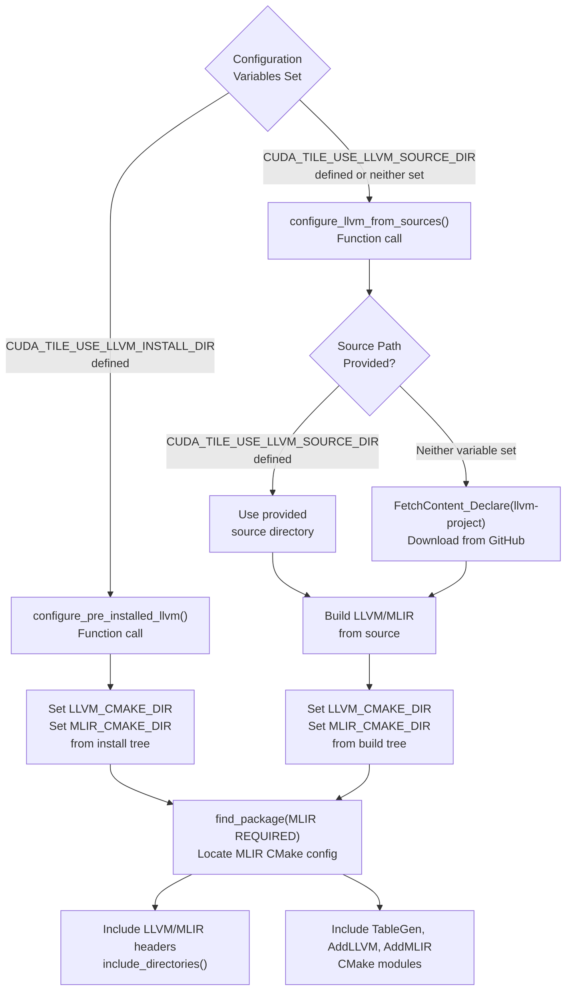
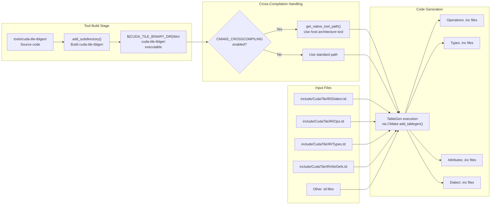
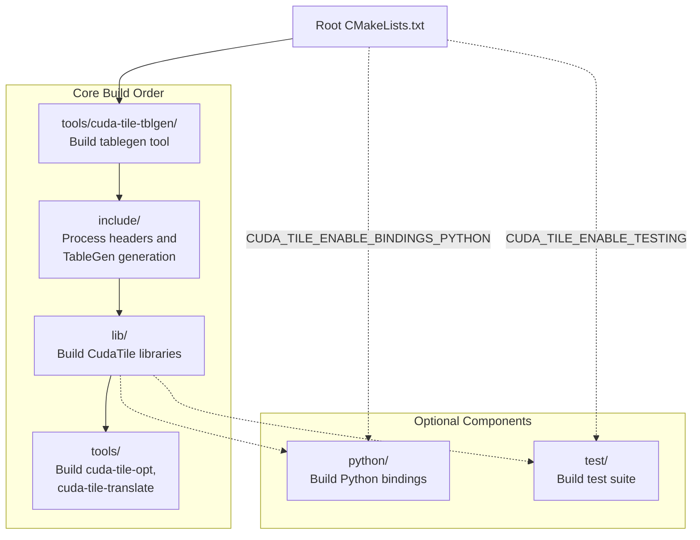
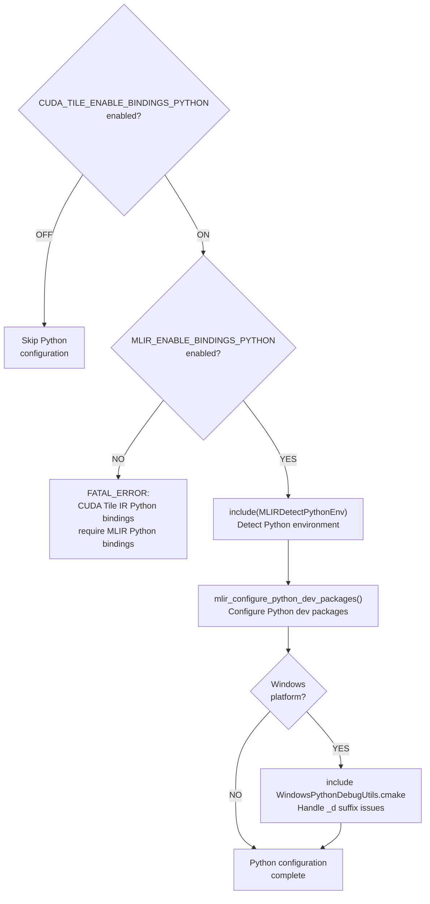
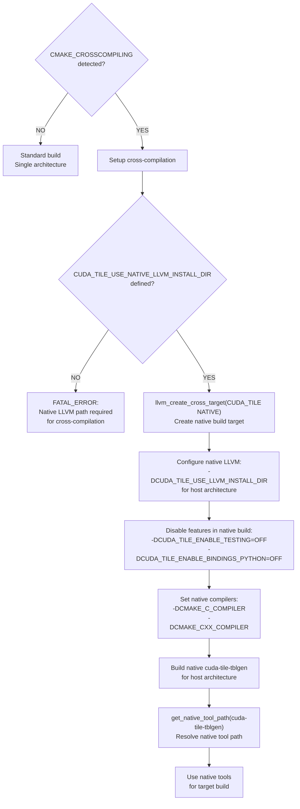
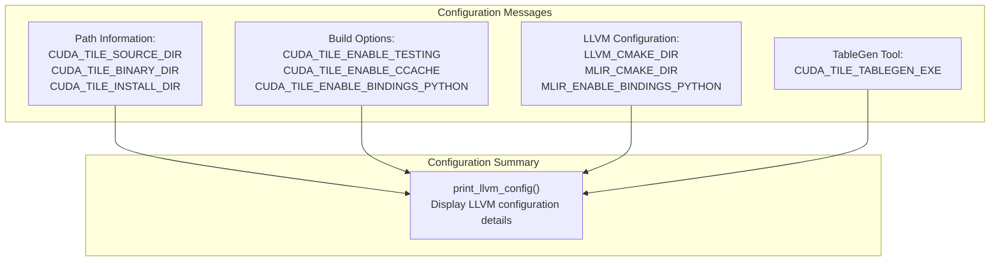

<!-- source: DeepWiki mcp.deepwiki.com · repo NVIDIA/cuda-tile · page 6 Build System Architecture · fetched 2026-10-26 -->

# Build System Architecture

<details>
<summary>Relevant source files</summary>

The following files were used as context for generating this wiki page:

- [cmake/IncludeLLVM.cmake](cmake/IncludeLLVM.cmake)

</details>


## Purpose and Scope

This document describes the CMake-based build system for the CUDA Tile IR project, explaining how the build configuration orchestrates LLVM/MLIR integration, code generation, compilation, and artifact production. It covers the build system's structure, key CMake files, configuration options, and the relationship between build components.

For step-by-step build instructions, see [Building from Source](#2.1). For detailed documentation of CMake configuration variables, see [CMake Configuration](#6.1). For LLVM/MLIR integration strategies, see [LLVM/MLIR Integration](#6.2). For compiler requirements and validation, see [Compiler Requirements](#6.3). For TableGen code generation, see [TableGen Code Generation](#6.4). For directory organization, see [Directory Structure](#6.5).

## Build System Overview

The CUDA Tile IR build system is a multi-stage CMake configuration that integrates with LLVM/MLIR, validates compiler toolchains, generates code via TableGen, and produces libraries, tools, and optional Python bindings. The build system is designed to support three LLVM integration methods and handles cross-compilation scenarios.



**Diagram: Build System Configuration Flow**

Sources: [CMakeLists.txt:1-197]()

## Configuration Entry Point

The root [CMakeLists.txt:1-197]() serves as the build system's entry point. It establishes the project configuration, includes utility modules, configures LLVM/MLIR integration, and orchestrates subdirectory builds.

### Project Setup

[CMakeLists.txt:4-9]() defines the project and C++ standard requirements:

```cmake
cmake_minimum_required(VERSION 3.20.0)
project(CUDA_TILE)
set(CMAKE_CXX_STANDARD 17)
set(CMAKE_CXX_STANDARD_REQUIRED True)
```

### Core Configuration Includes

[CMakeLists.txt:11-14]() includes essential utility modules:

| Include File | Purpose |
|-------------|---------|
| `cmake/IncludeCompilerChecks.cmake` | Validates compiler version requirements (GCC 7.4+, Clang 5.0+, MSVC 19.29+) |
| `cmake/IncludeCudaTileUtils.cmake` | Provides build type utilities via `set_cuda_tile_build_type()` |

### Directory Variables

[CMakeLists.txt:16-21]() establishes path variables used throughout the build:

| Variable | Purpose |
|----------|---------|
| `CUDA_TILE_SOURCE_DIR` | Path to source directory (CMAKE_CURRENT_SOURCE_DIR) |
| `CUDA_TILE_BINARY_DIR` | Path to build directory (CMAKE_CURRENT_BINARY_DIR) |
| `CUDA_TILE_INSTALL_DIR` | Path to installation prefix (CMAKE_INSTALL_PREFIX) |

### Build Options

[CMakeLists.txt:22-41]() defines user-configurable options:

| Option | Default | Description |
|--------|---------|-------------|
| `CUDA_TILE_ENABLE_TESTING` | OFF | Enables conformance test suite |
| `CUDA_TILE_ENABLE_CCACHE` | OFF | Enables ccache for faster rebuilds |
| `CUDA_TILE_ENABLE_BINDINGS_PYTHON` | OFF | Builds Python bindings |
| `CUDA_TILE_USE_LLVM_INSTALL_DIR` | unset | Path to pre-built LLVM installation |
| `CUDA_TILE_USE_LLVM_SOURCE_DIR` | unset | Path to LLVM source tree |

Sources: [CMakeLists.txt:1-41]()

## LLVM/MLIR Integration Strategy

The build system supports three LLVM integration methods, configured via [cmake/IncludeLLVM.cmake](). The integration strategy is selected by [CMakeLists.txt:56-70]():



**Diagram: LLVM/MLIR Integration Decision Flow**

The mutual exclusion check at [CMakeLists.txt:58-62]() prevents conflicting configurations:

```cmake
if (DEFINED CUDA_TILE_USE_LLVM_INSTALL_DIR AND
    DEFINED CUDA_TILE_USE_LLVM_SOURCE_DIR)
  message(FATAL_ERROR "Either CUDA_TILE_USE_LLVM_INSTALL_DIR or "
          "CUDA_TILE_USE_LLVM_SOURCE_DIR may be set, but not both")
endif()
```

After LLVM integration, [CMakeLists.txt:73-77]() locates the MLIR package and adds its CMake modules to the module search path.

Sources: [CMakeLists.txt:54-101]()

## TableGen Code Generation Pipeline

TableGen code generation is a critical build stage that transforms `.td` definition files into C++ implementations. The pipeline involves building the `cuda-tile-tblgen` tool and using it to process dialect definitions.



**Diagram: TableGen Code Generation Pipeline**

### Tool Build Priority

[CMakeLists.txt:150-152]() ensures `cuda-tile-tblgen` is built first:

```cmake
# 'cuda-tile-tblgen' is part of the build process and must be built before
# anything else.
add_subdirectory(tools/cuda-tile-tblgen)
```

### Executable Path Configuration

[CMakeLists.txt:154-164]() configures the TableGen executable path, handling cross-compilation:

```cmake
if(CMAKE_CROSSCOMPILING)
  get_native_tool_path(cuda-tile-tblgen CUDA_TILE_TABLEGEN_EXE)
  set(MLIR_TABLEGEN_EXE "${CUDA_TILE_USE_NATIVE_LLVM_INSTALL_DIR}/bin/${MLIR_TABLEGEN_EXE}")
else()
  set(CUDA_TILE_TABLEGEN_EXE ${CUDA_TILE_BINARY_DIR}/bin/cuda-tile-tblgen)
endif()
```

The `CUDA_TILE_TABLEGEN_EXE` variable is used throughout the build to invoke TableGen for code generation.

### Test Flag Propagation

[CMakeLists.txt:166-170]() conditionally includes test operations during code generation:

```cmake
if (CUDA_TILE_ENABLE_TESTING)
  list(APPEND LLVM_TABLEGEN_FLAGS -DTILE_IR_INCLUDE_TESTS)
  add_compile_definitions(TILE_IR_INCLUDE_TESTS=1)
endif()
```

This allows test-only operations to be conditionally compiled.

Sources: [CMakeLists.txt:150-170]()

## Build Subdirectories

The build system processes subdirectories in a specific order to satisfy dependencies:



**Diagram: Build Subdirectory Processing Order**

The subdirectory processing at [CMakeLists.txt:172-181]() follows dependency order:

```cmake
add_subdirectory(include)
add_subdirectory(lib)
add_subdirectory(tools)
if (CUDA_TILE_ENABLE_BINDINGS_PYTHON)
  add_subdirectory(python)
endif()

if(CUDA_TILE_ENABLE_TESTING)
  add_subdirectory(test)
endif()
```

Sources: [CMakeLists.txt:150-181]()

## Python Bindings Configuration

Python bindings require special configuration to ensure compatibility with MLIR's Python bindings. The configuration at [CMakeLists.txt:79-95]() validates prerequisites:



**Diagram: Python Bindings Configuration Flow**

The validation ensures MLIR Python bindings are enabled before proceeding:

```cmake
if(NOT MLIR_ENABLE_BINDINGS_PYTHON)
  message(FATAL_ERROR "CUDA Tile IR Python bindings require MLIR Python bindings enabled")
endif()
```

Sources: [CMakeLists.txt:79-95]()

## Cross-Compilation Support

The build system supports cross-compilation scenarios where the host architecture differs from the target architecture. This is critical for TableGen tools, which must run on the host system during the build.



**Diagram: Cross-Compilation Configuration Flow**

The cross-compilation setup at [CMakeLists.txt:109-125]() creates a separate native build:

```cmake
if(CMAKE_CROSSCOMPILING)
  include(CrossCompile)
  set(LLVM_USE_HOST_TOOLS ON)

  if (NOT DEFINED CUDA_TILE_USE_NATIVE_LLVM_INSTALL_DIR)
    message(FATAL_ERROR "CUDA_TILE_USE_NATIVE_LLVM_INSTALL_DIR is not defined")
  endif()

  llvm_create_cross_target(CUDA_TILE NATIVE "" Release
    -DCUDA_TILE_USE_LLVM_INSTALL_DIR=${CUDA_TILE_USE_NATIVE_LLVM_INSTALL_DIR}
    -DCUDA_TILE_ENABLE_TESTING=OFF
    -DCUDA_TILE_ENABLE_BINDINGS_PYTHON=OFF
    -DCMAKE_C_COMPILER=${NATIVE_C_COMPILER}
    -DCMAKE_CXX_COMPILER=${NATIVE_CXX_COMPILER}
    -DPython3_EXECUTABLE=${Python3_EXECUTABLE}
  )
endif()
```

This creates a native build of `cuda-tile-tblgen` that can execute on the host system while building for the target architecture.

Sources: [CMakeLists.txt:109-125](), [CMakeLists.txt:157-159]()

## Build Artifacts and Installation

The build system produces several categories of artifacts:

### Output Directory Configuration

[CMakeLists.txt:139-144]() configures output directories:

| Variable | Value | Purpose |
|----------|-------|---------|
| `LLVM_RUNTIME_OUTPUT_INTDIR` | `${CUDA_TILE_BINARY_DIR}/bin` | Executables location |
| `LLVM_LIBRARY_OUTPUT_INTDIR` | `${CUDA_TILE_BINARY_DIR}/lib` | Libraries location |
| `CUDA_TILE_TOOL_DIR` | `${LLVM_RUNTIME_OUTPUT_INTDIR}` | Tool path for lit tests |
| `CUDA_TILE_LIBRARY_DIR` | `${LLVM_LIBRARY_OUTPUT_INTDIR}` | Library path for lit tests |

### Installation Configuration

[CMakeLists.txt:189-196]() installs headers:

```cmake
install(DIRECTORY ${CUDA_TILE_SOURCE_DIR}/include
        DESTINATION ${CUDA_TILE_INSTALL_DIR}/include
        FILES_MATCHING
          PATTERN "*.def"
          PATTERN "*.h"
          PATTERN "*.inc"
          PATTERN "*.td")
```

This installs all header types including TableGen definition files (`.td`) and generated includes (`.inc`).

Sources: [CMakeLists.txt:139-196]()

## Build Flags and Definitions

### Position Independent Code

[CMakeLists.txt:44]() enables position-independent code globally:

```cmake
set(CMAKE_POSITION_INDEPENDENT_CODE ON)
```

This is required for shared library builds.

### Compatibility Definitions

[CMakeLists.txt:49]() adds a temporary compatibility flag:

```cmake
add_definitions(-DUSE_12_9_COMPATIBLE_LLVM=0)
```

This flag controls LLVM version compatibility behavior in the codebase.

Sources: [CMakeLists.txt:43-49]()

## Configuration Summary and Diagnostics

The build system emits diagnostic messages to aid debugging:



**Diagram: Configuration Diagnostic Messages**

The `print_llvm_config()` function at [CMakeLists.txt:127]() provides a comprehensive summary of the LLVM configuration used for the build.

Sources: [CMakeLists.txt:25-29](), [CMakeLists.txt:73-74](), [CMakeLists.txt:82-84](), [CMakeLists.txt:127](), [CMakeLists.txt:164]()

## Build Artifacts Ignored by Version Control

The [.gitignore:1-11]() file documents build artifacts excluded from version control:

| Pattern | Description |
|---------|-------------|
| `build*/` | All build directories (any name starting with "build") |
| `.cache` | CMake cache files |
| `.clangd` | clangd language server configuration |
| `compile_commands.json` | Compilation database |
| `doxygen` | Generated documentation |
| `.vscode` | IDE configuration |
| `.venv` | Python virtual environments |

This ensures build artifacts and IDE-specific files don't pollute the source tree.

Sources: [.gitignore:1-11]()

---

