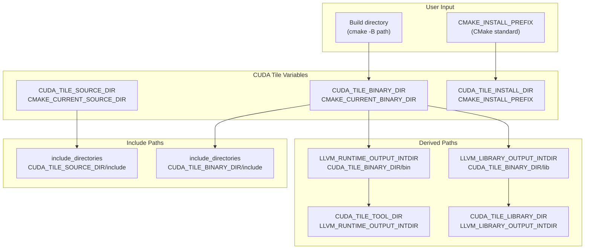
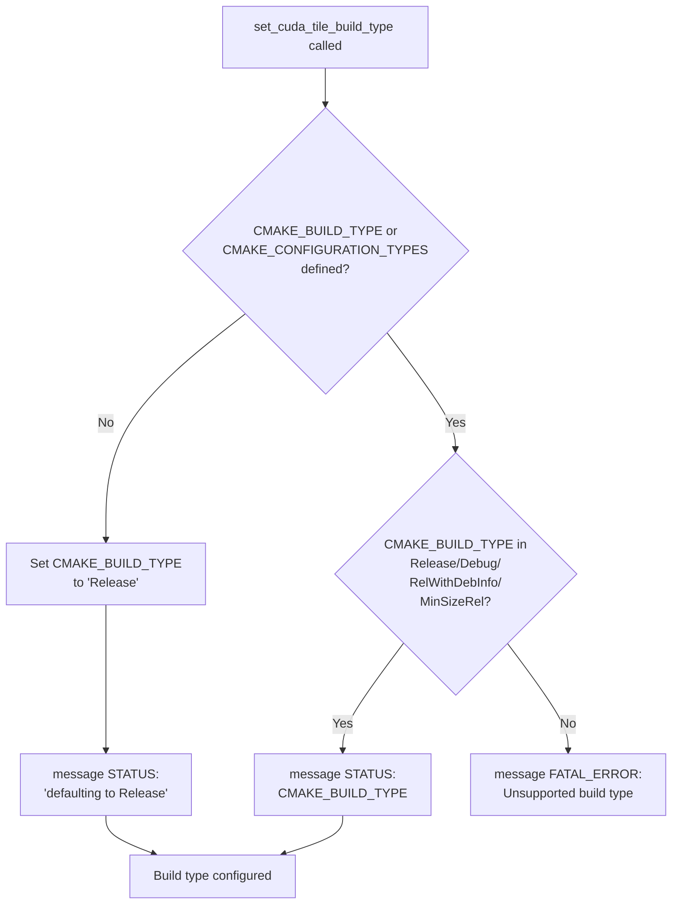
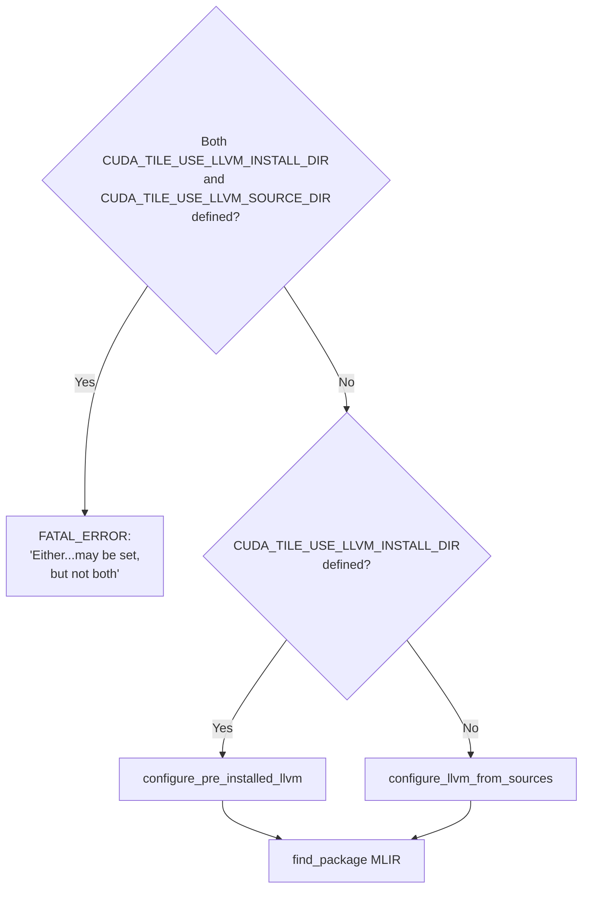
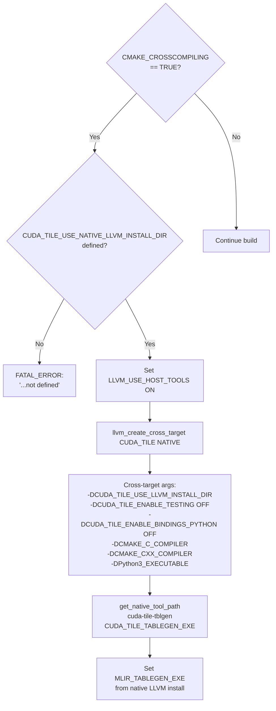

<!-- source: DeepWiki mcp.deepwiki.com · repo NVIDIA/cuda-tile · page 6.1 CMake Configuration Overview · fetched 2026-10-26 -->

# CMake Configuration

<details>
<summary>Relevant source files</summary>

The following files were used as context for generating this wiki page:

- [cmake/IncludeLLVM.cmake](cmake/IncludeLLVM.cmake)
- [python/CMakeLists.txt](python/CMakeLists.txt)

</details>


This page documents the CMake configuration system for CUDA Tile IR, including all CMake variables, build options, and configuration procedures. For information about LLVM/MLIR integration strategies, see [LLVM/MLIR Integration](#6.2). For compiler version requirements and validation, see [Compiler Requirements](#6.3).

## Overview

The CUDA Tile IR build system uses CMake 3.20.0 or later and follows standard CMake conventions. The root configuration file [CMakeLists.txt:1-197]() establishes project-level settings, integrates LLVM/MLIR, configures optional features, and orchestrates subdirectory builds. The build system supports multiple configurations including standalone builds, cross-compilation, and integration with existing LLVM installations.

Sources: [CMakeLists.txt:1-10]()

## CMake Requirements

The project requires CMake 3.20.0 minimum and enforces C++17 standard:

```cmake
cmake_minimum_required(VERSION 3.20.0)
project(CUDA_TILE)
set(CMAKE_CXX_STANDARD 17)
set(CMAKE_CXX_STANDARD_REQUIRED True)
```

Position-independent code is enabled globally via `CMAKE_POSITION_INDEPENDENT_CODE ON` [CMakeLists.txt:44]().

Sources: [CMakeLists.txt:4-9](), [CMakeLists.txt:44]()

## Core Configuration Variables

### Directory Path Variables

Three primary cache variables define the project's directory structure:

| Variable | Default | Purpose |
|----------|---------|---------|
| `CUDA_TILE_SOURCE_DIR` | `${CMAKE_CURRENT_SOURCE_DIR}` | Root source directory path |
| `CUDA_TILE_BINARY_DIR` | `${CMAKE_CURRENT_BINARY_DIR}` | Build output directory path |
| `CUDA_TILE_INSTALL_DIR` | `${CMAKE_INSTALL_PREFIX}` | Installation target directory path |

These variables are set as cache paths [CMakeLists.txt:16-21]() and reported during configuration [CMakeLists.txt:25-27](). The binary directory contains subdirectories `bin/` for executables and `lib/` for libraries [CMakeLists.txt:139-144]().

**Configuration Flow Diagram**



Sources: [CMakeLists.txt:16-27](), [CMakeLists.txt:134-144]()

### Output Directory Configuration

Generated executables and libraries are placed in consolidated output directories rather than subdirectories per tool:

- `LLVM_RUNTIME_OUTPUT_INTDIR` → `${CUDA_TILE_BINARY_DIR}/bin` [CMakeLists.txt:139]()
- `LLVM_LIBRARY_OUTPUT_INTDIR` → `${CUDA_TILE_BINARY_DIR}/lib` [CMakeLists.txt:140]()

These paths are also exposed as `CUDA_TILE_TOOL_DIR` and `CUDA_TILE_LIBRARY_DIR` for use by the lit test configuration [CMakeLists.txt:143-144]().

Sources: [CMakeLists.txt:139-144]()

## Build Type Configuration

The `set_cuda_tile_build_type()` macro [cmake/IncludeCudaTileUtils.cmake:7-28]() manages build type selection with automatic defaults:

**Supported Build Types**

| Build Type | Optimization | Debug Info | Assertions | Use Case |
|------------|--------------|------------|------------|----------|
| `Release` | Yes | No | No | Production builds |
| `Debug` | No | Yes | Yes | Development and debugging |
| `RelWithDebInfo` | Yes | Yes | No | Performance profiling |
| `MinSizeRel` | Size-optimized | No | No | Size-constrained deployments |

**Default Behavior**: If `CMAKE_BUILD_TYPE` is unspecified, the system defaults to `Release` [cmake/IncludeCudaTileUtils.cmake:9-13](). Invalid build types trigger a fatal error with usage instructions [cmake/IncludeCudaTileUtils.cmake:18-26]().

**Build Type Decision Flow**



Sources: [cmake/IncludeCudaTileUtils.cmake:7-28]()

**Usage Example**:
```bash
# Default Release build
cmake -B build

# Debug build with assertions
cmake -B build -DCMAKE_BUILD_TYPE=Debug

# Optimized build with debug symbols
cmake -B build -DCMAKE_BUILD_TYPE=RelWithDebInfo
```

Sources: [CMakeLists.txt:14](), [cmake/IncludeCudaTileUtils.cmake:1-28]()

## Optional Feature Configuration

### Testing Support

The `CUDA_TILE_ENABLE_TESTING` option controls test suite inclusion:

```cmake
option(CUDA_TILE_ENABLE_TESTING "Enable CUDA Tile testing" OFF)
```

When enabled [CMakeLists.txt:22]():
1. The `test/` subdirectory is added [CMakeLists.txt:179-181]()
2. TableGen receives `-DTILE_IR_INCLUDE_TESTS` flag [CMakeLists.txt:168]()
3. C++ compilation defines `TILE_IR_INCLUDE_TESTS=1` [CMakeLists.txt:169]()

This conditional compilation allows test-only operations to be excluded from production builds.

Sources: [CMakeLists.txt:22](), [CMakeLists.txt:167-170](), [CMakeLists.txt:179-181]()

### Python Bindings

The `CUDA_TILE_ENABLE_BINDINGS_PYTHON` option controls Python API generation:

```cmake
option(CUDA_TILE_ENABLE_BINDINGS_PYTHON "Enable CUDA Tile Python bindings" OFF)
```

Requirements:
- MLIR must be built with `MLIR_ENABLE_BINDINGS_PYTHON=ON` [CMakeLists.txt:88-90]()
- Python development packages are configured via `mlir_configure_python_dev_packages()` [CMakeLists.txt:94]()
- The `python/` subdirectory is added when enabled [CMakeLists.txt:175-177]()

The configuration validates MLIR Python binding availability before proceeding [CMakeLists.txt:84-90]().

Sources: [CMakeLists.txt:81-95](), [CMakeLists.txt:175-177]()

### Build Acceleration with ccache

The `CUDA_TILE_ENABLE_CCACHE` option enables ccache for faster incremental rebuilds:

```cmake
option(CUDA_TILE_ENABLE_CCACHE "Enable ccache for faster rebuilds" OFF)
```

When enabled, the system:
1. Searches for `ccache` in PATH [CMakeLists.txt:33]()
2. Sets `CMAKE_C_COMPILER_LAUNCHER` and `CMAKE_CXX_COMPILER_LAUNCHER` [CMakeLists.txt:36-37]()
3. Logs a warning if ccache is not found [CMakeLists.txt:39]()

Sources: [CMakeLists.txt:23](), [CMakeLists.txt:31-41]()

## LLVM Integration Configuration

The build system supports three LLVM integration methods controlled by variables documented in [LLVM/MLIR Integration](#6.2):

**Variable Conflict Check**



Sources: [CMakeLists.txt:54-77]()

The system enforces mutual exclusivity between `CUDA_TILE_USE_LLVM_INSTALL_DIR` and `CUDA_TILE_USE_LLVM_SOURCE_DIR` [CMakeLists.txt:58-62](). Configuration details are covered in [LLVM/MLIR Integration](#6.2).

Sources: [CMakeLists.txt:54-77]()

## Cross-Compilation Support

Cross-compilation requires native toolchain configuration for TableGen execution:

| Variable | Purpose |
|----------|---------|
| `CMAKE_CROSSCOMPILING` | Detected automatically by CMake |
| `CUDA_TILE_USE_NATIVE_LLVM_INSTALL_DIR` | Path to native LLVM installation for host tools |
| `NATIVE_C_COMPILER` | Host C compiler |
| `NATIVE_CXX_COMPILER` | Host C++ compiler |

**Cross-Compilation Configuration Flow**



Sources: [CMakeLists.txt:109-125](), [CMakeLists.txt:157-159]()

The system creates a cross-compilation target named `CUDA_TILE` with `NATIVE` configuration [CMakeLists.txt:117](), disabling testing and Python bindings for the host build [CMakeLists.txt:119-120](). Native tool paths are resolved via `get_native_tool_path()` [CMakeLists.txt:158]().

Sources: [CMakeLists.txt:109-125](), [CMakeLists.txt:157-159]()

## TableGen Executable Configuration

The `CUDA_TILE_TABLEGEN_EXE` variable locates the `cuda-tile-tblgen` executable:

**Native Build**: `${CUDA_TILE_BINARY_DIR}/bin/cuda-tile-tblgen` [CMakeLists.txt:161]()

**Cross-Compilation**: Path resolved from native cross-target [CMakeLists.txt:158]()

The executable must be built before any TableGen-dependent targets [CMakeLists.txt:150-152](). Details on TableGen code generation are in [TableGen Code Generation](#6.4).

Sources: [CMakeLists.txt:150-164]()

## Complete Configuration Example

**Minimal Configuration**:
```bash
cmake -B build -DCUDA_TILE_USE_LLVM_INSTALL_DIR=/path/to/llvm/install
cmake --build build
```

**Full-Featured Configuration**:
```bash
cmake -B build \
  -DCMAKE_BUILD_TYPE=RelWithDebInfo \
  -DCMAKE_INSTALL_PREFIX=/opt/cuda-tile \
  -DCUDA_TILE_USE_LLVM_INSTALL_DIR=/usr/local/llvm \
  -DCUDA_TILE_ENABLE_TESTING=ON \
  -DCUDA_TILE_ENABLE_BINDINGS_PYTHON=ON \
  -DCUDA_TILE_ENABLE_CCACHE=ON

cmake --build build --target all
cmake --build build --target check-cuda-tile  # Run tests
cmake --install build
```

**Cross-Compilation Configuration**:
```bash
cmake -B build-arm64 \
  -DCMAKE_TOOLCHAIN_FILE=toolchain-arm64.cmake \
  -DCUDA_TILE_USE_LLVM_INSTALL_DIR=/path/to/arm64-llvm \
  -DCUDA_TILE_USE_NATIVE_LLVM_INSTALL_DIR=/path/to/native-llvm \
  -DNATIVE_C_COMPILER=/usr/bin/gcc \
  -DNATIVE_CXX_COMPILER=/usr/bin/g++ \
  -DPython3_EXECUTABLE=/usr/bin/python3

cmake --build build-arm64
```

Sources: [CMakeLists.txt:1-197]()

## Configuration Variables Reference

**Core Configuration Variables**

| Variable | Type | Default | Description |
|----------|------|---------|-------------|
| `CUDA_TILE_SOURCE_DIR` | CACHE PATH | `CMAKE_CURRENT_SOURCE_DIR` | Source directory path |
| `CUDA_TILE_BINARY_DIR` | CACHE PATH | `CMAKE_CURRENT_BINARY_DIR` | Binary directory path |
| `CUDA_TILE_INSTALL_DIR` | CACHE PATH | `CMAKE_INSTALL_PREFIX` | Installation directory |
| `CUDA_TILE_ENABLE_TESTING` | OPTION | OFF | Enable test suite |
| `CUDA_TILE_ENABLE_BINDINGS_PYTHON` | OPTION | OFF | Enable Python bindings |
| `CUDA_TILE_ENABLE_CCACHE` | OPTION | OFF | Use ccache for compilation |

**LLVM Integration Variables** (see [LLVM/MLIR Integration](#6.2))

| Variable | Type | Description |
|----------|------|-------------|
| `CUDA_TILE_USE_LLVM_INSTALL_DIR` | PATH | Pre-installed LLVM location |
| `CUDA_TILE_USE_LLVM_SOURCE_DIR` | PATH | LLVM source directory |

**Cross-Compilation Variables**

| Variable | Type | Description |
|----------|------|-------------|
| `CUDA_TILE_USE_NATIVE_LLVM_INSTALL_DIR` | PATH | Native LLVM for host tools |
| `NATIVE_C_COMPILER` | FILEPATH | Host C compiler |
| `NATIVE_CXX_COMPILER` | FILEPATH | Host C++ compiler |

**Internal Variables** (set automatically)

| Variable | Value | Description |
|----------|-------|-------------|
| `CUDA_TILE_TABLEGEN_EXE` | `${CUDA_TILE_BINARY_DIR}/bin/cuda-tile-tblgen` | TableGen executable path |
| `CUDA_TILE_TOOL_DIR` | `${LLVM_RUNTIME_OUTPUT_INTDIR}` | Tool output directory |
| `CUDA_TILE_LIBRARY_DIR` | `${LLVM_LIBRARY_OUTPUT_INTDIR}` | Library output directory |

Sources: [CMakeLists.txt:16-164]()

---

