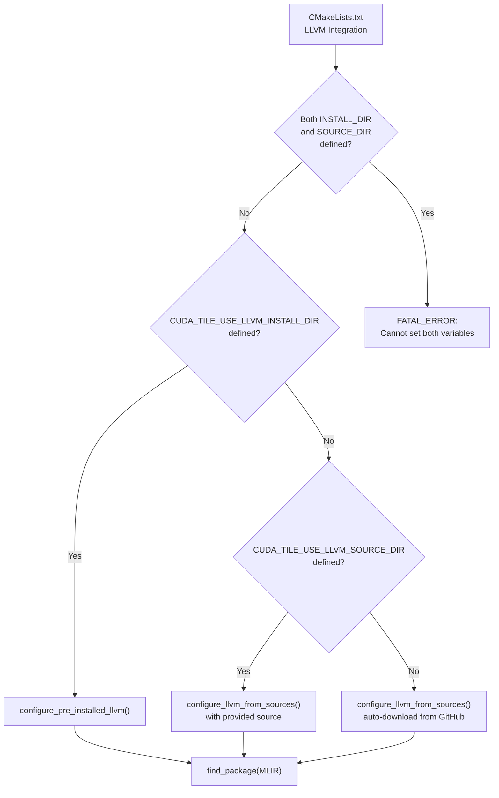
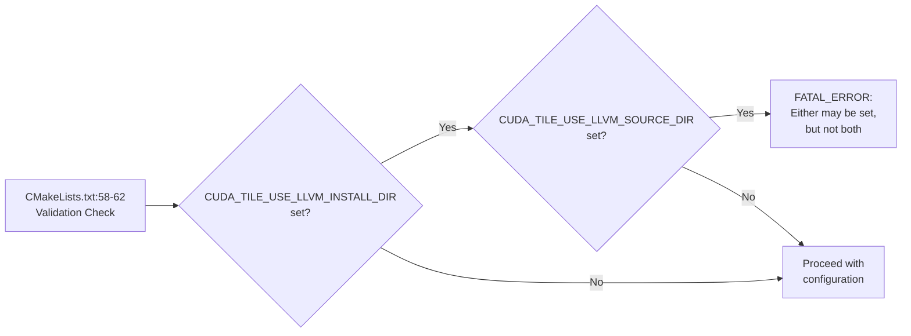
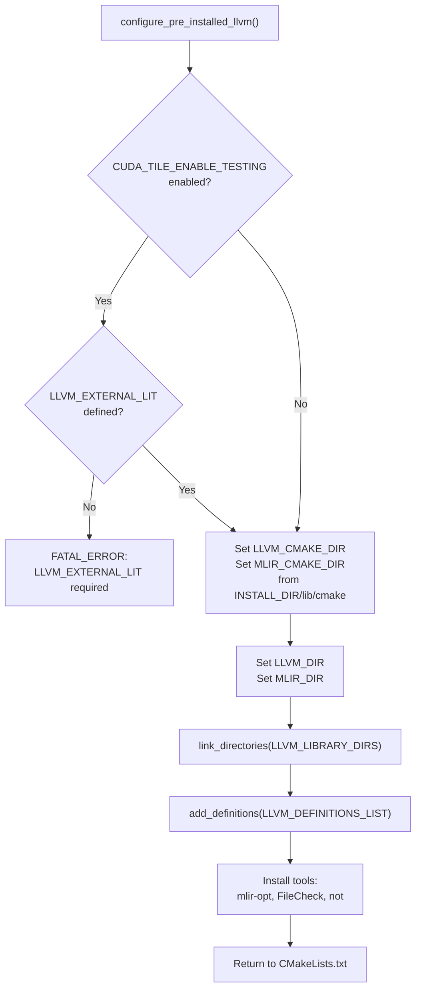
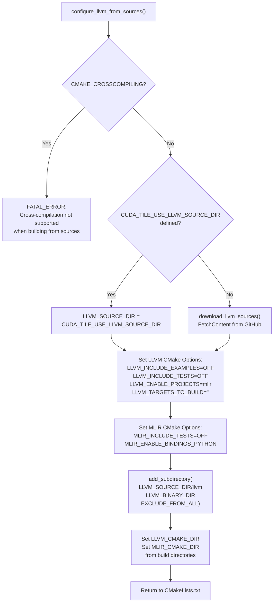
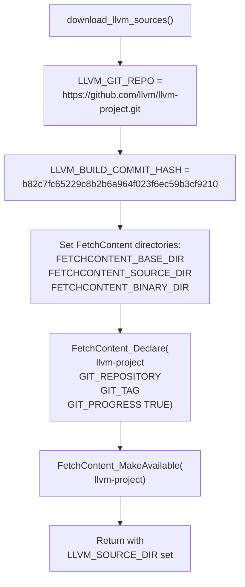
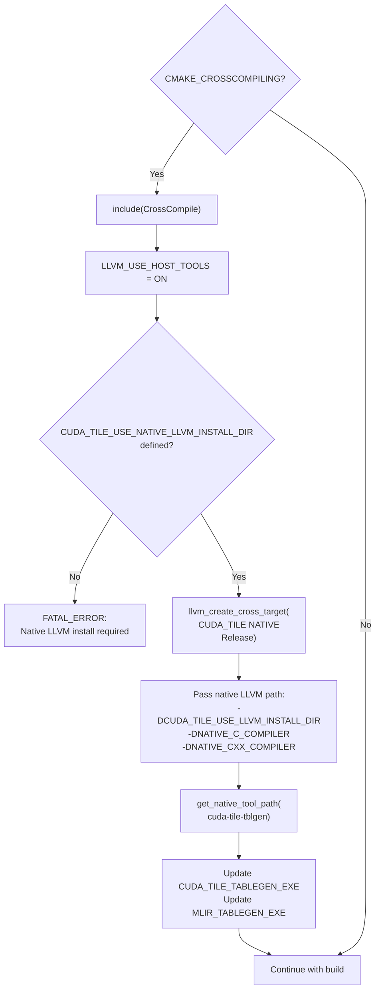
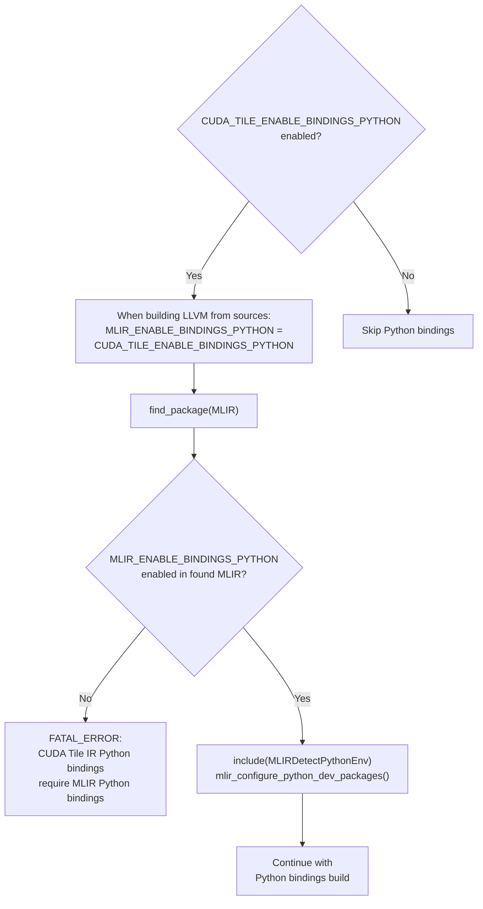
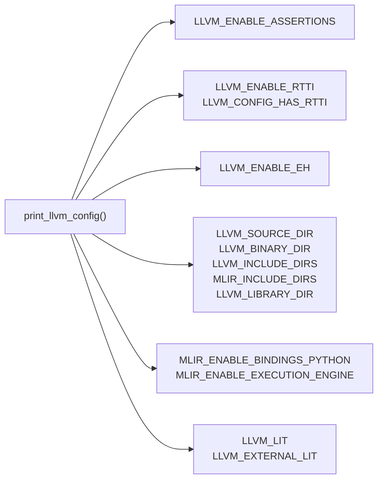

<!-- source: DeepWiki mcp.deepwiki.com · repo NVIDIA/cuda-tile · page 6.2 LLVM/MLIR Integration · fetched 2026-10-26 -->

# LLVM/MLIR Integration

<details>
<summary>Relevant source files</summary>

The following files were used as context for generating this wiki page:

- [cmake/IncludeLLVM.cmake](cmake/IncludeLLVM.cmake)

</details>


This document explains how CUDA Tile IR integrates with the LLVM/MLIR compiler infrastructure. It covers the three available integration methods (pre-built installation, source directory, auto-download), the CMake configuration macros that control the integration, and the build system's handling of LLVM dependencies.

For information about the broader build system structure, see [CMake Configuration](#6.1). For details on the TableGen code generation that depends on LLVM infrastructure, see [TableGen Code Generation](#6.4).

## Overview

The CUDA Tile IR project requires LLVM and MLIR to function, as the dialect is built on top of the MLIR framework. The build system provides three mutually exclusive methods for obtaining and configuring LLVM/MLIR dependencies, controlled by CMake variables and implemented in the `IncludeLLVM.cmake` module.

**Integration Methods Decision Flow**



Sources: [CMakeLists.txt:56-77](), [cmake/IncludeLLVM.cmake:55-138]()

## Configuration Variables

The integration method is selected through CMake variables that users can set when configuring the build. The build system validates these variables to prevent conflicting configurations.

| Variable | Type | Purpose | Notes |
|----------|------|---------|-------|
| `CUDA_TILE_USE_LLVM_INSTALL_DIR` | Path | Points to pre-built LLVM installation | Mutually exclusive with `SOURCE_DIR` |
| `CUDA_TILE_USE_LLVM_SOURCE_DIR` | Path | Points to LLVM source directory | User-provided sources |
| `CUDA_TILE_USE_NATIVE_LLVM_INSTALL_DIR` | Path | Points to native LLVM for cross-compilation | Required when `CMAKE_CROSSCOMPILING=ON` |
| `LLVM_EXTERNAL_LIT` | Path | Path to external `lit` test tool | Required when using pre-built LLVM with testing enabled |
| `CUDA_TILE_ENABLE_BINDINGS_PYTHON` | Boolean | Enable Python bindings | Propagates to `MLIR_ENABLE_BINDINGS_PYTHON` |

**Variable Validation**



Sources: [CMakeLists.txt:56-62]()

## Integration Method 1: Pre-built LLVM Installation

The `configure_pre_installed_llvm()` macro configures the build to use an existing LLVM/MLIR installation. This is the fastest build option as LLVM is not compiled.

**Configuration Steps**



**Implementation Details**

The macro performs the following operations:

1. **Validation**: If testing is enabled, verifies that `LLVM_EXTERNAL_LIT` is defined [cmake/IncludeLLVM.cmake:136-142]()
2. **Tool Installation**: Installs required LLVM tools (`FileCheck`, `not`) to the CUDA Tile install directory [cmake/IncludeLLVM.cmake:146-153]()
3. **CMake Paths**: Sets `LLVM_CMAKE_DIR` and `MLIR_CMAKE_DIR` to point to the installation's CMake configuration files [cmake/IncludeLLVM.cmake:155-158]()
4. **Library Linking**: Adds LLVM library directories to the linker search path [cmake/IncludeLLVM.cmake:160]()
5. **Definitions**: Applies LLVM compilation definitions [cmake/IncludeLLVM.cmake:161-162]()

**Usage Example**

```bash
cmake -DCUDA_TILE_USE_LLVM_INSTALL_DIR=/path/to/llvm/install \
      -DLLVM_EXTERNAL_LIT=/path/to/llvm-lit \
      -DCUDA_TILE_ENABLE_TESTING=ON \
      ..
```

Sources: [cmake/IncludeLLVM.cmake:133-163]()

## Integration Method 2: Source Directory

The `configure_llvm_from_sources()` macro with `CUDA_TILE_USE_LLVM_SOURCE_DIR` builds LLVM/MLIR from user-provided source code. This is useful for development with custom LLVM modifications.

**Configuration Flow**



**LLVM Build Configuration**

The macro applies the following LLVM/MLIR configuration options to minimize build time:

| Option | Value | Purpose |
|--------|-------|---------|
| `LLVM_INCLUDE_EXAMPLES` | `OFF` | Skip building examples |
| `LLVM_INCLUDE_TESTS` | `OFF` | Skip building LLVM tests |
| `LLVM_INCLUDE_BENCHMARKS` | `OFF` | Skip building benchmarks |
| `LLVM_BUILD_EXAMPLES` | `OFF` | Skip building examples |
| `LLVM_ENABLE_ASSERTIONS` | `OFF` | Disable assertions for performance |
| `LLVM_ENABLE_PROJECTS` | `"mlir"` | Only build MLIR project |
| `LLVM_TARGETS_TO_BUILD` | `""` | Build no LLVM backend targets |
| `CMAKE_DISABLE_PRECOMPILE_HEADERS` | `ON` | Avoid flag mismatches (e.g., NDEBUG) |
| `LLVM_BUILD_UTILS` | `ON` | Build LLVM utilities |
| `LLVM_INSTALL_UTILS` | `ON` | Install LLVM utilities |
| `LLVM_CCACHE_BUILD` | `ON` (conditional) | Use ccache if `CUDA_TILE_ENABLE_CCACHE` is set |
| `MLIR_INCLUDE_TESTS` | `OFF` | Skip building MLIR tests |
| `MLIR_ENABLE_BINDINGS_PYTHON` | `${CUDA_TILE_ENABLE_BINDINGS_PYTHON}` | Enable Python bindings if requested |

Sources: [cmake/IncludeLLVM.cmake:77-97]()

**Usage Example**

```bash
cmake -DCUDA_TILE_USE_LLVM_SOURCE_DIR=/path/to/llvm-project ..
```

Sources: [cmake/IncludeLLVM.cmake:57-127]()

## Integration Method 3: Auto-download

When neither `CUDA_TILE_USE_LLVM_INSTALL_DIR` nor `CUDA_TILE_USE_LLVM_SOURCE_DIR` is specified, the build system automatically downloads LLVM/MLIR sources from GitHub using CMake's `FetchContent` module.

**Download and Build Flow**



**FetchContent Configuration**

The download is configured with specific directory locations relative to the CUDA Tile build directory:

- **Base Directory**: `${CUDA_TILE_BINARY_DIR}` [cmake/IncludeLLVM.cmake:35]()
- **Source Directory**: `llvm-project` [cmake/IncludeLLVM.cmake:36]()
- **Binary Directory**: `llvm-project-build` [cmake/IncludeLLVM.cmake:37]()
- **Subbuild Directory**: `llvm-project-subbuild` [cmake/IncludeLLVM.cmake:38]()

**Pinned LLVM Version**

The build is pinned to a specific LLVM commit hash to ensure compatibility:

```
LLVM_BUILD_COMMIT_HASH: b82c7fc65229c8b2b6a964f023f6ec59b3cf9210
Repository: https://github.com/llvm/llvm-project.git
```

Sources: [cmake/IncludeLLVM.cmake:25-52]()

**Usage Example**

```bash
# No LLVM-related variables needed
cmake ..
```

Sources: [cmake/IncludeLLVM.cmake:23-50]()

## Cross-compilation Support

When cross-compiling CUDA Tile IR, the build system requires a native LLVM installation to run host-side tools like `cuda-tile-tblgen` and `mlir-tblgen`.

**Cross-compilation Configuration**



**Cross-compilation Requirements**

1. **Native LLVM Installation**: `CUDA_TILE_USE_NATIVE_LLVM_INSTALL_DIR` must point to an LLVM installation built for the host platform [CMakeLists.txt:113-114]()
2. **Restrictions**: Cannot build LLVM from sources when cross-compiling [cmake/IncludeLLVM.cmake:56-58]()
3. **TableGen Executables**: Uses native versions of `cuda-tile-tblgen` and `mlir-tblgen` [CMakeLists.txt:157-160]()
4. **Build Configuration**: The cross-compilation target is configured with testing and Python bindings disabled [CMakeLists.txt:119-120]()

Sources: [CMakeLists.txt:109-125](), [CMakeLists.txt:157-160](), [cmake/IncludeLLVM.cmake:56-58]()

## LLVM/MLIR Package Discovery

After the integration method configures LLVM, the main CMakeLists.txt uses CMake's `find_package` to locate and import the LLVM and MLIR CMake configurations.

**Package Discovery Flow**

```mermaid
flowchart LR
    ConfigDone["Integration method<br/>completes"]
    SetModulePath["CMAKE_MODULE_PATH +=<br/>LLVM_CMAKE_DIR<br/>MLIR_CMAKE_DIR"]
    FindPackage["find_package(MLIR<br/>REQUIRED CONFIG<br/>PATHS MLIR_CMAKE_DIR<br/>NO_DEFAULT_PATH)"]
    IncludeTableGen["include(TableGen)"]
    IncludeLLVM["include(AddLLVM)"]
    IncludeMLIR["include(AddMLIR)"]
    SetIncludes["include_directories(<br/>LLVM_INCLUDE_DIRS<br/>MLIR_INCLUDE_DIRS)"]
    Ready["LLVM/MLIR ready"]
    
    ConfigDone --> SetModulePath
    SetModulePath --> FindPackage
    FindPackage --> IncludeTableGen
    IncludeTableGen --> IncludeLLVM
    IncludeLLVM --> IncludeMLIR
    IncludeMLIR --> SetIncludes
    SetIncludes --> Ready
```



**Key Imported Components**

The `find_package(MLIR)` call imports:

- **CMake Modules**: `TableGen`, `AddLLVM`, `AddMLIR` [CMakeLists.txt:99-101]()
- **Include Directories**: `LLVM_INCLUDE_DIRS`, `MLIR_INCLUDE_DIRS` [CMakeLists.txt:104-105]()
- **Variables**: Various LLVM configuration variables (see Configuration Summary below)

Sources: [CMakeLists.txt:73-105]()

## Python Bindings Integration

Python bindings for CUDA Tile IR require MLIR's Python bindings to be enabled. The build system propagates the `CUDA_TILE_ENABLE_BINDINGS_PYTHON` option to MLIR's configuration.

**Python Bindings Configuration Flow**



**Configuration Steps**

1. **Propagation**: When building LLVM from sources, `MLIR_ENABLE_BINDINGS_PYTHON` is set to match `CUDA_TILE_ENABLE_BINDINGS_PYTHON` [cmake/IncludeLLVM.cmake:97]()
2. **Verification**: After finding MLIR, verifies that `MLIR_ENABLE_BINDINGS_PYTHON` is enabled [CMakeLists.txt:88-90]()
3. **Python Environment**: Configures Python development packages using MLIR's CMake modules [CMakeLists.txt:93-94]()

Sources: [CMakeLists.txt:81-95](), [cmake/IncludeLLVM.cmake:97]()

## Configuration Summary Macro

The `print_llvm_config()` macro outputs a summary of the LLVM/MLIR configuration to aid debugging and verification.

**Displayed Variables**



**Key Configuration Variables**

| Variable | Description |
|----------|-------------|
| `LLVM_ENABLE_ASSERTIONS` | Whether LLVM assertions are enabled |
| `LLVM_ENABLE_RTTI` | Whether LLVM was built with RTTI support |
| `LLVM_CONFIG_HAS_RTTI` | Whether the LLVM configuration has RTTI |
| `LLVM_ENABLE_EH` | Whether LLVM exception handling is enabled |
| `LLVM_SOURCE_DIR` | Path to LLVM source directory |
| `LLVM_BINARY_DIR` | Path to LLVM build directory |
| `LLVM_INCLUDE_DIRS` | Include directories for LLVM |
| `MLIR_INCLUDE_DIRS` | Include directories for MLIR |
| `LLVM_LIBRARY_DIR` | Library directory for LLVM |
| `MLIR_ENABLE_BINDINGS_PYTHON` | Whether MLIR Python bindings are enabled |
| `MLIR_ENABLE_EXECUTION_ENGINE` | Whether MLIR execution engine is enabled |
| `LLVM_LIT` | Path to internal lit tool (when building from sources) |
| `LLVM_EXTERNAL_LIT` | Path to external lit tool (when using pre-built) |

The summary is printed after LLVM configuration completes [CMakeLists.txt:127]().

Sources: [cmake/IncludeLLVM.cmake:5-23](), [CMakeLists.txt:127]()

## Integration Summary

The LLVM/MLIR integration system provides flexibility while maintaining simplicity through three well-defined integration methods:

**Integration Method Selection Matrix**

| Scenario | Variables to Set | Build Time | Use Case |
|----------|------------------|------------|----------|
| **Pre-built** | `CUDA_TILE_USE_LLVM_INSTALL_DIR` | Fast (no LLVM build) | CI, production builds, users with existing LLVM |
| **Source Directory** | `CUDA_TILE_USE_LLVM_SOURCE_DIR` | Slow (full LLVM build) | LLVM development, custom patches |
| **Auto-download** | None | Slow (full LLVM build) | Quick start, minimal configuration |
| **Cross-compilation** | `CUDA_TILE_USE_LLVM_INSTALL_DIR`<br/>`CUDA_TILE_USE_NATIVE_LLVM_INSTALL_DIR` | Medium (no LLVM build) | Embedded targets, ARM devices |

**Key Implementation Files**

- [cmake/IncludeLLVM.cmake](): Core integration logic with all three methods
- [CMakeLists.txt:54-127](): LLVM configuration orchestration and validation
- [CMakeLists.txt:157-162](): TableGen executable path resolution for cross-compilation

Sources: [CMakeLists.txt:54-127](), [cmake/IncludeLLVM.cmake:1-138]()

---

