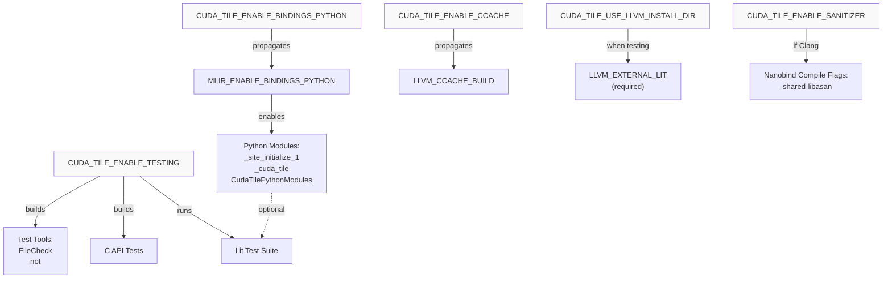
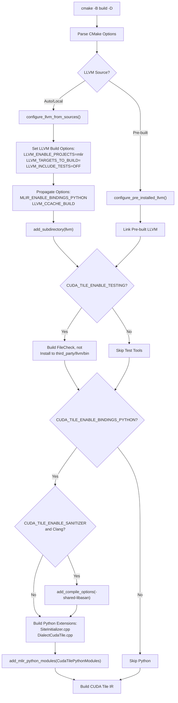

<!-- source: DeepWiki mcp.deepwiki.com · repo NVIDIA/cuda-tile · page 6.3 Build Options and Features · fetched 2026-10-26 -->

# Build Options and Features

<details>
<summary>Relevant source files</summary>

The following files were used as context for generating this wiki page:

- [cmake/IncludeLLVM.cmake](cmake/IncludeLLVM.cmake)
- [python/CMakeLists.txt](python/CMakeLists.txt)

</details>


## Purpose and Scope

This document describes the CMake build options and features available when configuring CUDA Tile IR. These options control Python bindings, testing infrastructure, build optimization tools, sanitizers, and LLVM/MLIR configuration. Understanding these options enables developers to customize the build for their specific use case, whether for development, CI/CD, or production deployment.

For information about LLVM integration strategies, see [LLVM/MLIR Integration](#6.2). For overall build configuration, see [CMake Configuration Overview](#6.1).
</thinking>

---

## Core Build Options

CUDA Tile IR provides several CMake variables to control build features. These options are set via `-D` flags during CMake configuration.

### Primary Configuration Variables

| Variable | Type | Default | Description |
|----------|------|---------|-------------|
| `CUDA_TILE_ENABLE_BINDINGS_PYTHON` | BOOL | OFF | Enable Python bindings generation |
| `CUDA_TILE_ENABLE_TESTING` | BOOL | OFF | Enable test suite and test dependencies |
| `CUDA_TILE_ENABLE_CCACHE` | BOOL | OFF | Enable ccache for faster rebuilds |
| `CUDA_TILE_ENABLE_SANITIZER` | BOOL | OFF | Enable sanitizer instrumentation (ASan, etc.) |
| `CUDA_TILE_USE_LLVM_SOURCE_DIR` | PATH | - | Path to local LLVM source directory |
| `CUDA_TILE_USE_LLVM_INSTALL_DIR` | PATH | - | Path to pre-built LLVM installation |
| `LLVM_EXTERNAL_LIT` | PATH | - | Path to external lit test runner (required with pre-built LLVM) |

**Configuration Example**:
```bash
cmake -B build \
  -DCUDA_TILE_ENABLE_BINDINGS_PYTHON=ON \
  -DCUDA_TILE_ENABLE_TESTING=ON \
  -DCUDA_TILE_ENABLE_CCACHE=ON
```

**Sources**: [cmake/IncludeLLVM.cmake:91-97](), [cmake/IncludeLLVM.cmake:104](), [cmake/IncludeLLVM.cmake:136-141](), [python/CMakeLists.txt:6]()

---

## Python Bindings Configuration

### Enable Python Bindings

Setting `CUDA_TILE_ENABLE_BINDINGS_PYTHON=ON` triggers a cascade of Python-related build configuration:

1. **MLIR Python Bindings**: When building LLVM from source, this option is propagated to MLIR via `MLIR_ENABLE_BINDINGS_PYTHON` [cmake/IncludeLLVM.cmake:97]()
2. **Nanobind Modules**: Enables compilation of C++ extension modules (`_site_initialize_1`, `_cuda_tile`) [python/CMakeLists.txt:35-71]()
3. **Python API Layer**: Builds high-level Python API including `cuda_tile_ops.py` [python/CMakeLists.txt:48-57]()

### Python Build Components

When Python bindings are enabled, the following components are built:

| Component | Module Name | Purpose | Source |
|-----------|-------------|---------|--------|
| Site Initializer | `_site_initialize_1` | Dialect registration during Python import | [python/CMakeLists.txt:35-47]() |
| Core Dialect | `_cuda_tile` | Type/attribute/operation wrappers | [python/CMakeLists.txt:59-71]() |
| Python API | `cuda_tile_ops` | High-level operations and Tile class | [python/CMakeLists.txt:48-57]() |
| CAPI Library | `CudaTilePythonCAPI` | Common C API for Python modules | [python/CMakeLists.txt:78-90]() |

**Installation Path**: Python modules are installed to `python_packages/cuda_tile/_mlir/_mlir_libs/` [python/CMakeLists.txt:80-81]()

**Sources**: [cmake/IncludeLLVM.cmake:97](), [python/CMakeLists.txt:35-110]()

---

## Testing Infrastructure Configuration

### Enable Testing

Setting `CUDA_TILE_ENABLE_TESTING=ON` activates the test suite and builds required test dependencies.

**Test Dependencies Built**:
- `FileCheck` and `not` utilities from LLVM [cmake/IncludeLLVM.cmake:107-109]()
- C API test binaries (if configured)
- Python test modules (if Python bindings enabled)

**Test Tool Installation**: LLVM tools (`FileCheck`, `not`) are installed to `third_party/llvm/bin/` for distribution with the project [cmake/IncludeLLVM.cmake:110-116]()

### Testing with Pre-built LLVM

When using pre-built LLVM (`CUDA_TILE_USE_LLVM_INSTALL_DIR` set), testing requires `LLVM_EXTERNAL_LIT` to be specified:

```bash
cmake -B build \
  -DCUDA_TILE_USE_LLVM_INSTALL_DIR=/path/to/llvm \
  -DCUDA_TILE_ENABLE_TESTING=ON \
  -DLLVM_EXTERNAL_LIT=/path/to/llvm/bin/llvm-lit
```

**Validation**: CMake will fail with `FATAL_ERROR` if `LLVM_EXTERNAL_LIT` is not set when testing is enabled with pre-built LLVM [cmake/IncludeLLVM.cmake:138-141]()

### Test Tool Installation from Pre-built LLVM

When using pre-built LLVM with testing enabled, LLVM tools are copied from the pre-built installation:

```cmake
install(
  PROGRAMS ${CUDA_TILE_USE_LLVM_INSTALL_DIR}/bin/${_TOOL_NAME}${CMAKE_EXECUTABLE_SUFFIX}
  DESTINATION third_party/llvm/bin
)
```

This ensures test tools are available in the same relative path regardless of LLVM source [cmake/IncludeLLVM.cmake:146-152]()

**Sources**: [cmake/IncludeLLVM.cmake:104-117](), [cmake/IncludeLLVM.cmake:136-153]()

---

## Ccache Build Acceleration

### Enable Ccache

Setting `CUDA_TILE_ENABLE_CCACHE=ON` enables compiler caching for faster incremental rebuilds. This option is particularly beneficial for CI/CD environments and development workflows with frequent rebuilds.

**Propagation to LLVM**: When building LLVM from source, the ccache setting is propagated via `LLVM_CCACHE_BUILD`:

```cmake
if(CUDA_TILE_ENABLE_CCACHE)
  set(LLVM_CCACHE_BUILD ON CACHE BOOL "")
endif()
```

This ensures both CUDA Tile IR and LLVM benefit from compiler caching [cmake/IncludeLLVM.cmake:91-93]()

**Usage Example**:
```bash
cmake -B build -DCUDA_TILE_ENABLE_CCACHE=ON
```

**Requirements**: `ccache` must be installed and available in the system PATH.

**Sources**: [cmake/IncludeLLVM.cmake:90-93]()

---

## Sanitizer Configuration

### Enable Sanitizers

Setting `CUDA_TILE_ENABLE_SANITIZER=ON` enables runtime sanitizer instrumentation (AddressSanitizer, ThreadSanitizer, etc.) for detecting memory errors and undefined behavior.

### Clang-Specific Configuration

For Clang builds with sanitizers, special compile options are required when building Nanobind extensions:

```cmake
if(CUDA_TILE_ENABLE_SANITIZER AND CMAKE_CXX_COMPILER_ID STREQUAL "Clang")
  add_compile_options("-shared-libasan")
endif()
```

The `-shared-libasan` flag links sanitizer runtime as a shared library, preventing symbol conflicts between Python modules and the main process [python/CMakeLists.txt:6-8]()

**Background**: See https://github.com/google/sanitizers/issues/1086 for details on why this is required for Python extension modules.

**Compiler Version Requirements**: When using sanitizers with pre-built LLVM, exact compiler version matching is required. See compiler requirements documentation for details.

**Sources**: [python/CMakeLists.txt:3-8]()

---

## LLVM Configuration Options

### LLVM Build Options Set by CUDA Tile

When building LLVM from source (auto-download or local sources), CUDA Tile IR configures LLVM with minimal features to reduce build time and complexity:

| LLVM Option | Value | Purpose |
|-------------|-------|---------|
| `LLVM_INCLUDE_EXAMPLES` | OFF | Skip LLVM example programs |
| `LLVM_INCLUDE_TESTS` | OFF | Skip LLVM test suite |
| `LLVM_INCLUDE_BENCHMARKS` | OFF | Skip LLVM benchmarks |
| `LLVM_BUILD_EXAMPLES` | OFF | Do not build examples |
| `LLVM_ENABLE_ASSERTIONS` | OFF | Disable runtime assertions for performance |
| `LLVM_ENABLE_PROJECTS` | "mlir" | Build only MLIR (not Clang, LLD, etc.) |
| `LLVM_TARGETS_TO_BUILD` | "" | Empty target list (no backend targets) |
| `CMAKE_DISABLE_PRECOMPILE_HEADERS` | ON | Disable PCH to avoid flag mismatches |
| `LLVM_BUILD_UTILS` | ON | Build utilities like FileCheck |
| `LLVM_INSTALL_UTILS` | ON | Install utilities for distribution |

**Rationale for Empty Targets**: CUDA Tile IR operates at the MLIR level and does not require LLVM backend targets (X86, ARM, etc.). Setting `LLVM_TARGETS_TO_BUILD` to empty significantly reduces compilation time [cmake/IncludeLLVM.cmake:83]()

**PCH Disable Reason**: Precompiled headers are disabled to prevent flag mismatches (e.g., NDEBUG differences) between LLVM and CUDA Tile IR targets [cmake/IncludeLLVM.cmake:84-86]()

**Sources**: [cmake/IncludeLLVM.cmake:77-88](), [cmake/IncludeLLVM.cmake:96-97]()

### MLIR-Specific Options

MLIR options are configured separately:

| MLIR Option | Value | Purpose |
|-------------|-------|---------|
| `MLIR_INCLUDE_TESTS` | OFF | Skip MLIR test suite |
| `MLIR_ENABLE_BINDINGS_PYTHON` | `${CUDA_TILE_ENABLE_BINDINGS_PYTHON}` | Propagate Python bindings setting |

The Python bindings option is conditionally propagated from CUDA Tile's setting [cmake/IncludeLLVM.cmake:97]()

**Sources**: [cmake/IncludeLLVM.cmake:95-97]()

---

## Build Option Dependencies and Flow

### Option Dependency Graph



**Sources**: [cmake/IncludeLLVM.cmake:91-97](), [cmake/IncludeLLVM.cmake:104-117](), [cmake/IncludeLLVM.cmake:136-141](), [python/CMakeLists.txt:6-8]()

### CMake Configuration Flow with Options



**Sources**: [cmake/IncludeLLVM.cmake:57-127](), [python/CMakeLists.txt:1-122]()

---

## Python Package Configuration

### Package Structure Configuration

Python modules are organized under the `cuda_tile` package with MLIR components embedded:

```cmake
add_compile_definitions("MLIR_PYTHON_PACKAGE_PREFIX=cuda_tile._mlir.")
```

This directive configures all MLIR Python packages to be co-located under the `cuda_tile._mlir` namespace, creating a relocatable package structure [python/CMakeLists.txt:12]()

**Package Hierarchy**:
```
cuda_tile/
  _mlir/
    _mlir_libs/           # Native extensions
      _site_initialize_1.so
      _cuda_tile.so
      libCudaTilePythonCAPI.so
    dialects/
      cuda_tile_ops.py    # High-level API
```

### MLIR Python Package Root

The MLIR core Python package location is configured via:

```cmake
set(MLIR_PYTHON_PKG_ROOT ${LLVM_ROOT}/python_packages/mlir_core)
```

This variable tells the Python build system where to find MLIR's Python components for proper integration [python/CMakeLists.txt:14]()

**Sources**: [python/CMakeLists.txt:10-14]()

---

## Windows Debug Build Support

### Debug Link Files

On Windows with Debug builds, special handling creates debug link files (`.pdb` files) for Python modules:

```cmake
if(WIN32 AND CMAKE_BUILD_TYPE STREQUAL "Debug")
  include(../cmake/WindowsPythonDebugUtils.cmake)
  
  add_windows_debug_links_installation(
    CudaTilePythonModules
    "${CUDA_TILE_BINARY_DIR}/python_packages/cuda_tile/_mlir/_mlir_libs"
    "${CMAKE_INSTALL_PREFIX}/python_packages/cuda_tile/_mlir/_mlir_libs"
    CudaTilePythonModules
  )
endif()
```

This ensures proper debugging support for Python extensions on Windows [python/CMakeLists.txt:113-122]()

**Sources**: [python/CMakeLists.txt:112-122]()

---

## Compiler Version Constants

The following constants are defined in [cmake/IncludeCompilerChecks.cmake:11-14]() and are referenced throughout the build system:

```cmake
set(GCC_MIN_VER 7.4)
set(CLANG_MIN_VER 5.0)
set(PREBUILT_LLVM_CLANG_VERSION 17.0.6)
set(MSVC_MIN_VER 19.29)
```

**Usage Pattern**: These constants are used as parameters to `check_compiler_version()` function calls. To update compiler requirements, modify these values and the corresponding validation logic will automatically enforce the new requirements.

**Sources**: [cmake/IncludeCompilerChecks.cmake:11-14]()

---

## Summary

The compiler requirement system provides:

1. **Minimum version enforcement** for GCC 7.4+, Clang 5.0+, and MSVC 19.29+
2. **Automated validation** during CMake configuration with clear error messages
3. **Sanitizer compatibility checks** ensuring exact compiler-LLVM version matching when needed
4. **Flexible handling** for custom LLVM builds with appropriate warnings

The system prevents build issues by detecting incompatible compilers early in the configuration process, before expensive operations like downloading dependencies or generating build files.

**Sources**: [cmake/IncludeCompilerChecks.cmake:1-39]()

---

