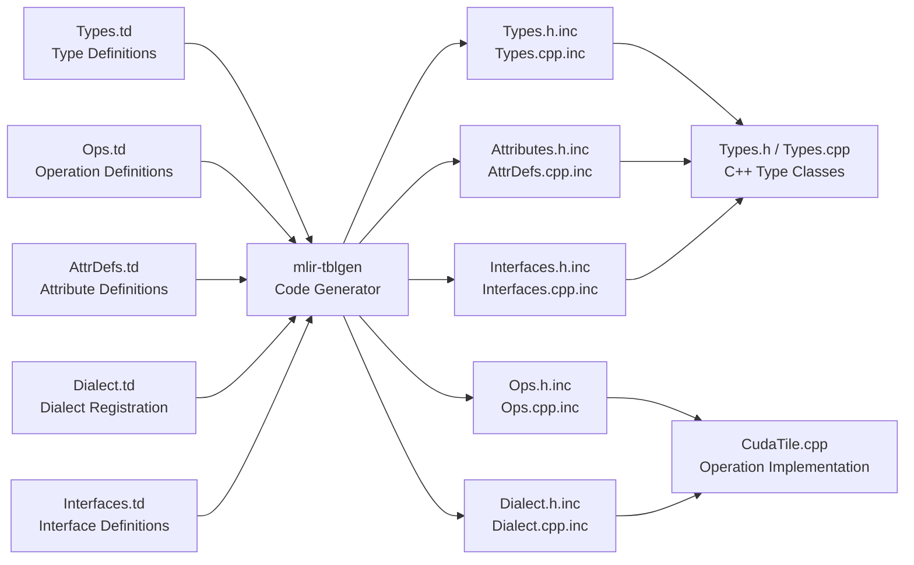
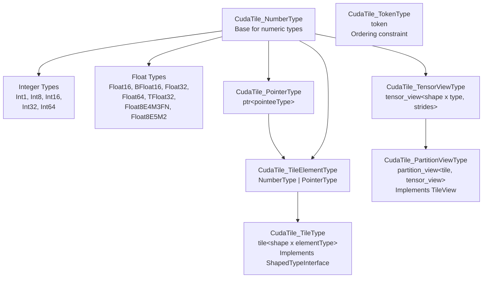
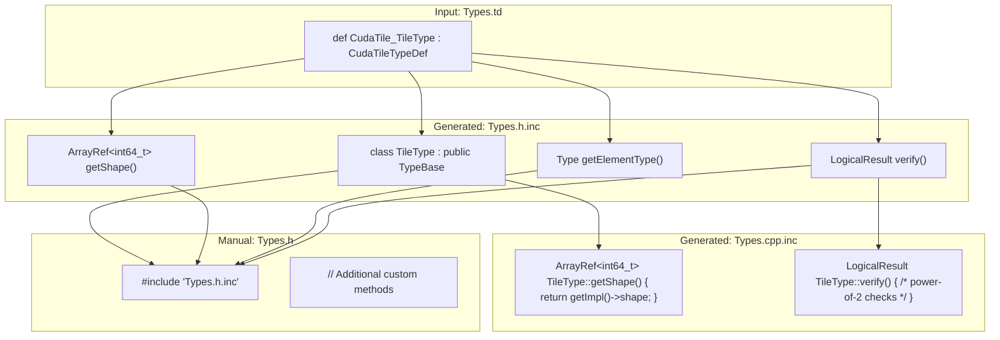
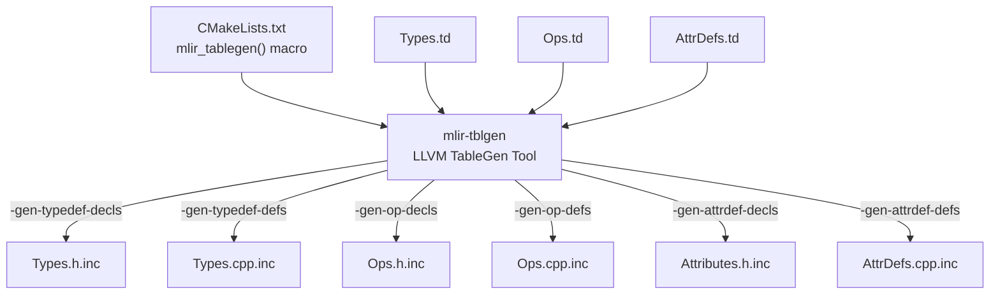
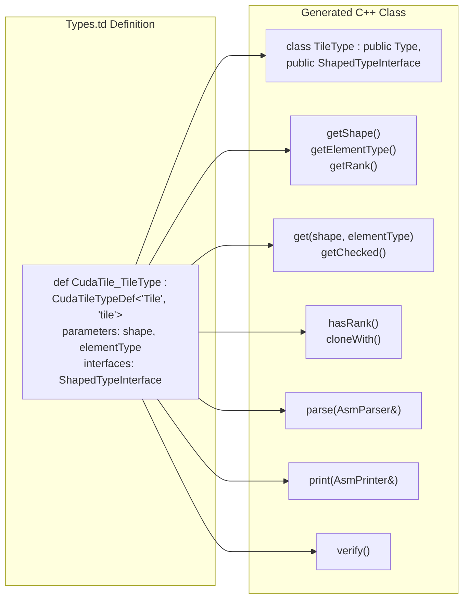
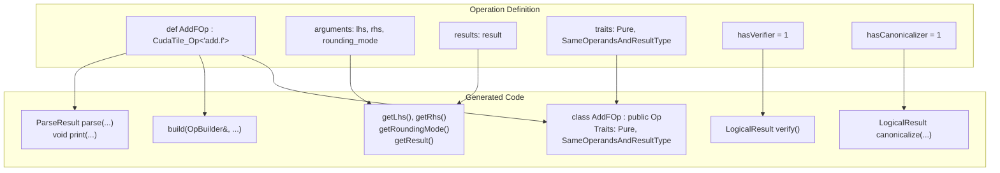

<!-- source: DeepWiki mcp.deepwiki.com · repo NVIDIA/cuda-tile · page 6.4 TableGen Code Generation · fetched 2026-10-26 -->

# TableGen Code Generation

<details>
<summary>Relevant source files</summary>

The following files were used as context for generating this wiki page:

- [include/cuda_tile/Dialect/CudaTile/IR/Types.td](include/cuda_tile/Dialect/CudaTile/IR/Types.td)
- [lib/Dialect/CudaTile/IR/CudaTile.cpp](lib/Dialect/CudaTile/IR/CudaTile.cpp)

</details>


## Purpose and Scope

This page documents how TableGen is used in CUDA Tile IR to automatically generate C++ code for dialect types, operations, attributes, and interfaces from declarative `.td` (TableGen Definition) files. For information about the overall build system configuration, see [CMake Configuration Overview](#6.1). For details on LLVM/MLIR integration, see [LLVM/MLIR Integration](#6.2).

TableGen is LLVM's domain-specific language and code generator that translates high-level declarative specifications into C++ implementation code. In CUDA Tile IR, TableGen eliminates boilerplate by generating parser/printer methods, verifiers, type accessors, operation builders, and other dialect infrastructure.

## Overview of TableGen

TableGen processes `.td` files containing declarative specifications and generates corresponding C++ header (`.h.inc`) and implementation (`.cpp.inc`) files. The generated code is then included into handwritten C++ source files to provide complete functionality.

**Diagram: TableGen Code Generation Pipeline**



Sources: [lib/Dialect/CudaTile/IR/CudaTile.cpp:1217-1221](), [include/cuda_tile/Dialect/CudaTile/IR/Types.td:1-361]()

## TableGen Input Files

CUDA Tile IR uses several `.td` files to define the dialect's structure:

| File | Purpose | Key Definitions |
|------|---------|-----------------|
| `Types.td` | Type system definitions | `TileType`, `PointerType`, `TensorViewType`, `PartitionViewType`, `TokenType` |
| `Ops.td` | Operation definitions | Arithmetic, memory, control flow, tensor operations |
| `AttrDefs.td` | Attribute definitions | `RoundingMode`, `MemoryOrderingSemantics`, `MemoryScope`, optimization hints |
| `Dialect.td` | Dialect registration | `CudaTileDialect` base definition |
| `Interfaces.td` | Type/operation interfaces | `TileView`, `AssumePredicateAttrInterface` |

Sources: [include/cuda_tile/Dialect/CudaTile/IR/Types.td:1-361]()

### Types.td Structure

The type definition file declares the type hierarchy using TableGen's declarative syntax:

**Diagram: Type Hierarchy in Types.td**



Sources: [include/cuda_tile/Dialect/CudaTile/IR/Types.td:19-323]()

#### Primitive Type Aliases

Types.td defines type aliases for primitive types:

```tablegen
def CudaTile_Int1  : TypeAlias<I1, "i1">;
def CudaTile_Int8  : TypeAlias<I8, "i8">;
def CudaTile_Int16 : TypeAlias<I16, "i16">;
def CudaTile_Int32 : TypeAlias<I32, "i32">;
def CudaTile_Int64 : TypeAlias<I64, "i64">;

def CudaTile_Float16  : TypeAlias<F16, "f16">;
def CudaTile_BFloat16 : TypeAlias<BF16, "bf16">;
def CudaTile_Float32  : TypeAlias<F32, "f32">;
def CudaTile_TFloat32 : TypeAlias<TF32, "tf32">;
def CudaTile_Float64  : TypeAlias<F64, "f64">;
```

These aliases provide dialect-specific names for MLIR's built-in types.

Sources: [include/cuda_tile/Dialect/CudaTile/IR/Types.td:28-60]()

#### PointerType Definition

The `PointerType` is defined using the `CudaTileTypeDef` construct:

```tablegen
def CudaTile_PointerType : CudaTileTypeDef<"Pointer", "ptr", "pointerType"> {
  let summary = "Pointer type";
  let parameters = (ins CudaTile_NumberType:$pointeeType);
  let assemblyFormat = "`<` custom<CudaTileType>($pointeeType) `>`";
  let builders = [
    TypeBuilderWithInferredContext<(ins "Type":$pointeeType)>
  ];
}
```

This generates:
- C++ class `mlir::cuda_tile::PointerType`
- Constructor methods
- Parameter accessor `getPointeeType()`
- Custom assembly parser/printer hooks

Sources: [include/cuda_tile/Dialect/CudaTile/IR/Types.td:74-90]()

#### TileType Definition

The `TileType` is more complex, implementing the `ShapedTypeInterface`:

```tablegen
def CudaTile_TileType : CudaTileTypeDef<"Tile", "tile", "tileType",
    [ShapedTypeInterface]> {
  let summary = "Tile type";
  let parameters = (ins ArrayRefParameter<"int64_t">:$shape,
                        CudaTile_TileElementType:$elementType);
  let hasCustomAssemblyFormat = 1;
  let genVerifyDecl = 1;
  let extraClassDeclaration = [{
    bool hasRank() const { return true; }
    TileType cloneWith(std::optional<ArrayRef<int64_t>> shape,
                       Type elementType) const;
  }];
}
```

Key generated artifacts:
- `TileType` C++ class with `ShapedTypeInterface` methods
- `getShape()` and `getElementType()` accessors
- Verification method declaration (`genVerifyDecl = 1`)
- Custom assembly format hooks

Sources: [include/cuda_tile/Dialect/CudaTile/IR/Types.td:102-142]()

## Generated Code Artifacts

TableGen generates two types of include files for each input:

### Header Files (.h.inc)

Generated headers contain:
- Type/operation/attribute class declarations
- Method signatures
- Template specializations
- Type predicates and constraints

Example generated content for types:
```cpp
class PointerType : public Type::TypeBase<...> {
public:
  using Base::Base;
  static PointerType get(Type pointeeType);
  Type getPointeeType() const;
  static ParseResult parse(AsmParser &parser);
  void print(AsmPrinter &printer) const;
};
```

### Implementation Files (.cpp.inc)

Generated implementation files contain:
- Method definitions
- Parser implementations
- Printer implementations
- Verifier logic (when auto-generated)

**Diagram: Generated Code Structure**



Sources: [lib/Dialect/CudaTile/IR/CudaTile.cpp:1217-1221]()

## TableGen Code Generation Process

### CMake Integration

The build system invokes TableGen through CMake macros. A typical invocation pattern:

```cmake
set(LLVM_TARGET_DEFINITIONS Types.td)
mlir_tablegen(Types.h.inc -gen-typedef-decls)
mlir_tablegen(Types.cpp.inc -gen-typedef-defs)
add_public_tablegen_target(CudaTileTypesIncGen)
```

### Generation Commands

Different TableGen backends generate different artifacts:

| Command Flag | Output | Purpose |
|-------------|--------|---------|
| `-gen-typedef-decls` | `Types.h.inc` | Type class declarations |
| `-gen-typedef-defs` | `Types.cpp.inc` | Type method implementations |
| `-gen-op-decls` | `Ops.h.inc` | Operation class declarations |
| `-gen-op-defs` | `Ops.cpp.inc` | Operation implementations |
| `-gen-attrdef-decls` | `Attributes.h.inc` | Attribute declarations |
| `-gen-attrdef-defs` | `AttrDefs.cpp.inc` | Attribute definitions |
| `-gen-dialect-decls` | `Dialect.h.inc` | Dialect registration |
| `-gen-enum-decls` | `Enums.h.inc` | Enum declarations |
| `-gen-enum-defs` | `Enums.cpp.inc` | Enum serialization |

**Diagram: TableGen Build Flow**



Sources: Based on standard MLIR build patterns

## Integration with C++ Source Code

Generated files are included at specific points in C++ source files:

### In Header Files

Header files include generated declarations:

```cpp
// Include generated type declarations
#include "cuda_tile/Dialect/CudaTile/IR/Types.h.inc"

// Include generated attribute declarations
#include "cuda_tile/Dialect/CudaTile/IR/Attributes.h.inc"
```

### In Implementation Files

Implementation files include generated definitions and use `GET_*_CLASSES` macros:

```cpp
// Include dialect implementation
#include "cuda_tile/Dialect/CudaTile/IR/Dialect.cpp.inc"

// Include operation implementations
#define GET_OP_CLASSES
#include "cuda_tile/Dialect/CudaTile/IR/Ops.cpp.inc"

// Include enum implementations
#include "cuda_tile/Dialect/CudaTile/IR/Enums.cpp.inc"
```

The `GET_OP_CLASSES` macro expands to include all generated operation class definitions.

Sources: [lib/Dialect/CudaTile/IR/CudaTile.cpp:1217-1221]()

## Type System Code Generation

### Type Definition Workflow

**Diagram: Type Definition to C++ Code**



Sources: [include/cuda_tile/Dialect/CudaTile/IR/Types.td:102-142]()

### Custom Type Assembly Format

Types can specify custom assembly formats using the `assemblyFormat` directive:

```tablegen
def CudaTile_PointerType : CudaTileTypeDef<...> {
  let assemblyFormat = "`<` custom<CudaTileType>($pointeeType) `>`";
}
```

This generates parser/printer code that handles the syntax:
```mlir
!cuda_tile.ptr<f32>
```

For more complex types like `TileType`, `hasCustomAssemblyFormat = 1` delegates to manually written parser/printer methods.

Sources: [include/cuda_tile/Dialect/CudaTile/IR/Types.td:89]()

### Type Verification

When `genVerifyDecl = 1` is set, TableGen generates a verification method declaration:

```cpp
LogicalResult TileType::verify(
    function_ref<InFlightDiagnostic()> emitError,
    ArrayRef<int64_t> shape,
    Type elementType);
```

The implementation is manually provided to check constraints like:
- Shape dimensions must be positive
- Shape dimensions should be power-of-2
- Element type must be valid

Sources: [include/cuda_tile/Dialect/CudaTile/IR/Types.td:125]()

### Type Constraints and Predicates

TableGen allows defining type constraints used in operation definitions:

```tablegen
// Predicate checking if type is TileType
def CudaTile_IsTileTypePred
  : CPred<"::llvm::isa<::mlir::cuda_tile::TileType>($_self)">;

// Tile with specific element types
class CudaTile_TileOf<list<Type> allowedTypes, ...>
  : ShapedContainerType<allowedTypes, ...>;

// Ranked tiles
class CudaTile_RankedTileOf<list<Type> allowedTypes, list<int> ranks>
  : CudaTile_TileOf<allowedTypes, [HasAnyRankOfPred<ranks>], ...>;
```

These predicates are used in operation definitions to constrain operand/result types.

Sources: [include/cuda_tile/Dialect/CudaTile/IR/Types.td:145-171]()

## Operation Code Generation

Operations are defined in `Ops.td` and generate extensive boilerplate code:

### Generated Operation Components

**Diagram: Operation Code Generation**



Sources: Inferred from [lib/Dialect/CudaTile/IR/CudaTile.cpp:1224-1269]()

### Operation Traits and Interfaces

TableGen automatically adds trait and interface implementations:

```tablegen
def AddFOp : CudaTile_Op<"add.f", [Pure, SameOperandsAndResultType]> {
  // Traits automatically generate constraint checking
}
```

Common traits:
- `Pure` - No side effects
- `SameOperandsAndResultType` - Type constraint
- `AllShapesMatch` - Shape constraint
- `Commutative` - Operand ordering doesn't matter

### Custom Parsers and Printers

Operations with complex syntax use custom parsers defined in C++:

```cpp
// Custom parser for AddFOp rounding mode
static ParseResult parseIEEERoundingMode(
    OpAsmParser &parser, RoundingModeAttr &attr) {
  // Parse optional "rounding<mode>" syntax
  ...
}

static void printIEEERoundingMode(
    OpAsmPrinter &p, Operation *op, RoundingModeAttr attr) {
  // Print if not default
  if (attr.getValue() != RoundingMode::NEAREST_EVEN)
    p << "rounding<" << stringifyRoundingMode(attr.getValue()) << ">";
}
```

These are referenced in the operation definition via assembly format directives.

Sources: [lib/Dialect/CudaTile/IR/CudaTile.cpp:708-882]()

## Attribute Code Generation

### Attribute Definition Example

Attributes like `RoundingModeAttr` are defined using TableGen:

```tablegen
def RoundingMode : I32EnumAttr<"RoundingMode", "rounding mode", [
  I32EnumAttrCase<"NEAREST_EVEN", 0>,
  I32EnumAttrCase<"ZERO", 1>,
  I32EnumAttrCase<"NEGATIVE_INF", 2>,
  ...
]> {
  let cppNamespace = "::mlir::cuda_tile";
}
```

This generates:
- `enum class RoundingMode` with all cases
- `RoundingModeAttr` wrapper class
- `symbolizeRoundingMode()` for string-to-enum conversion
- `stringifyRoundingMode()` for enum-to-string conversion
- Parser/printer integration

Sources: Inferred from [lib/Dialect/CudaTile/IR/CudaTile.cpp:624-882]()

### Structured Attributes

Complex attributes with multiple parameters use `AttrDef`:

```tablegen
def OptimizationHintsAttr : CudaTile_Attr<"OptimizationHints"> {
  let parameters = (ins
    "OptimizationThresholdsAttr":$entry,
    "OptimizationThresholdsAttr":$for_loop,
    "OptimizationThresholdsAttr":$if_statement
  );
  let assemblyFormat = "`<` $entry `,` $for_loop `,` $if_statement `>`";
}
```

This generates a C++ class with accessors for each parameter and assembly format support.

Sources: Inferred from [lib/Dialect/CudaTile/IR/CudaTile.cpp:2172-2222]()

## Custom Code in Generated Operations

Many operations require custom verification or canonicalization beyond what TableGen can generate:

### Custom Verification

Operations with `hasVerifier = 1` must provide manual implementation:

```cpp
LogicalResult AddFOp::verify() {
  if (failed(verifyIEEERoundingModes(*this)))
    return failure();
  return verifyFtz(*this, getFlushToZero());
}
```

Sources: [lib/Dialect/CudaTile/IR/CudaTile.cpp:1241-1245]()

### Custom Canonicalization

Operations with `hasCanonicalizer = 1` must provide canonicalization patterns:

```cpp
LogicalResult AddFOp::canonicalize(AddFOp op, PatternRewriter &rewriter) {
  // Canonicalize operand order to enable FMA fusion
  return canonicalizeAddOperands(op, rewriter);
}
```

Sources: [lib/Dialect/CudaTile/IR/CudaTile.cpp:1267-1269]()

## Benefits of TableGen Code Generation

**Summary Table: Manual vs Generated Code**

| Aspect | Manual C++ | TableGen |
|--------|-----------|----------|
| **Boilerplate** | ~200 lines per operation | ~20 lines in .td file |
| **Type safety** | Manual type checking | Automatic constraint generation |
| **Consistency** | Prone to inconsistencies | Uniform code generation |
| **Maintenance** | High effort | Update .td only |
| **Error checking** | Manual validation | Compile-time verification |
| **Documentation** | Separate docs | Self-documenting in .td |

TableGen reduces code duplication, ensures consistency across the dialect, and provides a single source of truth for type system and operation definitions. This is especially valuable for large dialects like CudaTile with dozens of operations and types.

Sources: General MLIR/TableGen design principles

---

