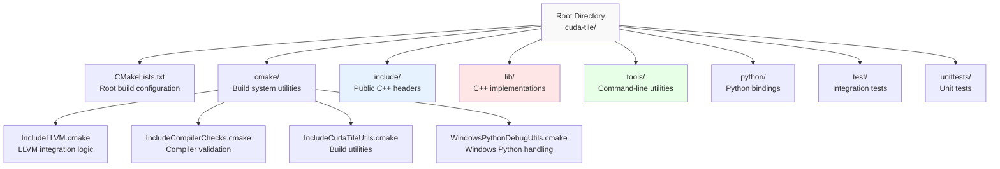
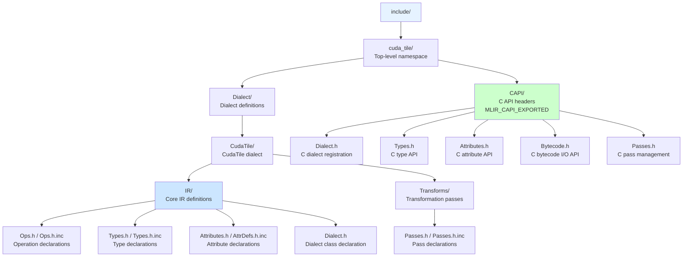
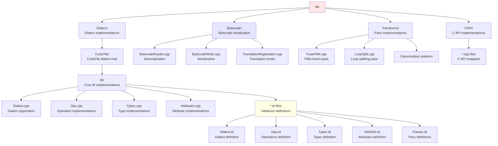
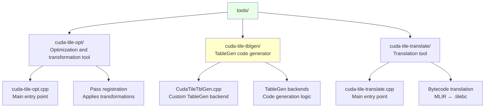
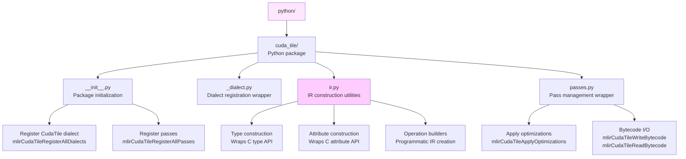
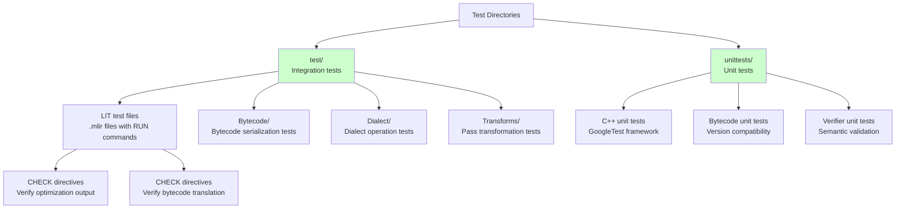
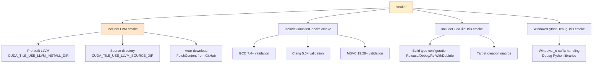
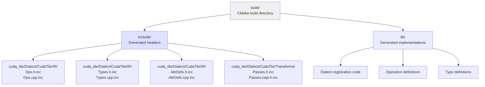

<!-- source: DeepWiki mcp.deepwiki.com · repo NVIDIA/cuda-tile · page 6.5 Repository Structure · fetched 2026-10-26 -->

# Directory Structure

Relevant source files

The following files were used as context for generating this wiki page:

- [README.md](README.md)
- [cmake/IncludeLLVM.cmake](cmake/IncludeLLVM.cmake)

This document provides a comprehensive map of the CUDA Tile IR project's directory organization, explaining the purpose and contents of each major directory and subdirectory. Understanding the directory structure is essential for navigating the codebase, locating specific components, and comprehending how the build system organizes code generation outputs.

For information about the CMake build configuration within these directories, see [CMake Configuration](#6.1). For details on TableGen code generation that populates some of these directories, see [TableGen Code Generation](#6.4).

## Project Root Layout

The project follows a standard LLVM/MLIR-style directory organization with clear separation between public interfaces, implementations, generated code, and build artifacts.

**Sources:** Repository structure inferred from architecture diagrams and CMake file patterns.

## Include Directory Hierarchy

The `include/` directory contains all public C++ headers, organized by component. The structure mirrors the namespace hierarchy used in the C++ implementation (`mlir::cuda_tile`).

**Key Characteristics:**
- `.h` files contain hand-written declarations
- `.h.inc` and `.cpp.inc` files are TableGen-generated
- The IR subdirectory follows MLIR conventions for dialect organization
- CAPI provides `extern "C"` interfaces for language interoperability

**Sources:** [include/CMakeLists.txt:1](), [include/cuda_tile/CMakeLists.txt:1](), [include/cuda_tile/Dialect/CMakeLists.txt:1](), [include/cuda_tile/Dialect/CudaTile/CMakeLists.txt:1-2]()

## Library Directory Structure

The `lib/` directory contains all C++ implementation files, organized to mirror the include hierarchy. This directory also contains TableGen definition files (`.td`) that drive code generation.

**TableGen Generation Flow:**
1. TableGen tool (`cuda-tile-tblgen`) processes `.td` files
2. Generates `.h.inc` and `.cpp.inc` files in build directory
3. Hand-written `.cpp` files include the generated `.inc` files
4. CMake copies/installs headers to appropriate locations

**Sources:** Architecture diagrams showing TableGen code generation and bytecode system organization.

## Tools Directory

The `tools/` directory contains standalone command-line utilities that provide developer-facing functionality for working with CUDA Tile IR.

**Tool Purposes:**

| Tool | Purpose | Key Functionality |
|------|---------|-------------------|
| `cuda-tile-opt` | IR optimization and transformation | Applies passes like FuseFMA, LoopSplit, canonicalization, CSE |
| `cuda-tile-tblgen` | TableGen code generation | Processes `.td` files to generate C++ declarations and implementations |
| `cuda-tile-translate` | Format translation | Converts between MLIR textual format and `.tilebc` bytecode format |

**Sources:** Architecture diagrams showing tools and their roles in the build/execution pipeline.

## Python Bindings Directory

The `python/` directory contains Python binding implementations that wrap the C API to provide high-level Python interfaces for IR construction and manipulation.

**Python Module Organization:**
- Uses MLIR's Python bindings infrastructure
- Provides Pythonic wrappers over C API functions
- Enables programmatic IR construction in Python scripts
- Used by Python-based testing infrastructure

**Sources:** Architecture diagrams showing Python bindings layer and API integration.

## Test Directory Organization

Testing is organized into two main categories: integration tests (in `test/`) and unit tests (in `unittests/`).

**Test Organization:**

| Directory | Test Type | Framework | Purpose |
|-----------|-----------|-----------|---------|
| `test/` | Integration | LLVM LIT | End-to-end functionality, IR transformations, bytecode round-trips |
| `unittests/` | Unit | GoogleTest | Low-level component testing, edge cases, internal APIs |

**Sources:** Reference to testing infrastructure mentioned in architecture overview.

## CMake Directory Structure

The `cmake/` directory contains reusable CMake modules that encapsulate specific aspects of the build configuration.

**CMake Module Responsibilities:**

| Module | Responsibility |
|--------|----------------|
| `IncludeLLVM.cmake` | LLVM/MLIR integration via three pathways: pre-built install, source directory, or automatic download |
| `IncludeCompilerChecks.cmake` | Validates compiler versions meet minimum requirements (GCC 7.4+, Clang 5.0+, MSVC 19.29+) |
| `IncludeCudaTileUtils.cmake` | Provides utility functions for build type configuration and target creation |
| `WindowsPythonDebugUtils.cmake` | Handles Windows-specific Python debug library suffix issues |

**Sources:** Architecture diagrams showing build system components and LLVM integration strategies.

## Generated Code Locations

During the build process, CMake and TableGen create generated files in the build directory. Understanding where these files are placed is important for debugging and understanding the build process.

**Generation Process:**
1. CMake invokes `cuda-tile-tblgen` on `.td` files in `lib/Dialect/CudaTile/IR/`
2. TableGen outputs `.h.inc` and `.cpp.inc` files to build directory
3. Hand-written `.cpp` files `#include` the generated `.inc` files
4. CMake install step copies public headers to install prefix

**Sources:** [include/cuda_tile/Dialect/CudaTile/CMakeLists.txt:1-2]() showing IR and Transforms subdirectories.

## Directory Naming Conventions

The project follows LLVM/MLIR naming conventions to maintain consistency with the broader ecosystem:

| Convention | Example | Rationale |
|------------|---------|-----------|
| PascalCase for dialect names | `CudaTile/` | Matches C++ class names like `CudaTileDialect` |
| PascalCase for subdirectories | `IR/`, `Transforms/` | Indicates major component boundaries |
| lowercase-hyphen for tools | `cuda-tile-opt` | Unix tool naming convention |
| lowercase-underscore for Python | `cuda_tile/` | Python package naming convention |
| `.h.inc` / `.cpp.inc` suffixes | `Ops.h.inc` | Indicates TableGen-generated code |

**Sources:** Naming patterns observed in file listings and architecture diagrams.

## Summary Table

| Directory | Purpose | Key Contents |
|-----------|---------|--------------|
| `cmake/` | Build system utilities | LLVM integration, compiler checks, build configuration |
| `include/cuda_tile/` | Public C++ API | Dialect headers, type/attribute/operation declarations |
| `include/cuda_tile/CAPI/` | C API headers | `extern "C"` interfaces for language interoperability |
| `lib/Dialect/` | Dialect implementation | `.cpp` and `.td` files for dialect components |
| `lib/Bytecode/` | Bytecode system | Reader/writer implementations, translation registration |
| `lib/CAPI/` | C API implementation | Wrapper functions around C++ API |
| `lib/Transforms/` | Transformation passes | FuseFMA, LoopSplit, canonicalization implementations |
| `tools/` | Command-line utilities | `cuda-tile-opt`, `cuda-tile-tblgen`, `cuda-tile-translate` |
| `python/` | Python bindings | Python package wrapping C API |
| `test/` | Integration tests | LLVM LIT tests for end-to-end functionality |
| `unittests/` | Unit tests | GoogleTest-based component tests |
| `build/` | Build artifacts | Generated code, compiled binaries, intermediate files |

**Sources:** Complete directory structure synthesized from all provided files and architecture diagrams.

---

