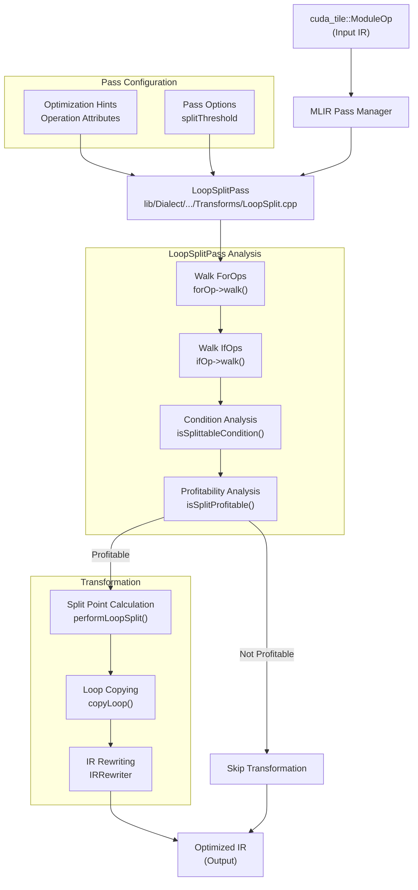
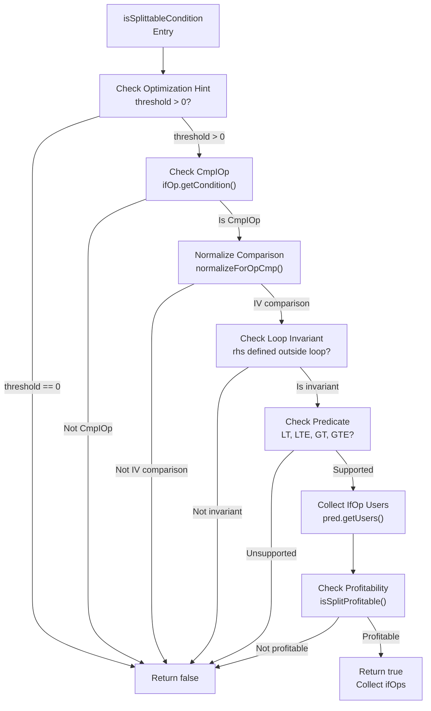
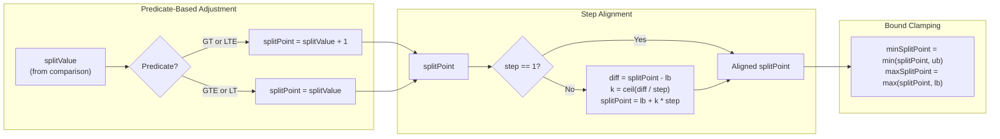
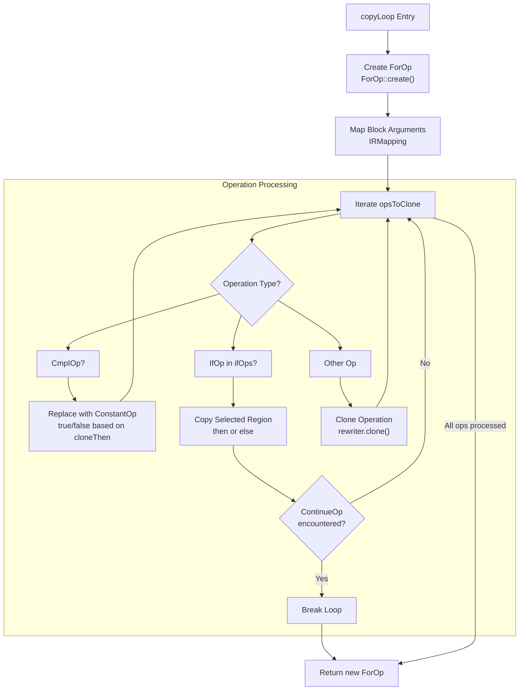
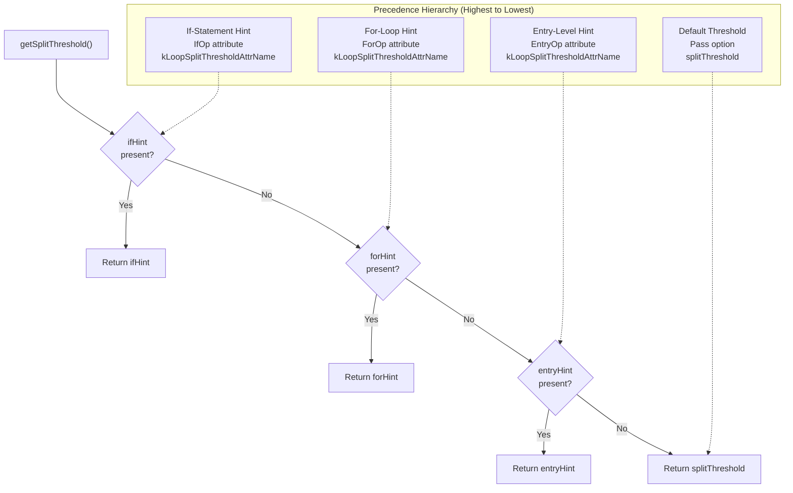
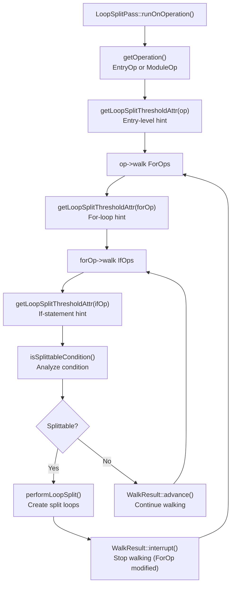

<!-- source: DeepWiki mcp.deepwiki.com · repo NVIDIA/cuda-tile · page 7 Optimization and Transformation · fetched 2026-10-26 -->

# Optimization and Transformation

<details>
<summary>Relevant source files</summary>

The following files were used as context for generating this wiki page:

- [lib/Dialect/CudaTile/Transforms/LoopSplit.cpp](lib/Dialect/CudaTile/Transforms/LoopSplit.cpp)

</details>


This document describes the optimization and transformation infrastructure in CUDA Tile IR, focusing on optimization passes that modify the IR to improve runtime performance. The primary transformation currently implemented is the loop splitting pass, which hoists conditionals out of loops when the condition depends on the loop induction variable.

For information about the dialect operations that these passes operate on, see [Core Dialect](#3). For details on executing optimized code, see [Execution Pipeline](#9).

## Overview

The CUDA Tile IR transformation layer provides optimization passes that analyze and modify the IR to eliminate runtime overhead. These passes are designed to be composable and configurable through optimization hints specified as operation attributes.

The transformation infrastructure is located in [lib/Dialect/CudaTile/Transforms/]() and includes:
- **LoopSplitPass**: Splits loops containing conditionals based on the induction variable
- **Optimization Hint System**: Three-tier attribute-based configuration for controlling transformations

**Sources:** [lib/Dialect/CudaTile/Transforms/LoopSplit.cpp:1-378]()

## Transformation Pipeline Architecture



**Sources:** [lib/Dialect/CudaTile/Transforms/LoopSplit.cpp:341-377]()

## Loop Splitting Transformation

The `LoopSplitPass` transforms loops containing conditionals that depend on the loop induction variable. When a conditional branch inside a loop tests the induction variable against a loop-invariant value, the pass splits the loop into two separate loops, eliminating the conditional test in each split loop.

### Transformation Example

Consider a loop with an induction-variable-dependent conditional:

```mlir
cuda_tile.for %i = %lb to %ub step %step {
  %cond = cuda_tile.cmpi LT, %i, %splitValue : tensor<i32>
  cuda_tile.if %cond {
    // Operations when i < splitValue
    ...
  } else {
    // Operations when i >= splitValue
    ...
  }
}
```

The pass transforms this into two loops:

```mlir
// First loop: i < splitValue (only "then" block)
cuda_tile.for %i = %lb to min(%splitValue, %ub) step %step {
  // Operations from "then" block (condition always true)
  ...
}

// Second loop: i >= splitValue (only "else" block)
cuda_tile.for %i = max(%splitValue, %lb) to %ub step %step {
  // Operations from "else" block (condition always false)
  ...
}
```

**Sources:** [lib/Dialect/CudaTile/Transforms/LoopSplit.cpp:252-310]()

## Condition Analysis

The pass performs several checks to determine if a loop conditional is splittable:

### Comparison Normalization

The `normalizeForOpCmp` function normalizes comparisons to always place the induction variable on the left side. This function:
- Verifies the comparison uses signed arithmetic (required by `ForOp`)
- Identifies whether the comparison involves the loop induction variable
- Swaps operands and inverts predicates when the induction variable appears on the right

| Original Predicate | Normalized Predicate (after swap) |
|-------------------|-----------------------------------|
| `LESS_THAN` | `GREATER_THAN` |
| `LESS_THAN_OR_EQUAL` | `GREATER_THAN_OR_EQUAL` |
| `GREATER_THAN` | `LESS_THAN` |
| `GREATER_THAN_OR_EQUAL` | `LESS_THAN_OR_EQUAL` |

**Sources:** [lib/Dialect/CudaTile/Transforms/LoopSplit.cpp:29-65]()

### Splittability Conditions

The `isSplittableCondition` function validates that a conditional is eligible for splitting. It checks:

1. **Optimization hints allow splitting** (threshold > 0)
2. **Condition is a comparison operation** (`CmpIOp`)
3. **Comparison involves the induction variable** (via `normalizeForOpCmp`)
4. **Right-hand side is loop-invariant** (defined outside the loop body)
5. **Predicate is supported** (`LESS_THAN`, `LESS_THAN_OR_EQUAL`, `GREATER_THAN`, `GREATER_THAN_OR_EQUAL`)
6. **At least one usage is profitable** (via `isSplitProfitable`)



The function also determines `secondThen`, which indicates whether the "then" block should go into the first or second split loop based on the comparison predicate.

**Sources:** [lib/Dialect/CudaTile/Transforms/LoopSplit.cpp:98-173]()

## Profitability Analysis

The `isSplitProfitable` function determines whether splitting a loop is likely to improve performance. This analysis prevents unnecessary code duplication when the overhead of branching is negligible.

### Profitability Criteria

| Criterion | Description | Implementation |
|-----------|-------------|----------------|
| **Threshold check** | If threshold is 1, splitting always occurs | Short-circuit return true |
| **Operation count** | Count operations in then/else blocks | `countOps()` lambda |
| **Heavy operations** | Detect expensive operations | Check for memory ops, MMA, reduce, nested control flow |
| **Size threshold** | Either block exceeds operation count threshold | `thenSize >= threshold \|\| elseSize >= threshold` |

### Heavy Operations

The following operations are considered "heavy" and trigger splitting regardless of operation count:
- **Memory operations**: `LoadPtrTkoOp`, `LoadViewTkoOp`, `StorePtrTkoOp`, `StoreViewTkoOp`
- **Matrix multiply-accumulate**: `MmaFOp`, `MmaIOp`
- **Reduction operations**: `ReduceOp`
- **Nested control flow**: `IfOp`, `ForOp`

```cpp
hasHeavyOps |= isa<LoadPtrTkoOp, LoadViewTkoOp, StorePtrTkoOp, StoreViewTkoOp,
                   MmaFOp, MmaIOp, ReduceOp, IfOp, ForOp>(op);
```

**Sources:** [lib/Dialect/CudaTile/Transforms/LoopSplit.cpp:67-96]()

## Split Point Calculation

The `performLoopSplit` function computes the split point and creates the two split loops. The split point depends on the comparison predicate and must be aligned with the loop step.

### Split Point Adjustment



### Split Point Formula

For predicates requiring adjustment (`GREATER_THAN`, `LESS_THAN_OR_EQUAL`):
```
splitPoint = splitValue + 1
```

For non-unit step values:
```
diff = splitPoint - lowerBound
k = ceil(diff / step)  // DivIOp with POSITIVE_INF rounding
splitPoint = lowerBound + k * step
```

Clamping to bounds:
```
minSplitPoint = min(splitPoint, upperBound)
maxSplitPoint = max(splitPoint, lowerBound)
```

**Sources:** [lib/Dialect/CudaTile/Transforms/LoopSplit.cpp:252-310]()

## Loop Copying and IR Rewriting

The `copyLoop` function creates a new `ForOp` with modified bounds and selectively copies operations from the original loop body.

### Copying Strategy



### Special Handling Cases

1. **CmpIOp Replacement**: The comparison operation is replaced with a constant boolean value since the condition is known to be true or false in each split loop.
   - [lib/Dialect/CudaTile/Transforms/LoopSplit.cpp:193-201]()

2. **IfOp Selective Copy**: Only one region (then or else) of collected `IfOp`s is copied, eliminating the conditional branch.
   - [lib/Dialect/CudaTile/Transforms/LoopSplit.cpp:206-232]()

3. **YieldOp Mapping**: When copying an `IfOp` region, `YieldOp` results are directly mapped to their operands to maintain SSA form.
   - [lib/Dialect/CudaTile/Transforms/LoopSplit.cpp:219-223]()

4. **ContinueOp Handling**: If a `ContinueOp` is encountered while copying an `IfOp` region, no further operations are copied since control flow exits the loop iteration.
   - [lib/Dialect/CudaTile/Transforms/LoopSplit.cpp:212-217]()

**Sources:** [lib/Dialect/CudaTile/Transforms/LoopSplit.cpp:175-234]()

## Optimization Hints System

The optimization hint system provides fine-grained control over loop splitting behavior through a three-tier hierarchy of attributes.

### Three-Tier Hierarchy



### Threshold Semantics

| Threshold Value | Behavior |
|----------------|----------|
| `0` | Disable splitting for this conditional |
| `1` | Enable splitting unconditionally |
| `N > 1` | Enable splitting only if the then/else block contains at least N operations or contains heavy operations |

### Attribute Retrieval

The `getLoopSplitThresholdAttr` function retrieves the threshold attribute from an operation:

```cpp
std::optional<int> getLoopSplitThresholdAttr(Operation *op) {
  std::optional<int> res = std::nullopt;
  Attribute loopSplitThreshold =
      op->getDiscardableAttr(kLoopSplitThresholdAttrName);
  if (loopSplitThreshold)
    res = cast<IntegerAttr>(loopSplitThreshold).getInt();
  return res;
}
```

The attribute is stored as a discardable attribute, meaning it can be removed during transformations without affecting semantics.

**Sources:** [lib/Dialect/CudaTile/Transforms/LoopSplit.cpp:312-336]()

## Pass Execution Flow

The `LoopSplitPass` implements a nested walking pattern to find and transform splittable loops.



### Walk Interruption

When a loop is successfully split, the walk returns `WalkResult::interrupt()` to stop processing nested `IfOp`s within that `ForOp`. This is necessary because the original `ForOp` has been replaced, and continuing to walk would access invalid IR. The outer walk over `ForOp`s continues, processing the newly created split loops in subsequent iterations.

**Sources:** [lib/Dialect/CudaTile/Transforms/LoopSplit.cpp:341-377]()

## Pass Integration

The `LoopSplitPass` is registered with the MLIR pass infrastructure and can be invoked through pass pipelines or programmatically.

### Pass Registration

The pass is defined using MLIR's TableGen-based pass generation system:

```cpp
#define GEN_PASS_DEF_LOOPSPLITPASS
#include "cuda_tile/Dialect/CudaTile/Transforms/Passes.h.inc"

struct LoopSplitPass : public impl::LoopSplitPassBase<LoopSplitPass> {
  using impl::LoopSplitPassBase<LoopSplitPass>::LoopSplitPassBase;
  
  void runOnOperation() override;
};
```

### Pass Options

The pass accepts a `splitThreshold` option that serves as the default threshold when no optimization hints are present:

| Option Name | Type | Default | Description |
|------------|------|---------|-------------|
| `splitThreshold` | `int` | Implementation-defined | Minimum operation count to trigger splitting |

**Sources:** [lib/Dialect/CudaTile/Transforms/LoopSplit.cpp:338-377]()

---

