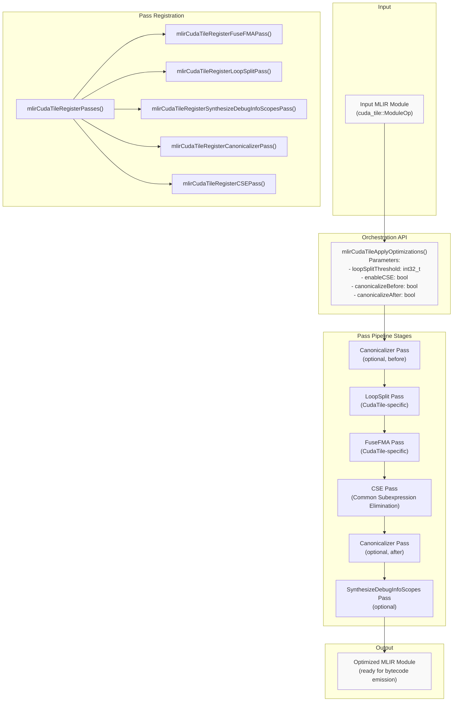
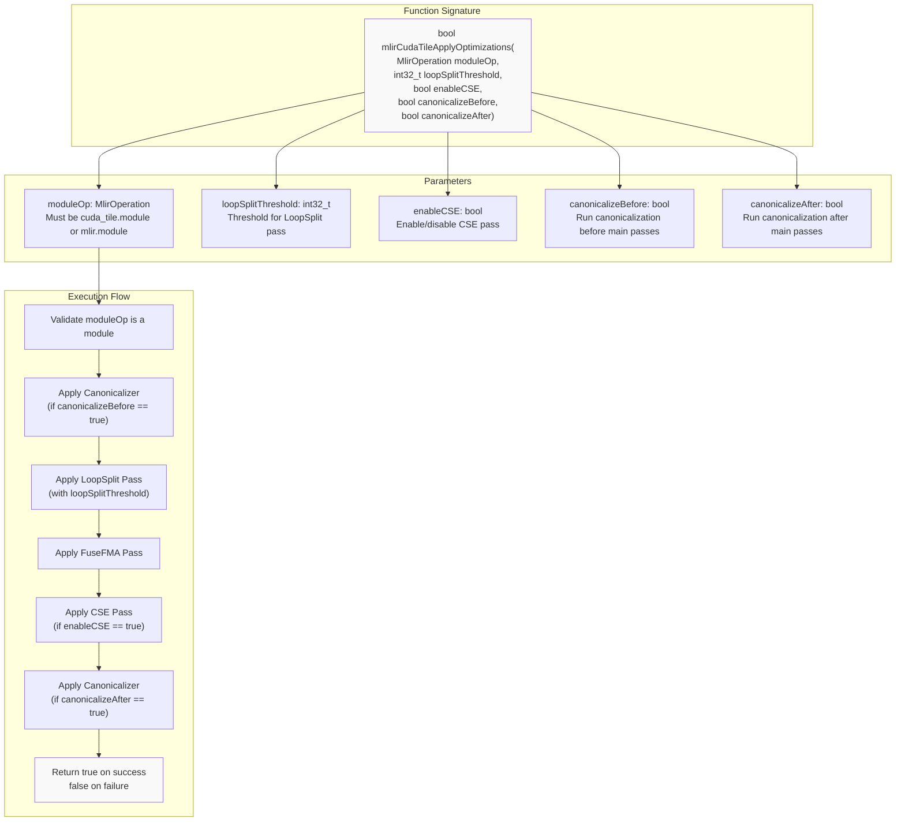
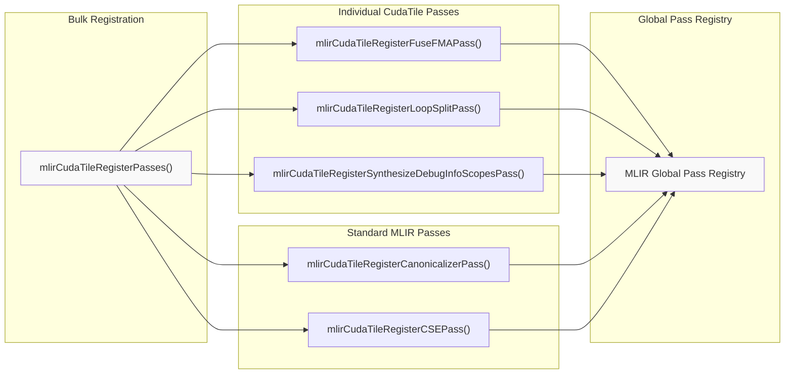
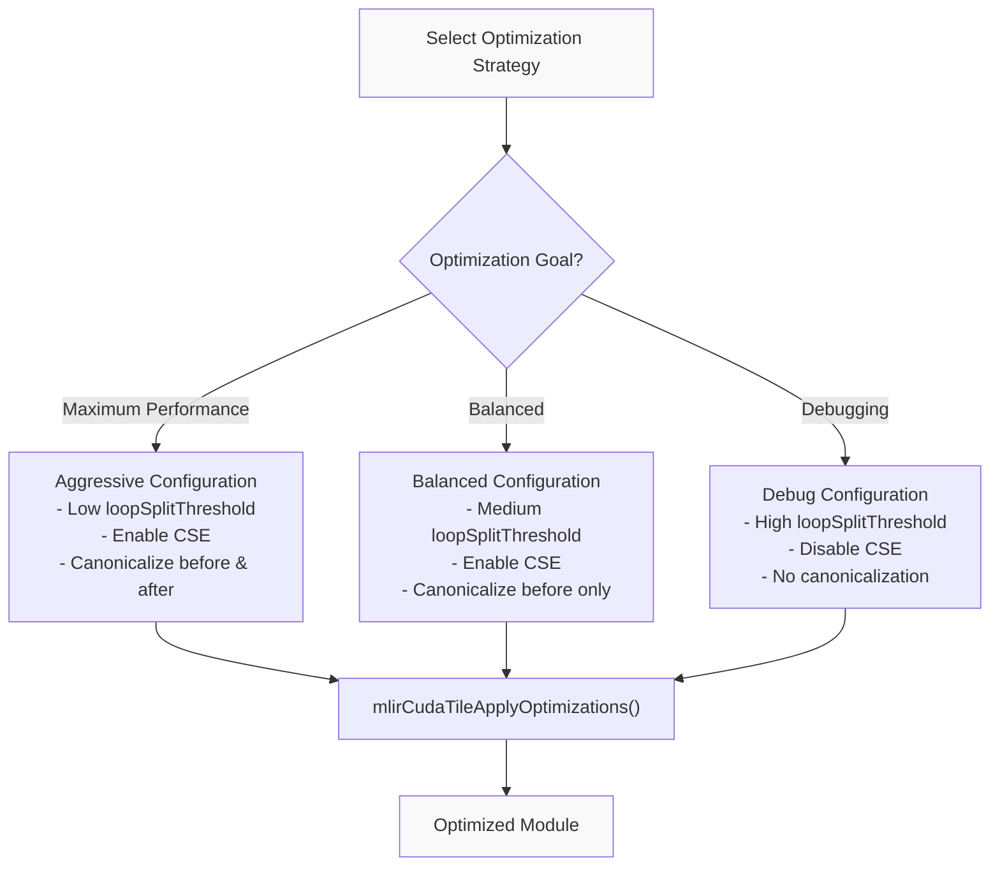
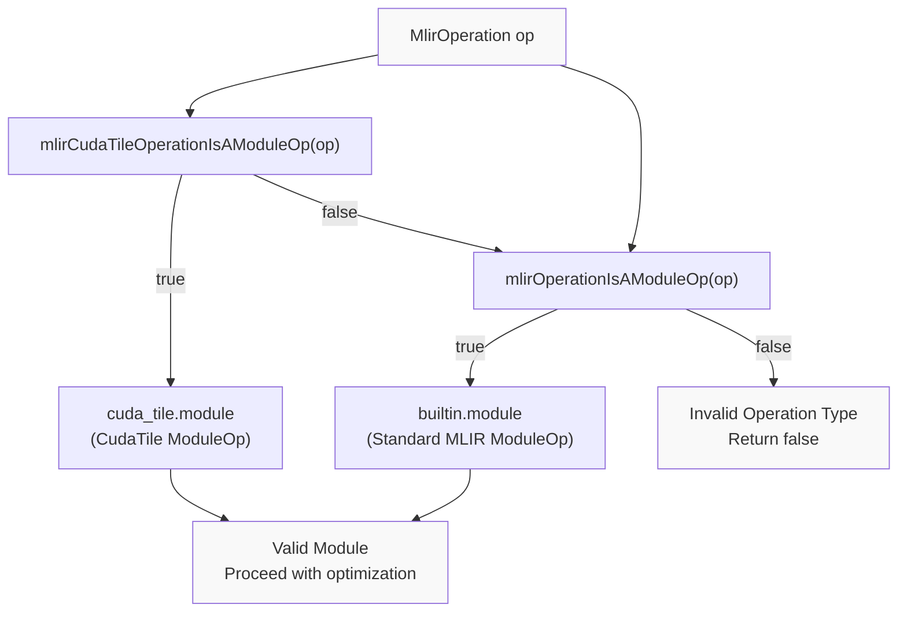
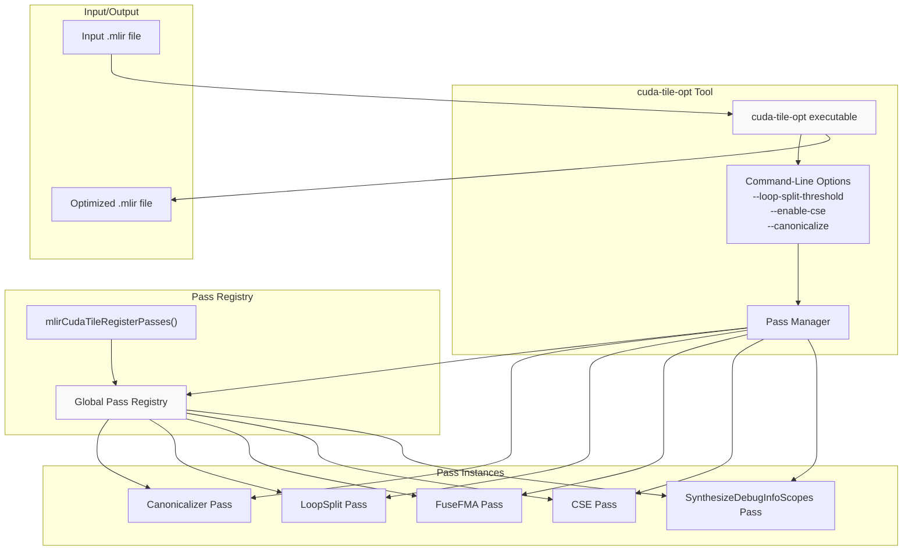
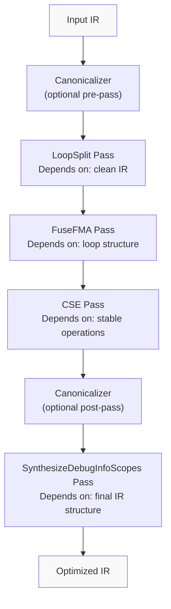
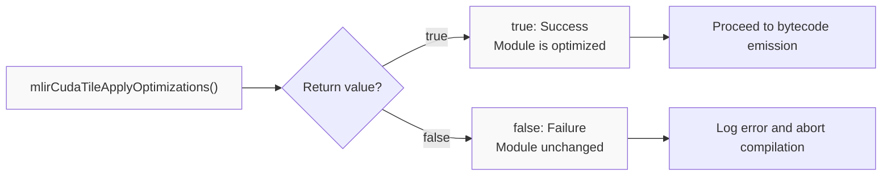

<!-- source: DeepWiki mcp.deepwiki.com · repo NVIDIA/cuda-tile · page 7.1 Loop Splitting Pass · fetched 2026-10-26 -->

# Loop Splitting Pass

Relevant source files

The following files were used as context for generating this wiki page:

- [lib/Dialect/CudaTile/Transforms/LoopSplit.cpp](lib/Dialect/CudaTile/Transforms/LoopSplit.cpp)

## Purpose and Scope

The Loop Splitting Pass (`LoopSplitPass`) is a CudaTile-specific optimization that partitions `ForOp` loops containing conditional branches based on induction variable comparisons. When a loop contains an `IfOp` whose condition compares the induction variable to a loop-invariant value, the pass splits the loop into two sequential loops: one covering iterations where the condition evaluates to false, and another where it evaluates to true. This transformation eliminates dynamic branching within loop iterations, improving execution efficiency on GPU architectures.

For information about optimization hints that control this pass, see [Optimization Hints and Attributes](#7.2). For the complete optimization pipeline, see [Optimization and Transformation](#7).

**Sources:** [lib/Dialect/CudaTile/Transforms/LoopSplit.cpp:1-377]()
</thinking>

## Overview of Loop Splitting

Loop splitting is a compiler optimization technique that partitions a loop with data-dependent conditional branches into multiple loops, each handling a subset of iterations where the branch outcome is known statically. This eliminates runtime branching overhead and enables better instruction scheduling and vectorization.

**Sources:** [lib/Dialect/CudaTile/Transforms/LoopSplit.cpp:27-377]()

## Overview of Pass System

CUDA Tile IR provides a configurable pass pipeline that can be applied to transform modules before bytecode emission. The system includes both dialect-specific optimization passes and standard MLIR canonicalization and CSE passes.

### Pass Pipeline Architecture

**Sources:** [include/cuda_tile-c/Dialect/CudaTileDialect.h:348-351](), [include/cuda_tile-c/Dialect/CudaTileDialect.h:386-396]()

## Available Optimization Passes

### Canonicalizer Pass

The Canonicalizer is a standard MLIR pass that applies operation-specific canonicalization patterns to simplify the IR. It performs peephole optimizations, constant folding, dead code elimination, and other local simplifications.

| Property | Value |
|----------|-------|
| **Type** | Standard MLIR Pass |
| **Registration Function** | `mlirCudaTileRegisterCanonicalizerPass()` |
| **Configurable** | Yes (via `canonicalizeBefore`, `canonicalizeAfter` flags) |
| **Position in Pipeline** | Can run before and/or after main passes |

The canonicalizer can be applied at two points in the pipeline:
- **Before main passes**: Simplifies the input IR before applying specialized transformations
- **After main passes**: Cleans up artifacts introduced by transformation passes

**Sources:** [include/cuda_tile-c/Dialect/CudaTileDialect.h:395]()

### LoopSplit Pass

The LoopSplit pass is a CudaTile-specific transformation that splits loop iterations based on a configurable threshold. This pass helps optimize tile-based computation patterns by partitioning work across threads.

| Property | Value |
|----------|-------|
| **Type** | CudaTile-Specific Pass |
| **Registration Function** | `mlirCudaTileRegisterLoopSplitPass()` |
| **Configuration Parameter** | `loopSplitThreshold` (int32_t) |
| **Purpose** | Split loop iterations for improved parallelism |

**Sources:** [include/cuda_tile-c/Dialect/CudaTileDialect.h:392](), [include/cuda_tile-c/Dialect/CudaTileDialect.h:350]()

### FuseFMA Pass

The FuseFMA (Fused Multiply-Add) pass combines separate multiply and add operations into fused multiply-add operations when possible. This optimization reduces instruction count and improves numerical accuracy on hardware that supports FMA instructions.

| Property | Value |
|----------|-------|
| **Type** | CudaTile-Specific Pass |
| **Registration Function** | `mlirCudaTileRegisterFuseFMAPass()` |
| **Pattern** | `mul + add → fma` |
| **Benefits** | Reduced instruction count, improved accuracy |

**Sources:** [include/cuda_tile-c/Dialect/CudaTileDialect.h:391]()

### CSE Pass

Common Subexpression Elimination (CSE) is a standard MLIR pass that identifies and eliminates redundant computations by reusing previously computed values.

| Property | Value |
|----------|-------|
| **Type** | Standard MLIR Pass |
| **Registration Function** | `mlirCudaTileRegisterCSEPass()` |
| **Configurable** | Yes (via `enableCSE` flag) |
| **Purpose** | Eliminate redundant computations |

**Sources:** [include/cuda_tile-c/Dialect/CudaTileDialect.h:396](), [include/cuda_tile-c/Dialect/CudaTileDialect.h:350]()

### SynthesizeDebugInfoScopes Pass

This CudaTile-specific pass synthesizes debug information scopes for operations in the IR. It ensures that debug metadata is properly structured for debugging and profiling tools.

| Property | Value |
|----------|-------|
| **Type** | CudaTile-Specific Pass |
| **Registration Function** | `mlirCudaTileRegisterSynthesizeDebugInfoScopesPass()` |
| **Purpose** | Generate debug info metadata |
| **Related** | See [Debug Information](#8.2) for more details |

**Sources:** [include/cuda_tile-c/Dialect/CudaTileDialect.h:390]()

## High-Level Optimization API

### mlirCudaTileApplyOptimizations Function

The `mlirCudaTileApplyOptimizations` function provides a high-level interface for applying the complete optimization pipeline to a CUDA Tile IR module.

#### Function Specification

**Declaration:** [include/cuda_tile-c/Dialect/CudaTileDialect.h:348-351]()

**Parameters:**

| Parameter | Type | Description |
|-----------|------|-------------|
| `moduleOp` | `MlirOperation` | Module operation to optimize. Must be either `cuda_tile.module` or standard MLIR `builtin.module` |
| `loopSplitThreshold` | `int32_t` | Threshold parameter for the LoopSplit pass. Controls when loops are split |
| `enableCSE` | `bool` | Whether to enable Common Subexpression Elimination |
| `canonicalizeBefore` | `bool` | Whether to run canonicalization before main optimization passes |
| `canonicalizeAfter` | `bool` | Whether to run canonicalization after main optimization passes |

**Returns:** `bool` - `true` on success, `false` on failure

#### Usage Example Structure

The function orchestrates the pass pipeline by:
1. Validating that the input is a module operation
2. Conditionally applying canonicalization (pre-optimization)
3. Applying the LoopSplit pass with the specified threshold
4. Applying the FuseFMA pass
5. Conditionally applying CSE
6. Conditionally applying canonicalization (post-optimization)

**Sources:** [include/cuda_tile-c/Dialect/CudaTileDialect.h:344-351]()

## Pass Registration

Before passes can be used, they must be registered with the MLIR pass infrastructure. CUDA Tile IR provides both individual registration functions and a convenience function to register all passes at once.

### Registration Functions

### Registration API Reference

| Function | Purpose | Scope |
|----------|---------|-------|
| `mlirCudaTileRegisterPasses()` | Register all CudaTile passes | All passes |
| `mlirCudaTileRegisterFuseFMAPass()` | Register FuseFMA pass only | Single pass |
| `mlirCudaTileRegisterLoopSplitPass()` | Register LoopSplit pass only | Single pass |
| `mlirCudaTileRegisterSynthesizeDebugInfoScopesPass()` | Register debug info synthesis pass only | Single pass |
| `mlirCudaTileRegisterCanonicalizerPass()` | Register standard Canonicalizer pass | Single pass |
| `mlirCudaTileRegisterCSEPass()` | Register standard CSE pass | Single pass |

**Sources:** [include/cuda_tile-c/Dialect/CudaTileDialect.h:384-396]()

## Pass Pipeline Configuration

The optimization pipeline is highly configurable through the parameters of `mlirCudaTileApplyOptimizations`. Different configurations are appropriate for different optimization goals.

### Common Configurations

| Configuration Name | loopSplitThreshold | enableCSE | canonicalizeBefore | canonicalizeAfter | Use Case |
|-------------------|-------------------|-----------|-------------------|-------------------|----------|
| **Aggressive** | Low value (e.g., 16) | `true` | `true` | `true` | Maximum optimization for production |
| **Balanced** | Medium value (e.g., 64) | `true` | `true` | `false` | Good performance with faster compile time |
| **Conservative** | High value (e.g., 256) | `false` | `false` | `false` | Preserve structure for debugging |
| **Debug** | No split (INT_MAX) | `false` | `false` | `false` | Maintain original structure |

### Configuration Decision Tree

**Sources:** [include/cuda_tile-c/Dialect/CudaTileDialect.h:348-351]()

## Module Validation

Before applying optimizations, the input operation must be validated to ensure it is a module type that can be optimized.

### Module Type Checking

The API provides two validation functions:

| Function | Purpose | Return Value |
|----------|---------|--------------|
| `mlirCudaTileOperationIsAModuleOp()` | Check if operation is `cuda_tile.module` | `true` if CudaTile module |
| `mlirOperationIsAModuleOp()` | Check if operation is standard `builtin.module` | `true` if MLIR module |

**Sources:** [include/cuda_tile-c/Dialect/CudaTileDialect.h:338-342]()

## Integration with Tools

The optimization passes are integrated with the `cuda-tile-opt` tool, which provides command-line access to individual passes and the complete pipeline.

### Tool Integration Architecture

**Sources:** [include/cuda_tile-c/Dialect/CudaTileDialect.h:386-396]()

## Pass Dependencies and Ordering

The optimization passes have implicit dependencies and should be executed in a specific order for optimal results.

### Pass Dependency Graph

### Ordering Rationale

| Pass | Position | Rationale |
|------|----------|-----------|
| Canonicalizer (before) | First | Simplifies input IR before specialized transformations |
| LoopSplit | Early | Must run before FMA fusion to expose optimization opportunities |
| FuseFMA | Middle | Runs after loop structure is established |
| CSE | Late middle | Eliminates redundancy after transformations |
| Canonicalizer (after) | Late | Cleans up artifacts from transformation passes |
| SynthesizeDebugInfoScopes | Last | Operates on finalized IR structure |

**Sources:** [include/cuda_tile-c/Dialect/CudaTileDialect.h:348-351]()

## Error Handling

The optimization API returns a boolean status to indicate success or failure. Failures can occur for several reasons.

### Common Failure Scenarios

| Failure Condition | Detection | Recovery |
|------------------|-----------|----------|
| Invalid module operation | Operation type check fails | Validate input before calling API |
| Pass verification failure | Pass verifier detects invalid IR | Fix IR construction logic |
| Pass execution error | MLIR pass infrastructure error | Check for malformed IR |
| Memory allocation failure | System resource exhaustion | Reduce IR size or increase available memory |

### Error Detection Pattern

**Sources:** [include/cuda_tile-c/Dialect/CudaTileDialect.h:348-351]()

---

