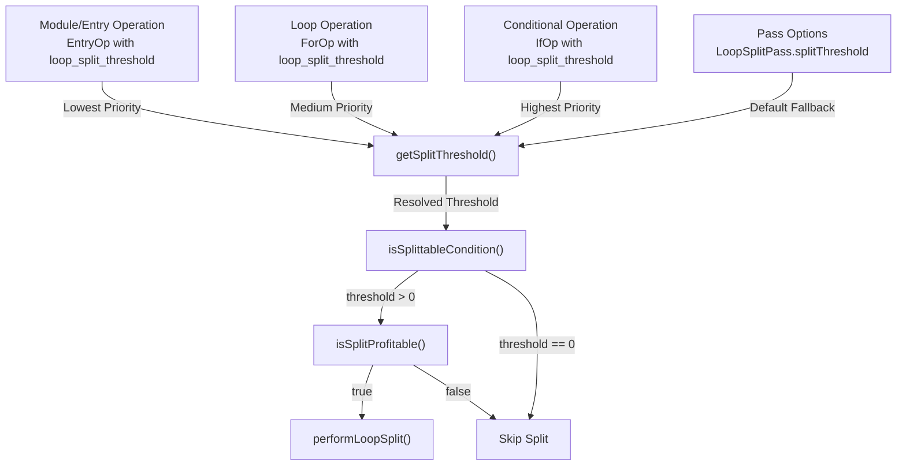
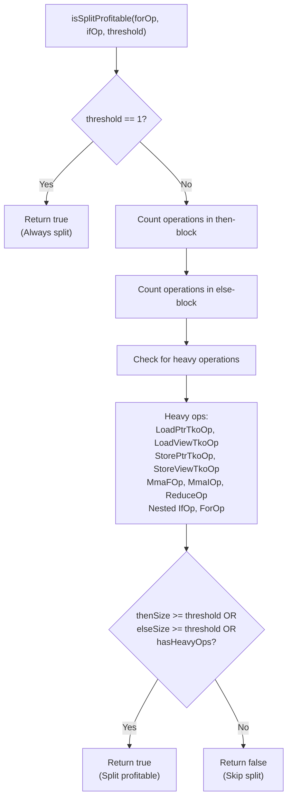
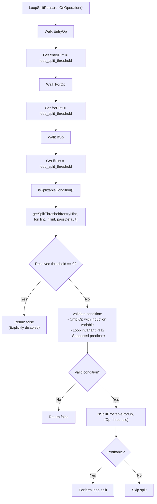
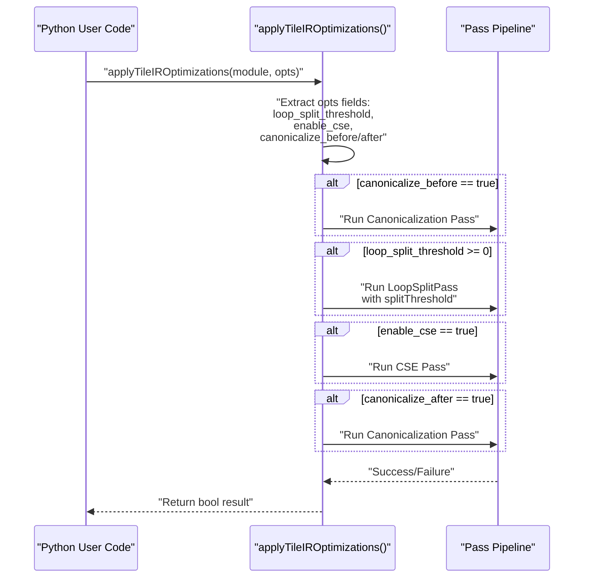

<!-- source: DeepWiki mcp.deepwiki.com · repo NVIDIA/cuda-tile · page 7.2 Optimization Hints and Attributes · fetched 2026-10-26 -->

# Optimization Hints and Attributes

<details>
<summary>Relevant source files</summary>

The following files were used as context for generating this wiki page:

- [lib/Dialect/CudaTile/Transforms/LoopSplit.cpp](lib/Dialect/CudaTile/Transforms/LoopSplit.cpp)
- [python/Dialect/DialectCudaTile.cpp](python/Dialect/DialectCudaTile.cpp)
- [python/SiteInitializer.cpp](python/SiteInitializer.cpp)

</details>


This page documents the optimization hint system in CUDA Tile IR, which allows users to control optimization behavior through attributes and configuration options. The system provides fine-grained control over transformation passes, particularly the loop splitting optimization.

For general information about attributes in the CudaTile dialect, see [Attribute System](#3.2). For details on the loop splitting transformation pass itself, see [Loop Splitting Pass](#7.1).

## Overview

The optimization hint system provides two mechanisms for controlling optimizations:

1. **Global Configuration** - Pass-level options that apply to entire modules via `TileIROptimizationsOpts`
2. **Operation Attributes** - Fine-grained hints attached to specific operations using `loop_split_threshold` and `OptimizationHintsAttr`

These mechanisms work together to enable both broad optimization strategies and targeted performance tuning for specific code regions or hardware architectures.

Sources: [python/Dialect/DialectCudaTile.cpp:37-64](), [lib/Dialect/CudaTile/Transforms/LoopSplit.cpp:312-336]()

## TileIROptimizationsOpts Configuration

The `TileIROptimizationsOpts` structure controls global optimization behavior when applying IR transformations. It is exposed through both C++ and Python APIs.

### Configuration Fields

| Field | Type | Default | Description |
|-------|------|---------|-------------|
| `loop_split_threshold` | `int` | `-1` | Minimum operation count to trigger loop splitting (disabled by default) |
| `enable_cse` | `bool` | `true` | Enable Common Subexpression Elimination pass |
| `canonicalize_before` | `bool` | `true` | Apply canonicalization before other optimizations |
| `canonicalize_after` | `bool` | `true` | Apply canonicalization after other optimizations |

### Python Usage

```python
from cuda_tile._cuda_tile import TileIROptimizationsOpts, applyTileIROptimizations

# Create configuration with custom settings
opts = TileIROptimizationsOpts()
opts.loop_split_threshold = 5  # Split loops with 5+ operations
opts.enable_cse = True
opts.canonicalize_before = True
opts.canonicalize_after = True

# Apply optimizations to module
success = applyTileIROptimizations(module, opts)
```

**Threshold Semantics:**
- `-1`: Loop splitting disabled
- `0`: Explicit disable for specific operations via attributes
- `1`: Split all eligible loops regardless of content
- `n > 1`: Split only if branch contains `n` or more operations, or contains "heavy" operations (memory ops, mma, reduce, nested control flow)

Sources: [python/Dialect/DialectCudaTile.cpp:37-64]()

## Three-Tier Threshold Hierarchy

The loop splitting optimization uses a three-tier precedence hierarchy for threshold values, allowing progressively finer control from kernel-level to statement-level hints.

### Hierarchy Diagram



### Threshold Resolution

The `getSplitThreshold()` function implements the precedence logic:

```
Priority (highest to lowest):
1. IfOp.loop_split_threshold - Most specific, controls individual branches
2. ForOp.loop_split_threshold - Controls all branches within a loop
3. EntryOp.loop_split_threshold - Controls all loops in a kernel
4. Pass option splitThreshold - Global default (typically 1)
```

**Resolution Algorithm:**
```
if IfOp has loop_split_threshold attribute:
    return IfOp.loop_split_threshold
else if ForOp has loop_split_threshold attribute:
    return ForOp.loop_split_threshold
else if EntryOp has loop_split_threshold attribute:
    return EntryOp.loop_split_threshold
else:
    return pass.splitThreshold (default: 1)
```

Sources: [lib/Dialect/CudaTile/Transforms/LoopSplit.cpp:312-327]()

## Setting Loop Split Threshold Attributes

### Python API

The `addLoopSplitThresholdAttr()` function attaches threshold attributes to operations:

```python
from cuda_tile._cuda_tile import addLoopSplitThresholdAttr

# Disable splitting for a specific loop
addLoopSplitThresholdAttr(for_op, threshold=0)

# Enable aggressive splitting for a branch
addLoopSplitThresholdAttr(if_op, threshold=1)

# Require 10+ operations for splitting
addLoopSplitThresholdAttr(entry_op, threshold=10)
```

**Implementation Details:**
- Creates an `i32` integer attribute with the threshold value
- Attaches it as a discardable attribute named `"loop_split_threshold"`
- Discardable attributes don't affect semantics but guide optimizations

Sources: [python/Dialect/DialectCudaTile.cpp:67-80]()

### Attribute Retrieval

The pass retrieves threshold attributes using `getLoopSplitThresholdAttr()`:

```cpp
// Returns std::optional<int>
auto threshold = getLoopSplitThresholdAttr(operation);
if (threshold.has_value()) {
    int value = threshold.value();
}
```

Sources: [lib/Dialect/CudaTile/Transforms/LoopSplit.cpp:329-336]()

## OptimizationHintsAttr

The `OptimizationHintsAttr` provides hardware-specific optimization hints for operations. It supports two categories of hints:

### Entry Operation Hints

Used on `EntryOp` to specify kernel launch configuration:

| Parameter | Type | Description |
|-----------|------|-------------|
| `arch` | `string` | Target GPU architecture (e.g., "sm_100") |
| `num_cta` | `int` | Number of CTAs (Cooperative Thread Arrays) |
| `occupancy` | `int` | Target occupancy level |

**Python Usage:**
```python
from cuda_tile._cuda_tile import OptimizationHintsAttr

hint = OptimizationHintsAttr.getEntryOpHint(
    cls=OptimizationHintsAttr,
    arch="sm_100",
    num_cta=8,
    occupancy=4,
    context=ctx
)
```

### Load/Store Operation Hints

Used on memory operations to control access patterns:

| Parameter | Type | Description |
|-----------|------|-------------|
| `arch` | `string` | Target GPU architecture |
| `allow_tma` | `optional<bool>` | Allow Tensor Memory Accelerator (TMA) |
| `latency` | `int` | Expected latency hint |

**Python Usage:**
```python
hint = OptimizationHintsAttr.getLoadStoreOpHint(
    cls=OptimizationHintsAttr,
    arch="sm_100",
    allow_tma=True,
    latency=100,
    context=ctx
)
```

Sources: [python/Dialect/DialectCudaTile.cpp:375-409]()

## Profitability Heuristics

The loop splitting pass uses profitability heuristics to avoid unprofitable transformations.

### Profitability Determination Flow



### Heuristic Rules

The `isSplitProfitable()` function applies these rules:

1. **Threshold 1 (Always Split)**: If threshold is 1, immediately return true without analysis
2. **Operation Count**: Split if either then-block or else-block contains `threshold` or more operations
3. **Heavy Operations**: Split if any branch contains:
   - Memory operations: `LoadPtrTkoOp`, `LoadViewTkoOp`, `StorePtrTkoOp`, `StoreViewTkoOp`
   - Compute operations: `MmaFOp`, `MmaIOp`, `ReduceOp`
   - Control flow: Nested `IfOp` or `ForOp`

**Rationale**: Heavy operations benefit more from loop specialization because they dominate execution time. Splitting loops removes conditional checks from critical inner loops.

Sources: [lib/Dialect/CudaTile/Transforms/LoopSplit.cpp:69-96]()

## Attribute Validation Flow



### Validation Steps

1. **Attribute Retrieval**: Extract `loop_split_threshold` from IfOp, ForOp, and EntryOp
2. **Threshold Resolution**: Apply three-tier precedence hierarchy via `getSplitThreshold()`
3. **Explicit Disable Check**: If threshold is 0, immediately reject split
4. **Condition Validation**: Ensure comparison involves induction variable with loop-invariant RHS
5. **Profitability Analysis**: Check operation count and heavy operation presence
6. **Split Execution**: If all checks pass, perform loop transformation

Sources: [lib/Dialect/CudaTile/Transforms/LoopSplit.cpp:341-374]()

## Integration with Optimization Pipeline

### Applying Optimizations from Python



### Pass Configuration Example

```python
# Aggressive optimization: split all loops, full canonicalization
aggressive_opts = TileIROptimizationsOpts()
aggressive_opts.loop_split_threshold = 1
aggressive_opts.enable_cse = True
aggressive_opts.canonicalize_before = True
aggressive_opts.canonicalize_after = True

# Conservative: only split large branches
conservative_opts = TileIROptimizationsOpts()
conservative_opts.loop_split_threshold = 10
conservative_opts.enable_cse = True

# Disable loop splitting entirely
no_split_opts = TileIROptimizationsOpts()
no_split_opts.loop_split_threshold = -1
```

Sources: [python/Dialect/DialectCudaTile.cpp:55-64]()

## Complete Example: Multi-Level Threshold Control

This example demonstrates using all three hierarchy levels to achieve fine-grained control:

```python
# Set global default for entire kernel
entry_op = create_entry("my_kernel", arg_types)
addLoopSplitThresholdAttr(entry_op, threshold=5)  # Require 5+ ops globally

# Override for performance-critical outer loop
outer_loop = for_loop(...)
addLoopSplitThresholdAttr(outer_loop, threshold=1)  # Always split

# Disable for specific problematic branch
inner_if = if_generate(condition)
addLoopSplitThresholdAttr(inner_if, threshold=0)  # Never split this branch

# Apply optimizations with pass-level defaults
opts = TileIROptimizationsOpts()
opts.loop_split_threshold = 3  # Fallback for unmarked operations
applyTileIROptimizations(module, opts)
```

**Resolution for different operations:**
- `inner_if`: Uses threshold=0 (IfOp attribute, highest priority) → Not split
- Other IfOps in `outer_loop`: Uses threshold=1 (ForOp attribute) → Always split
- IfOps in other loops under `entry_op`: Uses threshold=5 (EntryOp attribute) → Split if 5+ ops
- Unmarked operations: Uses threshold=3 (pass option) → Split if 3+ ops

Sources: [lib/Dialect/CudaTile/Transforms/LoopSplit.cpp:312-327](), [python/Dialect/DialectCudaTile.cpp:67-80]()

---

