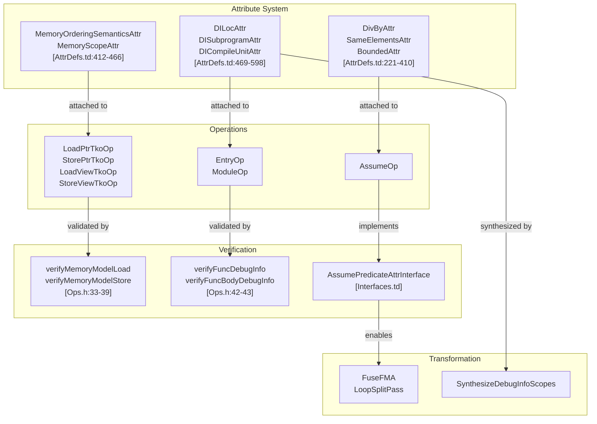
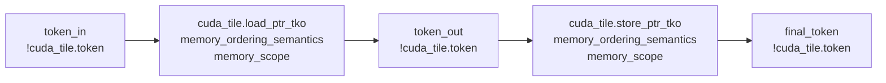
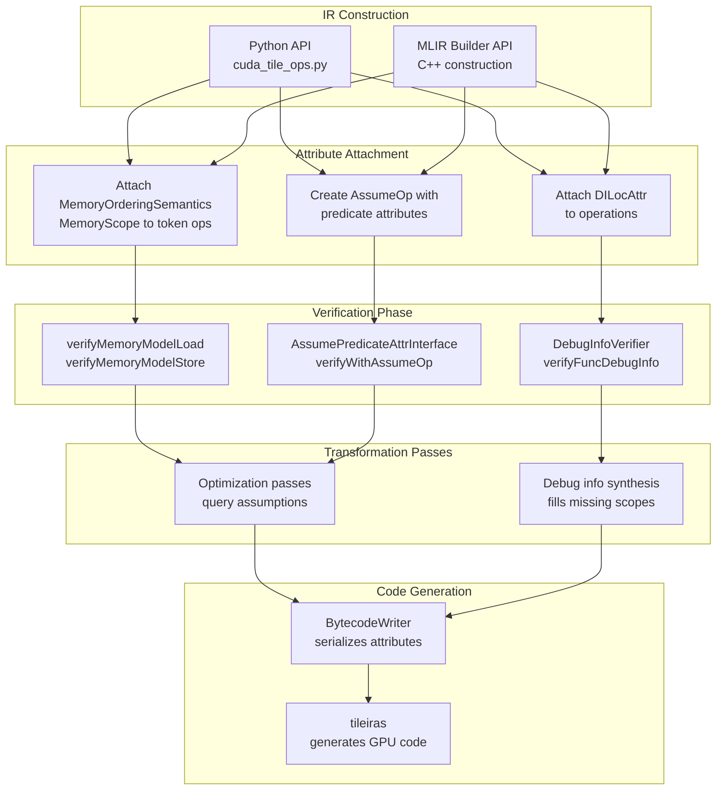

<!-- source: DeepWiki mcp.deepwiki.com · repo NVIDIA/cuda-tile · page 8 Advanced Topics · fetched 2026-10-26 -->

# Advanced Topics

<details>
<summary>Relevant source files</summary>

The following files were used as context for generating this wiki page:

- [lib/Dialect/CudaTile/IR/CudaTile.cpp](lib/Dialect/CudaTile/IR/CudaTile.cpp)

</details>


This page provides an overview of specialized CUDA Tile IR features that enable fine-grained control over concurrency, debugging, and optimization. These features are designed for users who need to:

- Specify precise memory synchronization semantics for concurrent GPU operations
- Generate source-level debug information for profiling and debugging
- Communicate semantic guarantees to enable aggressive compiler optimizations

The three major advanced feature areas are:

| Feature Area | Subsection | Purpose |
|--------------|-----------|---------|
| **Memory Model and Synchronization** | [8.1](#8.1) | Token-based memory ordering, scoping semantics |
| **Debug Information System** | [8.2](#8.2) | DWARF-compatible debug attributes and verification |
| **Assumption Predicates** | [8.3](#8.3) | Divisibility, boundedness, and pattern assumptions |

For optimization configuration, see [Optimization and Transformation](#7). For API usage, see [API Reference](#5). For core types and operations, see [Core Dialect](#3).

**Sources:** [lib/Dialect/CudaTile/IR/CudaTile.cpp:1-4252](), [include/cuda_tile/Dialect/CudaTile/IR/AttrDefs.td:1-599]()

## System Architecture

Advanced features integrate with the dialect through MLIR's attribute system, specialized verification infrastructure, and transformation passes. The diagram below shows how these components interact:



**Diagram: Advanced Feature Integration Architecture**

**Sources:** [include/cuda_tile/Dialect/CudaTile/IR/AttrDefs.td:1-599](), [include/cuda_tile/Dialect/CudaTile/IR/Ops.h:1-99](), [lib/Dialect/CudaTile/IR/CudaTile.cpp:1-4252]()

## Memory Model and Synchronization Overview

CUDA Tile IR uses a token-based memory model to express concurrent memory access semantics. Memory operations accept and produce `!cuda_tile.token` values that establish ordering constraints between loads and stores.



**Diagram: Token-Based Memory Ordering**

The memory model is controlled by two attribute types:

- **MemoryOrderingSemantics** - Defines synchronization strength (`WEAK`, `RELAXED`, `ACQUIRE`, `RELEASE`, `ACQ_REL`)
- **MemoryScope** - Defines synchronization breadth (`TL_BLK`, `DEVICE`, `SYS`)

Operations using tokens include:
- `LoadPtrTkoOp`, `StorePtrTkoOp` - Pointer-based memory operations [lib/Dialect/CudaTile/IR/CudaTile.cpp:3145-3153]()
- `LoadViewTkoOp`, `StoreViewTkoOp` - View-based memory operations [lib/Dialect/CudaTile/IR/CudaTile.cpp:3135-3141]()
- `AtomicRMWTkoOp`, `AtomicCASTkoOp` - Atomic operations [lib/Dialect/CudaTile/IR/CudaTile.cpp:1299-1403]()

Verification is performed by `verifyMemoryModelLoad` and `verifyMemoryModelStore` functions that enforce consistency between ordering semantics and scope attributes [lib/Dialect/CudaTile/IR/CudaTile.cpp:3102-3129]().

For complete details on memory semantics, scope rules, and verification, see [Memory Model and Synchronization](#8.1).

**Sources:** [include/cuda_tile/Dialect/CudaTile/IR/AttrDefs.td:412-466](), [lib/Dialect/CudaTile/IR/CudaTile.cpp:3102-3153]()


## Debug Information System Overview

CUDA Tile IR implements a DWARF-compatible debug information system through specialized location attributes. The system enables source-level debugging, profiling, and error reporting by attaching structured debug metadata to operations.

The `DebugInfoVerifier` class [lib/Dialect/CudaTile/IR/CudaTile.cpp:1090-1202]() enforces hierarchical consistency rules:

1. **Rule 1**: If a function has scope, it must have subprogram scope
2. **Rule 2**: Function name must match subprogram linkage name
3. **Rule 3**: If a function lacks scope, its operations must not have scope
4. **Rule 4**: Operation scope must match function scope
5. **Rule 5**: Global variables must not have scope
6. **Rule 6**: Function location must not be a `CallSiteLoc`

The debug attribute hierarchy consists of:

| Attribute | Role | Parameters |
|-----------|------|------------|
| `DILocAttr` | Associates operation with source location and scope | `FileLineColLoc`, `DILocalScopeAttr` |
| `DIFileAttr` | Represents source file | `name`, `directory` |
| `DICompileUnitAttr` | Compilation unit root | `file` |
| `DISubprogramAttr` | Function/method scope | `file`, `line`, `name`, `linkageName`, `compileUnit`, `scopeLine` |
| `DILexicalBlockAttr` | Nested block scope | `scope`, `file`, `line`, `column` |

Verification occurs at two levels:
- `verifyFuncDebugInfo` - Validates function-level attributes [lib/Dialect/CudaTile/IR/CudaTile.cpp:1204-1206]()
- `verifyFuncBodyDebugInfo` - Validates operation-level attributes [lib/Dialect/CudaTile/IR/CudaTile.cpp:1208-1211]()

Operations like `EntryOp` invoke these verifiers during their `verify()` and `verifyRegions()` methods [lib/Dialect/CudaTile/IR/CudaTile.cpp:2278-2287]().

For complete details on debug attribute structure, verification rules, and location synthesis, see [Debug Information System](#8.2).

**Sources:** [include/cuda_tile/Dialect/CudaTile/IR/AttrDefs.td:469-598](), [lib/Dialect/CudaTile/IR/CudaTile.cpp:1090-1211]()

## Assumption Predicates Overview

Assumption predicates enable developers to communicate semantic guarantees about values, allowing the compiler to perform aggressive optimizations that would otherwise be unsafe. The `AssumeOp` operation [lib/Dialect/CudaTile/IR/CudaTile.cpp:1275-1293]() accepts a predicate attribute and a value, producing an annotated value that optimization passes can query.

All assumption predicates implement the `AssumePredicateAttrInterface`, which requires a `verifyWithAssumeOp` method to validate the predicate's applicability to the assumed value type. The three predicate types are:

| Predicate | Purpose | Parameters | Applies To |
|-----------|---------|------------|------------|
| `DivByAttr` | Divisibility constraints | `divisor`, `every`, `along` | Integer tiles, pointer tiles, tensor views |
| `SameElementsAttr` | Element repetition patterns | `values` (array) | Integer tiles, pointer tiles |
| `BoundedAttr` | Integer range bounds | `lb`, `ub` | Integer tiles |

The `AssumeOp` verification delegates to the predicate's interface method [lib/Dialect/CudaTile/IR/CudaTile.cpp:1275-1277]():

```cpp
LogicalResult AssumeOp::verify() {
  return getPredicate().verifyWithAssumeOp(getOperation());
}
```

Optimization passes can query assumption predicates to enable transformations such as:

- **Alignment-based vectorization** - `DivByAttr` guarantees enable aligned memory operations
- **Broadcast pattern recognition** - `SameElementsAttr` identifies redundant computations
- **Bounds check elimination** - `BoundedAttr` proves range constraints
- **Address arithmetic simplification** - `DivByAttr` eliminates modulo operations

For complete predicate semantics, verification rules, and optimization patterns, see [Assumption Predicates](#8.3).

**Sources:** [include/cuda_tile/Dialect/CudaTile/IR/AttrDefs.td:221-410](), [lib/Dialect/CudaTile/IR/CudaTile.cpp:1275-1293]()

## Feature Integration and Compilation Flow

Advanced features integrate at multiple points in the compilation pipeline, from IR construction through final code generation:



**Diagram: Advanced Features in Compilation Pipeline**

The diagram shows how advanced attributes flow through the compilation process:

1. **Construction** - Python or C++ APIs create operations with attributes
2. **Attachment** - Attributes are attached to appropriate operations (memory ops, functions, assume ops)
3. **Verification** - Specialized verifiers check attribute validity and consistency
4. **Transformation** - Optimization passes query attributes to guide transformations
5. **Serialization** - BytecodeWriter preserves attributes in `.tilebc` format
6. **Generation** - `tileiras` tool uses attributes for target-specific code generation

This integration ensures that advanced features are consistently verified, preserved through transformations, and available to backend code generators.

**Sources:** [lib/Dialect/CudaTile/IR/CudaTile.cpp:1-4252](), [include/cuda_tile/Dialect/CudaTile/IR/AttrDefs.td:1-599]()

## Summary

Advanced CUDA Tile IR features provide fine-grained control over three critical aspects:

1. **Memory Model** ([8.1](#8.1)): `MemoryOrderingSemantics` and `MemoryScope` attributes define concurrent access patterns with verification through `verifyMemoryModelLoad` and `verifyMemoryModelStore`

2. **Debug Information** ([8.2](#8.2)): Hierarchical attributes (`DILocAttr`, `DISubprogramAttr`, `DICompileUnitAttr`, etc.) enable source-level debugging with verification through `verifyFuncDebugInfo`

3. **Assumption Predicates** ([8.3](#8.3)): `DivByAttr`, `SameElementsAttr`, and `BoundedAttr` communicate guarantees to enable optimizations through the `AssumePredicateAttrInterface`

These features integrate with the dialect's verification infrastructure and optimization passes to enable correct, debuggable, high-performance GPU code generation.

**Sources:** [include/cuda_tile/Dialect/CudaTile/IR/AttrDefs.td:1-599](), [include/cuda_tile/Dialect/CudaTile/IR/Ops.h:1-99]()

---

