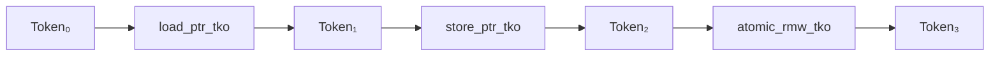
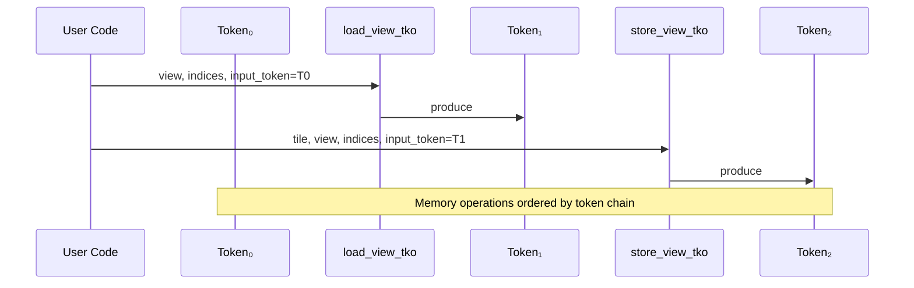
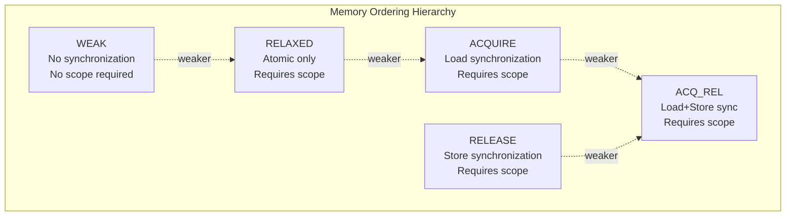
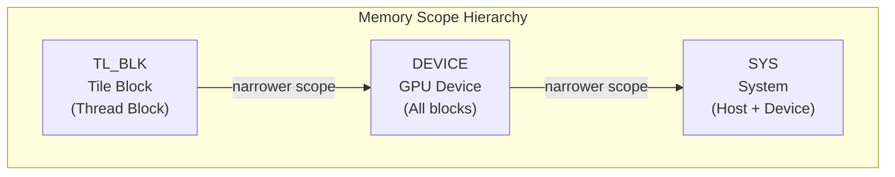
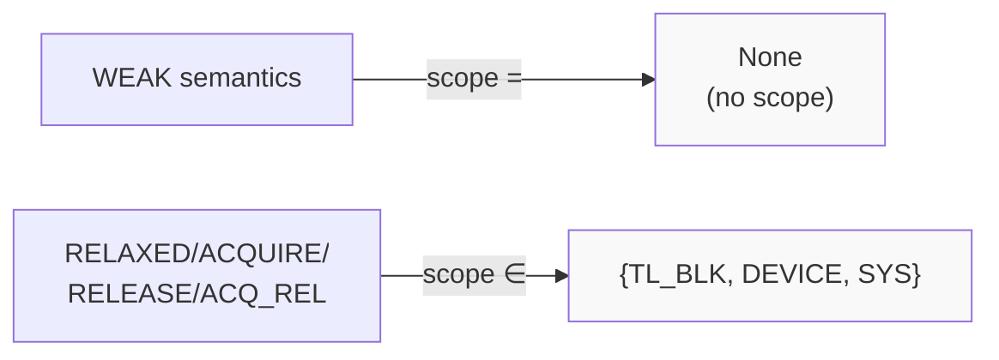
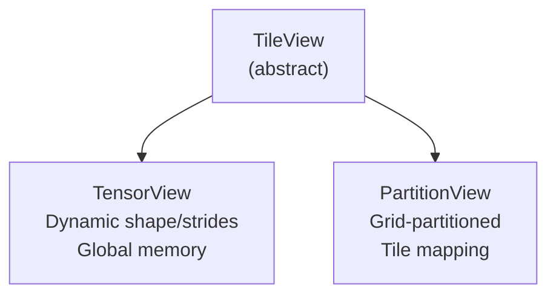
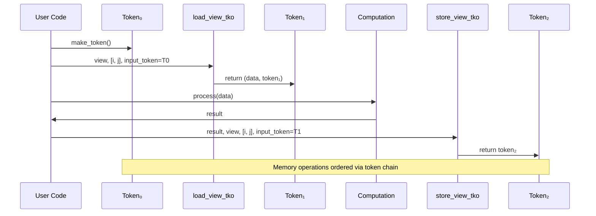
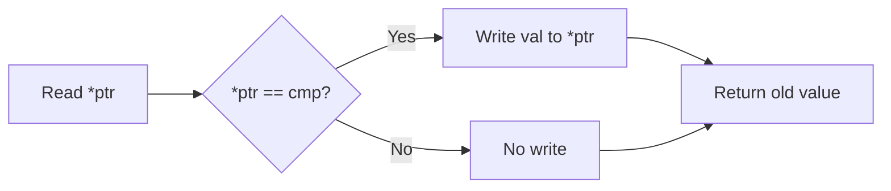
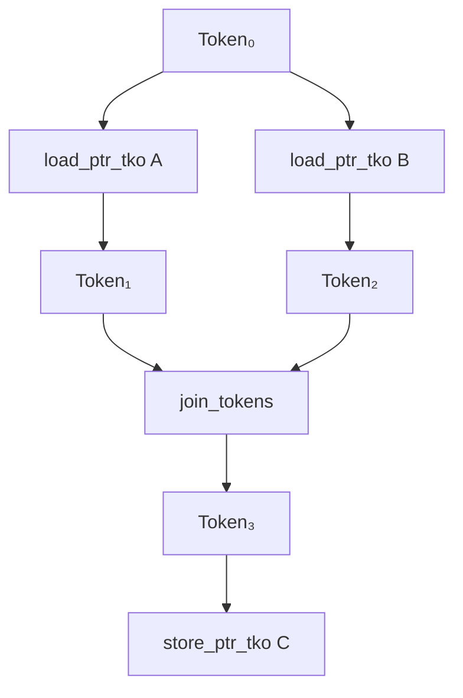

<!-- source: DeepWiki mcp.deepwiki.com · repo NVIDIA/cuda-tile · page 8.1 Memory Model and Synchronization · fetched 2026-10-26 -->

# Memory Model and Synchronization

<details>
<summary>Relevant source files</summary>

The following files were used as context for generating this wiki page:

- [lib/Dialect/CudaTile/IR/CudaTile.cpp](lib/Dialect/CudaTile/IR/CudaTile.cpp)
- [python/cuda_tile/dialects/cuda_tile_ops.py](python/cuda_tile/dialects/cuda_tile_ops.py)

</details>


## Purpose and Scope

This document describes the memory model and synchronization mechanisms in CUDA Tile IR, focusing on token-based memory ordering, memory semantics, and atomic operations. The memory model provides explicit control over memory ordering and visibility across different scopes of GPU execution.

For details on specific memory operation types (load, store, atomic), see [Memory Operations](#3.3.2). For the `TokenType` definition, see [Type System](#3.1).

## Overview

CUDA Tile IR uses a **token-based memory ordering system** where memory operations are explicitly ordered through token dependencies. This approach provides:

- Explicit control over memory operation ordering
- Fine-grained synchronization at different memory scopes
- Support for weak, relaxed, acquire/release, and sequentially consistent semantics
- Integration with atomic read-modify-write operations

The token system is reflected in operation names with the `_tko` suffix (token-ordered).

Sources: [lib/Dialect/CudaTile/IR/CudaTile.cpp:1020-1074](), [python/cuda_tile/dialects/cuda_tile_ops.py:175-207]()

## Token-Based Ordering System

### Token Concept

A `Token` represents a synchronization point in the execution stream. Memory operations consume and produce tokens to establish ordering dependencies:



**Token Creation and Management**

| Function | Purpose | Signature |
|----------|---------|-----------|
| `make_token()` | Create initial token | `() -> Token` |
| `join_tokens(*tokens)` | Merge multiple tokens | `(Token...) -> Token` |
| Memory operations | Consume and produce tokens | `(..., token=Token) -> (Tile, Token)` |

**Python Token Class**

The `Token` class wraps IR values of `TokenType`:

[python/cuda_tile/dialects/cuda_tile_ops.py:945-959]()

```python
class Token(_ods_ir.Value):
    """A class representing a Token object."""
    value: _ods_ir.Value
    
    def __init__(self, value: _ods_ir.Value):
        if not TokenType.isinstance(value.type):
            raise Exception("Token must have TokenType type")
```

**Token Operations**

[python/cuda_tile/dialects/cuda_tile_ops.py:2598-2619]()

Sources: [python/cuda_tile/dialects/cuda_tile_ops.py:945-959](), [python/cuda_tile/dialects/cuda_tile_ops.py:2598-2619]()

### Token Flow Example



Sources: [python/cuda_tile/dialects/cuda_tile_ops.py:2467-2554](), [python/cuda_tile/dialects/cuda_tile_ops.py:2747-2831]()

## Memory Ordering Semantics

CUDA Tile IR defines five memory ordering levels, based on C++11/C11 memory models:

### MemoryOrderingSemantics Enumeration



### Semantics Details

| Semantic | Use Case | Operations | Scope Required | Description |
|----------|----------|------------|----------------|-------------|
| `WEAK` | Default loads/stores | Load, Store | No | No synchronization guarantees; compiler may reorder |
| `RELAXED` | Atomic counters | Atomic | Yes | Guarantees atomicity but no ordering w.r.t. other operations |
| `ACQUIRE` | Consumer synchronization | Load, Atomic | Yes | Prevents later operations from moving before this load |
| `RELEASE` | Producer synchronization | Store, Atomic | Yes | Prevents earlier operations from moving after this store |
| `ACQ_REL` | Read-modify-write | Atomic | Yes | Combines acquire (for read) and release (for write) |

**Python Enumeration**

[python/cuda_tile/dialects/cuda_tile_ops.py:197-207]()

```python
class MemoryOrderingSemantics(Enum):
    WEAK = "weak"
    RELAXED = "relaxed"
    ACQUIRE = "acquire"
    RELEASE = "release"
    ACQ_REL = "acq_rel"
```

**Attribute Creation**

[python/cuda_tile/dialects/cuda_tile_ops.py:310-326]()

Sources: [python/cuda_tile/dialects/cuda_tile_ops.py:197-207](), [python/cuda_tile/dialects/cuda_tile_ops.py:310-326](), [lib/Dialect/CudaTile/IR/CudaTile.cpp:1020-1064]()

### Verification Rules

The C++ implementation enforces semantics constraints:

**Atomic Operations**

[lib/Dialect/CudaTile/IR/CudaTile.cpp:1354-1363]()

Valid semantics for `AtomicRMWTkoOp` and `AtomicCASTkoOp`: `RELAXED`, `ACQUIRE`, `RELEASE`, `ACQ_REL`

**Load Operations**

Valid semantics for loads: `WEAK`, `RELAXED`, `ACQUIRE`

**Store Operations**

Valid semantics for stores: `WEAK`, `RELAXED`, `RELEASE`

Sources: [lib/Dialect/CudaTile/IR/CudaTile.cpp:1299-1365](), [lib/Dialect/CudaTile/IR/CudaTile.cpp:1371-1403]()

## Memory Scope

Memory scope defines the visibility of memory operations across different levels of the GPU hierarchy.

### MemoryScope Enumeration



| Scope | Value | Visibility | Use Case |
|-------|-------|------------|----------|
| `TL_BLK` | `"tl_blk"` | Within thread block only | Shared memory synchronization within block |
| `DEVICE` | `"device"` | Across all thread blocks on GPU | Global memory synchronization on device |
| `SYS` | `"sys"` | Across host and device | CPU-GPU coherent memory operations |

**Python Enumeration**

[python/cuda_tile/dialects/cuda_tile_ops.py:175-182]()

```python
class MemoryScope(Enum):
    TL_BLK = "tl_blk"
    DEVICE = "device"
    SYS = "sys"
```

**Scope Requirement Rules**



- `WEAK` semantics: **Must not** specify a memory scope
- `RELAXED`, `ACQUIRE`, `RELEASE`, `ACQ_REL`: **Must** specify a memory scope

**Verification in C++**

[lib/Dialect/CudaTile/IR/CudaTile.cpp:1046-1064]()

```cpp
// Weak operations must not have scope
if (attrOptional.value() == cuda_tile::MemoryOrderingSemantics::WEAK) {
  if (keyword was parsed) {
    return parser.emitError(loc)
      << "operation specifies weak memory ordering semantics, but then provides scope";
  }
}
```

Sources: [python/cuda_tile/dialects/cuda_tile_ops.py:175-182](), [python/cuda_tile/dialects/cuda_tile_ops.py:283-298](), [lib/Dialect/CudaTile/IR/CudaTile.cpp:1020-1064]()

## Memory Operations

### Load Operations

CUDA Tile IR provides two primary load operations:

#### load_ptr_tko

Loads from a tile of pointers with explicit memory ordering.

**Signature**

[python/cuda_tile/dialects/cuda_tile_ops.py:2323-2338]()

```python
def load_ptr_tko(
    result: TileType,
    source: Tile,  # Tile of pointers
    *,
    memory_ordering_semantics: MemoryOrderingSemantics = WEAK,
    memory_scope: MemoryScope = None,
    input_token: Token = None,
    mask: Tile = None,
    padding_value: Tile = None,
    return_token: bool = False,
    # ... optimization hints
) -> Tile | Tuple[Tile, Token]
```

**Parameters**

| Parameter | Type | Description |
|-----------|------|-------------|
| `result` | `TileType` | Shape and element type of result |
| `source` | `Tile` | Tile of pointers (element type must be `PointerType`) |
| `memory_ordering_semantics` | Enum | `WEAK`, `RELAXED`, or `ACQUIRE` |
| `memory_scope` | Enum | Required if not `WEAK`: `TL_BLK`, `DEVICE`, or `SYS` |
| `input_token` | `Token` | Optional token for ordering |
| `mask` | `Tile` | Optional i1 tile for conditional loads |
| `padding_value` | `Tile` | Value for masked-out elements (requires mask) |
| `return_token` | `bool` | If True, return `(Tile, Token)`; else return `Tile` |

**Example Usage**

```python
# Weak load (no synchronization)
data = load_ptr_tko(result_type, ptrs)

# Acquire load with device scope
data, token = load_ptr_tko(
    result_type, ptrs,
    memory_ordering_semantics=MemoryOrderingSemantics.ACQUIRE,
    memory_scope=MemoryScope.DEVICE,
    input_token=input_tok,
    return_token=True
)

# Masked load with padding
data = load_ptr_tko(
    result_type, ptrs,
    mask=valid_mask,
    padding_value=zeros
)
```

Sources: [python/cuda_tile/dialects/cuda_tile_ops.py:2323-2464]()

#### load_view_tko

Loads from a view (TensorView or PartitionView) with index-based access.

**Signature**

[python/cuda_tile/dialects/cuda_tile_ops.py:2467-2481]()

```python
def load_view_tko(
    view: TileView,
    indices: Sequence[Tile | int],
    *,
    memory_ordering_semantics: MemoryOrderingSemantics = WEAK,
    memory_scope: MemoryScope = None,
    input_token: Token = None,
    return_token: bool = False,
    # ... optimization hints
) -> Tile | Tuple[Tile, Token]
```

**View Types**



**Index Handling**

[python/cuda_tile/dialects/cuda_tile_ops.py:2512-2513]()

Indices can be:
- `int`: Converted to constant scalar tiles
- `Tile`: Scalar integer tiles

The function `_index_list_to_tiles` normalizes indices to ensure type consistency.

Sources: [python/cuda_tile/dialects/cuda_tile_ops.py:2467-2554](), [python/cuda_tile/dialects/cuda_tile_ops.py:988-1025]()

### Store Operations

#### store_ptr_tko

Stores to a tile of pointers with explicit memory ordering.

**Signature**

[python/cuda_tile/dialects/cuda_tile_ops.py:2622-2635]()

```python
def store_ptr_tko(
    destination: Tile,  # Tile of pointers
    value: Tile,
    *,
    memory_ordering_semantics: MemoryOrderingSemantics = WEAK,
    memory_scope: MemoryScope = None,
    input_token: Token = None,
    mask: Tile = None,
    # ... optimization hints
) -> Token
```

**Semantics Constraints**

Valid semantics for stores: `WEAK`, `RELAXED`, `RELEASE`

[python/cuda_tile/dialects/cuda_tile_ops.py:2691-2698]()

Sources: [python/cuda_tile/dialects/cuda_tile_ops.py:2622-2744]()

#### store_view_tko

Stores to a view with index-based access.

**Signature**

[python/cuda_tile/dialects/cuda_tile_ops.py:2747-2761]()

```python
def store_view_tko(
    tile: Tile,
    view: TileView,
    indices: Sequence[Tile | int],
    *,
    memory_ordering_semantics: MemoryOrderingSemantics = WEAK,
    memory_scope: MemoryScope = None,
    input_token: Token = None,
    # ... optimization hints
) -> Token
```

**Validation**

[python/cuda_tile/dialects/cuda_tile_ops.py:2767-2770]()

```python
if tile.tile_type != view.view_tile_type:
    raise TypeError(
        f"Expected tile type to be {view.view_tile_type}, got {tile.tile_type}"
    )
```

Sources: [python/cuda_tile/dialects/cuda_tile_ops.py:2747-2831]()

### Memory Operation Pattern



Sources: [python/cuda_tile/dialects/cuda_tile_ops.py:2467-2554](), [python/cuda_tile/dialects/cuda_tile_ops.py:2747-2831]()

## Atomic Operations

Atomic operations provide read-modify-write semantics with strong memory ordering guarantees.

### atomic_rmw_tko

Atomic read-modify-write operation.

**Signature**

[python/cuda_tile/dialects/cuda_tile_ops.py:1688-1700]()

```python
def atomic_rmw_tko(
    memory_ordering_semantics: MemoryOrderingSemantics,
    memory_scope: MemoryScope,
    pointers: Tile,
    mode: AtomicRMWMode,
    arg: Tile,
    *,
    input_token: Token = None,
    return_token: bool = False,
) -> Tile | Tuple[Tile, Token]
```

**AtomicRMWMode Enumeration**

[python/cuda_tile/dialects/cuda_tile_ops.py:157-173]()

```python
class AtomicRMWMode(Enum):
    AND = "and"      # Bitwise AND (integer)
    OR = "or"        # Bitwise OR (integer)
    XOR = "xor"      # Bitwise XOR (integer)
    ADD = "add"      # Integer addition
    ADDF = "addf"    # Float addition
    MAX = "max"      # Signed max
    MIN = "min"      # Signed min
    UMAX = "umax"    # Unsigned max
    UMIN = "umin"    # Unsigned min
    XCHG = "xchg"    # Exchange
```

**Type Constraints**

[lib/Dialect/CudaTile/IR/CudaTile.cpp:1317-1352]()

| Mode | Allowed Types | Notes |
|------|---------------|-------|
| `AND`, `OR`, `XOR`, `ADD`, `MAX`, `MIN`, `UMAX`, `UMIN` | `i32`, `i64` | Integer operations |
| `ADDF` | `f16`, `f32`, `f64` | Float addition |
| `XCHG` | `i32`, `i64`, `f32`, `f64` | Exchange (32 or 64 bit) |

**Memory Ordering Constraint**

[lib/Dialect/CudaTile/IR/CudaTile.cpp:1354-1363]()

Valid semantics: `RELAXED`, `ACQUIRE`, `RELEASE`, `ACQ_REL` (not `WEAK`)

Sources: [python/cuda_tile/dialects/cuda_tile_ops.py:1688-1758](), [lib/Dialect/CudaTile/IR/CudaTile.cpp:1299-1365]()

### atomic_cas_tko

Atomic compare-and-swap operation.

**Signature**

[python/cuda_tile/dialects/cuda_tile_ops.py:1612-1625]()

```python
def atomic_cas_tko(
    memory_ordering_semantics: MemoryOrderingSemantics,
    memory_scope: MemoryScope,
    pointers: Tile,
    cmp: Tile,      # Compare value
    val: Tile,      # New value
    mask: Tile = None,
    *,
    input_token: Token = None,
    return_token: bool = False,
) -> Tile | Tuple[Tile, Token]
```

**Semantics**



**Type Constraints**

[lib/Dialect/CudaTile/IR/CudaTile.cpp:1376-1384]()

- Element types: Float or Integer
- Bitwidth: 32 or 64 bits

**Memory Ordering Constraint**

[lib/Dialect/CudaTile/IR/CudaTile.cpp:1393-1401]()

Valid semantics: `RELAXED`, `ACQUIRE`, `RELEASE`, `ACQ_REL`

Sources: [python/cuda_tile/dialects/cuda_tile_ops.py:1612-1686](), [lib/Dialect/CudaTile/IR/CudaTile.cpp:1371-1403]()

### Atomic Operation Example

```python
# Atomic increment with acquire-release semantics
old_val, token = atomic_rmw_tko(
    memory_ordering_semantics=MemoryOrderingSemantics.ACQ_REL,
    memory_scope=MemoryScope.DEVICE,
    pointers=counter_ptr,
    mode=AtomicRMWMode.ADD,
    arg=constant(1, tile_type=i32_scalar),
    input_token=input_tok,
    return_token=True
)

# Atomic compare-and-swap for lock-free algorithm
expected = constant(0, tile_type=i32_scalar)
desired = constant(1, tile_type=i32_scalar)
old_val = atomic_cas_tko(
    memory_ordering_semantics=MemoryOrderingSemantics.ACQ_REL,
    memory_scope=MemoryScope.DEVICE,
    pointers=lock_ptr,
    cmp=expected,
    val=desired
)
```

Sources: [python/cuda_tile/dialects/cuda_tile_ops.py:1612-1758]()

## Token Management Operations

### make_token

Creates a new independent token for starting a token chain.

**Signature**

[python/cuda_tile/dialects/cuda_tile_ops.py:2598-2600]()

```python
def make_token(*, loc=None, ip=None) -> Token:
    return return_results(_cuda_tile.MakeTokenOp(loc=loc, ip=ip))
```

**Usage Pattern**

```python
# Start new token chain
token0 = make_token()
data, token1 = load_ptr_tko(..., input_token=token0, return_token=True)
token2 = store_ptr_tko(..., input_token=token1)
```

Sources: [python/cuda_tile/dialects/cuda_tile_ops.py:2598-2600]()

### join_tokens

Merges multiple token dependencies into a single token.

**Signature**

[python/cuda_tile/dialects/cuda_tile_ops.py:2603-2619]()

```python
def join_tokens(*tokens, loc=None, ip=None) -> Token:
    """Join multiple tokens into a single token."""
    if not all(isinstance(token, Token) for token in tokens):
        raise TypeError("All arguments must be Token objects")
    return return_results(_cuda_tile.JoinTokensOp(tokens=tokens, loc=loc, ip=ip))
```

**Synchronization Pattern**



**Example**

```python
# Load from two independent sources
token0 = make_token()
dataA, token1 = load_ptr_tko(..., input_token=token0, return_token=True)
dataB, token2 = load_ptr_tko(..., input_token=token0, return_token=True)

# Join tokens before dependent operation
token3 = join_tokens(token1, token2)
result = compute(dataA, dataB)
token4 = store_ptr_tko(result, ..., input_token=token3)
```

Sources: [python/cuda_tile/dialects/cuda_tile_ops.py:2603-2619]()

## Parsing and Printing Memory Attributes

The C++ implementation provides custom parsing and printing for memory attributes in the textual IR format.

### parseMemoryAttributes

[lib/Dialect/CudaTile/IR/CudaTile.cpp:1023-1065]()

Parses memory ordering semantics and optional scope:

**Format**: `<semantics> [scope]`

Examples:
- `weak` (no scope)
- `relaxed device`
- `acquire tl_blk`
- `release sys`

**Validation**:
- `WEAK` operations must not have a scope
- Non-`WEAK` operations must specify a valid scope

### printMemoryAttributes

[lib/Dialect/CudaTile/IR/CudaTile.cpp:1067-1074]()

Prints memory attributes in textual format:

```cpp
static void printMemoryAttributes(
    OpAsmPrinter &printer, Operation *,
    MemoryOrderingSemanticsAttr memoryOrderingSemantics,
    MemoryScopeAttr memoryScopeAttr) {
  printer << memoryOrderingSemantics.getValue();
  if (memoryScopeAttr)
    printer << ' ' << memoryScopeAttr.getValue();
}
```

Sources: [lib/Dialect/CudaTile/IR/CudaTile.cpp:1020-1074]()

## Memory Model Summary

### Key Design Principles

1. **Explicit Ordering**: All memory dependencies expressed through tokens
2. **Hierarchical Scopes**: Three-level scope hierarchy (block, device, system)
3. **C11/C++11 Compatible**: Semantics align with standard memory models
4. **Type Safety**: Python and C++ layers enforce constraints at compile time
5. **Weak Default**: Default `WEAK` semantics for optimal performance when synchronization not needed

### Semantic Matrix

| Operation Type | WEAK | RELAXED | ACQUIRE | RELEASE | ACQ_REL |
|----------------|------|---------|---------|---------|---------|
| `load_ptr_tko` | ✓ | ✓ | ✓ | ✗ | ✗ |
| `load_view_tko` | ✓ | ✓ | ✓ | ✗ | ✗ |
| `store_ptr_tko` | ✓ | ✓ | ✗ | ✓ | ✗ |
| `store_view_tko` | ✓ | ✓ | ✗ | ✓ | ✗ |
| `atomic_rmw_tko` | ✗ | ✓ | ✓ | ✓ | ✓ |
| `atomic_cas_tko` | ✗ | ✓ | ✓ | ✓ | ✓ |

### Scope Requirements

| Semantics | Scope Required | Valid Scopes |
|-----------|----------------|--------------|
| `WEAK` | **No** | None |
| `RELAXED` | **Yes** | `TL_BLK`, `DEVICE`, `SYS` |
| `ACQUIRE` | **Yes** | `TL_BLK`, `DEVICE`, `SYS` |
| `RELEASE` | **Yes** | `TL_BLK`, `DEVICE`, `SYS` |
| `ACQ_REL` | **Yes** | `TL_BLK`, `DEVICE`, `SYS` |

Sources: [lib/Dialect/CudaTile/IR/CudaTile.cpp:1299-1403](), [python/cuda_tile/dialects/cuda_tile_ops.py:2323-2831]()

---

