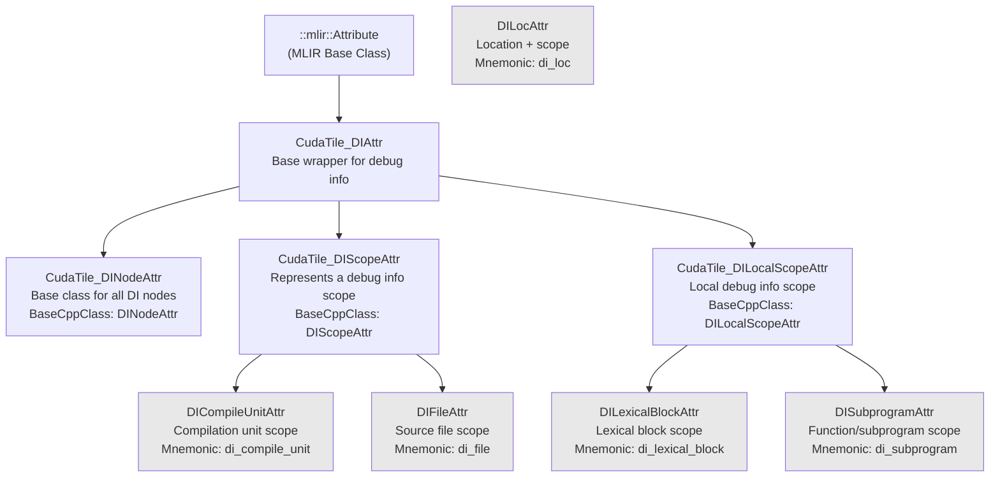
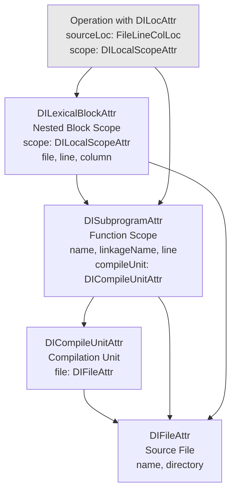
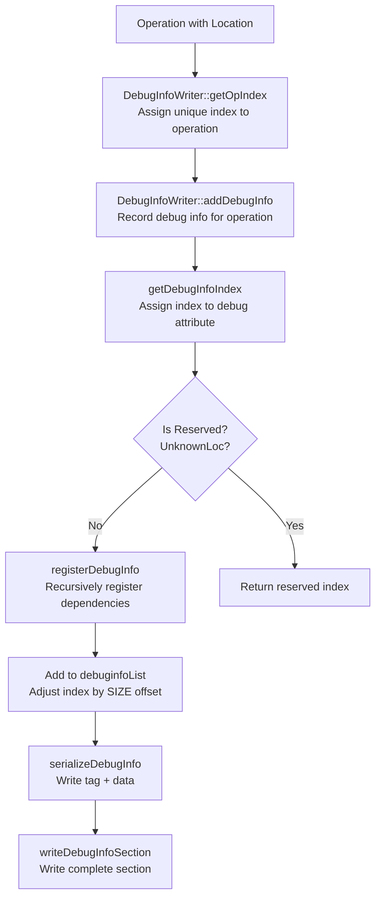
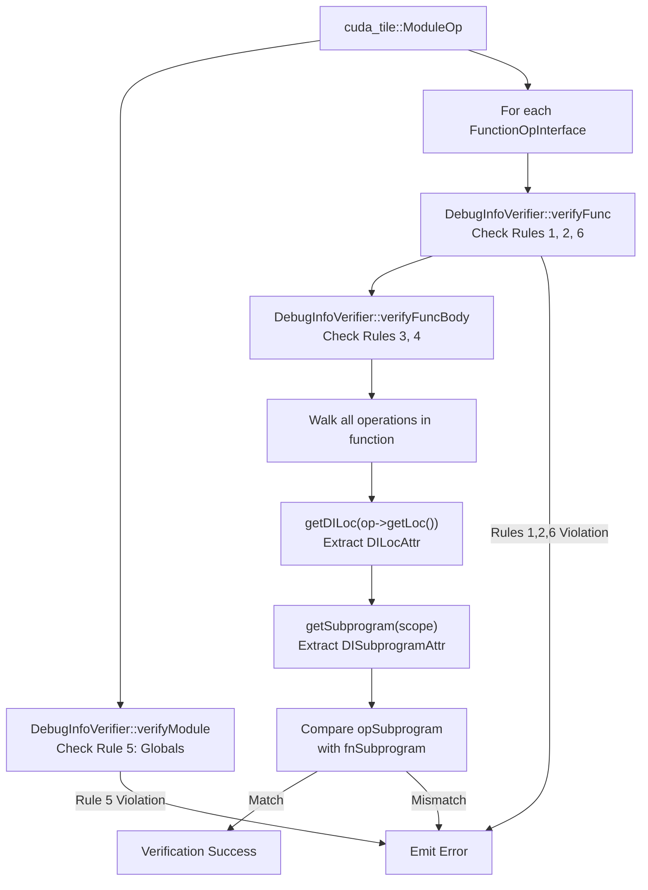

<!-- source: DeepWiki mcp.deepwiki.com · repo NVIDIA/cuda-tile · page 8.2 Debug Information System · fetched 2026-10-26 -->

# Debug Information System

<details>
<summary>Relevant source files</summary>

The following files were used as context for generating this wiki page:

- [lib/Bytecode/Reader/BytecodeReader.cpp](lib/Bytecode/Reader/BytecodeReader.cpp)
- [lib/Bytecode/Writer/BytecodeWriter.cpp](lib/Bytecode/Writer/BytecodeWriter.cpp)
- [lib/Dialect/CudaTile/IR/CudaTile.cpp](lib/Dialect/CudaTile/IR/CudaTile.cpp)

</details>


## Purpose and Scope

The debug information system in CUDA Tile IR enables source-level debugging by associating IR operations with their original source locations and lexical scopes. The system encompasses:
- Debug info attribute definitions (DILocAttr, DISubprogramAttr, etc.)
- Bytecode serialization and deserialization of debug info
- Strict verification rules ensuring debug info consistency
- Integration with the MLIR location system

For general information about the attribute system, see [Attribute System](#3.2). For bytecode format details, see [Bytecode System](#4).

## Debug Info Attribute Hierarchy

The CUDA Tile dialect defines a hierarchical system of debug information attributes. These attributes attach source location and scope information to operations, enabling debuggers to map compiled code back to the original source.

### Class Hierarchy Diagram



**Sources:** [include/cuda_tile/Dialect/CudaTile/IR/AttrDefs.td:472-499]()

The hierarchy distinguishes between:
- **Scope attributes** (`DIScopeAttr`): Define compilation units and source files
- **Local scope attributes** (`DILocalScopeAttr`): Define function and lexical block scopes
- **Location attributes**: Associate operations with specific source locations within scopes

## Debug Info Attributes

### DILocAttr

The `DILocAttr` is a location attribute that combines a file/line/column location with a debug info scope. It is used to attach source location information to operations.

| Parameter | Type | Description |
|-----------|------|-------------|
| `sourceLoc` | `FileLineColLoc` | The file, line, and column of the source location |
| `scope` | `DILocalScopeAttr` | The debug info scope containing this location |

**Assembly Format:**
```
di_loc< <source_location> in <scope> >
```

**Example:**
```mlir
loc(#cuda_tile.di_loc<loc("kernel.cu":42:10) in #cuda_tile.di_subprogram<...>>)
```

**Sources:** [include/cuda_tile/Dialect/CudaTile/IR/AttrDefs.td:505-519]()

### DICompileUnitAttr

The `DICompileUnitAttr` represents a compilation unit, which is the root scope for all objects declared in a specific compilation unit. It specifies the associated source file.

| Parameter | Type | Description |
|-----------|------|-------------|
| `file` | `DIFileAttr` | The source file for this compilation unit |

**Assembly Format:**
```
di_compile_unit< file = <file_attr> >
```

**Sources:** [include/cuda_tile/Dialect/CudaTile/IR/AttrDefs.td:525-537]()

### DIFileAttr

The `DIFileAttr` represents a source file, specifying the file name and directory path.

| Parameter | Type | Description |
|-----------|------|-------------|
| `name` | `StringAttr` | The name of the source file |
| `directory` | `StringAttr` | The directory containing the source file |

**Assembly Format:**
```
di_file< <name> in <directory> >
```

**Example:**
```mlir
#cuda_tile.di_file<"kernel.cu" in "/path/to/project">
```

**Sources:** [include/cuda_tile/Dialect/CudaTile/IR/AttrDefs.td:543-552]()

### DILexicalBlockAttr

The `DILexicalBlockAttr` represents a lexical block nested within a subprogram, such as the scope of a conditional statement or loop. It specifies the enclosing scope, file, line number, and optional column number.

| Parameter | Type | Description |
|-----------|------|-------------|
| `scope` | `DILocalScopeAttr` | The enclosing scope containing this block |
| `file` | `DIFileAttr` | The source file containing this block |
| `line` | `unsigned` | The line number where the block starts |
| `column` | `unsigned` (optional) | The column number where the block starts |

**Assembly Format:**
```
di_lexical_block< scope = <scope>, file = <file>, line = <line>, column = <column> >
```

**Sources:** [include/cuda_tile/Dialect/CudaTile/IR/AttrDefs.td:558-574]()

### DISubprogramAttr

The `DISubprogramAttr` represents a function within the source language. It captures the function's scope, source location, names, and containing compilation unit.

| Parameter | Type | Description |
|-----------|------|-------------|
| `file` | `DIFileAttr` | The source file containing the function |
| `line` | `unsigned` | The line number where the function is declared |
| `name` | `StringAttr` | The function name in the source language |
| `linkageName` | `StringAttr` | The mangled linkage name |
| `compileUnit` | `DICompileUnitAttr` | The compilation unit containing this function |
| `scopeLine` | `unsigned` (optional) | The line number where the function scope begins |

**Assembly Format:**
```
di_subprogram< file = <file>, line = <line>, name = <name>, 
               linkageName = <linkage_name>, compileUnit = <compile_unit>,
               scopeLine = <scope_line> >
```

**Sources:** [include/cuda_tile/Dialect/CudaTile/IR/AttrDefs.td:580-597]()

## Debug Info Structure and Usage

### Scope Nesting Diagram



**Sources:** [include/cuda_tile/Dialect/CudaTile/IR/AttrDefs.td:472-597]()

This diagram shows how debug info attributes nest to form a complete debugging context:

1. **DIFileAttr** defines a source file
2. **DICompileUnitAttr** references a file and serves as the root scope
3. **DISubprogramAttr** represents a function and references both its file and compile unit
4. **DILexicalBlockAttr** represents nested scopes within functions
5. **DILocAttr** on operations references the appropriate local scope

## Debug Info Bytecode Serialization

The debug information system integrates with the bytecode serialization layer to efficiently encode debug info in the binary format. The `DebugInfoWriter` class manages this process.

### Bytecode Section Structure

The debug section contains:

```
debuginfo-section =:
  diOpsNum[varint]          // Total number of operations with debug info
  padding[bytes]            // Align to 4 bytes
  diIndexOffsets[uint32_t]  // Per-op offset into debug info indices
  diIndicesNum[varint]      // Total number of debug info indices
  padding[bytes]            // Align to 8 bytes
  diIndices[uint64_t]       // Array of indices to debug info attributes
  diAttrNum[varint]         // Total number of debug info attributes
  padding[bytes]            // Align to 4 bytes
  diOffsets[uint32_t]       // Per-attribute offset into debug data
  diData[bytes]             // Serialized debug info attributes
```

**Sources:** [lib/Bytecode/Writer/BytecodeWriter.cpp:746-761]()

### Debug Info Encoding

Each debug info attribute is encoded with a tag byte followed by attribute-specific data:

| Debug Tag | Attribute Type | Encoding Format |
|-----------|----------------|-----------------|
| `DICompileUnit` | `DICompileUnitAttr` | `diFileIndex[varint]` |
| `DIFile` | `DIFileAttr` | `fileNameIndex[varint]` `directoryIndex[varint]` |
| `DILexicalBlock` | `DILexicalBlockAttr` | `diScopeIndex[varint]` `diFileIndex[varint]` `line[varint]` `column[varint]` |
| `DILoc` | `DILocAttr` | `diScopeIndex[varint]` `filenameIndex[varint]` `line[varint]` `column[varint]` |
| `DISubprogram` | `DISubprogramAttr` | `diFileIndex[varint]` `line[varint]` `nameIndex[varint]` `linkageNameIndex[varint]` `diCompileUnitIndex[varint]` `scopeLine[varint]` |
| `CallSite` | `CallSiteLoc` | `diCalleeIndex[varint]` `diCallerIndex[varint]` |
| `Unknown` | Reserved | No additional data |

**Sources:** [lib/Bytecode/Writer/BytecodeWriter.cpp:899-984]()

### Reserved Debug Indices

The bytecode format reserves special index values for common debug info patterns:

| Reserved Index | Meaning | Usage |
|----------------|---------|-------|
| `DebugReserved::UnknownLoc` | Unknown location | Operations without source location |
| `DebugReserved::SIZE` | Offset adjustment | Separates reserved from user indices |

**Sources:** [lib/Bytecode/Reader/BytecodeReader.cpp:1028-1029](), [lib/Bytecode/Writer/BytecodeWriter.cpp:719-722]()

### Serialization Flow



**Sources:** [lib/Bytecode/Writer/BytecodeWriter.cpp:708-1048]()

### Location Canonicalization

Before serialization, the `DebugInfoWriter` canonicalizes locations to simplify the encoding:

```cpp
LocationAttr canonicalizeLoc(LocationAttr loc) {
  return TypeSwitch<LocationAttr, LocationAttr>(loc)
      .Case([&](OpaqueLoc opaqueLoc) {
        return canonicalizeLoc(opaqueLoc.getFallbackLocation());
      })
      .Case([&](NameLoc nameLoc) {
        return canonicalizeLoc(nameLoc.getChildLoc());
      })
      .Case([&](FusedLoc fusedLoc) {
        for (auto subLoc : fusedLoc.getLocations())
          if (auto canonicalLoc = canonicalizeLoc(subLoc))
            return canonicalLoc;
        return LocationAttr();
      })
      .Case([&](DILocAttr diLoc) { return diLoc; })
      .Default([](LocationAttr) { return LocationAttr(); });
}
```

This process:
1. Unwraps `OpaqueLoc` and `NameLoc` wrappers
2. Extracts the first valid location from `FusedLoc`
3. Preserves `DILocAttr` and `CallSiteLoc` as-is
4. Returns null for unknown location types (encoded as `Unknown` tag)

**Sources:** [lib/Bytecode/Writer/BytecodeWriter.cpp:991-1013]()

## Debug Info Verification System

The CUDA Tile dialect implements strict verification of debug information through the `DebugInfoVerifier` class. Verification is invoked during module construction and before bytecode emission.

### Verification Entry Points

| Function | Purpose | Implementation |
|----------|---------|----------------|
| `verifyFuncDebugInfo` | Verifies function-level debug info | [lib/Dialect/CudaTile/IR/CudaTile.cpp:1204-1206]() |
| `verifyFuncBodyDebugInfo` | Verifies debug info for all ops in function body | [lib/Dialect/CudaTile/IR/CudaTile.cpp:1208-1211]() |
| `DebugInfoVerifier::verifyModule` | Verifies module-level debug info | [lib/Dialect/CudaTile/IR/CudaTile.cpp:1161-1170]() |

**Sources:** [lib/Dialect/CudaTile/IR/CudaTile.cpp:1090-1211]()

### Verification Rules

The `DebugInfoVerifier` enforces six strict rules:

#### Rule 1: Function Scope Must Be Subprogram
If a function has a debug info scope, it must be a `DISubprogramAttr`.

```cpp
// Rule 1 check
auto subprogram = dyn_cast<DISubprogramAttr>(diLoc.getScope());
if (!subprogram)
  return func.emitOpError()
         << "invalid function debug info scope: " << diLoc.getScope()
         << ". Function location must have cuda_tile.di_subprogram "
            "debug info scope.";
```

**Sources:** [lib/Dialect/CudaTile/IR/CudaTile.cpp:1102-1108]()

#### Rule 2: Function Name Must Match Subprogram Linkage Name
The function name must match the linkage name in its `DISubprogramAttr`.

```cpp
// Rule 2 check
if (subprogram.getLinkageName() != func.getName())
  return func.emitOpError()
         << "invalid function debug info scope: " << subprogram
         << ". Function name \"" << func.getName()
         << "\" does not match subprogram scope linkage name "
         << subprogram.getLinkageName() << ".";
```

**Sources:** [lib/Dialect/CudaTile/IR/CudaTile.cpp:1109-1117]()

#### Rule 3: Operations Require Function Scope
If a function does not have a debug info scope, its operations must not have debug info scopes.

**Sources:** [lib/Dialect/CudaTile/IR/CudaTile.cpp:1136-1144]()

#### Rule 4: Operation Scope Must Match Function Scope
All operations within a function must have the same `DISubprogramAttr` as the function.

**Sources:** [lib/Dialect/CudaTile/IR/CudaTile.cpp:1145-1153]()

#### Rule 5: Global Variables Must Not Have Scope
Global variables cannot have debug info scopes attached.

**Sources:** [lib/Dialect/CudaTile/IR/CudaTile.cpp:1164-1168]()

#### Rule 6: Function Location Must Not Be CallSiteLoc
Function locations cannot be `CallSiteLoc` attributes.

**Sources:** [lib/Dialect/CudaTile/IR/CudaTile.cpp:1094-1098]()

### Verification Flow Diagram



**Sources:** [lib/Dialect/CudaTile/IR/CudaTile.cpp:1090-1211]()

## Complete Example

Here is an example showing how debug info attributes work together in practice:

```mlir
// Define the source file
#file = #cuda_tile.di_file<"kernel.cu" in "/home/user/project/src">

// Define the compilation unit
#cu = #cuda_tile.di_compile_unit<file = #file>

// Define a subprogram (function)
#subprogram = #cuda_tile.di_subprogram<
  file = #file,
  line = 10,
  name = "my_kernel",
  linkageName = "_Z9my_kernelv",
  compileUnit = #cu,
  scopeLine = 11
>

// Define a lexical block within the function
#block = #cuda_tile.di_lexical_block<
  scope = #subprogram,
  file = #file,
  line = 15,
  column = 3
>

// Use debug locations on operations
cuda_tile.entry @my_kernel() {
  // Operation with subprogram scope
  %0 = cuda_tile.constant <i32: 42> : tile<i32>
    loc(#cuda_tile.di_loc<loc("kernel.cu":12:10) in #subprogram>)
  
  // Operation with nested block scope
  %1 = cuda_tile.addi %0, %0 : tile<i32>
    loc(#cuda_tile.di_loc<loc("kernel.cu":16:5) in #block>)
  
  cuda_tile.return
    loc(#cuda_tile.di_loc<loc("kernel.cu":18:3) in #subprogram>)
}
```

**Sources:** [include/cuda_tile/Dialect/CudaTile/IR/AttrDefs.td:505-597]()

This example demonstrates:
- A complete hierarchy from file → compile unit → subprogram → lexical block
- Location attributes (`DILocAttr`) referencing appropriate scopes
- Proper nesting of scopes within the function structure

---

