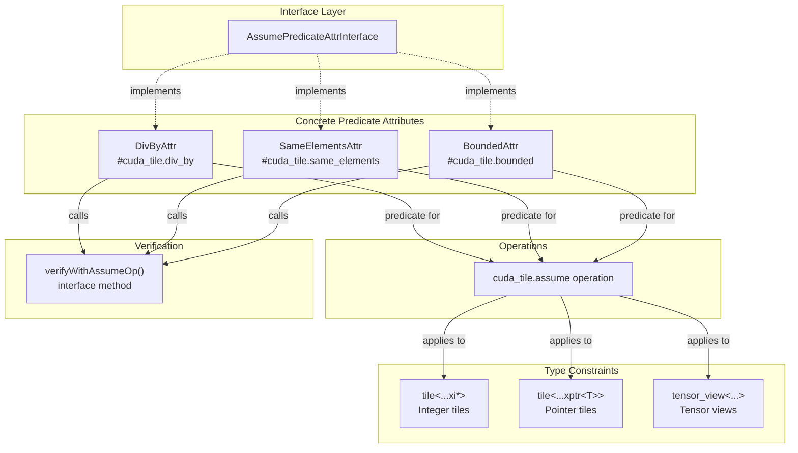
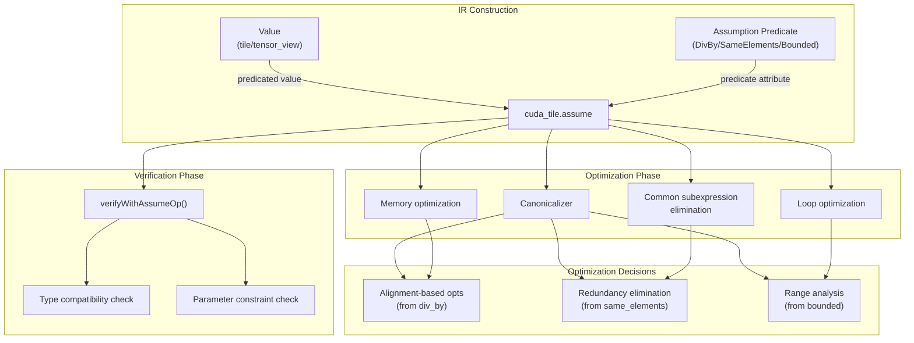

<!-- source: DeepWiki mcp.deepwiki.com · repo NVIDIA/cuda-tile · page 8.3 Assumption Predicates · fetched 2026-10-26 -->

# Assumption Predicates

<details>
<summary>Relevant source files</summary>

The following files were used as context for generating this wiki page:

- [lib/Dialect/CudaTile/IR/CudaTile.cpp](lib/Dialect/CudaTile/IR/CudaTile.cpp)
- [python/cuda_tile/dialects/cuda_tile_ops.py](python/cuda_tile/dialects/cuda_tile_ops.py)

</details>


## Purpose and Scope

This document describes the assumption predicate system in CUDA Tile IR, which allows programmers to provide semantic hints to the compiler about the properties of values at specific program points. These predicates are used with the `cuda_tile.assume` operation to enable optimizations that would otherwise be unsafe or impossible to perform.

Assumption predicates are implemented as MLIR attributes that conform to the `AssumePredicateAttrInterface`. The compiler may use these predicates for optimization, but it is the programmer's responsibility to ensure the assumptions hold at runtime. Violating an assumption results in undefined behavior.

For information about memory-related semantic annotations, see [Memory Model](#8.1). For debug information attributes, see [Debug Information](#8.2).

**Sources:** [include/cuda_tile/Dialect/CudaTile/IR/AttrDefs.td:221-410](), [include/cuda_tile/Dialect/CudaTile/IR/Interfaces.td:13-28]()

## Assumption Predicate Architecture

The following diagram illustrates the relationship between the interface, concrete predicate attributes, and their usage in the IR:



**Sources:** [include/cuda_tile/Dialect/CudaTile/IR/Interfaces.td:13-28](), [include/cuda_tile/Dialect/CudaTile/IR/AttrDefs.td:221-410]()

## AssumePredicateAttrInterface

The `AssumePredicateAttrInterface` is defined in the dialect's interface specifications and serves as the contract for all assumption predicate attributes. Any attribute used as a predicate for `cuda_tile.assume` operations must implement this interface.

### Interface Contract

The interface defines a single verification method:

```
LogicalResult verifyWithAssumeOp(Operation *op)
```

This method is called during operation verification to ensure that the predicate attribute is semantically valid in the context of the specific `cuda_tile.assume` operation. It validates both the attribute's parameters and its compatibility with the predicated value's type.

### Implementation Requirements

Each concrete predicate attribute must:
1. Declare implementation of `AssumePredicateAttrInterface` in its TableGen definition
2. Provide a `verifyWithAssumeOp` method that checks predicate-specific constraints
3. Return `success()` if the predicate is valid, `failure()` otherwise

**Sources:** [include/cuda_tile/Dialect/CudaTile/IR/Interfaces.td:13-28]()

## DivBy Predicate

The `DivByAttr` predicate indicates that elements of a tile or the base address of a tensor view are divisible by a specified power-of-two divisor.

### Assembly Format

```mlir
#cuda_tile.div_by<$divisor>
#cuda_tile.div_by<$divisor, every $every along $along>
```

### Parameters

| Parameter | Type | Description | Constraints |
|-----------|------|-------------|-------------|
| `divisor` | `uint64_t` | The divisor value | Must be a positive power of 2 |
| `every` | `std::optional<int64_t>` | Group size for divisibility | Optional; must be specified with `along` |
| `along` | `std::optional<int64_t>` | Dimension for grouping | Optional; must be specified with `every` |

### Semantic Behavior

When `every` and `along` are omitted, all elements of the tile are assumed divisible by `divisor`. This is equivalent to specifying `every 1 along 0`.

When `every` and `along` are specified, the dimension is divided into groups of size `every`. The first element of each group is assumed divisible by `divisor`, with subsequent elements monotonically increasing by 1 (for integers) or by the byte width of the pointee type (for pointers). The last group may contain fewer than `every` elements.

### Applicable Types

- `tile<...xi*>` - tiles of integers
- `tile<...xptr<T>>` - tiles of pointers
- `tensor_view<...>` - tensor views (base address divisibility only)

For tensor views and 0D tiles, the `every` and `along` parameters cannot be used.

### Usage Examples

```mlir
// Example 1: All pointers divisible by 16 bytes
%0 = cuda_tile.assume #cuda_tile.div_by<16>, %ptrs
    : !cuda_tile.tile<128x!cuda_tile.ptr<f32>>

// Example 2: 2D tile with groups of size [4, 1] along dimension 0
// First element of each column group divisible by 32
%1 = cuda_tile.assume #cuda_tile.div_by<32, every 4 along 0>, %ptrs
    : !cuda_tile.tile<4x8x!cuda_tile.ptr<f32>>

// Example 3: Tensor view base address divisible by 128
%2 = cuda_tile.assume #cuda_tile.div_by<128>, %view
    : !cuda_tile.tensor_view<memref<1024xf32>>
```

### Important Notes

For tiles of integers, the `every` parameter applies to the signed interpretation of the values. Sequences that wrap around in signed arithmetic violate the assumption:

```mlir
// INVALID: wraps from 0x7F to 0x80 in signed i8
// [0x7E, 0x7F, 0x80, 0x81] cannot satisfy every=4
```

**Sources:** [include/cuda_tile/Dialect/CudaTile/IR/AttrDefs.td:221-324]()

## SameElements Predicate

The `SameElementsAttr` predicate specifies that within groups of a specified size along each dimension, all elements are identical.

### Assembly Format

```mlir
#cuda_tile.same_elements<$values>
```

### Parameters

| Parameter | Type | Description |
|-----------|------|-------------|
| `values` | `DenseI64ArrayAttr` | Group sizes per dimension |

### Semantic Behavior

For each dimension `d` with size `N` and group size `C = values[d]`, the dimension is divided into `N/C` groups. All elements within each group must be identical. If `N` is not evenly divisible by `C`, the last group may contain fewer than `C` elements.

A value of `1` for a dimension indicates no constraint (groups of size 1 always satisfy the property).

### Applicable Types

- `tile<...xi*>` - tiles of integers
- `tile<...xptr<T>>` - tiles of pointers

### Usage Examples

```mlir
// Integer tile with same elements in groups of [2, 4]
// Dimension 0: groups of 2 rows have identical elements
// Dimension 1: groups of 4 columns have identical elements
%0 = cuda_tile.constant <i16: [[0, 0, 0, 0, 10, 10, 10, 10],
                               [0, 0, 0, 0, 10, 10, 10, 10],
                               [5, 5, 5, 5, 93, 93, 93, 93],
                               [5, 5, 5, 5, 93, 93, 93, 93]]>
    : tile<4x8xi16>
%1 = cuda_tile.assume #cuda_tile.same_elements<[2, 4]>, %0
    : !cuda_tile.tile<4x8xi16>

// Pointer tile example
%2 = cuda_tile.assume #cuda_tile.same_elements<[2, 4]>, %ptr_tile
    : !cuda_tile.tile<4x8x!cuda_tile.ptr<f32>>
```

### Trivial Predicate

The predicate `#cuda_tile.same_elements<[1, 1, ..., 1]>` is valid for any tile, as groups of size 1 always contain identical elements. This can be used as a no-op assumption.

**Sources:** [include/cuda_tile/Dialect/CudaTile/IR/AttrDefs.td:326-376]()

## Bounded Predicate

The `BoundedAttr` predicate specifies inclusive lower and upper bounds for all elements of an integer tile when interpreted as signed integers.

### Assembly Format

```mlir
#cuda_tile.bounded<$lb, $ub>
#cuda_tile.bounded<?, $ub>
#cuda_tile.bounded<$lb, ?>
```

### Parameters

| Parameter | Type | Description |
|-----------|------|-------------|
| `lb` | `std::optional<int64_t>` | Lower bound (inclusive) |
| `ub` | `std::optional<int64_t>` | Upper bound (inclusive) |

### Semantic Behavior

Either or both bounds can be unspecified using `?` in the assembly format. When specified:
- The lower bound must be less than or equal to the upper bound
- Bounds must be within the valid range of the integer type of the predicated tile
- All tile elements are assumed to satisfy: `lb <= element <= ub` (as signed integers)

### Applicable Types

- `tile<...xi*>` - tiles of integers only

### Usage Examples

```mlir
// Non-negative values only
%0 = cuda_tile.assume #cuda_tile.bounded<0, ?>, %tile
    : !cuda_tile.tile<4x8xi16>

// Bounded range [0, 255]
%1 = cuda_tile.assume #cuda_tile.bounded<0, 255>, %tile
    : !cuda_tile.tile<128xi32>

// Upper bound only
%2 = cuda_tile.assume #cuda_tile.bounded<?, 1000>, %tile
    : !cuda_tile.tile<64xi64>
```

### Validation Constraints

The verifier checks:
1. If both bounds are specified, `lb <= ub`
2. Bounds do not exceed the range of the tile's element type
3. The predicated value is a tile of integers

**Sources:** [include/cuda_tile/Dialect/CudaTile/IR/AttrDefs.td:378-410]()

## Predicate Type Compatibility Matrix

The following table summarizes which predicate types can be applied to which value types:

| Predicate | Integer Tiles | Pointer Tiles | Tensor Views | Notes |
|-----------|---------------|---------------|--------------|-------|
| `div_by` | ✓ | ✓ | ✓ | For tensor views: base address only |
| `same_elements` | ✓ | ✓ | ✗ | Requires tile type |
| `bounded` | ✓ | ✗ | ✗ | Integer tiles only |

**Sources:** [include/cuda_tile/Dialect/CudaTile/IR/AttrDefs.td:221-410]()

## Assumption Flow and Optimization Impact



**Sources:** [include/cuda_tile/Dialect/CudaTile/IR/Interfaces.td:13-28](), [include/cuda_tile/Dialect/CudaTile/IR/AttrDefs.td:221-410]()

## Verification Implementation

Each assumption predicate attribute implements verification through the `AssumePredicateAttrInterface`. The verification process occurs during MLIR's standard verification phase.

### Verification Steps

1. **Interface method invocation**: The `verifyWithAssumeOp` method is called with the `cuda_tile.assume` operation
2. **Type compatibility check**: The predicate verifies that its target type (integer tile, pointer tile, or tensor view) matches the predicated value's type
3. **Parameter validation**: Predicate-specific constraints are checked (e.g., power-of-two divisors, valid group sizes, bound ordering)
4. **Context validation**: Some predicates validate that parameters make sense in the context (e.g., `every` and `along` cannot be used with 0D tiles)

### Verification Failures

Verification failures result in compilation errors. Common failure cases include:

- **Type mismatch**: Using `bounded` on a pointer tile
- **Invalid parameters**: Specifying `divisor = 3` for `div_by` (not a power of 2)
- **Inconsistent bounds**: `#cuda_tile.bounded<10, 5>` (lower > upper)
- **Incomplete parameters**: Specifying `every` without `along` in `div_by`
- **Out-of-range bounds**: Bounds exceeding the integer type's range

**Sources:** [include/cuda_tile/Dialect/CudaTile/IR/Interfaces.td:20-27](), [include/cuda_tile/Dialect/CudaTile/IR/AttrDefs.td:221-410]()

## Optimization Implications

Assumption predicates enable several classes of optimizations:

### Alignment Optimizations (div_by)

When the compiler knows that memory addresses or indices are divisible by specific powers of two, it can:
- Use vector load/store instructions with alignment requirements
- Eliminate alignment checks
- Optimize address computation
- Enable hardware-specific memory access patterns (e.g., TMA on NVIDIA GPUs)

### Redundancy Elimination (same_elements)

Knowledge that groups of elements are identical allows:
- Loading only one element per group instead of all elements
- Broadcasting values instead of computing them repeatedly
- Eliminating redundant computations on duplicate values
- Simplifying control flow when all elements in a group have the same property

### Range Analysis (bounded)

Explicit bounds on integer values enable:
- Elimination of unnecessary range checks
- Loop bound simplification
- Dead code elimination for impossible branches
- More aggressive constant propagation

### Undefined Behavior

If an assumption does not hold at runtime, the behavior is undefined. The compiler is not required to check assumptions dynamically. Incorrect assumptions can lead to:
- Incorrect results
- Memory corruption (from misaligned accesses)
- Program crashes
- Security vulnerabilities

**Sources:** [include/cuda_tile/Dialect/CudaTile/IR/AttrDefs.td:45-51]()

## Custom Assembly Format

The `DivByAttr` uses custom assembly parsing and printing rather than the declarative format due to MLIR limitations with optional parameters at the time of implementation:

```cpp
// Custom format required for optional parameters
let hasCustomAssemblyFormat = 1;
// Desired format (not yet supported by MLIR):
// let assemblyFormat = [{
//   `<` $divisor (`,` `every` $every^ `along` $along)? `>`";
// }];
```

The `SameElementsAttr` and `BoundedAttr` use declarative assembly formats as their optional parameters are supported by MLIR's type parameter system.

**Sources:** [include/cuda_tile/Dialect/CudaTile/IR/AttrDefs.td:318-323](), [include/cuda_tile/Dialect/CudaTile/IR/AttrDefs.td:375](), [include/cuda_tile/Dialect/CudaTile/IR/AttrDefs.td:407-409]()

---

