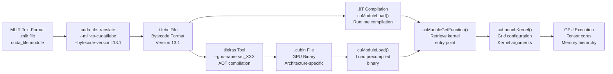
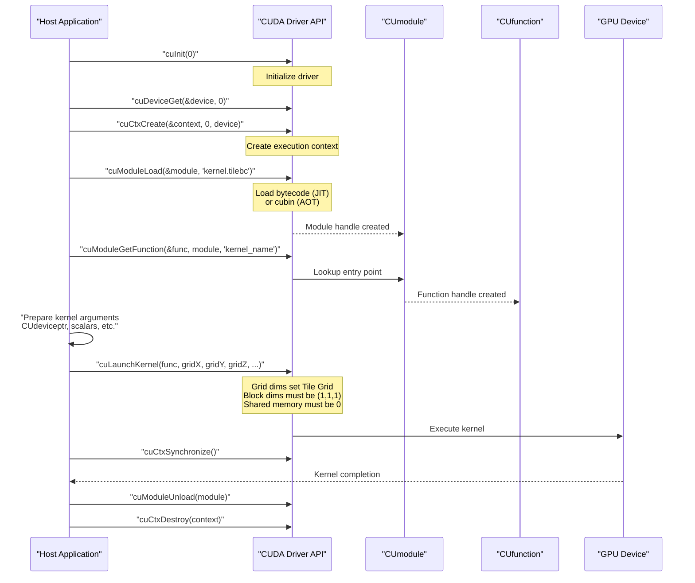
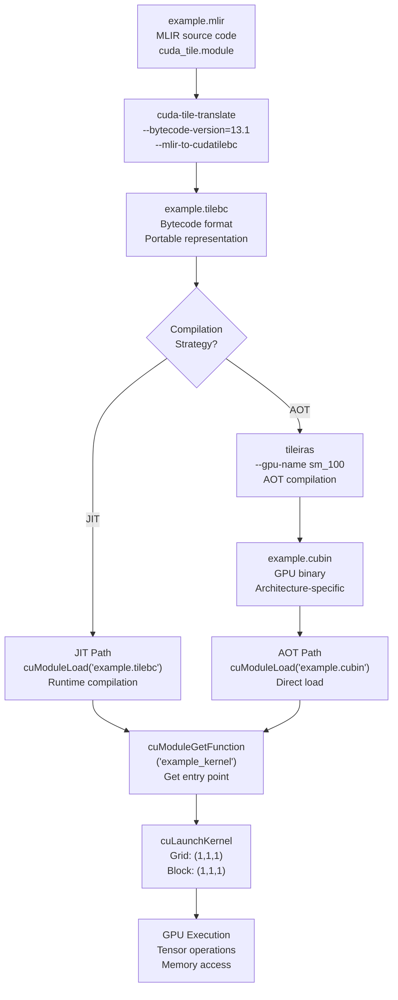

<!-- source: DeepWiki mcp.deepwiki.com · repo NVIDIA/cuda-tile · page 9 Execution Pipeline · fetched 2026-10-26 -->

# Execution Pipeline

<details>
<summary>Relevant source files</summary>

The following files were used as context for generating this wiki page:

- [README.md](README.md)

</details>


## Purpose and Scope

This page describes the complete execution pipeline for CUDA Tile IR programs, from intermediate representation through compilation to GPU execution. It covers the overall workflow, compilation paths (JIT and AOT), and integration with the CUDA driver API.

For detailed information about specific compilation stages, see:
- Bytecode format specification: [Bytecode System](#4)
- Bytecode serialization process: [Bytecode Serialization](#4.3)
- JIT execution details: [JIT Execution via CUDA Driver](#9.1)
- AOT compilation details: [AOT Compilation with tileiras](#9.2)

**Sources:** [README.md:1-374]()

## Pipeline Overview

The CUDA Tile IR execution pipeline transforms MLIR-based intermediate representation into executable GPU code through multiple stages. The pipeline supports two primary execution modes: just-in-time (JIT) compilation and ahead-of-time (AOT) compilation.

### End-to-End Pipeline Stages



**Sources:** [README.md:212-334]()

The pipeline consists of the following stages:

1. **IR Representation**: CUDA Tile programs begin as MLIR text format (`.mlir` files) containing `cuda_tile.module` and `entry` operations
2. **Bytecode Translation**: The `cuda-tile-translate` tool converts MLIR to compact bytecode format (`.tilebc`)
3. **Compilation Choice**: Programs can take either the JIT or AOT path
4. **Module Loading**: CUDA driver API loads either bytecode (JIT) or cubin (AOT)
5. **Kernel Launch**: Standard CUDA driver API launches kernels with appropriate grid configuration
6. **GPU Execution**: Kernels execute on GPU hardware utilizing tensor cores and memory hierarchy

**Sources:** [README.md:212-334]()

## Bytecode Format as Intermediate Representation

The `.tilebc` bytecode format serves as the critical intermediate representation in the execution pipeline. It provides:

| Property | Description |
|----------|-------------|
| **Format** | Binary section-based encoding (Header, String, Type, Constant, Debug, Func, Global) |
| **Version** | 13.1 aligned with CUDA Toolkit 13.1 |
| **Portability** | Architecture-independent until final compilation |
| **Efficiency** | Compact representation optimized for serialization/deserialization |
| **Execution Modes** | Supports both JIT and AOT compilation paths |

The bytecode format allows CUDA Tile IR to be:
- Serialized for storage and distribution
- Loaded directly by CUDA driver for JIT compilation
- Compiled ahead-of-time to architecture-specific binaries

**Sources:** [README.md:216-218](), [README.md:327-330]()

## Compilation Paths Comparison

```mermaid
graph TB
    subgraph "JIT Path (Runtime Compilation)"
        JIT_BC[".tilebc Bytecode"]
        JIT_Load["cuModuleLoad(&module, 'kernel.tilebc')<br/>CUDA Driver JIT compiler"]
        JIT_Cache["Driver-managed cache<br/>Compiled on first load<br/>Cached for subsequent runs"]
        JIT_Exec["Kernel execution<br/>Runtime overhead: first launch only"]
        
        JIT_BC --> JIT_Load
        JIT_Load --> JIT_Cache
        JIT_Cache --> JIT_Exec
    end
    
    subgraph "AOT Path (Ahead-of-Time Compilation)"
        AOT_BC[".tilebc Bytecode"]
        AOT_Tileiras["tileiras --gpu-name sm_100<br/>Compile for specific architecture"]
        AOT_Cubin[".cubin Binary<br/>Architecture-specific<br/>Machine code"]
        AOT_Load["cuModuleLoad(&module, 'kernel.cubin')<br/>Direct binary load"]
        AOT_Exec["Kernel execution<br/>No compilation overhead"]
        
        AOT_BC --> AOT_Tileiras
        AOT_Tileiras --> AOT_Cubin
        AOT_Cubin --> AOT_Load
        AOT_Load --> AOT_Exec
    end
```



**Sources:** [README.md:216-218](), [README.md:295-298](), [README.md:327-330]()

### JIT Compilation Workflow

Just-in-time compilation occurs at runtime when the CUDA driver loads a `.tilebc` file:

1. **Input**: `.tilebc` bytecode file
2. **Loader**: `cuModuleLoad()` accepts bytecode directly
3. **Compilation**: CUDA driver compiles bytecode to GPU machine code at load time
4. **Caching**: Driver caches compiled code for subsequent executions
5. **Trade-off**: First launch incurs compilation overhead; subsequent launches use cached binary

**Advantages:**
- No explicit compilation step required
- Single portable bytecode file works across GPU architectures
- Driver automatically optimizes for specific hardware

**Disadvantages:**
- First-launch latency due to JIT compilation
- Requires CUDA driver with JIT compilation support

**Sources:** [README.md:295-298](), [README.md:327-330]()

### AOT Compilation Workflow

Ahead-of-time compilation produces architecture-specific binaries before deployment:

1. **Input**: `.tilebc` bytecode file
2. **Compiler**: `tileiras` tool from CUDA Toolkit
3. **Target**: Specified via `--gpu-name` flag (e.g., `sm_100`)
4. **Output**: `.cubin` binary file optimized for target architecture
5. **Deployment**: Cubin loaded directly via `cuModuleLoad()`

**Advantages:**
- Zero runtime compilation overhead
- Deterministic compilation at build time
- Optimized for specific GPU architecture

**Disadvantages:**
- Separate cubins required for each architecture
- Larger deployment footprint for multi-architecture support
- Requires `tileiras` tool from CUDA Toolkit 13.1+

**Sources:** [README.md:328-329]()

## CUDA Driver API Integration

CUDA Tile IR kernels integrate with the CUDA driver API using standard module and kernel management functions. The driver API treats CUDA Tile kernels identically to traditional CUDA kernels after loading.

### Module and Kernel Lifecycle



**Sources:** [README.md:247-323]()

### Key Driver API Functions

| Function | Purpose | CUDA Tile Specific Notes |
|----------|---------|--------------------------|
| `cuInit()` | Initialize CUDA driver | Standard initialization |
| `cuDeviceGet()` | Get device handle | Select target GPU device |
| `cuCtxCreate()` | Create execution context | Required for all CUDA operations |
| `cuModuleLoad()` | Load module from file | Accepts `.tilebc` (JIT) or `.cubin` (AOT) |
| `cuModuleGetFunction()` | Get kernel entry point | Use `entry` operation name from IR |
| `cuLaunchKernel()` | Launch kernel | Grid dimensions set Tile Grid; block dimensions must be (1,1,1) |
| `cuCtxSynchronize()` | Wait for completion | Standard synchronization |
| `cuModuleUnload()` | Unload module | Clean up module resources |
| `cuCtxDestroy()` | Destroy context | Clean up execution context |

**Sources:** [README.md:283-319]()

### Launch Configuration Requirements

CUDA Tile IR kernels have specific launch configuration requirements that differ from traditional CUDA kernels:

```cpp
// Example launch configuration for CUDA Tile kernel
void *kernel_args[] = {&data_ptr, &other_args};

cuLaunchKernel(
    kernel_function,      // CUfunction: kernel entry point
    gridX, gridY, gridZ,  // Grid dimensions: sets Tile Grid dimensions
    1, 1, 1,              // Block dimensions: MUST be (1,1,1)
    0,                    // Shared memory bytes: MUST be 0
    stream,               // CUstream: CUDA stream for execution
    kernel_args,          // Kernel arguments array
    NULL                  // Extra parameters: unused
);
```

**Requirements:**
- **Grid Dimensions**: `(gridX, gridY, gridZ)` specify the Tile Grid dimensions for the kernel
- **Block Dimensions**: Must always be `(1, 1, 1)` - CUDA Tile uses its own tile-based execution model
- **Shared Memory**: Must be `0` - CUDA Tile manages memory internally
- **Kernel Arguments**: Standard array of pointers to argument values
- **Stream**: Standard CUDA stream for asynchronous execution

**Sources:** [README.md:305-314]()

## Complete Example Workflow

The following example demonstrates the complete pipeline from MLIR source to GPU execution.

### Step 1: MLIR Source Code

```mlir
cuda_tile.module @example_module {
    entry @example_kernel(%data_pr : tile<ptr<f32>>) {
        print "Running example module\n"
        %offsets = iota : tile<128xi32>
        %data_ptr_reshaped = reshape %data_pr : tile<ptr<f32>> -> tile<1xptr<f32>>
        %data_ptr_broadcasted = broadcast %data_ptr_reshaped : tile<1xptr<f32>> -> tile<128xptr<f32>>
        %data_ptr_tensor = offset %data_ptr_broadcasted, %offsets : tile<128xptr<f32>>, tile<128xi32> -> tile<128xptr<f32>>
        %data, %token = load_ptr_tko weak %data_ptr_broadcasted : tile<128xptr<f32>> -> tile<128xf32>, token
        print "Data: %f\n", %data : tile<128xf32>
        return
    }
}
```

**Sources:** [README.md:230-244]()

### Step 2: Translation to Bytecode

Command:
```bash
cuda-tile-translate example.mlir \
    --bytecode-version=13.1 \
    --mlir-to-cudatilebc \
    --no-implicit-module \
    -o example.tilebc
```

**Tool Flags:**
- `--bytecode-version=13.1`: Target CUDA Toolkit 13.1 bytecode format
- `--mlir-to-cudatilebc`: Convert MLIR to CUDA Tile bytecode
- `--no-implicit-module`: Do not wrap in implicit module (already has `cuda_tile.module`)
- `-o example.tilebc`: Output bytecode file

**Sources:** [README.md:327]()

### Step 3A: AOT Compilation (Optional)

Command:
```bash
tileiras --gpu-name sm_100 example.tilebc -o example.cubin
```

**Tool Flags:**
- `--gpu-name sm_100`: Target architecture (replace with actual GPU architecture like `sm_89`, `sm_90`, etc.)
- `-o example.cubin`: Output cubin binary file

**Sources:** [README.md:328-329]()

### Step 3B: JIT Compilation (Alternative)

For JIT compilation, skip Step 3A and load the `.tilebc` file directly in the host code:

```cpp
// JIT: Load bytecode directly
cuModuleLoad(&cuModule, "example.tilebc");

// AOT: Load precompiled cubin
cuModuleLoad(&cuModule, "example.cubin");
```

**Sources:** [README.md:295-298](), [README.md:330]()

### Step 4: Host Code Integration

```cpp
// Initialize CUDA
cuInit(0);
cuDeviceGet(&cuDevice, 0);
cuCtxCreate(&cuContext, NULL, 0, cuDevice);
cuStreamCreate(&stream, CU_STREAM_DEFAULT);

// Load module (JIT or AOT)
cuModuleLoad(&cuModule, "example.cubin");  // or "example.tilebc" for JIT
cuModuleGetFunction(&example_kernel, cuModule, "example_kernel");

// Prepare arguments
CUdeviceptr data_ptr;
cuMemAlloc(&data_ptr, sizeof(data));
cuMemcpyHtoD(data_ptr, data, sizeof(data));

// Launch kernel
void *kernel_args[] = {&data_ptr};
cuLaunchKernel(example_kernel,
               1, 1, 1,        // grid dims: Tile Grid dimensions
               1, 1, 1,        // block dims: must be (1,1,1)
               0,              // shared memory: must be 0
               stream,
               kernel_args,
               NULL);

cuCtxSynchronize();

// Cleanup
cuModuleUnload(cuModule);
cuCtxDestroy(cuContext);
```

**Sources:** [README.md:247-323]()

### Pipeline Flow Diagram



**Sources:** [README.md:212-334]()

## Prerequisites and Requirements

### Build Prerequisites

- CUDA Tile IR tools (`cuda-tile-translate`) from successful build
- CUDA Toolkit 13.1 or higher with `tileiras` tool (for AOT compilation)
- Compatible NVIDIA GPU with supported compute capability
- CUDA driver supporting target GPU architecture

### Runtime Requirements

- CUDA-capable GPU device
- CUDA driver with JIT compilation support (for JIT path)
- Host application linked with CUDA driver API (`-lcuda`)
- Appropriate CUDA headers and libraries (`cuda.h`, `cuda_runtime_api.h`)

**Sources:** [README.md:222-227](), [README.md:331-332]()

## Execution Model Characteristics

CUDA Tile IR kernels use a tile-based execution model that differs from traditional CUDA:

| Aspect | CUDA Tile IR | Traditional CUDA |
|--------|--------------|------------------|
| **Parallelism Unit** | Tile Grid dimensions (via launch grid) | Thread blocks and threads |
| **Block Dimensions** | Fixed at (1,1,1) | Configurable per kernel |
| **Shared Memory** | Managed internally by IR | Explicitly allocated at launch |
| **Memory Model** | Token-ordered operations for synchronization | Explicit synchronization primitives |
| **Computation Pattern** | Tile-based tensor operations | Thread-level scalar/vector operations |
| **Entry Points** | `entry` operations in `cuda_tile.module` | `__global__` functions |

The tile-based model abstracts away thread-level details, allowing the compiler and runtime to optimize tile operations for tensor cores and memory hierarchy.

**Sources:** [README.md:305-314]()

---

