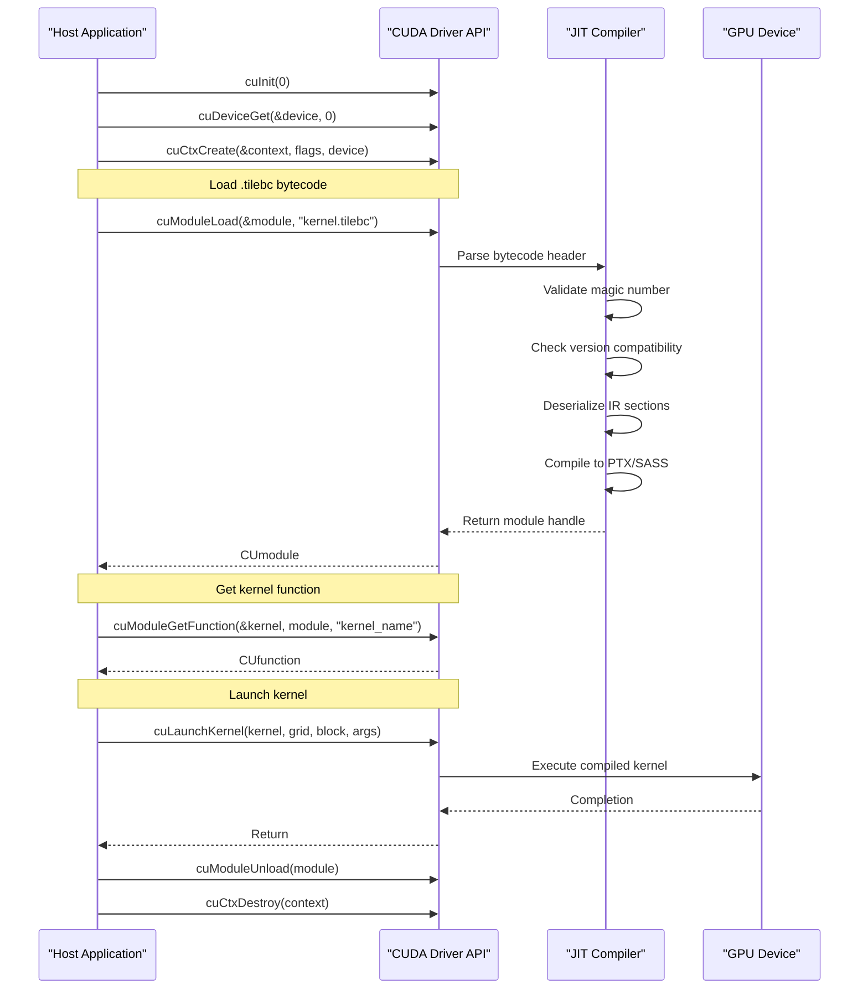

<!-- source: DeepWiki mcp.deepwiki.com · repo NVIDIA/cuda-tile · page 9.1 JIT Execution via CUDA Driver · fetched 2026-10-26 -->

# JIT Execution via CUDA Driver

<details>
<summary>Relevant source files</summary>

The following files were used as context for generating this wiki page:

- [README.md](README.md)
- [lib/Bytecode/Reader/BytecodeReader.cpp](lib/Bytecode/Reader/BytecodeReader.cpp)

</details>


## Purpose and Scope

This page documents just-in-time (JIT) compilation and execution of CUDA Tile IR kernels using the CUDA Driver API. In this execution model, `.tilebc` bytecode files are loaded directly at runtime via `cuModuleLoad`, where the CUDA driver automatically compiles the bytecode to GPU machine code for the current device. This differs from ahead-of-time (AOT) compilation, where bytecode is pre-compiled to `.cubin` files using the `tileiras` tool (see [AOT Compilation with tileiras](#9.2)).

**Sources:** [README.md:212-334]()

---

## Bytecode Format Overview

CUDA Tile IR bytecode files use the `.tilebc` extension and follow a structured binary format with a magic number header for validation. The bytecode format enables efficient serialization of CUDA Tile IR modules and supports versioning for compatibility management.

### Magic Number Validation

The bytecode format begins with an 8-byte magic number that identifies valid CUDA Tile IR bytecode files:

| Byte Position | Value (Hex) | ASCII |
|---------------|-------------|-------|
| 0 | 0x7F | - |
| 1 | 0x54 | 'T' |
| 2 | 0x69 | 'i' |
| 3 | 0x6C | 'l' |
| 4 | 0x65 | 'e' |
| 5 | 0x49 | 'I' |
| 6 | 0x52 | 'R' |
| 7 | 0x00 | NULL |

The `isTileIRBytecode()` function validates bytecode buffers by checking this magic number before attempting deserialization.

**Sources:** [lib/Bytecode/Reader/BytecodeReader.cpp:35-55]()

### Version Information

Following the magic number, the bytecode header contains version information encoded as:

```
header =:
  magic[8 bytes]
  verMajor[uint8_t]
  verMinor[uint8_t]
  tag[uint16_t]
```

The `BytecodeVersion` class manages version compatibility checks, ensuring that the reader can deserialize bytecode files created with compatible versions of CUDA Tile IR.

**Sources:** [lib/Bytecode/Reader/BytecodeReader.cpp:296-323](), [cuda_tile/Bytecode/Common/Version.h]()

### Bytecode Structure

The complete bytecode format consists of a header followed by multiple sections:

```mermaid
graph TD
    File["`.tilebc` File"]
    Header["Header<br/>(Magic + Version)"]
    Sections["Section Sequence"]
    
    StringSec["String Section<br/>String table for identifiers"]
    TypeSec["Type Section<br/>Type definitions (lazy)"]
    ConstSec["Constant Section<br/>Dense element attributes"]
    DebugSec["Debug Section<br/>Location information"]
    FuncSec["Function Section<br/>Operation bytecode"]
    
    File --> Header
    File --> Sections
    Sections --> StringSec
    Sections --> TypeSec
    Sections --> ConstSec
    Sections --> DebugSec
    Sections --> FuncSec
    
    BytecodeReader["BytecodeReader<br/>Deserialization"]
    LazyTypeTable["LazyTypeTable<br/>On-demand type parsing"]
    DebugInfoReader["DebugInfoReader<br/>Location attributes"]
    
    StringSec -.-> BytecodeReader
    TypeSec -.-> LazyTypeTable
    DebugSec -.-> DebugInfoReader
    FuncSec -.-> BytecodeReader
```

For detailed information on bytecode sections and encoding schemes, see [Bytecode Format Specification](#4.1).

**Sources:** [lib/Bytecode/Reader/BytecodeReader.cpp:58-79]()

---

## CUDA Driver API Integration

JIT execution requires using the CUDA Driver API (not the CUDA Runtime API) to load and execute bytecode. The driver automatically performs JIT compilation when loading `.tilebc` files.

### Module Loading Workflow



**Sources:** [README.md:282-322]()

### Core API Functions

The following CUDA Driver API functions are essential for JIT execution:

| Function | Purpose | Key Parameters |
|----------|---------|----------------|
| `cuInit` | Initialize CUDA driver | `flags`: Must be 0 |
| `cuDeviceGet` | Get device handle | `ordinal`: Device index (0 for first device) |
| `cuCtxCreate` | Create CUDA context | `flags`, `device`: Context flags and target device |
| `cuModuleLoad` | Load bytecode/cubin | `fname`: Path to `.tilebc` file |
| `cuModuleGetFunction` | Get kernel handle | `hmod`: Module handle, `name`: Entry function name |
| `cuLaunchKernel` | Execute kernel | Grid/block dims, args, stream |
| `cuModuleUnload` | Unload module | `hmod`: Module handle |
| `cuCtxDestroy` | Destroy context | `ctx`: Context handle |

**Sources:** [README.md:282-322]()

### Entry Function Naming

CUDA Tile IR modules contain `entry` operations that define kernel entry points. The function name passed to `cuModuleGetFunction` must match the entry operation's symbol name:

```mlir
cuda_tile.module @example_module {
    entry @example_kernel(%arg : tile<ptr<f32>>) {
        // Kernel body
        return
    }
}
```

In this example, use `"example_kernel"` (without the `@` prefix) as the function name in `cuModuleGetFunction`.

**Sources:** [README.md:233-245]()

---

## Launch Configuration

### Grid and Block Dimensions

CUDA Tile IR kernels use a simplified launch model compared to traditional CUDA kernels:

```c
CUresult cuLaunchKernel(
    CUfunction f,
    unsigned int gridDimX,    // Tile Grid X dimension
    unsigned int gridDimY,    // Tile Grid Y dimension  
    unsigned int gridDimZ,    // Tile Grid Z dimension
    unsigned int blockDimX,   // Must be 1
    unsigned int blockDimY,   // Must be 1
    unsigned int blockDimZ,   // Must be 1
    unsigned int sharedMemBytes,  // Must be 0
    CUstream hStream,
    void **kernelParams,
    void **extra
);
```

**Grid Dimensions** (`gridDimX`, `gridDimY`, `gridDimZ`): These dimensions set the Tile Grid size. Each grid position corresponds to one tile instance executing the kernel. Unlike traditional CUDA, there is no concept of thread blocks within each grid position.

**Block Dimensions** (`blockDimX`, `blockDimY`, `blockDimZ`): These parameters are unused for CUDA Tile IR kernels and must all be set to `1`.

**Shared Memory** (`sharedMemBytes`): Dynamic shared memory is not used in CUDA Tile IR and must be set to `0`.

**Sources:** [README.md:305-314]()

### Kernel Arguments

Kernel arguments are passed via the `kernelParams` array, which contains pointers to each argument value:

```c
// Example: Passing a device pointer argument
CUdeviceptr data_ptr;
cuMemAlloc(&data_ptr, size);

void *kernel_args[] = {&data_ptr};  // Array of pointers to arguments
cuLaunchKernel(kernel, 
               1, 1, 1,        // grid dims
               1, 1, 1,        // block dims (must be 1,1,1)
               0,              // shared memory (must be 0)
               stream,
               kernel_args,    // argument pointer array
               NULL);          // extra params (unused)
```

The argument types in the C host code must match the CUDA Tile IR entry function signature:

| CUDA Tile IR Type | C/C++ Type | Notes |
|-------------------|------------|-------|
| `tile<ptr<T>>` | `CUdeviceptr*` | Pointer to device pointer |
| `tile<NxT>` | Device buffer | For tile arguments, allocate device memory |
| `i32`, `i64` | `int32_t*`, `int64_t*` | Pointer to scalar value |
| `f32`, `f64` | `float*`, `double*` | Pointer to scalar value |

**Sources:** [README.md:300-314]()

---

## Complete JIT Execution Example

The following example demonstrates end-to-end JIT compilation and execution of a CUDA Tile IR kernel.

### CUDA Tile IR Source

```mlir
cuda_tile.module @example_module {
    entry @example_kernel(%data_pr : tile<ptr<f32>>) {
        print "Running example module\n"
        %offsets = iota : tile<128xi32>
        %data_ptr_reshaped = reshape %data_pr : tile<ptr<f32>> -> tile<1xptr<f32>>
        %data_ptr_broadcasted = broadcast %data_ptr_reshaped : tile<1xptr<f32>> -> tile<128xptr<f32>>
        %data_ptr_tensor = offset %data_ptr_broadcasted, %offsets : tile<128xptr<f32>>, tile<128xi32> -> tile<128xptr<f32>>
        %data, %token = load_ptr_tko weak %data_ptr_tensor : tile<128xptr<f32>> -> tile<128xf32>, token
        print "Data: %f\n", %data : tile<128xf32>
        return
    }
}
```

**Sources:** [README.md:232-245]()

### Compilation to Bytecode

Convert the MLIR source to `.tilebc` bytecode using `cuda-tile-translate`:

```bash
cuda-tile-translate example.mlir \
    --bytecode-version=13.1 \
    --mlir-to-cudatilebc \
    --no-implicit-module \
    -o example.tilebc
```

**Command-line flags:**
- `--bytecode-version=13.1`: Target bytecode version
- `--mlir-to-cudatilebc`: Convert MLIR to CUDA Tile bytecode
- `--no-implicit-module`: Don't wrap in implicit module
- `-o example.tilebc`: Output file path

**Sources:** [README.md:327]()

### Host Application Code

```c
#include <cuda.h>
#include <stdio.h>
#include <stdlib.h>

#define CUDA_CHECK(call) \
  do { \
    CUresult err = call; \
    if (err != CUDA_SUCCESS) { \
      const char *errStr; \
      cuGetErrorString(err, &errStr); \
      fprintf(stderr, "CUDA error: %s\n", errStr); \
      exit(1); \
    } \
  } while (0)

int main() {
  // Initialize CUDA driver API
  CUdevice cuDevice;
  CUcontext cuContext;
  CUmodule cuModule;
  CUfunction example_kernel;
  CUstream stream;

  CUDA_CHECK(cuInit(0));
  CUDA_CHECK(cuDeviceGet(&cuDevice, 0));
  CUDA_CHECK(cuCtxCreate(&cuContext, 0, cuDevice));
  CUDA_CHECK(cuStreamCreate(&stream, CU_STREAM_DEFAULT));

  // JIT compile and load bytecode (not cubin)
  CUDA_CHECK(cuModuleLoad(&cuModule, "example.tilebc"));
  CUDA_CHECK(cuModuleGetFunction(&example_kernel, cuModule, "example_kernel"));

  // Allocate and initialize device memory
  float data[128];
  for (int i = 0; i < 128; i++) data[i] = i * 5.0f;
  
  CUdeviceptr data_ptr;
  CUDA_CHECK(cuMemAlloc(&data_ptr, sizeof(data)));
  CUDA_CHECK(cuMemcpyHtoD(data_ptr, data, sizeof(data)));

  // Launch kernel with grid=(1,1,1), block=(1,1,1)
  void *kernel_args[] = {&data_ptr};
  CUDA_CHECK(cuLaunchKernel(example_kernel,
                            1, 1, 1,        // grid dimensions
                            1, 1, 1,        // block dimensions (must be 1,1,1)
                            0,              // shared memory (must be 0)
                            stream,
                            kernel_args,
                            NULL));
  CUDA_CHECK(cuCtxSynchronize());

  // Cleanup
  CUDA_CHECK(cuMemFree(data_ptr));
  CUDA_CHECK(cuModuleUnload(cuModule));
  CUDA_CHECK(cuStreamDestroy(stream));
  CUDA_CHECK(cuCtxDestroy(cuContext));

  return 0;
}
```

**Compilation:**
```bash
g++ example_host.cpp -o example \
    -I/usr/local/cuda/include \
    -L/usr/local/cuda/lib64 \
    -lcuda
```

**Sources:** [README.md:247-334]()

---

## JIT vs AOT Execution Comparison

```mermaid
graph TB
    subgraph "JIT Execution Path"
        MLIR_JIT["MLIR Source<br/>(.mlir file)"]
        Translate_JIT["cuda-tile-translate<br/>MLIR → Bytecode"]
        Bytecode["Bytecode<br/>(.tilebc file)"]
        Driver_JIT["cuModuleLoad<br/>(JIT compile at runtime)"]
        PTX["PTX/SASS<br/>(generated on device)"]
        Execute_JIT["cuLaunchKernel"]
        
        MLIR_JIT --> Translate_JIT
        Translate_JIT --> Bytecode
        Bytecode --> Driver_JIT
        Driver_JIT --> PTX
        PTX --> Execute_JIT
    end
    
    subgraph "AOT Execution Path"
        MLIR_AOT["MLIR Source<br/>(.mlir file)"]
        Translate_AOT["cuda-tile-translate<br/>MLIR → Bytecode"]
        Bytecode_AOT["Bytecode<br/>(.tilebc file)"]
        Tileiras["tileiras<br/>--gpu-name sm_XX"]
        Cubin["Cubin<br/>(.cubin file)"]
        Driver_AOT["cuModuleLoad<br/>(pre-compiled)"]
        Execute_AOT["cuLaunchKernel"]
        
        MLIR_AOT --> Translate_AOT
        Translate_AOT --> Bytecode_AOT
        Bytecode_AOT --> Tileiras
        Tileiras --> Cubin
        Cubin --> Driver_AOT
        Driver_AOT --> Execute_AOT
    end
```



### Trade-offs

| Aspect | JIT Execution | AOT Execution |
|--------|---------------|---------------|
| **Compilation Time** | Occurs at first `cuModuleLoad` call | Pre-compiled before distribution |
| **Startup Latency** | Higher (compilation overhead) | Lower (no compilation) |
| **Portability** | Single `.tilebc` runs on all architectures | Requires separate `.cubin` per architecture |
| **Optimization** | Optimized for runtime device | Optimized for target architecture |
| **Deployment** | Distribute `.tilebc` files | Distribute `.cubin` files |
| **Use Case** | Rapid development, device-agnostic deployment | Production deployment, latency-sensitive |

**JIT Advantages:**
- Device portability: Single bytecode file works across GPU architectures
- Development flexibility: No recompilation needed for different devices
- Forward compatibility: New GPU architectures supported automatically

**AOT Advantages:**
- Predictable startup latency: No runtime compilation delay
- Deterministic compilation: Same optimizations across deployments
- Offline validation: Compilation errors detected before deployment

**Sources:** [README.md:212-334]()

---

## Error Handling

### Module Load Failures

Common errors when loading `.tilebc` files:

| Error Condition | Cause | Resolution |
|-----------------|-------|------------|
| `CUDA_ERROR_INVALID_PTX` | Invalid bytecode format or corrupted file | Verify magic number, regenerate bytecode |
| `CUDA_ERROR_UNSUPPORTED_PTX_VERSION` | Bytecode version incompatible with driver | Update driver or regenerate with compatible version |
| `CUDA_ERROR_FILE_NOT_FOUND` | Invalid file path | Check file path and permissions |

```c
CUresult result = cuModuleLoad(&module, "kernel.tilebc");
if (result != CUDA_SUCCESS) {
    const char *errStr;
    cuGetErrorString(result, &errStr);
    
    // Additional error context
    if (result == CUDA_ERROR_INVALID_PTX) {
        fprintf(stderr, "Invalid bytecode: %s\n", errStr);
        // Check if file is valid CUDA Tile bytecode
    } else if (result == CUDA_ERROR_UNSUPPORTED_PTX_VERSION) {
        fprintf(stderr, "Version mismatch: %s\n", errStr);
        // Check driver version and bytecode version
    }
}
```

**Sources:** [README.md:257-268]()

### Function Resolution Failures

If `cuModuleGetFunction` returns `CUDA_ERROR_NOT_FOUND`, verify:

1. Entry function name matches the MLIR `entry @symbol_name`
2. Function name does not include the `@` prefix
3. Module loaded successfully before calling `cuModuleGetFunction`

```c
CUresult result = cuModuleGetFunction(&kernel, module, "example_kernel");
if (result == CUDA_ERROR_NOT_FOUND) {
    fprintf(stderr, "Entry function 'example_kernel' not found in module\n");
    // Verify entry operation symbol in MLIR source
}
```

**Sources:** [README.md:298]()

---

## Versioning and Compatibility

CUDA Tile IR bytecode includes version information to ensure compatibility between bytecode files and runtime components. The `BytecodeVersion` class manages version checking during module loading.

### Version Format

Bytecode version follows a three-component scheme: `Major.Minor.Tag`

- **Major**: CUDA Toolkit major version (e.g., 13)
- **Minor**: CUDA Toolkit minor version (e.g., 1)
- **Tag**: Patch/tag identifier (e.g., 0)

### Compatibility Checks

The `BytecodeReader` validates bytecode version during `cuModuleLoad`:

```cpp
std::optional<BytecodeVersion> versionInfo = 
    BytecodeVersion::fromVersion(verMajor, verMinor, tag);

if (!versionInfo || *versionInfo < BytecodeVersion::kMinSupportedVersion) {
    return emitError() 
        << "unsupported Tile version " << verMajor << "." << verMinor << "." << tag
        << ", this reader supports versions ["
        << BytecodeVersion::kMinSupportedVersion.toString() << ", "
        << BytecodeVersion::kCurrentVersion.toString() << "]";
}
```

**Supported Version Range:**
- Minimum: `BytecodeVersion::kMinSupportedVersion`
- Maximum: `BytecodeVersion::kCurrentVersion`

**Sources:** [lib/Bytecode/Reader/BytecodeReader.cpp:312-322]()

### Generating Compatible Bytecode

Specify bytecode version explicitly using `cuda-tile-translate`:

```bash
cuda-tile-translate kernel.mlir \
    --bytecode-version=13.1 \
    --mlir-to-cudatilebc \
    -o kernel.tilebc
```

For long-term compatibility, use the minimum supported version that includes required features.

**Sources:** [README.md:327]()

---

