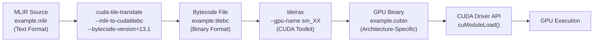
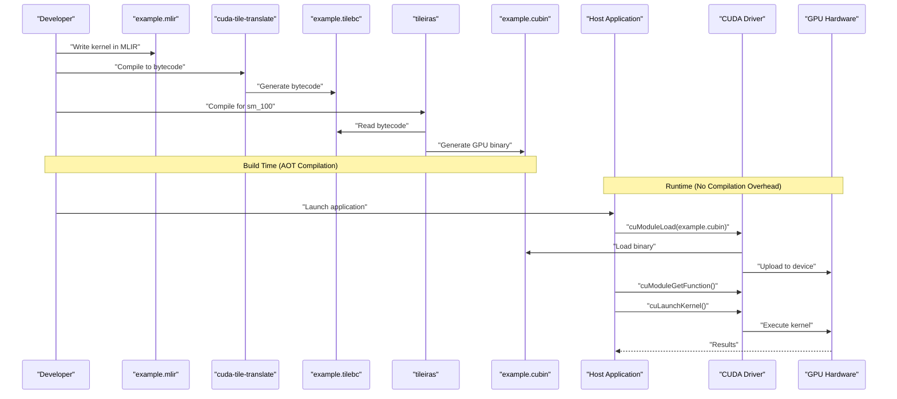
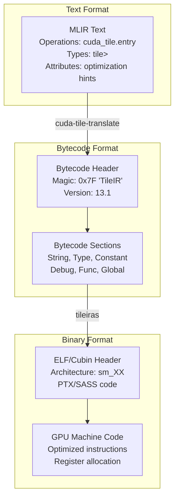

<!-- source: DeepWiki mcp.deepwiki.com · repo NVIDIA/cuda-tile · page 9.2 AOT Compilation with tileiras · fetched 2026-10-26 -->

# AOT Compilation with tileiras

<details>
<summary>Relevant source files</summary>

The following files were used as context for generating this wiki page:

- [README.md](README.md)
- [lib/Bytecode/Writer/BytecodeWriter.cpp](lib/Bytecode/Writer/BytecodeWriter.cpp)

</details>


## Purpose and Scope

This page documents ahead-of-time (AOT) compilation of CUDA Tile IR using the `tileiras` tool from the CUDA Toolkit. It covers the compilation workflow from bytecode to GPU binaries, architecture targeting, and integration with the CUDA driver API.

For just-in-time (JIT) compilation directly from bytecode, see [JIT Execution via CUDA Driver](#9.1). For information about generating bytecode from MLIR, see [Bytecode Translation Tools](#4.5).

## Overview

Ahead-of-time compilation with `tileiras` transforms CUDA Tile IR bytecode (`.tilebc` files) into architecture-specific GPU binaries (`.cubin` files) before runtime. This approach offers several advantages over JIT compilation:

- **Faster startup time**: Compilation occurs during build time rather than at application launch
- **Predictable performance**: No compilation overhead during runtime
- **Deployment optimization**: Ship pre-compiled binaries for specific GPU architectures
- **Build-time validation**: Detect compilation errors before deployment

The AOT compilation workflow consists of two stages:

1. **Bytecode generation**: MLIR text format → `.tilebc` binary format using `cuda-tile-translate`
2. **Binary compilation**: `.tilebc` bytecode → `.cubin` GPU binary using `tileiras`

Sources: [README.md:218-220]()

## Compilation Pipeline

The following diagram illustrates the complete AOT compilation pipeline from MLIR source to GPU execution:



**AOT Compilation Pipeline**

This pipeline contrasts with JIT compilation, where the bytecode file is loaded directly into `cuModuleLoad()`, skipping the `tileiras` compilation step.

Sources: [README.md:327-330]()

## The tileiras Tool

`tileiras` is a command-line compiler provided by the CUDA Toolkit (version 13.1+) that specializes in compiling CUDA Tile IR bytecode to GPU machine code. It is not part of the `cuda-tile` repository but is a separate component of the CUDA Toolkit.

### Basic Usage

```bash
tileiras --gpu-name <architecture> <input.tilebc> -o <output.cubin>
```

### Command-Line Options

| Option | Description | Example |
|--------|-------------|---------|
| `--gpu-name` | Target GPU architecture | `sm_100`, `sm_90`, `sm_89` |
| `-o <file>` | Output cubin file path | `-o kernel.cubin` |
| Input file | CUDA Tile IR bytecode file | `example.tilebc` |

### Architecture Targeting

The `--gpu-name` parameter specifies the target GPU architecture using NVIDIA's compute capability naming scheme:

- `sm_100`: NVIDIA Blackwell architecture (compute capability 10.0)
- `sm_90`: NVIDIA Hopper architecture (compute capability 9.0)
- `sm_89`: NVIDIA Ada Lovelace architecture (compute capability 8.9)
- `sm_86`: NVIDIA Ampere architecture (compute capability 8.6)
- `sm_80`: NVIDIA Ampere architecture (compute capability 8.0)

The architecture must match or be compatible with the GPU hardware where the cubin will execute. Running a cubin compiled for `sm_100` on an `sm_90` GPU will fail.

Sources: [README.md:328-329]()

## Complete Workflow Example

The following sequence diagram shows the complete development and execution workflow using AOT compilation:



**AOT Compilation and Execution Workflow**

Sources: [README.md:326-334]()

### Step-by-Step Instructions

**Step 1: Create MLIR Source**

Create a file `example.mlir` with CUDA Tile IR operations:

```mlir
cuda_tile.module @example_module {
    entry @example_kernel(%data_pr : tile<ptr<f32>>) {
        print "Running example module\n"
        %offsets = iota : tile<128xi32>
        %data_ptr_reshaped = reshape %data_pr : tile<ptr<f32>> -> tile<1xptr<f32>>
        %data_ptr_broadcasted = broadcast %data_ptr_reshaped : tile<1xptr<f32>> -> tile<128xptr<f32>>
        %data_ptr_tensor = offset %data_ptr_broadcasted, %offsets : tile<128xptr<f32>>, tile<128xi32> -> tile<128xptr<f32>>
        %data, %token = load_ptr_tko weak %data_ptr_broadcasted : tile<128xptr<f32>> -> tile<128xf32>, token
        print "Data: %f\n", %data : tile<128xf32>
        return
    }
}
```

**Step 2: Compile MLIR to Bytecode**

```bash
cuda-tile-translate example.mlir \
  --bytecode-version=13.1 \
  --mlir-to-cudatilebc \
  --no-implicit-module \
  -o example.tilebc
```

This invokes the `cuda-tile-translate` tool to serialize the MLIR into the bytecode format described in [Bytecode Format Specification](#4.1).

**Step 3: Compile Bytecode to Cubin**

```bash
tileiras --gpu-name sm_100 example.tilebc -o example.cubin
```

Replace `sm_100` with your target GPU architecture. This step performs architecture-specific optimizations and code generation.

**Step 4: Load and Execute in Host Application**

```cpp
// Initialize CUDA
CUdevice cuDevice;
CUcontext cuContext;
CUmodule cuModule;
CUfunction example_kernel;

cuInit(0);
cuDeviceGet(&cuDevice, 0);
cuCtxCreate(&cuContext, NULL, 0, cuDevice);

// Load pre-compiled cubin (no JIT overhead)
cuModuleLoad(&cuModule, "example.cubin");
cuModuleGetFunction(&example_kernel, cuModule, "example_kernel");

// Launch kernel
void *kernel_args[] = {&data_ptr};
cuLaunchKernel(example_kernel,
               1, 1, 1,        // grid dims
               1, 1, 1,        // block dims (must be 1,1,1)
               0,              // shared memory (must be 0)
               stream,
               kernel_args,
               NULL);
```

Sources: [README.md:232-323]()

## File Format Transformations

The following diagram illustrates the transformation of file formats through the compilation pipeline:



**File Format Evolution Through Compilation**

- **MLIR Text**: Human-readable intermediate representation with operations, types, and attributes
- **Bytecode**: Compact binary format with section-based layout for efficient storage and parsing
- **Cubin**: Architecture-specific GPU binary with low-level machine code

Sources: [lib/Bytecode/Writer/BytecodeWriter.cpp:30-49](), [README.md:327-328]()

## Bytecode Versioning

The `--bytecode-version` parameter in `cuda-tile-translate` controls the bytecode format version. This must match the version expected by `tileiras`:

```bash
# Generate bytecode for CUDA Toolkit 13.1
cuda-tile-translate --bytecode-version=13.1 ...
```

Version compatibility:
- Bytecode version 13.1 is compatible with CUDA Toolkit 13.1+
- `tileiras` validates bytecode version during compilation
- Mismatched versions will result in compilation errors

The bytecode version scheme follows the CUDA Toolkit versioning (Major.Minor format). For details on the bytecode format specification, see [Bytecode Format Specification](#4.1).

Sources: [README.md:327](), [README.md:342-358]()

## CUDA Driver Integration

After AOT compilation, the resulting `.cubin` file integrates with the CUDA driver API through standard module loading functions:

### Module Loading

```cpp
CUmodule cuModule;
CUresult result = cuModuleLoad(&cuModule, "example.cubin");
```

The `cuModuleLoad` function:
1. Reads the cubin file from disk
2. Validates the binary format and architecture compatibility
3. Uploads the binary to GPU memory
4. Returns a module handle for kernel access

### Function Retrieval

```cpp
CUfunction kernel;
cuModuleGetFunction(&kernel, cuModule, "example_kernel");
```

The function name (`"example_kernel"`) corresponds to the entry point name in the original MLIR (`entry @example_kernel`).

### Launch Parameters

CUDA Tile kernels use a specific launch configuration:

```cpp
cuLaunchKernel(
    kernel,
    gridX, gridY, gridZ,    // Grid dimensions: controls Tile Grid size
    1, 1, 1,                // Block dimensions: must be (1, 1, 1)
    0,                      // Shared memory: must be 0
    stream,
    kernel_args,
    NULL
);
```

**Important constraints**:
- Block dimensions must always be `(1, 1, 1)` for CUDA Tile kernels
- Shared memory parameter must be `0`
- Grid dimensions control the Tile Grid layout, not thread block layout

Sources: [README.md:295-315]()

## AOT vs JIT Compilation Comparison

The following table compares AOT compilation with `tileiras` against JIT compilation with the CUDA driver:

| Aspect | AOT (tileiras) | JIT (CUDA Driver) |
|--------|----------------|-------------------|
| **Input** | `.tilebc` bytecode | `.tilebc` bytecode |
| **Output** | `.cubin` binary | In-memory binary |
| **Compilation Time** | Build time | Application startup |
| **Runtime Overhead** | None | First launch only |
| **Architecture** | Specific (sm_XX) | Runtime-detected |
| **Distribution** | Multiple cubins for multi-arch | Single bytecode file |
| **Validation** | Build-time errors | Runtime errors |
| **Use Case** | Production deployment | Development, prototyping |
| **Binary Size** | Larger (arch-specific) | Smaller (portable) |

### When to Use AOT Compilation

Choose AOT compilation with `tileiras` when:

- **Performance is critical**: Eliminate JIT overhead for faster application startup
- **Target architecture is known**: Building for specific GPU models (e.g., data center deployment)
- **Build-time validation needed**: Catch compilation errors before deployment
- **Shipping production software**: Provide optimized binaries to end users

### When to Use JIT Compilation

Choose JIT compilation when:

- **Architecture flexibility required**: Single binary supports multiple GPU architectures
- **Rapid development**: Faster iteration without separate compilation step
- **Dynamic code generation**: Runtime-generated kernels or adaptive algorithms
- **Distribution size matters**: Smaller bytecode files vs. multiple architecture-specific cubins

Sources: [README.md:296-297](), [README.md:218-220]()

## Multi-Architecture Deployment

For applications targeting multiple GPU architectures, compile separate cubin files for each target:

```bash
# Compile for Hopper (sm_90)
tileiras --gpu-name sm_90 example.tilebc -o example_sm90.cubin

# Compile for Blackwell (sm_100)
tileiras --gpu-name sm_100 example.tilebc -o example_sm100.cubin
```

At runtime, select the appropriate cubin based on the detected GPU architecture:

```cpp
// Query GPU compute capability
int major, minor;
cuDeviceGetAttribute(&major, CU_DEVICE_ATTRIBUTE_COMPUTE_CAPABILITY_MAJOR, device);
cuDeviceGetAttribute(&minor, CU_DEVICE_ATTRIBUTE_COMPUTE_CAPABILITY_MINOR, device);

// Load appropriate cubin
if (major == 10 && minor == 0) {
    cuModuleLoad(&cuModule, "example_sm100.cubin");
} else if (major == 9 && minor == 0) {
    cuModuleLoad(&cuModule, "example_sm90.cubin");
} else {
    // Fallback: Use JIT compilation from bytecode
    cuModuleLoad(&cuModule, "example.tilebc");
}
```

This approach combines the benefits of AOT compilation for known architectures with JIT fallback for broader compatibility.

Sources: [README.md:328-329]()

## Error Handling

### Compilation Errors

`tileiras` reports errors during compilation:

```bash
$ tileiras --gpu-name sm_100 invalid.tilebc -o output.cubin
Error: Invalid bytecode format
Error: Unsupported operation in bytecode
```

Common compilation errors:
- Invalid bytecode version
- Corrupted bytecode file
- Unsupported operations for target architecture
- Invalid optimization hints or attributes

### Runtime Errors

`cuModuleLoad` reports errors when loading cubin files:

```cpp
CUresult result = cuModuleLoad(&cuModule, "example.cubin");
if (result != CUDA_SUCCESS) {
    const char *errStr;
    cuGetErrorString(result, &errStr);
    // Handle error: architecture mismatch, file not found, etc.
}
```

Common runtime errors:
- `CUDA_ERROR_FILE_NOT_FOUND`: Cubin file does not exist
- `CUDA_ERROR_INVALID_IMAGE`: Architecture mismatch or corrupted cubin
- `CUDA_ERROR_NOT_SUPPORTED`: GPU does not support required features

Sources: [README.md:257-268]()

## Integration with Build Systems

### CMake Example

```cmake
# Add custom target to compile MLIR to bytecode
add_custom_command(
    OUTPUT ${CMAKE_CURRENT_BINARY_DIR}/kernel.tilebc
    COMMAND cuda-tile-translate
        ${CMAKE_CURRENT_SOURCE_DIR}/kernel.mlir
        --bytecode-version=13.1
        --mlir-to-cudatilebc
        --no-implicit-module
        -o ${CMAKE_CURRENT_BINARY_DIR}/kernel.tilebc
    DEPENDS ${CMAKE_CURRENT_SOURCE_DIR}/kernel.mlir
    COMMENT "Compiling MLIR to bytecode"
)

# Add custom target to compile bytecode to cubin
add_custom_command(
    OUTPUT ${CMAKE_CURRENT_BINARY_DIR}/kernel_sm100.cubin
    COMMAND tileiras
        --gpu-name sm_100
        ${CMAKE_CURRENT_BINARY_DIR}/kernel.tilebc
        -o ${CMAKE_CURRENT_BINARY_DIR}/kernel_sm100.cubin
    DEPENDS ${CMAKE_CURRENT_BINARY_DIR}/kernel.tilebc
    COMMENT "Compiling bytecode to cubin for sm_100"
)

# Create target that depends on cubin
add_custom_target(kernel_binaries ALL
    DEPENDS ${CMAKE_CURRENT_BINARY_DIR}/kernel_sm100.cubin
)
```

### Makefile Example

```makefile
CUDA_TILE_TRANSLATE = cuda-tile-translate
TILEIRAS = tileiras
BYTECODE_VERSION = 13.1

%.tilebc: %.mlir
	$(CUDA_TILE_TRANSLATE) $< \
		--bytecode-version=$(BYTECODE_VERSION) \
		--mlir-to-cudatilebc \
		--no-implicit-module \
		-o $@

%_sm100.cubin: %.tilebc
	$(TILEIRAS) --gpu-name sm_100 $< -o $@

%_sm90.cubin: %.tilebc
	$(TILEIRAS) --gpu-name sm_90 $< -o $@

all: kernel_sm100.cubin kernel_sm90.cubin
```

Sources: [README.md:327-330]()

## Prerequisites and Dependencies

### Required Software

- **CUDA Toolkit 13.1+**: Provides the `tileiras` compiler
- **CUDA Tile IR tools**: `cuda-tile-translate` for bytecode generation
- **Compatible GPU driver**: Supports the target architecture

### Environment Setup

```bash
# Ensure CUDA Toolkit binaries are in PATH
export PATH=/usr/local/cuda/bin:$PATH

# Verify tileiras is available
which tileiras

# Verify cuda-tile-translate is available
which cuda-tile-translate
```

Sources: [README.md:224-227]()

---

