# Page: Overview

# Overview

<details>
<summary>Relevant source files</summary>

The following files were used as context for generating this wiki page:

- [README.md](README.md)

</details>


This document provides a high-level introduction to the CUDA Tile IR project, explaining its purpose as an MLIR-based intermediate representation for CUDA kernel optimization, its relationship to LLVM/MLIR and the CUDA Toolkit, and its major architectural components.

For detailed build instructions, see [Building from Source](#2.1). For dialect-specific information, see [Core Dialect](#3). For execution details, see [Execution Pipeline](#9).

## Purpose

CUDA Tile IR is an MLIR-based intermediate representation and compiler infrastructure for expressing and optimizing tile-based computations on NVIDIA GPUs. The project provides a domain-specific dialect within the MLIR framework that simplifies the development of high-performance CUDA kernels through first-class abstractions for tiling patterns, memory hierarchy management, and GPU-specific optimizations targeting tensor core units.

This implementation is aligned with CUDA Toolkit version 13.1 and provides a complete ecosystem including a dialect definition, bytecode serialization format, optimization passes, and language bindings (C++, C, Python).

**Sources:** [README.md:1-12]()

## System Context

CUDA Tile IR occupies a specific position in the compilation pipeline between high-level compiler infrastructure (LLVM/MLIR) and low-level GPU execution (CUDA Toolkit):

**System Context Diagram**

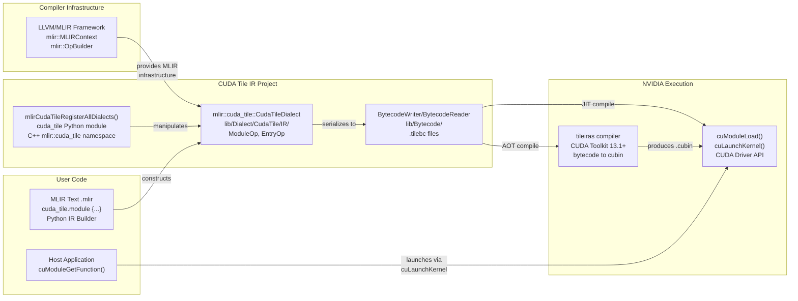

**Sources:** [README.md:1-12](), [lib/Dialect/CudaTile/IR/CudaTile.cpp](), [lib/Bytecode/Writer/Writer.cpp](), [lib/Bytecode/Reader/Reader.cpp]()

The project sits at the intersection of three domains:
- **LLVM/MLIR ecosystem**: Provides compiler infrastructure (`mlir::MLIRContext`, `mlir::OpBuilder`) and dialect framework
- **CUDA Toolkit**: Provides GPU compilation (`tileiras` tool) and runtime execution
- **User applications**: Consume the IR through C++ (`mlir::cuda_tile` namespace), C API (`mlirCudaTile*` functions), or Python (`cuda_tile` module)

## Major Components

CUDA Tile IR consists of five major subsystems:

**Component Architecture Diagram**

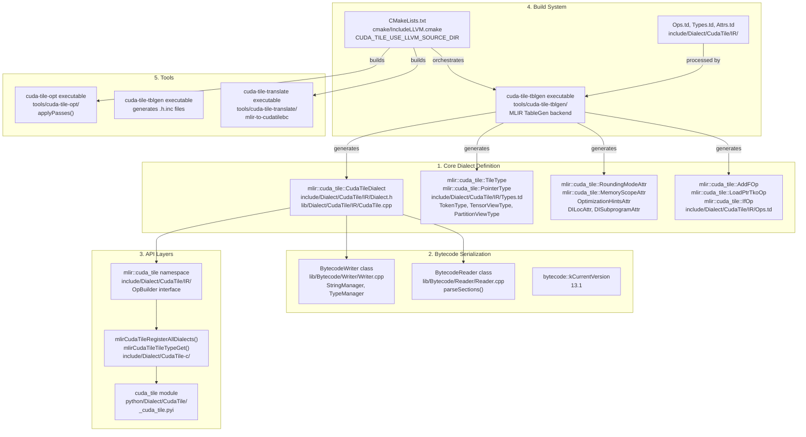

**Sources:** [README.md:14-25](), [lib/Dialect/CudaTile/IR/CudaTile.cpp](), [include/Dialect/CudaTile/IR/Types.td](), [include/Dialect/CudaTile/IR/Ops.td](), [lib/Bytecode/Writer/Writer.cpp](), [lib/Bytecode/Reader/Reader.cpp]()

### Component Descriptions

| Component | Location | Key Classes/Functions | Purpose |
|-----------|----------|----------------------|---------|
| **Core Dialect** | `include/Dialect/CudaTile/IR/`, `lib/Dialect/CudaTile/IR/` | `mlir::cuda_tile::CudaTileDialect`, `TileType`, `PointerType`, `AddFOp`, `LoadPtrTkoOp` | Defines the MLIR dialect with types, attributes, and operations for tile-based computations |
| **Bytecode System** | `lib/Bytecode/` | `BytecodeWriter`, `BytecodeReader`, `StringManager`, `TypeManager`, `bytecode::kCurrentVersion` | Provides binary serialization/deserialization with version 13.1 format and compatibility guarantees |
| **C++ API** | `include/Dialect/CudaTile/IR/` | `mlir::cuda_tile` namespace, `mlir::OpBuilder` interface | Internal implementation API using `mlir::cuda_tile` namespace |
| **C API** | `include/Dialect/CudaTile-c/` | `mlirCudaTileRegisterAllDialects()`, `mlirCudaTileTileTypeGet()`, `mlirCudaTileWriteBytecode()` | Language-agnostic API with `MLIR_CAPI_EXPORTED` functions prefixed with `mlirCudaTile*` |
| **Python Bindings** | `python/` | `cuda_tile` module, `_cuda_tile` extension module | Python wrappers for IR construction and manipulation (optional component) |
| **Build System** | `cmake/`, `CMakeLists.txt` | `CUDA_TILE_USE_LLVM_SOURCE_DIR`, `CUDA_TILE_ENABLE_BINDINGS_PYTHON` | CMake-based configuration supporting three LLVM integration modes |
| **Tools** | `tools/` | `cuda-tile-opt`, `cuda-tile-translate`, `cuda-tile-tblgen` executables | Command-line utilities: `cuda-tile-opt` (optimization), `cuda-tile-translate` (bytecode conversion), `cuda-tile-tblgen` (code generation) |

**Sources:** [README.md:14-25](), [README.md:144-210](), [include/Dialect/CudaTile/IR/Dialect.h](), [lib/Bytecode/Writer/Writer.cpp](), [include/Dialect/CudaTile-c/Dialect.h]()

## Compilation and Execution Flow

The typical workflow from source IR to GPU execution follows this pipeline:

**Compilation and Execution Pipeline Diagram**

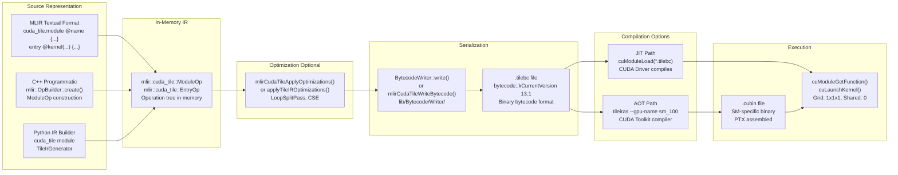

**Sources:** [README.md:212-339](), [lib/Bytecode/Writer/Writer.cpp](), [include/Dialect/CudaTile-c/Bytecode.h]()

### Pipeline Stages

1. **Source Construction**: IR can be created from:
   - MLIR textual syntax using `cuda_tile.module` and `entry` operations
   - C++ programmatically via `mlir::OpBuilder::create<mlir::cuda_tile::ModuleOp>()` and related builder methods
   - Python via the `cuda_tile` module using `TileIrGenerator` class

2. **Optimization** (Optional): The `mlirCudaTileApplyOptimizations()` C API function or `applyTileIROptimizations()` Python function applies transformation passes including:
   - `LoopSplitPass` at [lib/Dialect/CudaTile/Transforms/LoopSplit.cpp]()
   - Common subexpression elimination (CSE)
   - Canonicalization patterns

3. **Bytecode Serialization**: 
   - C++ API: `BytecodeWriter::write()` method at [lib/Bytecode/Writer/Writer.cpp]()
   - C API: `mlirCudaTileWriteBytecode()` function at [include/Dialect/CudaTile-c/Bytecode.h]()
   - Both serialize IR to `.tilebc` binary format at version `bytecode::kCurrentVersion` (13.1)

4. **Compilation Paths**:
   - **JIT**: Bytecode is loaded directly via CUDA Driver API `cuModuleLoad("example.tilebc")` for just-in-time compilation
   - **AOT**: The `tileiras` tool (CUDA Toolkit) compiles bytecode to architecture-specific `.cubin` files using `tileiras --gpu-name sm_100 example.tilebc -o example.cubin`

5. **Execution**: Both paths converge at `cuModuleGetFunction()` followed by `cuLaunchKernel()` with specific constraints:
   - Grid dimensions: 1×1×1 (sets Tile Grid dimensions)
   - Block dimensions: 1×1×1 (unused, must be 1×1×1)
   - Shared memory: 0 bytes (unused, must be 0)

**Sources:** [README.md:212-339](), [README.md:296-314](), [lib/Bytecode/Writer/Writer.cpp](), [include/Dialect/CudaTile-c/Bytecode.h](), [lib/Dialect/CudaTile/Transforms/LoopSplit.cpp]()

## LLVM/MLIR Integration

CUDA Tile IR is built on top of the MLIR framework and requires a compatible LLVM/MLIR installation. The project supports three integration modes:

| Mode | CMake Variable | Description |
|------|----------------|-------------|
| **Auto-download** | (default) | CMake downloads LLVM sources from GitHub at the commit specified in `cmake/IncludeLLVM.cmake:29` |
| **Source directory** | `CUDA_TILE_USE_LLVM_SOURCE_DIR` | Links against locally built LLVM at a compatible commit |
| **Install directory** | `CUDA_TILE_USE_LLVM_INSTALL_DIR` | Uses pre-built LLVM libraries from an installation directory |

The exact required LLVM commit is defined at [cmake/IncludeLLVM.cmake:29]() and must match for source/install directory modes.

**Sources:** [README.md:69-102](), Diagram 2

## CUDA Toolkit Integration

CUDA Tile IR requires CUDA Toolkit 13.1 or higher for execution. The integration occurs through:

- **tileiras compiler**: Compiles `.tilebc` bytecode files to SM-specific `.cubin` binaries
- **CUDA Driver API**: Loads bytecode (JIT) or cubin (AOT) and executes kernels via `cuModuleLoad()` and `cuLaunchKernel()`
- **Execution constraints**: CUDA Tile IR kernels must be launched with grid dimensions of 1x1x1 and 0 bytes of shared memory

**Sources:** [README.md:11-12](), [README.md:226-227](), [README.md:296-314]()

## API Architecture

CUDA Tile IR provides a three-layer API architecture for different integration scenarios:

**API Layer Architecture Diagram**

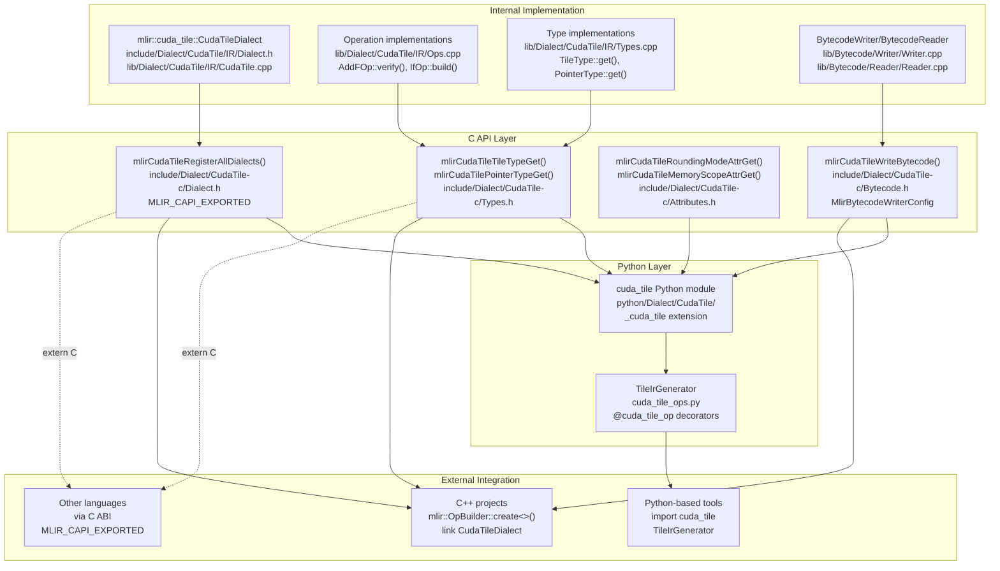

**Sources:** [README.md:144-210](), [include/Dialect/CudaTile/IR/Dialect.h](), [include/Dialect/CudaTile-c/Dialect.h](), [include/Dialect/CudaTile-c/Types.h](), [include/Dialect/CudaTile-c/Bytecode.h](), [python/Dialect/CudaTile/]()

### API Layer Purposes

- **C++ Internal API** (`mlir::cuda_tile` namespace): Used for direct integration in C++ projects, provides full access to dialect implementation including:
  - Type creation: `mlir::cuda_tile::TileType::get()`, `mlir::cuda_tile::PointerType::get()`
  - Operation builders: `mlir::OpBuilder::create<mlir::cuda_tile::AddFOp>()`
  - Bytecode I/O: `BytecodeWriter::write()`, `BytecodeReader::read()`
  
- **C API** (`mlirCudaTile*` functions): Language-agnostic interface with `MLIR_CAPI_EXPORTED` linkage defined at [include/Dialect/CudaTile-c/](), enables FFI from other languages with functions like:
  - `mlirCudaTileRegisterAllDialects(MlirContext)`
  - `mlirCudaTileTileTypeGet(MlirContext, intptr_t numElements, MlirType* elementTypes)`
  - `mlirCudaTileWriteBytecode(MlirModule, MlirStringCallback, void*)`

- **Python Bindings**: High-level interface for programmatic IR construction, manipulation, and testing (optional, controlled by `CUDA_TILE_ENABLE_BINDINGS_PYTHON` CMake variable) including:
  - `cuda_tile` module with `TileIrGenerator` class
  - `@cuda_tile_op` decorators for operation wrappers
  - High-level `Tile` class with operator overloading

**Sources:** [README.md:104-118](), [include/Dialect/CudaTile-c/Dialect.h](), [include/Dialect/CudaTile-c/Types.h](), [include/Dialect/CudaTile-c/Bytecode.h](), [python/Dialect/CudaTile/]()

## Build System Overview

The CMake build system handles complex dependencies and code generation:

**Build System Architecture Diagram**

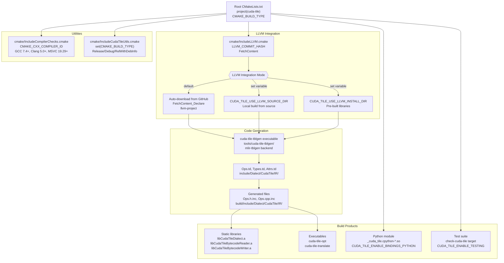

**Sources:** [README.md:36-133](), [CMakeLists.txt](), [cmake/IncludeLLVM.cmake](), [cmake/IncludeCompilerChecks.cmake]()

The build system performs three critical functions:
1. **LLVM/MLIR Integration**: Downloads (via `FetchContent`) or locates LLVM at the commit specified in [cmake/IncludeLLVM.cmake:29]()
2. **Compiler Validation**: Checks `CMAKE_CXX_COMPILER_ID` to ensure GCC 7.4+, Clang 5.0+, or MSVC 19.29+ via [cmake/IncludeCompilerChecks.cmake]()
3. **Code Generation**: Runs `cuda-tile-tblgen` (MLIR TableGen backend) on `.td` definition files at [include/Dialect/CudaTile/IR/]() to generate `.h.inc` and `.cpp.inc` files

**Sources:** [README.md:36-133](), [CMakeLists.txt](), [cmake/IncludeLLVM.cmake](), [cmake/IncludeCompilerChecks.cmake]()

## Key Features

CUDA Tile IR provides several key capabilities:

- **Tile-based type system**: First-class types defined in [include/Dialect/CudaTile/IR/Types.td]():
  - `mlir::cuda_tile::TileType` for fixed-shape tensors with power-of-2 dimensions
  - `mlir::cuda_tile::PointerType` for typed memory pointers
  - `mlir::cuda_tile::TokenType` for memory operation ordering
  - `mlir::cuda_tile::TensorViewType` for dynamic-shape global memory references
  - `mlir::cuda_tile::PartitionViewType` for grid-partitioned views

- **Memory model**: Explicit memory ordering and scope semantics via attributes:
  - `MemoryOrderingSemantics`: `WEAK`, `RELAXED`, `ACQUIRE`, `RELEASE`, `ACQ_REL`
  - `MemoryScope`: `TL_BLK`, `DEVICE`, `SYS`
  - Token-ordered operations (suffix `_tko`): `LoadPtrTkoOp`, `StoreViewTkoOp`, `AtomicCasTkoOp`

- **Optimization passes**: Located in [lib/Dialect/CudaTile/Transforms/]():
  - `LoopSplitPass` at [lib/Dialect/CudaTile/Transforms/LoopSplit.cpp]()
  - Common subexpression elimination (CSE)
  - Canonicalization patterns

- **Debug information**: DWARF-compatible debug info attributes:
  - `mlir::cuda_tile::DILocAttr` for source locations
  - `mlir::cuda_tile::DISubprogramAttr` for function metadata
  - `mlir::cuda_tile::DIFileAttr` for file references

- **Assumption predicates**: Predicates for enabling compiler optimizations:
  - `mlir::cuda_tile::AssumeDivByOp` for divisibility assumptions
  - `mlir::cuda_tile::AssumeSameElementsOp` for element equality
  - `mlir::cuda_tile::AssumeBoundedOp` for value bounds

- **Architecture-specific hints**: `mlir::cuda_tile::OptimizationHintsAttr` for controlling:
  - CTA count and distribution
  - TMA (Tensor Memory Accelerator) usage
  - Latency tolerance
  - Occupancy targets

- **Stable bytecode format**: Version `bytecode::kCurrentVersion` (13.1) with FROZEN opcode policy ensuring backward compatibility in section-based format (Header, String, Type, Constant, Debug, Func)

**Sources:** [README.md:1-12](), [include/Dialect/CudaTile/IR/Types.td](), [include/Dialect/CudaTile/IR/Attrs.td](), [lib/Dialect/CudaTile/Transforms/LoopSplit.cpp](), [lib/Bytecode/Writer/Writer.cpp]()

## License

CUDA Tile IR is licensed under Apache License v2.0 with LLVM Exceptions, matching the LLVM project's licensing model. This allows embedding compiled portions of the software into object form without full Apache 2.0 compliance and enables combination with GPLv2 software.

**Sources:** [LICENSE.txt:1-8](), [README.md:351-354]()

---

# Page: Getting Started

# Getting Started

<details>
<summary>Relevant source files</summary>

The following files were used as context for generating this wiki page:

- [README.md](README.md)

</details>


This page provides an overview of prerequisites, initial setup, and basic usage patterns for CUDA Tile IR. It covers the essential information needed to begin working with the project, including dependencies, quick start commands, and configuration options.

For detailed build instructions, see [Building from Source](#2.1). For integrating CUDA Tile IR into existing projects, see [Integration Methods](#2.2). For a complete walkthrough of writing and executing a CUDA Tile IR program, see [First Example](#2.3).

## Prerequisites

### Required Dependencies

The following dependencies are required to build and use CUDA Tile IR:

| Dependency | Minimum Version | Purpose |
|------------|----------------|---------|
| CMake | 3.20.0 | Build system configuration |
| C++ Compiler | C++17 compatible | Compilation (see compiler table below) |
| LLVM/MLIR | Specific commit | Compiler infrastructure |

**Supported Compilers:**

| Compiler | Minimum Version | Validation |
|----------|----------------|------------|
| GCC | 7.4+ | Checked in [cmake/IncludeCompilerChecks.cmake]() |
| Clang | 5.0+ | Checked in [cmake/IncludeCompilerChecks.cmake]() |
| MSVC | 19.29+ | Checked in [cmake/IncludeCompilerChecks.cmake]() |

The C++ standard is set to C++17 in [CMakeLists.txt:8]().

### Optional Dependencies

| Dependency | Purpose | Configuration Flag |
|------------|---------|-------------------|
| Python 3.6+ | Python bindings | `CUDA_TILE_ENABLE_BINDINGS_PYTHON` |
| Ninja | Faster builds | `-G Ninja` |
| ccache | Build caching | `CUDA_TILE_ENABLE_CCACHE` |
| CUDA Toolkit 13.1+ | Kernel execution | Runtime only |

### LLVM/MLIR Compatibility

CUDA Tile IR requires LLVM/MLIR at a specific compatible commit. The exact commit hash is defined in [cmake/IncludeLLVM.cmake:29](). This version alignment ensures compatibility with CUDA Toolkit 13.1.

**Sources:** [README.md:37-44](), [CMakeLists.txt:4-9](), [cmake/IncludeCompilerChecks.cmake]()

## Quick Start

The simplest way to get started is to let the build system automatically download and build LLVM/MLIR from source:

```bash
# Configure with automatic LLVM download
cmake -G Ninja -S . -B build \
  -DCMAKE_BUILD_TYPE=Release \
  -DLLVM_ENABLE_ASSERTIONS=OFF \
  -DCUDA_TILE_ENABLE_BINDINGS_PYTHON=ON

# Build all targets
cmake --build build

# Run tests (requires CUDA_TILE_ENABLE_TESTING=ON)
cmake --build build --target check-cuda-tile
```

This configuration will:
1. Download LLVM/MLIR sources from GitHub at the compatible commit
2. Build LLVM/MLIR and CUDA Tile IR
3. Enable Python bindings for programmatic IR manipulation
4. Produce tools in `build/bin/` and libraries in `build/lib/`

**Sources:** [README.md:47-65](), [CMakeLists.txt:1-29]()

## Configuration Options

### CMake Variables

The following diagram shows the key CMake configuration variables and how they relate to build outputs:

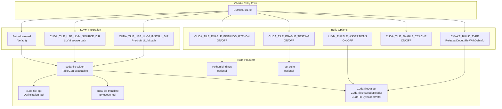

**Key Configuration Variables:**

| Variable | Default | Description |
|----------|---------|-------------|
| `CUDA_TILE_USE_LLVM_INSTALL_DIR` | Unset | Path to pre-built LLVM installation |
| `CUDA_TILE_USE_LLVM_SOURCE_DIR` | Unset | Path to LLVM source directory |
| `CUDA_TILE_ENABLE_BINDINGS_PYTHON` | OFF | Enable Python bindings |
| `CUDA_TILE_ENABLE_TESTING` | OFF | Enable test suite |
| `CUDA_TILE_ENABLE_CCACHE` | OFF | Enable ccache for faster rebuilds |
| `CMAKE_BUILD_TYPE` | - | Release/Debug/RelWithDebInfo |
| `LLVM_ENABLE_ASSERTIONS` | - | Enable LLVM assertions (Debug builds) |

The variables are validated in [CMakeLists.txt:56-62](), where mutually exclusive options are checked.

**Sources:** [CMakeLists.txt:16-41](), [README.md:67-103]()

## Development Workflow

The following diagram illustrates the typical development workflow from source files to kernel execution:

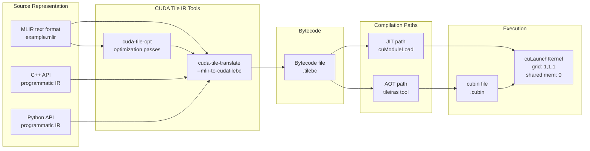

**Workflow Steps:**

1. **IR Creation**: Write CUDA Tile IR in textual MLIR format, or construct it programmatically using C++ or Python APIs
2. **Optimization** (optional): Apply transformation passes using `cuda-tile-opt`
3. **Bytecode Generation**: Use `cuda-tile-translate` to produce `.tilebc` bytecode files
4. **Compilation**:
   - **JIT Path**: Load bytecode directly with `cuModuleLoad` for runtime compilation
   - **AOT Path**: Use `tileiras` tool to compile bytecode to architecture-specific cubin files
5. **Execution**: Launch kernels using CUDA Driver API with `cuLaunchKernel`

The tools are built as subdirectories referenced in [CMakeLists.txt:152-174]().

**Sources:** [README.md:212-339](), [CMakeLists.txt:139-144]()

## Build System Components

Understanding the build system structure helps when troubleshooting or customizing the build:

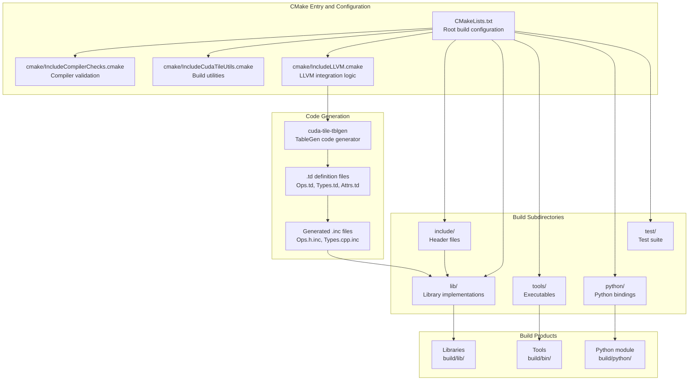

**Key Build Files:**

- [CMakeLists.txt](): Root build configuration, sets C++17 standard, includes cmake utilities
- [cmake/IncludeCompilerChecks.cmake](): Validates compiler versions (GCC 7.4+, Clang 5.0+, MSVC 19.29+)
- [cmake/IncludeCudaTileUtils.cmake](): Build type configuration and utility functions
- [cmake/IncludeLLVM.cmake](): LLVM/MLIR integration with three pathways (install dir, source dir, auto-download)

**Build Subdirectories** (referenced in [CMakeLists.txt:172-181]()):

- `tools/cuda-tile-tblgen`: Must be built first, provides TableGen code generation
- `include/`: Header files and TableGen definitions
- `lib/`: Core dialect and bytecode implementations
- `tools/`: User-facing executables (`cuda-tile-opt`, `cuda-tile-translate`)
- `python/`: Python bindings (if `CUDA_TILE_ENABLE_BINDINGS_PYTHON=ON`)
- `test/`: Test suite (if `CUDA_TILE_ENABLE_TESTING=ON`)

**Sources:** [CMakeLists.txt:1-197](), [cmake/IncludeLLVM.cmake](), [cmake/IncludeCompilerChecks.cmake]()

## Directory Structure

The project follows this organization:

```
cuda-tile/
├── CMakeLists.txt              # Root build configuration
├── cmake/                      # CMake utilities and configuration
│   ├── IncludeLLVM.cmake      # LLVM integration logic
│   ├── IncludeCompilerChecks.cmake
│   └── IncludeCudaTileUtils.cmake
├── include/                    # Public headers
│   └── cuda-tile/             # Dialect definitions
├── lib/                        # Implementation files
│   ├── CAPI/                  # C API implementations
│   ├── Dialect/               # Core dialect
│   └── Bytecode/              # Bytecode reader/writer
├── tools/                      # Executables
│   ├── cuda-tile-tblgen/      # TableGen tool
│   ├── cuda-tile-opt/         # Optimization tool
│   └── cuda-tile-translate/   # Bytecode tool
├── python/                     # Python bindings (optional)
└── test/                       # Test suite (optional)
```

The source and binary directories are tracked as CMake variables:
- `CUDA_TILE_SOURCE_DIR`: Set in [CMakeLists.txt:16]()
- `CUDA_TILE_BINARY_DIR`: Set in [CMakeLists.txt:18]()
- `CUDA_TILE_INSTALL_DIR`: Set in [CMakeLists.txt:20]()

**Sources:** [CMakeLists.txt:16-21](), [CMakeLists.txt:134-144]()

## Next Steps

After completing the basic setup:

1. **Build from Source**: For detailed build instructions including cross-compilation and advanced options, see [Building from Source](#2.1)

2. **Integration**: To integrate CUDA Tile IR into your own project, see [Integration Methods](#2.2)

3. **First Example**: For a complete walkthrough of writing, compiling, and executing a CUDA Tile IR program, see [First Example](#2.3)

4. **Core Dialect**: To understand the operations, types, and attributes available, see [Core Dialect](#3)

5. **API Reference**: For programmatic usage via C++, C, or Python APIs, see [API Reference](#5)

**Sources:** [README.md:1-355]()

---

# Page: Building from Source

# Building from Source

<details>
<summary>Relevant source files</summary>

The following files were used as context for generating this wiki page:

- [README.md](README.md)
- [cmake/IncludeLLVM.cmake](cmake/IncludeLLVM.cmake)

</details>


This page provides detailed instructions for building CUDA Tile IR from source, including prerequisite setup, CMake configuration, and build verification. This covers the compilation process of CUDA Tile itself as a standalone project. For information about integrating CUDA Tile into your own projects, see [Integration Methods](#2.2).

## Prerequisites

CUDA Tile requires the following dependencies to build from source:

| Dependency | Minimum Version | Notes |
|------------|-----------------|-------|
| CMake | 3.20.0 | Build system configuration |
| C++ Compiler | C++17 compatible | GCC, Clang, or MSVC |
| Python | 3.6+ | Required for Python bindings and test infrastructure |
| LLVM/MLIR | Specific commit | Exact commit: `b82c7fc65229c8b2b6a964f023f6ec59b3cf9210` |
| Ninja | (optional) | Recommended for faster parallel builds |

The LLVM/MLIR dependency is the most critical. CUDA Tile is pinned to a specific LLVM commit hash defined in [cmake/IncludeLLVM.cmake:29](). This version requirement is strict because CUDA Tile depends on MLIR APIs that may change between commits.

**Sources:** [README.md:37-44](), [cmake/IncludeLLVM.cmake:29]()

## Build Process Overview

The following diagram shows the complete build process flow, from initial CMake configuration through final artifact generation:

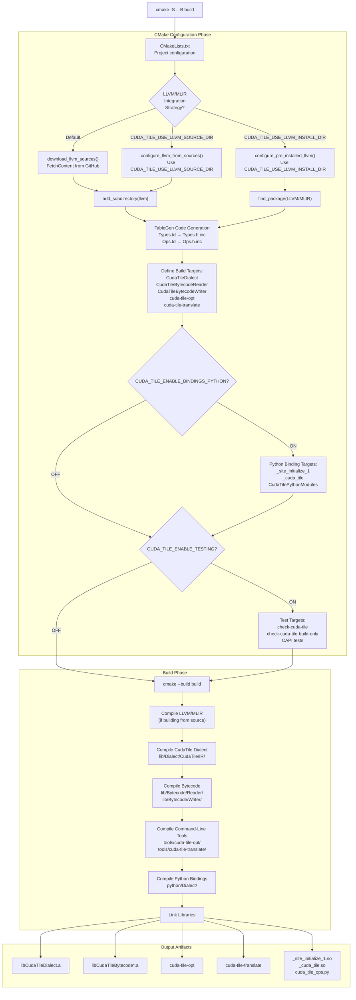

**Sources:** [cmake/IncludeLLVM.cmake:25-163](), [README.md:48-133]()

## Quick Start Build

The fastest way to build CUDA Tile from source with automatic LLVM/MLIR download:

```bash
# Configure the build
cmake -G Ninja -S . -B build \
  -DCMAKE_BUILD_TYPE=Release \
  -DLLVM_ENABLE_ASSERTIONS=OFF \
  -DCUDA_TILE_ENABLE_BINDINGS_PYTHON=ON

# Build all targets
cmake --build build

# Run tests
cmake --build build --target check-cuda-tile
```

This configuration:
- Uses Ninja generator for parallel builds
- Builds release mode with optimizations enabled
- Disables LLVM assertions for better performance
- Enables Python bindings
- Automatically downloads LLVM/MLIR sources from GitHub at the pinned commit

**Sources:** [README.md:48-65]()

## Build Configuration Options

### Core Build Settings

| CMake Variable | Default | Description |
|----------------|---------|-------------|
| `CMAKE_BUILD_TYPE` | (none) | Build type: `Debug`, `Release`, `RelWithDebInfo`, `MinSizeRel` |
| `CMAKE_C_COMPILER` | System default | C compiler path |
| `CMAKE_CXX_COMPILER` | System default | C++ compiler path |
| `CMAKE_INSTALL_PREFIX` | `/usr/local` | Installation directory |

### LLVM/MLIR Integration Options

These options control how CUDA Tile integrates with LLVM/MLIR. For detailed explanations of each method, see [Integration Methods](#2.2).

| CMake Variable | Description |
|----------------|-------------|
| `CUDA_TILE_USE_LLVM_SOURCE_DIR` | Path to local LLVM sources. If set, builds LLVM from these sources instead of downloading. |
| `CUDA_TILE_USE_LLVM_INSTALL_DIR` | Path to pre-built LLVM installation. If set, links against pre-compiled libraries. |
| `LLVM_ENABLE_ASSERTIONS` | Enable LLVM assertions. Recommended `OFF` for release builds, `ON` for debugging. |

When neither `CUDA_TILE_USE_LLVM_SOURCE_DIR` nor `CUDA_TILE_USE_LLVM_INSTALL_DIR` is set, the build system automatically invokes `download_llvm_sources()` from [cmake/IncludeLLVM.cmake:25-52]() which uses CMake's `FetchContent` to download LLVM sources at commit `b82c7fc65229c8b2b6a964f023f6ec59b3cf9210`.

**Sources:** [cmake/IncludeLLVM.cmake:57-127](), [cmake/IncludeLLVM.cmake:133-163](), [README.md:69-103]()

### Feature Control Options

| CMake Variable | Default | Description |
|----------------|---------|-------------|
| `CUDA_TILE_ENABLE_BINDINGS_PYTHON` | `OFF` | Enable Python bindings. When building LLVM from source, automatically sets `MLIR_ENABLE_BINDINGS_PYTHON=ON`. |
| `CUDA_TILE_ENABLE_TESTING` | `ON` | Enable test targets and test tool installation. |
| `CUDA_TILE_ENABLE_CCACHE` | `OFF` | Enable ccache for faster recompilation. When building LLVM from source, propagates to `LLVM_CCACHE_BUILD`. |

**Sources:** [cmake/IncludeLLVM.cmake:90-98](), [cmake/IncludeLLVM.cmake:104-117](), [README.md:104-133]()

### LLVM Build Configuration

When building LLVM from source (either via auto-download or local sources), the macro `configure_llvm_from_sources()` applies these settings to minimize build time:

```cmake
# Disabled to reduce build time
LLVM_INCLUDE_EXAMPLES=OFF
LLVM_INCLUDE_TESTS=OFF
LLVM_INCLUDE_BENCHMARKS=OFF
LLVM_BUILD_EXAMPLES=OFF

# Only build MLIR, not other LLVM tools
LLVM_ENABLE_PROJECTS="mlir"

# Don't build any code generation targets
LLVM_TARGETS_TO_BUILD=""

# Build and install utility tools for testing
LLVM_BUILD_UTILS=ON
LLVM_INSTALL_UTILS=ON
```

The build system also disables precompiled headers (`CMAKE_DISABLE_PRECOMPILE_HEADERS=ON`) to avoid flag mismatches between LLVM and CUDA Tile targets, particularly around debug flags like `NDEBUG`.

**Sources:** [cmake/IncludeLLVM.cmake:76-102]()

## LLVM/MLIR Configuration Macro Flow

The following diagram shows the internal CMake macro execution flow based on configuration options:

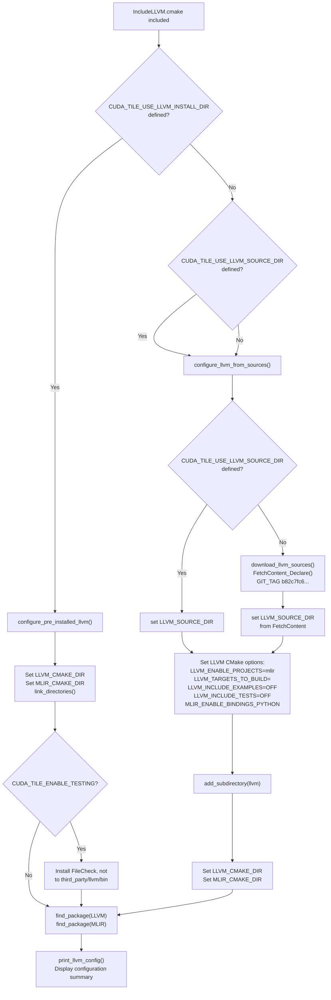

**Sources:** [cmake/IncludeLLVM.cmake:57-163]()

## Build Target Hierarchy

After configuration, CMake generates the following build targets:

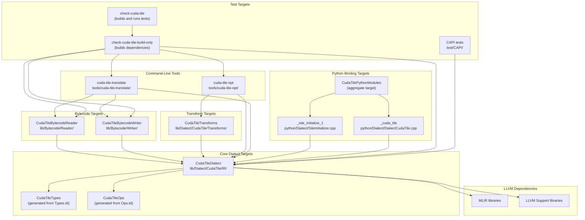

**Sources:** [cmake/IncludeLLVM.cmake:104-117]()

## Building the Project

After configuration, build all targets:

```bash
# Build all targets
cmake --build build

# Build with explicit parallelism (for Make generator)
cmake --build build -j 8

# Build specific target
cmake --build build --target CudaTileDialect

# Build only Python bindings
cmake --build build --target CudaTilePythonModules

# Build command-line tools
cmake --build build --target cuda-tile-opt cuda-tile-translate
```

**Common build targets:**

| Target | Description |
|--------|-------------|
| `all` | Default target, builds everything except tests |
| `CudaTileDialect` | Core dialect library only |
| `CudaTileBytecodeReader` | Bytecode deserialization library |
| `CudaTileBytecodeWriter` | Bytecode serialization library |
| `cuda-tile-opt` | Optimization tool for applying transformation passes |
| `cuda-tile-translate` | Translation tool for MLIR ↔ bytecode conversion |
| `CudaTilePythonModules` | All Python binding modules (if enabled) |
| `check-cuda-tile-build-only` | Build test dependencies without running tests |
| `check-cuda-tile` | Build and execute full test suite |

## Build Artifacts

After a successful build, artifacts are organized in the build directory:

| Location | Contents |
|----------|----------|
| `build/lib/` | Static libraries: `libCudaTileDialect.a`, `libCudaTileBytecodeReader.a`, `libCudaTileBytecodeWriter.a`, etc. |
| `build/bin/` | Command-line tools: `cuda-tile-opt`, `cuda-tile-translate`, `FileCheck`, `not` |
| `build/include/` | Generated headers: `Types.h.inc`, `Ops.h.inc`, `Dialect.h.inc` |
| `build/python/` | Python binding shared libraries: `_site_initialize_1.so`, `_cuda_tile.so` |
| `build/tools/` | Tool-specific build artifacts |
| `build/llvm-project-build/` | LLVM/MLIR build artifacts (if building from source) |

The Python bindings require special PYTHONPATH setup to use from the build directory. For details on Python binding usage, see [Python Operations API](#5.3.3).

## Testing the Build

CUDA Tile uses LLVM's `lit` (LLVM Integrated Tester) framework for testing. Tests are enabled by default via `CUDA_TILE_ENABLE_TESTING=ON`.

**Run all tests:**
```bash
cmake --build build --target check-cuda-tile
```

**Build test dependencies without running:**
```bash
cmake --build build --target check-cuda-tile-build-only
```

The test system validates:
- MLIR textual format parsing and printing
- Bytecode serialization/deserialization round-trips
- Optimization pass correctness
- Python binding functionality
- C API registration and type creation

For comprehensive information about the testing infrastructure, see [Testing and Validation](#10).

**Sources:** [README.md:135-142]()

## Troubleshooting Common Build Issues

### LLVM Version Mismatch

**Error:** `Compatible LLVM commit not found` or LLVM linking errors.

**Solution:** Ensure your LLVM sources or pre-built libraries match commit `b82c7fc65229c8b2b6a964f023f6ec59b3cf9210`. Check [cmake/IncludeLLVM.cmake:29]() for the exact commit hash.

### Python Binding Errors

**Error:** `Could not find MLIR Python bindings` or Nanobind compilation failures.

**Solution:** When using pre-built LLVM, ensure it was built with `-DMLIR_ENABLE_BINDINGS_PYTHON=ON`. When building from source, this is automatically handled by [cmake/IncludeLLVM.cmake:97]().

### Out of Memory During LLVM Build

**Error:** Compiler killed or out-of-memory during LLVM compilation.

**Solution:** Limit parallel jobs: `cmake --build build -j 4`. Consider using pre-built LLVM libraries via `CUDA_TILE_USE_LLVM_INSTALL_DIR` to avoid building LLVM entirely.

### Cross-Compilation Not Supported

**Error:** `Cross-compilation is not supported when building LLVM from sources`.

**Solution:** Cross-compilation is only supported when using pre-built LLVM libraries via `CUDA_TILE_USE_LLVM_INSTALL_DIR`. See [cmake/IncludeLLVM.cmake:58-60]().

### Test Tools Not Found

**Error:** `FileCheck not found` or `lit configuration failed`.

**Solution:** Ensure `CUDA_TILE_ENABLE_TESTING=ON` during configuration. This triggers installation of test tools to `third_party/llvm/bin/` via [cmake/IncludeLLVM.cmake:107-116]() and [cmake/IncludeLLVM.cmake:146-153]().

**Sources:** [cmake/IncludeLLVM.cmake:58-60](), [cmake/IncludeLLVM.cmake:97](), [cmake/IncludeLLVM.cmake:136-141]()

---

# Page: Integration Methods

# Integration Methods

<details>
<summary>Relevant source files</summary>

The following files were used as context for generating this wiki page:

- [README.md](README.md)
- [cmake/IncludeLLVM.cmake](cmake/IncludeLLVM.cmake)

</details>


## Purpose and Scope

This page documents the three methods for integrating LLVM/MLIR dependencies into CUDA Tile IR builds. CUDA Tile requires MLIR (part of the LLVM project) at a specific compatible commit hash. The build system provides flexible integration strategies to accommodate different development workflows and CI/CD environments.

For information about integrating the **CUDA Tile project itself** into downstream applications, see [Building from Source](#2.1). For Python-specific binding configuration, see [Python Build System](#5.3.1).

**Sources:** [cmake/IncludeLLVM.cmake:1-164](), [README.md:69-102]()

---

## Overview of Integration Methods

CUDA Tile supports three mutually exclusive methods for obtaining LLVM/MLIR dependencies, controlled via CMake configuration variables:

| Method | CMake Variable | Use Case | Build Time | Setup Complexity |
|--------|---------------|----------|------------|------------------|
| **Auto-download** | None (default) | Quick start, CI environments | Longest (~2+ hours) | Minimal |
| **Local Sources** | `CUDA_TILE_USE_LLVM_SOURCE_DIR` | Active development, customization | Long (~2+ hours) | Medium |
| **Pre-built Libraries** | `CUDA_TILE_USE_LLVM_INSTALL_DIR` | Production, CI optimization | Fast (~10 minutes) | Highest |

All three methods require LLVM/MLIR at the specific commit hash defined in [cmake/IncludeLLVM.cmake:29]() (currently `b82c7fc65229c8b2b6a964f023f6ec59b3cf9210`). The build system performs version validation to ensure compatibility.

**Sources:** [cmake/IncludeLLVM.cmake:25-163](), [README.md:69-102]()

---

## Integration Method Selection Flow

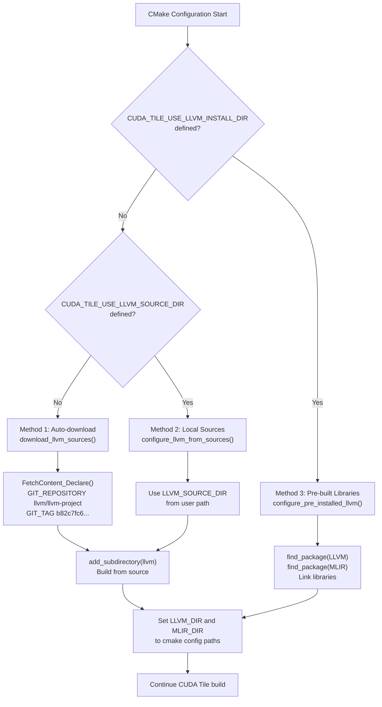

**Sources:** [cmake/IncludeLLVM.cmake:25-163]()

---

## Method 1: Auto-download from GitHub

### Configuration

The auto-download method is the **default** when no LLVM-related CMake variables are set. It requires no manual setup of LLVM dependencies.

```bash
cmake -G Ninja -S . -B build -DCMAKE_BUILD_TYPE=Release
```

### Implementation Details

The `download_llvm_sources()` macro ([cmake/IncludeLLVM.cmake:25-52]()) uses CMake's `FetchContent` module to clone the LLVM project from GitHub:

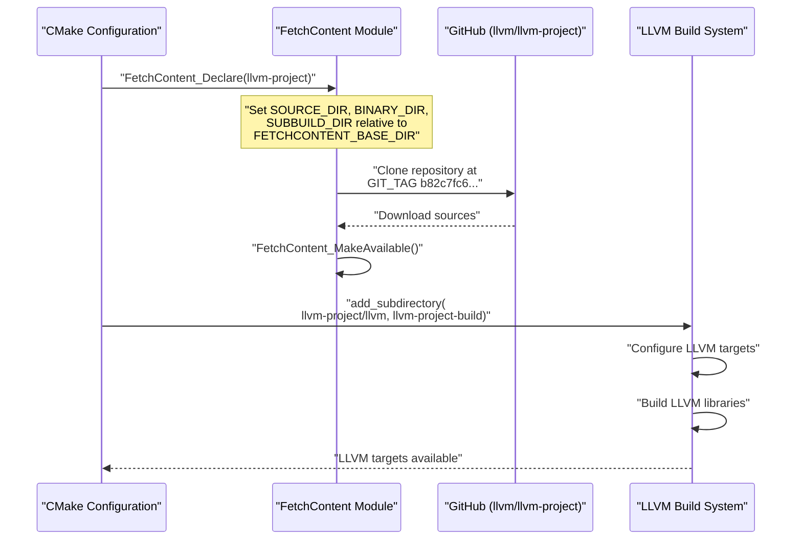

### Key Variables Set

The macro configures the following FetchContent variables ([cmake/IncludeLLVM.cmake:35-39]()):

- `FETCHCONTENT_BASE_DIR`: `${CUDA_TILE_BINARY_DIR}`
- `FETCHCONTENT_SOURCE_DIR`: `llvm-project`
- `FETCHCONTENT_BINARY_DIR`: `llvm-project-build`
- `FETCHCONTENT_SUBBUILD_DIR`: `llvm-project-subbuild`
- `FETCHCONTENT_QUIET`: `FALSE` (enables progress output)

The downloaded sources are placed in `${CUDA_TILE_BINARY_DIR}/llvm-project/`, and the build artifacts in `${CUDA_TILE_BINARY_DIR}/llvm-project-build/`.

### Advantages and Limitations

**Advantages:**
- Zero setup required beyond CMake and a C++ compiler
- Guarantees correct LLVM version automatically
- Ideal for first-time users and CI environments

**Limitations:**
- Longest build time (LLVM compilation takes 2+ hours)
- Requires stable internet connection during configuration
- No cross-compilation support ([cmake/IncludeLLVM.cmake:58-60]())

**Sources:** [cmake/IncludeLLVM.cmake:25-52](), [cmake/IncludeLLVM.cmake:57-127](), [README.md:75-82]()

---

## Method 2: Local LLVM Sources

### Configuration

This method builds LLVM/MLIR from existing sources on the filesystem, useful when developing both CUDA Tile and LLVM simultaneously or when offline builds are required.

```bash
cmake -G Ninja -S . -B build \
  -DCMAKE_BUILD_TYPE=Release \
  -DCUDA_TILE_USE_LLVM_SOURCE_DIR=/path/to/llvm-project
```

### Version Requirements

The local LLVM sources **must** be at the compatible commit hash. The build system does not perform automatic version checking for local sources, so users must ensure correctness. Verify with:

```bash
cd /path/to/llvm-project
git log -1 --format=%H
# Should output: b82c7fc65229c8b2b6a964f023f6ec59b3cf9210
```

### Implementation Details

The `configure_llvm_from_sources()` macro ([cmake/IncludeLLVM.cmake:57-127]()) handles both auto-download and local sources:

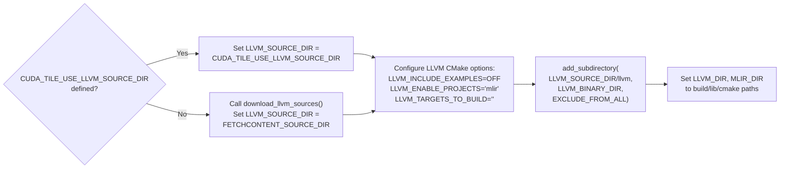

### LLVM Build Configuration

When building from sources (either downloaded or local), the macro sets minimal LLVM configuration options ([cmake/IncludeLLVM.cmake:76-98]()):

| CMake Variable | Value | Purpose |
|----------------|-------|---------|
| `LLVM_INCLUDE_EXAMPLES` | `OFF` | Skip example targets |
| `LLVM_INCLUDE_TESTS` | `OFF` | Skip LLVM test suite |
| `LLVM_INCLUDE_BENCHMARKS` | `OFF` | Skip benchmark targets |
| `LLVM_BUILD_EXAMPLES` | `OFF` | Don't build examples |
| `LLVM_ENABLE_ASSERTIONS` | `OFF` | Release mode default |
| `LLVM_ENABLE_PROJECTS` | `"mlir"` | Only MLIR, not Clang/LLD/etc |
| `LLVM_TARGETS_TO_BUILD` | `""` | No backend targets (MLIR only) |
| `CMAKE_DISABLE_PRECOMPILE_HEADERS` | `ON` | Avoid flag mismatches |
| `LLVM_BUILD_UTILS` | `ON` | Build FileCheck, not, etc. |
| `LLVM_INSTALL_UTILS` | `ON` | Install test utilities |
| `MLIR_INCLUDE_TESTS` | `OFF` | Skip MLIR tests |
| `MLIR_ENABLE_BINDINGS_PYTHON` | `${CUDA_TILE_ENABLE_BINDINGS_PYTHON}` | Match CUDA Tile setting |

This minimal configuration significantly reduces build time by avoiding unnecessary LLVM components.

### Ccache Propagation

When `CUDA_TILE_ENABLE_CCACHE` is enabled, the setting propagates to the LLVM build ([cmake/IncludeLLVM.cmake:91-93]()):

```cmake
if(CUDA_TILE_ENABLE_CCACHE)
  set(LLVM_CCACHE_BUILD ON CACHE BOOL "")
endif()
```

**Sources:** [cmake/IncludeLLVM.cmake:57-127](), [README.md:84-92]()

---

## Method 3: Pre-built LLVM Libraries

### Configuration

This method links against pre-compiled LLVM/MLIR libraries, drastically reducing CUDA Tile build time. Recommended for production builds and CI optimization.

```bash
cmake -G Ninja -S . -B build \
  -DCMAKE_BUILD_TYPE=Release \
  -DCUDA_TILE_USE_LLVM_INSTALL_DIR=/path/to/llvm/install
```

When testing is enabled, the `LLVM_EXTERNAL_LIT` variable must also be provided:

```bash
cmake -G Ninja -S . -B build \
  -DCMAKE_BUILD_TYPE=Release \
  -DCUDA_TILE_USE_LLVM_INSTALL_DIR=/path/to/llvm/install \
  -DLLVM_EXTERNAL_LIT=/path/to/llvm/install/bin/llvm-lit
```

### Version Requirements

Pre-built LLVM libraries **must**:
1. Be built from commit `b82c7fc65229c8b2b6a964f023f6ec59b3cf9210`
2. Include MLIR components
3. If Python bindings are needed, be built with `-DMLIR_ENABLE_BINDINGS_PYTHON=ON`

The build system validates version compatibility through CMake package configuration files.

### Implementation Details

The `configure_pre_installed_llvm()` macro ([cmake/IncludeLLVM.cmake:133-163]()) sets up paths and links libraries:

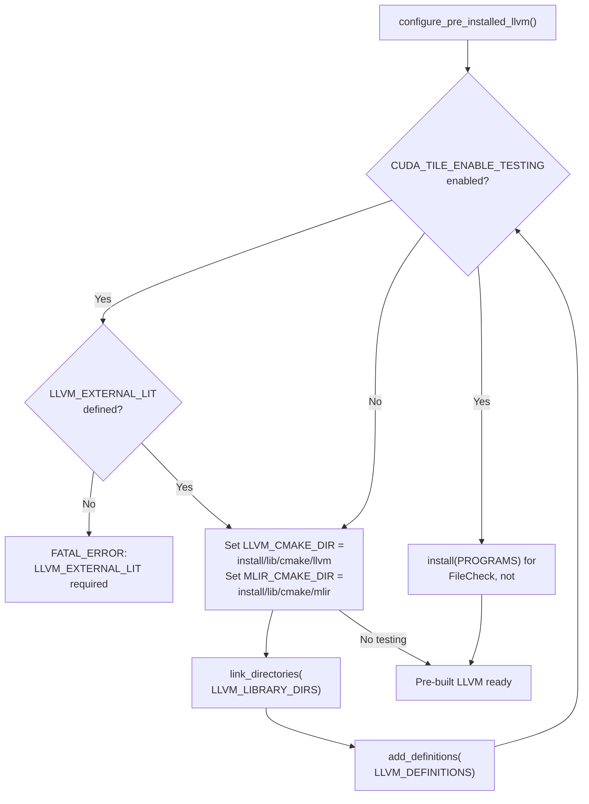

### CMake Package Discovery

The macro sets `LLVM_DIR` and `MLIR_DIR` to the CMake package config directories ([cmake/IncludeLLVM.cmake:155-158]()):

```cmake
set(LLVM_CMAKE_DIR ${CUDA_TILE_USE_LLVM_INSTALL_DIR}/lib/cmake/llvm)
set(LLVM_DIR "${LLVM_CMAKE_DIR}")
set(MLIR_CMAKE_DIR ${CUDA_TILE_USE_LLVM_INSTALL_DIR}/lib/cmake/mlir)
set(MLIR_DIR "${MLIR_CMAKE_DIR}")
```

These paths allow subsequent `find_package(LLVM)` and `find_package(MLIR)` calls to locate the installation.

### Test Tool Installation

When testing is enabled, the macro installs LLVM utilities (`FileCheck`, `not`) from the pre-built installation to `third_party/llvm/bin/` ([cmake/IncludeLLVM.cmake:146-153]()):

```cmake
foreach(_TOOL_NAME ${LLVM_TOOLS_TO_INSTALL})
  install(
    PROGRAMS ${CUDA_TILE_USE_LLVM_INSTALL_DIR}/bin/${_TOOL_NAME}${CMAKE_EXECUTABLE_SUFFIX}
    DESTINATION third_party/llvm/bin
  )
endforeach()
```

This ensures test infrastructure has access to required LLVM tools without rebuilding them.

### Python Bindings Requirement

When `CUDA_TILE_ENABLE_BINDINGS_PYTHON=ON`, the pre-built LLVM must have been compiled with MLIR Python bindings enabled. The build system does not validate this automatically, so users must ensure their LLVM build includes `-DMLIR_ENABLE_BINDINGS_PYTHON=ON`.

**Sources:** [cmake/IncludeLLVM.cmake:133-163](), [README.md:94-102](), [README.md:116-119]()

---

## Test Utility Handling

All three integration methods ensure LLVM test utilities (`FileCheck`, `not`) are available when `CUDA_TILE_ENABLE_TESTING=ON`. The handling differs by method:

| Method | Utility Source | Installation Mechanism |
|--------|---------------|------------------------|
| Auto-download / Local | Built from source | CMake targets, installed via `install(TARGETS)` |
| Pre-built | Copied from installation | Shell programs, installed via `install(PROGRAMS)` |

### Source-built Utilities

For source-based builds, custom targets ensure the utilities are always built ([cmake/IncludeLLVM.cmake:107-116]()):

```cmake
foreach(_TOOL_NAME ${LLVM_TOOLS_TO_INSTALL})
  add_custom_target(llvm-test-tool-${_TOOL_NAME} ALL DEPENDS ${_TOOL_NAME})
  
  install(TARGETS ${_TOOL_NAME}
    RUNTIME DESTINATION third_party/llvm/bin
  )
endforeach()
```

The `DEPENDS ${_TOOL_NAME}` ensures the utility is built even though the parent LLVM directory uses `EXCLUDE_FROM_ALL`.

### Pre-built Utilities

For pre-built LLVM, utilities are copied from the installation directory ([cmake/IncludeLLVM.cmake:148-152]()):

```cmake
install(
  PROGRAMS ${CUDA_TILE_USE_LLVM_INSTALL_DIR}/bin/${_TOOL_NAME}${CMAKE_EXECUTABLE_SUFFIX}
  DESTINATION third_party/llvm/bin
)
```

**Sources:** [cmake/IncludeLLVM.cmake:3](), [cmake/IncludeLLVM.cmake:104-153]()

---

## Configuration Diagnostics

The `print_llvm_config()` macro ([cmake/IncludeLLVM.cmake:5-23]()) outputs LLVM/MLIR configuration details during CMake configuration. It displays:

| Variable | Description |
|----------|-------------|
| `LLVM_ENABLE_ASSERTIONS` | Assertion mode (ON/OFF) |
| `LLVM_ENABLE_RTTI` | Runtime type information enabled |
| `LLVM_CONFIG_HAS_RTTI` | RTTI detected in config |
| `LLVM_ENABLE_EH` | Exception handling enabled |
| `LLVM_SOURCE_DIR` | LLVM source directory path |
| `LLVM_BINARY_DIR` | LLVM build directory path |
| `LLVM_INCLUDE_DIRS` | LLVM header directories |
| `MLIR_INCLUDE_DIRS` | MLIR header directories |
| `LLVM_LIBRARY_DIR` | LLVM library directory |
| `MLIR_ENABLE_BINDINGS_PYTHON` | Python bindings status |
| `MLIR_ENABLE_EXECUTION_ENGINE` | Execution engine availability |
| `LLVM_LIT` | Lit test runner path |
| `LLVM_EXTERNAL_LIT` | External lit tool path (pre-built only) |

This macro is called after LLVM configuration completes to aid debugging and validation.

**Sources:** [cmake/IncludeLLVM.cmake:5-23]()

---

## Method Comparison and Recommendations

### Decision Matrix

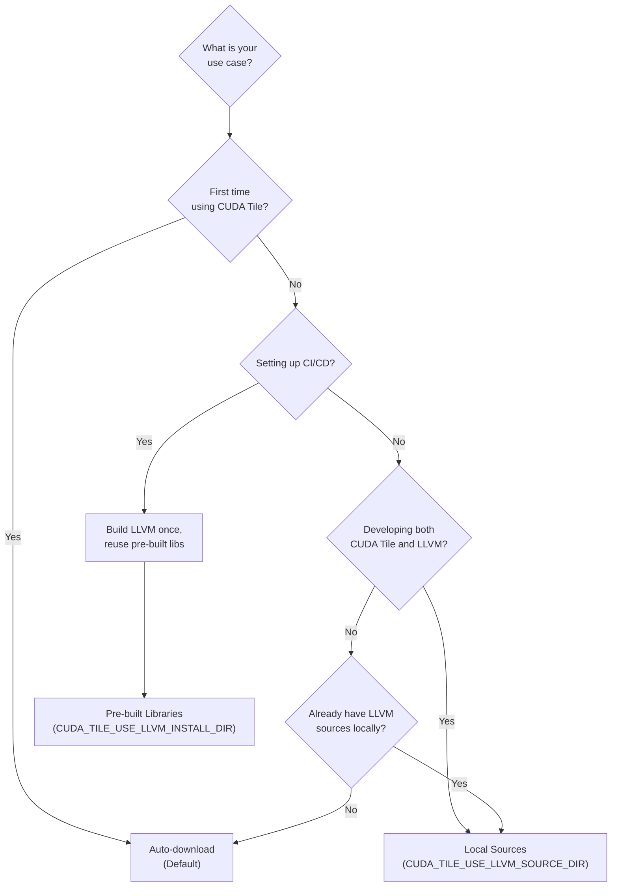

### Recommended Workflows

**Development Workflow:**
1. First build: Use auto-download to establish baseline
2. Subsequent builds: Build LLVM once, then use pre-built libraries
3. LLVM modifications: Use local sources with `CUDA_TILE_USE_LLVM_SOURCE_DIR`

**CI/CD Workflow:**
1. Cache pre-built LLVM artifacts between runs
2. Use `CUDA_TILE_USE_LLVM_INSTALL_DIR` for fast builds
3. Rebuild LLVM cache only when commit hash changes

**Offline Development:**
1. Clone LLVM repository manually at correct commit
2. Use `CUDA_TILE_USE_LLVM_SOURCE_DIR` for builds
3. Sources remain available without network access

**Sources:** [README.md:69-133](), [cmake/IncludeLLVM.cmake:25-163]()

---

# Page: First Example

# First Example

<details>
<summary>Relevant source files</summary>

The following files were used as context for generating this wiki page:

- [README.md](README.md)
- [python/cuda_tile/dialects/cuda_tile_ops.py](python/cuda_tile/dialects/cuda_tile_ops.py)

</details>


This page walks through creating, compiling, and executing a simple CUDA Tile IR kernel. Two approaches are demonstrated: writing IR directly in MLIR textual format, and using the Python API to generate IR programmatically. Both approaches produce the same bytecode output and follow the same compilation and execution pipeline.

For information about building the tools referenced here, see [Building from Source](#2.1). For details on the Python API beyond this introductory example, see [Python Operations API](#5.3.3).

---

## Example Overview

The example kernel performs a simple operation: loading 128 floating-point values from a pointer and printing them. This demonstrates fundamental CUDA Tile IR concepts including:

- Entry point definition with kernel arguments
- Tile creation and manipulation (`iota`, `reshape`, `broadcast`, `offset`)
- Memory operations (`load_ptr_tko` with token ordering)
- Output operations (`print`)

The kernel accepts a single argument: a pointer to f32 data (`tile<ptr<f32>>`), loads 128 elements from sequential memory locations, and prints the resulting tile.

---

## Complete Workflow Diagram

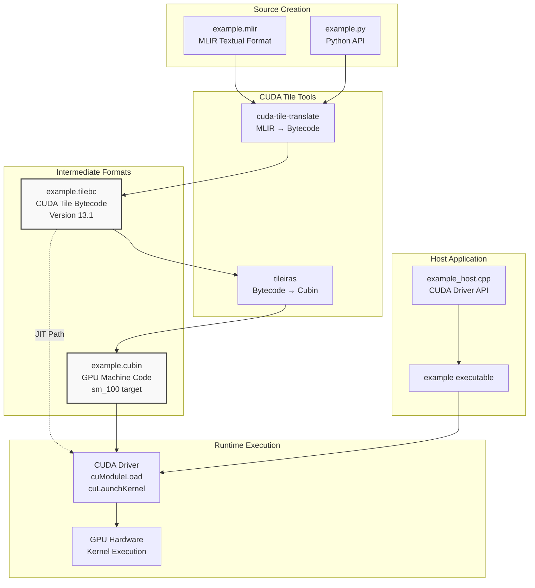

**Sources:** [README.md:212-339]()

---

## Approach 1: MLIR Textual Format

### Writing the MLIR Program

The kernel is defined in MLIR textual format with the following structure:

```mlir
cuda_tile.module @example_module {
    entry @example_kernel(%data_pr : tile<ptr<f32>>) {
        print "Running example module\n"
        %offsets = iota : tile<128xi32>
        %data_ptr_reshaped = reshape %data_pr : tile<ptr<f32>> -> tile<1xptr<f32>>
        %data_ptr_broadcasted = broadcast %data_ptr_reshaped : tile<1xptr<f32>> -> tile<128xptr<f32>>
        %data_ptr_tensor = offset %data_ptr_broadcasted, %offsets : tile<128xptr<f32>>, tile<128xi32> -> tile<128xptr<f32>>
        %data, %token = load_ptr_tko weak %data_ptr_tensor : tile<128xptr<f32>> -> tile<128xf32>, token
        print "Data: %f\n", %data : tile<128xf32>
        return
    }
}
```

#### Key Operations

| Operation | Purpose | Result Type |
|-----------|---------|-------------|
| `cuda_tile.module` | Top-level container for kernel definitions | Module with symbol `@example_module` |
| `entry` | Kernel entry point with public visibility | Function accepting `tile<ptr<f32>>` |
| `iota` | Generate sequence [0, 1, 2, ..., 127] | `tile<128xi32>` |
| `reshape` | Convert scalar pointer to rank-1 tile | `tile<1xptr<f32>>` |
| `broadcast` | Replicate pointer across 128 elements | `tile<128xptr<f32>>` |
| `offset` | Add integer offsets to pointers | `tile<128xptr<f32>>` |
| `load_ptr_tko` | Load from pointers with token ordering | `tile<128xf32>`, `token` |
| `print` | Output string or tensor data | void |

**Sources:** [README.md:230-245](), [python/cuda_tile/dialects/cuda_tile_ops.py:2291-2300](), [python/cuda_tile/dialects/cuda_tile_ops.py:2323-2465]()

### MLIR Operation Flow

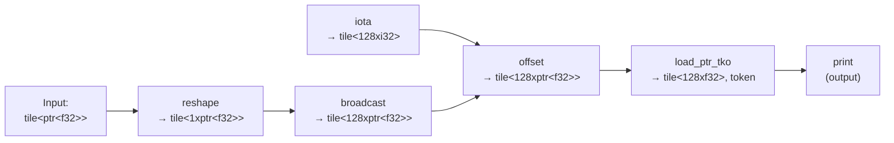

**Sources:** [README.md:230-245]()

---

## Approach 2: Python API

### Writing the Python Program

The same kernel can be generated using the Python API:

```python
from cuda_tile.dialects import cuda_tile_ops as ct
from cuda_tile.ir import Context, Location

# Initialize IR context
generator = ct.TileIrGenerator()

with generator.tile_ir_start(), generator.location():
    with generator.create_tile_ir_module("example_module"):
        # Define entry point
        ptr_type = ct.make_tile_type(ct.PointerType.get(ct.Float32.mlir_type), [])
        
        with generator.create_entry("example_kernel", [ptr_type]):
            args = generator.entry.body.arguments
            data_pr = ct.Tile(args[0], ptr_type)
            
            # Print header
            ct.printf("Running example module\n", [])
            
            # Generate offset sequence
            offsets = ct.iota(128, ct.Int32)
            
            # Prepare pointer tile
            data_ptr_reshaped = ct.reshape([1], data_pr)
            data_ptr_broadcasted = ct.broadcast([128], data_ptr_reshaped)
            data_ptr_tensor = ct.add(data_ptr_broadcasted, offsets)
            
            # Load data
            result_type = ct.make_tile_type(ct.Float32, [128])
            data, token = ct.load_ptr_tko(
                result_type, 
                data_ptr_tensor,
                memory_ordering_semantics=ct.MemoryOrderingSemantics.WEAK,
                return_token=True
            )
            
            # Print data
            ct.printf("Data: %f\n", [data])

# Print generated IR
generator.print_ir(enable_location=False)
```

### Python API Component Hierarchy

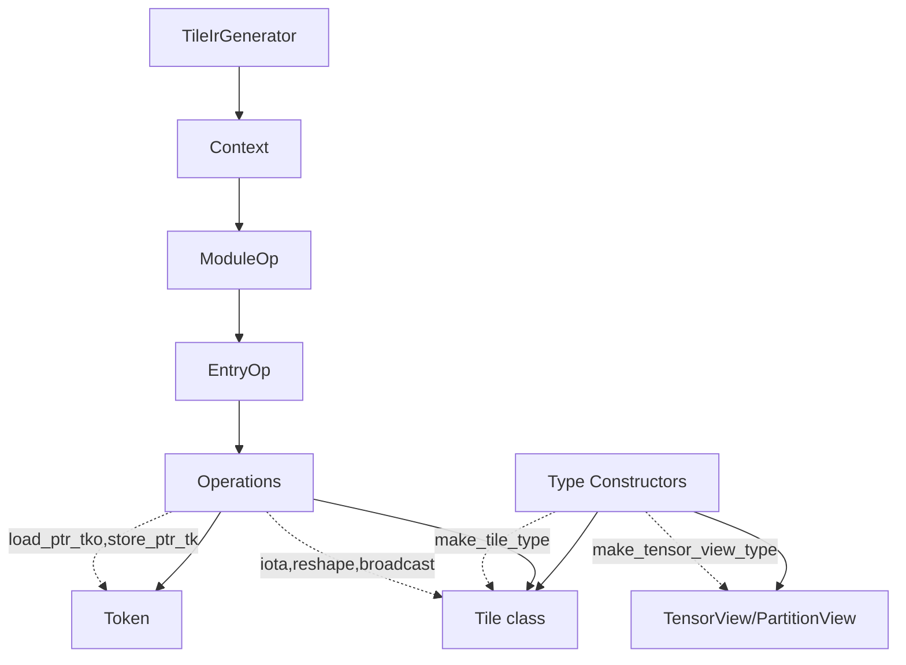

**Sources:** [python/cuda_tile/dialects/cuda_tile_ops.py:4201-4265](), [python/cuda_tile/dialects/cuda_tile_ops.py:1140-1162](), [python/cuda_tile/dialects/cuda_tile_ops.py:667-823]()

### Key Python API Functions

| Function | Purpose | Return Type |
|----------|---------|-------------|
| `TileIrGenerator()` | Initialize IR generation context | Generator instance |
| `tile_ir_start()` | Create MLIR context | Context manager |
| `create_tile_ir_module()` | Create module container | InsertionPoint |
| `create_entry()` | Define kernel entry point | EntryContext |
| `make_tile_type()` | Construct tile type | TileType |
| `iota()` | Generate integer sequence | Tile |
| `reshape()` | Change tile shape | Tile |
| `broadcast()` | Replicate tile elements | Tile |
| `load_ptr_tko()` | Load with token ordering | Tuple[Tile, Token] |

**Sources:** [python/cuda_tile/dialects/cuda_tile_ops.py:4201-4265](), [python/cuda_tile/dialects/cuda_tile_ops.py:2916-2928](), [python/cuda_tile/dialects/cuda_tile_ops.py:2590-2595](), [python/cuda_tile/dialects/cuda_tile_ops.py:2323-2465]()

---

## Compilation Pipeline

### Step 1: MLIR to Bytecode

The `cuda-tile-translate` tool converts MLIR textual format to CUDA Tile bytecode:

```bash
cuda-tile-translate example.mlir \
  --bytecode-version=13.1 \
  --mlir-to-cudatilebc \
  --no-implicit-module \
  -o example.tilebc
```

**Key flags:**
- `--bytecode-version=13.1`: Target bytecode format version
- `--mlir-to-cudatilebc`: Specify conversion direction
- `--no-implicit-module`: Expect explicit module declaration
- `-o example.tilebc`: Output bytecode file

**Sources:** [README.md:327]()

### Step 2: Bytecode to Cubin (AOT)

The `tileiras` tool compiles bytecode to GPU machine code:

```bash
tileiras --gpu-name sm_100 example.tilebc -o example.cubin
```

**Note:** Replace `sm_100` with your target GPU architecture (e.g., `sm_80`, `sm_90`, `sm_103`, `sm_120`).

**Sources:** [README.md:328-330]()

### Compilation Pipeline Components

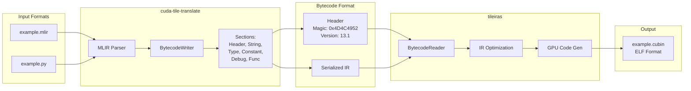

**Sources:** [README.md:327-330]()

---

## Host Program Integration

### C++ Host Code

The host program loads and executes the compiled kernel using CUDA Driver API:

```cpp
#include <cuda.h>
#include <cuda_runtime_api.h>

// Error checking macro
#define CUDA_CHECK(call) do { \
    CUresult err = call; \
    if (err != CUDA_SUCCESS) { \
        const char *errStr; \
        cuGetErrorString(err, &errStr); \
        fprintf(stderr, "CUDA error at %s:%d: %s\n", __FILE__, __LINE__, errStr); \
        exit(1); \
    } \
} while (0)

// Input data (128 floats: 0, 5, 10, ..., 635)
float data[128] = {0, 5, 10, 15, /* ... */, 635};

int main() {
    CUdevice cuDevice;
    CUcontext cuContext;
    CUmodule cuModule;
    CUfunction example_kernel;
    CUstream stream;
    
    // Initialize CUDA
    CUDA_CHECK(cuInit(0));
    CUDA_CHECK(cuDeviceGet(&cuDevice, 0));
    CUDA_CHECK(cuCtxCreate(&cuContext, NULL, 0, cuDevice));
    CUDA_CHECK(cuStreamCreate(&stream, CU_STREAM_DEFAULT));
    
    // Load compiled kernel (cubin or tilebc)
    CUDA_CHECK(cuModuleLoad(&cuModule, "example.cubin"));
    CUDA_CHECK(cuModuleGetFunction(&example_kernel, cuModule, "example_kernel"));
    
    // Allocate device memory and copy input
    CUdeviceptr data_ptr;
    CUDA_CHECK(cuMemAlloc(&data_ptr, sizeof(data)));
    CUDA_CHECK(cuMemcpyHtoD(data_ptr, data, sizeof(data)));
    
    // Launch kernel
    void *kernel_args[] = {&data_ptr};
    CUDA_CHECK(cuLaunchKernel(
        example_kernel,
        1, 1, 1,        // grid dims (Tile Grid dimensions)
        1, 1, 1,        // block dims (must be 1,1,1 for CUDA Tile)
        0,              // shared memory (unused, must be 0)
        stream,
        kernel_args,
        NULL
    ));
    
    CUDA_CHECK(cuCtxSynchronize());
    
    // Cleanup
    CUDA_CHECK(cuModuleUnload(cuModule));
    CUDA_CHECK(cuCtxDestroy(cuContext));
    
    return 0;
}
```

### CUDA Driver API Key Functions

| Function | Purpose |
|----------|---------|
| `cuInit()` | Initialize CUDA driver |
| `cuDeviceGet()` | Get device handle by index |
| `cuCtxCreate()` | Create CUDA context on device |
| `cuModuleLoad()` | Load .cubin or .tilebc module |
| `cuModuleGetFunction()` | Get kernel function by name |
| `cuMemAlloc()` | Allocate device memory |
| `cuMemcpyHtoD()` | Copy host to device memory |
| `cuLaunchKernel()` | Launch kernel on GPU |

**Important constraints for CUDA Tile kernels:**
- Block dimensions must be `(1, 1, 1)`
- Shared memory must be `0`
- Grid dimensions correspond to Tile Grid dimensions

**Sources:** [README.md:247-323]()

### Host Execution Flow

```mermaid
sequenceDiagram
    participant Host as "Host Program"
    participant Driver as "CUDA Driver API"
    participant GPU as "GPU Device"
    
    Host->>Driver: cuInit(0)
    Host->>Driver: cuDeviceGet(&device, 0)
    Host->>Driver: cuCtxCreate(&context, device)
    
    Host->>Driver: cuModuleLoad(&module, "example.cubin")
    Note over Driver: Load and JIT compile<br/>if using .tilebc
    
    Host->>Driver: cuModuleGetFunction(&kernel, "example_kernel")
    
    Host->>Driver: cuMemAlloc(&data_ptr, size)
    Host->>Driver: cuMemcpyHtoD(data_ptr, host_data)
    
    Host->>Driver: cuLaunchKernel(kernel, 1,1,1, 1,1,1, args)
    Driver->>GPU: Execute kernel
    GPU->>GPU: load_ptr_tko operations
    GPU->>GPU: print operations
    GPU-->>Driver: Complete
    
    Host->>Driver: cuCtxSynchronize()
    Driver-->>Host: Kernel complete
```

**Sources:** [README.md:282-316]()

---

## Building and Running

### Prerequisites

- CUDA Toolkit 13.1+ with compatible driver
- CUDA Tile IR tools built (see [Building from Source](#2.1))
- Supported CUDA device

**Sources:** [README.md:222-227]()

### Complete Build and Execute Sequence

```bash
# 1. Compile MLIR to bytecode
cuda-tile-translate example.mlir \
  --bytecode-version=13.1 \
  --mlir-to-cudatilebc \
  --no-implicit-module \
  -o example.tilebc

# 2. Compile bytecode to cubin (AOT)
tileiras --gpu-name sm_100 example.tilebc -o example.cubin

# 3. Compile host program
g++ example_host.cpp -o example \
  -I/usr/local/cuda/include \
  -L/usr/local/cuda/lib64 \
  -lcuda

# 4. Execute
./example
```

**Alternative (JIT compilation):** Skip step 2 and use `example.tilebc` directly in the host program. The CUDA driver will JIT-compile the bytecode at load time via `cuModuleLoad()`.

**Sources:** [README.md:326-334]()

### Expected Output

```
Running example module
Data: [0.000000, 5.000000, 10.000000, 15.000000, 20.000000, ..., 630.000000, 635.000000]
```

The kernel prints a header message followed by the 128 loaded floating-point values.

**Sources:** [README.md:335-339]()

---

## Type System Reference

### TileType Structure

```mermaid
graph TB
    TILE["TileType"]
    SHAPE["Shape: [128]"]
    ELEM["Element Type"]
    
    PTR["PointerType"]
    FLOAT["Float32"]
    INT["Int32"]
    
    TILE --> SHAPE
    TILE --> ELEM
    
    ELEM -.ptr example.-> PTR
    ELEM -.load result.-> FLOAT
    ELEM -.iota result.-> INT
    
    PTR -.pointee.-> FLOAT
```

| Type Expression | Meaning |
|-----------------|---------|
| `tile<ptr<f32>>` | Scalar tile containing a pointer to f32 |
| `tile<128xi32>` | 1D tile of 128 signed 32-bit integers |
| `tile<1xptr<f32>>` | 1D tile of 1 pointer element |
| `tile<128xptr<f32>>` | 1D tile of 128 pointer elements |
| `tile<128xf32>` | 1D tile of 128 32-bit floats |

**Sources:** [README.md:234-241](), [python/cuda_tile/dialects/cuda_tile_ops.py:1140-1162]()

---

## Memory Ordering Semantics

The `load_ptr_tko` operation uses token ordering for memory operations. In this example, `weak` semantics are used, which provides no cross-thread synchronization guarantees but is sufficient for single-thread access patterns.

### Memory Ordering Options

| Semantic | Synchronization | Use Case |
|----------|-----------------|----------|
| `WEAK` | None | Single-thread, no aliasing |
| `RELAXED` | Within scope | Atomic without ordering |
| `ACQUIRE` | Acquire fence | Load synchronization |
| `RELEASE` | Release fence | Store synchronization |
| `ACQ_REL` | Both fences | Read-modify-write |

**Sources:** [python/cuda_tile/dialects/cuda_tile_ops.py:197-207](), [python/cuda_tile/dialects/cuda_tile_ops.py:2323-2465]()

---

## Summary

This example demonstrates the complete CUDA Tile IR workflow:

1. **IR Creation:** Write kernel logic using MLIR textual syntax or Python API
2. **Translation:** Convert to bytecode using `cuda-tile-translate`
3. **Compilation:** Generate GPU code using `tileiras` (AOT) or CUDA driver (JIT)
4. **Execution:** Load and launch via CUDA Driver API

Both the MLIR and Python approaches generate equivalent IR and follow identical compilation paths. Choose MLIR textual format for direct IR manipulation or the Python API for programmatic generation with validation and type safety.

**Sources:** [README.md:212-339](), [python/cuda_tile/dialects/cuda_tile_ops.py:4201-4265]()

---

# Page: Core Dialect

# Core Dialect

<details>
<summary>Relevant source files</summary>

The following files were used as context for generating this wiki page:

- [lib/Dialect/CudaTile/IR/CudaTile.cpp](lib/Dialect/CudaTile/IR/CudaTile.cpp)

</details>


## Purpose and Scope

The CudaTile dialect is the central MLIR dialect that defines the intermediate representation for GPU kernel optimization in CUDA Tile IR. It provides a comprehensive set of types, attributes, and operations specifically designed for expressing GPU computations with precise memory semantics, tensor operations, and control flow.

This page covers the overall dialect structure, initialization, custom parsing/printing mechanisms, and core verification infrastructure. For detailed information on specific components:
- Type system details: see [Type System](#3.1)
- Attribute system details: see [Attribute System](#3.2)
- Operation categories: see [Operations](#3.3)
- Dialect interfaces: see [Dialect Interfaces](#3.4)

**Sources:** [lib/Dialect/CudaTile/IR/CudaTile.cpp:1-4252]()

## Dialect Architecture

The CudaTile dialect is organized into several interconnected subsystems that work together to provide a complete IR for GPU kernels.

```mermaid
graph TB
    subgraph "CudaTileDialect Registration"
        Init["CudaTileDialect::initialize()"]
        Init --> RegTypes["registerTypes()"]
        Init --> RegAttrs["registerAttributes()"]
        Init --> AddOps["addOperations&lt;...&gt;()"]
        Init --> AddIfaces["addInterfaces&lt;...&gt;()"]
    end
    
    subgraph "Type System"
        TileType["TileType<br/>Fixed-shape tensors"]
        PointerType["PointerType<br/>Memory pointers"]
        TensorViewType["TensorViewType<br/>Dynamic tensors"]
        PartitionViewType["PartitionViewType<br/>Grid partitions"]
        TokenType["TokenType<br/>Ordering constraints"]
    end
    
    subgraph "Attribute System"
        RoundingModeAttr["RoundingModeAttr<br/>FP rounding control"]
        MemorySemanticsAttr["MemoryOrderingSemanticsAttr<br/>WEAK/RELAXED/ACQUIRE/RELEASE/ACQ_REL"]
        MemoryScopeAttr["MemoryScopeAttr<br/>TL_BLK/DEVICE/SYS"]
        OptHintsAttr["OptimizationHintsAttr<br/>Threshold configuration"]
        DebugInfoAttrs["Debug Info Attrs<br/>DILocAttr, DISubprogramAttr"]
    end
    
    subgraph "Operations"
        ArithOps["Arithmetic Ops<br/>AddFOp, MulFOp, DivFOp"]
        MemOps["Memory Ops<br/>LoadPtrTkoOp, StoreViewTkoOp<br/>AtomicRMWTkoOp"]
        ControlOps["Control Flow Ops<br/>IfOp, ForOp, LoopOp<br/>BreakOp, ContinueOp"]
        TensorOps["Tensor Ops<br/>MmaFOp, ReduceOp, ScanOp<br/>BroadcastOp, ReshapeOp"]
        ViewOps["View Ops<br/>MakeTensorViewOp<br/>MakePartitionViewOp"]
    end
    
    subgraph "Interfaces"
        InlinerIface["CudaTileinlinerInterface<br/>Function inlining support"]
        OpAsmIface["CudaTileOpAsmInterface<br/>Custom printing/aliasing"]
    end
    
    subgraph "Verification"
        DebugVerifier["DebugInfoVerifier<br/>Function/module scope validation"]
        MemModelVerifier["Memory Model Verifiers<br/>verifyMemoryModelLoad/Store"]
        OpVerifiers["Operation Verifiers<br/>Type checking, shape validation"]
    end
    
    RegTypes --> TileType
    RegTypes --> PointerType
    RegTypes --> TensorViewType
    RegTypes --> PartitionViewType
    RegTypes --> TokenType
    
    RegAttrs --> RoundingModeAttr
    RegAttrs --> MemorySemanticsAttr
    RegAttrs --> MemoryScopeAttr
    RegAttrs --> OptHintsAttr
    RegAttrs --> DebugInfoAttrs
    
    AddOps --> ArithOps
    AddOps --> MemOps
    AddOps --> ControlOps
    AddOps --> TensorOps
    AddOps --> ViewOps
    
    AddIfaces --> InlinerIface
    AddIfaces --> OpAsmIface
    
    MemOps -.uses.-> TokenType
    MemOps -.uses.-> MemorySemanticsAttr
    MemOps -.uses.-> MemoryScopeAttr
    ArithOps -.uses.-> RoundingModeAttr
    
    OpVerifiers --> ArithOps
    OpVerifiers --> MemOps
    OpVerifiers --> ControlOps
    OpVerifiers --> TensorOps
    
    MemModelVerifier --> MemOps
    DebugVerifier -.validates.-> DebugInfoAttrs
```

**Sources:** [lib/Dialect/CudaTile/IR/CudaTile.cpp:4243-4251](), [lib/Dialect/CudaTile/IR/CudaTile.cpp:1217-1222]()

## Dialect Initialization

The dialect is initialized through the `CudaTileDialect::initialize()` method, which registers all components:

| Component | Registration Method | Description |
|-----------|-------------------|-------------|
| Types | `registerTypes()` | Registers `TileType`, `PointerType`, `TensorViewType`, `PartitionViewType`, `TokenType` |
| Attributes | `registerAttributes()` | Registers `RoundingModeAttr`, `MemoryOrderingSemanticsAttr`, `MemoryScopeAttr`, etc. |
| Operations | `addOperations<...>()` | Adds all dialect operations from TableGen-generated code |
| Interfaces | `addInterfaces<...>()` | Adds `CudaTileinlinerInterface` and `CudaTileOpAsmInterface` |

The initialization follows the standard MLIR dialect pattern, with operations defined via TableGen and verification/canonicalization logic implemented in C++.

**Sources:** [lib/Dialect/CudaTile/IR/CudaTile.cpp:4243-4251]()

## Custom Type Parsing and Printing

The dialect implements custom parsing and printing to support both short-form (`tile<f32>`) and long-form (`!cuda_tile.tile<f32>`) type syntax within `cuda_tile.module` operations.

```mermaid
graph LR
    subgraph "Parsing Flow"
        ParseInput["Input: tile&lt;f32&gt;<br/>or !cuda_tile.tile&lt;f32&gt;"]
        ParseCudaTileType["parseCudaTileType()"]
        TypeParser["MLIR Type Parser"]
        ParseInput --> ParseCudaTileType
        ParseCudaTileType --> TypeParser
    end
    
    subgraph "Printing Flow"
        PrintInput["Type Object"]
        PrintCudaTileType["printCudaTileType()"]
        PrintOutput["Output: tile&lt;f32&gt;<br/>(short form)"]
        PrintInput --> PrintCudaTileType
        PrintCudaTileType --> PrintOutput
    end
    
    subgraph "Function Signature Parsing"
        FuncSig["parseFunctionSignatureWithArguments()"]
        ArgParser["parseSingleArgument()<br/>Uses parseCudaTileType"]
        ResultParser["parseFunctionResultList()<br/>Uses parseCudaTileType"]
        FuncSig --> ArgParser
        FuncSig --> ResultParser
    end
```

### Function Signature Parsing

The dialect provides specialized function signature parsing to enable proper type resolution within operation contexts:

- **`parseFunctionSignatureWithArguments()`** - Custom parser that handles argument lists with cuda_tile types ([lib/Dialect/CudaTile/IR/CudaTile.cpp:190-200]())
- **`printFunctionSignatureWithCudaTileTypes()`** - Custom printer for function signatures ([lib/Dialect/CudaTile/IR/CudaTile.cpp:243-251]())

This custom parsing is necessary because standard MLIR `parseFunctionSignatureWithArguments()` uses generic type parsing that ignores `OpAsmOpInterface::getDefaultDialect()`, breaking short-form type resolution within `cuda_tile.module` operations.

**Key Implementation Details:**

- `validateSSANameConsistency()` ensures all arguments either have or lack SSA names consistently ([lib/Dialect/CudaTile/IR/CudaTile.cpp:75-88]())
- `parseSingleArgument()` handles individual argument parsing with type and attribute support ([lib/Dialect/CudaTile/IR/CudaTile.cpp:91-121]())
- `parseFunctionArgumentList()` supports variadic arguments ([lib/Dialect/CudaTile/IR/CudaTile.cpp:124-145]())

**Sources:** [lib/Dialect/CudaTile/IR/CudaTile.cpp:58-251]()

## Custom Attribute Parsing

The dialect provides specialized parsers for several attribute types to improve usability:

### Rounding Mode Parsing

Multiple parsing functions handle different rounding mode constraints:

| Parser Function | Allowed Modes | Default Mode | Use Case |
|----------------|---------------|--------------|----------|
| `parseIEEERoundingMode()` | `nearest_even`, `zero`, `negative_inf`, `positive_inf` | `nearest_even` | Float-to-float conversions |
| `parseIntegerRoundingMode()` | `nearest_int_to_zero` | `nearest_int_to_zero` | Float-to-integer conversions |
| `parseDivFOpRoundingMode()` | IEEE modes + `approx`, `full` | `nearest_even` | Division operations |
| `parseSqrtOpRoundingMode()` | IEEE modes + `approx` | `nearest_even` | Square root operations |

The parsing supports optional `rounding<mode>` syntax, defaulting to the specified mode if omitted.

### Memory Semantics Parsing

The `parseMemoryAttributes()` function parses both memory ordering semantics and scope ([lib/Dialect/CudaTile/IR/CudaTile.cpp:1023-1065]()):

```
weak                    // WEAK ordering, no scope allowed
relaxed tl_blk         // RELAXED ordering, thread-block scope
acquire device         // ACQUIRE ordering, device scope
release sys            // RELEASE ordering, system scope
```

Validation ensures that `WEAK` semantics cannot specify a scope, while `RELAXED`, `ACQUIRE`, `RELEASE`, and `ACQ_REL` require one.

### Assumption Predicate Parsing

The `parseAssumePredicate()` function supports both full attribute syntax (`#cuda_tile.div_by<8>`) and shortened syntax (`div_by<8>`) for assumption operations ([lib/Dialect/CudaTile/IR/CudaTile.cpp:888-941]()).

**Sources:** [lib/Dialect/CudaTile/IR/CudaTile.cpp:624-961](), [lib/Dialect/CudaTile/IR/CudaTile.cpp:1023-1074]()

## Dense Element Parsing

The dialect implements custom parsing for `DenseIntOrFPElementsAttr` to support both scalar and nested array literals with automatic shape inference:

```
constant <f32: 42.0> : tile<f32>                           // Scalar
constant <i32: [1, 2, 3, 4]> : tile<4xi32>                 // 1D array
constant <f16: [[1.0, 2.0], [3.0, 4.0]]> : tile<2x2xf16>   // 2D array
```

The parser (`parseDenseIntOrFPElementsAttr()`) performs:

1. **Type-aware parsing** - Uses prefix element type to determine integer vs. float parsing ([lib/Dialect/CudaTile/IR/CudaTile.cpp:311-330]())
2. **Integer bounds validation** - Validates integer values fit within target type bitwidth ([lib/Dialect/CudaTile/IR/CudaTile.cpp:258-287]())
3. **Recursive shape inference** - Infers shape from nested array structure ([lib/Dialect/CudaTile/IR/CudaTile.cpp:385-467]())
4. **Shape consistency checking** - Validates all array elements have consistent shapes ([lib/Dialect/CudaTile/IR/CudaTile.cpp:415-421]())
5. **Result shape verification** - Ensures inferred shape matches declared tile type ([lib/Dialect/CudaTile/IR/CudaTile.cpp:499-530]())

**Sources:** [lib/Dialect/CudaTile/IR/CudaTile.cpp:254-619]()

## Debug Information Verification

The `DebugInfoVerifier` class implements comprehensive validation of debug information attributes across modules, functions, and operations.

```mermaid
graph TB
    subgraph "Verification Entry Points"
        VerifyModule["DebugInfoVerifier::verifyModule()"]
        VerifyFunc["DebugInfoVerifier::verifyFunc()"]
        VerifyFuncBody["DebugInfoVerifier::verifyFuncBody()"]
    end
    
    subgraph "Verification Rules"
        Rule1["Rule 1: Function with scope<br/>must have DISubprogramAttr"]
        Rule2["Rule 2: Function name must match<br/>subprogram linkage name"]
        Rule3["Rule 3: Ops cannot have scope<br/>if function lacks scope"]
        Rule4["Rule 4: Op scope must match<br/>function scope"]
        Rule5["Rule 5: Global variables<br/>cannot have scope"]
        Rule6["Rule 6: Function location<br/>cannot be CallSiteLoc"]
    end
    
    subgraph "Implementation Helpers"
        GetSubprogram["getSubprogram()<br/>Extract DISubprogramAttr<br/>from DILocalScopeAttr"]
        GetDILoc["getDILoc()<br/>Extract DILocAttr<br/>from LocationAttr hierarchy"]
    end
    
    VerifyModule --> Rule5
    VerifyFunc --> Rule1
    VerifyFunc --> Rule2
    VerifyFunc --> Rule6
    VerifyFuncBody --> Rule3
    VerifyFuncBody --> Rule4
    
    Rule1 --> GetDILoc
    Rule2 --> GetSubprogram
    Rule3 --> GetSubprogram
    Rule4 --> GetSubprogram
    
    GetDILoc -.handles.-> CallSiteLoc
    GetDILoc -.handles.-> FusedLoc
    GetDILoc -.handles.-> NameLoc
    GetDILoc -.handles.-> OpaqueLoc
    
    GetSubprogram -.handles.-> DISubprogramAttr
    GetSubprogram -.handles.-> DILexicalBlockAttr
```

### Verification Rules

The verifier enforces six key invariants:

1. **Function Scope Constraint** - If a function has debug info scope, it must be a `DISubprogramAttr` ([lib/Dialect/CudaTile/IR/CudaTile.cpp:1103-1108]())

2. **Name Consistency** - Function name must match the subprogram's linkage name ([lib/Dialect/CudaTile/IR/CudaTile.cpp:1111-1117]())

3. **Operation Scope Dependency** - Operations cannot have debug scope if the containing function lacks one ([lib/Dialect/CudaTile/IR/CudaTile.cpp:1137-1144]())

4. **Scope Matching** - Operation debug scope must exactly match function scope ([lib/Dialect/CudaTile/IR/CudaTile.cpp:1146-1153]())

5. **Global Variable Restriction** - Global variables (module-level operations other than functions) cannot have debug scope ([lib/Dialect/CudaTile/IR/CudaTile.cpp:1164-1168]())

6. **Location Type Constraint** - Function locations cannot be `CallSiteLoc` ([lib/Dialect/CudaTile/IR/CudaTile.cpp:1095-1098]())

### Helper Functions

- **`getDILoc()`** - Recursively extracts `DILocAttr` from MLIR location hierarchies, handling `CallSiteLoc`, `FusedLoc`, `NameLoc`, and `OpaqueLoc` ([lib/Dialect/CudaTile/IR/CudaTile.cpp:1184-1201]())

- **`getSubprogram()`** - Extracts `DISubprogramAttr` from `DILocalScopeAttr`, recursively traversing `DILexicalBlockAttr` ([lib/Dialect/CudaTile/IR/CudaTile.cpp:1174-1181]())

**Integration:** Debug info verification is invoked through:
- `impl::verifyFuncDebugInfo()` for function-level checks ([lib/Dialect/CudaTile/IR/CudaTile.cpp:1204-1206]())
- `impl::verifyFuncBodyDebugInfo()` for operation-level checks ([lib/Dialect/CudaTile/IR/CudaTile.cpp:1208-1211]())

**Sources:** [lib/Dialect/CudaTile/IR/CudaTile.cpp:1090-1211]()

## Memory Model Verification

The dialect implements strict verification of memory ordering semantics to ensure correct synchronization behavior.

```mermaid
graph TB
    subgraph "Load Operations"
        LoadVerify["impl::verifyMemoryModelLoad()"]
        LoadSemantics["Allowed Semantics:<br/>WEAK, RELAXED, ACQUIRE"]
        LoadScopeRule["Scope Rule:<br/>WEAK: no scope<br/>RELAXED/ACQUIRE: requires scope"]
        LoadVerify --> LoadSemantics
        LoadVerify --> LoadScopeRule
    end
    
    subgraph "Store Operations"
        StoreVerify["impl::verifyMemoryModelStore()"]
        StoreSemantics["Allowed Semantics:<br/>WEAK, RELAXED, RELEASE"]
        StoreScopeRule["Scope Rule:<br/>WEAK: no scope<br/>RELAXED/RELEASE: requires scope"]
        StoreVerify --> StoreSemantics
        StoreVerify --> StoreScopeRule
    end
    
    subgraph "Atomic Operations"
        AtomicSemantics["Allowed Semantics:<br/>RELAXED, ACQUIRE,<br/>RELEASE, ACQ_REL"]
        AtomicScope["Required Scope:<br/>TL_BLK, DEVICE, SYS"]
    end
    
    subgraph "Operations Using Verifiers"
        LoadPtrTkoOp["LoadPtrTkoOp::verify()"]
        LoadViewTkoOp["LoadViewTkoOp::verify()"]
        StorePtrTkoOp["StorePtrTkoOp::verify()"]
        StoreViewTkoOp["StoreViewTkoOp::verify()"]
        AtomicRMWTkoOp["AtomicRMWTkoOp::verify()"]
        AtomicCASTkoOp["AtomicCASTkoOp::verify()"]
    end
    
    LoadPtrTkoOp --> LoadVerify
    LoadViewTkoOp --> LoadVerify
    StorePtrTkoOp --> StoreVerify
    StoreViewTkoOp --> StoreVerify
    AtomicRMWTkoOp --> AtomicSemantics
    AtomicCASTkoOp --> AtomicSemantics
```

### Load Verification

The `impl::verifyMemoryModelLoad()` function validates load operations ([lib/Dialect/CudaTile/IR/CudaTile.cpp:3102-3129]()):

- **Allowed orderings:** `WEAK`, `RELAXED`, `ACQUIRE`
- **Scope requirements:**
  - `WEAK`: Must not specify scope
  - `RELAXED` / `ACQUIRE`: Must specify scope (`TL_BLK`, `DEVICE`, or `SYS`)

### Store Verification

The `impl::verifyMemoryModelStore()` function validates store operations ([lib/Dialect/CudaTile/IR/CudaTile.cpp:4062-4089]()):

- **Allowed orderings:** `WEAK`, `RELAXED`, `RELEASE`
- **Scope requirements:**
  - `WEAK`: Must not specify scope
  - `RELAXED` / `RELEASE`: Must specify scope

### Atomic Operation Verification

Atomic operations (`AtomicRMWTkoOp`, `AtomicCASTkoOp`) require:
- **Orderings:** `RELAXED`, `ACQUIRE`, `RELEASE`, `ACQ_REL` ([lib/Dialect/CudaTile/IR/CudaTile.cpp:1354-1362](), [lib/Dialect/CudaTile/IR/CudaTile.cpp:1393-1401]())
- **Scope:** Always required (no `WEAK` semantics allowed)
- **Type constraints:** Element types must be 32-bit or 64-bit integers or floats

**Sources:** [lib/Dialect/CudaTile/IR/CudaTile.cpp:3102-3129](), [lib/Dialect/CudaTile/IR/CudaTile.cpp:4062-4089](), [lib/Dialect/CudaTile/IR/CudaTile.cpp:1299-1403]()

## Dialect Interfaces

The dialect implements two key MLIR interfaces to customize behavior:

### Inliner Interface

The `CudaTileinlinerInterface` enables inlining of function calls with special handling for early returns ([lib/Dialect/CudaTile/IR/CudaTile.cpp:4142-4219]()):

```mermaid
graph TB
    subgraph "Inlining Policy"
        IsLegalCall["isLegalToInline(call, callable)<br/>Returns: true"]
        IsLegalRegion["isLegalToInline(dest, src)<br/>Returns: true"]
        IsLegalOp["isLegalToInline(op, region)<br/>Returns: true"]
    end
    
    subgraph "Terminator Handling"
        HandleTerm["handleTerminator(ReturnOp, valuesToRepl)<br/>Replace uses with return operands"]
    end
    
    subgraph "Early Return Processing"
        ProcessInlined["processInlinedCallBlocks()"]
        CheckEarlyReturn["Walk blocks for ReturnOp<br/>not at end"]
        WrapInLoop["Wrap inlined block<br/>in LoopOp"]
        ReplaceReturn["Replace ReturnOp<br/>with BreakOp"]
        
        ProcessInlined --> CheckEarlyReturn
        CheckEarlyReturn -->|Has early return| WrapInLoop
        WrapInLoop --> ReplaceReturn
    end
```

**Key Features:**

1. **Universal inlining** - All operations, regions, and calls are legal to inline ([lib/Dialect/CudaTile/IR/CudaTile.cpp:4145-4159]())

2. **Return handling** - `ReturnOp` operands replace the call's results ([lib/Dialect/CudaTile/IR/CudaTile.cpp:4161-4166]())

3. **Early return transformation** - When inlining functions with early returns:
   - Wraps inlined code in a `LoopOp` ([lib/Dialect/CudaTile/IR/CudaTile.cpp:4206-4210]())
   - Converts `ReturnOp` to `BreakOp` to exit the loop ([lib/Dialect/CudaTile/IR/CudaTile.cpp:4184-4189]())
   - Preserves control flow semantics ([lib/Dialect/CudaTile/IR/CudaTile.cpp:4168-4218]())

### OpAsm Interface

The `CudaTileOpAsmInterface` provides custom aliasing for debug info attributes ([lib/Dialect/CudaTile/IR/CudaTile.cpp:4225-4239]()):

```cpp
// Generates aliases like:
// #di_file = ...
// #di_subprogram = ...
// #di_compile_unit = ...
```

Supported attributes: `DICompileUnitAttr`, `DIFileAttr`, `DILexicalBlockAttr`, `DISubprogramAttr`

The interface outputs the mnemonic for each attribute type and returns `OverridableAlias`, allowing MLIR's printer to generate readable aliases.

**Sources:** [lib/Dialect/CudaTile/IR/CudaTile.cpp:4142-4239]()

## Control Flow Canonicalization

The dialect implements extensive canonicalization patterns for `IfOp` to optimize control flow:

### Canonicalization Patterns

| Pattern | Description | Implementation |
|---------|-------------|----------------|
| `RemoveStaticCondition` | Eliminates `IfOp` with constant condition, inlining appropriate branch | [lib/Dialect/CudaTile/IR/CudaTile.cpp:2487-2505]() |
| `ConvertToSelect` | Converts `IfOp` to `SelectOp` for scalar tiles when possible | [lib/Dialect/CudaTile/IR/CudaTile.cpp:2512-2603]() |
| `RemoveUnusedResults` | Eliminates unused results from `IfOp` | [lib/Dialect/CudaTile/IR/CudaTile.cpp:2607-2674]() |
| `ReplaceYieldWithValue` | Replaces result with condition or constant when branches yield `true`/`false` | [lib/Dialect/CudaTile/IR/CudaTile.cpp:2678-2739]() |
| `CombineIfs` | Merges consecutive `IfOp` operations with related conditions | [lib/Dialect/CudaTile/IR/CudaTile.cpp:2743-2891]() |
| `CombineNestedIfs` | Combines nested `IfOp` into single `IfOp` with `&&` condition | [lib/Dialect/CudaTile/IR/CudaTile.cpp:2918-3027]() |
| `RemoveEmptyElseBranch` | Removes empty else blocks when `IfOp` has no results | [lib/Dialect/CudaTile/IR/CudaTile.cpp:2894-2914]() |
| `MoveTerminatorToParent` | Extracts else-block when both branches end in terminator | [lib/Dialect/CudaTile/IR/CudaTile.cpp:3032-3050]() |

### Special Terminator Handling

The canonicalization patterns support `IfOp` with non-`YieldOp` terminators (`ReturnOp`, `ContinueOp`, `BreakOp`):

- **`ConvertToSelect`** - Handles cases where one branch yields and the other has a terminator ([lib/Dialect/CudaTile/IR/CudaTile.cpp:2523-2536]())
- **`CombineIfs`** - Skips branch combination when first `IfOp` ends with terminator ([lib/Dialect/CudaTile/IR/CudaTile.cpp:2786-2789]())
- **`MoveTerminatorToParent`** - Extracts reachable else-block when both branches terminate ([lib/Dialect/CudaTile/IR/CudaTile.cpp:3032-3050]())

**Sources:** [lib/Dialect/CudaTile/IR/CudaTile.cpp:2390-3057]()

## Aggregate Operation Verification

The dialect provides common verification infrastructure for operations with aggregation semantics (`ReduceOp`, `ScanOp`):

```mermaid
graph TB
    subgraph "Verification Functions"
        VerifyAggOp["verifyAggregateOp()<br/>Validates operands, results,<br/>dimension, identities"]
        VerifyAggRegions["verifyAggregateOpRegions()<br/>Validates reduction region"]
    end
    
    subgraph "Region Verification Checks"
        BlockArgs["Block must have<br/>2 * num_operands arguments"]
        ArgTypes["All block args must be<br/>0-rank TileType"]
        PairwiseTypes["Arg types must match pairwise<br/>(current, previous)"]
        OperandMatch["Block arg types must match<br/>operand element types"]
        TermTypes["Terminator operands must match<br/>operand element types"]
        PureOps["Only pure operations allowed<br/>in reduction region"]
        
        VerifyAggRegions --> BlockArgs
        VerifyAggRegions --> ArgTypes
        VerifyAggRegions --> PairwiseTypes
        VerifyAggRegions --> OperandMatch
        VerifyAggRegions --> TermTypes
        VerifyAggRegions --> PureOps
    end
    
    subgraph "Operand Verification Checks"
        NumOperands["At least 1 operand required"]
        MatchCount["#operands == #results"]
        DimInBounds["Dimension in valid range"]
        IdentityCheck["If provided:<br/>#identities == #operands<br/>types match operand elements"]
        
        VerifyAggOp --> NumOperands
        VerifyAggOp --> MatchCount
        VerifyAggOp --> DimInBounds
        VerifyAggOp --> IdentityCheck
    end
    
    subgraph "Operations Using Verifiers"
        ReduceOp["ReduceOp::verify()"]
        ReduceOpRegions["ReduceOp::verifyRegions()"]
        ScanOp["ScanOp::verify()"]
        ScanOpRegions["ScanOp::verifyRegions()"]
    end
    
    ReduceOp --> VerifyAggOp
    ReduceOpRegions --> VerifyAggRegions
    ScanOp --> VerifyAggOp
    ScanOpRegions --> VerifyAggRegions
```

### Region Structure

Aggregate operations define a single-block region with specific structure ([lib/Dialect/CudaTile/IR/CudaTile.cpp:3682-3789]()):

```mlir
reduce(%arg0, %arg1) dim=0 {
^bb0(%current0: tile<f32>, %previous0: tile<f32>,
     %current1: tile<i32>, %previous1: tile<i32>):
  // Reduction computation
  %result0 = cuda_tile.add_f %current0, %previous0
  %result1 = cuda_tile.add_i %current1, %previous1
  yield %result0, %result1
}
```

**Block Arguments:** For N operands, block has 2*N arguments in pattern: `[current_0, previous_0, current_1, previous_1, ...]`

### Verification Rules

1. **Block argument count** - Must equal 2 * number of operands ([lib/Dialect/CudaTile/IR/CudaTile.cpp:3690-3693]())

2. **Argument types** - All block arguments must be 0-rank `TileType` ([lib/Dialect/CudaTile/IR/CudaTile.cpp:3696-3703]())

3. **Pairwise type matching** - Types must match for each (current, previous) pair ([lib/Dialect/CudaTile/IR/CudaTile.cpp:3713-3727]())

4. **Element type consistency** - Block argument element types must match operand element types ([lib/Dialect/CudaTile/IR/CudaTile.cpp:3730-3744]())

5. **Terminator validation** - `YieldOp` must have N operands matching operand element types ([lib/Dialect/CudaTile/IR/CudaTile.cpp:3746-3768]())

6. **Pure operations only** - Region can only contain pure (side-effect-free) operations ([lib/Dialect/CudaTile/IR/CudaTile.cpp:3769-3788]())

7. **Identity validation** - If provided, identity attributes must match operand count and types ([lib/Dialect/CudaTile/IR/CudaTile.cpp:3809-3836]())

**Sources:** [lib/Dialect/CudaTile/IR/CudaTile.cpp:3682-3866](), [lib/Dialect/CudaTile/IR/CudaTile.cpp:3872-3880](), [lib/Dialect/CudaTile/IR/CudaTile.cpp:4011-4020]()

---

# Page: Type System

# Type System

<details>
<summary>Relevant source files</summary>

The following files were used as context for generating this wiki page:

- [include/cuda_tile/Dialect/CudaTile/IR/Types.td](include/cuda_tile/Dialect/CudaTile/IR/Types.td)
- [lib/Dialect/CudaTile/IR/CudaTile.cpp](lib/Dialect/CudaTile/IR/CudaTile.cpp)

</details>


This document provides a comprehensive reference for the CudaTile type system, which defines the data types used to represent values in CUDA Tile IR. The type system includes primitive types (integers and floating-point numbers), structured types for representing tensors and memory references (TileType, TensorViewType, PartitionViewType), and specialized types for memory operations (PointerType, TokenType).

For information about how types are used in operations, see [Operations](#3.3). For details on the C++ and Python APIs for constructing types, see [C++ API](#5.1) and [Python Bindings](#5.3).

## Type Hierarchy Overview

The CudaTile type system is organized into two main categories: primitive types that represent individual scalar values, and structured types that represent collections of values or memory abstractions.

**Diagram: CudaTile Type Hierarchy**

```mermaid
graph TB
    Root["CudaTile Type System"]
    
    Primitives["Primitive Types<br/>(CudaTile_NumberType)"]
    Structured["Structured Types"]
    
    Root --> Primitives
    Root --> Structured
    
    Integers["Integer Types<br/>(CudaTile_AnyInt)"]
    Floats["Floating-Point Types<br/>(CudaTile_AnyFloat)"]
    
    Primitives --> Integers
    Primitives --> Floats
    
    Int1["i1 (CudaTile_Int1)"]
    Int8["i8 (CudaTile_Int8)"]
    Int16["i16 (CudaTile_Int16)"]
    Int32["i32 (CudaTile_Int32)"]
    Int64["i64 (CudaTile_Int64)"]
    
    Integers --> Int1
    Integers --> Int8
    Integers --> Int16
    Integers --> Int32
    Integers --> Int64
    
    F16["f16 (CudaTile_Float16)"]
    BF16["bf16 (CudaTile_BFloat16)"]
    F32["f32 (CudaTile_Float32)"]
    TF32["tf32 (CudaTile_TFloat32)"]
    F64["f64 (CudaTile_Float64)"]
    F8E4M3FN["f8E4M3FN (CudaTile_Float8E4M3FN)"]
    F8E5M2["f8E5M2 (CudaTile_Float8E5M2)"]
    
    Floats --> F16
    Floats --> BF16
    Floats --> F32
    Floats --> TF32
    Floats --> F64
    Floats --> F8E4M3FN
    Floats --> F8E5M2
    
    PointerType["PointerType<br/>(CudaTile_PointerType)"]
    TileType["TileType<br/>(CudaTile_TileType)"]
    TensorViewType["TensorViewType<br/>(CudaTile_TensorViewType)"]
    PartitionViewType["PartitionViewType<br/>(CudaTile_PartitionViewType)"]
    TokenType["TokenType<br/>(CudaTile_TokenType)"]
    
    Structured --> PointerType
    Structured --> TileType
    Structured --> TensorViewType
    Structured --> PartitionViewType
    Structured --> TokenType
    
    PointerType -."pointee_type".-> Primitives
    TileType -."element_type".-> Primitives
    TileType -."element_type".-> PointerType
    TensorViewType -."element_type".-> Primitives
    PartitionViewType -."contains".-> TensorViewType
```

Sources: [include/cuda_tile/Dialect/CudaTile/IR/Types.td:1-332]()

## Primitive Types

Primitive types represent individual scalar numeric values. All primitive types are grouped under the `CudaTile_NumberType` constraint, which can be used as element types in structured types.

### Integer Types

The CudaTile dialect supports five integer types with varying bit widths. Integer types are defined with specific semantic interpretations for certain operations.

| Type | TableGen Definition | Bit Width | Description |
|------|-------------------|-----------|-------------|
| `i1` | `CudaTile_Int1` | 1 bit | Boolean values interpreted as 0 or 1 (unsigned) or 0 or -1 (signed two's complement) |
| `i8` | `CudaTile_Int8` | 8 bits | 8-bit signed or unsigned integer |
| `i16` | `CudaTile_Int16` | 16 bits | 16-bit signed or unsigned integer |
| `i32` | `CudaTile_Int32` | 32 bits | 32-bit signed or unsigned integer |
| `i64` | `CudaTile_Int64` | 64 bits | 64-bit signed or unsigned integer |

#### i1 Semantics

The `i1` type has special semantics defined in [include/cuda_tile/Dialect/CudaTile/IR/Types.td:22-27]():

- **Unsigned interpretation**: Values 0 and 1 (represented as `0b00000000` and `0b00000001`)
- **Signed interpretation**: Values 0 and -1 (two's complement for 1-bit: `0b00000000` and `0b11111111`)
- **Canonicalization**: `i1` values are canonicalized to `0x00` (false) or `0x01` (true) before storage and after loading from memory
- Operations on `i1` values must preserve LSB-only semantics

#### Integer Bounds Utilities

The dialect provides helper functions for computing integer bounds defined in [lib/Dialect/CudaTile/IR/CudaTile.cpp:37-56]():

- `getMaxSignedValueForBitwidth(int64_t n)`: Returns maximum signed value for n-bit integers
- `getMinSignedValueForBitwidth(int64_t n)`: Returns minimum signed value for n-bit integers  
- `getMaxUnsignedValueForBitwidth(int64_t n)`: Returns maximum unsigned value for n-bit integers

Sources: [include/cuda_tile/Dialect/CudaTile/IR/Types.td:18-40](), [lib/Dialect/CudaTile/IR/CudaTile.cpp:37-56]()

### Floating-Point Types

The CudaTile dialect supports seven floating-point types, including standard IEEE formats and specialized formats for machine learning workloads.

| Type | TableGen Definition | Bit Width | Description |
|------|-------------------|-----------|-------------|
| `f16` | `CudaTile_Float16` | 16 bits | IEEE 754 half-precision floating-point |
| `bf16` | `CudaTile_BFloat16` | 16 bits | Brain floating-point (1 sign, 8 exponent, 7 mantissa) |
| `f32` | `CudaTile_Float32` | 32 bits | IEEE 754 single-precision floating-point |
| `tf32` | `CudaTile_TFloat32` | 19 bits | TensorFloat-32 format (1 sign, 8 exponent, 10 mantissa) |
| `f64` | `CudaTile_Float64` | 64 bits | IEEE 754 double-precision floating-point |
| `f8E4M3FN` | `CudaTile_Float8E4M3FN` | 8 bits | 8-bit floating-point (1 sign, 4 exponent, 3 mantissa, FN encoding) |
| `f8E5M2` | `CudaTile_Float8E5M2` | 8 bits | 8-bit floating-point (1 sign, 5 exponent, 2 mantissa) |

#### Machine Learning Float Types

The specialized 8-bit floating-point types (`f8E4M3FN` and `f8E5M2`) are designed for efficient machine learning operations:

- **f8E4M3FN**: Optimized for forward propagation with higher precision mantissa
- **f8E5M2**: Optimized for backward propagation with extended exponent range

Sources: [include/cuda_tile/Dialect/CudaTile/IR/Types.td:42-68]()

## PointerType

The `PointerType` represents a typed pointer to a single location in global device memory. Unlike traditional C-style pointers, CUDA Tile pointers are always typed with the element type they point to.

**Type Definition**: `!cuda_tile.ptr<elementType>`

### Parameters

| Parameter | Type | Description |
|-----------|------|-------------|
| `pointeeType` | `CudaTile_NumberType` | The type of element the pointer references |

### Assembly Format

Syntax: `ptr<elementType>`

Examples:
- `!cuda_tile.ptr<f32>` - Pointer to f32
- `!cuda_tile.ptr<i64>` - Pointer to i64
- `!cuda_tile.ptr<bf16>` - Pointer to bf16

### Usage Pattern

PointerType is primarily used in two contexts:

1. **Element type in TileType**: A tile can contain pointers, enabling scatter/gather operations
   ```
   !cuda_tile.tile<4x!cuda_tile.ptr<i8>>
   ```

2. **Atomic operations**: Atomic memory operations require pointer tiles as operands

Sources: [include/cuda_tile/Dialect/CudaTile/IR/Types.td:70-90]()

## TileType

The `TileType` is the fundamental tensor type in CUDA Tile IR, representing a fixed-shape, statically-sized multi-dimensional array of elements. TileType implements the MLIR `ShapedTypeInterface`, making it compatible with standard MLIR shape-aware operations.

**Type Definition**: `!cuda_tile.tile<shapeSpec x elementType>`

### Parameters

| Parameter | Type | Description |
|-----------|------|-------------|
| `shape` | `ArrayRef<int64_t>` | Static shape dimensions (all must be power-of-2) |
| `elementType` | `CudaTile_TileElementType` | Element type (any `CudaTile_NumberType` or `CudaTile_PointerType`) |

### Shape Constraints

All shape dimensions must be powers of two. This constraint is verified in the type verification logic and ensures efficient memory access patterns on GPU hardware.

Valid examples:
- `!cuda_tile.tile<16x32xf32>` ✓ (16 and 32 are powers of 2)
- `!cuda_tile.tile<8x8x8xi32>` ✓ (8 is power of 2)
- `!cuda_tile.tile<f16>` ✓ (scalar tile, rank 0)

Invalid examples:
- `!cuda_tile.tile<5x4xf32>` ✗ (5 and 4 are not powers of 2... actually 4 is, but 5 isn't)
- `!cuda_tile.tile<15x16xf64>` ✗ (15 is not power of 2)

### Supported Element Types

TileType supports two categories of element types:

1. **Numeric types** (`CudaTile_NumberType`): All primitive integer and floating-point types
2. **Pointer types** (`CudaTile_PointerType`): Enables tiles of pointers for scatter/gather operations

**Diagram: TileType Element Type Relationships**

```mermaid
graph LR
    TileType["TileType"]
    ElementTypes["Element Types<br/>(CudaTile_TileElementType)"]
    
    Numbers["Numeric Types<br/>(CudaTile_NumberType)"]
    Pointers["Pointer Types<br/>(CudaTile_PointerType)"]
    
    TileType --> ElementTypes
    ElementTypes --> Numbers
    ElementTypes --> Pointers
    
    Numbers --> Ints["i1, i8, i16, i32, i64"]
    Numbers --> Floats["f16, bf16, f32, tf32, f64<br/>f8E4M3FN, f8E5M2"]
    
    Pointers --> PtrNumeric["ptr&lt;CudaTile_NumberType&gt;"]
```

### ShapedTypeInterface Implementation

TileType implements `ShapedTypeInterface` [include/cuda_tile/Dialect/CudaTile/IR/Types.td:132-141](), providing:

- `hasRank()`: Always returns `true` (TileType is always ranked)
- `getShape()`: Returns the static shape array
- `getElementType()`: Returns the element type
- `cloneWith()`: Creates a new TileType with modified shape and/or element type

### Rank-Specific Type Constraints

The dialect defines several rank-constrained tile type predicates for use in operation constraints:

- `CudaTile_RankedTileOf<allowedTypes, ranks>`: Tile with specific ranks
- `CudaTile_ScalarTileOf<elementType>`: Rank-0 (scalar) tile of specific element type

Examples:
- `CudaTile_RankedTileOf<[f32], [2]>`: 2D tile of f32
- `CudaTile_ScalarTileOf<i64>`: Scalar tile (rank 0) of i64

Sources: [include/cuda_tile/Dialect/CudaTile/IR/Types.td:92-171]()

## TensorViewType

The `TensorViewType` represents a reference to a tensor in global device memory with potentially dynamic shape and stride information. Unlike TileType which has fully static shape, TensorViewType can have dynamic dimensions denoted by `?`.

**Type Definition**: `!cuda_tile.tensor_view<shapeSpec x elementType, strides=[strideSpec]>`

### Parameters

| Parameter | Type | Description |
|-----------|------|-------------|
| `elementType` | `CudaTile_NumberType` | Element type of the tensor |
| `shape` | `ArrayRef<int64_t>` | Size of each dimension (can contain `kDynamic` for dynamic dims) |
| `strides` | `ArrayRef<int64_t>` | Stride of each dimension (can contain `kDynamic` for dynamic strides) |

### Dynamic Dimensions

TensorViewType uses `ShapedType::kDynamic` (typically `-1`) to represent dimensions whose values are determined at runtime. The type provides utility methods defined in [include/cuda_tile/Dialect/CudaTile/IR/Types.td:215-223]():

- `kDynamic`: Constant representing dynamic dimension value
- `dynamicShapeAmount()`: Returns count of dynamic shape dimensions
- `dynamicStrideAmount()`: Returns count of dynamic stride dimensions

### Assembly Format

The assembly format explicitly shows both shape and strides:

```
tensor_view<shape_0 x shape_1 x ... x shape_n x elementType, strides=[stride_0, stride_1, ..., stride_n]>
```

Examples:
- `!cuda_tile.tensor_view<1024x1024xf16, strides=[1024,1]>` - Fully static row-major 2D tensor
- `!cuda_tile.tensor_view<32x16x32xf16, strides=[512,1,16]>` - 3D tensor with custom strides
- `!cuda_tile.tensor_view<?x?xf16, strides=[?,1]>` - Dynamic height and width, dynamic leading stride
- `!cuda_tile.tensor_view<?x16xf32, strides=[1,?]>` - Dynamic first dimension, static second dimension

### Stride Semantics

Strides specify the offset in elements when incrementing the index of each dimension by one:

- **Row-major layout**: Strides decrease from outer to inner dimensions
  - Example: `shape=[M,N], strides=[N,1]`
- **Column-major layout**: Strides increase from outer to inner dimensions
  - Example: `shape=[M,N], strides=[1,M]`
- **Custom layouts**: Arbitrary stride patterns for complex memory layouts
  - Example: `shape=[B,M,N], strides=[M*N,1,M]` for batched column-major

Sources: [include/cuda_tile/Dialect/CudaTile/IR/Types.td:176-227]()

## PartitionViewType

The `PartitionViewType` represents a view into a TensorViewType where the tensor is conceptually divided into a grid of tiles. This type is fundamental for expressing tile-level parallelism and is used extensively in load/store operations.

**Type Definition**: `!cuda_tile.partition_view<tile=(tileShape), tensor_view=tensorViewType, dim_map=[mapping], padding_value=paddingValue>`

### Parameters

| Parameter | Type | Required | Description |
|-----------|------|----------|-------------|
| `tile_shape` | `DenseI32ArrayAttr` | Yes | Shape of each tile in the partition |
| `tensor_view` | `CudaTile_TensorViewType` | Yes | Underlying tensor view being partitioned |
| `dim_map` | `ArrayRef<int32_t>` | No | Mapping from tile dimensions to tensor dimensions (defaults to identity) |
| `padding_value` | `PaddingValueAttr` | No | Value for out-of-bounds accesses |

### TileView Interface

PartitionViewType implements the `CudaTile_TileView` interface [include/cuda_tile/Dialect/CudaTile/IR/Types.td:237-238](), which defines:

- **Index space rank**: Number of dimensions in the underlying tensor_view
- **Tile size**: As specified by `tile_shape`

This interface allows operations to abstract over different view types uniformly.

### Dimension Mapping

The `dim_map` parameter specifies how tile dimensions map to tensor_view dimensions, enabling transposed or reordered tile layouts:

- **Identity mapping** (default): `dim_map=[0, 1, 2, ...]` - Tile dimensions directly correspond to tensor dimensions
- **Transposed mapping**: `dim_map=[1, 0]` - 2D tiles are transposed relative to tensor layout
- **Custom mapping**: Arbitrary permutations for complex access patterns

Examples:
```
// Identity mapping (default)
!cuda_tile.partition_view<
  tile=(2x2),
  tensor_view=!cuda_tile.tensor_view<16x16xf32, strides=[16,1]>
>

// Transposed mapping
!cuda_tile.partition_view<
  tile=(2x2),
  tensor_view=!cuda_tile.tensor_view<16x16xf32, strides=[16,1]>,
  dim_map=[1, 0]
>
```

### Padding Values

When accessing elements outside the bounds of the underlying tensor_view, the padding_value attribute specifies the returned value [include/cuda_tile/Dialect/CudaTile/IR/Types.td:260-269]():

| Padding Value | Description |
|---------------|-------------|
| `zero` | Zero (0.0 or 0) |
| `neg_zero` | Negative zero (-0.0) |
| `nan` | Not-a-Number (NaN) |
| `pos_inf` | Positive infinity (+∞) |
| `neg_inf` | Negative infinity (-∞) |

If `padding_value` is not specified, out-of-bounds accesses return an unspecified value.

Example with padding:
```
!cuda_tile.partition_view<
  tile=(2x2),
  padding_value = nan,
  tensor_view=!cuda_tile.tensor_view<16x16xf32, strides=[16,1]>
>
```

### Power-of-Two Constraint

Like TileType, PartitionViewType requires all tile dimensions to be powers of two [include/cuda_tile/Dialect/CudaTile/IR/Types.td:270]().

Sources: [include/cuda_tile/Dialect/CudaTile/IR/Types.td:232-310]()

## TokenType

The `TokenType` is a special type that does not represent a runtime value. Instead, it serves to explicitly model ordering dependencies between memory operations within a tile.

**Type Definition**: `!cuda_tile.token`

### Purpose and Semantics

Tokens are used exclusively for ordering token-ordered operations (operations with the `_tko` suffix), such as:

- `load_ptr_tko`: Load from pointer with token ordering
- `store_view_tko`: Store to view with token ordering  
- `atomic_cas_tko`: Atomic compare-and-swap with token ordering
- `atomic_rmw_tko`: Atomic read-modify-write with token ordering

**Key properties** [include/cuda_tile/Dialect/CudaTile/IR/Types.td:318-321]():

1. **Not a runtime value**: Tokens have no runtime representation and incur no overhead
2. **Ordering constraint**: Token dependencies enforce execution order of memory operations
3. **Tile-local**: Token dependencies only apply within a single tile's execution context

### Usage Pattern

Token-ordered operations typically:
1. Accept an input token operand
2. Return a result token along with their actual result value
3. Form chains of dependent memory operations

Example operation signature pattern:
```
load_ptr_tko(pointers, token_in) -> (result_value, token_out)
store_view_tko(view, data, token_in) -> token_out
```

For detailed information on how tokens are used in memory operations, see [Memory Operations](#3.3.2).

Sources: [include/cuda_tile/Dialect/CudaTile/IR/Types.td:312-322]()

## Type Constraints and Composition

The type system defines several composite type constraints used throughout the dialect for operation type checking.

**Diagram: Type Constraint Hierarchy**

```mermaid
graph TB
    AnyType["CudaTile_AnyType<br/>All CudaTile Types"]
    
    NumberType["CudaTile_NumberType<br/>Primitive Types"]
    CudaTileTypes["CudaTileType<br/>Dialect Types"]
    
    AnyType --> NumberType
    AnyType --> CudaTileTypes
    
    AnyInt["CudaTile_AnyInt<br/>i1, i8, i16, i32, i64"]
    AnyFloat["CudaTile_AnyFloat<br/>f16, bf16, f32, tf32, f64<br/>f8E4M3FN, f8E5M2"]
    
    NumberType --> AnyInt
    NumberType --> AnyFloat
    
    CudaTileTypes --> PointerT["PointerType"]
    CudaTileTypes --> TileT["TileType"]
    CudaTileTypes --> TensorViewT["TensorViewType"]
    CudaTileTypes --> PartitionViewT["PartitionViewType"]
    CudaTileTypes --> TokenT["TokenType"]
    
    TileElementType["CudaTile_TileElementType<br/>Elements in Tiles"]
    TileElementType --> NumberType
    TileElementType --> PointerT
    
    TileT --> TileElementType
    
    NumberTile["CudaTile_NumberTileType<br/>Tiles of Numbers"]
    IntTile["CudaTile_IntTileType<br/>Tiles of Integers"]
    FloatTile["CudaTile_FloatTileType<br/>Tiles of Floats"]
    PointerTile["CudaTile_PointerTileType<br/>Tiles of Pointers"]
    
    TileT --> NumberTile
    TileT --> IntTile
    TileT --> FloatTile
    TileT --> PointerTile
```

### Tile Type Constraints

The dialect defines several specialized tile type constraints for use in operation definitions:

| Constraint | Definition | Usage |
|------------|------------|-------|
| `CudaTile_IntTileType` | Tiles with integer element types | Integer arithmetic operations |
| `CudaTile_FloatTileType` | Tiles with floating-point element types (including tf32, f8) | Floating-point arithmetic |
| `CudaTile_BaseFloatTileType` | Tiles with standard float types (f16, bf16, f32, f64) | Operations not supporting specialized formats |
| `CudaTile_NumberTileType` | Tiles with any numeric element type | Generic numeric operations |
| `CudaTile_PointerTileType` | Tiles with pointer element types | Memory access operations |

### Element Type Nesting Rules

The type system enforces specific nesting rules:

1. **PointerType pointee**: Must be `CudaTile_NumberType` (cannot point to structured types)
2. **TileType element**: Can be `CudaTile_NumberType` or `CudaTile_PointerType` (one level of nesting)
3. **TensorViewType element**: Must be `CudaTile_NumberType` (cannot contain pointers or tiles)
4. **PartitionViewType contains**: Must be `CudaTile_TensorViewType`

**Diagram: Type Nesting Relationships**

```mermaid
graph LR
    Numbers["CudaTile_NumberType<br/>(Primitives)"]
    
    Ptr["PointerType"]
    Tile["TileType"]
    TensorView["TensorViewType"]
    PartitionView["PartitionViewType"]
    
    Numbers -->|"pointee_type"| Ptr
    Numbers -->|"element_type"| Tile
    Numbers -->|"element_type"| TensorView
    Ptr -->|"element_type"| Tile
    TensorView -->|"contains"| PartitionView
    
    style Numbers fill:#f9f9f9
    style Ptr fill:#e8f4f8
    style Tile fill:#e8f4f8
    style TensorView fill:#e8f4f8
    style PartitionView fill:#e8f4f8
```

Sources: [include/cuda_tile/Dialect/CudaTile/IR/Types.td:65-68,96-100,328-360]()

## Type Verification

Type verification is implemented in the dialect to ensure type constraints are satisfied at IR construction time. Verification logic is generated from TableGen definitions with additional custom verification where needed.

### TileType Verification

TileType verification [lib/Dialect/CudaTile/IR/CudaTile.cpp]() checks:
- All shape dimensions are positive
- All shape dimensions are powers of two
- Element type is valid (`CudaTile_TileElementType`)

### TensorViewType Verification  

TensorViewType verification checks:
- Shape and stride arrays have the same length (rank consistency)
- Static dimensions are positive
- Power-of-two constraint on static shape dimensions
- Element type is `CudaTile_NumberType`

### PartitionViewType Verification

PartitionViewType verification checks:
- Tile shape dimensions are powers of two
- `dim_map` length matches tile rank (if specified)
- `dim_map` values are valid indices into tensor_view rank
- No duplicate values in `dim_map` (must be a permutation)
- Underlying tensor_view type is valid

Sources: [include/cuda_tile/Dialect/CudaTile/IR/Types.td:125,226,309]()

## Type System Code Map

This section maps type system concepts to specific code entities for reference.

| Type Concept | TableGen Definition | C++ Class | Definition Location |
|-------------|-------------------|-----------|-------------------|
| Integer Types | `CudaTile_Int1`, `CudaTile_Int8`, etc. | MLIR built-in integer types | [include/cuda_tile/Dialect/CudaTile/IR/Types.td:28-32]() |
| Float Types | `CudaTile_Float16`, `CudaTile_Float32`, etc. | MLIR built-in float types | [include/cuda_tile/Dialect/CudaTile/IR/Types.td:46-53]() |
| PointerType | `CudaTile_PointerType` | `mlir::cuda_tile::PointerType` | [include/cuda_tile/Dialect/CudaTile/IR/Types.td:74-90]() |
| TileType | `CudaTile_TileType` | `mlir::cuda_tile::TileType` | [include/cuda_tile/Dialect/CudaTile/IR/Types.td:102-142]() |
| TensorViewType | `CudaTile_TensorViewType` | `mlir::cuda_tile::TensorViewType` | [include/cuda_tile/Dialect/CudaTile/IR/Types.td:176-227]() |
| PartitionViewType | `CudaTile_PartitionViewType` | `mlir::cuda_tile::PartitionViewType` | [include/cuda_tile/Dialect/CudaTile/IR/Types.td:233-310]() |
| TokenType | `CudaTile_TokenType` | `mlir::cuda_tile::TokenType` | [include/cuda_tile/Dialect/CudaTile/IR/Types.td:316-322]() |
| Type Parsing | `parseCudaTileType()` | Custom parser function | [lib/Dialect/CudaTile/IR/CudaTile.cpp:113,156,171]() |
| Type Printing | `printCudaTileType()` | Custom printer function | [lib/Dialect/CudaTile/IR/CudaTile.cpp:216,230,234]() |

Sources: [include/cuda_tile/Dialect/CudaTile/IR/Types.td:1-332](), [lib/Dialect/CudaTile/IR/CudaTile.cpp:113-234]()

---

# Page: Attribute System

# Attribute System

<details>
<summary>Relevant source files</summary>

The following files were used as context for generating this wiki page:

- [lib/Dialect/CudaTile/IR/CudaTile.cpp](lib/Dialect/CudaTile/IR/CudaTile.cpp)
- [python/Dialect/DialectCudaTile.cpp](python/Dialect/DialectCudaTile.cpp)
- [python/SiteInitializer.cpp](python/SiteInitializer.cpp)

</details>


## Purpose and Scope

The attribute system provides metadata and compiler hints for operations in the CUDA Tile dialect. Attributes control operation semantics, enable optimizations, specify memory ordering guarantees, and attach debug information. This document covers all attribute types defined in the dialect, their structure, validation rules, and usage patterns.

For information about operations that use these attributes, see [Operations](#3.3). For details about the C and Python APIs for working with attributes, see [C API](#5.2) and [Python Bindings](#5.3).

**Sources:** [include/cuda_tile/Dialect/CudaTile/IR/AttrDefs.td:1-600]()

---

## Attribute Type Taxonomy

```mermaid
graph TB
    subgraph "Attribute Categories"
        EnumAttrs["Enumeration Attributes"]
        StructAttrs["Structured Attributes"]
        AssumeAttrs["Assumption Predicate Attributes"]
        DebugAttrs["Debug Info Attributes"]
    end
    
    subgraph "Enumeration Attributes"
        RoundingMode["RoundingModeAttr<br/>Controls FP rounding behavior"]
        CompPred["ComparisonPredicateAttr<br/>eq, ne, lt, le, gt, ge"]
        CompOrder["ComparisonOrderingAttr<br/>ordered, unordered"]
        MemScope["MemoryScopeAttr<br/>tl_blk, device, sys"]
        MemOrder["MemoryOrderingSemanticsAttr<br/>weak, relaxed, acquire, release, acq_rel"]
        PaddingVal["PaddingValueAttr<br/>zero, neg_zero, nan, pos_inf, neg_inf"]
        AtomicMode["AtomicRMWModeAttr<br/>and, or, xor, add, max, min, xchg"]
        Overflow["IntegerOverflowAttr<br/>none, nsw, nuw, nw"]
        Signedness["SignednessAttr<br/>signed, unsigned"]
    end
    
    subgraph "Structured Attributes"
        OptHints["OptimizationHintsAttr<br/>Architecture-specific hints<br/>num_cta_in_cga, allow_tma, latency"]
    end
    
    subgraph "Assumption Predicates"
        DivBy["DivByAttr<br/>Divisibility assumptions"]
        SameElems["SameElementsAttr<br/>Element repetition patterns"]
        Bounded["BoundedAttr<br/>Integer range bounds"]
    end
    
    subgraph "Debug Info Attributes"
        DILoc["DILocAttr<br/>Source location with scope"]
        DIFile["DIFileAttr<br/>Source file information"]
        DICompileUnit["DICompileUnitAttr<br/>Compilation unit scope"]
        DISubprogram["DISubprogramAttr<br/>Function scope"]
        DILexicalBlock["DILexicalBlockAttr<br/>Lexical block scope"]
    end
    
    subgraph "Interfaces"
        AssumeIface["AssumePredicateAttrInterface<br/>Validates assume predicates"]
    end
    
    EnumAttrs --> RoundingMode
    EnumAttrs --> CompPred
    EnumAttrs --> CompOrder
    EnumAttrs --> MemScope
    EnumAttrs --> MemOrder
    EnumAttrs --> PaddingVal
    EnumAttrs --> AtomicMode
    EnumAttrs --> Overflow
    EnumAttrs --> Signedness
    
    StructAttrs --> OptHints
    
    AssumeAttrs --> DivBy
    AssumeAttrs --> SameElems
    AssumeAttrs --> Bounded
    
    DebugAttrs --> DILoc
    DebugAttrs --> DIFile
    DebugAttrs --> DICompileUnit
    DebugAttrs --> DISubprogram
    DebugAttrs --> DILexicalBlock
    
    DivBy -.implements.-> AssumeIface
    SameElems -.implements.-> AssumeIface
    Bounded -.implements.-> AssumeIface
```

**Sources:** [include/cuda_tile/Dialect/CudaTile/IR/AttrDefs.td:1-600](), [include/cuda_tile/Dialect/CudaTile/IR/Attributes.h:1-49]()

---

## Enumeration Attributes

Enumeration attributes represent a fixed set of named values. They are defined using the `CudaTileI32EnumAttr` base class in TableGen and compiled to efficient C++ enum classes.

### RoundingModeAttr

Controls floating-point and integer rounding behavior for arithmetic operations.

| Enum Value | Mnemonic | Description |
|------------|----------|-------------|
| `NEAREST_EVEN` | `nearest_even` | Round to nearest, ties to even |
| `ZERO` | `zero` | Round towards zero (truncate) |
| `NEGATIVE_INF` | `negative_inf` | Round towards negative infinity |
| `POSITIVE_INF` | `positive_inf` | Round towards positive infinity |
| `APPROX` | `approx` | Approximate rounding mode |
| `FULL` | `full` | Full precision rounding mode |
| `NEAREST_INT_TO_ZERO` | `nearest_int_to_zero` | Round towards zero to nearest integer |

**Assembly Format:** `rounding<value>`

The assembly format varies by operation type:
- **IEEE operations** (add, sub, mul): Omits `rounding<nearest_even>` as default; other modes printed explicitly
- **Division operations** (div): Supports all modes; defaults to `nearest_even`
- **Square root operations** (sqrt): Supports IEEE modes plus `approx`; defaults to `nearest_even`
- **Integer conversion operations** (ftoi, itof): Only allows `nearest_int_to_zero`; defaults to this mode

**Example Usage:**
```mlir
%result = cuda_tile.mulf %a, %b rounding<nearest_even> : !cuda_tile.tile<128xf32>
%div = cuda_tile.divf %a, %b rounding<zero> : !cuda_tile.tile<128xf32>
%sqrt = cuda_tile.sqrtf %a rounding<approx> : !cuda_tile.tile<128xf32>
%int = cuda_tile.ftoi %f rounding<nearest_int_to_zero> : !cuda_tile.tile<128xf32> -> !cuda_tile.tile<128xi32>
```

**Implementation Details:**

Custom parsing and printing logic is implemented in [lib/Dialect/CudaTile/IR/CudaTile.cpp:699-882]():
- `parseDivFOpRoundingMode` / `printDivFOpRoundingMode` - For division operations
- `parseSqrtOpRoundingMode` / `printSqrtOpRoundingMode` - For sqrt operations
- `parseIEEERoundingMode` / `printIEEERoundingMode` - For IEEE arithmetic operations
- `parseIntegerRoundingMode` / `printIntegerRoundingMode` - For integer conversions

**Sources:** [include/cuda_tile/Dialect/CudaTile/IR/AttrDefs.td:135-155](), [include/cuda_tile-c/Dialect/CudaTileDialect.h:164-177](), [lib/Dialect/CudaTile/IR/CudaTile.cpp:699-882]()

---

### ComparisonPredicateAttr and ComparisonOrderingAttr

Specify comparison semantics for comparison operations.

#### ComparisonPredicateAttr

| Enum Value | Mnemonic | Description |
|------------|----------|-------------|
| `EQUAL` | `equal` | Equal comparison |
| `NOT_EQUAL` | `not_equal` | Not equal comparison |
| `LESS_THAN` | `less_than` | Less than comparison |
| `LESS_THAN_OR_EQUAL` | `less_than_or_equal` | Less than or equal comparison |
| `GREATER_THAN` | `greater_than` | Greater than comparison |
| `GREATER_THAN_OR_EQUAL` | `greater_than_or_equal` | Greater than or equal comparison |

#### ComparisonOrderingAttr

| Enum Value | Mnemonic | Description |
|------------|----------|-------------|
| `UNORDERED` | `unordered` | Unordered comparison (NaN handling) |
| `ORDERED` | `ordered` | Ordered comparison |

**Assembly Format:** `comparison_predicate<value>`, `comparison_ordering<value>`

**Sources:** [include/cuda_tile/Dialect/CudaTile/IR/AttrDefs.td:164-196](), [include/cuda_tile-c/Dialect/CudaTileDialect.h:178-207]()

---

### Memory Semantics Attributes

Control memory ordering and synchronization guarantees for load, store, and atomic operations. See [Memory Model](#8.1) for detailed semantics.

#### MemoryScopeAttr

Specifies the communication scope for memory operations.

| Enum Value | Mnemonic | Description |
|------------|----------|-------------|
| `TL_BLK` | `tl_blk` | Concurrent accesses within tile block |
| `DEVICE` | `device` | Concurrent accesses within device (GPU) |
| `SYS` | `sys` | Concurrent accesses across system (all devices) |

#### MemoryOrderingSemanticsAttr

Specifies concurrency assumptions for memory operations.

| Enum Value | Mnemonic | Description |
|------------|----------|-------------|
| `WEAK` | `weak` | No concurrent accesses |
| `RELAXED` | `relaxed` | Concurrent access without happens-before |
| `ACQUIRE` | `acquire` | Acquire semantics (synchronizes with release) |
| `RELEASE` | `release` | Release semantics (synchronizes with acquire) |
| `ACQ_REL` | `acq_rel` | Combined acquire-release semantics |

**Assembly Format:** Custom parsing combines both attributes

Token-ordered memory operations use custom syntax that combines both ordering semantics and scope:

```mlir
// Format: ordering_semantics [scope]
%data = cuda_tile.load_ptr_tko %ptr, %token acquire device
  : !cuda_tile.ptr<f32>, !cuda_tile.token -> !cuda_tile.tile<128xf32>, !cuda_tile.token
```

**Parsing Rules** ([lib/Dialect/CudaTile/IR/CudaTile.cpp:1023-1074]()):
1. Memory ordering semantics keyword is required (weak, relaxed, acquire, release, acq_rel)
2. Memory scope is optional for all modes except `weak`
3. If `weak` semantics is specified, no scope should be provided (validation error if present)
4. Valid scope values: `tl_blk`, `device`, `sys`

**Example Usage:**
```mlir
// Weak ordering - no scope allowed
%0 = cuda_tile.load_view_tko %view, %token weak : ...

// Relaxed with device scope
%1 = cuda_tile.load_view_tko %view, %token relaxed device : ...

// Acquire without explicit scope
%2 = cuda_tile.load_view_tko %view, %token acquire : ...

// Release with system scope
%3 = cuda_tile.store_view_tko %view, %data, %token release sys : ...
```

**Sources:** [include/cuda_tile/Dialect/CudaTile/IR/AttrDefs.td:412-440](), [include/cuda_tile-c/Dialect/CudaTileDialect.h:222-252](), [lib/Dialect/CudaTile/IR/CudaTile.cpp:1023-1074]()

---

### PaddingValueAttr

Specifies the value returned for out-of-bounds memory accesses in load operations.

| Enum Value | Mnemonic | Description | Valid Types |
|------------|----------|-------------|-------------|
| `zero` | `zero` | Zero value | All types |
| `neg_zero` | `neg_zero` | Negative zero | Floating-point only |
| `nan` | `nan` | NaN | Floating-point only |
| `pos_inf` | `pos_inf` | Positive infinity | Floating-point only |
| `neg_inf` | `neg_inf` | Negative infinity | Floating-point only |

**Assembly Format:** `padding_value<value>`

**Sources:** [include/cuda_tile/Dialect/CudaTile/IR/AttrDefs.td:442-467](), [include/cuda_tile-c/Dialect/CudaTileDialect.h:253-266]()

---

### AtomicRMWModeAttr

Specifies the modification operation for atomic read-modify-write operations.

| Enum Value | Mnemonic | Description |
|------------|----------|-------------|
| `AND` | `and` | Bitwise AND |
| `OR` | `or` | Bitwise OR |
| `XOR` | `xor` | Bitwise XOR |
| `ADD` | `add` | Integer addition |
| `ADDF` | `addf` | Floating-point addition |
| `MAX` | `max` | Maximum |
| `MIN` | `min` | Minimum |
| `UMAX` | `umax` | Unsigned maximum |
| `UMIN` | `umin` | Unsigned minimum |
| `XCHG` | `xchg` | Exchange |

**Assembly Format:** Mode has default value of `add` if not specified.

**Sources:** [include/cuda_tile/Dialect/CudaTile/IR/AttrDefs.td:202-219](), [include/cuda_tile-c/Dialect/CudaTileDialect.h:267-280]()

---

### IntegerOverflowAttr

Provides compiler assumptions about integer overflow behavior for optimization purposes.

| Enum Value | Mnemonic | Description |
|------------|----------|-------------|
| `NONE` | `none` | No assumptions about overflow |
| `NSW` | `no_signed_wrap` | No overflow when interpreting as signed |
| `NUW` | `no_unsigned_wrap` | No overflow when interpreting as unsigned |
| `NW` | `no_wrap` | No overflow for signed or unsigned interpretation |

**Note:** If overflow occurs at runtime despite the attribute value, behavior is undefined.

**Assembly Format:** `overflow<value>`

**Sources:** [include/cuda_tile/Dialect/CudaTile/IR/AttrDefs.td:37-61](), [include/cuda_tile-c/Dialect/CudaTileDialect.h:281-295]()

---

### SignednessAttr

Specifies the signedness interpretation for integer operands.

| Enum Value | Mnemonic | Description |
|------------|----------|-------------|
| `Unsigned` | `unsigned` | Treat operands as unsigned integers |
| `Signed` | `signed` | Treat operands as signed integers |

**Assembly Format:** `signedness<value>`

**Sources:** [include/cuda_tile/Dialect/CudaTile/IR/AttrDefs.td:19-31](), [include/cuda_tile-c/Dialect/CudaTileDialect.h:296-309]()

---

## OptimizationHintsAttr

The `OptimizationHintsAttr` provides architecture-specific compiler hints as nested dictionaries. Hints are organized by target architecture (e.g., `sm_100`, `sm_120`) and vary by operation type.

### Structure

```mermaid
graph TB
    OptHints["OptimizationHintsAttr<br/>DictionaryAttr value"]
    
    subgraph "Architecture Keys"
        SM80["sm_80"]
        SM90["sm_90"]
        SM100["sm_100"]
        SM103["sm_103"]
        SM110["sm_110"]
        SM120["sm_120"]
        SM121["sm_121"]
    end
    
    subgraph "Hint Keys for EntryOp"
        NumCTA["num_cta_in_cga<br/>Power of 2, ≤16"]
        Occupancy["occupancy<br/>Occupancy hint"]
    end
    
    subgraph "Hint Keys for LoadStore View Ops"
        AllowTMA["allow_tma<br/>boolean"]
        Latency1["latency<br/>integer"]
    end
    
    subgraph "Hint Keys for LoadStore Ptr Ops"
        Latency2["latency<br/>integer"]
    end
    
    OptHints --> SM80
    OptHints --> SM90
    OptHints --> SM100
    OptHints --> SM103
    OptHints --> SM110
    OptHints --> SM120
    OptHints --> SM121
    
    SM100 -.for EntryOp.-> NumCTA
    SM100 -.for EntryOp.-> Occupancy
    SM100 -.for Load/StoreViewTko.-> AllowTMA
    SM100 -.for Load/StoreViewTko.-> Latency1
    SM100 -.for Load/StorePtrTko.-> Latency2
```

### Supported Hints by Operation

| Optimization Hint | `cuda_tile.entry` | `load_view_tko`, `store_view_tko` | `load_ptr_tko`, `store_ptr_tko` |
|-------------------|-------------------|-----------------------------------|----------------------------------|
| `num_cta_in_cga` | ✓ | ✗ | ✗ |
| `occupancy` | ✓ | ✗ | ✗ |
| `allow_tma` | ✗ | ✓ | ✗ |
| `latency` | ✗ | ✓ | ✓ |

### Assembly Format

```mlir
optimization_hints<
  sm_100 = {num_cta_in_cga = 8, occupancy = 2},
  sm_120 = {num_cta_in_cga = 16}
>
```

### C API Functions

The C API provides builder functions for creating optimization hints:

- `mlirCudaTileOptimizationHintsAttrGetEmpty()` - Creates empty hints
- `mlirCudaTileOptimizationHintsAttrGetEntryOpHint()` - Creates EntryOp hints
- `mlirCudaTileOptimizationHintsAttrGetLoadStoreOpHint()` - Creates LoadStore hints

### Verification

The attribute implements custom verification logic to ensure:
- Only allowed architecture keys are used
- Hint keys are appropriate for the operation type
- Values are within valid ranges (e.g., `num_cta_in_cga` is power of 2, ≤16)

**Sources:** [include/cuda_tile/Dialect/CudaTile/IR/AttrDefs.td:67-129](), [include/cuda_tile-c/Dialect/CudaTileDialect.h:310-335]()

---

## Assumption Predicate Attributes

Assumption predicate attributes are used with the `cuda_tile.assume` operation to provide compiler hints about data properties. All three assumption attributes implement the `AssumePredicateAttrInterface` for validation.

### AssumePredicateAttrInterface

```mermaid
graph LR
    Interface["AssumePredicateAttrInterface"]
    
    subgraph "Implementing Attributes"
        DivBy["DivByAttr"]
        SameElems["SameElementsAttr"]
        Bounded["BoundedAttr"]
    end
    
    subgraph "Interface Methods"
        Verify["verify()<br/>Validates predicate against value type"]
    end
    
    Interface --> Verify
    DivBy -.implements.-> Interface
    SameElems -.implements.-> Interface
    Bounded -.implements.-> Interface
```

### Custom Parsing and Printing

Assumption predicate attributes support both full and shortened assembly syntax:

```mlir
// Full syntax with dialect prefix
%0 = cuda_tile.assume #cuda_tile.div_by<16>, %ptrs : !cuda_tile.tile<128x!cuda_tile.ptr<f32>>

// Shortened syntax without prefix (parsed by custom logic)
%1 = cuda_tile.assume div_by<16>, %ptrs : !cuda_tile.tile<128x!cuda_tile.ptr<f32>>
```

The custom parser in [lib/Dialect/CudaTile/IR/CudaTile.cpp:888-960]() implements `parseAssumePredicate` which:
1. First attempts to parse full attribute syntax with `#cuda_tile.` prefix
2. If that fails, tries to parse shortened keyword syntax (`div_by`, `same_elements`, `bounded`)
3. Uses attribute-specific parsers (e.g., `DivByAttr::parse`) for each case

The custom printer `printAssumePredicate` strips the `#cuda_tile.` prefix when printing to produce the shortened form.

**Sources:** [include/cuda_tile/Dialect/CudaTile/IR/AttrDefs.td:221-410](), [include/cuda_tile/Dialect/CudaTile/IR/Interfaces.td](), [lib/Dialect/CudaTile/IR/CudaTile.cpp:888-960]()

---

### DivByAttr

Specifies divisibility assumptions for tile elements or tensor view base addresses.

#### Syntax

```
div_by<$divisor (, every $every^ along $along)?>
```

#### Parameters

- `divisor` (uint64_t): Positive power of 2
- `every` (optional int64_t): Group size for divisibility pattern
- `along` (optional int64_t): Dimension along which to apply pattern

#### Semantics

**For Tiles:**
- Without `every`/`along`: All elements satisfy divisibility
- With `every`/`along`: First element of each group satisfies divisibility; other elements monotonically increase by 1 (or by pointee byte width for pointer tiles)

**For TensorView:**
- Base address satisfies divisibility
- `every`/`along` parameters are not allowed

#### Examples

```mlir
// Example 1: Each pointer divisible by 16
%0 = cuda_tile.assume #cuda_tile.div_by<16>, %ptrs
    : !cuda_tile.tile<128x!cuda_tile.ptr<f32>>

// Example 2: 2D tile with groups of 4 along dimension 1
// First element of each group divisible by 4
%0 = cuda_tile.assume #cuda_tile.div_by<4, every 4 along 1>, %t
    : !cuda_tile.tile<4x8xi32>

// Example 3: Tensor view base address divisible by 128
%0 = cuda_tile.assume #cuda_tile.div_by<128>, %view
    : !cuda_tile.tensor_view<f32, [1024], [1]>
```

**Important Note:** For integer tiles, `every` is a property of signed interpretation. Values wrapping around when interpreted as signed integers violate the assumption.

**Sources:** [include/cuda_tile/Dialect/CudaTile/IR/AttrDefs.td:221-324]()

---

### SameElementsAttr

Specifies repetition patterns within tiles of integers or pointers.

#### Syntax

```
same_elements<$values>
```

#### Parameters

- `values` (DenseI64ArrayAttr): Array of group sizes, one per dimension

#### Semantics

For each dimension with size N and group size C:
- Dimension is divided into N/C groups of size C
- Elements within each group are identical
- Last group may have fewer than C elements if N % C ≠ 0

A value of 1 means no grouping (size-1 groups always have "same elements").

#### Example

```mlir
// 4x8 tile with groups of [2, 4]
// Rows grouped by 2, columns grouped by 4
%0 = cuda_tile.constant <i16: [[0, 0, 0, 0, 10, 10, 10, 10],
                               [0, 0, 0, 0, 10, 10, 10, 10],
                               [5, 5, 5, 5, 93, 93, 93, 93],
                               [5, 5, 5, 5, 93, 93, 93, 93]]>
    : tile<4x8xi16>
%1 = cuda_tile.assume #cuda_tile.same_elements<[2, 4]>, %0
    : !cuda_tile.tile<4x8xi16>
```

**Sources:** [include/cuda_tile/Dialect/CudaTile/IR/AttrDefs.td:326-376]()

---

### BoundedAttr

Specifies inclusive lower and upper bounds for signed integer tile elements.

#### Syntax

```
bounded<(lb|?), (ub|?)>
```

#### Parameters

- `lb` (optional int64_t): Lower bound (inclusive)
- `ub` (optional int64_t): Upper bound (inclusive)

#### Constraints

- Either or both bounds can be unspecified (`?`)
- If both specified: lb ≤ ub
- Bounds must be within valid range of element type

#### Example

```mlir
// All elements are non-negative (signed interpretation)
%1 = cuda_tile.assume #cuda_tile.bounded<0, ?>, %0
    : !cuda_tile.tile<4x8xi16>

// Elements bounded between -100 and 100
%2 = cuda_tile.assume #cuda_tile.bounded<-100, 100>, %0
    : !cuda_tile.tile<4x8xi16>
```

**Sources:** [include/cuda_tile/Dialect/CudaTile/IR/AttrDefs.td:378-410]()

---

## Debug Information Attributes

Debug information attributes attach source-level metadata to operations. They form a hierarchy of scopes and locations compatible with DWARF debug info standards.

### Debug Info Class Hierarchy

```mermaid
graph TB
    Attribute["mlir::Attribute<br/>Base MLIR attribute"]
    
    DINode["DINodeAttr<br/>Base for all debug info"]
    DIScope["DIScopeAttr<br/>Represents a scope"]
    DILocalScope["DILocalScopeAttr<br/>Local scope"]
    
    subgraph "Concrete Scope Attributes"
        DIFile["DIFileAttr<br/>name, directory"]
        DICompileUnit["DICompileUnitAttr<br/>file"]
        DISubprogram["DISubprogramAttr<br/>file, line, name, linkageName,<br/>compileUnit, scopeLine"]
        DILexicalBlock["DILexicalBlockAttr<br/>scope, file, line, column"]
    end
    
    subgraph "Location Attribute"
        DILoc["DILocAttr<br/>FileLineColLoc, DILocalScopeAttr"]
    end
    
    Attribute --> DINode
    DINode --> DIScope
    DIScope --> DILocalScope
    DIScope --> DIFile
    DIScope --> DICompileUnit
    DILocalScope --> DISubprogram
    DILocalScope --> DILexicalBlock
    
    DILoc -.references.-> DILocalScope
```

### DIFileAttr

Represents a source file with name and directory.

**Parameters:**
- `name` (StringAttr): File name
- `directory` (StringAttr): Directory path

**Assembly Format:**
```mlir
di_file<"example.cu" in "/path/to/source">
```

### DICompileUnitAttr

Represents a compilation unit, the root scope for all declarations in a source file.

**Parameters:**
- `file` (DIFileAttr): Associated source file

**Assembly Format:**
```mlir
di_compile_unit<file = di_file<"example.cu" in "/path/to/source">>
```

### DISubprogramAttr

Represents a function in the source language.

**Parameters:**
- `file` (DIFileAttr): Source file
- `line` (unsigned): Line number of function definition
- `name` (StringAttr): Function name
- `linkageName` (StringAttr): Mangled/linkage name
- `compileUnit` (DICompileUnitAttr): Containing compilation unit
- `scopeLine` (optional unsigned): Line number of scope start

**Assembly Format:**
```mlir
di_subprogram<
  file = di_file<"kernel.cu" in "/src">,
  line = 42,
  name = "myKernel",
  linkageName = "_Z8myKernelv",
  compileUnit = di_compile_unit<...>,
  scopeLine = 43
>
```

### DILexicalBlockAttr

Represents a lexical block (e.g., nested scope from conditional statement).

**Parameters:**
- `scope` (DILocalScopeAttr): Parent scope
- `file` (DIFileAttr): Source file
- `line` (unsigned): Line number
- `column` (optional unsigned): Column number

**Assembly Format:**
```mlir
di_lexical_block<
  scope = di_subprogram<...>,
  file = di_file<...>,
  line = 50,
  column = 5
>
```

### DILocAttr

A location attribute that combines a source location with a debug scope. This is used as the location attribute on operations to connect them to their debug info context.

**Parameters:**
- `sourceLoc` (FileLineColLoc): Source file, line, and column
- `scope` (DILocalScopeAttr): Associated debug scope

**Assembly Format:**
```mlir
di_loc<"kernel.cu":42:10 in di_subprogram<...>>
```

**Usage Example:**
```mlir
%result = cuda_tile.add %a, %b : !cuda_tile.tile<128xf32>
  loc(#cuda_tile.di_loc<"kernel.cu":42:10 in #di_subprogram<...>>)
```

**Sources:** [include/cuda_tile/Dialect/CudaTile/IR/AttrDefs.td:469-598](), [include/cuda_tile/Dialect/CudaTile/IR/Attributes.h:18-42]()

---

## C API for Attributes

The C API provides language-agnostic access to attribute creation and manipulation through `MLIR_CAPI_EXPORTED` functions.

### Enumeration Attribute C API Pattern

All enumeration attributes follow a consistent C API pattern:

```c
// Type checking
bool mlirCudaTileAttributeIsA<Name>Attr(MlirAttribute attr);

// Construction from string
MlirAttribute mlirCudaTile<Name>AttrGet(MlirContext ctx, MlirStringRef value);

// Value extraction
MlirStringRef mlirCudaTile<Name>AttrGetValue(MlirAttribute attr);
```

### Example: RoundingModeAttr C API

```c
// Check if attribute is a RoundingModeAttr
bool mlirCudaTileAttributeIsARoundingModeAttr(MlirAttribute attr);

// Create RoundingModeAttr with "nearest_even"
MlirAttribute mlirCudaTileRoundingModeAttrGet(
    MlirContext ctx, 
    mlirStringRefCreateFromCString("nearest_even")
);

// Get the value string from RoundingModeAttr
MlirStringRef mlirCudaTileRoundingModeAttrGetValue(MlirAttribute attr);
```

### OptimizationHintsAttr C API

Special builder functions for structured hints:

```c
// Create empty optimization hints
MlirAttribute mlirCudaTileOptimizationHintsAttrGetEmpty(MlirContext ctx);

// Create hints for cuda_tile.entry operation
MlirAttribute mlirCudaTileOptimizationHintsAttrGetEntryOpHint(
    MlirContext ctx,
    MlirStringRef arch,      // e.g., "sm_100"
    int32_t numCta,          // num_cta_in_cga value (0 if unused)
    int32_t occupancy        // occupancy value (0 if unused)
);

// Create hints for load/store view operations
MlirAttribute mlirCudaTileOptimizationHintsAttrGetLoadStoreOpHint(
    MlirContext ctx,
    MlirStringRef arch,      // e.g., "sm_100"
    int8_t allowTma,         // allow_tma boolean (0/1, or 0 if unused)
    int32_t latency          // latency value (0 if unused)
);
```

### DenseI32ArrayAttr Helpers

Utilities for working with integer array attributes (used by `PartitionViewType` and others):

```c
// Create DenseI32ArrayAttr
MlirAttribute mlirCudaTileDenseI32ArrayAttrGet(
    MlirContext ctx, 
    intptr_t numElements, 
    const int32_t *values
);

// Query number of elements
intptr_t mlirCudaTileDenseI32ArrayAttrGetNumElements(MlirAttribute attr);

// Get element at position
int32_t mlirCudaTileDenseI32ArrayAttrGetElement(
    MlirAttribute attr, 
    intptr_t pos
);
```

### Complete C API Function List

| Attribute Type | Type Check | Construction | Value Access |
|----------------|------------|--------------|--------------|
| RoundingMode | `mlirCudaTileAttributeIsARoundingModeAttr` | `mlirCudaTileRoundingModeAttrGet` | `mlirCudaTileRoundingModeAttrGetValue` |
| ComparisonOrdering | `mlirCudaTileAttributeIsAComparisonOrderingAttr` | `mlirCudaTileComparisonOrderingAttrGet` | `mlirCudaTileComparisonOrderingAttrGetValue` |
| ComparisonPredicate | `mlirCudaTileAttributeIsAComparisonPredicateAttr` | `mlirCudaTileComparisonPredicateAttrGet` | `mlirCudaTileComparisonPredicateAttrGetValue` |
| MemoryOrderingSemantics | `mlirCudaTileAttributeIsAMemoryOrderingSemanticsAttr` | `mlirCudaTileMemoryOrderingSemanticsAttrGet` | `mlirCudaTileMemoryOrderingSemanticsAttrGetValue` |
| MemoryScope | `mlirCudaTileAttributeIsAMemoryScopeAttr` | `mlirCudaTileMemoryScopeAttrGet` | `mlirCudaTileMemoryScopeAttrGetValue` |
| PaddingValue | `mlirCudaTileAttributeIsAPaddingValueAttr` | `mlirCudaTilePaddingValueAttrGet` | `mlirCudaTilePaddingValueAttrGetValue` |
| AtomicRMWMode | `mlirCudaTileAttributeIsAAtomicRMWModeAttr` | `mlirCudaTileAtomicRMWModeAttrGet` | `mlirCudaTileAtomicRMWModeAttrGetValue` |
| IntegerOverflow | `mlirCudaTileAttributeIsAIntegerOverflowAttr` | `mlirCudaTileIntegerOverflowAttrGet` | `mlirCudaTileIntegerOverflowAttrGetValue` |
| Signedness | `mlirCudaTileAttributeIsASignednessAttr` | `mlirCudaTileSignednessAttrGet` | `mlirCudaTileSignednessAttrGetValue` |
| OptimizationHints | `mlirCudaTileAttributeIsAOptimizationHintsAttr` | `mlirCudaTileOptimizationHintsAttrGetEmpty`<br/>`mlirCudaTileOptimizationHintsAttrGetEntryOpHint`<br/>`mlirCudaTileOptimizationHintsAttrGetLoadStoreOpHint` | — |

**Sources:** [include/cuda_tile-c/Dialect/CudaTileDialect.h:164-335]()

---

## Python API for Attributes

The Python bindings provide high-level wrappers for creating and manipulating attributes. All attribute classes are exposed through the `_cuda_tile` extension module.

### Python Attribute Classes

Each attribute type is exposed as a Python class with the following pattern:

```python
from mlir.ir import *
from mlir.dialects import cuda_tile

# Create attribute using class method
attr = cuda_tile.RoundingModeAttr.get("nearest_even", context)

# Access attribute value
value = attr.value  # Returns "nearest_even"
```

### Complete Python Attribute API

| Attribute Type | Python Class | Constructor | Properties |
|----------------|--------------|-------------|------------|
| RoundingMode | `RoundingModeAttr` | `.get(value, context)` | `value` |
| MemoryOrderingSemantics | `MemoryOrderingSemanticsAttr` | `.get(value, context)` | `value` |
| MemoryScope | `MemoryScopeAttr` | `.get(value, context)` | `value` |
| PaddingValue | `PaddingValueAttr` | `.get(value, context)` | `value` |
| AtomicRMWMode | `AtomicRMWModeAttr` | `.get(value, context)` | `value` |
| IntegerOverflow | `IntegerOverflowAttr` | `.get(value, context)` | `value` |
| Signedness | `SignednessAttr` | `.get(value, context)` | `value` |
| ComparisonOrdering | `ComparisonOrderingAttr` | `.get(value, context)` | `value` |
| ComparisonPredicate | `ComparisonPredicateAttr` | `.get(value, context)` | `value` |
| OptimizationHints | `OptimizationHintsAttr` | `.getEntryOpHint(arch, num_cta, occupancy, context)`<br/>`.getLoadStoreOpHint(arch, allow_tma, latency, context)` | — |

### OptimizationHintsAttr Python API

The `OptimizationHintsAttr` class provides specialized constructors for different operation types:

```python
from mlir.dialects._cuda_tile import OptimizationHintsAttr

# Create hints for entry operation
entry_hints = OptimizationHintsAttr.getEntryOpHint(
    cls=OptimizationHintsAttr,
    arch="sm_100",
    num_cta=8,
    occupancy=2,
    context=ctx
)

# Create hints for load/store operations
loadstore_hints = OptimizationHintsAttr.getLoadStoreOpHint(
    cls=OptimizationHintsAttr,
    arch="sm_100",
    allow_tma=True,  # Optional, can be None
    latency=128,
    context=ctx
)
```

### Error Handling

Python bindings validate attribute values and raise exceptions for invalid inputs:

```python
# Valid creation
attr = cuda_tile.MemoryScopeAttr.get("device", ctx)

# Invalid value raises std::invalid_argument -> Python exception
try:
    invalid = cuda_tile.MemoryScopeAttr.get("invalid_scope", ctx)
except Exception as e:
    print(f"Error: {e}")  # "Invalid memory scope: invalid_scope"
```

### Implementation Details

Python bindings are implemented in [python/Dialect/DialectCudaTile.cpp:348-601]() using the Nanobind framework:

1. **Type checking predicates**: `mlirCudaTileAttributeIsA<Name>Attr()` checks if an `MlirAttribute` is of the specific type
2. **Constructor methods**: `.get()` class methods create attributes from string values
3. **Property accessors**: Read-only properties return attribute values as Python strings
4. **Fallback handling**: Invalid enum values fall back to safe defaults (e.g., "nearest_even" for rounding modes) or raise exceptions

**Sources:** [python/Dialect/DialectCudaTile.cpp:348-601]()

---

## Attribute Code Generation Flow

```mermaid
graph LR
    subgraph "TableGen Definition"
        AttrDefsTD["AttrDefs.td<br/>Attribute definitions"]
    end
    
    subgraph "TableGen Processing"
        TblGen["cuda-tile-tblgen<br/>Code generator"]
    end
    
    subgraph "Generated C++ Code"
        AttrDefsInc["AttrDefs.h.inc<br/>Attribute declarations"]
        AttrDefsCppInc["AttrDefs.cpp.inc<br/>Attribute implementations"]
        EnumsInc["Enums.h.inc<br/>Enum definitions"]
        AttrInterfacesInc["AttrInterfaces.h.inc<br/>Interface declarations"]
    end
    
    subgraph "C++ Headers"
        AttributesH["Attributes.h<br/>Public C++ API"]
    end
    
    subgraph "C API"
        CAPI["CudaTileDialect.h<br/>MLIR_CAPI_EXPORTED functions"]
    end
    
    AttrDefsTD --> TblGen
    TblGen --> AttrDefsInc
    TblGen --> AttrDefsCppInc
    TblGen --> EnumsInc
    TblGen --> AttrInterfacesInc
    
    AttrDefsInc --> AttributesH
    EnumsInc --> AttributesH
    AttrInterfacesInc --> AttributesH
    
    AttributesH --> CAPI
```

**Sources:** [include/cuda_tile/Dialect/CudaTile/IR/AttrDefs.td:1-600](), [include/cuda_tile/Dialect/CudaTile/IR/Attributes.h:1-49](), [include/cuda_tile-c/Dialect/CudaTileDialect.h:164-335]()

---

# Page: Operations

# Operations

<details>
<summary>Relevant source files</summary>

The following files were used as context for generating this wiki page:

- [lib/Dialect/CudaTile/IR/CudaTile.cpp](lib/Dialect/CudaTile/IR/CudaTile.cpp)

</details>


## Purpose and Scope

This page provides an overview of the operation categories in the CudaTile dialect and the infrastructure for defining, parsing, and verifying operations. Operations are the fundamental building blocks of CUDA Tile IR, representing computations, memory accesses, control flow constructs, and tensor manipulations.

For detailed documentation of specific operation categories, see:
- **Arithmetic and bitwise operations**: [3.3.1](#3.3.1)
- **Memory operations**: [3.3.2](#3.3.2)
- **Control flow operations**: [3.3.3](#3.3.3)
- **Tensor and view operations**: [3.3.4](#3.3.4)

For information about the type system used by operations, see [3.1](#3.1). For attributes that configure operation behavior, see [3.2](#3.2).

## Operation Categories

The CudaTile dialect organizes operations into four primary categories based on their semantic role:

| Category | Purpose | Example Operations |
|----------|---------|-------------------|
| **Arithmetic & Bitwise** | Element-wise numeric computations and bit manipulation | `add_f`, `mul_f`, `div_f`, `and_i`, `or_i`, `shift_left` |
| **Memory** | Token-ordered loads, stores, and atomic operations | `load_ptr_tko`, `store_view_tko`, `atomic_cas_tko`, `atomic_rmw_tko` |
| **Control Flow** | Conditional execution and loops | `if`, `for`, `loop`, `break`, `continue`, `return` |
| **Tensor & View** | Tensor manipulation and view creation | `broadcast`, `reshape`, `cat`, `mma`, `reduce`, `scan` |

**Sources:** [lib/Dialect/CudaTile/IR/CudaTile.cpp:1-4252]()

### Operation Category Hierarchy

```mermaid
graph TB
    CudaTileOp["CudaTile Operations<br/>(Ops.td definitions)"]
    
    Arithmetic["Arithmetic & Bitwise<br/>Section 3.3.1"]
    Memory["Memory Operations<br/>Section 3.3.2"]
    ControlFlow["Control Flow<br/>Section 3.3.3"]
    TensorView["Tensor & View<br/>Section 3.3.4"]
    
    CudaTileOp --> Arithmetic
    CudaTileOp --> Memory
    CudaTileOp --> ControlFlow
    CudaTileOp --> TensorView
    
    Arithmetic --> ArithOps["AddFOp, MulFOp, DivFOp<br/>SubFOp, FmaOp"]
    Arithmetic --> BitwiseOps["AndIOp, OrIOp, XOrIOp<br/>ShiftLeftOp, ShiftRightOp"]
    Arithmetic --> ConvOps["FToFOp, IToFOp, FToIOp<br/>ExtIOp, TruncIOp, BitcastOp"]
    
    Memory --> LoadStore["LoadPtrTkoOp<br/>StorePtrTkoOp<br/>LoadViewTkoOp<br/>StoreViewTkoOp"]
    Memory --> Atomic["AtomicRMWTkoOp<br/>AtomicCASTkoOp"]
    Memory --> Token["JoinTokensOp"]
    
    ControlFlow --> Conditional["IfOp"]
    ControlFlow --> Loops["ForOp, LoopOp"]
    ControlFlow --> Terminators["BreakOp, ContinueOp<br/>ReturnOp, YieldOp"]
    
    TensorView --> Manipulation["BroadcastOp, ReshapeOp<br/>CatOp, PermuteOp"]
    TensorView --> ViewCreation["MakeTensorViewOp<br/>MakePartitionViewOp"]
    TensorView --> Compute["MmaFOp, MmaIOp<br/>ReduceOp, ScanOp"]
```

**Sources:** [lib/Dialect/CudaTile/IR/CudaTile.cpp:1224-4252]()

## Operation Definition and Verification Framework

CudaTile operations follow MLIR's TableGen-based operation definition pattern. Each operation is defined in TableGen (`.td` files) and has associated C++ verification logic in `CudaTile.cpp`.

### Operation Lifecycle

```mermaid
graph LR
    TableGen["TableGen Definition<br/>include/.../Ops.td"]
    Generated["Generated C++ Code<br/>Ops.cpp.inc"]
    Verifiers["Custom Verifiers<br/>CudaTile.cpp"]
    Parser["Custom Parsers<br/>parse() methods"]
    Printer["Custom Printers<br/>print() methods"]
    
    TableGen -->|"mlir-tblgen"| Generated
    Generated --> Verifiers
    Generated --> Parser
    Generated --> Printer
    
    Verifiers --> Validation["verify() method<br/>verifyRegions() method"]
    Parser --> Syntax["Custom syntax support<br/>parseCudaTileType()"]
    Printer --> Pretty["Pretty printing<br/>printCudaTileType()"]
```

**Sources:** [lib/Dialect/CudaTile/IR/CudaTile.cpp:1217-1221]()

### Key Verification Patterns

The dialect implements several common verification patterns used across operations:

#### 1. Type Constraint Verification

Operations verify that operand and result types satisfy their constraints:

```mermaid
graph TD
    Op["Operation Verification"]
    
    ElementType["Element Type Check<br/>verifyFtz(), verifyIEEERoundingModes()"]
    ShapeCheck["Shape Compatibility<br/>AllShapesMatch, SameOperandsShape"]
    RankCheck["Rank Constraints<br/>AllRanksMatch"]
    PointeeCheck["Pointer Type Validation<br/>PointerType::getPointeeType()"]
    
    Op --> ElementType
    Op --> ShapeCheck
    Op --> RankCheck
    Op --> PointeeCheck
    
    ElementType --> Example1["AddFOp::verify()<br/>line 1241-1245"]
    ShapeCheck --> Example2["BroadcastOp::verify()<br/>line 1429-1441"]
    RankCheck --> Example3["MmaFOp::verify()<br/>line 1822-1927"]
    PointeeCheck --> Example4["AtomicRMWTkoOp::verify()<br/>line 1299-1365"]
```

**Sources:** 
- [lib/Dialect/CudaTile/IR/CudaTile.cpp:1228-1245]() (IEEE rounding verification)
- [lib/Dialect/CudaTile/IR/CudaTile.cpp:1429-1441]() (broadcast shape verification)
- [lib/Dialect/CudaTile/IR/CudaTile.cpp:1822-1927]() (MMA shape/type verification)
- [lib/Dialect/CudaTile/IR/CudaTile.cpp:1299-1365]() (atomic operation verification)

#### 2. Region Verification

Operations with regions (e.g., control flow, reduce/scan) verify their nested blocks:

| Operation | Region Verification | Key Checks |
|-----------|-------------------|------------|
| `ForOp` | `verifyRegions()` at line 2048 | Induction variable type matches bounds, iter_values match init types |
| `IfOp` | `verify()` at line 2326 | Then/else regions have compatible yield types |
| `ReduceOp` | `verifyRegions()` at line 3872 | Block arguments match operand types, terminator yields correct types |
| `EntryOp` | `verifyRegions()` at line 2283 | Function body debug info consistency |

**Sources:**
- [lib/Dialect/CudaTile/IR/CudaTile.cpp:2048-2061]() (ForOp region verification)
- [lib/Dialect/CudaTile/IR/CudaTile.cpp:2326-2379]() (IfOp verification)
- [lib/Dialect/CudaTile/IR/CudaTile.cpp:3872-3875]() (ReduceOp region verification)
- [lib/Dialect/CudaTile/IR/CudaTile.cpp:2283-2287]() (EntryOp region verification)

#### 3. Memory Ordering Semantics Verification

Memory operations use helper functions to verify memory ordering semantics:

```mermaid
graph TB
    MemOp["Memory Operation"]
    
    LoadVerify["impl::verifyMemoryModelLoad()<br/>line 3102-3129"]
    StoreVerify["impl::verifyMemoryModelStore()<br/>line 4062-4089"]
    
    MemOp -->|"load_ptr_tko<br/>load_view_tko"| LoadVerify
    MemOp -->|"store_ptr_tko<br/>store_view_tko"| StoreVerify
    
    LoadVerify --> LoadSemantics["Valid: WEAK, RELAXED, ACQUIRE<br/>Scope required for RELAXED/ACQUIRE"]
    StoreVerify --> StoreSemantics["Valid: WEAK, RELAXED, RELEASE<br/>Scope required for RELAXED/RELEASE"]
    
    LoadSemantics --> Example5["LoadPtrTkoOp::verify()<br/>line 3147-3152"]
    StoreSemantics --> Example6["StorePtrTkoOp::verify()<br/>line 4095-4100"]
```

**Sources:**
- [lib/Dialect/CudaTile/IR/CudaTile.cpp:3102-3129]() (load memory model verification)
- [lib/Dialect/CudaTile/IR/CudaTile.cpp:4062-4089]() (store memory model verification)
- [lib/Dialect/CudaTile/IR/CudaTile.cpp:3147-3152]() (LoadPtrTkoOp verification)
- [lib/Dialect/CudaTile/IR/CudaTile.cpp:4095-4100]() (StorePtrTkoOp verification)

## Custom Parsing and Printing Infrastructure

CudaTile operations use custom parsers and printers to support dialect-specific syntax, particularly for type notation without the `!cuda_tile.` prefix within `cuda_tile.module` operations.

### Function Signature Parsing

Custom function signature parsing enables short-form type syntax in function-like operations:

```mermaid
graph LR
    Input["Function Signature Input<br/>(arg0: tile&lt;f32&gt;, ...)"]
    
    Parser["parseFunctionSignatureWithArguments()<br/>line 190-200"]
    ArgList["parseFunctionArgumentList()<br/>line 124-145"]
    SingleArg["parseSingleArgument()<br/>line 91-121"]
    
    TypeParser["parseCudaTileType()<br/>Supports short-form types"]
    
    Result["Parsed Arguments<br/>with Type Information"]
    
    Input --> Parser
    Parser --> ArgList
    ArgList --> SingleArg
    SingleArg --> TypeParser
    TypeParser --> Result
    
    Printer["printFunctionSignatureWithCudaTileTypes()<br/>line 243-251"]
    Output["Printed Signature<br/>(arg0: tile&lt;f32&gt;, ...)"]
    
    Result --> Printer
    Printer --> Output
```

**Sources:**
- [lib/Dialect/CudaTile/IR/CudaTile.cpp:190-200]() (main signature parser)
- [lib/Dialect/CudaTile/IR/CudaTile.cpp:124-145]() (argument list parser)
- [lib/Dialect/CudaTile/IR/CudaTile.cpp:91-121]() (single argument parser)
- [lib/Dialect/CudaTile/IR/CudaTile.cpp:243-251]() (signature printer)

### Dense Constant Parsing

The `ConstantOp` uses custom parsing for dense tensor literals with type prefix notation:

```
constant <f32: [1.0, 2.0, 3.0]> : tile<3xf32>
constant <i32: [[1, 2], [3, 4]]> : tile<2x2xi32>
```

**Sources:**
- [lib/Dialect/CudaTile/IR/CudaTile.cpp:305-575]() (dense attribute parser)
- [lib/Dialect/CudaTile/IR/CudaTile.cpp:578-605]() (dense attribute printer)

### Attribute Parsing Utilities

Several attribute types have custom parsers to support convenient syntax:

| Attribute Type | Parser Function | Syntax Example |
|----------------|-----------------|----------------|
| `RoundingModeAttr` | `parseIEEERoundingMode()` at line 863 | `rounding<nearest_even>` or omitted |
| `SignednessAttr` | `parseSignedness()` at line 624 | `signed` or `unsigned` |
| `ComparisonPredicateAttr` | `parseComparisonPredicate()` at line 647 | `equal`, `less_than`, etc. |
| `AssumePredicateAttrInterface` | `parseAssumePredicate()` at line 888 | `div_by<8>`, `bounded` |
| `MemoryOrderingSemantics` | `parseMemoryAttributes()` at line 1023 | `relaxed device`, `weak` |

**Sources:**
- [lib/Dialect/CudaTile/IR/CudaTile.cpp:863-882]() (IEEE rounding mode parser)
- [lib/Dialect/CudaTile/IR/CudaTile.cpp:624-636]() (signedness parser)
- [lib/Dialect/CudaTile/IR/CudaTile.cpp:647-664]() (comparison predicate parser)
- [lib/Dialect/CudaTile/IR/CudaTile.cpp:888-941]() (assume predicate parser)
- [lib/Dialect/CudaTile/IR/CudaTile.cpp:1023-1065]() (memory attributes parser)

## Operation Registration and Dialect Integration

Operations are registered with the CudaTile dialect during initialization and integrate with MLIR infrastructure through dialect interfaces.

### Dialect Initialization

```mermaid
graph TD
    Init["CudaTileDialect::initialize()<br/>line 4243-4251"]
    
    Attrs["registerAttributes()"]
    Types["registerTypes()"]
    Ops["addOperations&lt;...&gt;()<br/>GET_OP_LIST from Ops.cpp.inc"]
    Interfaces["addInterfaces&lt;...&gt;()"]
    
    Init --> Attrs
    Init --> Types
    Init --> Ops
    Init --> Interfaces
    
    Interfaces --> Inliner["CudaTileinlinerInterface<br/>line 4142-4219"]
    Interfaces --> AsmInterface["CudaTileOpAsmInterface<br/>line 4225-4239"]
    
    Inliner --> InlinerMethods["isLegalToInline()<br/>handleTerminator()<br/>processInlinedCallBlocks()"]
    AsmInterface --> Aliasing["getAlias() for debug attrs"]
```

**Sources:**
- [lib/Dialect/CudaTile/IR/CudaTile.cpp:4243-4251]() (dialect initialization)
- [lib/Dialect/CudaTile/IR/CudaTile.cpp:4142-4219]() (inliner interface)
- [lib/Dialect/CudaTile/IR/CudaTile.cpp:4225-4239]() (ASM interface for debug info)

### Inliner Interface

The `CudaTileinlinerInterface` enables function inlining and handles early returns by transforming them into loop breaks:

```mermaid
graph TB
    Call["Function Call Site"]
    
    InlineCheck["isLegalToInline()<br/>Always returns true"]
    Process["processInlinedCallBlocks()<br/>line 4168-4218"]
    
    Call --> InlineCheck
    InlineCheck -->|"allowed"| Process
    
    Process --> EarlyReturn{"Has early<br/>ReturnOp?"}
    
    EarlyReturn -->|"no"| Direct["Direct inlining"]
    EarlyReturn -->|"yes"| Wrap["Wrap in LoopOp<br/>Transform ReturnOp → BreakOp"]
    
    Wrap --> HandleTerm["handleTerminator()<br/>line 4161-4166"]
    HandleTerm --> Replace["Replace call results"]
```

**Sources:**
- [lib/Dialect/CudaTile/IR/CudaTile.cpp:4145-4159]() (isLegalToInline methods)
- [lib/Dialect/CudaTile/IR/CudaTile.cpp:4161-4166]() (handleTerminator)
- [lib/Dialect/CudaTile/IR/CudaTile.cpp:4168-4218]() (processInlinedCallBlocks with early return handling)

## Common Verification Utilities

The dialect provides several shared verification utilities used across multiple operations:

### Bitwidth Helper Functions

```mermaid
graph LR
    Helpers["Bitwidth Utilities<br/>cuda_tile namespace"]
    
    MaxSigned["getMaxSignedValueForBitwidth(n)<br/>line 37-42"]
    MinSigned["getMinSignedValueForBitwidth(n)<br/>line 44-49"]
    MaxUnsigned["getMaxUnsignedValueForBitwidth(n)<br/>line 51-56"]
    
    Helpers --> MaxSigned
    Helpers --> MinSigned
    Helpers --> MaxUnsigned
    
    MaxSigned --> Usage1["Used in dense constant<br/>integer validation"]
    MinSigned --> Usage1
    MaxUnsigned --> Usage1
```

**Sources:**
- [lib/Dialect/CudaTile/IR/CudaTile.cpp:37-56]() (bitwidth utility functions)
- [lib/Dialect/CudaTile/IR/CudaTile.cpp:258-287]() (usage in integer bounds validation)

### Debug Info Verification

The `DebugInfoVerifier` class enforces consistency rules for debug information across functions and operations:

| Rule | Verification Method | Description |
|------|---------------------|-------------|
| Rule 1 | `verifyFunc()` at line 1093 | Functions with scope must have subprogram scope |
| Rule 2 | `verifyFunc()` at line 1093 | Function name must match subprogram linkage name |
| Rule 3 | `verifyFuncBody()` at line 1122 | Ops cannot have scope if function lacks scope |
| Rule 4 | `verifyFuncBody()` at line 1122 | Operation scope must match function scope |
| Rule 5 | `verifyModule()` at line 1161 | Global variables must not have scope |
| Rule 6 | `verifyFunc()` at line 1093 | Function location must not be CallSiteLoc |

**Sources:**
- [lib/Dialect/CudaTile/IR/CudaTile.cpp:1080-1202]() (DebugInfoVerifier class)
- [lib/Dialect/CudaTile/IR/CudaTile.cpp:1204-1211]() (verification entry points)

### Aggregate Operation Verification

Reduce and scan operations share common verification logic:

```mermaid
graph TB
    AggOp["Aggregate Operation<br/>(ReduceOp, ScanOp)"]
    
    Basic["verifyAggregateOp()<br/>line 3793-3866"]
    Regions["verifyAggregateOpRegions()<br/>line 3682-3789"]
    
    AggOp --> Basic
    AggOp --> Regions
    
    Basic --> Checks1["Operand/result counts match<br/>Dimension in bounds<br/>Identity types match"]
    
    Regions --> Checks2["Block arg count = 2 * operands<br/>Block args are rank-0 tiles<br/>Pairwise type equality<br/>Terminator yields match"]
    
    Checks2 --> Purity["Only pure operations allowed<br/>in reduction body"]
```

**Sources:**
- [lib/Dialect/CudaTile/IR/CudaTile.cpp:3793-3866]() (verifyAggregateOp)
- [lib/Dialect/CudaTile/IR/CudaTile.cpp:3682-3789]() (verifyAggregateOpRegions)
- [lib/Dialect/CudaTile/IR/CudaTile.cpp:3872-3880]() (ReduceOp verification)
- [lib/Dialect/CudaTile/IR/CudaTile.cpp:4011-4020]() (ScanOp verification)

---

# Page: Arithmetic and Bitwise Operations

# Arithmetic and Bitwise Operations

<details>
<summary>Relevant source files</summary>

The following files were used as context for generating this wiki page:

- [lib/Dialect/CudaTile/IR/CudaTile.cpp](lib/Dialect/CudaTile/IR/CudaTile.cpp)
- [python/cuda_tile/dialects/cuda_tile_ops.py](python/cuda_tile/dialects/cuda_tile_ops.py)

</details>


## Purpose and Scope

This page documents arithmetic and bitwise operations in the CUDA Tile dialect. These operations perform element-wise numerical computations and bit manipulations on `TileType` operands, producing `TileType` results. Operations are categorized into:

- **Integer arithmetic**: `add`, `sub`, `mul`, `div`, `rem`, `abs`, `neg`
- **Floating-point arithmetic**: `addf`, `subf`, `mulf`, `divf`, `remf`, `absf`, `negf`, `fma`, `pow`, `exp`, `sqrt`
- **Bitwise operations**: `and`, `or`, `xor`, `shl`, `shr`

All operations operate element-wise on tiles with compatible shapes. For tiles with shape `[M, N]`, the operation `tile<M x N x T> ⊗ tile<M x N x T> → tile<M x N x T>` applies the operation to corresponding elements.

For memory operations, see [Memory Operations](#3.3.2). For control flow, see [Control Flow Operations](#3.3.3). For type conversions, see [Tensor and View Operations](#3.3.4).

---

## Integer Arithmetic Operations

Integer operations perform element-wise arithmetic on tiles containing integer elements (`i1`, `i8`, `i16`, `i32`, `i64`). Operations support both signed and unsigned semantics through attributes.

### AddIOp - Integer Addition

**Operation:** `cuda_tile.addi`

Performs element-wise integer addition with optional overflow checking.

**Signature:**
```
%result = cuda_tile.addi %lhs, %rhs {overflow = #cuda_tile.integer_overflow<none>}
  : tile<MxNxi32>
```

**Attributes:**
- `overflow`: `IntegerOverflowAttr` - overflow semantics (`none`, `no_signed_wrap`, `no_unsigned_wrap`, `no_wrap`)

**Verification:** Ensures operands have matching integer element types and shapes.

**Python API:**
```python
result = add(lhs, rhs, overflow=IntegerOverflow.NONE)
```

**Sources:** [lib/Dialect/CudaTile/IR/CudaTile.cpp:1406-1414](), [python/cuda_tile/dialects/cuda_tile_ops.py:1505-1541]()

### SubIOp - Integer Subtraction

**Operation:** `cuda_tile.subi`

Performs element-wise integer subtraction.

**Signature:**
```
%result = cuda_tile.subi %lhs, %rhs : tile<MxNxi32>
```

**Python API:**
```python
result = sub(lhs, rhs)  # dispatches to _subi for integer tiles
```

**Sources:** [lib/Dialect/CudaTile/IR/CudaTile.cpp:2073-2075](), [python/cuda_tile/dialects/cuda_tile_ops.py:2115-2142]()

### MulIOp - Integer Multiplication

**Operation:** `cuda_tile.muli`

Performs element-wise integer multiplication.

**Signature:**
```
%result = cuda_tile.muli %lhs, %rhs : tile<MxNxi32>
```

**Python API:**
```python
result = mul(lhs, rhs)  # dispatches to _muli for integer tiles
```

**Sources:** [lib/Dialect/CudaTile/IR/CudaTile.cpp:3038-3040](), [python/cuda_tile/dialects/cuda_tile_ops.py:3095-3122]()

### DivIOp - Integer Division

**Operation:** `cuda_tile.divi`

Performs element-wise integer division with configurable rounding and signedness.

**Signature:**
```
%result = cuda_tile.divi %lhs, %rhs {signedness = #cuda_tile.signedness<signed>,
                                      rounding = #cuda_tile.rounding_mode<zero>}
  : tile<MxNxi32>
```

**Attributes:**
- `signedness`: `SignednessAttr` - `signed` or `unsigned` interpretation
- `rounding`: `RoundingModeAttr` - one of `zero`, `negative_inf`, `positive_inf`

**Verification:** 
- Validates rounding mode is one of the three allowed modes [lib/Dialect/CudaTile/IR/CudaTile.cpp:1757-1763]()
- Rejects `negative_inf` with unsigned signedness [lib/Dialect/CudaTile/IR/CudaTile.cpp:1764-1768]()

**Python API:**
```python
result = div(lhs, rhs, signedness=Signedness.SIGNED, rounding_mode=RoundingMode.ZERO)
```

**Sources:** [lib/Dialect/CudaTile/IR/CudaTile.cpp:1754-1770](), [python/cuda_tile/dialects/cuda_tile_ops.py:1911-1938]()

### RemIOp - Integer Remainder

**Operation:** `cuda_tile.remi`

Computes element-wise integer remainder (modulo operation).

**Signature:**
```
%result = cuda_tile.remi %lhs, %rhs {signedness = #cuda_tile.signedness<signed>}
  : tile<MxNxi32>
```

**Attributes:**
- `signedness`: `SignednessAttr` - `signed` or `unsigned`

**Python API:**
```python
result = rem(lhs, rhs, signedness=Signedness.SIGNED)
```

**Sources:** [lib/Dialect/CudaTile/IR/CudaTile.cpp:2021-2037](), [python/cuda_tile/dialects/cuda_tile_ops.py:2050-2066]()

### AbsIOp - Integer Absolute Value

**Operation:** `cuda_tile.absi`

Computes element-wise absolute value for signed integers.

**Signature:**
```
%result = cuda_tile.absi %source : tile<MxNxi32>
```

**Python API:**
```python
result = absi(source)
```

**Sources:** [lib/Dialect/CudaTile/IR/CudaTile.cpp:1388-1392](), [python/cuda_tile/dialects/cuda_tile_ops.py:1388-1392]()

### NegIOp - Integer Negation

**Operation:** `cuda_tile.negi`

Computes element-wise arithmetic negation (two's complement).

**Signature:**
```
%result = cuda_tile.negi %source : tile<MxNxi32>
```

**Python API:**
```python
result = negi(source)
```

**Sources:** [lib/Dialect/CudaTile/IR/CudaTile.cpp:1833-1836](), [python/cuda_tile/dialects/cuda_tile_ops.py:1833-1836]()

### Integer Operations Summary

```mermaid
graph LR
    Input1["tile&lt;MxNxI&gt;"]
    Input2["tile&lt;MxNxI&gt;"]
    
    AddIOp["AddIOp<br/>overflow attr"]
    SubIOp["SubIOp"]
    MulIOp["MulIOp"]
    DivIOp["DivIOp<br/>signedness, rounding"]
    RemIOp["RemIOp<br/>signedness"]
    
    AbsIOp["AbsIOp<br/>(unary)"]
    NegIOp["NegIOp<br/>(unary)"]
    
    Output["tile&lt;MxNxI&gt;"]
    
    Input1 --> AddIOp
    Input2 --> AddIOp
    Input1 --> SubIOp
    Input2 --> SubIOp
    Input1 --> MulIOp
    Input2 --> MulIOp
    Input1 --> DivIOp
    Input2 --> DivIOp
    Input1 --> RemIOp
    Input2 --> RemIOp
    
    Input1 --> AbsIOp
    Input1 --> NegIOp
    
    AddIOp --> Output
    SubIOp --> Output
    MulIOp --> Output
    DivIOp --> Output
    RemIOp --> Output
    AbsIOp --> Output
    NegIOp --> Output
```

**Sources:** [lib/Dialect/CudaTile/IR/CudaTile.cpp:1388-2075](), [python/cuda_tile/dialects/cuda_tile_ops.py:1388-2142]()

---

## Integer Arithmetic Operations

Integer operations perform arithmetic on tile types containing integer elements. These operations support both signed and unsigned integer semantics depending on the specific operation.

### Common Integer Operations

The following table lists typical integer arithmetic operations available in the CUDA Tile dialect:

| Operation | Mnemonic | Description | Typical Traits |
|-----------|----------|-------------|----------------|
| Addition | `add` | Element-wise integer addition | Commutative, Associative |
| Multiplication | `mul` | Element-wise integer multiplication | Commutative, Associative |
| Division | `div` | Element-wise signed integer division | None |
| Unsigned Division | `udiv` | Element-wise unsigned integer division | None |
| Remainder | `rem` | Signed integer remainder | None |
| Unsigned Remainder | `urem` | Unsigned integer remainder | None |
| Subtraction | `sub` | Element-wise integer subtraction | None |

### Operational Semantics

Integer operations in CUDA Tile IR operate element-wise on tile types. For a tile with shape `[M, N]` containing integer elements:

```
tile<M x N x i32> × tile<M x N x i32> → tile<M x N x i32>
```

Each operation applies the arithmetic operation independently to corresponding elements at the same position in the input tiles.

**Sources:** [include/cuda_tile/Dialect/CudaTile/IR/Dialect.td:113-114]()

---

## Floating-Point Arithmetic Operations

Floating-point operations perform element-wise computations on tiles with IEEE 754 floating-point element types (`f16`, `bf16`, `f32`, `f64`, `tf32`, `f8E4M3FN`, `f8E5M2`). Most operations support optional rounding mode and flush-to-zero attributes.

### AddFOp - Floating-Point Addition

**Operation:** `cuda_tile.addf`

Performs element-wise floating-point addition with IEEE 754 rounding.

**Signature:**
```
%result = cuda_tile.addf %lhs, %rhs 
  {rounding_mode = #cuda_tile.rounding_mode<nearest_even>,
   flush_to_zero = false} : tile<MxNxf32>
```

**Attributes:**
- `rounding_mode`: `RoundingModeAttr` - one of `nearest_even`, `zero`, `negative_inf`, `positive_inf`
- `flush_to_zero`: `BoolAttr` - whether to flush denormals to zero

**Verification:**
- Validates rounding mode is IEEE-compliant [lib/Dialect/CudaTile/IR/CudaTile.cpp:1228-1239]()
- Verifies flush-to-zero is valid for element type [lib/Dialect/CudaTile/IR/CudaTile.cpp:1241-1245]()

**Canonicalization:**
The operation canonicalizes to place multiply operations on the left-hand side to enable FMA fusion patterns [lib/Dialect/CudaTile/IR/CudaTile.cpp:1250-1269]().

**Python API:**
```python
result = add(lhs, rhs, rounding_mode=RoundingMode.NEAREST_EVEN, flush_to_zero=False)
```

**Sources:** [lib/Dialect/CudaTile/IR/CudaTile.cpp:1224-1269](), [python/cuda_tile/dialects/cuda_tile_ops.py:1421-1451]()

### SubFOp - Floating-Point Subtraction

**Operation:** `cuda_tile.subf`

Performs element-wise floating-point subtraction.

**Signature:**
```
%result = cuda_tile.subf %lhs, %rhs
  {rounding_mode = #cuda_tile.rounding_mode<nearest_even>,
   flush_to_zero = false} : tile<MxNxf32>
```

**Attributes:** Same as `AddFOp`

**Python API:**
```python
result = sub(lhs, rhs, rounding_mode=RoundingMode.NEAREST_EVEN, flush_to_zero=False)
```

**Sources:** [lib/Dialect/CudaTile/IR/CudaTile.cpp:2082-2111](), [python/cuda_tile/dialects/cuda_tile_ops.py:2082-2142]()

### MulFOp - Floating-Point Multiplication

**Operation:** `cuda_tile.mulf`

Performs element-wise floating-point multiplication.

**Signature:**
```
%result = cuda_tile.mulf %lhs, %rhs
  {rounding_mode = #cuda_tile.rounding_mode<nearest_even>,
   flush_to_zero = false} : tile<MxNxf32>
```

**Attributes:** Same as `AddFOp`

**Python API:**
```python
result = mul(lhs, rhs, rounding_mode=RoundingMode.NEAREST_EVEN, flush_to_zero=False)
```

**Sources:** [lib/Dialect/CudaTile/IR/CudaTile.cpp:3047-3077](), [python/cuda_tile/dialects/cuda_tile_ops.py:3047-3122]()

### DivFOp - Floating-Point Division

**Operation:** `cuda_tile.divf`

Performs element-wise floating-point division with extended rounding modes.

**Signature:**
```
%result = cuda_tile.divf %lhs, %rhs
  {rounding_mode = #cuda_tile.rounding_mode<nearest_even>,
   flush_to_zero = false} : tile<MxNxf32>
```

**Attributes:**
- `rounding_mode`: `RoundingModeAttr` - one of `nearest_even`, `zero`, `negative_inf`, `positive_inf`, `approx`, `full`
- `flush_to_zero`: `BoolAttr`

**Verification:** Validates rounding mode and flush-to-zero compatibility [lib/Dialect/CudaTile/IR/CudaTile.cpp:1734-1750]()

**Python API:**
```python
result = div(lhs, rhs, rounding_mode=RoundingMode.NEAREST_EVEN, flush_to_zero=False)
```

**Sources:** [lib/Dialect/CudaTile/IR/CudaTile.cpp:1732-1750](), [python/cuda_tile/dialects/cuda_tile_ops.py:1945-1977]()

### FmaOp - Fused Multiply-Add

**Operation:** `cuda_tile.fma`

Computes `(lhs × rhs) + acc` with a single rounding operation, providing better numerical accuracy than separate multiply and add.

**Signature:**
```
%result = cuda_tile.fma %lhs, %rhs, %acc
  {rounding_mode = #cuda_tile.rounding_mode<nearest_even>,
   flush_to_zero = false} : tile<MxNxf32>
```

**Attributes:** Same as `AddFOp`

**Verification:**
- Validates IEEE rounding modes [lib/Dialect/CudaTile/IR/CudaTile.cpp:1948-1951]()
- Verifies flush-to-zero validity [lib/Dialect/CudaTile/IR/CudaTile.cpp:1948-1952]()

**Python API:**
```python
result = fma(lhs, rhs, acc, rounding_mode=RoundingMode.NEAREST_EVEN, flush_to_zero=False)
```

**Sources:** [lib/Dialect/CudaTile/IR/CudaTile.cpp:1948-1952](), [python/cuda_tile/dialects/cuda_tile_ops.py:1459-1491]()

### AbsFOp - Floating-Point Absolute Value

**Operation:** `cuda_tile.absf`

Computes element-wise absolute value (clears sign bit).

**Signature:**
```
%result = cuda_tile.absf %source : tile<MxNxf32>
```

**Python API:**
```python
result = absf(source)
```

**Sources:** [lib/Dialect/CudaTile/IR/CudaTile.cpp:1395-1399](), [python/cuda_tile/dialects/cuda_tile_ops.py:1395-1399]()

### NegFOp - Floating-Point Negation

**Operation:** `cuda_tile.negf`

Computes element-wise negation (flips sign bit).

**Signature:**
```
%result = cuda_tile.negf %source : tile<MxNxf32>
```

**Python API:**
```python
result = negf(source)
```

**Sources:** [lib/Dialect/CudaTile/IR/CudaTile.cpp:1839-1843](), [python/cuda_tile/dialects/cuda_tile_ops.py:1839-1843]()

### Floating-Point Rounding Modes

Floating-point operations support IEEE 754 rounding modes through the `RoundingModeAttr`:

| Mode | Value | Description |
|------|-------|-------------|
| `nearest_even` | `RoundingMode::NEAREST_EVEN` | Round to nearest, ties to even (default) |
| `zero` | `RoundingMode::ZERO` | Round toward zero (truncate) |
| `negative_inf` | `RoundingMode::NEGATIVE_INF` | Round toward negative infinity (floor) |
| `positive_inf` | `RoundingMode::POSITIVE_INF` | Round toward positive infinity (ceil) |
| `approx` | `RoundingMode::APPROX` | Fast approximation (division only) |
| `full` | `RoundingMode::FULL` | Full precision (division only) |

**Sources:** [lib/Dialect/CudaTile/IR/CudaTile.cpp:1228-1239](), [python/cuda_tile/dialects/cuda_tile_ops.py:209-221]()

### Floating-Point Operations Data Flow

```mermaid
graph TB
    InputLHS["tile&lt;MxNxF&gt;<br/>lhs"]
    InputRHS["tile&lt;MxNxF&gt;<br/>rhs"]
    InputAcc["tile&lt;MxNxF&gt;<br/>acc (FMA only)"]
    
    AddFOp["AddFOp"]
    SubFOp["SubFOp"]
    MulFOp["MulFOp"]
    DivFOp["DivFOp"]
    FmaOp["FmaOp<br/>(lhs*rhs)+acc"]
    
    AbsFOp["AbsFOp<br/>(unary)"]
    NegFOp["NegFOp<br/>(unary)"]
    
    RoundingAttr["RoundingModeAttr<br/>nearest_even, zero,<br/>negative_inf, positive_inf"]
    FtzAttr["flush_to_zero<br/>BoolAttr"]
    
    Output["tile&lt;MxNxF&gt;<br/>result"]
    
    InputLHS --> AddFOp
    InputRHS --> AddFOp
    InputLHS --> SubFOp
    InputRHS --> SubFOp
    InputLHS --> MulFOp
    InputRHS --> MulFOp
    InputLHS --> DivFOp
    InputRHS --> DivFOp
    InputLHS --> FmaOp
    InputRHS --> FmaOp
    InputAcc --> FmaOp
    
    InputLHS --> AbsFOp
    InputLHS --> NegFOp
    
    RoundingAttr -.configures.-> AddFOp
    RoundingAttr -.configures.-> SubFOp
    RoundingAttr -.configures.-> MulFOp
    RoundingAttr -.configures.-> DivFOp
    RoundingAttr -.configures.-> FmaOp
    
    FtzAttr -.configures.-> AddFOp
    FtzAttr -.configures.-> SubFOp
    FtzAttr -.configures.-> MulFOp
    FtzAttr -.configures.-> DivFOp
    FtzAttr -.configures.-> FmaOp
    
    AddFOp --> Output
    SubFOp --> Output
    MulFOp --> Output
    DivFOp --> Output
    FmaOp --> Output
    AbsFOp --> Output
    NegFOp --> Output
```

**Sources:** [lib/Dialect/CudaTile/IR/CudaTile.cpp:1224-1952](), [python/cuda_tile/dialects/cuda_tile_ops.py:1395-3122]()

---

## Bitwise Operations

Bitwise operations manipulate individual bits within integer tile elements. All bitwise operations require integer element types and operate element-wise.

### AndIOp - Bitwise AND

**Operation:** `cuda_tile.andi`

Performs element-wise bitwise AND.

**Signature:**
```
%result = cuda_tile.andi %lhs, %rhs : tile<MxNxi32>
```

**Properties:** Commutative, associative

**Python API:**
```python
result = andi(lhs, rhs)
# Also available via operator: result = lhs & rhs
```

**Sources:** [lib/Dialect/CudaTile/IR/CudaTile.cpp:1548-1550](), [python/cuda_tile/dialects/cuda_tile_ops.py:1548-1550]()

### OrIOp - Bitwise OR

**Operation:** `cuda_tile.ori`

Performs element-wise bitwise OR.

**Signature:**
```
%result = cuda_tile.ori %lhs, %rhs : tile<MxNxi32>
```

**Properties:** Commutative, associative

**Python API:**
```python
result = ori(lhs, rhs)
# Also available via operator: result = lhs | rhs
```

**Sources:** [lib/Dialect/CudaTile/IR/CudaTile.cpp:1864-1867](), [python/cuda_tile/dialects/cuda_tile_ops.py:1864-1867]()

### XorIOp - Bitwise XOR

**Operation:** `cuda_tile.xori`

Performs element-wise bitwise XOR (exclusive OR).

**Signature:**
```
%result = cuda_tile.xori %lhs, %rhs : tile<MxNxi32>
```

**Properties:** Commutative, associative

**Python API:**
```python
result = xori(lhs, rhs)
# XOR pattern: result = lhs ^ rhs
```

**Sources:** [python/cuda_tile/dialects/cuda_tile_ops.py:766-777]()

### ShLIOp - Shift Left

**Operation:** `cuda_tile.shli`

Performs element-wise logical shift left. Shifts in zeros from the right.

**Signature:**
```
%result = cuda_tile.shli %data, %amount : tile<MxNxi32>
```

**Operands:**
- `data`: tile to be shifted
- `amount`: number of bit positions to shift (can be scalar or tile)

**Python API:**
```python
result = shli(data, amount)
# Also available via operator: result = data << amount
```

**Sources:** [python/cuda_tile/dialects/cuda_tile_ops.py:778-783]()

### ShRIOp - Shift Right

**Operation:** `cuda_tile.shri`

Performs element-wise logical shift right (unsigned). Shifts in zeros from the left.

**Signature:**
```
%result = cuda_tile.shri %data, %amount : tile<MxNxi32>
```

**Operands:**
- `data`: tile to be shifted
- `amount`: number of bit positions to shift (can be scalar or tile)

**Note:** For arithmetic right shift (signed, preserving sign bit), use a separate operation with signedness attribute.

**Python API:**
```python
result = shri(data, amount)
# Also available via operator: result = data >> amount
```

**Sources:** [python/cuda_tile/dialects/cuda_tile_ops.py:778-783]()

### Bitwise Operations Summary

```mermaid
graph LR
    InputData["tile&lt;MxNxI&gt;<br/>data"]
    InputAmount["tile&lt;MxNxI&gt;<br/>amount (shifts only)"]
    
    AndIOp["AndIOp<br/>bitwise AND"]
    OrIOp["OrIOp<br/>bitwise OR"]
    XorIOp["XorIOp<br/>bitwise XOR"]
    
    ShLIOp["ShLIOp<br/>shift left"]
    ShRIOp["ShRIOp<br/>shift right<br/>(logical)"]
    
    Output["tile&lt;MxNxI&gt;<br/>result"]
    
    InputData --> AndIOp
    InputData --> OrIOp
    InputData --> XorIOp
    InputData --> ShLIOp
    InputData --> ShRIOp
    
    InputAmount --> ShLIOp
    InputAmount --> ShRIOp
    
    AndIOp --> Output
    OrIOp --> Output
    XorIOp --> Output
    ShLIOp --> Output
    ShRIOp --> Output
```

**Sources:** [lib/Dialect/CudaTile/IR/CudaTile.cpp:1548-1867](), [python/cuda_tile/dialects/cuda_tile_ops.py:766-1867]()

---

## Python API Integration

The Python bindings provide high-level wrappers for arithmetic and bitwise operations with automatic type promotion and operator overloading.

### Tile Class Operator Overloading

The `Tile` class overloads Python operators to provide natural arithmetic syntax:

```python
class Tile:
    def __add__(self, rhs): return add(self, rhs)
    def __sub__(self, rhs): return sub(self, rhs)
    def __mul__(self, rhs): return mul(self, rhs)
    def __truediv__(self, rhs): return div(self, rhs)
    def __mod__(self, rhs): return rem(self, rhs)
    def __floordiv__(self, rhs): return floordivi(self, rhs)
    
    def __and__(self, rhs): return andi(self, rhs)
    def __or__(self, rhs): return ori(self, rhs)
    def __xor__(self, rhs): return xori(self, rhs)
    def __lshift__(self, rhs): return shli(self, rhs)
    def __rshift__(self, rhs): return shri(self, rhs)
    
    def __neg__(self): return negi(self) if integer else negf(self)
    def __abs__(self): return absi(self) if integer else absf(self)
```

**Sources:** [python/cuda_tile/dialects/cuda_tile_ops.py:706-829]()

### Type-Polymorphic Operations

High-level operations automatically dispatch to the appropriate integer or floating-point variant:

```python
@cuda_tile_op
def add(lhs, rhs, *, flush_to_zero=False, rounding_mode=RoundingMode.NEAREST_EVEN,
        overflow=IntegerOverflow.NONE, loc=None, ip=None):
    if isinstance(lhs.element_type, _ods_ir.IntegerType):
        return _addi(lhs, rhs, overflow=overflow, loc=loc, ip=ip)
    elif isinstance(lhs.element_type, _ods_ir.FloatType):
        return _addf(lhs, rhs, flush_to_zero=flush_to_zero,
                     rounding_mode=rounding_mode, loc=loc, ip=ip)
    elif PointerType.isinstance(lhs.element_type):
        return _offset(lhs, rhs, loc=loc, ip=ip)  # pointer arithmetic
```

**Sources:** [python/cuda_tile/dialects/cuda_tile_ops.py:1505-1541]()

### Automatic Type Promotion

The `_check_is_rhs_tile` function automatically promotes Python scalars and lists to tiles:

```python
def _check_is_rhs_tile(lhs: Tile, rhs: Tile):
    if isinstance(rhs, Tile):
        return rhs
    if isinstance(rhs, list):
        # Promote list to constant tile matching lhs shape
        return constant(rhs, tile_type=lhs.tile_type)
    if isinstance(rhs, Number):
        # Promote scalar to constant tile
        return constant([rhs], tile_type=lhs.tile_type)
```

This enables natural mixed-type expressions:
```python
result = tile_a + 1.0          # scalar promoted to tile
result = tile_b * [2, 3, 4]    # list promoted to tile
```

**Sources:** [python/cuda_tile/dialects/cuda_tile_ops.py:1341-1385]()

### cuda_tile_op Decorator

The `@cuda_tile_op` decorator automatically captures source location information for debugging:

```python
def cuda_tile_op(opFunc):
    @_wraps(opFunc)
    def wrapper(*args, **kwargs):
        loc = kwargs.pop("loc", None)
        if loc is None:
            frame = _inspect.currentframe().f_back
            file_loc = _ods_ir.Location.file(frame.f_code.co_filename, frame.f_lineno, 0)
            loc = _ods_ir.Location.name(frame.f_code.co_name, childLoc=file_loc)
        return opFunc(*args, **kwargs, loc=loc)
    return wrapper
```

**Sources:** [python/cuda_tile/dialects/cuda_tile_ops.py:966-986]()

### Python API Usage Example

```python
import cuda_tile as ct

# Create tiles
a = ct.constant([1.0, 2.0, 3.0], tile_type=ct.make_tile_type(ct.Float32, [3]))
b = ct.constant([4.0, 5.0, 6.0], tile_type=ct.make_tile_type(ct.Float32, [3]))

# Natural operator syntax
c = a + b                              # AddFOp with default rounding
d = a * b                              # MulFOp
e = (a * b) + c                       # Can be fused to FmaOp via canonicalization

# Explicit operation calls with attributes
f = ct.add(a, b, rounding_mode=ct.RoundingMode.ZERO, flush_to_zero=True)
g = ct.fma(a, b, c, rounding_mode=ct.RoundingMode.NEAREST_EVEN)

# Integer operations with modifiers
i1 = ct.constant([10, 20, 30], tile_type=ct.make_tile_type(ct.Int32, [3]))
i2 = ct.constant([3, 4, 5], tile_type=ct.make_tile_type(ct.Int32, [3]))
i3 = ct.div(i1, i2, signedness=ct.Signedness.SIGNED, 
            rounding_mode=ct.RoundingMode.ZERO)

# Bitwise operations
mask = ct.constant([0xFF, 0x0F, 0xF0], tile_type=ct.make_tile_type(ct.Int32, [3]))
masked = i1 & mask                     # AndIOp
shifted = i1 << 2                      # ShLIOp
```

**Sources:** [python/cuda_tile/dialects/cuda_tile_ops.py:1324-3122]()

---

## Summary

Arithmetic operations in CUDA Tile IR are organized into three categories using dedicated TableGen base classes:

- **`CudaTileBitwiseOpDef`** for bitwise manipulation operations
- **`CudaTileIntegerOpDef`** for integer arithmetic operations  
- **`CudaTileFloatingPointOpDef`** for floating-point arithmetic operations

All operations inherit from `CudaTileOpDef`, providing versioning metadata, specification categorization, and documentation infrastructure. The TableGen definitions are processed by `cuda-tile-tblgen` to generate C++ implementation code that integrates with MLIR's operation infrastructure.

For specific operation usage patterns, see the bytecode examples in [Bytecode System](#4). For optimization of arithmetic operations, see [Optimization Passes](#7.1).

---

# Page: Memory Operations

# Memory Operations

<details>
<summary>Relevant source files</summary>

The following files were used as context for generating this wiki page:

- [lib/Dialect/CudaTile/IR/CudaTile.cpp](lib/Dialect/CudaTile/IR/CudaTile.cpp)
- [python/cuda_tile/dialects/cuda_tile_ops.py](python/cuda_tile/dialects/cuda_tile_ops.py)

</details>


## Purpose and Scope

This document describes the memory operations in the CudaTile dialect, specifically the `load_ptr_tko` and `store_ptr_tko` operations. These operations provide low-level memory access primitives with explicit control over memory ordering semantics, memory scope, and padding behavior for out-of-bounds accesses.

For information about the memory ordering semantics and scope attributes themselves, see [Attribute System](#3.2). For a comprehensive explanation of the memory model and synchronization guarantees, see [Memory Model](#8.1). For memory operations on views (as opposed to raw pointers), refer to [View and Tile Operations](#3.3.4).

## Memory Operation Overview

The CudaTile dialect provides two fundamental pointer-based memory operations:

| Operation | Purpose | Key Operands | Key Attributes |
|-----------|---------|--------------|----------------|
| `load_ptr_tko` | Load data from memory via pointer | Pointer tile | `memory_ordering`, `scope`, `padding_value` |
| `store_ptr_tko` | Store data to memory via pointer | Pointer tile, data tile | `memory_ordering`, `scope` |

Both operations operate on tiles of pointers (`!cuda_tile.tile<...x!cuda_tile.ptr<T>>`) and provide explicit memory ordering guarantees through attributes. The "tko" suffix likely stands for "tile, key, ordering" reflecting the operation's tile-based nature and memory ordering semantics.

**Diagram: Memory Operation Components**

```mermaid
graph TB
    subgraph "Memory Operations"
        LoadOp["load_ptr_tko"]
        StoreOp["store_ptr_tko"]
    end
    
    subgraph "Operands"
        PtrTile["Pointer Tile<br/>!cuda_tile.tile<...x!cuda_tile.ptr<T>>"]
        DataTile["Data Tile<br/>!cuda_tile.tile<...xT>"]
    end
    
    subgraph "Attributes"
        MemOrder["MemoryOrderingSemantics<br/>weak/relaxed/acquire/release/acq_rel"]
        MemScope["MemoryScope<br/>tl_blk/device/sys"]
        Padding["PaddingValue<br/>zero/neg_zero/nan/pos_inf/neg_inf"]
    end
    
    subgraph "Results"
        LoadResult["Loaded Data Tile<br/>!cuda_tile.tile<...xT>"]
        StoreToken["Store Token<br/>!cuda_tile.token"]
    end
    
    subgraph "Verification"
        VerifyLoad["verifyMemoryModelLoad"]
        VerifyStore["verifyMemoryModelStore"]
    end
    
    PtrTile --> LoadOp
    LoadOp --> LoadResult
    
    PtrTile --> StoreOp
    DataTile --> StoreOp
    StoreOp --> StoreToken
    
    MemOrder --> LoadOp
    MemOrder --> StoreOp
    MemScope --> LoadOp
    MemScope --> StoreOp
    Padding --> LoadOp
    
    LoadOp --> VerifyLoad
    StoreOp --> VerifyStore
```

Sources: [include/cuda_tile/Dialect/CudaTile/IR/Ops.h:34-39](), [include/cuda_tile/Dialect/CudaTile/IR/AttrDefs.td:412-466]()

## Memory Ordering Semantics

Memory operations support five levels of memory ordering semantics, defined by the `MemoryOrderingSemantics` enumeration attribute. These semantics control synchronization and visibility guarantees between concurrent threads.

**Diagram: Memory Ordering Hierarchy**

```mermaid
graph TB
    subgraph "MemoryOrderingSemantics Enum"
        WEAK["WEAK (0)<br/>weak<br/>No concurrent accesses"]
        RELAXED["RELAXED (1)<br/>relaxed<br/>Concurrent but no happens-before"]
        ACQUIRE["ACQUIRE (2)<br/>acquire<br/>Observes release, establishes happens-before"]
        RELEASE["RELEASE (3)<br/>release<br/>Observed by acquire, establishes happens-before"]
        ACQ_REL["ACQ_REL (4)<br/>acq_rel<br/>Both release and acquire"]
    end
    
    WEAK --> RELAXED
    RELAXED --> ACQUIRE
    RELAXED --> RELEASE
    ACQUIRE --> ACQ_REL
    RELEASE --> ACQ_REL
    
    style WEAK fill:#ffffff
    style RELAXED fill:#ffffff
    style ACQUIRE fill:#ffffff
    style RELEASE fill:#ffffff
    style ACQ_REL fill:#ffffff
```

### Memory Ordering Levels

| Ordering | Mnemonic | Concurrent Access? | Synchronization Effect |
|----------|----------|-------------------|------------------------|
| `WEAK` | `weak` | No | Compiler assumes no concurrent accesses; allows aggressive optimization |
| `RELAXED` | `relaxed` | Yes | Allows concurrent access but does not establish happens-before relationship |
| `ACQUIRE` | `acquire` | Yes | If this load observes a release store, happens-before is established |
| `RELEASE` | `release` | Yes | If this store is observed by an acquire load, happens-before is established |
| `ACQ_REL` | `acq_rel` | Yes | Combined effect of both acquire and release |

**Memory Ordering Usage Rules:**

1. **Load operations** can use: `weak`, `relaxed`, or `acquire`
2. **Store operations** can use: `weak`, `relaxed`, or `release`
3. **Atomic operations** (not in memory ops, but related) can use: `weak`, `relaxed`, `acquire`, `release`, or `acq_rel`

The verification functions `verifyMemoryModelLoad` and `verifyMemoryModelStore` enforce these constraints at IR validation time.

Sources: [include/cuda_tile/Dialect/CudaTile/IR/AttrDefs.td:426-440](), [include/cuda_tile/Dialect/CudaTile/IR/Ops.h:34-39]()

## Memory Scope

The `MemoryScope` attribute specifies the communication scope for memory operations. This determines which concurrent threads are considered when reasoning about synchronization and visibility.

**Diagram: Memory Scope Levels**

```mermaid
graph TB
    subgraph "Memory Scope Hierarchy"
        TL_BLK["TL_BLK (0)<br/>tl_blk<br/>Tile Block Scope"]
        DEVICE["DEVICE (1)<br/>device<br/>GPU Device Scope"]
        SYS["SYS (2)<br/>sys<br/>System-Wide Scope"]
    end
    
    TL_BLK -->|"Narrower scope"| DEVICE
    DEVICE -->|"Narrower scope"| SYS
    
    Note1["Scope must encompass<br/>all participating threads"]
    Note1 -.-> TL_BLK
    Note1 -.-> DEVICE
    Note1 -.-> SYS
```

### Scope Levels

| Scope | Mnemonic | Encompasses | Use Case |
|-------|----------|-------------|----------|
| `TL_BLK` | `tl_blk` | Same tile block | Synchronization within a single CTA/thread block |
| `DEVICE` | `device` | Same GPU device | Synchronization across CTAs on one GPU |
| `SYS` | `sys` | All devices in system | Synchronization across multiple GPUs or with CPU |

**Scope Selection Guidelines:**

- The scope must be **broad enough** to encompass all threads participating in the communication
- Using a narrower scope than necessary can cause **data races**
- Using a broader scope than necessary may reduce **performance** due to stronger synchronization requirements
- The scope is **optional** for memory operations; when omitted, a default scope is inferred based on memory ordering

Sources: [include/cuda_tile/Dialect/CudaTile/IR/AttrDefs.td:412-424]()

## Padding Values for Load Operations

Load operations support a `padding_value` attribute that specifies the value returned when accessing memory out of bounds. This is particularly useful for operations on tiles that may extend beyond allocated memory regions.

**Diagram: Padding Value Options**

```mermaid
graph LR
    subgraph "PaddingValue Enum"
        ZERO["zero (0)<br/>Integer: 0<br/>Float: +0.0"]
        NEG_ZERO["neg_zero (1)<br/>Float: -0.0<br/>Integer: N/A"]
        NAN["nan (2)<br/>Float: NaN<br/>Integer: N/A"]
        POS_INF["pos_inf (3)<br/>Float: +infinity<br/>Integer: N/A"]
        NEG_INF["neg_inf (4)<br/>Float: -infinity<br/>Integer: N/A"]
    end
    
    IntTypes["Integer Element Types"]
    FloatTypes["Float Element Types"]
    
    IntTypes --> ZERO
    FloatTypes --> ZERO
    FloatTypes --> NEG_ZERO
    FloatTypes --> NAN
    FloatTypes --> POS_INF
    FloatTypes --> NEG_INF
```

### Padding Value Semantics

| Value | Mnemonic | Integer Types | Float Types | Description |
|-------|----------|---------------|-------------|-------------|
| `zero` | `zero` | ✓ | ✓ | Zero value (positive zero for floats) |
| `neg_zero` | `neg_zero` | ✗ | ✓ | Negative zero (-0.0) |
| `nan` | `nan` | ✗ | ✓ | Not-a-Number (NaN) |
| `pos_inf` | `pos_inf` | ✗ | ✓ | Positive infinity (+∞) |
| `neg_inf` | `neg_inf` | ✗ | ✓ | Negative infinity (-∞) |

**Important Constraints:**

- Special padding values (`neg_zero`, `nan`, `pos_inf`, `neg_inf`) **can only be used with floating-point element types**
- Attempting to use special padding values with integer types will cause verification to fail
- The `zero` padding value is valid for both integer and floating-point types

Sources: [include/cuda_tile/Dialect/CudaTile/IR/AttrDefs.td:442-466]()

## Memory Model Verification

The CudaTile dialect enforces memory model constraints through dedicated verification functions. These ensure that memory ordering and scope attributes are used correctly with load and store operations.

**Diagram: Verification Process**

```mermaid
graph TB
    subgraph "Operation Verification"
        OpCreation["Memory Operation Created"]
        SelectVerifier{"Operation Type?"}
        VerifyLoad["verifyMemoryModelLoad<br/>impl namespace"]
        VerifyStore["verifyMemoryModelStore<br/>impl namespace"]
    end
    
    subgraph "Load Verification Checks"
        CheckLoadOrdering["Valid ordering:<br/>weak/relaxed/acquire"]
        CheckLoadScope["Scope compatible<br/>with ordering"]
        LoadResult["Verification Result"]
    end
    
    subgraph "Store Verification Checks"
        CheckStoreOrdering["Valid ordering:<br/>weak/relaxed/release"]
        CheckStoreScope["Scope compatible<br/>with ordering"]
        StoreResult["Verification Result"]
    end
    
    OpCreation --> SelectVerifier
    SelectVerifier -->|"load_ptr_tko"| VerifyLoad
    SelectVerifier -->|"store_ptr_tko"| VerifyStore
    
    VerifyLoad --> CheckLoadOrdering
    CheckLoadOrdering --> CheckLoadScope
    CheckLoadScope --> LoadResult
    
    VerifyStore --> CheckStoreOrdering
    CheckStoreOrdering --> CheckStoreScope
    CheckStoreScope --> StoreResult
```

### Verification Functions

The verification functions are implemented in the `mlir::cuda_tile::impl` namespace:

| Function | Purpose | Parameters |
|----------|---------|------------|
| `verifyMemoryModelLoad` | Validates load operation memory model | `Operation*`, `MemoryOrderingSemantics`, `std::optional<MemoryScope>` |
| `verifyMemoryModelStore` | Validates store operation memory model | `Operation*`, `MemoryOrderingSemantics`, `std::optional<MemoryScope>` |

**Verification Rules:**

1. **Ordering Constraints:**
   - Loads cannot use `RELEASE` or `ACQ_REL`
   - Stores cannot use `ACQUIRE` or `ACQ_REL`

2. **Scope Constraints:**
   - If ordering is `WEAK`, scope must be absent or consistent
   - If ordering is `RELAXED`, `ACQUIRE`, or `RELEASE`, scope must be specified and broad enough
   - Scope must be one of: `tl_blk`, `device`, or `sys`

3. **Type Constraints:**
   - Special padding values require floating-point element types
   - Pointer tile element types must match data tile element types for stores

Sources: [include/cuda_tile/Dialect/CudaTile/IR/Ops.h:29-44]()

## Operation Attributes and Optimization Hints

Memory operations can be annotated with architecture-specific optimization hints through the `OptimizationHintsAttr`. For load and store pointer operations, the `latency` hint is supported.

**Diagram: Optimization Hints for Memory Operations**

```mermaid
graph TB
    subgraph "OptimizationHintsAttr"
        HintDict["DictionaryAttr<br/>Per-architecture hints"]
    end
    
    subgraph "Architecture Keys"
        SM80["sm_80"]
        SM90["sm_90"]
        SM100["sm_100"]
        SM120["sm_120"]
    end
    
    subgraph "Supported Hints for Memory Ops"
        Latency["latency<br/>Integer hint for load/store latency"]
    end
    
    subgraph "Not Supported"
        NumCTA["num_cta_in_cga<br/>(EntryOp only)"]
        AllowTMA["allow_tma<br/>(View ops only)"]
    end
    
    HintDict --> SM80
    HintDict --> SM90
    HintDict --> SM100
    HintDict --> SM120
    
    SM80 --> Latency
    SM90 --> Latency
    SM100 --> Latency
    SM120 --> Latency
    
    style NumCTA fill:#f0f0f0
    style AllowTMA fill:#f0f0f0
```

### Optimization Hints Table

| Hint | LoadPtrTkoOp | StorePtrTkoOp | LoadViewTkoOp | StoreViewTkoOp | EntryOp |
|------|--------------|---------------|---------------|----------------|---------|
| `num_cta_in_cga` | No | No | No | No | Yes |
| `allow_tma` | No | No | Yes | Yes | No |
| `latency` | **Yes** | **Yes** | Yes | Yes | No |

Sources: [include/cuda_tile/Dialect/CudaTile/IR/AttrDefs.td:67-129]()

## Complete Example

The following example demonstrates the use of memory operations with different memory ordering semantics and scopes:

```mlir
// Example: Memory operations with different orderings

// Load with weak ordering (no concurrent access assumed)
%loaded_weak = cuda_tile.load_ptr_tko %ptr_tile, 
    memory_ordering=<weak>, 
    padding_value=<zero>
    : !cuda_tile.tile<16x!cuda_tile.ptr<f32>> 
    -> !cuda_tile.tile<16xf32>

// Load with relaxed ordering at device scope
%loaded_relaxed = cuda_tile.load_ptr_tko %ptr_tile, 
    memory_ordering=<relaxed>, 
    scope=<device>,
    padding_value=<zero>
    : !cuda_tile.tile<16x!cuda_tile.ptr<f32>> 
    -> !cuda_tile.tile<16xf32>

// Load with acquire ordering (establishes happens-before)
%loaded_acquire = cuda_tile.load_ptr_tko %shared_ptr_tile, 
    memory_ordering=<acquire>, 
    scope=<tl_blk>,
    padding_value=<nan>
    : !cuda_tile.tile<32x!cuda_tile.ptr<f32>> 
    -> !cuda_tile.tile<32xf32>

// Store with release ordering (for synchronization)
%store_token = cuda_tile.store_ptr_tko %ptr_tile, %data, 
    memory_ordering=<release>, 
    scope=<device>
    : !cuda_tile.tile<16x!cuda_tile.ptr<f32>>, 
      !cuda_tile.tile<16xf32> 
    -> !cuda_tile.token

// Store with weak ordering and optimization hint
%store_token_opt = cuda_tile.store_ptr_tko %ptr_tile, %data, 
    memory_ordering=<weak>,
    optimization_hints=<sm_100 = {latency = 4}>
    : !cuda_tile.tile<16x!cuda_tile.ptr<f32>>, 
      !cuda_tile.tile<16xf32> 
    -> !cuda_tile.token
```

Sources: [include/cuda_tile/Dialect/CudaTile/IR/AttrDefs.td:412-466](), [include/cuda_tile/Dialect/CudaTile/IR/Ops.h:34-39]()

## Summary Table

| Aspect | Load Operations | Store Operations |
|--------|----------------|------------------|
| **Operation Name** | `load_ptr_tko` | `store_ptr_tko` |
| **Primary Operand** | Pointer tile | Pointer tile + data tile |
| **Result** | Data tile | Token |
| **Memory Ordering** | `weak`, `relaxed`, `acquire` | `weak`, `relaxed`, `release` |
| **Memory Scope** | Optional; `tl_blk`, `device`, `sys` | Optional; `tl_blk`, `device`, `sys` |
| **Padding Values** | `zero`, `neg_zero`, `nan`, `pos_inf`, `neg_inf` | N/A |
| **Optimization Hints** | `latency` | `latency` |
| **Verification** | `verifyMemoryModelLoad` | `verifyMemoryModelStore` |

Sources: [include/cuda_tile/Dialect/CudaTile/IR/AttrDefs.td:412-466](), [include/cuda_tile/Dialect/CudaTile/IR/Ops.h:29-44]()

---

# Page: Control Flow Operations

# Control Flow Operations

<details>
<summary>Relevant source files</summary>

The following files were used as context for generating this wiki page:

- [lib/Dialect/CudaTile/IR/CudaTile.cpp](lib/Dialect/CudaTile/IR/CudaTile.cpp)
- [python/cuda_tile/dialects/cuda_tile_ops.py](python/cuda_tile/dialects/cuda_tile_ops.py)

</details>


## Purpose and Scope

This page documents the control flow operations in the CudaTile dialect, which enable conditional execution, loops, and structured early exits within CUDA Tile IR kernels. These operations provide the building blocks for expressing complex control flow patterns while maintaining structured control flow semantics suitable for GPU execution.

For information about arithmetic and memory operations, see [3.3.1](#3.3.1) and [3.3.2](#3.3.2). For tensor manipulation operations, see [3.3.4](#3.3.4).

## Overview

Control flow operations in CUDA Tile IR are designed around structured control flow principles, where all control flow constructs have well-defined entry and exit points. The dialect provides:

- **Conditional branching** via `IfOp`
- **Counted loops** via `ForOp` 
- **While-style loops** via `LoopOp`
- **Early exits** via `BreakOp` and `ContinueOp`
- **Region terminators** via `YieldOp` and `ReturnOp`

All control flow operations use MLIR regions to encapsulate their bodies, ensuring proper dominance relationships and SSA form.

## Control Flow Operation Hierarchy

```mermaid
graph TB
    subgraph "Conditional Operations"
        IfOp["IfOp<br/>cuda_tile.if"]
    end
    
    subgraph "Loop Operations"
        ForOp["ForOp<br/>cuda_tile.for"]
        LoopOp["LoopOp<br/>cuda_tile.loop"]
    end
    
    subgraph "Loop Control"
        BreakOp["BreakOp<br/>cuda_tile.break"]
        ContinueOp["ContinueOp<br/>cuda_tile.continue"]
    end
    
    subgraph "Terminators"
        YieldOp["YieldOp<br/>cuda_tile.yield"]
        ReturnOp["ReturnOp<br/>cuda_tile.return"]
    end
    
    IfOp -->|"terminates with"| YieldOp
    ForOp -->|"terminates with"| ContinueOp
    LoopOp -->|"can terminate with"| BreakOp
    LoopOp -->|"can terminate with"| ContinueOp
    
    BreakOp -->|"valid in"| LoopOp
    ContinueOp -->|"valid in"| ForOp
    ContinueOp -->|"valid in"| LoopOp
    
    ContinueOp -.->|"may be nested in"| IfOp
    BreakOp -.->|"may be nested in"| IfOp
```

**Sources:** [lib/Dialect/CudaTile/IR/CudaTile.cpp:963-1005](), [lib/Dialect/CudaTile/IR/CudaTile.cpp:1543-1626]()

## IfOp - Conditional Execution

### Operation Semantics

`cuda_tile.if` provides conditional branching with optional else blocks. The operation evaluates a boolean condition tile and executes either the then-region or else-region accordingly. Both regions may return values via `YieldOp` terminators.

**Operation Signature:**
```
%results = cuda_tile.if %condition : tile<i1> -> (result_types...) {
  ^then_region:
    // then body
    cuda_tile.yield %values... : types...
} else {
  ^else_region:
    // else body  
    cuda_tile.yield %values... : types...
}
```

### Verification Rules

The implementation enforces several structural constraints:

| Rule | Description |
|------|-------------|
| **Then Region Required** | IfOp must define a then region |
| **Else Region Conditional** | Else region is required only if the operation has results |
| **Yield Type Matching** | YieldOp operands in both branches must match the operation's result types |
| **No View Results** | Result types cannot be `TensorViewType` or `TileView` types |

### Implementation Details

The verification logic for IfOp performs the following checks:

```mermaid
graph TD
    Start["IfOp::verify()"]
    CheckThenRegion{"Then region<br/>exists?"}
    CheckResults{"Has<br/>results?"}
    CheckYield{"YieldOp<br/>present?"}
    CheckYieldTypes{"Yield types<br/>match results?"}
    CheckViewTypes{"Results contain<br/>TensorView/TileView?"}
    CheckElseRegion{"Else region<br/>exists?"}
    Success["Success"]
    Fail["Failure"]
    
    Start --> CheckThenRegion
    CheckThenRegion -->|"No"| Fail
    CheckThenRegion -->|"Yes"| CheckResults
    CheckResults -->|"No results"| CheckElseRegion
    CheckResults -->|"Has results"| CheckViewTypes
    CheckViewTypes -->|"Yes"| Fail
    CheckViewTypes -->|"No"| CheckYield
    CheckYield -->|"No"| Fail
    CheckYield -->|"Yes"| CheckYieldTypes
    CheckYieldTypes -->|"Mismatch"| Fail
    CheckYieldTypes -->|"Match"| CheckElseRegion
    CheckElseRegion -->|"No else + has results"| Fail
    CheckElseRegion -->|"Has else or no results"| Success
```

**Sources:** [lib/Dialect/CudaTile/IR/CudaTile.cpp:2323-2379]()

### Python API

The `if_generate` function provides a high-level interface for constructing IfOp operations:

```python
def if_generate(
    condition: Tile,
    then_body: Callable,
    else_body: Optional[Callable] = None,
    input_args: List[Tile] | None = None,
    return_types: List[Tile] | None = None,
) -> Tile
```

The function automatically constructs the MLIR regions and inserts appropriate `YieldOp` terminators based on the return values from the body functions.

**Sources:** [python/cuda_tile/dialects/cuda_tile_ops.py:2989-3030]()

## ForOp - Counted Loops

### Operation Semantics

`cuda_tile.for` implements counted loops with an induction variable that iterates from a lower bound to an upper bound with a specified step. The operation supports loop-carried values (iteration arguments) that can be updated across iterations.

**Operation Signature:**
```
%results = cuda_tile.for %iv in (%lb to %ub, step %step) : index_type
    iter_values(%iter_arg1 = %init1, ...) -> (result_types...) {
  ^body(%iv: index_type, %iter_arg1: type1, ...):
    // loop body
    cuda_tile.continue %next_values... : types...
}
```

### Region Arguments and Results

The ForOp body region receives the following arguments:

| Argument Position | Name | Description |
|------------------|------|-------------|
| 0 | Induction Variable | Loop counter, initialized to `%lb`, incremented by `%step` |
| 1..N | Iteration Arguments | Loop-carried values, initialized from `init_values` |

The loop terminates with `ContinueOp`, whose operands become the iteration arguments for the next iteration (or results if the loop exits).

### Verification Rules

```mermaid
graph TD
    Start["ForOp::verifyRegions()"]
    CheckArgs{"At least one<br/>region arg?"}
    CheckIndVarType{"Induction var type<br/>matches bounds?"}
    CheckIterValues{"verifyLoopIterValues()"}
    CheckTensorView{"Iter values are<br/>TensorView/TileView?"}
    CheckInitMatch{"Init type matches<br/>iter arg type?"}
    CheckResultView{"Results are<br/>TensorView/TileView?"}
    Success["Success"]
    Fail["Failure"]
    
    Start --> CheckArgs
    CheckArgs -->|"No"| Fail
    CheckArgs -->|"Yes"| CheckIndVarType
    CheckIndVarType -->|"Mismatch"| Fail
    CheckIndVarType -->|"Match"| CheckIterValues
    CheckIterValues --> CheckTensorView
    CheckTensorView -->|"Yes"| Fail
    CheckTensorView -->|"No"| CheckInitMatch
    CheckInitMatch -->|"Mismatch"| Fail
    CheckInitMatch -->|"Match"| CheckResultView
    CheckResultView -->|"Yes"| Fail
    CheckResultView -->|"No"| Success
```

**Sources:** [lib/Dialect/CudaTile/IR/CudaTile.cpp:2048-2061](), [lib/Dialect/CudaTile/IR/CudaTile.cpp:1960-2002]()

### Builder Interface

The ForOp provides a convenient builder that accepts a function for constructing the loop body:

```cpp
void ForOp::build(
    OpBuilder &builder, 
    OperationState &result,
    Value lb, Value ub, Value step,
    ValueRange initArgs,
    function_ref<void(OpBuilder &, Location, Value, ValueRange)> bodyBuilder
)
```

**Sources:** [lib/Dialect/CudaTile/IR/CudaTile.cpp:2020-2046]()

### Python API

The `for_loop` function provides the Python interface for ForOp:

```python
def for_loop(
    body: Callable,
    lower_bound: int | Tile,
    upper_bound: int | Tile,
    step: int | Tile = 1,
    init_values: Sequence[Tile] = (),
    el_type=Int32,
) -> Tuple[Tile, ...]
```

Integer bounds are automatically converted to constant tiles. The body callable receives the induction variable and iteration arguments as parameters.

**Sources:** [python/cuda_tile/dialects/cuda_tile_ops.py:3190-3249]()

## LoopOp - While-Style Loops

### Operation Semantics

`cuda_tile.loop` implements while-style loops where the loop continuation condition is determined within the loop body via `BreakOp` or `ContinueOp`. Unlike ForOp, there is no automatic induction variable.

**Operation Signature:**
```
%results = cuda_tile.loop iter_values(%iter_arg1 = %init1, ...) -> (result_types...) {
  ^body(%iter_arg1: type1, ...):
    // loop body
    // Either:
    cuda_tile.continue %next_values... : types...
    // Or:
    cuda_tile.break %exit_values... : types...
}
```

### Verification Rules

The LoopOp verification enforces similar rules to ForOp regarding iteration values:

- Iteration arguments must not be `TensorViewType` or `TileView` types
- Initial values must match iteration argument types
- Result types must not be `TensorViewType` or `TileView` types

**Sources:** [lib/Dialect/CudaTile/IR/CudaTile.cpp:1960-2002]()

### Python API

The `loop_generate` function constructs LoopOp operations:

```python
def loop_generate(
    inputs: Iterable[Union[Tile, Token]],
    loop_body: Callable,
) -> Union[Tile, Token]
```

The function accepts both `Tile` and `Token` types as iteration arguments, supporting token-based synchronization patterns within loops.

**Sources:** [python/cuda_tile/dialects/cuda_tile_ops.py:3125-3154]()

## BreakOp - Loop Early Exit

### Operation Semantics

`cuda_tile.break` provides early exit from `LoopOp`, terminating the loop and returning specified values as the loop results.

**Operation Signature:**
```
cuda_tile.break %values... : types...
```

### Nesting and Verification

The BreakOp enforces strict nesting rules through `verifyEarlyExitOp`:

```mermaid
graph TD
    Start["BreakOp::verify()"]
    FindParent["Search parent chain"]
    CheckIfOp{"Parent is<br/>IfOp?"}
    CheckLoopOp{"Parent is<br/>LoopOp?"}
    CheckTypes{"Operand types match<br/>loop result types?"}
    Success["Success"]
    Fail["Failure"]
    
    Start --> FindParent
    FindParent --> CheckIfOp
    CheckIfOp -->|"Yes"| FindParent
    CheckIfOp -->|"No"| CheckLoopOp
    CheckLoopOp -->|"No"| Fail
    CheckLoopOp -->|"Yes"| CheckTypes
    CheckTypes -->|"Mismatch"| Fail
    CheckTypes -->|"Match"| Success
```

**Key Rule:** BreakOp can be nested within any chain of `IfOp` operations, but must ultimately be contained within a `LoopOp`. The operand types must exactly match the parent `LoopOp`'s result types.

**Sources:** [lib/Dialect/CudaTile/IR/CudaTile.cpp:1538-1584](), [lib/Dialect/CudaTile/IR/CudaTile.cpp:1543-1566]()

### Python API

```python
def loop_break(
    operands: Union[Tile, Token, Iterable[Union[Tile, Token]]]
)
```

**Sources:** [python/cuda_tile/dialects/cuda_tile_ops.py:3158-3170]()

## ContinueOp - Loop Continuation

### Operation Semantics

`cuda_tile.continue` skips to the next iteration of a loop, providing updated values for iteration arguments (in `LoopOp`) or result values (in `ForOp`).

**Operation Signature:**
```
cuda_tile.continue %values... : types...
```

### Dual Semantics

ContinueOp behaves differently depending on its containing loop:

| Loop Type | Operand Meaning | Type Constraint |
|-----------|-----------------|-----------------|
| `LoopOp` | Next iteration values | Must match loop's `iter_values` types |
| `ForOp` | Result values for this iteration | Must match loop's result types |

### Verification Logic

```mermaid
graph TD
    Start["ContinueOp::verify()"]
    FindParent["Find nearest loop parent"]
    IsLoopOp{"Parent is<br/>LoopOp?"}
    IsForOp{"Parent is<br/>ForOp?"}
    CheckIterMatch{"Operands match<br/>iter_values?"}
    CheckResultMatch{"Operands match<br/>result types?"}
    Success["Success"]
    Fail["Failure"]
    
    Start --> FindParent
    FindParent --> IsLoopOp
    IsLoopOp -->|"Yes"| CheckIterMatch
    IsLoopOp -->|"No"| IsForOp
    IsForOp -->|"Yes"| CheckResultMatch
    IsForOp -->|"No"| Fail
    CheckIterMatch -->|"Mismatch"| Fail
    CheckIterMatch -->|"Match"| Success
    CheckResultMatch -->|"Mismatch"| Fail
    CheckResultMatch -->|"Match"| Success
```

Like BreakOp, ContinueOp can be nested within `IfOp` operations but must be contained within either `ForOp` or `LoopOp`.

**Sources:** [lib/Dialect/CudaTile/IR/CudaTile.cpp:1588-1626]()

### Python API

```python
def loop_continue(
    operands: Union[Tile, Token, Iterable[Union[Tile, Token]]]
)
```

**Sources:** [python/cuda_tile/dialects/cuda_tile_ops.py:3174-3186]()

## YieldOp - Region Terminator

### Operation Semantics

`cuda_tile.yield` serves as the terminator for control flow regions, returning values from within `IfOp` branches and other constructs. It is not used for loops (which use `ContinueOp` or `BreakOp` instead).

**Operation Signature:**
```
cuda_tile.yield %values... : types...
```

### Implicit Terminator Pattern

Control flow operations automatically insert YieldOp terminators when regions are empty:

```cpp
template <typename OpT>
static void printControlFlowRegion(OpAsmPrinter &p, OpT op, Region &region) {
  bool printBlockTerminators =
      region.front().getTerminator()->getNumOperands() != 0 ||
      !isa<ImplicitTerminatorOpT>(region.front().getTerminator());
  p.printRegion(region, /*printEntryBlockArgs=*/false, printBlockTerminators);
}
```

When a YieldOp has no operands and is the implicit terminator, it is not printed in the textual format.

**Sources:** [lib/Dialect/CudaTile/IR/CudaTile.cpp:980-990](), [lib/Dialect/CudaTile/IR/CudaTile.cpp:2973-2974]()

## ReturnOp - Function Return

### Operation Semantics

`cuda_tile.return` terminates function execution and returns values to the caller. In the context of `EntryOp` (kernel entry points), the operation must have no operands as kernels do not return values.

**Operation Signature:**
```
cuda_tile.return %values... : types...
```

### Python API

```python
def ret(args: Iterable[Tile])
```

**Sources:** [python/cuda_tile/dialects/cuda_tile_ops.py:3288-3290](), [lib/Dialect/CudaTile/IR/CudaTile.cpp:2268-2269]()

## Control Flow Operation Code Mapping

The following table maps high-level control flow concepts to their implementation across the codebase:

| Operation | C++ Class | TableGen Definition | Python API | Verification Method |
|-----------|-----------|---------------------|------------|---------------------|
| If | `IfOp` | `Ops.td` | `if_generate()` | `IfOp::verify()` |
| For Loop | `ForOp` | `Ops.td` | `for_loop()` | `ForOp::verifyRegions()` |
| While Loop | `LoopOp` | `Ops.td` | `loop_generate()` | Inherits from template |
| Break | `BreakOp` | `Ops.td` | `loop_break()` | `BreakOp::verify()` |
| Continue | `ContinueOp` | `Ops.td` | `loop_continue()` | `ContinueOp::verify()` |
| Yield | `YieldOp` | `Ops.td` | Implicit via builders | Type-checked |
| Return | `ReturnOp` | `Ops.td` | `ret()` | Type-checked |

**Sources:** [lib/Dialect/CudaTile/IR/CudaTile.cpp:1217-1221](), [python/cuda_tile/dialects/cuda_tile_ops.py:2989-3290]()

## Parser and Printer Utilities

### Custom Region Parsing

Control flow operations use specialized parsing logic to handle cuda_tile type syntax within regions:

```cpp
template <typename OpT>
static ParseResult parseControlFlowRegion(
    OpAsmParser &p, 
    Region &region,
    ArrayRef<OpAsmParser::Argument> arguments = {}
) {
  if (failed(p.parseRegion(region, arguments)))
    return failure();
  OpT::ensureTerminator(region, p.getBuilder(),
                       p.getEncodedSourceLoc(p.getNameLoc()));
  return success();
}
```

This pattern automatically ensures proper terminator insertion when parsing control flow operation bodies.

**Sources:** [lib/Dialect/CudaTile/IR/CudaTile.cpp:966-975]()

### Iteration Value Printing

ForOp and LoopOp use specialized printing for iteration arguments:

```cpp
static void printLoopIteratorValues(
    OpAsmPrinter &p, 
    OperandRange initVals,
    Block::BlockArgListType regionIterValues
) {
  p << "iter_values(";
  llvm::interleaveComma(llvm::zip(regionIterValues, initVals), p, [&](auto it) {
    p << std::get<0>(it) << " = " << std::get<1>(it);
  });
  p << ") -> (";
  printCudaTileType(p, initVals.getTypes());
  p << ") ";
}
```

This produces the `iter_values(%arg = %init, ...) -> (types...)` syntax seen in loop operations.

**Sources:** [lib/Dialect/CudaTile/IR/CudaTile.cpp:2005-2018]()

## Canonicalization Patterns

### AddFOp Canonicalization

The AddFOp operation includes a canonicalization pattern that reorders operands to facilitate FMA fusion:

```cpp
LogicalResult canonicalizeAddOperands(AddFOp op, PatternRewriter &rewriter) {
  Value lhs = op.getLhs();
  Value rhs = op.getRhs();

  bool rhsIsMul = isa_and_nonnull<MulFOp>(rhs.getDefiningOp());
  bool lhsIsMul = isa_and_nonnull<MulFOp>(lhs.getDefiningOp());

  // If RHS is multiply but LHS is not, swap them
  if (rhsIsMul && !lhsIsMul) {
    rewriter.replaceOpWithNewOp<AddFOp>(op, rhs, lhs, ...);
    return success();
  }
  return failure();
}
```

This pattern ensures multiply operations appear on the LHS of additions, enabling downstream FMA fusion patterns.

**Sources:** [lib/Dialect/CudaTile/IR/CudaTile.cpp:1247-1269]()

---

# Page: Tensor and View Operations

# View and Tile Operations

<details>
<summary>Relevant source files</summary>

The following files were used as context for generating this wiki page:

- [lib/Dialect/CudaTile/IR/CudaTile.cpp](lib/Dialect/CudaTile/IR/CudaTile.cpp)
- [python/cuda_tile/dialects/cuda_tile_ops.py](python/cuda_tile/dialects/cuda_tile_ops.py)

</details>


## Purpose and Scope

This document describes operations in the CudaTile dialect that manipulate views and tiles. These operations enable transformation of tile shapes, broadcasting across dimensions, offsetting views, generating sequential indices, and partitioning tensors into tiled representations. 

View and tile operations work closely with the type system, particularly `TensorViewType`, `PartitionViewType`, and `TileType`. For details on these types, see [Type System](#3.1). For memory operations that load/store using views, see [Memory Operations](#3.3.2).

---

## Overview

View and tile operations provide the foundation for describing tiled tensor computations. They enable:

- **Shape transformation**: Reshaping tiles to different dimensions
- **Broadcasting**: Expanding tiles across dimensions
- **View manipulation**: Applying offsets to tensor views
- **Index generation**: Creating sequential tile indices with iota
- **Partitioning**: Decomposing tensors into tiled partition views

These operations bridge the abstract tile space with concrete memory layout strategies, working through the `TileView` interface to enforce consistent indexing contracts.

**Sources:** [include/cuda_tile/Dialect/CudaTile/IR/Interfaces.td:30-63]()

---

## The TileView Interface

The `TileView` interface is the core abstraction for view operations. It represents a view within a memref from which tiles can be loaded or stored, acting as a converter from abstract tile-space coordinates to tiles.

```mermaid
graph TB
    subgraph "TileView Interface Contract"
        TileViewIface["TileView TypeInterface<br/>mlir::cuda_tile::TileView"]
    end
    
    subgraph "Interface Methods"
        GetIndexRank["getViewIndexRank()<br/>Returns rank of tile indices"]
        GetTileType["getViewTileType()<br/>Returns type of tiles"]
    end
    
    subgraph "Implementing Types"
        PartitionView["PartitionViewType<br/>!cuda_tile.partition_view"]
        TensorView["TensorViewType<br/>!cuda_tile.tensor_view"]
    end
    
    subgraph "Usage Context"
        LoadOp["load_ptr_tko operation<br/>Loads tiles from view"]
        StoreOp["store_ptr_tko operation<br/>Stores tiles to view"]
    end
    
    TileViewIface --> GetIndexRank
    TileViewIface --> GetTileType
    
    PartitionView -.implements.- TileViewIface
    TensorView -.implements.- TileViewIface
    
    LoadOp --> TileViewIface
    StoreOp --> TileViewIface
```

### Interface Contract

The `TileView` interface defines two key methods:

| Method | Return Type | Purpose |
|--------|-------------|---------|
| `getViewIndexRank()` | `size_t` | Returns the rank of tile indices (tile-space coordinates) |
| `getViewTileType()` | `mlir::Type` | Returns the type of tiles loaded from/stored to the view |

**Key invariant:** Views must always access tiles of the same type regardless of the index used. This ensures type consistency across tile operations.

**Sources:** [include/cuda_tile/Dialect/CudaTile/IR/Interfaces.td:30-63]()

---

## View Manipulation Operations

### Reshape Operation

The `reshape` operation transforms the shape of a tile without changing its element count. It enables reinterpretation of tile dimensions for operations requiring different layouts.

```mermaid
graph LR
    subgraph "Input"
        InputTile["Tile<br/>shape: [M, N]<br/>element_type: T"]
    end
    
    subgraph "Reshape Operation"
        ReshapeOp["cuda_tile.reshape<br/>target_shape: [P, Q]<br/>where M × N = P × Q"]
    end
    
    subgraph "Output"
        OutputTile["Tile<br/>shape: [P, Q]<br/>element_type: T"]
    end
    
    InputTile --> ReshapeOp
    ReshapeOp --> OutputTile
```

**Constraints:**
- Total element count must remain constant
- Element type is preserved
- Shape transformation is purely layout reinterpretation

### Broadcast Operation

The `broadcast` operation expands a tile across specified dimensions, replicating values to match a target shape.

```mermaid
graph LR
    subgraph "Input"
        InputTile["Tile<br/>shape: [M]<br/>element_type: T"]
    end
    
    subgraph "Broadcast Operation"
        BroadcastOp["cuda_tile.broadcast<br/>target_shape: [M, N]<br/>broadcast_dim: 1"]
    end
    
    subgraph "Output"
        OutputTile["Tile<br/>shape: [M, N]<br/>element_type: T<br/>values replicated along dim 1"]
    end
    
    InputTile --> BroadcastOp
    BroadcastOp --> OutputTile
```

**Use cases:**
- Expanding scalars or vectors to match matrix dimensions
- Replicating tile values for elementwise operations
- Preparing operands for broadcasting arithmetic

### Offset Operation

The `offset` operation applies a coordinate offset to a view, shifting the tile-space origin for subsequent load/store operations.

```mermaid
graph TB
    subgraph "Original View"
        OrigView["TensorView or PartitionView<br/>base_offset: [0, 0]"]
    end
    
    subgraph "Offset Operation"
        OffsetOp["cuda_tile.offset<br/>offset_values: [dx, dy]"]
    end
    
    subgraph "Offset View"
        NewView["Modified View<br/>effective_offset: [dx, dy]"]
    end
    
    subgraph "Subsequent Operations"
        Load["load_ptr_tko<br/>uses new effective offset"]
        Store["store_ptr_tko<br/>uses new effective offset"]
    end
    
    OrigView --> OffsetOp
    OffsetOp --> NewView
    NewView --> Load
    NewView --> Store
```

**Purpose:**
- Enables sliding window patterns
- Facilitates stencil computations
- Supports relative addressing in tile space

**Sources:** Based on overview diagrams and view operation patterns

---

## Tile Generation Operations

### Iota Operation

The `iota` operation generates a tile containing sequential indices, useful for coordinate-based computations and index generation.

```mermaid
graph TB
    subgraph "Iota Operation"
        IotaOp["cuda_tile.iota<br/>shape: [M, N]<br/>dimension: dim<br/>element_type: index_type"]
    end
    
    subgraph "Output Patterns"
        Dim0["dimension=0:<br/>[0,0,0,...]<br/>[1,1,1,...]<br/>[2,2,2,...]"]
        Dim1["dimension=1:<br/>[0,1,2,...]<br/>[0,1,2,...]<br/>[0,1,2,...]"]
    end
    
    IotaOp --> Dim0
    IotaOp --> Dim1
```

**Generated values:**
- For `dimension=0`: Values increase along rows (first dimension)
- For `dimension=1`: Values increase along columns (second dimension)
- Element type is typically an integer type suitable for indexing

**Common use cases:**
- Generating tile coordinates for index-dependent computations
- Creating masks based on position
- Implementing gather/scatter patterns

**Sources:** Based on architecture overview and tile operation patterns

---

## Partitioning Operations

### Partition Operation

The `partition` operation decomposes a tensor into a tiled representation, creating a `PartitionViewType` that describes how the tensor is divided into tiles. This is a fundamental operation for expressing tiled algorithms.

```mermaid
graph TB
    subgraph "Input Tensor"
        Tensor["TensorViewType<br/>shape: [H, W]<br/>strides: [s0, s1]<br/>element_type: T"]
    end
    
    subgraph "Partition Operation"
        PartitionOp["cuda_tile.partition<br/>tile_shape: [th, tw]<br/>dimension_mapping"]
    end
    
    subgraph "Output Partition View"
        PartView["PartitionViewType<br/>tile_shape: [th, tw]<br/>tile_space: [H/th, W/tw]<br/>element_type: T"]
    end
    
    subgraph "Tile Indexing"
        Index["Tile indices [i, j]<br/>0 ≤ i < H/th<br/>0 ≤ j < W/tw"]
        Access["Access tile at [i,j]<br/>via TileView interface"]
    end
    
    Tensor --> PartitionOp
    PartitionOp --> PartView
    PartView --> Index
    Index --> Access
```

### PartitionViewType Structure

The `PartitionViewType` combines multiple concepts:

| Component | Description |
|-----------|-------------|
| **Tile Shape** | Dimensions of individual tiles (e.g., `[16, 16]`) |
| **Tensor View** | Underlying tensor with stride information |
| **Dimension Mapping** | How tensor dimensions map to tile space |
| **Tile Space Rank** | Number of dimensions in the tiled coordinate system |

**Key properties:**
- Implements the `TileView` interface for uniform access patterns
- Enables load/store operations in tile-space coordinates
- Encodes tiling strategy as part of the type system

```mermaid
graph TB
    subgraph "PartitionViewType Components"
        PVType["PartitionViewType"]
    end
    
    subgraph "Embedded Information"
        TileShape["Tile Shape<br/>[th, tw, ...]"]
        TensorView["TensorViewType<br/>base tensor + strides"]
        DimMap["Dimension Mapping<br/>tensor_dim → tile_dim"]
    end
    
    subgraph "TileView Interface Implementation"
        IndexRank["getViewIndexRank()<br/>returns tile-space rank"]
        TileType["getViewTileType()<br/>returns tile<[th,tw] × T>"]
    end
    
    PVType --> TileShape
    PVType --> TensorView
    PVType --> DimMap
    
    PVType -.implements.- IndexRank
    PVType -.implements.- TileType
```

**Sources:** [include/cuda_tile/Dialect/CudaTile/IR/Interfaces.td:30-63](), architecture overview diagrams

---

## Type Relationships

View and tile operations interact with several key types in the CudaTile type system:

```mermaid
graph TB
    subgraph "Base Types"
        TileType["TileType<br/>tile<shape × element_type>"]
        TensorView["TensorViewType<br/>tensor_view with strides"]
    end
    
    subgraph "View Types (TileView Interface)"
        PartitionView["PartitionViewType<br/>Tiled tensor decomposition"]
        TensorViewDerived["TensorViewType<br/>Strided tensor view"]
    end
    
    subgraph "Operations"
        Reshape["reshape<br/>tile → tile"]
        Broadcast["broadcast<br/>tile → tile"]
        Offset["offset<br/>view → view"]
        Iota["iota<br/>() → tile"]
        Partition["partition<br/>tensor_view → partition_view"]
    end
    
    TileType --> Reshape
    TileType --> Broadcast
    Reshape --> TileType
    Broadcast --> TileType
    
    Iota --> TileType
    
    TensorView --> Partition
    Partition --> PartitionView
    
    PartitionView --> Offset
    TensorViewDerived --> Offset
    Offset --> PartitionView
    
    PartitionView -.implements.- TileViewInterface["TileView Interface"]
    TensorViewDerived -.implements.- TileViewInterface
```

### Type Transformation Summary

| Operation | Input Type | Output Type | Transformation |
|-----------|-----------|-------------|----------------|
| `reshape` | `TileType` | `TileType` | Shape reinterpretation |
| `broadcast` | `TileType` | `TileType` | Dimension expansion |
| `offset` | `TileView` | `TileView` | Coordinate translation |
| `iota` | (none) | `TileType` | Index generation |
| `partition` | `TensorViewType` | `PartitionViewType` | Tiling decomposition |

**Sources:** [include/cuda_tile/Dialect/CudaTile/IR/Interfaces.td:30-63](), architecture overview

---

## Integration with Memory Operations

View and tile operations work in conjunction with memory operations to implement tiled memory access patterns:

```mermaid
graph LR
    subgraph "Setup Phase"
        TensorPtr["Tensor Pointer<br/>ptr<tensor_view>"]
        CreateView["Create tensor_view"]
        PartitionOp["partition operation"]
        PartView["PartitionViewType"]
    end
    
    subgraph "Access Phase"
        OffsetOp["offset operation<br/>(optional)"]
        TileCoord["Tile coordinates [i,j]"]
        LoadOp["load_ptr_tko<br/>Memory operation"]
        Tile["TileType result"]
    end
    
    subgraph "Computation Phase"
        ReshapeOp["reshape<br/>(optional)"]
        BroadcastOp["broadcast<br/>(optional)"]
        Compute["Arithmetic operations"]
    end
    
    subgraph "Write-back Phase"
        StoreOp["store_ptr_tko<br/>Memory operation"]
    end
    
    TensorPtr --> CreateView
    CreateView --> PartitionOp
    PartitionOp --> PartView
    
    PartView --> OffsetOp
    OffsetOp --> LoadOp
    TileCoord --> LoadOp
    LoadOp --> Tile
    
    Tile --> ReshapeOp
    ReshapeOp --> BroadcastOp
    BroadcastOp --> Compute
    
    Compute --> StoreOp
    PartView --> StoreOp
```

This pipeline demonstrates how view operations set up the addressing strategy, tile operations transform loaded data, and memory operations perform the actual data movement. The `TileView` interface ensures consistent type contracts throughout the pipeline.

**Sources:** [include/cuda_tile/Dialect/CudaTile/IR/Interfaces.td:30-63](), [include/cuda_tile/Dialect/CudaTile/IR/Ops.h:33-39]()

---

## Implementation Notes

### Interface Verification

The `TileView` interface enforces critical invariants through its contract methods. Types implementing this interface must correctly implement:

- `getViewIndexRank()`: Must return a consistent rank value that matches the dimensionality expected by load/store operations
- `getViewTileType()`: Must return a `TileType` that remains constant regardless of which tile-space coordinate is accessed

These invariants enable the verifier to catch inconsistencies at IR construction time rather than during execution.

### Type System Integration

View and tile operations are deeply integrated with the CudaTile type system:

- The `TileType` captures shape and element type information
- The `TensorViewType` includes stride information for memory layout
- The `PartitionViewType` combines tiling strategy with tensor layout
- The `TileView` interface provides a uniform abstraction over view types

This layered type system enables the dialect to express complex tiled memory access patterns while maintaining strong type safety.

**Sources:** [include/cuda_tile/Dialect/CudaTile/IR/Interfaces.td:30-63](), [include/cuda_tile/Dialect/CudaTile/IR/Ops.h:1-100]()

---

# Page: Dialect Interfaces

# Dialect Interfaces

<details>
<summary>Relevant source files</summary>

The following files were used as context for generating this wiki page:

- [lib/Dialect/CudaTile/IR/CudaTile.cpp](lib/Dialect/CudaTile/IR/CudaTile.cpp)

</details>


This document describes the interface system in the CudaTile MLIR dialect. Interfaces define contracts that types, attributes, operations, and dialects must implement to enable generic functionality and semantic guarantees. The CudaTile dialect implements four primary categories of interfaces:

1. **Dialect Interfaces**: Control dialect-wide behaviors (inlining, assembly printing)
2. **Type Interfaces**: Define contracts for types (`TileView`)
3. **Attribute Interfaces**: Define contracts for attributes (`AssumePredicateAttrInterface`)
4. **Operation Traits**: Constrain operation properties (`AllElementTypeMatch`)

For information about the concrete attributes that implement `AssumePredicateAttrInterface`, see [Attribute System](#3.2). For information about types that implement `TileView`, see [Type System](#3.1). For usage of interfaces in operations, see [Operations](#3.3).

## Overview

The CudaTile dialect defines interfaces at multiple levels to enforce behavioral contracts and enable MLIR framework integration. Dialect-level interfaces integrate with MLIR's transformation and analysis infrastructure (inlining, printing). Type and attribute interfaces enable polymorphic operations without requiring knowledge of specific implementing classes. The dialect uses MLIR's TableGen-based interface system to generate C++ code that enforces these contracts at compile time and runtime.

**CudaTile Interface Architecture**

```mermaid
graph TB
    subgraph "Dialect-Level Interfaces"
        InlinerInterface["CudaTileinlinerInterface<br/>DialectInlinerInterface<br/>Controls inlining behavior"]
        OpAsmInterface["CudaTileOpAsmInterface<br/>OpAsmDialectInterface<br/>Custom assembly printing"]
    end
    
    subgraph "Type/Attribute Interfaces"
        AssumeInterface["AssumePredicateAttrInterface<br/>AttrInterface<br/>Validates assumption predicates"]
        TileViewInterface["TileView<br/>TypeInterface<br/>Defines tile access contract"]
        ElementMatchTrait["AllElementTypeMatch<br/>PredOpTrait<br/>Element type constraint"]
    end
    
    subgraph "Implementing Attributes"
        DivByAttr["DivByAttr"]
        SameElementsAttr["SameElementsAttr"]
        BoundedAttr["BoundedAttr"]
        DebugAttrs["DICompileUnitAttr<br/>DIFileAttr<br/>DISubprogramAttr"]
    end
    
    subgraph "Implementing Types"
        PartitionViewType["PartitionViewType"]
        TensorViewType["TensorViewType"]
    end
    
    subgraph "Dialect Registration"
        CudaTileDialect["CudaTileDialect::initialize()"]
    end
    
    CudaTileDialect -->|"addInterfaces"| InlinerInterface
    CudaTileDialect -->|"addInterfaces"| OpAsmInterface
    
    AssumeInterface -.->|"implements"| DivByAttr
    AssumeInterface -.->|"implements"| SameElementsAttr
    AssumeInterface -.->|"implements"| BoundedAttr
    
    TileViewInterface -.->|"implements"| PartitionViewType
    TileViewInterface -.->|"implements"| TensorViewType
    
    OpAsmInterface -.->|"provides aliases for"| DebugAttrs
```

Sources: [lib/Dialect/CudaTile/IR/CudaTile.cpp:4142-4251](), [include/cuda_tile/Dialect/CudaTile/IR/Interfaces.td:1-73]()

## AssumePredicateAttrInterface

The `AssumePredicateAttrInterface` is an attribute interface that must be implemented by all attributes used as predicates in `cuda_tile.assume` operations. This interface ensures that assumption predicates can be validated in the context of their use, enabling semantic checks beyond basic type constraints.

### Interface Definition

| Property | Value |
|----------|-------|
| Interface Type | `AttrInterface` |
| C++ Namespace | `::mlir::cuda_tile` |
| TableGen Name | `CudaTile_AssumePredicateAttrInterface` |
| Implementing Attributes | `DivByAttr`, `SameElementsAttr`, `BoundedAttr` |

### Methods

The interface defines a single method for validation:

**`verifyWithAssumeOp(::mlir::Operation *op) -> LogicalResult`**

Verifies the attribute in the context of a given `cuda_tile.assume` operation. Returns `success()` if the attribute is semantically valid on the operation, or `failure()` otherwise. This method allows each predicate attribute to implement custom validation logic based on the specific operation and operands.

**Interface Method Contract**

```mermaid
graph LR
    subgraph "Assume Operation Context"
        AssumeOp["cuda_tile.assume<br/>Operation instance"]
        Operands["Operation operands"]
        PredicateAttr["Predicate attribute<br/>implements AssumePredicateAttrInterface"]
    end
    
    subgraph "Verification Flow"
        VerifyCall["verifyWithAssumeOp(op)"]
        CheckSemantics["Check predicate semantics<br/>against operands"]
        Result["LogicalResult<br/>success or failure"]
    end
    
    AssumeOp --> VerifyCall
    Operands --> VerifyCall
    PredicateAttr --> VerifyCall
    
    VerifyCall --> CheckSemantics
    CheckSemantics --> Result
```

### Example Implementations

The following attributes implement `AssumePredicateAttrInterface`:

- **`DivByAttr`**: Asserts that a value is divisible by a specified divisor
- **`SameElementsAttr`**: Asserts that two values have identical elements
- **`BoundedAttr`**: Asserts that a value is bounded within a specified range

Each implementation provides custom validation logic in its `verifyWithAssumeOp` method to ensure the predicate is meaningful for the given operands.

Sources: [include/cuda_tile/Dialect/CudaTile/IR/Interfaces.td:13-28]()

## TileView Interface

The `TileView` interface is a type interface that represents a view within a memory region from which tiles can be loaded or stored. It abstracts the mapping between abstract tile-space coordinates and concrete memory layouts, enabling polymorphic tile access operations.

### Interface Definition

| Property | Value |
|----------|-------|
| Interface Type | `TypeInterface` |
| C++ Namespace | `::mlir::cuda_tile` |
| TableGen Name | `CudaTile_TileView` |
| Implementing Types | `PartitionViewType`, `TensorViewType` |

### Semantic Contract

Types implementing `TileView` must satisfy the following invariant:

> **Views must always access tiles of the same type no matter the index.**

This guarantees that tile type information is statically known and does not depend on dynamic indices. The invariant enables type-safe tile operations and optimization passes that reason about tile shapes.

### Methods

**`getViewIndexRank() -> size_t`**

Returns the rank of tile indices, which represents the dimensionality of the tile-space coordinate system. For example, a 2D tile grid would return rank 2.

**`getViewTileType() -> ::mlir::Type`**

Returns the type of tiles loaded from or stored to the view. The return type should be `cuda_tile::TileType`, but the interface uses `::mlir::Type` to avoid circular dependencies between TableGen definitions.

**TileView Method Contract**

```mermaid
graph TB
    subgraph "TileView Type Instance"
        ViewType["Type implementing TileView<br/>e.g., PartitionViewType"]
        IndexRank["Tile-space rank<br/>Dimensionality of coordinates"]
        TileType["Tile type<br/>Shape and element type"]
    end
    
    subgraph "Interface Methods"
        GetRank["getViewIndexRank()<br/>Returns: size_t"]
        GetTile["getViewTileType()<br/>Returns: mlir::Type"]
    end
    
    subgraph "Usage Context"
        LoadStore["Load/Store Operations<br/>cuda_tile.load_ptr_tko<br/>cuda_tile.store_ptr_tko"]
        Indices["Tile indices<br/>Rank matches getViewIndexRank()"]
        TileResult["Tile result<br/>Type matches getViewTileType()"]
    end
    
    ViewType --> GetRank
    ViewType --> GetTile
    
    GetRank --> IndexRank
    GetTile --> TileType
    
    IndexRank --> Indices
    TileType --> TileResult
    
    LoadStore --> Indices
    LoadStore --> TileResult
```

### Example Usage

The `TileView` interface is primarily used by memory operations:

- **`cuda_tile.load_ptr_tko`**: Loads tiles from a view using tile-space indices
- **`cuda_tile.store_ptr_tko`**: Stores tiles to a view using tile-space indices

These operations accept any type implementing `TileView`, enabling polymorphic tile access patterns without operation-specific type handling.

Sources: [include/cuda_tile/Dialect/CudaTile/IR/Interfaces.td:30-63]()

## AllElementTypeMatch Trait

`AllElementTypeMatch` is a predicate-based operation trait that constrains multiple operands or results to have matching element types when they are `TileType` instances. This trait is implemented using MLIR's `PredOpTrait` mechanism.

### Trait Definition

| Property | Value |
|----------|-------|
| Base Class | `PredOpTrait` |
| Predicate | `AllMatchSameOperatorPred` |
| Element Type Extraction | `llvm::cast<mlir::cuda_tile::TileType>($_self.getType()).getElementType()` |

### Behavior

The trait verifies that all specified operands/results have the same element type by:

1. Casting each value's type to `cuda_tile::TileType`
2. Extracting the element type using `getElementType()`
3. Comparing all extracted element types for equality

**AllElementTypeMatch Constraint**

```mermaid
graph TB
    subgraph "Operation with Trait"
        Op["Operation<br/>Annotated with AllElementTypeMatch"]
        Values["Named values/results<br/>e.g., 'operand1', 'operand2', 'result'"]
    end
    
    subgraph "Constraint Evaluation"
        CastToTile["Cast each to TileType"]
        ExtractElem["Extract element type<br/>getElementType()"]
        Compare["Compare all element types<br/>Must be identical"]
    end
    
    subgraph "Verification Result"
        Success["Verification success<br/>All element types match"]
        Failure["Verification failure<br/>Element type mismatch"]
    end
    
    Op --> Values
    Values --> CastToTile
    CastToTile --> ExtractElem
    ExtractElem --> Compare
    
    Compare --> Success
    Compare --> Failure
```

### Example

An operation declared with `AllElementTypeMatch<"all operands have matching element types", ["operand1", "operand2", "result"]>` will be verified to ensure that `operand1`, `operand2`, and `result` all have tiles with the same element type (e.g., all `f32`, or all `i32`).

Sources: [include/cuda_tile/Dialect/CudaTile/IR/Interfaces.td:65-70]()

## Inliner Interface

The `CudaTileinlinerInterface` implements MLIR's `DialectInlinerInterface` to control how CudaTile operations are inlined into other operations. This interface enables function inlining optimization passes to work correctly with CudaTile-specific control flow.

### Interface Implementation

| Property | Value |
|----------|-------|
| Base Interface | `mlir::DialectInlinerInterface` |
| Implementation Class | `CudaTileinlinerInterface` |
| Registration | `CudaTileDialect::initialize()` |
| Source Location | [lib/Dialect/CudaTile/IR/CudaTile.cpp:4142-4219]() |

### Methods

**`isLegalToInline(Operation *call, Operation *callable, bool wouldBeCloned) -> bool`**

Returns `true` to indicate that CudaTile operations can be inlined. This permissive policy allows all calls to be inlined.

**`isLegalToInline(Region *dest, Region *src, bool wouldBeCloned, IRMapping &valueMapping) -> bool`**

Returns `true` to allow inlining regions. No additional restrictions are imposed on region inlining.

**`isLegalToInline(Operation *op, Region *region, bool wouldBeCloned, IRMapping &mapping) -> bool`**

Returns `true` to allow inlining operations into regions without restriction.

**`handleTerminator(Operation *op, ValueRange valuesToRepl) -> void`**

Handles the inlined function's return operation by replacing uses of the call's results with the return operation's operands. This is called for `cuda_tile.return` operations.

**`processInlinedCallBlocks(Operation *call, iterator_range<Region::iterator> inlinedBlocks) -> void`**

Transforms early returns in inlined functions by:
1. Scanning for `cuda_tile.return` operations before the final return
2. Wrapping the inlined block in a `cuda_tile.loop` operation
3. Converting early returns to `cuda_tile.break` operations that exit the loop
4. Preserving return values through loop results

**Inlining Transformation for Early Returns**

```mermaid
graph TB
    subgraph "Before Inlining"
        CallSite["Call Site"]
        InlinedFunc["Function with early returns<br/>if (cond) return x;<br/>...<br/>return y;"]
    end
    
    subgraph "After Inlining (No Early Returns)"
        DirectInline["Inlined operations<br/>Return replaced with results"]
    end
    
    subgraph "After Inlining (With Early Returns)"
        LoopWrapper["cuda_tile.loop (result_types)"]
        IfRegion["if (cond)"]
        BreakOp["cuda_tile.break x"]
        RestOfCode["...<br/>operations"]
        FinalBreak["cuda_tile.break y"]
        UseResults["Use loop results"]
    end
    
    CallSite --> InlinedFunc
    InlinedFunc -->|"no early returns"| DirectInline
    InlinedFunc -->|"has early returns"| LoopWrapper
    
    LoopWrapper --> IfRegion
    IfRegion --> BreakOp
    IfRegion --> RestOfCode
    RestOfCode --> FinalBreak
    LoopWrapper --> UseResults
```

Sources: [lib/Dialect/CudaTile/IR/CudaTile.cpp:4142-4219]()

## OpAsm Dialect Interface

The `CudaTileOpAsmInterface` implements MLIR's `OpAsmDialectInterface` to customize the assembly (textual) printing of CudaTile attributes. This interface provides human-readable mnemonics for debug information attributes.

### Interface Implementation

| Property | Value |
|----------|-------|
| Base Interface | `mlir::OpAsmDialectInterface` |
| Implementation Class | `CudaTileOpAsmInterface` |
| Registration | `CudaTileDialect::initialize()` |
| Source Location | [lib/Dialect/CudaTile/IR/CudaTile.cpp:4225-4239]() |

### Methods

**`getAlias(Attribute attr, raw_ostream &os) -> AliasResult`**

Provides custom aliases for debug information attributes. Returns `OverridableAlias` for supported attributes, allowing users to override the alias if needed. Returns `NoAlias` for other attributes.

**Supported Debug Info Attributes**

| Attribute Type | Mnemonic Output |
|----------------|-----------------|
| `DICompileUnitAttr` | Uses attribute's defined mnemonic |
| `DIFileAttr` | Uses attribute's defined mnemonic |
| `DILexicalBlockAttr` | Uses attribute's defined mnemonic |
| `DISubprogramAttr` | Uses attribute's defined mnemonic |

The implementation uses a `TypeSwitch` to match attribute types and extract their mnemonics using the `getMnemonic()` static method on each attribute class.

**Debug Info Attribute Aliasing**

```mermaid
graph LR
    subgraph "Attribute Instance"
        DebugAttr["Debug Info Attribute<br/>e.g., DISubprogramAttr"]
    end
    
    subgraph "OpAsmInterface"
        GetAlias["getAlias(attr, os)"]
        TypeSwitch["TypeSwitch on attribute type"]
        ExtractMnemonic["Call getMnemonic()"]
        WriteAlias["Write mnemonic to stream"]
    end
    
    subgraph "Assembly Output"
        ShortForm["Short form:<br/>di_subprogram"]
        LongForm["Long form (if overridden):<br/>#cuda_tile.di_subprogram"]
    end
    
    DebugAttr --> GetAlias
    GetAlias --> TypeSwitch
    TypeSwitch --> ExtractMnemonic
    ExtractMnemonic --> WriteAlias
    WriteAlias --> ShortForm
    WriteAlias --> LongForm
```

Sources: [lib/Dialect/CudaTile/IR/CudaTile.cpp:4225-4239]()

## Dialect Interface Registration

The CudaTile dialect registers all dialect-level interfaces during initialization. The registration occurs in `CudaTileDialect::initialize()` using the `addInterfaces` template method.

**Registration Code Flow**

```mermaid
graph TB
    subgraph "CudaTileDialect::initialize()"
        RegisterAttrs["registerAttributes()"]
        RegisterTypes["registerTypes()"]
        AddOps["addOperations<...>()"]
        AddInterfaces["addInterfaces<<br/>CudaTileinlinerInterface,<br/>CudaTileOpAsmInterface<br/>>()"]
    end
    
    subgraph "Interface Instances"
        InlinerInst["CudaTileinlinerInterface instance"]
        OpAsmInst["CudaTileOpAsmInterface instance"]
    end
    
    subgraph "MLIR Framework"
        InlinerFramework["Inlining pass infrastructure"]
        PrinterFramework["AsmPrinter infrastructure"]
    end
    
    RegisterAttrs --> RegisterTypes
    RegisterTypes --> AddOps
    AddOps --> AddInterfaces
    
    AddInterfaces --> InlinerInst
    AddInterfaces --> OpAsmInst
    
    InlinerInst --> InlinerFramework
    OpAsmInst --> PrinterFramework
```

Sources: [lib/Dialect/CudaTile/IR/CudaTile.cpp:4243-4251]()

## Generated Code and Integration

The interface definitions in `Interfaces.td` are processed by MLIR's TableGen tool (`cuda-tile-tblgen`) to generate C++ header files. The generated code is included through `TypeInterfaces.h.inc`.

**Code Generation and Registration Flow**

```mermaid
graph TB
    subgraph "TableGen Definition"
        InterfacesTD["Interfaces.td<br/>Interface definitions"]
    end
    
    subgraph "TableGen Processing"
        Tblgen["cuda-tile-tblgen<br/>Code generator"]
        GenCode["TypeInterfaces.h.inc<br/>Generated C++ code"]
    end
    
    subgraph "C++ Implementation"
        InterfacesH["Interfaces.h<br/>Public interface header"]
        CudaTileCpp["CudaTile.cpp<br/>Dialect interface implementations"]
    end
    
    subgraph "Dialect Registration"
        Initialize["CudaTileDialect::initialize()"]
        RegisterAttrType["registerAttributes()<br/>registerTypes()"]
        RegisterDialect["addInterfaces<<br/>InlinerInterface,<br/>OpAsmInterface>()"]
    end
    
    InterfacesTD --> Tblgen
    Tblgen --> GenCode
    GenCode --> InterfacesH
    InterfacesH --> CudaTileCpp
    
    CudaTileCpp --> Initialize
    Initialize --> RegisterAttrType
    Initialize --> RegisterDialect
```

### Header Structure

The main header file [include/cuda_tile/Dialect/CudaTile/IR/Interfaces.h:1-16]() provides a minimal interface that includes:

- MLIR core headers for `Location` and `Types`
- Generated interface declarations from `TypeInterfaces.h.inc`

This design separates hand-written interface declarations from generated code, maintaining clean separation of concerns in the build system.

### Integration with MLIR

Interfaces integrate with MLIR at multiple levels:

1. **Dialect-level interfaces** (Inliner, OpAsm) are registered during `CudaTileDialect::initialize()` and queried by MLIR transformation and printing infrastructure
2. **Type/attribute interfaces** are registered with MLIR's type and attribute systems through TableGen-generated registration code
3. **Operations** that use interfaces can polymorphically invoke interface methods without knowing concrete types
4. **Verification passes** automatically invoke interface-defined verification methods during operation verification

Sources: [include/cuda_tile/Dialect/CudaTile/IR/Interfaces.h:1-16](), [include/cuda_tile/Dialect/CudaTile/IR/Interfaces.td:1-73](), [lib/Dialect/CudaTile/IR/CudaTile.cpp:4243-4251]()

## Interface Usage Patterns

### Assumption Validation Pattern

Operations like `cuda_tile.assume` use `AssumePredicateAttrInterface` to validate predicates:

```mermaid
graph TB
    subgraph "User Code"
        AssumeOpCreation["Create cuda_tile.assume<br/>with predicate attribute"]
    end
    
    subgraph "MLIR Verification"
        OpVerify["Operation::verify()"]
        CheckInterface["Check predicate implements<br/>AssumePredicateAttrInterface"]
        CallVerify["Call verifyWithAssumeOp(op)"]
    end
    
    subgraph "Predicate Implementation"
        PredicateVerify["Attribute-specific<br/>verification logic"]
        CheckOperands["Validate against operands"]
        ReturnResult["Return LogicalResult"]
    end
    
    AssumeOpCreation --> OpVerify
    OpVerify --> CheckInterface
    CheckInterface --> CallVerify
    CallVerify --> PredicateVerify
    PredicateVerify --> CheckOperands
    CheckOperands --> ReturnResult
```

### Tile View Access Pattern

Memory operations use `TileView` interface to abstract tile access:

```mermaid
graph TB
    subgraph "User Code"
        CreateView["Create view<br/>PartitionViewType or TensorViewType"]
        CreateLoad["Create cuda_tile.load_ptr_tko<br/>with view and indices"]
    end
    
    subgraph "Operation Construction"
        CheckViewInterface["Verify view implements TileView"]
        GetRank["Call getViewIndexRank()"]
        ValidateIndices["Validate index count<br/>matches rank"]
        GetTileType["Call getViewTileType()"]
        SetResultType["Set result type to tile type"]
    end
    
    subgraph "Runtime Execution"
        MapIndices["Map tile indices to memory"]
        LoadTile["Load tile data"]
        ReturnTile["Return tile with correct type"]
    end
    
    CreateView --> CreateLoad
    CreateLoad --> CheckViewInterface
    CheckViewInterface --> GetRank
    GetRank --> ValidateIndices
    ValidateIndices --> GetTileType
    GetTileType --> SetResultType
    
    SetResultType --> MapIndices
    MapIndices --> LoadTile
    LoadTile --> ReturnTile
```

Sources: [include/cuda_tile/Dialect/CudaTile/IR/Interfaces.td:1-73]()

---

# Page: Bytecode System

# Bytecode System

<details>
<summary>Relevant source files</summary>

The following files were used as context for generating this wiki page:

- [lib/Bytecode/Reader/BytecodeReader.cpp](lib/Bytecode/Reader/BytecodeReader.cpp)
- [lib/Bytecode/Writer/BytecodeWriter.cpp](lib/Bytecode/Writer/BytecodeWriter.cpp)

</details>


The Bytecode System provides efficient serialization and deserialization of CUDA Tile IR modules into a compact binary format. This system enables persistent storage, network transmission, and just-in-time compilation of MLIR IR without relying on textual MLIR format. The bytecode format uses a section-based architecture with variable-length encoding and lazy loading optimizations.

For information about using the bytecode format with command-line tools, see [Bytecode Translation Tools](#4.5). For details on the bytecode format specification, see [Bytecode Format Specification](#4.1).

## Architecture Overview

The bytecode system consists of two primary subsystems: serialization (Writer) and deserialization (Reader), each implemented with a set of specialized manager classes.

```mermaid
graph TB
    subgraph "Serialization Path (Writer)"
        Module["cuda_tile::ModuleOp<br/>(In-Memory IR)"]
        WriterEntry["writeBytecode()<br/>lib/Bytecode/Writer/<br/>BytecodeWriter.cpp:1669"]
        
        StringMgr["StringManager<br/>Deduplicates strings<br/>:240-290"]
        TypeMgr["TypeManager<br/>Serializes type hierarchy<br/>:323-578"]
        ConstMgr["ConstantManager<br/>Pools DenseElementsAttr<br/>:593-703"]
        DebugMgr["DebugInfoWriter<br/>Location tracking<br/>:709-1048"]
        FuncMgr["FunctionTableWriter<br/>Operations & regions<br/>:1086-1578"]
        
        Module --> WriterEntry
        WriterEntry --> StringMgr
        WriterEntry --> TypeMgr
        WriterEntry --> ConstMgr
        WriterEntry --> DebugMgr
        WriterEntry --> FuncMgr
        
        FuncMgr --> EncodingWriter["EncodingWriter<br/>Varint & LE encoding<br/>:56-155"]
        StringMgr --> EncodingWriter
        TypeMgr --> EncodingWriter
        ConstMgr --> EncodingWriter
        DebugMgr --> EncodingWriter
        
        EncodingWriter --> BytecodeFile[".tilebc Binary File"]
    end
    
    subgraph "Deserialization Path (Reader)"
        BytecodeFile2[".tilebc Binary File"]
        ReaderEntry["BytecodeReader<br/>lib/Bytecode/Reader/<br/>BytecodeReader.cpp:1-4672"]
        
        EncodingReader["EncodingReader<br/>Varint & LE decoding<br/>:86-280"]
        LazyTypes["LazyTypeTable<br/>On-demand type parsing<br/>:519-839"]
        ConstCache["DenseElementsAttrCache<br/>Constant deduplication<br/>:895-954"]
        DebugReader["DebugInfoReader<br/>Location reconstruction<br/>:1014-1346"]
        InstrParser["InstructionParser<br/>Operation reconstruction<br/>:1372-2073"]
        
        BytecodeFile2 --> ReaderEntry
        ReaderEntry --> EncodingReader
        EncodingReader --> LazyTypes
        EncodingReader --> ConstCache
        EncodingReader --> DebugReader
        EncodingReader --> InstrParser
        
        InstrParser --> ModuleOut["cuda_tile::ModuleOp<br/>(Reconstructed IR)"]
    end
    
    BytecodeFile -.Same Format.-> BytecodeFile2
```

**Sources:** [lib/Bytecode/Writer/BytecodeWriter.cpp:1-1712](), [lib/Bytecode/Reader/BytecodeReader.cpp:1-4672]()

## File Format Structure

The bytecode format consists of a header followed by an ordered sequence of sections. Each section is self-describing with a section ID, length, and optional alignment.

### Format Layout

```mermaid
graph LR
    subgraph "Bytecode File Structure"
        Header["Header<br/>Magic: 0x7F 'TileIR' 0x00<br/>Version: Major.Minor.Tag"]
        
        StringSec["String Section<br/>SectionID: 0x00<br/>Deduplicated strings"]
        TypeSec["Type Section<br/>SectionID: 0x01<br/>Type definitions"]
        ConstSec["Constant Section<br/>SectionID: 0x02<br/>Dense attributes"]
        DebugSec["Debug Section<br/>SectionID: 0x03<br/>Location info"]
        FuncSec["Function Section<br/>SectionID: 0x04<br/>Operations"]
        GlobalSec["Global Section<br/>SectionID: 0x05<br/>Global constants"]
        EndSec["End Marker<br/>SectionID: 0x7F"]
        
        Header --> StringSec
        StringSec --> TypeSec
        TypeSec --> ConstSec
        ConstSec --> DebugSec
        DebugSec --> FuncSec
        FuncSec --> GlobalSec
        GlobalSec --> EndSec
    end
```

**Sources:** [lib/Bytecode/Reader/BytecodeReader.cpp:60-79](), [lib/Bytecode/Writer/BytecodeWriter.cpp:30-49]()

### Section Types

| Section ID | Name | Description | Alignment |
|------------|------|-------------|-----------|
| 0x00 | String | Deduplicated string table with offset array | 4 bytes |
| 0x01 | Type | Type definitions with lazy parsing support | 4 bytes |
| 0x02 | Constant | Dense element attributes in raw binary form | 8 bytes |
| 0x03 | Debug | Debug information and location tracking | 4 bytes |
| 0x04 | Function | Operation bytecode and function metadata | 8 bytes |
| 0x05 | Global | Global constant declarations | Variable |
| 0x7F | EndOfBytecode | Termination marker | None |

**Sources:** [lib/Bytecode/Reader/BytecodeReader.cpp:286-367](), [../BytecodeEnums.h]()

## Serialization System (Writer)

The writer system transforms in-memory MLIR IR into compact bytecode through a multi-pass architecture using specialized manager classes.

### Manager Classes and Responsibilities

```mermaid
graph TB
    subgraph "Manager Class Hierarchy"
        SM["StringManager<br/>:240-290"]
        TM["TypeManager<br/>:323-578"]
        CM["ConstantManager<br/>:593-703"]
        DM["DebugInfoWriter<br/>:709-1048"]
        FM["FunctionTableWriter<br/>:1086-1578"]
        
        SM_Methods["Methods:<br/>getStringIndex(StringRef)<br/>writeStringSection(raw_ostream)"]
        TM_Methods["Methods:<br/>getTypeIndex(Type)<br/>registerDependentTypes(Type)<br/>writeTypeSection(raw_ostream)"]
        CM_Methods["Methods:<br/>addConstant(Attribute, uint64_t&)<br/>serializeAttribute(Attribute)<br/>writeConstantSection(raw_ostream)"]
        DM_Methods["Methods:<br/>getOpIndex(Operation*)<br/>addDebugInfo(uint64_t, Attribute)<br/>writeDebugInfoSection(raw_ostream)"]
        FM_Methods["Methods:<br/>writeOperation(Operation*)<br/>writeRegion(Region&)<br/>writeBlock(Block&)<br/>writeFunctionTableSection(raw_ostream)"]
        
        SM --> SM_Methods
        TM --> TM_Methods
        CM --> CM_Methods
        DM --> DM_Methods
        FM --> FM_Methods
    end
    
    FM_Uses["FunctionTableWriter uses:"]
    FM_Uses --> SM
    FM_Uses --> TM
    FM_Uses --> CM
    FM_Uses --> DM
```

**Sources:** [lib/Bytecode/Writer/BytecodeWriter.cpp:240-290, 323-578, 593-703, 709-1048, 1086-1578]()

### String Deduplication

The `StringManager` maintains a `MapVector<StringRef, uint64_t>` to deduplicate all strings in the module. Each unique string is assigned a sequential index used for references throughout the bytecode.

**String Section Format:**
```
numStrings [varint]
padding    [align to 4 bytes]
offsets    [uint32_t array]
data       [concatenated strings]
```

**Sources:** [lib/Bytecode/Writer/BytecodeWriter.cpp:240-290](), [lib/Bytecode/Reader/BytecodeReader.cpp:371-421]()

### Type Serialization

The `TypeManager` recursively serializes the type hierarchy, ensuring dependent types are registered before parent types. It uses `TypeTag` enumerations to identify type kinds.

#### Type Tag Mapping

| Type | TypeTag | Encoding |
|------|---------|----------|
| `IntegerType` (i1) | `I1` | Tag only |
| `IntegerType` (i8/i16/i32/i64) | `I8/I16/I32/I64` | Tag only |
| `Float16Type` | `F16` | Tag only |
| `BFloat16Type` | `BF16` | Tag only |
| `Float32Type` | `F32` | Tag only |
| `FloatTF32Type` | `TF32` | Tag only |
| `Float64Type` | `F64` | Tag only |
| `Float8E4M3FNType` | `F8E4M3FN` | Tag only |
| `Float8E5M2Type` | `F8E5M2` | Tag only |
| `cuda_tile::TileType` | `Tile` | Tag + elementTypeIndex + shape |
| `cuda_tile::PointerType` | `Pointer` | Tag + pointeeTypeIndex |
| `cuda_tile::TensorViewType` | `TensorView` | Tag + elementTypeIndex + shape + strides |
| `cuda_tile::PartitionViewType` | `PartitionView` | Tag + tileShape + tensorViewIndex + dimMap + padding |
| `FunctionType` | `Func` | Tag + inputTypes + resultTypes |
| `cuda_tile::TokenType` | `Token` | Tag only |

**Sources:** [lib/Bytecode/Writer/BytecodeWriter.cpp:389-548](), [lib/Bytecode/Reader/BytecodeReader.cpp:580-831]()

### Constant Pool Management

The `ConstantManager` extracts `DenseElementsAttr` into a constant pool with index-based references. Dense attributes are serialized as raw binary data with a varint size prefix.

**Constant Serialization Logic:**
```cpp
// Writer side
serializeAttribute(DenseElementsAttr attr, EncodingWriter &writer) {
  ArrayRef<char> rawData = attr.getRawData();
  writer.writeVarInt(rawData.size());
  writer.write(rawData.data(), rawData.size());
}
```

**Sources:** [lib/Bytecode/Writer/BytecodeWriter.cpp:593-703](), [lib/Bytecode/Reader/BytecodeReader.cpp:883-1005]()

### Debug Information Tracking

The `DebugInfoWriter` serializes location attributes and maintains a per-operation mapping for instruction-level location tracking. It uses reserved indices for common locations like `UnknownLoc`.

#### Debug Info Tags

| Attribute Type | DebugTag | Fields |
|----------------|----------|--------|
| `DICompileUnitAttr` | `DICompileUnit` | fileIndex |
| `DIFileAttr` | `DIFile` | nameIndex, directoryIndex |
| `DILexicalBlockAttr` | `DILexicalBlock` | scopeIndex, fileIndex, line, column |
| `DILocAttr` | `DILoc` | scopeIndex, filenameIndex, line, column |
| `DISubprogramAttr` | `DISubprogram` | fileIndex, line, nameIndex, linkageNameIndex, compileUnitIndex, scopeLine |
| `CallSiteLoc` | `CallSite` | calleeIndex, callerIndex |
| `UnknownLoc` | `Unknown` | (reserved index) |

**Sources:** [lib/Bytecode/Writer/BytecodeWriter.cpp:899-1040](), [lib/Bytecode/Reader/BytecodeReader.cpp:1141-1335]()

### Operation Encoding

The `FunctionTableWriter` serializes operations using generated opcode dispatchers. Each operation type has a custom serialization function that encodes operands, attributes, and nested regions.

```mermaid
graph LR
    Op["Operation*<br/>(e.g., AddFOp)"]
    GetOpcode["getOpcodeForOperation()<br/>Maps op name to Opcode enum"]
    WriteOpcode["writeVarInt(opcode)"]
    DispatchWriter["dispatchOpWriter()<br/>TypeSwitch to writeAddF()"]
    WriteOperands["writeOperands(ValueRange)"]
    WriteAttrs["writeOpAttribute(...)"]
    WriteRegions["writeRegion(Region&)"]
    
    Op --> GetOpcode
    GetOpcode --> WriteOpcode
    WriteOpcode --> DispatchWriter
    DispatchWriter --> WriteOperands
    DispatchWriter --> WriteAttrs
    DispatchWriter --> WriteRegions
```

**Sources:** [lib/Bytecode/Writer/BytecodeWriter.cpp:1091-1398](), [StaticOpcodes.inc](), [Bytecode.inc]()

## Deserialization System (Reader)

The reader system reconstructs MLIR IR from bytecode using a lazy loading strategy for types and an iterative parsing approach for operations.

### Core Reader Classes

```mermaid
graph TB
    subgraph "Reader Class Architecture"
        ER["EncodingReader<br/>:86-280"]
        LTT["LazyTypeTable<br/>:519-839"]
        DEAC["DenseElementsAttrCache<br/>:895-954"]
        DIR["DebugInfoReader<br/>:1014-1346"]
        IP["InstructionParser<br/>:1372-2073"]
        
        ER_Methods["readVarInt(uint64_t&)<br/>readSignedVarInt(uint64_t&)<br/>readLE<T>(T&)<br/>readBytes(size_t)<br/>getString(uint64_t, StringRef&)"]
        LTT_Methods["getType(uint64_t)<br/>readAndGetType(EncodingReader&)<br/>parseTypeImpl(uint8_t, ArrayRef<uint8_t>)"]
        DEAC_Methods["getOrCreate(Type, ArrayRef<uint8_t>)"]
        DIR_Methods["getIterator(uint64_t)<br/>getDebugInfo<T>(uint64_t)"]
        IP_Methods["parseOperation(EncodingReader&, OpBuilder&)<br/>parseBlock(EncodingReader&, OpBuilder&)<br/>parseRegion(EncodingReader&, OpBuilder&)"]
        
        ER --> ER_Methods
        LTT --> LTT_Methods
        DEAC --> DEAC_Methods
        DIR --> DIR_Methods
        IP --> IP_Methods
        
        LTT -.uses.-> ER
        DIR -.uses.-> ER
        IP -.uses.-> ER
        IP -.uses.-> LTT
        IP -.uses.-> DEAC
        IP -.uses.-> DIR
    end
```

**Sources:** [lib/Bytecode/Reader/BytecodeReader.cpp:86-280, 519-839, 895-954, 1014-1346, 1372-2073]()

### Lazy Type Resolution

The `LazyTypeTable` parses types on-demand and caches results to avoid redundant parsing. It maintains a `typeCache` vector indexed by type ID and detects circular dependencies during parsing.

**Type Parsing Flow:**
```cpp
Type getType(uint64_t typeIndex) {
  // Check cache
  if (typeCache[typeIndex])
    return typeCache[typeIndex];
    
  // Detect recursion
  if (currentlyParsing.count(typeIndex))
    return Type();
    
  // Parse and cache
  currentlyParsing.insert(typeIndex);
  Type parsedType = parseTypeImpl(...);
  typeCache[typeIndex] = parsedType;
  currentlyParsing.erase(typeIndex);
  
  return parsedType;
}
```

**Sources:** [lib/Bytecode/Reader/BytecodeReader.cpp:529-564]()

### Header and Section Parsing

The reader validates the magic number `{0x7F, 'T', 'i', 'l', 'e', 'I', 'R', 0x00}` and version, then iteratively parses sections until reaching the `EndOfBytecode` marker.

**Header Format:**
```
magic   [8 bytes]
major   [uint8_t]
minor   [uint8_t]
tag     [uint16_t]
```

**Section Header Format:**
```
idAndIsAligned  [uint8_t]  // Lower 7 bits = ID, high bit = hasAlignment
length          [varint]
alignment       [varint]   // Only if high bit of idAndIsAligned is set
padding         [bytes]    // Alignment padding bytes (0xCF)
```

**Sources:** [lib/Bytecode/Reader/BytecodeReader.cpp:35-45, 296-367]()

### Operation Reconstruction

The `InstructionParser` reads operation opcodes and dispatches to generated parsing functions. Each operation parser reconstructs operands, attributes, result types, and nested regions.

#### Attribute Parsing Strategy

Attributes use different encoding strategies based on their type:

| Attribute Type | Encoding Strategy |
|----------------|-------------------|
| `BoolAttr` | Inline (1 byte) |
| `IntegerAttr` | Inline (varint) or type index + varint |
| `FloatAttr` | Inline (APInt representation) or type index + APInt |
| `TypeAttr` | Type index |
| `StringAttr` | String index |
| `DenseElementsAttr` | Constant pool index |
| `ArrayAttr` | Inline array of self-contained attributes |
| `DictionaryAttr` | Inline dictionary of key-value pairs |
| Enum attributes (e.g., `RoundingModeAttr`) | Varint encoding of enum value |

**Sources:** [lib/Bytecode/Reader/BytecodeReader.cpp:1585-1942](), [lib/Bytecode/Writer/BytecodeWriter.cpp:1139-1303]()

### Value Index Management

During function body parsing, the reader maintains a `valueIndexList` that maps indices to `mlir::Value` objects. Block arguments and operation results are assigned sequential indices within each function scope.

**Value Index Scoping:**
```
Function Entry:
  valueIndexList = [arg0, arg1, ...]
  
Block Entry:
  Save originalSize
  Append block arguments to valueIndexList
  
Operation Parsed:
  Append operation results to valueIndexList
  
Block Exit:
  Restore valueIndexList to originalSize
```

**Sources:** [lib/Bytecode/Reader/BytecodeReader.cpp:1432-1494, 1497-1522]()

## Encoding Schemes

The bytecode format uses variable-length integers (varints) and little-endian fixed-width encoding to minimize file size while maintaining platform portability.

### Variable-Length Integer (VarInt)

Varints encode integers using 7 bits per byte with a continuation bit. Signed varints use zigzag encoding to efficiently represent negative values.

**VarInt Encoding Algorithm:**
```
do {
  byte = value & 0x7F;
  value >>= 7;
  if (value != 0)
    byte |= 0x80;  // Set continuation bit
  emit(byte);
} while (value != 0);
```

**Signed VarInt (Zigzag Encoding):**
```
encoded = (value << 1) ^ (value >> 63)
```

This encoding maps signed integers as follows:
- `0` → `0`
- `-1` → `1`
- `1` → `2`
- `-2` → `3`

**Sources:** [lib/Bytecode/Writer/BytecodeWriter.cpp:68-94](), [lib/Bytecode/Reader/BytecodeReader.cpp:91-121]()

### Little-Endian Fixed-Width Encoding

Multi-byte integers (e.g., `uint32_t`, `uint64_t`) are encoded in little-endian byte order for consistency across platforms.

**Encoding Example (uint32_t):**
```
value = 0x12345678
bytes = [0x78, 0x56, 0x34, 0x12]
```

**Sources:** [lib/Bytecode/Writer/BytecodeWriter.cpp:97-110](), [lib/Bytecode/Reader/BytecodeReader.cpp:124-139]()

### APInt and APFloat Encoding

Arbitrary precision integers are encoded based on bit width:
- **≤ 8 bits**: Single byte
- **≤ 64 bits**: Signed varint
- **> 64 bits**: Number of active words + signed varint array

Floating-point values are encoded as APInt representations of their IEEE 754 bit patterns.

**Sources:** [lib/Bytecode/Writer/BytecodeWriter.cpp:209-228](), [lib/Bytecode/Reader/BytecodeReader.cpp:1529-1583]()

## Section Format Details

### String Section Format

```
numStrings  [varint]
padding     [to 4-byte boundary]
offsets     [uint32_t * numStrings]
data        [concatenated string bytes]
```

Offsets point to the start of each string in the data region. Strings are stored without null terminators.

**Sources:** [lib/Bytecode/Writer/BytecodeWriter.cpp:233-290](), [lib/Bytecode/Reader/BytecodeReader.cpp:371-421]()

### Type Section Format

```
numTypes    [varint]
padding     [to 4-byte boundary]
offsets     [uint32_t * numTypes]
typeData    [concatenated type encodings]
```

Each type encoding begins with a `TypeTag` followed by type-specific data. Types reference other types by index.

**Sources:** [lib/Bytecode/Writer/BytecodeWriter.cpp:296-378](), [lib/Bytecode/Reader/BytecodeReader.cpp:508-879]()

### Constant Section Format

```
numConstants  [varint]
padding       [to 8-byte boundary]
offsets       [uint64_t * numConstants]
constantData  [concatenated attribute encodings]
```

Dense element attributes are serialized as raw binary buffers with endianness conversion for big-endian platforms.

**Sources:** [lib/Bytecode/Writer/BytecodeWriter.cpp:583-703](), [lib/Bytecode/Reader/BytecodeReader.cpp:883-1005]()

### Debug Section Format

```
diOpsNum        [varint]           # Number of operations with debug info
padding         [to 4-byte boundary]
diIndexOffsets  [uint32_t * diOpsNum]  # Offset into diIndices per op
diIndicesNum    [varint]           # Total number of debug info indices
padding         [to 8-byte boundary]
diIndices       [uint64_t * diIndicesNum]  # Indices to debug attributes
diAttrNum       [varint]           # Total number of debug attributes
padding         [to 4-byte boundary]
diOffsets       [uint32_t * diAttrNum]  # Offset into diData per attribute
diData          [concatenated debug attribute encodings]
```

This multi-level indirection enables each operation to reference multiple debug attributes (e.g., location stack frames).

**Sources:** [lib/Bytecode/Writer/BytecodeWriter.cpp:746-835](), [lib/Bytecode/Reader/BytecodeReader.cpp:2077-2178]()

### Function Section Format

```
numFunctions  [varint]
functionEntry*
```

**Function Entry:**
```
nameIndex          [varint]
signatureIndex     [varint]
entryFlag          [uint8_t]  # Bit 0: Visibility, Bit 1: IsKernel
functionLocIndex   [varint]
optimizationHints? [self-contained attribute]  # Only if flag set
bodyLength         [varint]
functionBody       [instruction stream]
```

**Instruction Format:**
```
opcode          [varint]
operandCount    [varint]  # May be omitted for fixed-operand ops
operandIndices  [varint*]
resultTypes     [type indices]
attributes      [inline or indexed]
regions         [nested region bytecode]
```

**Sources:** [lib/Bytecode/Writer/BytecodeWriter.cpp:1054-1502](), [lib/Bytecode/Reader/BytecodeReader.cpp:2180-2424]()

### Global Section Format

```
numGlobals  [varint]
globalEntry*
```

**Global Entry:**
```
symbolNameIndex  [varint]
typeIndex        [varint]
constantIndex    [varint]
alignment        [varint]
```

Global constants are stored in the constant pool and referenced by index.

**Sources:** [lib/Bytecode/Writer/BytecodeWriter.cpp:1581-1622]()

## Versioning and Compatibility

The bytecode format uses semantic versioning with a three-component version: `major.minor.tag`.

**Version Structure:**
- **Major**: Incompatible format changes
- **Minor**: Backward-compatible additions
- **Tag**: Patch-level fixes

**Current Version:** `BytecodeVersion::kCurrentVersion` defined in [cuda_tile/Bytecode/Common/Version.h]()

**Minimum Supported Version:** `BytecodeVersion::kMinSupportedVersion`

The reader validates version compatibility during header parsing and rejects unsupported versions.

**Sources:** [lib/Bytecode/Reader/BytecodeReader.cpp:296-323](), [lib/Bytecode/Writer/BytecodeWriter.cpp:167-188]()

## Error Handling

Both reader and writer use MLIR's diagnostic infrastructure (`emitError`) to report errors with location context. The reader emits errors with byte offsets for debugging:

```cpp
InFlightDiagnostic emitError() const {
  return ::emitError(UnknownLoc::get(&context))
         << "error at offset " << offset << ": ";
}
```

Common error categories:
- **Format errors**: Invalid magic number, unsupported version
- **Data corruption**: Section length exceeds buffer size, invalid indices
- **Semantic errors**: Type mismatches, unsupported operation types
- **Verification errors**: Invalid IR structure after reconstruction

**Sources:** [lib/Bytecode/Reader/BytecodeReader.cpp:263-266](), [lib/Bytecode/Writer/BytecodeWriter.cpp:1632-1667]()

---

# Page: Bytecode Format Specification

# Bytecode Format

<details>
<summary>Relevant source files</summary>

The following files were used as context for generating this wiki page:

- [lib/Bytecode/Reader/BytecodeReader.cpp](lib/Bytecode/Reader/BytecodeReader.cpp)
- [lib/Bytecode/Writer/BytecodeWriter.cpp](lib/Bytecode/Writer/BytecodeWriter.cpp)

</details>


This page describes the binary bytecode format used by CUDA Tile IR for serializing MLIR modules. It covers the version encoding scheme, opcode assignment policy, and the structure of the bytecode representation. For information about reading bytecode files, see [Reading Bytecode](#4.2). For writing bytecode, see [Writing Bytecode](#4.3). For versioning strategies and compatibility guarantees, see [Versioning and Compatibility](#4.4).

## Overview

The CUDA Tile IR bytecode format is a binary serialization format for MLIR modules that ensures backward compatibility through explicit opcode assignments and a strict versioning scheme. The bytecode is designed to be consumed by the CUDA Toolkit's `tileiras` compiler and can be loaded directly via CUDA's driver API.

The format consists of:
- **Version Header**: Encodes the bytecode format version as `major.minor.tag`
- **Operation Opcodes**: Frozen numeric identifiers for each operation
- **Type and Attribute Encoding**: Serialized representations of dialect types and attributes

## Version Encoding

The bytecode version is represented by the `BytecodeVersion` class, which encodes three components:

| Component | Type | Description |
|-----------|------|-------------|
| Major | `uint8_t` | Major version, corresponds to CUDA Toolkit major version |
| Minor | `uint8_t` | Minor version, corresponds to CUDA Toolkit minor version |
| Tag | `uint16_t` | Optional tag for pre-release or experimental versions |

```mermaid
graph TB
    BytecodeVersionClass["BytecodeVersion class<br/>[Version.h:19-92]"]
    
    Components["Version Components"]
    verMajor["verMajor: uint8_t<br/>[Version.h:85]"]
    verMinor["verMinor: uint8_t<br/>[Version.h:88]"]
    verTag["verTag: uint16_t<br/>[Version.h:91]"]
    
    Methods["Access Methods"]
    getMajor["getMajor()<br/>[Version.h:31]"]
    getMinor["getMinor()<br/>[Version.h:34]"]
    getTag["getTag()<br/>[Version.h:37]"]
    toString["toString()<br/>[Version.h:56-60]"]
    
    Constructors["Construction"]
    defaultCtor["BytecodeVersion()<br/>defaults to kCurrentCompatibilityVersion<br/>[Version.h:23]"]
    fromVersion["fromVersion(major, minor, tag)<br/>[Version.h:27-28]"]
    
    BytecodeVersionClass --> Components
    Components --> verMajor
    Components --> verMinor
    Components --> verTag
    
    BytecodeVersionClass --> Methods
    Methods --> getMajor
    Methods --> getMinor
    Methods --> getTag
    Methods --> toString
    
    BytecodeVersionClass --> Constructors
    Constructors --> defaultCtor
    Constructors --> fromVersion
```

**Diagram: BytecodeVersion Class Structure**

The `toString()` method formats the version as `"major.minor.tag"` or `"major.minor"` if the tag is zero.

**Sources:** [include/cuda_tile/Bytecode/Common/Version.h:19-92]()

### Version Constants

Three key version constants are defined in the `BytecodeVersion` class:

| Constant | Purpose |
|----------|---------|
| `kCurrentCompatibilityVersion` | Widest compatibility within a CUDA Toolkit major version (default) |
| `kCurrentVersion` | Most recent version of CUDA Tile IR |
| `kMinSupportedVersion` | Oldest version that can still be read |

**Sources:** [include/cuda_tile/Bytecode/Common/Version.h:66-77]()

### Supported Versions

The TableGen definition file explicitly declares supported bytecode versions:

```mermaid
graph LR
    SupportedVersionClass["SupportedVersion<br/>TableGen class<br/>[BytecodeOpcodes.td:32-35]"]
    
    Version13_1["SupportedVersion<13, 1><br/>[BytecodeOpcodes.td:41]"]
    Version250_0["SupportedVersion<250, 0><br/>TILE_IR_INCLUDE_TESTS only<br/>[BytecodeOpcodes.td:45]"]
    
    SupportedVersionClass --> Version13_1
    SupportedVersionClass --> Version250_0
```

**Diagram: Declared Supported Versions**

Version 13.1 corresponds to CUDA Toolkit 13.1+. Version 250.0 is only available when `TILE_IR_INCLUDE_TESTS` is defined and is used for testing purposes.

**Sources:** [include/cuda_tile/Dialect/CudaTile/IR/BytecodeOpcodes.td:32-46]()

## Opcode Assignment Scheme

The bytecode format uses explicit opcode assignments to ensure backward compatibility. Each operation in the CudaTile dialect is assigned a unique numeric identifier that **must never change** once assigned.

```mermaid
graph TB
    BytecodeOpcodeBase["BytecodeOpcode<Op, int><br/>Base class<br/>[BytecodeOpcodes.td:23-26]"]
    
    PublicOpcodeClass["PublicOpcode<Op, int><br/>[BytecodeOpcodes.td:29]"]
    
    OpcodeRange["Opcode Range"]
    PublicRange["Public Operations<br/>0x0 - 0xFFF<br/>Available in all builds"]
    TestRange["Testing Operations<br/>0x3000+<br/>TILE_IR_INCLUDE_TESTS only"]
    
    Policy["FROZEN Policy"]
    NoRenumber["Opcodes must NEVER be renumbered<br/>[BytecodeOpcodes.td:49]"]
    BackCompat["Ensures backward compatibility<br/>across versions"]
    
    BytecodeOpcodeBase --> PublicOpcodeClass
    
    PublicOpcodeClass --> OpcodeRange
    OpcodeRange --> PublicRange
    OpcodeRange --> TestRange
    
    PublicRange --> Policy
    Policy --> NoRenumber
    NoRenumber --> BackCompat
```

**Diagram: Opcode Assignment Architecture**

### Opcode Ranges

| Range | Purpose | Availability |
|-------|---------|--------------|
| `0x0` - `0xFFF` | Public operations | All builds |
| `0x3000+` | Testing operations | `TILE_IR_INCLUDE_TESTS` builds only |

**Sources:** [include/cuda_tile/Dialect/CudaTile/IR/BytecodeOpcodes.td:23-35](), [include/cuda_tile/Dialect/CudaTile/IR/BytecodeOpcodes.td:52-53]()

### The FROZEN Policy

The bytecode opcodes follow a **FROZEN** policy, as explicitly documented in the file header:

> "Explicit opcode assignments to ensure backward compatibility across versions."
>
> "PUBLIC OPERATIONS (0x0 - 0xFFF) - These are available in all builds and must never be renumbered for backward compatibility."

This policy guarantees that:
1. Once an opcode is assigned, it is permanent
2. Bytecode files written with older versions remain readable by newer versions
3. The numeric value directly maps to the operation type during deserialization

**Sources:** [include/cuda_tile/Dialect/CudaTile/IR/BytecodeOpcodes.td:1-53]()

## Operation-to-Opcode Mapping

Each CudaTile operation is mapped to a specific opcode through the `PublicOpcode` TableGen definition. The mapping uses the syntax:

```tablegen
def : PublicOpcode<OperationClass, HexadecimalValue>;
```

### Sample Opcode Assignments

The following table shows representative opcode assignments for different operation categories:

| Operation | Opcode | Category | Line |
|-----------|--------|----------|------|
| `CudaTile_AbsFOp` | `0x0` | Arithmetic (Floating-point) | [BytecodeOpcodes.td:54]() |
| `CudaTile_AbsIOp` | `0x1` | Arithmetic (Integer) | [BytecodeOpcodes.td:55]() |
| `CudaTile_AddFOp` | `0x2` | Arithmetic (Floating-point) | [BytecodeOpcodes.td:56]() |
| `CudaTile_AddIOp` | `0x3` | Arithmetic (Integer) | [BytecodeOpcodes.td:57]() |
| `CudaTile_AtomicRMWTkoOp` | `0x8` | Memory (Atomic) | [BytecodeOpcodes.td:62]() |
| `CudaTile_BreakOp` | `0xA` | Control Flow | [BytecodeOpcodes.td:64]() |
| `CudaTile_ContinueOp` | `0x11` | Control Flow | [BytecodeOpcodes.td:71]() |
| `CudaTile_EntryOp` | `0x16` | Core | [BytecodeOpcodes.td:76]() |
| `CudaTile_ForOp` | `0x29` | Control Flow | [BytecodeOpcodes.td:83]() |
| `CudaTile_IfOp` | `0x32` | Control Flow | [BytecodeOpcodes.td:92]() |
| `CudaTile_LoadPtrTkoOp` | `0x3D` | Memory (Load) | [BytecodeOpcodes.td:97]() |
| `CudaTile_LoopOp` | `0x41` | Control Flow | [BytecodeOpcodes.td:101]() |
| `CudaTile_ModuleOp` | `0x4B` | Core | [BytecodeOpcodes.td:111]() |
| `CudaTile_ReturnOp` | `0x5C` | Core | [BytecodeOpcodes.td:128]() |
| `CudaTile_StorePtrTkoOp` | `0x65` | Memory (Store) | [BytecodeOpcodes.td:137]() |
| `CudaTile_YieldOp` | `0x6D` | Core | [BytecodeOpcodes.td:145]() |

**Sources:** [include/cuda_tile/Dialect/CudaTile/IR/BytecodeOpcodes.td:54-145]()

### Complete Opcode Listing

The bytecode format defines opcodes for all CudaTile operations, organized sequentially from `0x0` to `0x6D`. The complete mapping includes:

- **Arithmetic Operations**: `0x0` - `0x4`, `0x14` - `0x15`, `0x28`, `0x45` - `0x50`, `0x54`, `0x59` - `0x5A`, `0x67` - `0x6A`
- **Memory Operations**: `0x7` - `0x8`, `0x3D` - `0x3E`, `0x65` - `0x66`
- **Control Flow**: `0xA`, `0x11`, `0x29`, `0x32`, `0x41`, `0x5C`, `0x6D`
- **View/Tile Operations**: `0xB`, `0xC`, `0x26`, `0x34` - `0x3B`, `0x42` - `0x43`, `0x51`, `0x53`, `0x5B`, `0x58`, `0x5E`, `0x5F`
- **Conversion Operations**: `0x9`, `0x25`, `0x2A` - `0x2B`, `0x33`, `0x56` - `0x57`, `0x6B`
- **Core Operations**: `0x5`, `0x6`, `0x10`, `0x16`, `0x2C` - `0x31`, `0x3C`, `0x44`, `0x4B`, `0x55`

```mermaid
graph TB
    subgraph "Public Opcode Space: 0x0 - 0x6D"
        direction TB
        Start["0x0: AbsFOp"]
        ArithOps["Arithmetic Ops<br/>0x0-0x4, 0x14-0x15, etc."]
        MemOps["Memory Ops<br/>0x7-0x8, 0x3D-0x3E, 0x65-0x66"]
        CtrlFlow["Control Flow<br/>0xA, 0x11, 0x29, 0x32, 0x41"]
        ViewOps["View/Tile Ops<br/>0xB, 0xC, 0x2F, 0x3A, 0x42-0x43"]
        ConvOps["Conversion Ops<br/>0x9, 0x25, 0x2A-0x2B, 0x33"]
        CoreOps["Core Ops<br/>0x5, 0x6, 0x10, 0x16, 0x4B, 0x5C"]
        End["0x6D: YieldOp"]
        
        Start --> ArithOps
        Start --> MemOps
        Start --> CtrlFlow
        Start --> ViewOps
        Start --> ConvOps
        Start --> CoreOps
        CoreOps --> End
    end
    
    subgraph "Testing Opcode Space: 0x3000+"
        TestOps["0x3001: Test_FuncOp<br/>TILE_IR_INCLUDE_TESTS only"]
    end
```

**Diagram: Opcode Space Organization**

**Sources:** [include/cuda_tile/Dialect/CudaTile/IR/BytecodeOpcodes.td:54-150]()

### Testing Operations

Testing operations are assigned opcodes in the `0x3000+` range and are only available when the `TILE_IR_INCLUDE_TESTS` preprocessor macro is defined:

```tablegen
#ifdef TILE_IR_INCLUDE_TESTS
def : PublicOpcode<CudaTile_Test_FuncOp, 0x3001>;
#endif // TILE_IR_INCLUDE_TESTS
```

This separation ensures that testing infrastructure does not pollute the public opcode space and allows the testing operations to be excluded from production builds.

**Sources:** [include/cuda_tile/Dialect/CudaTile/IR/BytecodeOpcodes.td:147-150]()

## Binary Format Structure

The bytecode file (`.tilebc`) contains a binary-encoded representation of the MLIR module. While the exact binary layout is managed by MLIR's bytecode infrastructure, the CUDA Tile IR layer is responsible for:

```mermaid
graph TB
    TileBCFile[".tilebc Binary File"]
    
    VersionHeader["Version Header<br/>major.minor.tag"]
    DialectData["CudaTile Dialect Data"]
    
    Operations["Operations<br/>Encoded with assigned opcodes"]
    Types["Types<br/>TileType, PointerType, etc."]
    Attributes["Attributes<br/>RoundingMode, MemoryScope, etc."]
    
    OpcodeMapping["Opcode → Operation Mapping<br/>PublicOpcode definitions<br/>[BytecodeOpcodes.td]"]
    VersionValidation["Version Validation<br/>BytecodeVersion class<br/>[Version.h]"]
    
    TileBCFile --> VersionHeader
    TileBCFile --> DialectData
    
    DialectData --> Operations
    DialectData --> Types
    DialectData --> Attributes
    
    Operations --> OpcodeMapping
    VersionHeader --> VersionValidation
```

**Diagram: Bytecode File Structure**

### Key Responsibilities

The bytecode format layer is responsible for:

1. **Version Encoding**: Embedding the bytecode version in the file header
2. **Opcode Assignment**: Mapping each operation to its frozen numeric identifier
3. **Validation**: Ensuring opcodes are valid for the target bytecode version
4. **Type/Attribute Serialization**: Encoding dialect-specific types and attributes

The actual reading and writing of the binary format is handled by the `BytecodeReader` and `BytecodeWriter` classes (see [Reading Bytecode](#4.2) and [Writing Bytecode](#4.3)).

**Sources:** [include/cuda_tile/Bytecode/Common/Version.h:1-102](), [include/cuda_tile/Dialect/CudaTile/IR/BytecodeOpcodes.td:1-152]()

## Integration with MLIR Infrastructure

The CUDA Tile IR bytecode format integrates with MLIR's bytecode infrastructure through TableGen-based code generation. The `BytecodeOpcodes.td` file is processed by `cuda-tile-tblgen` to generate:

- C++ code for opcode-to-operation mapping
- Validation code to ensure opcodes are within supported ranges
- Version-specific serialization logic

```mermaid
graph LR
    TDFile["BytecodeOpcodes.td<br/>Opcode definitions"]
    TblGen["cuda-tile-tblgen<br/>Code generator"]
    GeneratedCode["Generated C++ Code<br/>Opcode mappings"]
    BytecodeWriter["BytecodeWriter<br/>Uses generated mappings"]
    BytecodeReader["BytecodeReader<br/>Uses generated mappings"]
    
    TDFile --> TblGen
    TblGen --> GeneratedCode
    GeneratedCode --> BytecodeWriter
    GeneratedCode --> BytecodeReader
```

**Diagram: Code Generation Flow**

This approach ensures that the opcode assignments are single-sourced from the TableGen definition and automatically propagated to all bytecode reading and writing code.

**Sources:** [include/cuda_tile/Dialect/CudaTile/IR/BytecodeOpcodes.td:1-16]()

## Compatibility Guarantees

The bytecode format provides the following compatibility guarantees:

| Guarantee | Description |
|-----------|-------------|
| **Forward Compatibility** | Older readers can skip unknown operations in newer bytecode |
| **Backward Compatibility** | Newer readers can always read older bytecode (opcode stability) |
| **Version Validation** | Bytecode version is validated before deserialization |
| **Opcode Stability** | Once assigned, opcodes never change (FROZEN policy) |

The `BytecodeVersion` comparison operators (`operator<`, `operator==`) enable readers to determine compatibility:

```cpp
bool operator<(const BytecodeVersion &other) const {
  if (verMajor != other.verMajor)
    return verMajor < other.verMajor;
  if (verMinor != other.verMinor)
    return verMinor < other.verMinor;
  return verTag < other.verTag;
}
```

This allows code to check if a bytecode file's version falls within the supported range (`kMinSupportedVersion` to `kCurrentVersion`).

**Sources:** [include/cuda_tile/Bytecode/Common/Version.h:40-53]()

---

# Page: Bytecode Deserialization

# Bytecode Deserialization

<details>
<summary>Relevant source files</summary>

The following files were used as context for generating this wiki page:

- [lib/Bytecode/Reader/BytecodeReader.cpp](lib/Bytecode/Reader/BytecodeReader.cpp)

</details>


## Purpose and Scope

This page documents the BytecodeReader architecture and the internal mechanisms for deserializing CUDA Tile IR bytecode files (`.tilebc`) back into in-memory MLIR modules. The system implements section-based parsing, lazy type resolution, and incremental IR reconstruction to efficiently transform binary bytecode into a fully-functional `cuda_tile::ModuleOp`.

For the bytecode format specification, see [Bytecode Format Specification](#4.1). For information about writing bytecode, see [Bytecode Serialization](#4.3). For version compatibility details, see [Versioning and Compatibility](#4.4).

## Overview

The bytecode deserialization system is implemented in `BytecodeReader.cpp` and consists of several cooperating components that transform binary `.tilebc` files into `cuda_tile::ModuleOp` instances. The architecture uses a multi-pass approach: first discovering all sections in the bytecode stream, then parsing them in dependency order (strings before types, types before operations), and finally reconstructing the complete IR hierarchy.

Key design principles:
- **Section-based parsing**: Bytecode is organized into independent sections (String, Type, Constant, Debug, Func, Global) that can be parsed separately
- **Lazy resolution**: Types and debug information are parsed on-demand to minimize memory usage and startup time
- **Stateless operation**: The reader operates on immutable memory buffers without modifying global state beyond the provided `MLIRContext`
- **Validation-first**: Format validation, version checking, and alignment verification occur before IR reconstruction

Sources: [lib/Bytecode/Reader/BytecodeReader.cpp:1-20](), [lib/Bytecode/Reader/BytecodeReader.cpp:2568-2720]()

## BytecodeReader Architecture

The deserialization system is organized into several key components that work together to reconstruct IR from binary bytecode.

**Architecture: Component Relationships**

```mermaid
graph TB
    Buffer["llvm::MemoryBufferRef<br/>(input bytecode)"]
    ER["EncodingReader<br/>(primitive decoding)"]
    Main["readBytecode()<br/>(orchestration)"]
    
    subgraph "Section Parsers"
        SP["parseStringSection()"]
        TP["parseTypeSection()"]
        CP["parseConstantSection()"]
        DP["parseDebugSection()"]
        FP["parseFunctionTableSection()"]
        GP["parseGlobalSection()"]
    end
    
    subgraph "Lazy Resolution"
        LTT["LazyTypeTable<br/>(on-demand type parsing)"]
        DIR["DebugInfoReader<br/>(on-demand debug info)"]
        DEC["DenseElementsAttrCache<br/>(constant deduplication)"]
    end
    
    subgraph "IR Builders"
        IP["InstructionParser<br/>(operation reconstruction)"]
        FB["parseFunctionBody()"]
        GB["createGlobal()"]
    end
    
    Result["OwningOpRef&lt;ModuleOp&gt;"]
    
    Buffer --> ER
    ER --> Main
    Main --> SP
    Main --> TP
    Main --> CP
    Main --> DP
    Main --> FP
    Main --> GP
    
    TP --> LTT
    CP --> DEC
    DP --> DIR
    
    FP --> FB
    FB --> IP
    IP --> LTT
    IP --> DIR
    IP --> DEC
    
    GP --> GB
    GB --> LTT
    GB --> DEC
    
    IP --> Result
    GB --> Result
```

Sources: [lib/Bytecode/Reader/BytecodeReader.cpp:86-280](), [lib/Bytecode/Reader/BytecodeReader.cpp:519-839](), [lib/Bytecode/Reader/BytecodeReader.cpp:1014-1346](), [lib/Bytecode/Reader/BytecodeReader.cpp:1372-2073](), [lib/Bytecode/Reader/BytecodeReader.cpp:2568-2720]()

### EncodingReader: Primitive Data Decoding

The `EncodingReader` class (lines 86-280) provides low-level primitives for reading encoded data from byte buffers. It handles:

| Method Category | Purpose | Key Methods |
|----------------|---------|-------------|
| **VarInt Decoding** | Read variable-length integers | `readVarInt()`, `readSignedVarInt()` |
| **Fixed-Size Reading** | Read little-endian integers/floats | `readLE<T>()` for integral/floating-point types |
| **Byte Array Reading** | Read raw byte sequences | `readBytes()`, `readLEVarSize()` |
| **String Table Access** | Resolve string indices | `readAndGetString()`, `getString()` |
| **Alignment Handling** | Skip padding bytes | `skipPadding()` |
| **Error Reporting** | Emit diagnostics with offset context | `emitError()` |

EncodingReader instances are created per-section and inherit the string table from the main reader for consistent string resolution across all sections.

Sources: [lib/Bytecode/Reader/BytecodeReader.cpp:86-280]()

### Section Discovery and Storage

The main `readBytecode()` function implements a two-phase approach:

**Phase 1: Section Discovery**
- Parse section headers sequentially (lines 2586-2646)
- Store each section's payload in `sectionPayloads` array indexed by section ID
- Validate section alignment requirements (strings/types require 4-byte alignment, constants/debug/functions require 8-byte alignment)
- Detect end-of-bytecode marker

**Phase 2: Dependency-Order Parsing**
- Parse sections in dependency order: String → Type → Constant → Global → Function → Debug (lines 2656-2695)
- Initialize lazy resolution tables (`LazyTypeTable`, `DebugInfoReader`)
- Construct IR objects using resolved dependencies

Sources: [lib/Bytecode/Reader/BytecodeReader.cpp:2568-2720]()

## Public API Functions

The BytecodeReader provides three public API functions in the `mlir::cuda_tile` namespace:

| Function Signature | Purpose | Return Type |
|-------------------|---------|-------------|
| `isTileIRBytecode(llvm::MemoryBufferRef)` | Validate bytecode magic number | `bool` |
| `isTileIRBytecode(const char*)` | Validate bytecode magic number (C-style) | `bool` |
| `getBytecodeSize(const char*)` | Determine bytecode module size | `std::optional<size_t>` |
| `readBytecode(llvm::MemoryBufferRef, MLIRContext&)` | Deserialize to MLIR module | `OwningOpRef<ModuleOp>` |

**Validation: Magic Number Check**

The `isTileIRBytecode()` functions check for the 8-byte magic number: `{0x7F, 'T', 'i', 'l', 'e', 'I', 'R', 0x00}` at the start of the buffer without performing full deserialization.

Sources: [lib/Bytecode/Reader/BytecodeReader.cpp:35-55](), [include/cuda_tile/Bytecode/Reader/BytecodeReader.h:18-27]()

## Section Parsing

Each section type has a dedicated parsing function that extracts its payload and populates corresponding data structures.

### String Section Parsing

`parseStringSection()` (lines 379-421) deserializes the string table used throughout the bytecode:

**String Section Format:**
- Number of strings (varint)
- Padding to 4-byte alignment
- Array of `uint32_t` offsets (one per string, pointing into concatenated data)
- Concatenated string data (null-terminated or length-delimited)

The parser reads the offset array directly from the payload using pointer reinterpretation (avoiding copies) and sets up the string table in the main `EncodingReader` for subsequent string lookups via index.

Sources: [lib/Bytecode/Reader/BytecodeReader.cpp:379-421]()

### Type Section Parsing

`parseTypeSection()` (lines 842-879) initializes the `LazyTypeTable` with type data but does not parse individual types immediately:

**Type Section Format:**
- Number of types (varint)
- Padding to 4-byte alignment
- Array of `uint32_t` offsets (one per type, pointing into type data)
- Concatenated type data blobs (each starts with type tag)

The function initializes `LazyTypeTable` with the offset array and type data payload. Actual type parsing is deferred until types are requested via `getType()`.

Sources: [lib/Bytecode/Reader/BytecodeReader.cpp:842-879]()

### Constant Section Parsing

`parseConstantSection()` (lines 957-1005) extracts constant data blobs:

**Constant Section Format:**
- Number of constants (varint)
- Padding to 8-byte alignment
- Array of `uint64_t` offsets (one per constant)
- Concatenated constant data (format depends on constant type)

The parser populates a `std::vector<ArrayRef<uint8_t>>` where each entry is a slice of the payload containing one constant's raw data. The `DenseElementsAttrCache` later interprets these blobs when creating `DenseElementsAttr` instances.

Sources: [lib/Bytecode/Reader/BytecodeReader.cpp:957-1005]()

### Debug Section Parsing

`parseDebugSection()` (lines 2092-2178) initializes the `DebugInfoReader` with structured debug information:

**Debug Section Format:**
- Number of operations with debug info (varint)
- Padding to 4-byte alignment
- Array of `uint32_t` index offsets (per-operation offset into debug indices array)
- Number of debug info indices (varint)
- Padding to 8-byte alignment
- Array of `uint64_t` debug indices (references to debug attributes)
- Number of debug attributes (varint)
- Padding to 4-byte alignment
- Array of `uint32_t` offsets (one per debug attribute)
- Concatenated debug attribute data

The `DebugInfoReader` lazily resolves debug attributes (DILocAttr, DISubprogramAttr, etc.) when requested during operation parsing.

Sources: [lib/Bytecode/Reader/BytecodeReader.cpp:2092-2178]()

### Function Section Parsing

`parseFunctionTableSection()` (lines 2210-2292) extracts function metadata without parsing function bodies:

**Function Entry Format (per function):**
- Name index (varint, into string table)
- Signature index (varint, into type table)
- Entry flag (byte: kernel bit, visibility bit, optimization hints bit)
- Function location index (varint, into debug info)
- Optional optimization hints attribute (if flag set)
- Function body length (varint)
- Function body data (raw bytes, parsed later)

The parser creates a `std::vector<FunctionInfo>` where each entry contains metadata and a `StringRef` to the function body data. Function bodies are parsed separately during IR construction.

Sources: [lib/Bytecode/Reader/BytecodeReader.cpp:2210-2292]()

### Global Section Parsing

`parseGlobalSection()` (lines 2432-2480) extracts global variable metadata:

**Global Entry Format (per global):**
- Symbol name index (varint, into string table)
- Value type index (varint, into type table)
- Constant value index (varint, into constant table)
- Alignment (varint)

The parser creates a `std::vector<GlobalInfo>` for later `GlobalOp` construction.

Sources: [lib/Bytecode/Reader/BytecodeReader.cpp:2432-2480]()

## Lazy Type Resolution

The `LazyTypeTable` class (lines 519-839) implements on-demand type parsing and caching to minimize memory usage and deserialization time.

**LazyTypeTable Architecture**

```mermaid
graph TB
    Init["initialize()<br/>(payload + offsets)"]
    Cache["typeCache<br/>(std::vector&lt;Type&gt;)"]
    Parsing["currentlyParsing<br/>(DenseSet&lt;uint64_t&gt;)"]
    
    Request["getType(typeIndex)"]
    CheckCache{"Type in<br/>cache?"}
    ReturnCached["Return cached Type"]
    
    CheckRecursion{"Type currently<br/>being parsed?"}
    MarkParsing["Mark as parsing"]
    SlicePayload["Slice type data<br/>by offset"]
    ReadTag["Read type tag<br/>(varint)"]
    
    subgraph "Type-Specific Parsers"
        PI["parseIntegerType()"]
        PF["parseFloatType()"]
        PT["parseTileType()"]
        PP["parsePointerType()"]
        PTV["parseTensorViewType()"]
        PPV["parsePartitionViewType()"]
        PFT["parseFunctionType()"]
    end
    
    CacheResult["Cache Type"]
    UnmarkParsing["Unmark parsing"]
    ReturnType["Return Type"]
    ReturnNull["Return null Type"]
    
    Init --> Cache
    Request --> CheckCache
    CheckCache -->|"Yes"| ReturnCached
    CheckCache -->|"No"| CheckRecursion
    CheckRecursion -->|"Yes (cycle)"| ReturnNull
    CheckRecursion -->|"No"| MarkParsing
    MarkParsing --> Parsing
    MarkParsing --> SlicePayload
    SlicePayload --> ReadTag
    ReadTag --> PI
    ReadTag --> PF
    ReadTag --> PT
    ReadTag --> PP
    ReadTag --> PTV
    ReadTag --> PPV
    ReadTag --> PFT
    
    PI --> CacheResult
    PF --> CacheResult
    PT --> CacheResult
    PP --> CacheResult
    PTV --> CacheResult
    PPV --> CacheResult
    PFT --> CacheResult
    
    CacheResult --> Cache
    CacheResult --> UnmarkParsing
    UnmarkParsing --> Parsing
    UnmarkParsing --> ReturnType
```

Sources: [lib/Bytecode/Reader/BytecodeReader.cpp:519-839]()

### Type Parsing Methods

Each type category has a dedicated parser:

| Type Tag | Parser Method | Format |
|----------|---------------|--------|
| `I1`, `I8`, `I16`, `I32`, `I64` | `parseIntegerType()` | Type tag only (no payload) |
| `F16`, `BF16`, `F32`, `TF32`, `F64`, `F8E4M3FN`, `F8E5M2` | `parseFloatType()` | Type tag only |
| `Tile` | `parseTileType()` | Element type index + rank + dimensions array |
| `Pointer` | `parsePointerType()` | Pointee type index |
| `TensorView` | `parseTensorViewType()` | Element type + shape array + strides array |
| `PartitionView` | `parsePartitionViewType()` | Tile shape + tensor_view type + dim map + optional padding |
| `Func` | `parseFunctionType()` | Num params + param type indices + num results + result type indices |
| `Token` | (Direct construction) | Type tag only |

Type parsers can recursively call `readAndGetType()` to resolve nested types (e.g., element type of `TileType`). The `currentlyParsing` set detects cycles and prevents infinite recursion.

Sources: [lib/Bytecode/Reader/BytecodeReader.cpp:581-831]()

### Recursion Detection

The `currentlyParsing` member (a `DenseSet<uint64_t>`) tracks type indices currently being parsed. When `getType()` is called:
1. Check if the index is in `currentlyParsing` → if yes, return null `Type` (cycle detected)
2. Insert index into `currentlyParsing`
3. Parse the type (may recursively call `getType()` for nested types)
4. Remove index from `currentlyParsing` (using `llvm::make_scope_exit`)
5. Cache and return the result

This mechanism handles recursive type definitions gracefully.

Sources: [lib/Bytecode/Reader/BytecodeReader.cpp:536-563]()

## IR Reconstruction

### Operation Parsing

The `InstructionParser` class (lines 1372-2073) reconstructs operations from bytecode using a generated dispatch mechanism.

**Operation Parsing Flow**

```mermaid
graph TB
    Parse["parseOperation()"]
    ReadOpcode["Read opcode<br/>(varint)"]
    ReadLoc["Read location<br/>(from DebugInfoReader)"]
    
    Dispatch["Generated dispatch<br/>(GEN_OP_READER_DISPATCH)"]
    
    subgraph "Generated Per-Op Parsers"
        ParseAdd["parseAddFOp()"]
        ParseMul["parseMulFOp()"]
        ParseLoad["parseLoadPtrTkoOp()"]
        ParseMMA["parseMmaFOp()"]
        ParseFor["parseForOp()"]
        ParseIf["parseIfOp()"]
    end
    
    ReadOperands["parseOperands()<br/>(resolve value indices)"]
    ReadAttrs["parseOpAttribute()<br/>(deserialize attributes)"]
    ReadRegions["parseRegion()<br/>(recursively parse blocks)"]
    
    CreateOp["createOperationGeneric()<br/>(OpBuilder::create)"]
    PushResults["Append results to<br/>valueIndexList"]
    
    Parse --> ReadOpcode
    ReadOpcode --> ReadLoc
    ReadLoc --> Dispatch
    
    Dispatch --> ParseAdd
    Dispatch --> ParseMul
    Dispatch --> ParseLoad
    Dispatch --> ParseMMA
    Dispatch --> ParseFor
    Dispatch --> ParseIf
    
    ParseAdd --> ReadOperands
    ParseMul --> ReadOperands
    ParseLoad --> ReadOperands
    ParseMMA --> ReadOperands
    ParseFor --> ReadOperands
    ParseIf --> ReadOperands
    
    ReadOperands --> ReadAttrs
    ReadAttrs --> ReadRegions
    ReadRegions --> CreateOp
    CreateOp --> PushResults
```

Sources: [lib/Bytecode/Reader/BytecodeReader.cpp:2051-2073]()

### Value Index List

The `valueIndexList` is a `std::vector<Value>` that maintains the mapping from bytecode value indices to MLIR `Value` objects. As operations are parsed:
1. Operation results are appended to `valueIndexList`
2. Block arguments are appended when entering blocks
3. Operands reference earlier values by index into `valueIndexList`

For blocks with regions, the `valueIndexList` is temporarily extended with block arguments and operation results, then restored to its original size upon exiting the block (lines 1490-1492).

Sources: [lib/Bytecode/Reader/BytecodeReader.cpp:1431-1494]()

### Attribute Deserialization

The `parseOpAttribute<T>()` template function (lines 1698-1942) deserializes attributes based on their C++ type:

| C++ Type | Encoding | Parser Logic |
|----------|----------|--------------|
| `BoolAttr` | Inline i1 | `parseScalarAttributeInline()` |
| `IntegerAttr` | Inline varint + type | `parseScalarAttributeInline()` |
| `FloatAttr` | Inline APInt encoding | `parseScalarAttributeInline()` |
| `TypeAttr` | Type index | `types.readAndGetType()` |
| `StringAttr` | String index | `reader.readAndGetString()` |
| `DenseI32ArrayAttr` | Array of i32 values | `readLEVarSize()` |
| `DenseI64ArrayAttr` | Array of i64 values | `readLEVarSize()` |
| `DenseElementsAttr` | Constant index | `parseConstantAttrIndex()` → cache lookup |
| `ArrayAttr` | Size + elements | Recursive calls to `parseSelfContainedOpAttribute()` |
| `DictionaryAttr` | Size + key-value pairs | String keys + recursive attribute parsing |
| Enum attributes | Varint enum value | `parseGenericEnumAttr()` |
| `std::optional<T>` | Presence byte + value | Recursive call if present |

Self-contained attributes (those with explicit tags) are parsed via `parseSelfContainedOpAttribute()` which reads the attribute tag and dispatches to the appropriate type-specific parser.

Sources: [lib/Bytecode/Reader/BytecodeReader.cpp:1698-2044]()

### Function Body Reconstruction

Function bodies are reconstructed in `parseFunctionBody()` (lines 2295-2312):
1. Create an `EncodingReader` for the function body bytes
2. Inherit the string table from the main reader
3. Initialize `valueIndexList` with function arguments
4. Parse operations sequentially using `InstructionParser::parseOperation()`
5. Each operation appends its results to `valueIndexList` for subsequent reference

The function body forms the entry block of the function operation (`EntryOp`).

Sources: [lib/Bytecode/Reader/BytecodeReader.cpp:2295-2312](), [lib/Bytecode/Reader/BytecodeReader.cpp:2315-2406]()

### Module Construction

The final module is constructed in `readBytecode()` (lines 2697-2719):
1. Create an empty `cuda_tile::ModuleOp` with name "kernels"
2. Create `GlobalOp` instances from `globalInfoList` (lines 2703-2707)
3. Create `EntryOp` instances from `functionInfoList` (lines 2708-2713)
4. Verify the complete module (line 2714)
5. Return the `OwningOpRef<ModuleOp>`

Sources: [lib/Bytecode/Reader/BytecodeReader.cpp:2697-2720]()

## Header and Version Validation

The `parseHeader()` function (lines 296-323) validates the bytecode header:
1. Read and verify 8-byte magic number: `{0x7F, 'T', 'i', 'l', 'e', 'I', 'R', 0x00}`
2. Read version triple: major (uint8), minor (uint8), tag (uint16)
3. Convert to `BytecodeVersion` instance
4. Check if version is in supported range: `[kMinSupportedVersion, kCurrentVersion]`
5. Emit error if unsupported, otherwise continue

**Version Validation Logic**

```mermaid
graph TD
    ReadMagic["Read 8-byte magic<br/>kTileIRBytecodeMagic"]
    CheckMagic{"Magic<br/>matches?"}
    ReadVersion["Read version triple<br/>(major, minor, tag)"]
    ConvertVer["BytecodeVersion::fromVersion()"]
    CheckRange{"Version in<br/>[kMinSupportedVersion,<br/>kCurrentVersion]?"}
    Continue["Continue parsing"]
    EmitError["Emit error with<br/>version details"]
    
    ReadMagic --> CheckMagic
    CheckMagic -->|"No"| EmitError
    CheckMagic -->|"Yes"| ReadVersion
    ReadVersion --> ConvertVer
    ConvertVer --> CheckRange
    CheckRange -->|"Yes"| Continue
    CheckRange -->|"No"| EmitError
```

Sources: [lib/Bytecode/Reader/BytecodeReader.cpp:296-323]()

## Debug Information Deserialization

The `DebugInfoReader` class (lines 1014-1346) provides lazy resolution of debug information attributes.

### Debug Info Iterator Pattern

Debug information is associated with operations via an index. The `DebugInfoReader::Iterator` (lines 1019-1057) enables sequential retrieval of debug attributes for a given operation:

```cpp
auto iterator = debuginfo.getIterator(opIndex);
auto loc = iterator.next<LocationAttr>();  // Get location for operation
```

The iterator:
1. Starts at the operation index (which maps to an offset in `diIndexOffsets`)
2. Each call to `next<T>()` increments an internal offset and retrieves the next debug attribute
3. Returns attributes of the requested type (e.g., `LocationAttr`, `DILocAttr`)

Sources: [lib/Bytecode/Reader/BytecodeReader.cpp:1019-1059]()

### Debug Attribute Parsing

Debug attributes are parsed on-demand via `getDebugInfo()` (lines 1100-1139):
- Check cache for previously-parsed attribute
- Detect recursive parsing (prevent cycles)
- Slice debug data by offset
- Read debug tag (byte)
- Dispatch to tag-specific parser:
  - `DICompileUnit`: file attribute
  - `DIFile`: file name + directory strings
  - `DILexicalBlock`: scope + file + line + column
  - `DILoc`: scope + filename + line + column → creates `FileLineColLoc`
  - `DISubprogram`: file + line + name + linkage name + compile unit + scope line
  - `CallSite`: callee location + caller location

Reserved debug indices (e.g., `DebugReserved::UnknownLoc`) map directly to `UnknownLoc::get()` without parsing.

Sources: [lib/Bytecode/Reader/BytecodeReader.cpp:1100-1335]()

## Error Handling and Diagnostics

The bytecode reader employs comprehensive error handling at multiple levels:

### EncodingReader Error Context

The `EncodingReader::emitError()` method (lines 263-266) creates diagnostics with offset information:
```cpp
InFlightDiagnostic emitError() const {
  return ::emitError(UnknownLoc::get(&context))
         << "error at offset " << offset << ": ";
}
```

All parsing errors include the byte offset where the error occurred, aiding debugging of corrupt bytecode files.

### Error Categories

| Error Type | Detection Point | Example |
|------------|----------------|---------|
| **Magic Number Mismatch** | `parseHeader()` lines 298-305 | "invalid magic number at position 2, got 0x42 expected 0x69" |
| **Unsupported Version** | `parseHeader()` lines 315-321 | "unsupported Tile version 14.0.0, this reader supports versions [13.0.0, 13.1.0]" |
| **Section Header Corruption** | `parseSectionHeader()` lines 329-367 | "section length 1048576 exceeds remaining data size 1024" |
| **Out-of-Bounds Index** | Various index lookups | "string index 42 out of bounds", "type index 99 out of bounds" |
| **Type Validation Failure** | Type-specific parsers | "tile element type must be integer, float, or valid pointer, got: !cuda_tile.token" |
| **Operand Index Error** | `parseOperands()` lines 1420-1424 | "operand index 15 out of bounds (size=10) for operand 2" |
| **Recursive Type** | `LazyTypeTable::getType()` lines 536-537 | Returns null Type (cycle detected) |
| **Verification Failure** | Final module verification line 2714 | "verification failed for deserialized cuda_tile::ModuleOp" |

All error paths return failure indicators (`LogicalResult::failure()`, `nullptr`, `null OwningOpRef`) and emit diagnostics to the `MLIRContext`.

Sources: [lib/Bytecode/Reader/BytecodeReader.cpp:263-266](), [lib/Bytecode/Reader/BytecodeReader.cpp:296-323](), [lib/Bytecode/Reader/BytecodeReader.cpp:2714-2718]()

## Performance Characteristics

### Lazy Resolution Benefits

The lazy resolution strategy provides several performance advantages:

| Aspect | Eager Approach | Lazy Approach (Implemented) |
|--------|----------------|---------------------------|
| **Initial Parse Time** | Parse all types/debug info upfront | Parse only referenced entities |
| **Memory Usage** | All types materialized in memory | Only cache parsed types |
| **Startup Latency** | Higher (full deserialization) | Lower (parse on-demand) |
| **Cache Locality** | Poor (all data accessed) | Better (access patterns match usage) |

For large bytecode files with many unused types or debug information, lazy resolution can significantly reduce deserialization time and memory footprint.

### Deduplication Mechanisms

The `DenseElementsAttrCache` (lines 895-954) prevents duplicate creation of constant attributes:
- Cache key: `(Type, ArrayRef<uint8_t>)` pair (type + raw data)
- When the same constant data is referenced multiple times, only one `DenseElementsAttr` is created
- Subsequent references retrieve the cached instance

This is particularly important for shared constant tensors used across multiple operations.

Sources: [lib/Bytecode/Reader/BytecodeReader.cpp:895-954]()

### Section Alignment

Section alignment requirements (enforced at lines 2614-2632) ensure that arrays of fixed-size integers can be accessed directly via pointer reinterpretation without copying:
- String and Type sections: 4-byte aligned (for `uint32_t` offset arrays)
- Constant, Debug, and Function sections: 8-byte aligned (for `uint64_t` offset arrays)

This zero-copy access improves parsing performance for large offset arrays.

Sources: [lib/Bytecode/Reader/BytecodeReader.cpp:2600-2632]()

## Example Usage Patterns

### Basic Deserialization

```cpp
// Load bytecode file
auto bufferOrError = llvm::MemoryBuffer::getFile("kernel.tilebc");
if (!bufferOrError) {
    llvm::errs() << "Failed to load file\n";
    return;
}

// Validate format
if (!mlir::cuda_tile::isTileIRBytecode(**bufferOrError)) {
    llvm::errs() << "Not a valid tilebc file\n";
    return;
}

// Prepare context (must have CudaTileDialect registered)
mlir::MLIRContext context;
context.loadDialect<mlir::cuda_tile::CudaTileDialect>();

// Deserialize
auto moduleOp = mlir::cuda_tile::readBytecode(**bufferOrError, context);
if (!moduleOp) {
    llvm::errs() << "Deserialization failed\n";
    return;
}

// Use the module
moduleOp->dump();  // Print textual IR
// Apply optimization passes, extract kernels, etc.
```

### Size-Aware Loading

```cpp
const char *bytecodePtr = /* ... */;

// Check if valid bytecode
if (!mlir::cuda_tile::isTileIRBytecode(bytecodePtr)) {
    return;
}

// Get exact size for buffer allocation
auto size = mlir::cuda_tile::getBytecodeSize(bytecodePtr);
if (!size) {
    return;  // Size determination failed
}

// Allocate exact buffer and copy
std::vector<char> buffer(*size);
std::memcpy(buffer.data(), bytecodePtr, *size);

// Create buffer reference and deserialize
llvm::MemoryBufferRef bufRef(
    llvm::StringRef(buffer.data(), buffer.size()), 
    "bytecode"
);
mlir::MLIRContext context;
context.loadDialect<mlir::cuda_tile::CudaTileDialect>();
auto moduleOp = mlir::cuda_tile::readBytecode(bufRef, context);
```

Sources: [include/cuda_tile/Bytecode/Reader/BytecodeReader.h:18-27](), [lib/Bytecode/Reader/BytecodeReader.cpp:2524-2566]()

## Version Compatibility During Reading

The reader performs version validation during deserialization using the `BytecodeVersion` system. The bytecode header contains version information that is checked against supported version ranges:

**Version Validation Flow**

```mermaid
graph TD
    Read["readBytecode() called"]
    ParseVer["Parse BytecodeVersion<br/>from header"]
    GetMin["Get kMinSupportedVersion"]
    GetCur["Get kCurrentVersion"]
    Compare{"Version in<br/>supported range?"}
    Proceed["Proceed with<br/>deserialization"]
    Fail["Emit diagnostic<br/>and return null"]
    
    Read --> ParseVer
    ParseVer --> GetMin
    ParseVer --> GetCur
    GetMin --> Compare
    GetCur --> Compare
    Compare -->|"kMinSupportedVersion <= version <= kCurrentVersion"| Proceed
    Compare -->|"Outside range"| Fail
```

The version check ensures backward compatibility by supporting all versions from `BytecodeVersion::kMinSupportedVersion` through `BytecodeVersion::kCurrentVersion`. For details on version constants and compatibility policies, see [Versioning and Compatibility](#4.4).

Sources: [include/cuda_tile/Bytecode/Common/Version.h:70-77](), [include/cuda_tile/Bytecode/Reader/BytecodeReader.h:25-27]()

## API Summary Reference

| Function | Header | Return Type | Purpose |
|----------|--------|-------------|---------|
| `isTileIRBytecode(MemoryBufferRef)` | `BytecodeReader.h:19` | `bool` | Validate bytecode format |
| `isTileIRBytecode(const char*)` | `BytecodeReader.h:20` | `bool` | Validate bytecode format (C-style) |
| `getBytecodeSize(const char*)` | `BytecodeReader.h:23` | `std::optional<size_t>` | Query bytecode size |
| `readBytecode(MemoryBufferRef, MLIRContext&)` | `BytecodeReader.h:26-27` | `OwningOpRef<ModuleOp>` | Deserialize to MLIR module |

Sources: [include/cuda_tile/Bytecode/Reader/BytecodeReader.h:18-27]()

---

# Page: Bytecode Serialization

# Bytecode Serialization

<details>
<summary>Relevant source files</summary>

The following files were used as context for generating this wiki page:

- [lib/Bytecode/Writer/BytecodeWriter.cpp](lib/Bytecode/Writer/BytecodeWriter.cpp)

</details>


## Purpose and Scope

This page documents the internal architecture of the BytecodeWriter system, which serializes CUDA Tile IR modules to binary bytecode format. It covers the manager classes (`StringManager`, `TypeManager`, `ConstantManager`, `DebugInfoWriter`, `FunctionTableWriter`), the `EncodingWriter` utility, and the serialization orchestration process. For information about the binary bytecode format structure, see page 4.1. For reading bytecode back into MLIR modules, see page 4.2. For the public API usage and version selection, see page 4.5.

## BytecodeWriter Architecture

The BytecodeWriter system is structured around specialized manager classes that handle different aspects of serialization. Each manager is responsible for collecting, indexing, and writing a specific section of the bytecode file.

**System Architecture**

```mermaid
graph TB
    subgraph "Public API"
        WriteBytecode["writeBytecode()<br/>lib/Bytecode/Writer/BytecodeWriter.cpp:1669"]
    end
    
    subgraph "Core Utilities"
        EncodingWriter["EncodingWriter<br/>lines 56-154<br/>Encoding primitives"]
    end
    
    subgraph "Manager Classes"
        StringMgr["StringManager<br/>lines 240-290<br/>String table deduplication"]
        TypeMgr["TypeManager<br/>lines 323-578<br/>Type table & serialization"]
        ConstMgr["ConstantManager<br/>lines 593-703<br/>Constant pool"]
        DebugMgr["DebugInfoWriter<br/>lines 709-1048<br/>Debug info attributes"]
        FuncMgr["FunctionTableWriter<br/>lines 1086-1578<br/>Functions & operations"]
    end
    
    subgraph "Section Writers"
        WriteString["writeStringSection()<br/>lines 250-285"]
        WriteType["writeTypeSection()<br/>lines 340-378"]
        WriteConst["writeConstantSection()<br/>lines 654-698"]
        WriteDebug["writeDebugInfoSection()<br/>lines 762-835"]
        WriteFunc["writeFunctionTableSection()<br/>lines 1450-1502"]
        WriteGlobal["writeGlobalSection()<br/>lines 1581-1622"]
    end
    
    WriteBytecode --> StringMgr
    WriteBytecode --> TypeMgr
    WriteBytecode --> ConstMgr
    WriteBytecode --> DebugMgr
    WriteBytecode --> FuncMgr
    
    StringMgr --> EncodingWriter
    TypeMgr --> EncodingWriter
    ConstMgr --> EncodingWriter
    DebugMgr --> EncodingWriter
    FuncMgr --> EncodingWriter
    
    StringMgr --> WriteString
    TypeMgr --> WriteType
    ConstMgr --> WriteConst
    DebugMgr --> WriteDebug
    FuncMgr --> WriteFunc
    WriteBytecode --> WriteGlobal
```

Sources: [lib/Bytecode/Writer/BytecodeWriter.cpp:1-1712]()

## EncodingWriter Utility

The `EncodingWriter` class provides low-level encoding primitives for writing data in the bytecode format. All manager classes use `EncodingWriter` to serialize their data.

**Key Methods**

| Method | Purpose | Lines |
|--------|---------|-------|
| `writeByte(uint8_t)` | Write a single byte | 61 |
| `writeVarInt(uint64_t)` | Write variable-length integer using continuation bits | 68-81 |
| `writeSignedVarInt(uint64_t)` | Write signed varint with zigzag encoding | 92-94 |
| `writeLE<T>(T)` | Write integer in little-endian format | 97-104 |
| `writeLEVarSize<T>(ArrayRef<T>)` | Write array size + elements in little-endian | 113-116 |
| `alignTo(uint64_t, uint8_t)` | Align stream to specified boundary | 138-148 |

**Encoding Details**

- **VarInt Encoding**: Uses 7 bits per byte for data, high bit indicates continuation. Encodes values up to 64 bits efficiently.
- **Zigzag Encoding**: For signed varints, applies zigzag encoding: `(value << 1) ^ (value >> 63)` to efficiently encode negative values.
- **Alignment**: Supports alignment with configurable padding byte (default `0xCF`). Tracks required alignment for section headers.

Sources: [lib/Bytecode/Writer/BytecodeWriter.cpp:56-154]()

## StringManager

The `StringManager` class maintains a deduplicated string table used throughout the bytecode. All string references (operation names, attribute values, debug info filenames) are stored once and referenced by index.

**Responsibilities**

- Deduplicate strings across the entire module
- Assign unique indices to each string
- Write the String section with offset table

**Key Methods**

| Method | Purpose | Lines |
|--------|---------|-------|
| `getStringIndex(StringRef)` | Get or create index for a string | 241-248 |
| `writeStringSection(raw_ostream&)` | Write String section to output | 250-285 |

**String Section Format**

The `writeStringSection` method generates the following structure:
1. Number of strings (varint)
2. Alignment to 4 bytes
3. Offset table (array of `uint32_t`, one per string)
4. Concatenated string data (no null terminators)

The offset table contains byte offsets into the concatenated string data, enabling random access during deserialization.

**Data Structure**

```mermaid
graph LR
    subgraph "StringManager State"
        Map["stringIndexMap<br/>MapVector&lt;StringRef, uint64_t&gt;<br/>line 288"]
    end
    
    subgraph "String Section Output"
        Count["numStrings<br/>varint"]
        Align["padding to 4 bytes"]
        Offsets["offset table<br/>uint32_t array"]
        Data["concatenated strings"]
    end
    
    Map --> Count
    Map --> Offsets
    Map --> Data
    Count --> Align
    Align --> Offsets
    Offsets --> Data
```

Sources: [lib/Bytecode/Writer/BytecodeWriter.cpp:240-290]()

## TypeManager

The `TypeManager` class manages the type table, serializing all unique types encountered in the module. Types are indexed and written with their structure and dependent types.

**Responsibilities**

- Track all unique types using pointer identity
- Ensure dependent types are registered before parent types
- Serialize type definitions with appropriate tags

**Key Methods**

| Method | Purpose | Lines |
|--------|---------|-------|
| `getTypeIndex(Type)` | Get or create index for a type | 326-338 |
| `writeTypeSection(raw_ostream&)` | Write Type section to output | 340-378 |
| `writeTypeIndex(Type, EncodingWriter&)` | Write type index to bytecode | 381-386 |
| `serializeType(Type, EncodingWriter&)` | Serialize type definition | 389-420 |

**Supported Types**

| Type | TypeTag | Serialization Method | Lines |
|------|---------|---------------------|-------|
| `IntegerType` (i1, i8, i16, i32, i64) | `I1`, `I8`, `I16`, `I32`, `I64` | `serializeIntegerType` | 422-440 |
| `FloatType` (f16, bf16, f32, f64, tf32, f8e4m3fn, f8e5m2) | `F16`, `BF16`, `F32`, `F64`, `TF32`, `F8E4M3FN`, `F8E5M2` | `serializeFloatType` | 442-469 |
| `TileType` | `Tile` | `serializeTileType` | 471-481 |
| `PointerType` | `Pointer` | `serializePointerType` | 483-490 |
| `TensorViewType` | `TensorView` | `serializeTensorViewType` | 492-506 |
| `PartitionViewType` | `PartitionView` | `serializePartitionViewType` | 508-527 |
| `FunctionType` | `Func` | `serializeFunctionType` | 529-548 |
| `TokenType` | `Token` | Inline at line 412-415 | 412-415 |

**Dependent Type Registration**

The `registerDependentTypes` method (lines 551-573) ensures that any types referenced by a parent type are registered first. For example:
- `TileType` registers its element type
- `PointerType` registers its pointee type
- `FunctionType` registers all input and result types

This creates a topological ordering in the type table, enabling forward references during deserialization.

Sources: [lib/Bytecode/Writer/BytecodeWriter.cpp:323-578]()

## ConstantManager

The `ConstantManager` class manages the constant pool, storing deduplicated constant attribute values that are referenced by operations.

**Responsibilities**

- Deduplicate constant attributes (DenseElementsAttr, IntegerAttr, FloatAttr, BoolAttr)
- Serialize constant data in raw binary format
- Write Constant section with offset table

**Key Methods**

| Method | Purpose | Lines |
|--------|---------|-------|
| `addConstant(Attribute, uint64_t&)` | Add or retrieve constant index | 594-609 |
| `getConstantIndex(Attribute, uint64_t&)` | Look up existing constant | 612-619 |
| `serializeAttribute(Attribute, EncodingWriter&)` | Serialize attribute to raw bytes | 629-652 |
| `writeConstantSection(raw_ostream&)` | Write Constant section | 654-698 |

**Supported Attributes**

| Attribute Type | Serialization Format | Lines |
|----------------|---------------------|-------|
| `DenseElementsAttr` | Size (varint) + raw data buffer | 630-637 |
| `IntegerAttr` | 64-bit little-endian value | 638-641 |
| `BoolAttr` | Single byte (0x00 or 0x01) | 642-645 |
| `FloatAttr` | APFloat bitcast to APInt | 646-648 |

**Constant Section Format**

If the constant pool is non-empty, the `writeConstantSection` method writes:
1. Number of constants (varint)
2. Alignment to 8 bytes
3. Offset table (array of `uint64_t`, one per constant)
4. Concatenated constant data

If the pool is empty, the section is omitted entirely (line 656-657).

Sources: [lib/Bytecode/Writer/BytecodeWriter.cpp:593-703]()

## DebugInfoWriter

The `DebugInfoWriter` class manages debug information attributes, including source locations, compile units, and subprograms. It maintains indices for operations and debug attributes.

**Responsibilities**

- Assign indices to operations for location tracking
- Deduplicate debug info attributes
- Handle reserved debug indices (e.g., `UnknownLoc`)
- Canonicalize location attributes
- Write Debug section

**Key Methods**

| Method | Purpose | Lines |
|--------|---------|-------|
| `getOpIndex(Operation*)` | Get or create operation index | 714-730 |
| `addDebugInfo(uint64_t, Attribute)` | Associate debug info with operation | 733-744 |
| `writeDebugInfoSection(raw_ostream&)` | Write Debug section | 762-835 |
| `getDebugInfoIndex(Attribute)` | Get or create debug attribute index | 839-860 |

**Debug Attribute Types**

| Attribute | DebugTag | Serialization Format | Lines |
|-----------|----------|---------------------|-------|
| `DICompileUnitAttr` | `DICompileUnit` | File index | 902-907 |
| `DIFileAttr` | `DIFile` | Filename index + directory index | 912-917 |
| `DILexicalBlockAttr` | `DILexicalBlock` | Scope + file + line + column | 924-932 |
| `DILocAttr` | `DILoc` | Scope + filename + line + column | 939-947 |
| `DISubprogramAttr` | `DISubprogram` | File + line + name + linkage name + compile unit + scope line | 956-966 |
| `CallSiteLoc` | `CallSite` | Callee index + caller index | 972-977 |
| `UnknownLoc` | `Unknown` | No data | 981-984 |

**Location Canonicalization**

The `canonicalizeLoc` method (lines 991-1013) simplifies complex location hierarchies:
- `OpaqueLoc` → unwraps to fallback location
- `NameLoc` → unwraps to child location
- `FusedLoc` → returns first canonical sub-location
- `CallSiteLoc` → canonicalizes both callee and caller
- `DILocAttr` → returned as-is

This ensures that only meaningful location information is serialized.

**Debug Section Structure**

```mermaid
graph TB
    subgraph "DebugInfoWriter State"
        OpMap["opIndexMap<br/>Operation* → index<br/>line 1046"]
        DIMap["diIndexMap<br/>Attribute → index<br/>line 1045"]
        DIList["debuginfoList<br/>Attribute array<br/>line 1043"]
        DIIndices["debuginfoIndices<br/>per-op debug indices<br/>line 1044"]
    end
    
    subgraph "Debug Section Output"
        NumOps["diOpsNum<br/>operations with debug info"]
        IndexOffsets["diIndexOffsets<br/>uint32_t offsets"]
        NumIndices["diIndicesNum<br/>total indices"]
        Indices["diIndices<br/>uint64_t array"]
        NumAttrs["diAttrNum<br/>unique attributes"]
        AttrOffsets["diOffsets<br/>uint32_t offsets"]
        AttrData["diData<br/>serialized attributes"]
    end
    
    OpMap --> NumOps
    DIIndices --> IndexOffsets
    DIIndices --> NumIndices
    DIIndices --> Indices
    DIList --> NumAttrs
    DIList --> AttrOffsets
    DIList --> AttrData
```

Sources: [lib/Bytecode/Writer/BytecodeWriter.cpp:709-1048]()

## FunctionTableWriter

The `FunctionTableWriter` class is the most complex manager, responsible for serializing functions, operations, regions, and blocks. It coordinates with all other managers to write complete function definitions.

**Responsibilities**

- Build function metadata map
- Serialize operation opcodes and operands
- Handle operation attributes (inline and self-contained)
- Write regions and blocks with SSA value indexing
- Write Function Table section

**Key Methods**

| Method | Purpose | Lines |
|--------|---------|-------|
| `buildFunctionMap(ModuleOp)` | Collect all function metadata | 1420-1448 |
| `writeFunctionTableSection(raw_ostream&)` | Write Func section | 1450-1502 |
| `writeFunctionBody(FunctionOpInterface, buffer)` | Serialize function body | 1401-1417 |
| `writeOperation(Operation*, EncodingWriter&)` | Serialize single operation | 1091-1107 |
| `writeRegion(Region&, EncodingWriter&)` | Serialize region with blocks | 1508-1518 |
| `writeBlock(Block&, EncodingWriter&)` | Serialize block with arguments and ops | 1526-1559 |
| `writeOperands(ValueRange, EncodingWriter&)` | Write operand indices | 1117-1125 |

**Operation Serialization**

Each operation is serialized as:
1. Opcode (varint) - obtained from `getOpcodeForOperation` (lines 1109-1114)
2. Debug info tracking (lines 1098-1100)
3. Operation-specific data via generated writers (lines 1385-1398)
4. Result value index assignment (lines 1104-1106)

The generated writers (included from `Bytecode.inc` at line 1386) handle operation-specific attribute encoding using the `writeOpAttribute` template methods.

**Attribute Serialization**

The `writeOpAttribute` template (lines 1339-1381) handles various C++ types:
- `bool` → single byte
- Enums (RoundingMode, etc.) → varint
- Integers → varint
- `ArrayRef<int32_t>` → size + elements
- `StringRef` → string table index
- `Attribute` types → delegated to `writeSingleAttribute`

The `writeSingleAttribute` method (lines 1139-1292) dispatches to handlers for:
- `TypeAttr` → type table index
- `StringAttr` → string table index
- `IntegerAttr` → inline varint
- `FloatAttr` → APFloat representation
- `BoolAttr` → single byte
- `DenseElementsAttr` → constant pool index
- Custom attributes (`DivByAttr`, `SameElementsAttr`, `BoundedAttr`, `OptimizationHintsAttr`)
- Compound attributes (`ArrayAttr`, `DictionaryAttr`)

**SSA Value Indexing**

The writer maintains a `valueIndexMap` (line 1562) that assigns sequential indices to SSA values. Block arguments and operation results receive indices in definition order. The `writeBlock` method uses scoped indexing:
1. Save current `nextValueIndex` (line 1529)
2. Assign indices to block arguments (lines 1533-1541)
3. Process operations (assign result indices) (lines 1547-1549)
4. Remove block-local entries and restore `nextValueIndex` (lines 1552-1557)

This creates function-local SSA value numbering.

**Function Metadata**

The `FunctionMetadata` struct (lines 1565-1571) captures:
- `nameIndex` → string table index
- `signatureIndex` → type table index for FunctionType
- `functionLocIndex` → debug info index
- `isEntry` → whether function is EntryOp
- `hints` → optional OptimizationHintsAttr

Sources: [lib/Bytecode/Writer/BytecodeWriter.cpp:1086-1578]()

## Serialization Orchestration

The `writeBytecode` function (lines 1669-1711) orchestrates the complete serialization process by coordinating all manager classes and writing sections in the correct order.

**Serialization Flow**

```mermaid
graph TB
    Start["writeBytecode()<br/>line 1669"]
    
    Validate["verifySelfContainedModule()<br/>lines 1632-1667<br/>Check only CudaTile ops"]
    
    Header["writeHeader()<br/>lines 167-188<br/>Magic number + version"]
    
    InitManagers["Initialize Managers<br/>lines 1684-1687<br/>StringManager, TypeManager,<br/>ConstantManager, DebugInfoWriter"]
    
    BuildFunc["buildFunctionMap()<br/>line 1692<br/>Collect functions & populate tables"]
    
    WriteGlobal["writeGlobalSection()<br/>lines 1694-1695<br/>GlobalOp serialization"]
    
    WriteFunc["writeFunctionTableSection()<br/>lines 1697-1698<br/>Functions + operations"]
    
    WriteConst["writeConstantSection()<br/>lines 1699-1700<br/>Constant pool"]
    
    WriteDebug["writeDebugInfoSection()<br/>lines 1701-1702<br/>Debug attributes"]
    
    WriteType["writeTypeSection()<br/>lines 1703-1704<br/>Type table"]
    
    WriteString["writeStringSection()<br/>lines 1705-1706<br/>String table"]
    
    WriteEnd["Write EndOfBytecode<br/>line 1709<br/>Section marker"]
    
    Output["Output stream<br/>.tilebc file"]
    
    Start --> Validate
    Validate --> Header
    Header --> InitManagers
    InitManagers --> BuildFunc
    BuildFunc --> WriteGlobal
    WriteGlobal --> WriteFunc
    WriteFunc --> WriteConst
    WriteConst --> WriteDebug
    WriteDebug --> WriteType
    WriteType --> WriteString
    WriteString --> WriteEnd
    WriteEnd --> Output
```

**Section Ordering**

Sections are written in this specific order:
1. **Header** - Magic number + version information
2. **Global** - GlobalOp definitions with constant references
3. **Func** - Function definitions with operation bytecode
4. **Constant** - Constant pool (if non-empty)
5. **Debug** - Debug info attributes (if non-empty)
6. **Type** - Type table
7. **String** - String table
8. **EndOfBytecode** - Terminator marker

This ordering ensures forward references work correctly: when the Func section references types or constants, those tables are already populated (though not yet written). The actual Type and String sections are written last because they're fully known only after processing all functions.

**Module Validation**

The `verifySelfContainedModule` function (lines 1632-1667) enforces two constraints:
1. Module body can only contain `FunctionOpInterface` and `GlobalOp` (lines 1636-1644)
2. All operations at any nesting level must be from the CudaTile dialect (lines 1648-1664)

These checks ensure the module can be fully serialized without external dialect dependencies.

Sources: [lib/Bytecode/Writer/BytecodeWriter.cpp:1632-1711]()

## Global Section Writing

Global variables (declared with `cuda_tile.global`) are serialized in the Global section by the `writeGlobalSection` helper function (lines 1581-1622).

**Global Serialization Format**

For each `GlobalOp`:
1. Symbol name (string table index)
2. Value type (type table index)
3. Constant value (constant pool index)
4. Alignment (varint)

If no globals exist in the module, the section is omitted entirely (lines 1593-1594).

**Global Section Structure**

```
global-section =:
  numGlobals[varint]
  global-entry*

global-entry =:
  nameIndex[varint]        // Symbol name in string table
  typeIndex[varint]        // DenseElementsAttr type in type table
  constantIndex[varint]    // Constant pool index for value
  alignment[varint]        // Alignment requirement
```

Sources: [lib/Bytecode/Writer/BytecodeWriter.cpp:1581-1622]()

## Header Writing

The bytecode header is written by the `writeHeader` function (lines 167-188), which validates the requested version and writes the magic number and version fields.

**Header Format**

```
header =:
  magic[8 bytes]      // 0x7F, 'T', 'i', 'l', 'e', 'I', 'R', 0x00
  major[uint8_t]      // Major version
  minor[uint8_t]      // Minor version  
  tag[uint16_t]       // Tag version
```

The header validation (lines 170-178) ensures the requested version is between `kMinSupportedVersion` and `kCurrentVersion`.

Sources: [lib/Bytecode/Writer/BytecodeWriter.cpp:167-188]()

## Section Header Format

Each section is prefixed with a header written by `writeSectionHeader` (lines 194-206). The header encodes section ID, length, and optional alignment.

**Section Header Structure**

```
section-header =:
  idAndIsAligned[byte]    // Lower 7 bits: section ID
                          // High bit: alignment flag
  length[varint]          // Section content length in bytes
  alignment[varint]       // Optional: only if high bit set
  padding[bytes]          // Optional: alignment padding (0xCF)
```

When alignment > 1, the high bit of `idAndIsAligned` is set (line 199), `alignment` is written (line 203), and padding bytes are inserted to align the content (line 204).

Sources: [lib/Bytecode/Writer/BytecodeWriter.cpp:194-206]()

## Output Stream Management

The `writeBytecode` function accepts any LLVM `raw_ostream`, enabling flexible output destinations.

**Common Stream Types**

| Stream Type | Use Case | Construction Example |
|------------|----------|---------------------|
| `raw_fd_ostream` | Write to file on disk | `raw_fd_ostream os("output.tilebc", EC);` |
| `raw_string_ostream` | Write to std::string buffer | `std::string buffer; raw_string_ostream os(buffer);` |
| `raw_svector_ostream` | Write to SmallVector buffer | `SmallVector<char, 0> buffer; raw_svector_ostream os(buffer);` |
| `raw_pwrite_stream` | Write with seeking support | Derived streams with `pwrite` capability |

The stream is not closed by `writeBytecode`; the caller retains ownership and must manage the stream's lifetime.

**Error Handling**

Stream errors (e.g., disk full, permissions) are propagated through the LLVM stream error mechanism. The `writeBytecode` function returns `failure()` if encoding errors occur, but stream I/O errors must be checked separately via the stream's error state.

Sources: [include/cuda_tile/Bytecode/Writer/BytecodeWriter.h:16-18]()

## Usage Patterns

### Pattern 1: Maximum Compatibility (Default)

Write bytecode with the widest compatibility range by using the default `kCurrentCompatibilityVersion`:

```cpp
// Default behavior - maximum compatibility
cuda_tile::ModuleOp module = /* ... */;
raw_fd_ostream output("kernel.tilebc", errorCode);
if (failed(writeBytecode(output, module))) {
  // Handle serialization error
}
```

This pattern is appropriate for distributing bytecode to users with varying CUDA Toolkit versions within the same major version.

### Pattern 2: Latest Features

Use the latest bytecode version to access all current features:

```cpp
// Explicit latest version
cuda_tile::ModuleOp module = /* ... */;
raw_fd_ostream output("kernel.tilebc", errorCode);
if (failed(writeBytecode(output, module, BytecodeVersion::kCurrentVersion))) {
  // Handle serialization error
}
```

This pattern is appropriate when you control the execution environment and want access to the most recent IR features.

### Pattern 3: In-Memory Serialization

Serialize to memory for network transmission or embedding:

```cpp
// Serialize to memory buffer
cuda_tile::ModuleOp module = /* ... */;
SmallVector<char, 0> buffer;
raw_svector_ostream stream(buffer);
if (failed(writeBytecode(stream, module))) {
  // Handle serialization error
}
// buffer now contains bytecode data
```

This pattern is used by JIT compilation systems and network-based compilation services.

### Pattern 4: Specific Version Targeting

Target a specific version for precise compatibility control:

```cpp
// Target specific CUDA Toolkit version
cuda_tile::ModuleOp module = /* ... */;
auto version = BytecodeVersion::fromVersion(13, 1);
if (!version) {
  // Version not supported
}
raw_fd_ostream output("kernel.tilebc", errorCode);
if (failed(writeBytecode(output, module, *version))) {
  // Handle serialization error
}
```

This pattern is used when deploying to known CUDA Toolkit installations.

Sources: [include/cuda_tile/Bytecode/Writer/BytecodeWriter.h:1-23](), [include/cuda_tile/Bytecode/Common/Version.h:1-103]()

## Integration with C API

The bytecode writer functionality is exposed through the C API for language interoperability. The C API provides functions for writing bytecode to callbacks and buffers, documented in [C API](#5.2).

```mermaid
graph LR
    subgraph "Language Bindings"
        Python["Python<br/>bindings"]
        FFI["Other language<br/>FFI"]
    end
    
    subgraph "C API Layer"
        CWriteCallback["mlirCudaTileWriteBytecode<br/>callback-based"]
        CWriteBuffer["mlirCudaTileWriteBytecodeToBuffer<br/>buffer-based"]
    end
    
    subgraph "C++ Implementation"
        WriteBytecode["writeBytecode<br/>raw_ostream"]
        BytecodeWriter["BytecodeWriter<br/>internal implementation"]
    end
    
    Python --> CWriteCallback
    Python --> CWriteBuffer
    FFI --> CWriteCallback
    FFI --> CWriteBuffer
    
    CWriteCallback --> WriteBytecode
    CWriteBuffer --> WriteBytecode
    
    WriteBytecode --> BytecodeWriter
```

The C API functions wrap the C++ `writeBytecode` function, providing stable ABI for cross-language integration. Python bindings and other language FFI layers call these C functions rather than directly invoking the C++ API.

Sources: [include/cuda_tile/Bytecode/Writer/BytecodeWriter.h:1-23]()

## Relationship to Translation and Execution

The bytecode writer is a critical component in the execution pipeline. After writing bytecode, the resulting `.tilebc` files can be consumed in two ways:

- **JIT Execution**: The bytecode is loaded directly into the CUDA driver via `cuModuleLoad`, as documented in [JIT Execution](#9.1).
- **AOT Compilation**: The bytecode is compiled to SM-specific binaries using CUDA Toolkit's `tileiras` tool, as documented in [AOT Compilation](#9.2).

The `cuda-tile-translate` tool (see [Bytecode Translation](#4.5)) uses `writeBytecode` internally to convert MLIR text format to binary bytecode format as part of the build and deployment workflow.

Sources: [include/cuda_tile/Bytecode/Writer/BytecodeWriter.h:1-23]()

---

# Page: Versioning and Compatibility

# Versioning and Compatibility

<details>
<summary>Relevant source files</summary>

The following files were used as context for generating this wiki page:

- [README.md](README.md)
- [lib/Bytecode/Reader/BytecodeReader.cpp](lib/Bytecode/Reader/BytecodeReader.cpp)
- [lib/Bytecode/Writer/BytecodeWriter.cpp](lib/Bytecode/Writer/BytecodeWriter.cpp)

</details>


This page documents the bytecode versioning system used by CUDA Tile IR to ensure compatibility between bytecode files and the tools that read and write them. It covers the version format, validation mechanisms, and compatibility policies.

For information about the bytecode format structure itself, see [Bytecode Format Specification](#4.1). For details on serialization and deserialization processes, see [Bytecode Serialization](#4.3) and [Bytecode Deserialization](#4.2).

## Purpose and Scope

The CUDA Tile bytecode format includes embedded version information to enable:

1. **Detection of incompatible bytecode files** - Readers can reject bytecode generated by incompatible writers
2. **Evolution of the format** - New features can be added while maintaining backward compatibility within supported version ranges
3. **Clear compatibility boundaries** - Tools can communicate which versions they support and reject unsupported formats
4. **Alignment with CUDA Toolkit releases** - Bytecode versions track the CUDA Toolkit release schedule

## Version Format Structure

The bytecode version consists of three components encoded as separate fields:

```mermaid
graph LR
    Version["BytecodeVersion"] --> Major["Major (uint8_t)"]
    Version --> Minor["Minor (uint8_t)"]
    Version --> Tag["Tag (uint16_t)"]
    
    Major --> Toolkit["CUDA Toolkit<br/>Major Version"]
    Minor --> Toolkit2["CUDA Toolkit<br/>Minor Version"]
    Tag --> Release["Open-Source<br/>Release Number"]
```

**Version Component Semantics:**

| Component | Type | Description |
|-----------|------|-------------|
| **Major** | `uint8_t` | Corresponds to CUDA Toolkit major version (e.g., 13) |
| **Minor** | `uint8_t` | Corresponds to CUDA Toolkit minor version (e.g., 1) |
| **Tag** | `uint16_t` | Tracks independent open-source releases for a given toolkit version |

**Example:** Version `13.1.5` indicates:
- Compatible with CUDA Toolkit 13.1.x
- The 6th open-source release for toolkit version 13.1 (tag=5, zero-indexed)

When the CUDA Toolkit version advances (e.g., 13.1 → 13.2), the tag resets to 0.

Sources: [README.md:341-358]()

## Version Storage in Bytecode Header

The version information is embedded in the bytecode file header immediately following the magic number:

```mermaid
graph TB
    subgraph "Bytecode Header Layout"
        Magic["Magic Number<br/>8 bytes<br/>0x7F 'TileIR' 0x00"]
        Major["Major Version<br/>1 byte (LE)"]
        Minor["Minor Version<br/>1 byte (LE)"]
        Tag["Tag<br/>2 bytes (LE)"]
    end
    
    Magic --> Major
    Major --> Minor
    Minor --> Tag
    Tag --> Sections["Section Data..."]
```

**Encoding Details:**
- **Magic number:** Fixed 8-byte sequence `{0x7F, 'T', 'i', 'l', 'e', 'I', 'R', 0x00}` for bytecode identification
- **Version fields:** Little-endian encoded integers (`writeLE()` / `readLE()`)
- **Total header size:** 12 bytes (8 bytes magic + 1 byte major + 1 byte minor + 2 bytes tag)

Sources: [lib/Bytecode/Writer/BytecodeWriter.cpp:39-48](), [lib/Bytecode/Writer/BytecodeWriter.cpp:180-186](), [lib/Bytecode/Reader/BytecodeReader.cpp:67-79]()

## BytecodeVersion Class API

The `BytecodeVersion` class (defined in `cuda_tile/Bytecode/Common/Version.h`) provides version management functionality:

```mermaid
classDiagram
    class BytecodeVersion {
        +uint8_t major
        +uint8_t minor
        +uint16_t tag
        +fromVersion(major, minor, tag) BytecodeVersion
        +getMajor() uint8_t
        +getMinor() uint8_t
        +getTag() uint16_t
        +toString() string
        +operator<(other) bool
        +operator==(other) bool
    }
    
    class Constants {
        <<static>>
        +kMinSupportedVersion
        +kCurrentVersion
    }
    
    BytecodeVersion --> Constants
```

**Key Static Members:**
- `BytecodeVersion::kMinSupportedVersion` - Oldest version the reader can parse
- `BytecodeVersion::kCurrentVersion` - Version written by the current writer

**Methods:**
- `fromVersion(major, minor, tag)` - Constructs version from components, returns `std::optional<BytecodeVersion>`
- `toString()` - Returns formatted string "major.minor.tag"
- Comparison operators for version ordering checks

Sources: [lib/Bytecode/Reader/BytecodeReader.cpp:313-321](), [lib/Bytecode/Writer/BytecodeWriter.cpp:170-178]()

## Version Validation During Deserialization

The bytecode reader performs version compatibility checks in the `parseHeader()` function:

```mermaid
flowchart TD
    Start["Read Bytecode File"] --> ReadMagic["Read Magic Number<br/>(8 bytes)"]
    ReadMagic --> ValidMagic{"Magic number<br/>matches?"}
    ValidMagic -->|No| ErrorMagic["Error: Invalid bytecode file"]
    ValidMagic -->|Yes| ReadVersion["Read Version<br/>(major, minor, tag)"]
    
    ReadVersion --> ParseVersion["BytecodeVersion::fromVersion()"]
    ParseVersion --> ValidVersion{"Version exists<br/>in enum?"}
    ValidVersion -->|No| ErrorVersion["Error: Unknown version"]
    
    ValidVersion -->|Yes| CheckMin{"version >=<br/>kMinSupportedVersion?"}
    CheckMin -->|No| ErrorRange["Error: unsupported Tile version X.Y.Z,<br/>this reader supports versions<br/>[min, current]"]
    CheckMin -->|Yes| Success["Proceed with parsing sections"]
    
    ErrorMagic --> End["Fail"]
    ErrorVersion --> End
    ErrorRange --> End
    Success --> End2["Success"]
```

**Version Check Implementation:**

The validation logic in [lib/Bytecode/Reader/BytecodeReader.cpp:296-323]() performs:

1. **Magic number verification** ([lib/Bytecode/Reader/BytecodeReader.cpp:298-305]())
   - Compares first 8 bytes against `kTileIRBytecodeMagic`
   - Emits error with position and expected/actual bytes if mismatch

2. **Version component reading** ([lib/Bytecode/Reader/BytecodeReader.cpp:307-311]())
   - Reads `verMajor` (uint8_t)
   - Reads `verMinor` (uint8_t)
   - Reads `tag` (uint16_t)

3. **Version object construction** ([lib/Bytecode/Reader/BytecodeReader.cpp:313-314]())
   - Calls `BytecodeVersion::fromVersion(verMajor, verMinor, tag)`
   - Returns `std::optional<BytecodeVersion>` (empty if version unknown)

4. **Range validation** ([lib/Bytecode/Reader/BytecodeReader.cpp:315-321]())
   - Checks if version >= `kMinSupportedVersion`
   - Emits detailed error message showing requested version and supported range

Sources: [lib/Bytecode/Reader/BytecodeReader.cpp:296-323]()

## Version Specification During Serialization

When writing bytecode, the target version is specified through the `BytecodeWriterConfig` structure:

```mermaid
flowchart TD
    Start["writeBytecode()"] --> Config["Create BytecodeWriterConfig<br/>with targetVersion"]
    Config --> ValidateVersion["writeHeader() validates<br/>version >= kMinSupportedVersion"]
    ValidateVersion --> Valid{"Version in<br/>supported range?"}
    Valid -->|No| Error["Error: unsupported version requested X.Y.Z,<br/>must be in range [min, current]"]
    Valid -->|Yes| WriteMagic["Write magic number<br/>(8 bytes)"]
    WriteMagic --> WriteVersion["Write version components:<br/>- major (uint8_t)<br/>- minor (uint8_t)<br/>- tag (uint16_t)"]
    WriteVersion --> WriteSections["Write bytecode sections"]
    Error --> End["Fail"]
    WriteSections --> End2["Success"]
```

**Configuration Structure:**

```cpp
struct BytecodeWriterConfig {
    BytecodeVersion bytecodeVersion;
};
```

The configuration is used in [lib/Bytecode/Writer/BytecodeWriter.cpp:167-188]() to:

1. **Validate target version** - Ensures requested version is not older than minimum supported
2. **Write header** - Encodes version components in little-endian format
3. **Control format features** - Allows conditional serialization based on target version capabilities

Sources: [lib/Bytecode/Writer/BytecodeWriter.cpp:158-161](), [lib/Bytecode/Writer/BytecodeWriter.cpp:167-188]()

## Bytecode Magic Number Verification

The magic number serves as the primary bytecode file identification mechanism, checked before version validation:

```mermaid
graph TB
    subgraph "Magic Number Structure"
        Byte0["0x7F<br/>(DEL)"]
        Byte1["'T' (0x54)"]
        Byte2["'i' (0x69)"]
        Byte3["'l' (0x6C)"]
        Byte4["'e' (0x65)"]
        Byte5["'I' (0x49)"]
        Byte6["'R' (0x52)"]
        Byte7["0x00<br/>(NUL)"]
    end
    
    Byte0 --> Byte1
    Byte1 --> Byte2
    Byte2 --> Byte3
    Byte3 --> Byte4
    Byte4 --> Byte5
    Byte5 --> Byte6
    Byte6 --> Byte7
```

**Helper Functions:**

| Function | Purpose |
|----------|---------|
| `isTileIRBytecode(MemoryBufferRef)` | Checks if buffer starts with magic number |
| `isTileIRBytecode(const char*)` | Null-terminated string variant |

These functions ([lib/Bytecode/Reader/BytecodeReader.cpp:39-55]()) allow quick bytecode identification without full parsing.

Sources: [lib/Bytecode/Reader/BytecodeReader.cpp:35-55](), [lib/Bytecode/Writer/BytecodeWriter.cpp:180-186]()

## Compatibility Policies

### Backward Compatibility

**Within Supported Range:** A bytecode reader supports all versions from `kMinSupportedVersion` to `kCurrentVersion` inclusive.

```mermaid
graph LR
    subgraph "Version Timeline"
        direction LR
        Old["Unsupported<br/>Old Versions"]
        Min["kMinSupportedVersion"]
        Supported["Supported Versions"]
        Current["kCurrentVersion"]
        Future["Future Versions"]
    end
    
    Old -->|Rejected| Min
    Min -->|Can Read| Supported
    Supported -->|Can Read| Current
    Current -->|Rejected| Future
    
    style Old fill:#ffcccc
    style Future fill:#ffcccc
    style Supported fill:#ccffcc
```

**Guarantees:**
- Files written with version V can be read by any reader with `kMinSupportedVersion <= V <= kCurrentVersion`
- Older bytecode files (< `kMinSupportedVersion`) are explicitly rejected with clear error messages

### Forward Compatibility

The bytecode format does **not** provide forward compatibility:
- Readers reject bytecode with versions > `kCurrentVersion`
- New format features require reader upgrades
- Version checking prevents silent data corruption from unrecognized sections

### Cross-Toolkit Compatibility

The versioning scheme ties bytecode to specific CUDA Toolkit releases:

| Bytecode Version | Compatible Toolkit Versions | Restrictions |
|------------------|----------------------------|--------------|
| 13.1.X | 13.1.0, 13.1.1, ... | Minor patch releases typically compatible |
| 13.2.X | 13.2.0, 13.2.1, ... | Major/minor changes may break compatibility |
| 14.0.X | 14.0.0, 14.0.1, ... | Major version changes break compatibility |

**Note:** Toolkit patch releases (e.g., 13.1.0 → 13.1.1) rarely affect bytecode format and do not increment the bytecode tag.

Sources: [README.md:341-358]()

## Migration Strategies

### Handling Version Mismatches

When a bytecode file cannot be read due to version incompatibility:

```mermaid
flowchart TD
    Mismatch["Version Mismatch Detected"] --> Type{"Mismatch Type?"}
    
    Type -->|"bytecode version <<br/>kMinSupportedVersion"| TooOld["Bytecode Too Old"]
    Type -->|"bytecode version ><br/>kCurrentVersion"| TooNew["Bytecode Too New"]
    
    TooOld --> Regenerate["Regenerate bytecode<br/>from source MLIR"]
    TooOld --> Archive["Keep as legacy<br/>archive only"]
    
    TooNew --> UpgradeReader["Upgrade CUDA Tile<br/>to newer version"]
    TooNew --> Downgrade["Regenerate with<br/>older writer version"]
    
    Regenerate --> Solution["Resolution"]
    Archive --> Solution
    UpgradeReader --> Solution
    Downgrade --> Solution
```

### Recommended Practices

1. **Version Specification in Translation**
   - Use `cuda-tile-translate` with `--bytecode-version=X.Y` flag to target specific versions
   - Example: `cuda-tile-translate example.mlir --bytecode-version=13.1 --mlir-to-cudatilebc`

2. **Version Tracking in Build Systems**
   - Store bytecode version metadata alongside compiled artifacts
   - Document which CUDA Toolkit version was used for generation

3. **Testing Across Versions**
   - Validate bytecode files against minimum supported version
   - Include version compatibility tests in CI/CD pipelines

4. **Deprecation Planning**
   - Monitor when `kMinSupportedVersion` advances in new releases
   - Plan regeneration of bytecode archives before support is dropped

Sources: [README.md:327-334]()

## Version Constants and Configuration

### Build-Time Version Configuration

The bytecode version is determined at build time and embedded in the CUDA Tile libraries:

```mermaid
graph TB
    subgraph "Version Definition"
        VersionH["cuda_tile/Bytecode/Common/Version.h"]
        Constants["Static Constants:<br/>- kMinSupportedVersion<br/>- kCurrentVersion"]
    end
    
    subgraph "Writer Usage"
        WriterCpp["BytecodeWriter.cpp"]
        DefaultVersion["Default to kCurrentVersion"]
        UserVersion["User-specified target version"]
    end
    
    subgraph "Reader Usage"
        ReaderCpp["BytecodeReader.cpp"]
        Validation["Version range validation"]
    end
    
    VersionH --> Constants
    Constants --> DefaultVersion
    Constants --> Validation
    UserVersion --> WriterCpp
    DefaultVersion --> WriterCpp
```

### Version Selection in API

**C++ API:**
```cpp
// Default: writes with kCurrentVersion
LogicalResult writeBytecode(raw_ostream &os, 
                            cuda_tile::ModuleOp module);

// Explicit version targeting
LogicalResult writeBytecode(raw_ostream &os,
                            cuda_tile::ModuleOp module, 
                            BytecodeVersion targetVersion);
```

**Python API:**
```python
# Default current version
module.writeBytecode(output_file)

# Specify target version
from cuda_tile import BytecodeVersion
version = BytecodeVersion.fromVersion(13, 1, 0)
module.writeBytecode(output_file, version)
```

Sources: [lib/Bytecode/Writer/BytecodeWriter.cpp:1669-1711]()

## Error Messages and Diagnostics

The version validation system provides detailed error messages for debugging:

### Reader Error Messages

| Scenario | Error Message Format |
|----------|---------------------|
| Invalid magic | `invalid magic number at position {i}, got {actual} expected {expected}` |
| Unknown version | `unsupported Tile version {major}.{minor}.{tag}, this reader supports versions [{min}, {current}]` |
| Version too old | Same as unknown version with range shown |

Example error output:
```
error at offset 8: unsupported Tile version 12.0.0, this reader supports versions [13.0.0, 13.1.5]
```

### Writer Error Messages

| Scenario | Error Message Format |
|----------|---------------------|
| Invalid target version | `unsupported version requested {major}.{minor}.{tag}, must be in range [{min}, {current}]` |

Sources: [lib/Bytecode/Reader/BytecodeReader.cpp:298-321](), [lib/Bytecode/Writer/BytecodeWriter.cpp:170-178]()

## Summary

The CUDA Tile bytecode versioning system provides:

1. **Explicit version encoding** in the bytecode header (major, minor, tag)
2. **Range-based compatibility** checking (`kMinSupportedVersion` to `kCurrentVersion`)
3. **Alignment with CUDA Toolkit** releases through major/minor version numbers
4. **Clear error messages** when version mismatches occur
5. **Forward declaration** of compatibility boundaries to enable planned migrations

By embedding version information directly in the bytecode format and validating it during deserialization, the system ensures that incompatible bytecode files are detected early with actionable error messages rather than causing silent failures or data corruption.

Sources: [lib/Bytecode/Reader/BytecodeReader.cpp:296-323](), [lib/Bytecode/Writer/BytecodeWriter.cpp:167-188](), [README.md:341-358]()

---

# Page: Bytecode Translation Tools

# Bytecode Translation Tools

<details>
<summary>Relevant source files</summary>

The following files were used as context for generating this wiki page:

- [README.md](README.md)
- [lib/Bytecode/Writer/BytecodeWriter.cpp](lib/Bytecode/Writer/BytecodeWriter.cpp)

</details>


This page documents the command-line tools for translating CUDA Tile IR between different representations and compiling to GPU executable code. It covers `cuda-tile-translate` for converting MLIR textual format to bytecode, and `tileiras` for ahead-of-time (AOT) compilation of bytecode to GPU machine code.

For information about the bytecode format specification itself, see [4.1](#4.1). For details on the serialization and deserialization implementation, see [4.3](#4.3) and [4.2](#4.2) respectively. For JIT and AOT execution strategies, see [9.1](#9.1) and [9.2](#9.2).

**Scope**: This page focuses on the external tool interfaces and usage patterns. It does not cover the internal implementation details of bytecode reading/writing, which are documented in sections 4.2 and 4.3.

---

## Overview

CUDA Tile IR provides two primary translation tools that work with bytecode:

| Tool | Input Format | Output Format | Purpose |
|------|-------------|---------------|---------|
| `cuda-tile-translate` | MLIR text (`.mlir`) | Bytecode (`.tilebc`) | Serialize IR to compact binary format |
| `tileiras` | Bytecode (`.tilebc`) | GPU binary (`.cubin`) | AOT compilation for specific GPU architecture |

These tools enable two distinct execution workflows:

1. **JIT Compilation Path**: CUDA driver loads `.tilebc` directly and JIT compiles at runtime
2. **AOT Compilation Path**: Pre-compile to `.cubin` using `tileiras`, then load with CUDA driver

Sources: [README.md:216-220](), [README.md:327-330]()

---

## Translation Pipeline Architecture

The following diagram shows how the bytecode translation tools fit into the overall CUDA Tile IR compilation and execution pipeline:

**Diagram: End-to-End Compilation Pipeline**

```mermaid
graph LR
    subgraph "IR Creation"
        Python["Python API<br/>cuda_tile_ops.py"]
        MLIR_Text[".mlir Text File"]
        Python --> ModuleOp["cuda_tile::ModuleOp<br/>(In-Memory IR)"]
        MLIR_Text --> ModuleOp
    end
    
    subgraph "Bytecode Translation Layer"
        ModuleOp --> Translate["cuda-tile-translate<br/>--mlir-to-cudatilebc"]
        Translate --> Bytecode[".tilebc Bytecode File<br/>(Binary Format)"]
    end
    
    subgraph "GPU Compilation"
        Bytecode --> Tileiras["tileiras<br/>--gpu-name sm_XX"]
        Tileiras --> Cubin[".cubin GPU Binary"]
        Bytecode -.JIT Path.-> Driver["CUDA Driver API<br/>cuModuleLoad()"]
        Cubin --> Driver
    end
    
    subgraph "Execution"
        Driver --> Launch["cuLaunchKernel()"]
        Launch --> GPU["GPU Execution"]
    end
```

Sources: [README.md:216-334]()

---

## cuda-tile-translate

The `cuda-tile-translate` tool converts CUDA Tile IR from MLIR textual format to the binary bytecode format. This tool is built as part of the CUDA Tile IR project and uses the bytecode writer implementation.

### Purpose

- Serialize MLIR text representation to compact binary `.tilebc` format
- Enable efficient storage and transmission of IR
- Support version-specific bytecode generation
- Validate IR structure during conversion

### Command-Line Interface

**Basic Syntax**:
```bash
cuda-tile-translate <input.mlir> [options] -o <output.tilebc>
```

**Key Options**:

| Flag | Description | Example |
|------|-------------|---------|
| `--bytecode-version=X.Y` | Target bytecode version | `--bytecode-version=13.1` |
| `--mlir-to-cudatilebc` | Enable MLIR to bytecode conversion | Required for translation |
| `--no-implicit-module` | Disable automatic module wrapping | Recommended for explicit modules |
| `-o <file>` | Output file path | `-o example.tilebc` |

Sources: [README.md:327]()

### Usage Example

**Input MLIR** (`example.mlir`):
```mlir
cuda_tile.module @example_module {
    entry @example_kernel(%data_pr : tile<ptr<f32>>) {
        print "Running example module\n"
        %offsets = iota : tile<128xi32>
        %data_ptr_reshaped = reshape %data_pr : tile<ptr<f32>> -> tile<1xptr<f32>>
        %data_ptr_broadcasted = broadcast %data_ptr_reshaped : tile<1xptr<f32>> -> tile<128xptr<f32>>
        %data_ptr_tensor = offset %data_ptr_broadcasted, %offsets : tile<128xptr<f32>>, tile<128xi32> -> tile<128xptr<f32>>
        %data, %token = load_ptr_tko weak %data_ptr_tensor : tile<128xptr<f32>> -> tile<128xf32>, token
        print "Data: %f\n", %data : tile<128xf32>
        return
    }
}
```

**Translation Command**:
```bash
cuda-tile-translate example.mlir \
    --bytecode-version=13.1 \
    --mlir-to-cudatilebc \
    --no-implicit-module \
    -o example.tilebc
```

**Output**: Binary `.tilebc` file containing serialized IR with header, string table, type table, constant pool, debug info, and function bytecode sections.

Sources: [README.md:230-244](), [README.md:327]()

### Bytecode Output Structure

The generated `.tilebc` file follows the format documented in section 4.1, with the following sections written by the `BytecodeWriter`:

**Diagram: Bytecode File Structure from cuda-tile-translate**

```mermaid
graph TB
    File[".tilebc Binary File"]
    
    File --> Header["Header Section<br/>Magic: 0x7F TileIR 0x00<br/>Version: Major.Minor.Tag"]
    File --> Global["Global Section<br/>cuda_tile::GlobalOp data"]
    File --> Func["Function Section<br/>EntryOp, KernelOp bodies"]
    File --> Const["Constant Section<br/>DenseElementsAttr pool"]
    File --> Debug["Debug Section<br/>DILocAttr, DISubprogramAttr"]
    File --> Type["Type Section<br/>TileType, PointerType, etc."]
    File --> String["String Section<br/>Symbol names, file paths"]
    File --> End["End Marker<br/>0xFF"]
    
    Header --> Global
    Global --> Func
    Func --> Const
    Const --> Debug
    Debug --> Type
    Type --> String
    String --> End
```

Sources: [lib/Bytecode/Writer/BytecodeWriter.cpp:30-49](), [lib/Bytecode/Writer/BytecodeWriter.cpp:1669-1711]()

### Version Compatibility

The `--bytecode-version` flag must specify a version within the supported range. Version validation occurs during header writing:

- **Minimum Supported**: Defined by `BytecodeVersion::kMinSupportedVersion`
- **Current Version**: Defined by `BytecodeVersion::kCurrentVersion`
- **CUDA Toolkit Alignment**: Version 13.1 corresponds to CUDA Toolkit 13.1

Specifying an unsupported version results in an error during translation.

Sources: [lib/Bytecode/Writer/BytecodeWriter.cpp:167-178]()

---

## tileiras

The `tileiras` tool is part of the CUDA Toolkit and performs ahead-of-time compilation of CUDA Tile IR bytecode to GPU machine code (cubin format). Unlike `cuda-tile-translate`, this is a toolkit-provided tool rather than being built from this repository.

### Purpose

- Compile `.tilebc` bytecode to architecture-specific `.cubin` binaries
- Enable offline compilation for production deployments
- Support multiple GPU architectures (sm_XX targets)
- Optimize for specific GPU capabilities

### Command-Line Interface

**Basic Syntax**:
```bash
tileiras --gpu-name <architecture> <input.tilebc> -o <output.cubin>
```

**Key Options**:

| Flag | Description | Example |
|------|-------------|---------|
| `--gpu-name <sm_XX>` | Target GPU architecture | `--gpu-name sm_100` |
| `-o <file>` | Output cubin file path | `-o example.cubin` |

Sources: [README.md:328-329]()

### GPU Architecture Targeting

The `--gpu-name` flag specifies the compute capability of the target GPU:

| Architecture | Compute Capability | Example GPUs |
|--------------|-------------------|--------------|
| `sm_100` | 10.0 | Blackwell generation |
| `sm_90` | 9.0 | Hopper generation |
| `sm_89` | 8.9 | Ada Lovelace |
| `sm_80` | 8.0 | Ampere |

**Important**: The target architecture must match the GPU where the cubin will execute. Using an incompatible architecture will result in runtime errors from the CUDA driver.

Sources: [README.md:329]()

### Usage Example

**Compilation Command**:
```bash
tileiras --gpu-name sm_100 example.tilebc -o example.cubin
```

**Input**: `example.tilebc` - Binary bytecode from `cuda-tile-translate`

**Output**: `example.cubin` - GPU machine code binary ready for `cuModuleLoad()`

This cubin can be loaded directly by the CUDA driver API without JIT compilation overhead.

Sources: [README.md:328]()

---

## Execution Workflows

The following diagrams illustrate the two execution paths supported by the bytecode translation tools.

**Diagram: JIT vs AOT Compilation Paths**

```mermaid
graph TB
    subgraph "Shared Preparation"
        MLIR[".mlir Source<br/>CUDA Tile IR Text"]
        MLIR --> Translate["cuda-tile-translate<br/>--mlir-to-cudatilebc"]
        Translate --> BC[".tilebc Bytecode"]
    end
    
    subgraph "JIT Path - Runtime Compilation"
        BC --> LoadJIT["cuModuleLoad<br/>('example.tilebc')"]
        LoadJIT --> JITCompile["CUDA Driver<br/>JIT Compilation"]
        JITCompile --> ModuleJIT["CUmodule Handle"]
    end
    
    subgraph "AOT Path - Ahead-of-Time"
        BC --> Tileiras["tileiras --gpu-name sm_XX"]
        Tileiras --> Cubin[".cubin Binary"]
        Cubin --> LoadAOT["cuModuleLoad<br/>('example.cubin')"]
        LoadAOT --> ModuleAOT["CUmodule Handle"]
    end
    
    ModuleJIT --> GetFunc["cuModuleGetFunction<br/>('kernel_name')"]
    ModuleAOT --> GetFunc
    GetFunc --> Launch["cuLaunchKernel()"]
    Launch --> Execute["GPU Execution"]
```

Sources: [README.md:216-220](), [README.md:295-298]()

### JIT Path Characteristics

**Advantages**:
- Single file distribution (`.tilebc`)
- Automatic architecture adaptation
- Simpler deployment

**Trade-offs**:
- First-launch compilation overhead
- Runtime compilation dependencies
- Potential for driver version issues

**Usage Pattern**:
```cpp
CUmodule cuModule;
// Load bytecode directly - JIT compilation happens here
CUDA_CHECK(cuModuleLoad(&cuModule, "example.tilebc"));
CUDA_CHECK(cuModuleGetFunction(&example_kernel, cuModule, "example_kernel"));
```

Sources: [README.md:297]()

### AOT Path Characteristics

**Advantages**:
- Zero runtime compilation overhead
- Deterministic performance
- Explicit architecture control
- Smaller runtime dependencies

**Trade-offs**:
- Separate cubin per architecture
- Manual architecture management
- Larger deployment artifacts

**Usage Pattern**:
```cpp
CUmodule cuModule;
// Load pre-compiled cubin - no compilation overhead
CUDA_CHECK(cuModuleLoad(&cuModule, "example.cubin"));
CUDA_CHECK(cuModuleGetFunction(&example_kernel, cuModule, "example_kernel"));
```

Sources: [README.md:297](), [README.md:328-330]()

---

## Integration with Python API

When using the Python API to generate IR, bytecode can be written directly without `cuda-tile-translate` by using the `writeBytecode` function exposed through the Python bindings.

**Diagram: Python to Bytecode Workflow**

```mermaid
graph LR
    subgraph "Python IR Generation"
        Script["Python Script<br/>using cuda_tile_ops.py"]
        Script --> Generator["TileIrGenerator<br/>.create_tile_ir_module()"]
        Generator --> Module["cuda_tile::ModuleOp"]
    end
    
    subgraph "Direct Bytecode Writing"
        Module --> WritePy["writeBytecode()<br/>(Python binding)"]
        WritePy --> Writer["BytecodeWriter<br/>(C++ implementation)"]
        Writer --> BC[".tilebc File"]
    end
    
    subgraph "Alternative Path"
        Module --> Print["print_ir()<br/>Generate MLIR text"]
        Print --> MLIR[".mlir File"]
        MLIR --> CLITrans["cuda-tile-translate"]
        CLITrans --> BC2[".tilebc File"]
    end
    
    BC --> Execution["JIT or AOT Path"]
    BC2 --> Execution
```

The Python binding exposes a `writeBytecode` operation helper that directly invokes the C++ `BytecodeWriter` without requiring the command-line tool.

Sources: [README.md:216-220]()

---

## Complete Example Workflow

This section demonstrates a complete workflow from MLIR source to GPU execution using both translation tools.

### Step 1: Create MLIR Source

Save to `example.mlir`:
```mlir
cuda_tile.module @example_module {
    entry @example_kernel(%data_pr : tile<ptr<f32>>) {
        print "Running example module\n"
        %offsets = iota : tile<128xi32>
        %data_ptr_reshaped = reshape %data_pr : tile<ptr<f32>> -> tile<1xptr<f32>>
        %data_ptr_broadcasted = broadcast %data_ptr_reshaped : tile<1xptr<f32>> -> tile<128xptr<f32>>
        %data_ptr_tensor = offset %data_ptr_broadcasted, %offsets : tile<128xptr<f32>>, tile<128xi32> -> tile<128xptr<f32>>
        %data, %token = load_ptr_tko weak %data_ptr_tensor : tile<128xptr<f32>> -> tile<128xf32>, token
        print "Data: %f\n", %data : tile<128xf32>
        return
    }
}
```

Sources: [README.md:230-244]()

### Step 2: Translate to Bytecode

```bash
cuda-tile-translate example.mlir \
    --bytecode-version=13.1 \
    --mlir-to-cudatilebc \
    --no-implicit-module \
    -o example.tilebc
```

**Output**: `example.tilebc` containing serialized IR

Sources: [README.md:327]()

### Step 3A: JIT Compilation (Direct Load)

Update host code to load bytecode directly:
```cpp
// Skip Step 3B, load bytecode for JIT compilation
CUDA_CHECK(cuModuleLoad(&cuModule, "example.tilebc"));
```

Sources: [README.md:297](), [README.md:330]()

### Step 3B: AOT Compilation (Pre-compile)

```bash
# Compile for specific architecture (e.g., sm_100)
tileiras --gpu-name sm_100 example.tilebc -o example.cubin
```

**Output**: `example.cubin` containing GPU machine code

Sources: [README.md:328]()

### Step 4: Host Code Integration

```cpp
#include <cuda.h>
#include <stdio.h>

int main() {
  CUdevice cuDevice;
  CUcontext cuContext;
  CUmodule cuModule;
  CUfunction example_kernel;
  CUstream stream;
  
  CUDA_CHECK(cuInit(0));
  CUDA_CHECK(cuDeviceGet(&cuDevice, 0));
  CUDA_CHECK(cuCtxCreate(&cuContext, NULL, 0, cuDevice));
  CUDA_CHECK(cuStreamCreate(&stream, CU_STREAM_DEFAULT));
  
  // Load the compiled cubin file (or .tilebc for JIT)
  CUDA_CHECK(cuModuleLoad(&cuModule, "example.cubin"));
  CUDA_CHECK(cuModuleGetFunction(&example_kernel, cuModule, "example_kernel"));
  
  // Allocate and initialize device memory
  CUdeviceptr data_ptr;
  float data[128];
  // ... initialize data ...
  CUDA_CHECK(cuMemAlloc(&data_ptr, sizeof(data)));
  CUDA_CHECK(cuMemcpyHtoD(data_ptr, data, sizeof(data)));
  
  // Launch kernel
  void *kernel_args[] = {&data_ptr};
  CUDA_CHECK(cuLaunchKernel(example_kernel,
                            1, 1, 1,        // grid dims
                            1, 1, 1,        // block dims (must be 1,1,1)
                            0,              // shared memory (must be 0)
                            stream,
                            kernel_args,
                            NULL));
  CUDA_CHECK(cuCtxSynchronize());
  
  // Clean up
  CUDA_CHECK(cuModuleUnload(cuModule));
  CUDA_CHECK(cuCtxDestroy(cuContext));
  
  return 0;
}
```

Sources: [README.md:247-323]()

### Step 5: Compilation and Execution

```bash
# Compile host program
g++ example_host.cpp -o example \
    -I/usr/local/cuda/include \
    -L/usr/local/cuda/lib64 \
    -lcuda

# Execute
./example
```

**Expected Output**:
```
Running example module
Data: [0.000000, 5.000000, 10.000000, ..., 635.000000]
```

Sources: [README.md:331-339]()

---

## Tool Dependencies and Build Integration

The bytecode translation tools have different build and deployment characteristics:

**Diagram: Tool Build and Deployment Architecture**

```mermaid
graph TB
    subgraph "CUDA Tile IR Repository"
        BuildCTI["CMake Build"]
        BuildCTI --> TranslateTool["cuda-tile-translate<br/>(Built from source)"]
        BuildCTI --> WriterLib["CudaTileBytecodeWriter<br/>(Library)"]
        BuildCTI --> ReaderLib["CudaTileBytecodeReader<br/>(Library)"]
        
        TranslateTool -.uses.-> WriterLib
        TranslateTool -.uses.-> ReaderLib
    end
    
    subgraph "CUDA Toolkit 13.1+"
        Toolkit["CUDA Toolkit Installation"]
        Toolkit --> TileirasExt["tileiras<br/>(External tool)"]
    end
    
    subgraph "Runtime Dependencies"
        DriverAPI["CUDA Driver API<br/>(libcuda.so / cuda.dll)"]
    end
    
    TranslateTool --> BC[".tilebc Files"]
    BC --> TileirasExt
    BC --> DriverAPI
    TileirasExt --> Cubin[".cubin Files"]
    Cubin --> DriverAPI
```

### cuda-tile-translate Build

Built as part of the CUDA Tile IR project:

```cmake
# Links against bytecode writer library
target_link_libraries(cuda-tile-translate PRIVATE
  CudaTileBytecodeWriter
  CudaTileBytecodeReader
  CudaTileDialect
)
```

Available after building the project with `cmake --build build`.

Sources: [README.md:60-65]()

### tileiras Distribution

Distributed as part of the CUDA Toolkit (13.1+):
- Not built from this repository
- Installed with toolkit binaries
- Requires compatible CUDA driver version
- Accessed via system PATH after toolkit installation

Sources: [README.md:218-220](), [README.md:226]()

---

## Error Handling and Diagnostics

Both tools provide diagnostic output for common error conditions.

### cuda-tile-translate Error Categories

| Error Type | Cause | Example Message |
|------------|-------|-----------------|
| Version Error | Unsupported bytecode version | `unsupported version requested 12.0, must be in range [13.1, 13.1]` |
| Validation Error | Invalid IR structure | `only function and global ops are allowed in the body` |
| Dialect Error | Non-CudaTile operations | `only ops from the 'cuda_tile' dialect are allowed` |
| Serialization Error | Unsupported attribute type | `unsupported attribute type in bytecode writer` |

The tool validates the IR structure before serialization using `verifySelfContainedModule()`, which ensures:
- Only `FunctionOpInterface` and `GlobalOp` at module level
- All operations belong to the `cuda_tile` dialect
- No external dependencies that cannot be serialized

Sources: [lib/Bytecode/Writer/BytecodeWriter.cpp:1632-1667](), [lib/Bytecode/Writer/BytecodeWriter.cpp:167-178]()

### tileiras Error Categories

Common error scenarios:
- **Architecture Mismatch**: Using cubin compiled for wrong GPU architecture
- **Toolkit Version**: Bytecode version incompatible with toolkit version
- **Invalid Bytecode**: Corrupted or malformed `.tilebc` file
- **Memory Issues**: Insufficient GPU resources for compilation

Errors from `tileiras` are reported through standard error output. The CUDA driver provides additional diagnostic information during module load.

Sources: [README.md:328-330]()

---

## Performance Considerations

### Translation Performance

**cuda-tile-translate**:
- Overhead: Linear in IR size
- Bottlenecks: String table construction, type deduplication
- Optimization: Pre-register frequently-used types and strings

**tileiras**:
- Overhead: Proportional to kernel complexity and optimization level
- Bottlenecks: Register allocation, instruction scheduling
- Optimization: Architecture-specific tuning

### Runtime Performance Impact

| Path | First Launch | Subsequent Launches | Binary Size |
|------|--------------|---------------------|-------------|
| JIT (`.tilebc`) | High (compilation) | Low (cached) | Small |
| AOT (`.cubin`) | Low | Low | Larger |

**Recommendation**: Use AOT path for production deployments where first-launch latency is critical. Use JIT path for development and when targeting multiple architectures with a single binary.

Sources: [README.md:216-220]()

---

## Summary

The bytecode translation tools provide a complete pipeline for converting CUDA Tile IR from development format (MLIR text) through intermediate representation (bytecode) to executable GPU code (cubin):

1. **cuda-tile-translate**: Serializes IR to compact bytecode format with version control
2. **tileiras**: Compiles bytecode to architecture-specific GPU machine code
3. **Integration**: Both tools support flexible deployment strategies (JIT vs AOT)

These tools bridge the gap between high-level IR representation and low-level GPU execution, enabling efficient distribution and execution of CUDA Tile kernels.

Sources: [README.md:216-339](), [lib/Bytecode/Writer/BytecodeWriter.cpp:1-1712]()

---

# Page: API Reference

# API Reference

<details>
<summary>Relevant source files</summary>

The following files were used as context for generating this wiki page:

- [lib/Dialect/CudaTile/IR/CudaTile.cpp](lib/Dialect/CudaTile/IR/CudaTile.cpp)

</details>


This document provides an overview of the CUDA Tile IR API architecture, which consists of three distinct layers designed to support different integration scenarios and user communities. For detailed documentation of each layer's specific functions and usage patterns, see the corresponding subsection pages.

The API layers are:
- **C++ API** ([5.1](#5.1)) - Internal implementation and programmatic access for C++ applications
- **C API** ([5.2](#5.2)) - Stable, language-agnostic interface following C ABI conventions
- **Python Bindings** ([5.3](#5.3)) - High-level Python interface for scripting and tooling

For information about building with these APIs, see [Integration Methods](#2.2). For information about the bytecode serialization APIs, see [Bytecode System](#4).

---

## Three-Layer Architecture

The CUDA Tile IR API follows a three-layer architecture strategy that enables broad language interoperability while maintaining a single implementation base.

```mermaid
graph TB
    subgraph Layer1["Layer 1: Internal C++ Implementation"]
        DialectImpl["mlir::cuda_tile::CudaTileDialect"]
        OpImpl["Operation Implementations<br/>(Ops.cpp.inc generated)"]
        TypeImpl["Type Implementations<br/>(TileType, PointerType, etc.)"]
        AttrImpl["Attribute Implementations<br/>(RoundingModeAttr, etc.)"]
        BytecodeImpl["BytecodeReader / BytecodeWriter"]
    end
    
    subgraph Layer2["Layer 2: C API (MLIR_CAPI_EXPORTED)"]
        DialectReg["mlirCudaTileRegisterAllDialects"]
        PassReg["mlirCudaTileRegisterAllPasses"]
        TypeAPI["mlirCudaTile*TypeGet/Is<br/>PointerType, TileType, etc."]
        AttrAPI["mlirCudaTile*AttrGet/GetValue<br/>RoundingModeAttr, etc."]
        BytecodeAPI["mlirCudaTileWriteBytecode<br/>mlirCudaTileWriteBytecodeToBuffer"]
        OptAPI["mlirCudaTileApplyOptimizations"]
    end
    
    subgraph Layer3["Layer 3: Python Bindings"]
        PyDialect["Dialect Registration"]
        PyIR["IR Construction"]
        PyOps["Operation Builders"]
        PyTransform["Transformations"]
    end
    
    subgraph External["External Integration"]
        CppApp["C++ Applications"]
        FFILang["FFI Languages<br/>(Rust, Go, etc.)"]
        PyScript["Python Scripts"]
        PyTest["Python Test Suite"]
    end
    
    DialectImpl --> DialectReg
    OpImpl --> TypeAPI
    TypeImpl --> TypeAPI
    AttrImpl --> AttrAPI
    BytecodeImpl --> BytecodeAPI
    
    DialectReg --> PyDialect
    TypeAPI --> PyIR
    AttrAPI --> PyIR
    BytecodeAPI --> PyTransform
    OptAPI --> PyTransform
    
    Layer1 --> CppApp
    TypeAPI --> CppApp
    BytecodeAPI --> CppApp
    
    DialectReg -.->|"extern C ABI"| FFILang
    TypeAPI -.->|"extern C ABI"| FFILang
    
    PyDialect --> PyScript
    PyIR --> PyScript
    PyOps --> PyScript
    PyTransform --> PyTest
```

Sources: [include/cuda_tile-c/Dialect/CudaTileDialect.h:1-402](), [include/cuda_tile-c/Registration.h:1-28]()

---

## C++ API Layer

The C++ API consists of the internal MLIR dialect implementation, providing direct programmatic access to all dialect components. This layer is implemented in the `mlir::cuda_tile` namespace and uses standard MLIR C++ idioms.

**Key Components:**
- `mlir::cuda_tile::CudaTileDialect` - Main dialect class
- Type classes: `TileType`, `PointerType`, `TokenType`, `TensorViewType`, `PartitionViewType`
- Attribute classes: `RoundingModeAttr`, `ComparisonPredicateAttr`, `MemoryScopeAttr`, etc.
- Operation classes: Generated from TableGen definitions
- `BytecodeReader` / `BytecodeWriter` classes

For detailed C++ API documentation, see [C++ API](#5.1).

Sources: [README.md:14-26]()

---

## C API Layer

The C API provides a stable, language-agnostic interface to CUDA Tile IR functionality. All functions are marked with `MLIR_CAPI_EXPORTED` and follow `extern "C"` linkage conventions for stable ABI compatibility. This layer enables integration from any language that supports C FFI.

### C API Function Organization

```mermaid
graph TB
    subgraph Registration["Registration Functions"]
        RegDialects["mlirCudaTileRegisterAllDialects<br/>(MlirDialectRegistry)"]
        RegPasses["mlirCudaTileRegisterAllPasses<br/>(void)"]
        RegIndividual["mlirCudaTileRegisterFuseFMAPass<br/>mlirCudaTileRegisterLoopSplitPass<br/>etc."]
    end
    
    subgraph TypeAPI["Type Construction & Query"]
        PointerAPI["mlirCudaTilePointerTypeGet<br/>mlirCudaTilePointerTypeIsA<br/>mlirCudaTilePointerTypeGetPointeeType"]
        TileAPI["mlirCudaTileTileTypeGet<br/>mlirCudaTileTileTypeGetRank<br/>mlirCudaTileTileTypeGetDimSize"]
        TokenAPI["mlirCudaTileTokenTypeGet<br/>mlirCudaTileTokenTypeIsA"]
        TensorViewAPI["mlirCudaTileTensorViewTypeGet<br/>mlirCudaTileTensorViewTypeGetElementType<br/>mlirCudaTileTensorViewTypeGetStride"]
        PartitionViewAPI["mlirCudaTilePartitionViewTypeGet<br/>mlirCudaTilePartitionViewTypeGetTileShape<br/>mlirCudaTilePartitionViewTypeGetDimMapElement"]
    end
    
    subgraph AttributeAPI["Attribute Construction & Query"]
        EnumAttrs["mlirCudaTileRoundingModeAttrGet/GetValue<br/>mlirCudaTileComparisonPredicateAttrGet/GetValue<br/>mlirCudaTileMemoryScopeAttrGet/GetValue"]
        HintAttrs["mlirCudaTileOptimizationHintsAttrGetEmpty<br/>mlirCudaTileOptimizationHintsAttrGetEntryOpHint<br/>mlirCudaTileOptimizationHintsAttrGetLoadStoreOpHint"]
        ArrayAttrs["mlirCudaTileDenseI32ArrayAttrGet<br/>mlirCudaTileDenseI32ArrayAttrGetNumElements<br/>mlirCudaTileDenseI32ArrayAttrGetElement"]
    end
    
    subgraph HighLevel["High-Level Operations"]
        ApplyOpts["mlirCudaTileApplyOptimizations<br/>(MlirOperation, int32_t loopSplitThreshold,<br/>bool enableCSE, bool canonicalize...)"]
        WriteBytecode["mlirCudaTileWriteBytecode<br/>(MlirOperation, int fileDescriptor)"]
        WriteBytecodeBuffer["mlirCudaTileWriteBytecodeToBuffer<br/>(MlirOperation) -> MlirStringRef"]
        FreeBuffer["mlirCudaTileFreeBuffer<br/>(MlirStringRef)"]
    end
    
    subgraph Helpers["Helper Functions"]
        OpQuery["mlirCudaTileOperationIsAModuleOp<br/>mlirOperationIsAModuleOp"]
        AttrHelpers["mlirCudaTileIntegerTypeGet<br/>mlirCudaTileIntegerAttrGet<br/>mlirCudaTileOperationSetDiscardableAttributeByName"]
    end
```

**Function Naming Conventions:**
- `mlirCudaTile{TypeName}TypeGet` - Construct a type
- `mlirCudaTile{TypeName}TypeIsA` - Type predicate check
- `mlirCudaTile{TypeName}TypeGet{Property}` - Extract type property
- `mlirCudaTile{AttrName}AttrGet` - Construct an attribute
- `mlirCudaTile{AttrName}AttrGetValue` - Extract attribute value
- `mlirCudaTileRegister*` - Registration functions

For detailed C API documentation and examples, see [C API](#5.2).

Sources: [include/cuda_tile-c/Dialect/CudaTileDialect.h:1-402](), [include/cuda_tile-c/Registration.h:1-28]()

---

## Type API Reference

The C API provides comprehensive type construction and query functions for all CUDA Tile IR types.

| Type | Construction Function | Predicate | Key Accessors |
|------|----------------------|-----------|---------------|
| `PointerType` | `mlirCudaTilePointerTypeGet` | `mlirCudaTileTypeIsAPointerType` | `mlirCudaTilePointerTypeGetPointeeType` |
| `TileType` | `mlirCudaTileTileTypeGet` | `mlirCudaTileTypeIsATileType` | `mlirCudaTileTileTypeGetRank`<br/>`mlirCudaTileTileTypeGetDimSize`<br/>`mlirCudaTileTileTypeGetElementType` |
| `TokenType` | `mlirCudaTileTokenTypeGet` | `mlirCudaTileTypeIsATokenType` | (opaque type) |
| `TensorViewType` | `mlirCudaTileTensorViewTypeGet` | `mlirCudaTileTypeIsATensorViewType` | `mlirCudaTileTensorViewTypeGetRank`<br/>`mlirCudaTileTensorViewTypeGetDimSize`<br/>`mlirCudaTileTensorViewTypeGetStride`<br/>`mlirCudaTileTensorViewTypeGetElementType` |
| `PartitionViewType` | `mlirCudaTilePartitionViewTypeGet` | `mlirCudaTileTypeIsAPartitionViewType` | `mlirCudaTilePartitionViewTypeGetTileShape`<br/>`mlirCudaTilePartitionViewTypeGetTensorView`<br/>`mlirCudaTilePartitionViewTypeGetDimMapRank`<br/>`mlirCudaTilePartitionViewTypeGetDimMapElement`<br/>`mlirCudaTilePartitionViewTypeGetPaddingValue` |

Each type also provides a `GetChecked` variant (e.g., `mlirCudaTileTileTypeGetChecked`) that performs verification and returns a null type on failure.

Sources: [include/cuda_tile-c/Dialect/CudaTileDialect.h:18-162]()

---

## Attribute API Reference

The C API provides attribute construction and query functions organized by attribute category.

| Attribute Category | Functions | Example Attributes |
|-------------------|-----------|-------------------|
| Enumeration Attributes | `mlirCudaTile{Name}AttrGet`<br/>`mlirCudaTile{Name}AttrGetValue` | `RoundingModeAttr`<br/>`ComparisonPredicateAttr`<br/>`ComparisonOrderingAttr`<br/>`MemoryScopeAttr`<br/>`MemoryOrderingSemanticsAttr`<br/>`PaddingValueAttr`<br/>`AtomicRMWModeAttr`<br/>`IntegerOverflowAttr`<br/>`SignednessAttr` |
| Optimization Hints | `mlirCudaTileOptimizationHintsAttrGetEmpty`<br/>`mlirCudaTileOptimizationHintsAttrGetEntryOpHint`<br/>`mlirCudaTileOptimizationHintsAttrGetLoadStoreOpHint` | `OptimizationHintsAttr` with architecture-specific hints |
| Array Attributes | `mlirCudaTileDenseI32ArrayAttrGet`<br/>`mlirCudaTileDenseI32ArrayAttrGetNumElements`<br/>`mlirCudaTileDenseI32ArrayAttrGetElement` | `DenseI32ArrayAttr` for dimension maps |

Sources: [include/cuda_tile-c/Dialect/CudaTileDialect.h:164-334]()

---

## Pass Management and Optimization API

The C API provides high-level functions for applying optimization passes and managing the pass pipeline.

```mermaid
graph LR
    subgraph Input["Input"]
        Module["MlirOperation<br/>(cuda_tile.module)"]
    end
    
    subgraph Registration["Pass Registration"]
        RegAll["mlirCudaTileRegisterAllPasses"]
        RegIndiv["mlirCudaTileRegisterFuseFMAPass<br/>mlirCudaTileRegisterLoopSplitPass<br/>mlirCudaTileRegisterSynthesizeDebugInfoScopesPass<br/>mlirCudaTileRegisterCanonicalizerPass<br/>mlirCudaTileRegisterCSEPass"]
    end
    
    subgraph HighLevelAPI["High-Level Optimization"]
        ApplyOpts["mlirCudaTileApplyOptimizations<br/>Parameters:<br/>- loopSplitThreshold: int32_t<br/>- enableCSE: bool<br/>- canonicalizeBefore: bool<br/>- canonicalizeAfter: bool"]
    end
    
    subgraph Output["Output"]
        OptModule["Optimized MlirOperation"]
    end
    
    Module --> ApplyOpts
    RegAll -.->|"registers passes"| ApplyOpts
    RegIndiv -.->|"registers passes"| ApplyOpts
    ApplyOpts --> OptModule
```

**Pass Registration:**
- [include/cuda_tile-c/Dialect/CudaTileDialect.h:387-396]() - Individual pass registration functions
- [include/cuda_tile-c/Registration.h:21]() - `mlirCudaTileRegisterAllPasses` for bulk registration

**Optimization Application:**
- [include/cuda_tile-c/Dialect/CudaTileDialect.h:348-351]() - `mlirCudaTileApplyOptimizations` applies a configurable pass pipeline

Sources: [include/cuda_tile-c/Dialect/CudaTileDialect.h:336-396](), [include/cuda_tile-c/Registration.h:20-21]()

---

## Bytecode I/O API

The C API provides functions for writing CUDA Tile IR modules to bytecode format.

```mermaid
graph TB
    subgraph Input["Input"]
        ModuleOp["MlirOperation<br/>(cuda_tile.module or ModuleOp)"]
    end
    
    subgraph BytecodeAPI["Bytecode Writing API"]
        WriteFile["mlirCudaTileWriteBytecode<br/>(MlirOperation moduleOp,<br/>int fileDescriptor)<br/>Returns: bool (success/failure)"]
        WriteBuffer["mlirCudaTileWriteBytecodeToBuffer<br/>(MlirOperation moduleOp)<br/>Returns: MlirStringRef (bytecode data)"]
        FreeFunc["mlirCudaTileFreeBuffer<br/>(MlirStringRef buffer)"]
    end
    
    subgraph Output["Output"]
        FileOutput["File Descriptor<br/>(written bytecode)"]
        BufferOutput["Memory Buffer<br/>(MlirStringRef)"]
    end
    
    ModuleOp --> WriteFile
    ModuleOp --> WriteBuffer
    WriteFile --> FileOutput
    WriteBuffer --> BufferOutput
    BufferOutput --> FreeFunc
```

**Key Functions:**
- [include/cuda_tile-c/Dialect/CudaTileDialect.h:357-358]() - `mlirCudaTileWriteBytecode` writes to file descriptor
- [include/cuda_tile-c/Dialect/CudaTileDialect.h:364-365]() - `mlirCudaTileWriteBytecodeToBuffer` writes to memory buffer
- [include/cuda_tile-c/Dialect/CudaTileDialect.h:368]() - `mlirCudaTileFreeBuffer` frees buffer allocated by `mlirCudaTileWriteBytecodeToBuffer`

Sources: [include/cuda_tile-c/Dialect/CudaTileDialect.h:353-368]()

---

## Python Bindings Layer

The Python bindings provide a high-level, Pythonic interface to CUDA Tile IR functionality. The bindings wrap the C API and integrate with MLIR's Python bindings infrastructure, enabling programmatic IR construction, manipulation, and transformation from Python.

**Key Capabilities:**
- Dialect registration and IR context management
- Programmatic IR construction using Python syntax
- Operation building and manipulation
- Pass pipeline execution
- Bytecode reading and writing
- Integration with Python-based tools and test suites

**Example Use Cases:**
- Programmatic test generation
- Custom transformation scripts
- IR analysis and visualization tools
- Code generation workflows

For detailed Python bindings documentation and examples, see [Python Bindings](#5.3).

Sources: [README.md:20-21](), [README.md:104-119]()

---

## Integration Patterns

Different user communities integrate with CUDA Tile IR through the appropriate API layer based on their requirements.

```mermaid
graph TB
    subgraph CppIntegration["C++ Application Integration"]
        CppCode["C++ Application Code"]
        LinkDialect["Link: CudaTileDialect"]
        LinkBytecode["Link: CudaTileBytecodeReader<br/>CudaTileBytecodeWriter"]
        IncludePath["Include: CUDA_TILE_INSTALL_DIR/include"]
    end
    
    subgraph FFIIntegration["FFI Language Integration (Rust, Go, etc.)"]
        FFICode["FFI Language Code"]
        CBinding["C Bindings<br/>(extern C ABI)"]
        HeaderFile["Headers:<br/>cuda_tile-c/Dialect/CudaTileDialect.h<br/>cuda_tile-c/Registration.h"]
    end
    
    subgraph PythonIntegration["Python Integration"]
        PyCode["Python Script"]
        PyBindings["Python Bindings Module"]
        MLIRPy["MLIR Python Infrastructure"]
    end
    
    subgraph CoreImpl["Core Implementation"]
        CppAPI["C++ API<br/>(mlir::cuda_tile namespace)"]
        CAPI["C API<br/>(MLIR_CAPI_EXPORTED functions)"]
    end
    
    CppCode --> LinkDialect
    CppCode --> LinkBytecode
    CppCode --> IncludePath
    LinkDialect --> CppAPI
    LinkBytecode --> CppAPI
    
    FFICode --> CBinding
    CBinding --> HeaderFile
    HeaderFile --> CAPI
    CAPI --> CppAPI
    
    PyCode --> PyBindings
    PyBindings --> MLIRPy
    MLIRPy --> CAPI
```

**C++ Integration Pattern:**
- Direct linking against dialect and bytecode libraries
- Include headers from installation directory
- Full access to internal C++ API
- See [README.md:149-168]() for CMake example

**FFI Language Integration Pattern:**
- Generate bindings from C API headers
- Call functions through foreign function interface
- Stable ABI through `extern "C"` functions
- No direct access to C++ implementation

**Python Integration Pattern:**
- Import Python module (built with `CUDA_TILE_ENABLE_BINDINGS_PYTHON=ON`)
- Leverage MLIR's Python infrastructure
- High-level, Pythonic API
- See [README.md:104-119]() for build configuration

Sources: [README.md:144-210](), [include/cuda_tile-c/Dialect/CudaTileDialect.h:1-402](), [include/cuda_tile-c/Registration.h:1-28]()

---

## Helper and Utility Functions

The C API provides additional helper functions for common operations.

| Category | Functions | Purpose |
|----------|-----------|---------|
| Operation Query | `mlirCudaTileOperationIsAModuleOp`<br/>`mlirOperationIsAModuleOp` | Check if operation is a module |
| Integer Type/Attr | `mlirCudaTileIntegerTypeGet`<br/>`mlirCudaTileIntegerAttrGet` | Construct integer types and attributes |
| Attribute Manipulation | `mlirCudaTileOperationSetDiscardableAttributeByName` | Set discardable attributes on operations |

Sources: [include/cuda_tile-c/Dialect/CudaTileDialect.h:338-382]()

---

## API Versioning and Stability

**C API Stability Guarantees:**
- The C API follows `extern "C"` conventions for stable ABI
- Functions marked `MLIR_CAPI_EXPORTED` are part of the stable interface
- Function signatures and semantics remain stable across minor releases
- Bytecode version compatibility is maintained (see [Versioning and Compatibility](#4.4))

**C++ API Stability:**
- The C++ API is internal and subject to change
- Applications should prefer the C API for stable integration
- Direct C++ API usage is recommended only for tight MLIR integration

**Python Bindings Stability:**
- Python bindings follow the C API stability guarantees
- Python API surface may evolve with MLIR Python bindings infrastructure

Sources: [include/cuda_tile-c/Dialect/CudaTileDialect.h:12-14]()

---

# Page: C++ API

# C++ API

<details>
<summary>Relevant source files</summary>

The following files were used as context for generating this wiki page:

- [include/cuda_tile/Dialect/CudaTile/IR/Types.td](include/cuda_tile/Dialect/CudaTile/IR/Types.td)
- [lib/Dialect/CudaTile/IR/CudaTile.cpp](lib/Dialect/CudaTile/IR/CudaTile.cpp)

</details>


## Purpose and Scope

This page documents the C++ API for the CudaTile MLIR dialect, which provides programmatic access to IR construction, type creation, and dialect operations. The C++ API is the foundational layer for working directly with CudaTile IR in C++ applications and compiler passes.

For C-compatible FFI interfaces suitable for language interoperability, see [C API](#5.2). For high-level Python interfaces built atop this C++ layer, see [Python Bindings](#5.3).

**Sources:** [lib/Dialect/CudaTile/IR/CudaTile.cpp:1-50]()

---

## Type System

### Type Hierarchy

The CudaTile type system consists of primitive types, structured types, and specialized types for GPU memory modeling.

```mermaid
graph TB
    subgraph "Primitive Types"
        Int["Integer Types<br/>Int1, Int8, Int16,<br/>Int32, Int64"]
        Float["Floating Point Types<br/>Float16, BFloat16, Float32,<br/>TFloat32, Float64,<br/>Float8E4M3FN, Float8E5M2"]
    end
    
    subgraph "Structured Types"
        Pointer["PointerType<br/>ptr&lt;elementType&gt;"]
        Tile["TileType<br/>tile&lt;shape x elementType&gt;<br/>Implements ShapedTypeInterface"]
        TensorView["TensorViewType<br/>tensor_view&lt;shape x elementType,<br/>strides=[...]&gt;"]
        PartitionView["PartitionViewType<br/>partition_view&lt;tile=(...),<br/>tensor_view=...&gt;<br/>Implements TileView"]
        Token["TokenType<br/>Ordering constraint token"]
    end
    
    Int --> Pointer
    Float --> Pointer
    Int --> Tile
    Float --> Tile
    Pointer --> Tile
    
    Int --> TensorView
    Float --> TensorView
    
    TensorView --> PartitionView
    
    style Tile fill:#e8f4f8
    style TensorView fill:#e8f4f8
    style PartitionView fill:#e8f4f8
```

**Diagram: CudaTile Type System Hierarchy**

**Sources:** [include/cuda_tile/Dialect/CudaTile/IR/Types.td:1-360]()

---

### Core Type Definitions

| Type | C++ Class | Description | Key Methods |
|------|-----------|-------------|-------------|
| `tile<...>` | `cuda_tile::TileType` | Fixed-shape tensor with power-of-2 dimensions | `getShape()`, `getElementType()`, `getRank()`, `cloneWith()` |
| `ptr<T>` | `cuda_tile::PointerType` | Typed pointer to global memory | `getPointeeType()` |
| `tensor_view<...>` | `cuda_tile::TensorViewType` | Dynamic-shape view into global memory | `getShape()`, `getStrides()`, `dynamicShapeAmount()` |
| `partition_view<...>` | `cuda_tile::PartitionViewType` | Grid-partitioned tile view | `getTileShape()`, `getTensorView()`, `getDimMap()`, `getPaddingValue()` |
| `token` | `cuda_tile::TokenType` | Ordering constraint (not a runtime value) | N/A |

**Sources:** [include/cuda_tile/Dialect/CudaTile/IR/Types.td:74-322]()

---

### Type Builders

#### TileType Construction

```cpp
// Using TypeBuilderWithInferredContext
auto tileType = cuda_tile::TileType::get(
    ArrayRef<int64_t>{16, 16},  // shape
    builder.getF32Type()         // element type
);

// Clone with modified shape/element type
auto newTileType = tileType.cloneWith(
    std::optional<ArrayRef<int64_t>>{{32, 32}},
    builder.getF16Type()
);
```

**Sources:** [include/cuda_tile/Dialect/CudaTile/IR/Types.td:127-141]()

#### PointerType Construction

```cpp
// Create pointer to f32
auto ptrType = cuda_tile::PointerType::get(builder.getF32Type());

// Create tile of pointers
auto tilePtrType = cuda_tile::TileType::get(
    ArrayRef<int64_t>{8, 8},
    cuda_tile::PointerType::get(builder.getI32Type())
);
```

**Sources:** [include/cuda_tile/Dialect/CudaTile/IR/Types.td:74-90]()

#### TensorViewType Construction

```cpp
// Static shape and strides
auto tensorViewType = cuda_tile::TensorViewType::get(
    builder.getContext(),
    builder.getF16Type(),           // element type
    ArrayRef<int64_t>{1024, 1024},  // shape
    ArrayRef<int64_t>{1024, 1}      // strides
);

// Dynamic dimensions (use kDynamic)
auto dynamicView = cuda_tile::TensorViewType::get(
    builder.getContext(),
    builder.getF32Type(),
    ArrayRef<int64_t>{
        cuda_tile::TensorViewType::kDynamic,  // dynamic row count
        16                                     // static col count
    },
    ArrayRef<int64_t>{1, cuda_tile::TensorViewType::kDynamic}
);
```

**Sources:** [include/cuda_tile/Dialect/CudaTile/IR/Types.td:176-227]()

---

## Operation Classes

### Operation Categories and Key Classes

```mermaid
graph TB
    subgraph "Arithmetic Operations"
        AddFOp["AddFOp, SubFOp, MulFOp,<br/>DivFOp, RemFOp"]
        AddIOp["AddIOp, SubIOp, MulIOp,<br/>DivIOp, RemIOp"]
        BitwiseOps["AndOp, OrOp, XorOp,<br/>ShlOp, ShrOp"]
    end
    
    subgraph "Memory Operations (Token-Ordered)"
        LoadPtrTkoOp["LoadPtrTkoOp<br/>Load from pointer"]
        StoreViewTkoOp["StoreViewTkoOp<br/>Store to view"]
        AtomicRMWTkoOp["AtomicRMWTkoOp<br/>Atomic read-modify-write"]
        AtomicCASTkoOp["AtomicCASTkoOp<br/>Atomic compare-and-swap"]
    end
    
    subgraph "Control Flow Operations"
        IfOp["IfOp<br/>Conditional branching"]
        ForOp["ForOp<br/>Range-based loop"]
        LoopOp["LoopOp<br/>Custom iteration loop"]
        BreakOp["BreakOp, ContinueOp,<br/>YieldOp, ReturnOp"]
    end
    
    subgraph "Tensor Operations"
        BroadcastOp["BroadcastOp<br/>Dimension expansion"]
        ReshapeOp["ReshapeOp<br/>Shape transformation"]
        CatOp["CatOp<br/>Concatenation"]
        ExtractOp["ExtractOp<br/>Sub-tile extraction"]
        MmaFOp["MmaFOp, MmaIOp<br/>Matrix multiply-accumulate"]
        ReduceOp["ReduceOp, ScanOp<br/>Reduction operations"]
    end
    
    subgraph "Type Conversion Operations"
        FToFOp["FToFOp<br/>Float-to-float"]
        IToFOp["IToFOp<br/>Int-to-float"]
        FToIOp["FToIOp<br/>Float-to-int"]
        ExtIOp["ExtIOp<br/>Integer extension"]
        BitcastOp["BitcastOp<br/>Bitwise reinterpretation"]
    end
    
    subgraph "Module & Function Operations"
        ModuleOp["ModuleOp<br/>Top-level container"]
        EntryOp["EntryOp<br/>Kernel entry point"]
        FuncOp["FuncOp<br/>Device function"]
        GlobalOp["GlobalOp<br/>Global variable"]
        GetGlobalOp["GetGlobalOp<br/>Global reference"]
    end
```

**Diagram: CudaTile Operation Categories**

**Sources:** [lib/Dialect/CudaTile/IR/CudaTile.cpp:1224-2389]()

---

### Operation Builders

#### Using OpBuilder

Operations are constructed using MLIR's `OpBuilder` class. CudaTile provides custom builders for complex operations.

```cpp
// Arithmetic operation
auto addOp = builder.create<cuda_tile::AddFOp>(
    loc,                                      // location
    resultType,                               // result type
    lhs, rhs,                                 // operands
    cuda_tile::RoundingModeAttr::get(         // rounding mode
        ctx, cuda_tile::RoundingMode::NEAREST_EVEN
    ),
    builder.getBoolAttr(false)                // flush_to_zero
);

// Memory load operation
auto loadOp = builder.create<cuda_tile::LoadPtrTkoOp>(
    loc,
    resultType,                               // tile type
    pointers,                                 // tile of pointers
    token,                                    // ordering token
    mask,                                     // optional mask
    memOrderingSemantics,                     // memory semantics
    memScope                                  // memory scope
);
```

**Sources:** [lib/Dialect/CudaTile/IR/CudaTile.cpp:1224-1365]()

#### ForOp Custom Builder

The `ForOp` provides a custom builder with callback for body construction:

```cpp
void ForOp::build(
    OpBuilder &builder, 
    OperationState &result, 
    Value lb, Value ub, Value step,
    ValueRange initArgs,
    function_ref<void(OpBuilder &, Location, Value, ValueRange)> bodyBuilder
) {
    // Implementation at line 2020
}

// Usage:
builder.create<cuda_tile::ForOp>(
    loc, lb, ub, step, initArgs,
    [&](OpBuilder &b, Location loc, Value iv, ValueRange iterArgs) {
        // Body construction
        // ...
        b.create<cuda_tile::ContinueOp>(loc, updatedIterArgs);
    }
);
```

**Sources:** [lib/Dialect/CudaTile/IR/CudaTile.cpp:2020-2046]()

---

## Custom Parsing and Printing

### Function Signature Parsing

CudaTile provides custom function signature parsing to support both short-form (`tile<f32>`) and long-form (`!cuda_tile.tile<f32>`) type syntax within the dialect's default context.

```mermaid
graph LR
    Input["Input String<br/>@kernel(%arg0: tile&lt;f32&gt;)"] --> Parse["parseFunctionSignatureWithArguments"]
    Parse --> ValidateSSA["validateSSANameConsistency<br/>Check arg naming consistency"]
    Parse --> ParseArgs["parseSingleArgument<br/>Parse each argument"]
    ParseArgs --> ParseType["parseCudaTileType<br/>Handle short/long form"]
    ParseType --> Result["Parsed Arguments<br/>with Types"]
    
    style ParseType fill:#e8f4f8
```

**Diagram: Function Signature Parsing Flow**

**Key Functions:**

| Function | Location | Purpose |
|----------|----------|---------|
| `parseFunctionSignatureWithArguments` | [lib/Dialect/CudaTile/IR/CudaTile.cpp:190-200]() | Main entry point for parsing function signatures |
| `parseSingleArgument` | [lib/Dialect/CudaTile/IR/CudaTile.cpp:91-121]() | Parses individual function argument |
| `validateSSANameConsistency` | [lib/Dialect/CudaTile/IR/CudaTile.cpp:75-88]() | Ensures consistent SSA name usage |
| `parseCudaTileType` | Referenced in code | Handles both short and long type forms |
| `printFunctionSignatureWithCudaTileTypes` | [lib/Dialect/CudaTile/IR/CudaTile.cpp:243-251]() | Prints function signatures with custom types |

**Sources:** [lib/Dialect/CudaTile/IR/CudaTile.cpp:60-251]()

---

### Dense Attribute Parsing

Custom parsing for dense constant attributes supports array literals and splat values:

```cpp
// Parse format: constant <elementType: values> : tileType
// Example: constant <f32: [1.0, 2.0, 3.0]> : tile<3xf32>

static ParseResult parseDenseIntOrFPElementsAttr(
    OpAsmParser &parser,
    DenseIntOrFPElementsAttr &attr,
    Type &resultType
);
```

**Parsing Features:**
- Nested array literals: `<f32: [[1.0, 2.0], [3.0, 4.0]]> : tile<2x2xf32>`
- Splat values: `<i32: 42> : tile<8x8xi32>`
- Integer range validation
- Shape inference and validation

**Sources:** [lib/Dialect/CudaTile/IR/CudaTile.cpp:254-618]()

---

## Verification

### Operation Verification

All operations implement `verify()` methods to ensure IR correctness:

```mermaid
graph TB
    Op["Operation Created"] --> Verify["verify() Method"]
    
    Verify --> TypeCheck["Type Constraints<br/>Check operand/result types"]
    Verify --> ShapeCheck["Shape Constraints<br/>Validate tensor dimensions"]
    Verify --> AttrCheck["Attribute Constraints<br/>Validate attributes"]
    Verify --> RegionCheck["Region Constraints<br/>Verify nested regions"]
    
    TypeCheck --> Success["LogicalResult::success()"]
    ShapeCheck --> Success
    AttrCheck --> Success
    RegionCheck --> Success
    
    TypeCheck --> Failure["emitOpError()<br/>LogicalResult::failure()"]
    ShapeCheck --> Failure
    AttrCheck --> Failure
    RegionCheck --> Failure
```

**Diagram: Operation Verification Flow**

**Example Verifiers:**

#### AddFOp Verification
```cpp
LogicalResult AddFOp::verify() {
  // Verify IEEE rounding modes
  if (failed(verifyIEEERoundingModes(*this)))
    return failure();
  // Verify flush-to-zero attribute
  return verifyFtz(*this, getFlushToZero());
}
```

**Sources:** [lib/Dialect/CudaTile/IR/CudaTile.cpp:1241-1245]()

#### MmaFOp Verification
```cpp
LogicalResult MmaFOp::verify() {
  // Verify matrix multiplication shapes
  if (failed(verifyMmaShapes(*this)))
    return failure();
  
  // Verify element type combinations
  // f8 x f8 -> {f16, f32}
  // f16 x f16 -> {f16, f32}
  // bf16 x bf16 -> f32
  // ...
}
```

**Sources:** [lib/Dialect/CudaTile/IR/CudaTile.cpp:1872-1927]()

#### ForOp Region Verification
```cpp
LogicalResult ForOp::verifyRegions() {
  // Verify induction variable type matches bounds
  Value indVar = getInductionVar(), lowerBound = getLowerBound();
  if (indVar.getType() != lowerBound.getType()) {
    return emitOpError("expected induction variable to be same type...");
  }
  
  // Verify loop-carried values
  return verifyLoopIterValues(*this, getResults(), getRegionIterValues());
}
```

**Sources:** [lib/Dialect/CudaTile/IR/CudaTile.cpp:2048-2061]()

---

### Debug Information Verification

The `DebugInfoVerifier` class enforces strict rules for debug information consistency:

```mermaid
graph TB
    FuncVerify["verifyFunc(FunctionOpInterface)"] --> Rule1["Rule 1: Function scope<br/>must be DISubprogramAttr"]
    Rule1 --> Rule2["Rule 2: Function name must match<br/>subprogram linkage name"]
    Rule2 --> Rule6["Rule 6: Function location<br/>must not be CallSiteLoc"]
    
    BodyVerify["verifyFuncBody(FunctionOpInterface)"] --> Walk["Walk all operations in function"]
    Walk --> Rule3["Rule 3: If function has no scope,<br/>operations must not have scope"]
    Walk --> Rule4["Rule 4: Operation scope must<br/>match function scope"]
    
    ModuleVerify["verifyModule(ModuleOp)"] --> Rule5["Rule 5: Global variables<br/>must not have scope"]
```

**Diagram: Debug Information Verification Rules**

**Verification Functions:**

| Function | Location | Rules Enforced |
|----------|----------|----------------|
| `DebugInfoVerifier::verifyFunc` | [lib/Dialect/CudaTile/IR/CudaTile.cpp:1093-1119]() | Rules 1, 2, 6 |
| `DebugInfoVerifier::verifyFuncBody` | [lib/Dialect/CudaTile/IR/CudaTile.cpp:1122-1158]() | Rules 3, 4 |
| `DebugInfoVerifier::verifyModule` | [lib/Dialect/CudaTile/IR/CudaTile.cpp:1161-1170]() | Rule 5 |

**Sources:** [lib/Dialect/CudaTile/IR/CudaTile.cpp:1080-1211]()

---

## Canonicalization

### Pattern-Based Canonicalization

Operations can implement `canonicalize()` methods that return rewrite patterns:

```cpp
LogicalResult AddFOp::canonicalize(AddFOp op, PatternRewriter &rewriter) {
  return canonicalizeAddOperands(op, rewriter);
}

// Canonicalization: Move multiply to LHS for FMA fusion
LogicalResult canonicalizeAddOperands(AddFOp op, PatternRewriter &rewriter) {
  Value lhs = op.getLhs();
  Value rhs = op.getRhs();
  
  // Check if RHS is multiply but LHS is not
  bool rhsIsMul = isa_and_nonnull<MulFOp>(rhs.getDefiningOp());
  bool lhsIsMul = isa_and_nonnull<MulFOp>(lhs.getDefiningOp());
  
  // Swap to enable FMA fusion
  if (rhsIsMul && !lhsIsMul) {
    rewriter.replaceOpWithNewOp<AddFOp>(
        op, rhs, lhs, 
        op.getRoundingModeAttr(),
        op.getFlushToZeroAttr()
    );
    return success();
  }
  return failure();
}
```

**Sources:** [lib/Dialect/CudaTile/IR/CudaTile.cpp:1248-1269]()

---

## Utility Functions

### Helper Functions

| Function | Location | Purpose |
|----------|----------|---------|
| `getMaxSignedValueForBitwidth` | [lib/Dialect/CudaTile/IR/CudaTile.cpp:37-42]() | Compute max signed int for bit width |
| `getMinSignedValueForBitwidth` | [lib/Dialect/CudaTile/IR/CudaTile.cpp:44-49]() | Compute min signed int for bit width |
| `getMaxUnsignedValueForBitwidth` | [lib/Dialect/CudaTile/IR/CudaTile.cpp:51-56]() | Compute max unsigned int for bit width |
| `parseMemoryAttributes` | [lib/Dialect/CudaTile/IR/CudaTile.cpp:1023-1065]() | Parse memory ordering semantics and scope |
| `printMemoryAttributes` | [lib/Dialect/CudaTile/IR/CudaTile.cpp:1067-1074]() | Print memory attributes |
| `verifyLoopIterValues` | [lib/Dialect/CudaTile/IR/CudaTile.cpp:1961-2002]() | Verify loop-carried values |
| `verifyEarlyExitOp` | [lib/Dialect/CudaTile/IR/CudaTile.cpp:1544-1566]() | Verify break/continue nesting |

**Sources:** [lib/Dialect/CudaTile/IR/CudaTile.cpp:37-1074]()

---

## IR Construction Example

### Complete Workflow

```cpp
#include "cuda_tile/Dialect/CudaTile/IR/Dialect.h"
#include "cuda_tile/Dialect/CudaTile/IR/Ops.h"
#include "cuda_tile/Dialect/CudaTile/IR/Types.h"
#include "mlir/IR/Builders.h"
#include "mlir/IR/MLIRContext.h"

void buildSimpleKernel() {
    mlir::MLIRContext context;
    context.loadDialect<cuda_tile::CudaTileDialect>();
    
    mlir::OpBuilder builder(&context);
    auto loc = builder.getUnknownLoc();
    
    // Create module
    auto module = builder.create<cuda_tile::ModuleOp>(loc);
    builder.setInsertionPointToEnd(module.getBody());
    
    // Create tile types
    auto scalarF32 = cuda_tile::TileType::get({}, builder.getF32Type());
    auto tileF32 = cuda_tile::TileType::get({16, 16}, builder.getF32Type());
    
    // Create entry function
    auto funcType = builder.getFunctionType({scalarF32, scalarF32}, {});
    auto entry = builder.create<cuda_tile::EntryOp>(loc, "my_kernel", funcType);
    
    // Build function body
    Block *entryBlock = entry.addEntryBlock();
    builder.setInsertionPointToStart(entryBlock);
    
    Value arg0 = entryBlock->getArgument(0);
    Value arg1 = entryBlock->getArgument(1);
    
    // Create add operation
    auto addResult = builder.create<cuda_tile::AddFOp>(
        loc, scalarF32, arg0, arg1,
        cuda_tile::RoundingModeAttr::get(
            &context, cuda_tile::RoundingMode::NEAREST_EVEN
        ),
        builder.getBoolAttr(false)
    );
    
    // Create return
    builder.create<cuda_tile::ReturnOp>(loc);
}
```

**Sources:** [lib/Dialect/CudaTile/IR/CudaTile.cpp:2020-2046](), [lib/Dialect/CudaTile/IR/CudaTile.cpp:2169-2287]()

---

## Assembly Result Name Customization

Operations can customize their SSA value names in MLIR assembly via `getAsmResultNames`:

```cpp
void ConstantOp::getAsmResultNames(OpAsmSetValueNameFn setNameFn) {
  Type type = getType().getElementType();
  DenseIntOrFPElementsAttr cstAttr = getValue();
  
  // Sugar i1 constants with 'true' and 'false'
  if (auto intType = llvm::dyn_cast<IntegerType>(type)) {
    if (intType.getWidth() == 1) {
      if (llvm::all_of(cstAttr.getValues<bool>(), [](bool v) { return v; }))
        return setNameFn(getResult(), "true");
      if (llvm::all_of(cstAttr.getValues<bool>(), [](bool v) { return !v; }))
        return setNameFn(getResult(), "false");
    }
  }
  
  // Generate specialized names for splat constants
  if (cstAttr.isSplat()) {
    specialName << "cst_" << *intData->begin();
    // ...
  }
}
```

**Sources:** [lib/Dialect/CudaTile/IR/CudaTile.cpp:1492-1535]()

---

# Page: C API

# C API

<details>
<summary>Relevant source files</summary>

The following files were used as context for generating this wiki page:

- [python/Dialect/DialectCudaTile.cpp](python/Dialect/DialectCudaTile.cpp)
- [python/SiteInitializer.cpp](python/SiteInitializer.cpp)
- [test/CAPI/register.c](test/CAPI/register.c)

</details>


## Purpose and Scope

The C API provides a language-agnostic interface to the CUDA Tile IR dialect through MLIR's C API infrastructure. All functions are marked with `MLIR_CAPI_EXPORTED` and follow `extern "C"` conventions to ensure ABI stability across language boundaries. This layer enables integration with any language that supports C FFI (Foreign Function Interface), including Python, Rust, Julia, and others.

The C API covers:
- Type construction and introspection (TileType, PointerType, TokenType, TensorViewType, PartitionViewType)
- Attribute creation and manipulation (enumeration attributes, OptimizationHintsAttr)
- Dialect and pass registration
- Bytecode serialization and deserialization
- High-level optimization application

For the internal C++ API implementation, see [C++ API](#5.1). For Python-specific bindings that wrap this C API, see [Python Bindings](#5.3).

**Sources:** [include/cuda_tile-c/Dialect/CudaTileDialect.h:1-402](), [include/cuda_tile-c/Registration.h:1-28]()

## API Organization

The C API is organized into functional categories, with all functions prefixed with `mlirCudaTile` to avoid namespace conflicts. The API follows MLIR's C API conventions, using opaque handle types (`MlirType`, `MlirAttribute`, `MlirContext`, etc.) and providing type-safe construction and query functions.

### Function Categories

```mermaid
graph TB
    subgraph "C API Entry Points"
        Registration["Registration Functions<br/>mlirCudaTileRegisterAllDialects<br/>mlirCudaTileRegisterAllPasses"]
    end
    
    subgraph "Type API"
        PointerAPI["PointerType API<br/>mlirCudaTileTypeIsAPointerType<br/>mlirCudaTilePointerTypeGet<br/>mlirCudaTilePointerTypeGetPointeeType"]
        TileAPI["TileType API<br/>mlirCudaTileTypeIsATileType<br/>mlirCudaTileTileTypeGet<br/>mlirCudaTileTileTypeGetRank"]
        TokenAPI["TokenType API<br/>mlirCudaTileTypeIsATokenType<br/>mlirCudaTileTokenTypeGet"]
        TensorViewAPI["TensorViewType API<br/>mlirCudaTileTypeIsATensorViewType<br/>mlirCudaTileTensorViewTypeGet<br/>mlirCudaTileTensorViewTypeGetStride"]
        PartitionViewAPI["PartitionViewType API<br/>mlirCudaTileTypeIsAPartitionViewType<br/>mlirCudaTilePartitionViewTypeGet<br/>mlirCudaTilePartitionViewTypeGetDimMap"]
    end
    
    subgraph "Attribute API"
        EnumAttrs["Enumeration Attributes<br/>mlirCudaTileRoundingModeAttrGet<br/>mlirCudaTileComparisonPredicateAttrGet<br/>mlirCudaTileMemoryOrderingSemanticsAttrGet"]
        OptHints["OptimizationHintsAttr<br/>mlirCudaTileOptimizationHintsAttrGetEmpty<br/>mlirCudaTileOptimizationHintsAttrGetEntryOpHint<br/>mlirCudaTileOptimizationHintsAttrGetLoadStoreOpHint"]
        ArrayHelpers["Array Attribute Helpers<br/>mlirCudaTileDenseI32ArrayAttrGet<br/>mlirCudaTileDenseI32ArrayAttrGetNumElements"]
    end
    
    subgraph "Pass and Optimization API"
        PassReg["Pass Registration<br/>mlirCudaTileRegisterPasses<br/>mlirCudaTileRegisterFuseFMAPass<br/>mlirCudaTileRegisterLoopSplitPass"]
        OptApply["Optimization Application<br/>mlirCudaTileApplyOptimizations"]
    end
    
    subgraph "Bytecode I/O API"
        BytecodeWrite["Bytecode Writing<br/>mlirCudaTileWriteBytecode<br/>mlirCudaTileWriteBytecodeToBuffer<br/>mlirCudaTileFreeBuffer"]
    end
    
    Registration --> PointerAPI
    Registration --> TileAPI
    Registration --> TokenAPI
    Registration --> TensorViewAPI
    Registration --> PartitionViewAPI
    Registration --> EnumAttrs
    Registration --> OptHints
    
    PassReg --> OptApply
    OptApply --> BytecodeWrite
    
    style Registration fill:#f9f9f9
    style OptApply fill:#f9f9f9
    style BytecodeWrite fill:#f9f9f9
```

**Sources:** [include/cuda_tile-c/Dialect/CudaTileDialect.h:16-402](), [include/cuda_tile-c/Registration.h:16-22]()

### Header File Structure

| Header File | Purpose | Key Exports |
|-------------|---------|-------------|
| `cuda_tile-c/Registration.h` | Top-level registration | `mlirCudaTileRegisterAllDialects`, `mlirCudaTileRegisterAllPasses` |
| `cuda_tile-c/Dialect/CudaTileDialect.h` | Type/attribute/pass APIs | Type constructors, attribute constructors, pass registration, bytecode I/O |

**Sources:** [include/cuda_tile-c/Registration.h:1-28](), [include/cuda_tile-c/Dialect/CudaTileDialect.h:1-10]()

## Type Construction API

The Type API provides functions for constructing and introspecting CUDA Tile types. Each type follows a consistent pattern with type-checking predicates (`Is*`), TypeID queries, constructors (`*Get`), and property accessors.

### Type API Pattern

```mermaid
graph LR
    subgraph "Type API Pattern for each Type"
        Check["Type Check<br/>mlirCudaTileTypeIsA*Type"]
        GetTypeID["Get TypeID<br/>mlirCudaTile*TypeGetTypeID"]
        Construct["Constructor<br/>mlirCudaTile*TypeGet"]
        ConstructChecked["Checked Constructor<br/>mlirCudaTile*TypeGetChecked"]
        Query["Property Queries<br/>mlirCudaTile*TypeGet*"]
    end
    
    Check --> Construct
    GetTypeID --> Construct
    Construct --> Query
    ConstructChecked --> Query
    
    style Check fill:#f9f9f9
    style Construct fill:#f9f9f9
```

**Sources:** [include/cuda_tile-c/Dialect/CudaTileDialect.h:18-162]()

### PointerType API

PointerType represents a pointer to another type. The API consists of:

| Function | Purpose | Parameters | Return |
|----------|---------|------------|--------|
| `mlirCudaTileTypeIsAPointerType` | Type checking | `MlirType type` | `bool` |
| `mlirCudaTilePointerTypeGetTypeID` | Get TypeID | `void` | `MlirTypeID` |
| `mlirCudaTilePointerTypeGet` | Construct PointerType | `MlirContext ctx, MlirType pointeeType` | `MlirType` |
| `mlirCudaTilePointerTypeGetPointeeType` | Get pointee type | `MlirType type` | `MlirType` |

**Sources:** [include/cuda_tile-c/Dialect/CudaTileDialect.h:18-33]()

### TileType API

TileType represents a multi-dimensional tile with a fixed shape and element type. The API provides both checked and unchecked constructors:

| Function | Purpose | Parameters | Return |
|----------|---------|------------|--------|
| `mlirCudaTileTypeIsATileType` | Type checking | `MlirType type` | `bool` |
| `mlirCudaTileTileTypeGetTypeID` | Get TypeID | `void` | `MlirTypeID` |
| `mlirCudaTileTileTypeGet` | Construct TileType | `MlirContext ctx, intptr_t rank, const int64_t *shape, MlirType elementType` | `MlirType` |
| `mlirCudaTileTileTypeGetChecked` | Construct with verification | `MlirContext ctx, intptr_t rank, const int64_t *shape, MlirType elementType` | `MlirType` (null on failure) |
| `mlirCudaTileTileTypeGetElementType` | Get element type | `MlirType type` | `MlirType` |
| `mlirCudaTileTileTypeGetRank` | Get rank | `MlirType type` | `intptr_t` |
| `mlirCudaTileTileTypeGetDimSize` | Get dimension size | `MlirType type, intptr_t pos` | `int64_t` |

**Sources:** [include/cuda_tile-c/Dialect/CudaTileDialect.h:35-62]()

### TokenType API

TokenType represents a synchronization token used for ordering memory operations:

| Function | Purpose | Parameters | Return |
|----------|---------|------------|--------|
| `mlirCudaTileTypeIsATokenType` | Type checking | `MlirType type` | `bool` |
| `mlirCudaTileTokenTypeGetTypeID` | Get TypeID | `void` | `MlirTypeID` |
| `mlirCudaTileTokenTypeGet` | Construct TokenType | `MlirContext ctx` | `MlirType` |

**Sources:** [include/cuda_tile-c/Dialect/CudaTileDialect.h:64-73]()

### TensorViewType API

TensorViewType represents a tensor with explicit shape and stride information. Strides may be dynamic:

| Function | Purpose | Parameters | Return |
|----------|---------|------------|--------|
| `mlirCudaTileTypeIsATensorViewType` | Type checking | `MlirType type` | `bool` |
| `mlirCudaTileTensorViewTypeGetTypeID` | Get TypeID | `void` | `MlirTypeID` |
| `mlirCudaTileTensorViewTypeGet` | Construct TensorViewType | `MlirContext ctx, MlirType elementType, intptr_t shapeRank, const int64_t *shape, intptr_t strideRank, const int64_t *strides` | `MlirType` |
| `mlirCudaTileTensorViewTypeGetChecked` | Construct with verification | `MlirContext ctx, MlirType elementType, intptr_t shapeRank, const int64_t *shape, intptr_t strideRank, const int64_t *strides` | `MlirType` (null on failure) |
| `mlirCudaTileTensorViewTypeGetElementType` | Get element type | `MlirType type` | `MlirType` |
| `mlirCudaTileTensorViewTypeGetRank` | Get rank | `MlirType type` | `intptr_t` |
| `mlirCudaTileTensorViewTypeGetDimSize` | Get dimension size | `MlirType type, intptr_t pos` | `int64_t` |
| `mlirCudaTileTensorViewTypeGetStride` | Get stride | `MlirType type, intptr_t pos` | `int64_t` |
| `mlirCudaTileTensorViewTypeGetDynamicSize` | Get dynamic size sentinel | `void` | `int64_t` |

**Sources:** [include/cuda_tile-c/Dialect/CudaTileDialect.h:75-111]()

### PartitionViewType API

PartitionViewType is the most complex type, representing a partitioned view of a tensor with tile shape, dimension mapping, and optional padding:

| Function | Purpose | Parameters | Return |
|----------|---------|------------|--------|
| `mlirCudaTileTypeIsAPartitionViewType` | Type checking | `MlirType type` | `bool` |
| `mlirCudaTilePartitionViewTypeGetTypeID` | Get TypeID | `void` | `MlirTypeID` |
| `mlirCudaTilePartitionViewTypeGet` | Construct PartitionViewType | `MlirContext ctx, MlirAttribute tileShapeAttr, MlirType tensorViewType, intptr_t dimMapRank, const int32_t *dimMap, MlirAttribute paddingValue` | `MlirType` |
| `mlirCudaTilePartitionViewTypeGetChecked` | Construct with verification | `MlirContext ctx, MlirAttribute tileShapeAttr, MlirType tensorViewType, intptr_t dimMapRank, const int32_t *dimMap, MlirAttribute paddingValue` | `MlirType` (null on failure) |
| `mlirCudaTilePartitionViewTypeGetTileShape` | Get tile shape attribute | `MlirType type` | `MlirAttribute` |
| `mlirCudaTilePartitionViewTypeGetTensorView` | Get tensor view type | `MlirType type` | `MlirType` |
| `mlirCudaTilePartitionViewTypeGetDimMapRank` | Get dimension map rank | `MlirType type` | `intptr_t` |
| `mlirCudaTilePartitionViewTypeGetDimMapElement` | Get dimension map element | `MlirType type, intptr_t pos` | `int32_t` |
| `mlirCudaTilePartitionViewTypeGetPaddingValue` | Get padding value attribute | `MlirType type` | `MlirAttribute` (may be null) |
| `mlirCudaTilePartitionViewTypeGetViewTileType` | Get view tile type | `MlirType type` | `MlirType` |
| `mlirCudaTilePartitionViewTypeGetViewIndexRank` | Get view index rank | `MlirType type` | `intptr_t` |

**Sources:** [include/cuda_tile-c/Dialect/CudaTileDialect.h:113-162]()

## Attribute Construction API

The Attribute API provides functions for creating and querying attributes. Attributes are organized into enumeration attributes (representing predefined values) and structured attributes (like OptimizationHintsAttr).

### Enumeration Attribute Pattern

All enumeration attributes follow a consistent pattern:

```mermaid
graph LR
    subgraph "Enumeration Attribute Pattern"
        IsCheck["Is Check<br/>mlirCudaTileAttributeIsA*Attr"]
        GetAttr["Get Attribute<br/>mlirCudaTile*AttrGet<br/>MlirStringRef value"]
        GetValue["Get Value<br/>mlirCudaTile*AttrGetValue<br/>returns MlirStringRef"]
    end
    
    IsCheck --> GetAttr
    GetAttr --> GetValue
    
    style IsCheck fill:#f9f9f9
    style GetAttr fill:#f9f9f9
```

**Sources:** [include/cuda_tile-c/Dialect/CudaTileDialect.h:164-309]()

### Enumeration Attributes

| Attribute Type | Constructor Function | Value Getter | Use Case |
|----------------|---------------------|--------------|----------|
| RoundingModeAttr | `mlirCudaTileRoundingModeAttrGet` | `mlirCudaTileRoundingModeAttrGetValue` | FP rounding control |
| ComparisonOrderingAttr | `mlirCudaTileComparisonOrderingAttrGet` | `mlirCudaTileComparisonOrderingAttrGetValue` | FP comparison ordering |
| ComparisonPredicateAttr | `mlirCudaTileComparisonPredicateAttrGet` | `mlirCudaTileComparisonPredicateAttrGetValue` | Comparison predicates |
| MemoryOrderingSemanticsAttr | `mlirCudaTileMemoryOrderingSemanticsAttrGet` | `mlirCudaTileMemoryOrderingSemanticsAttrGetValue` | Memory ordering semantics |
| MemoryScopeAttr | `mlirCudaTileMemoryScopeAttrGet` | `mlirCudaTileMemoryScopeAttrGetValue` | Memory scope (tl_blk/device/sys) |
| PaddingValueAttr | `mlirCudaTilePaddingValueAttrGet` | `mlirCudaTilePaddingValueAttrGetValue` | Padding value semantics |
| AtomicRMWModeAttr | `mlirCudaTileAtomicRMWModeAttrGet` | `mlirCudaTileAtomicRMWModeAttrGetValue` | Atomic RMW operation mode |
| IntegerOverflowAttr | `mlirCudaTileIntegerOverflowAttrGet` | `mlirCudaTileIntegerOverflowAttrGetValue` | Integer overflow behavior |
| SignednessAttr | `mlirCudaTileSignednessAttrGet` | `mlirCudaTileSignednessAttrGetValue` | Integer signedness |

**Sources:** [include/cuda_tile-c/Dialect/CudaTileDialect.h:164-309]()

### DenseI32ArrayAttr Helpers

Helper functions for creating and querying `DenseI32ArrayAttr`, used for dimension maps and tile shapes:

| Function | Purpose | Parameters | Return |
|----------|---------|------------|--------|
| `mlirCudaTileDenseI32ArrayAttrGet` | Create array attribute | `MlirContext ctx, intptr_t numElements, const int32_t *values` | `MlirAttribute` |
| `mlirCudaTileDenseI32ArrayAttrGetNumElements` | Get element count | `MlirAttribute attr` | `intptr_t` |
| `mlirCudaTileDenseI32ArrayAttrGetElement` | Get element value | `MlirAttribute attr, intptr_t pos` | `int32_t` |

**Sources:** [include/cuda_tile-c/Dialect/CudaTileDialect.h:208-221]()

### OptimizationHintsAttr API

OptimizationHintsAttr provides architecture-specific optimization hints for EntryOp and Load/Store operations:

| Function | Purpose | Parameters | Return |
|----------|---------|------------|--------|
| `mlirCudaTileAttributeIsAOptimizationHintsAttr` | Type checking | `MlirAttribute attr` | `bool` |
| `mlirCudaTileOptimizationHintsAttrGetEmpty` | Create empty hints | `MlirContext ctx` | `MlirAttribute` |
| `mlirCudaTileOptimizationHintsAttrGetEntryOpHint` | Create EntryOp hints | `MlirContext ctx, MlirStringRef arch, int32_t numCta, int32_t occupancy` | `MlirAttribute` |
| `mlirCudaTileOptimizationHintsAttrGetLoadStoreOpHint` | Create Load/Store hints | `MlirContext ctx, MlirStringRef arch, int8_t allowTma, int32_t latency` | `MlirAttribute` |

**Note:** Pass `0` for unused integer parameters and `false` for unused boolean parameters.

**Sources:** [include/cuda_tile-c/Dialect/CudaTileDialect.h:310-334]()

## Registration and Pass Management API

The Registration API provides functions for registering the CUDA Tile dialect and its transformation passes with MLIR infrastructure.

### Registration Functions

```mermaid
graph TB
    subgraph "Dialect and Pass Registration Flow"
        RegDialects["mlirCudaTileRegisterAllDialects<br/>MlirDialectRegistry registry"]
        RegPasses["mlirCudaTileRegisterAllPasses<br/>void"]
        
        RegSpecific["Individual Pass Registration"]
        RegDebug["mlirCudaTileRegisterSynthesizeDebugInfoScopesPass"]
        RegFMA["mlirCudaTileRegisterFuseFMAPass"]
        RegLoop["mlirCudaTileRegisterLoopSplitPass"]
        RegCanon["mlirCudaTileRegisterCanonicalizerPass"]
        RegCSE["mlirCudaTileRegisterCSEPass"]
    end
    
    RegDialects --> RegPasses
    RegPasses --> RegSpecific
    RegSpecific --> RegDebug
    RegSpecific --> RegFMA
    RegSpecific --> RegLoop
    RegSpecific --> RegCanon
    RegSpecific --> RegCSE
    
    style RegDialects fill:#f9f9f9
    style RegPasses fill:#f9f9f9
```

**Sources:** [include/cuda_tile-c/Registration.h:16-22](), [include/cuda_tile-c/Dialect/CudaTileDialect.h:384-397]()

### Registration Function Details

| Function | Purpose | Parameters | Use Case |
|----------|---------|------------|----------|
| `mlirCudaTileRegisterAllDialects` | Register CUDA Tile dialects | `MlirDialectRegistry registry` | Called during initialization to make dialect available |
| `mlirCudaTileRegisterAllPasses` | Register all CUDA Tile passes | `void` | Called to make passes available for pass manager |
| `mlirCudaTileRegisterSynthesizeDebugInfoScopesPass` | Register debug info synthesis pass | `void` | Individual pass registration |
| `mlirCudaTileRegisterFuseFMAPass` | Register FMA fusion pass | `void` | Individual pass registration |
| `mlirCudaTileRegisterLoopSplitPass` | Register loop split pass | `void` | Individual pass registration |
| `mlirCudaTileRegisterCanonicalizerPass` | Register canonicalizer pass | `void` | Individual pass registration |
| `mlirCudaTileRegisterCSEPass` | Register CSE pass | `void` | Individual pass registration |

**Note:** `mlirCudaTileRegisterAllPasses` internally calls all individual pass registration functions. Use individual functions for selective pass registration.

**Sources:** [include/cuda_tile-c/Registration.h:16-22](), [include/cuda_tile-c/Dialect/CudaTileDialect.h:384-397]()

## Bytecode I/O API

The Bytecode I/O API provides functions for serializing CUDA Tile IR modules to bytecode format (`.tilebc` files).

### Bytecode Writing Functions

```mermaid
graph LR
    subgraph "Bytecode Writing Workflow"
        Module["MlirOperation moduleOp<br/>cuda_tile.module or builtin.module"]
        WriteFile["mlirCudaTileWriteBytecode<br/>int fileDescriptor<br/>returns bool"]
        WriteBuffer["mlirCudaTileWriteBytecodeToBuffer<br/>returns MlirStringRef"]
        FreeBuffer["mlirCudaTileFreeBuffer<br/>MlirStringRef buffer"]
        
        File["File Descriptor<br/>POSIX fd"]
        Buffer["Memory Buffer<br/>MlirStringRef data + length"]
    end
    
    Module --> WriteFile
    Module --> WriteBuffer
    WriteFile --> File
    WriteBuffer --> Buffer
    Buffer --> FreeBuffer
    
    style WriteFile fill:#f9f9f9
    style WriteBuffer fill:#f9f9f9
```

**Sources:** [include/cuda_tile-c/Dialect/CudaTileDialect.h:353-368]()

### Bytecode Function Details

| Function | Purpose | Parameters | Return | Notes |
|----------|---------|------------|--------|-------|
| `mlirCudaTileWriteBytecode` | Write to file descriptor | `MlirOperation moduleOp, int fileDescriptor` | `bool` (success/failure) | Uses POSIX file descriptor |
| `mlirCudaTileWriteBytecodeToBuffer` | Write to memory buffer | `MlirOperation moduleOp` | `MlirStringRef` (bytecode data with length) | Returns empty string on failure |
| `mlirCudaTileFreeBuffer` | Free allocated buffer | `MlirStringRef buffer` | `void` | Must be called to free buffer from `WriteBytecodeToBuffer` |

**Important:** The `moduleOp` parameter must be either a `cuda_tile.module` operation or a standard `builtin.module` operation. Use `mlirCudaTileOperationIsAModuleOp` or `mlirOperationIsAModuleOp` to check the operation type before writing.

**Sources:** [include/cuda_tile-c/Dialect/CudaTileDialect.h:353-368]()

## High-Level Optimization API

The Optimization API provides a high-level function for applying a configurable sequence of transformation passes to a CUDA Tile module.

### mlirCudaTileApplyOptimizations

```mermaid
graph TB
    subgraph "Optimization Pipeline Controlled by mlirCudaTileApplyOptimizations"
        Input["MlirOperation moduleOp"]
        
        CanonBefore["Canonicalize Before<br/>if canonicalizeBefore = true"]
        LoopSplit["Loop Split Pass<br/>threshold = loopSplitThreshold"]
        FuseFMA["Fuse FMA Pass<br/>combine mul + add"]
        CSE["Common Subexpression Elimination<br/>if enableCSE = true"]
        CanonAfter["Canonicalize After<br/>if canonicalizeAfter = true"]
        
        Output["Optimized Module<br/>returns bool success/failure"]
    end
    
    Input --> CanonBefore
    CanonBefore --> LoopSplit
    LoopSplit --> FuseFMA
    FuseFMA --> CSE
    CSE --> CanonAfter
    CanonAfter --> Output
    
    style Input fill:#f9f9f9
    style Output fill:#f9f9f9
```

**Sources:** [include/cuda_tile-c/Dialect/CudaTileDialect.h:344-351]()

### Function Signature

```c
MLIR_CAPI_EXPORTED bool mlirCudaTileApplyOptimizations(
    MlirOperation moduleOp,
    int32_t loopSplitThreshold,
    bool enableCSE,
    bool canonicalizeBefore,
    bool canonicalizeAfter
);
```

### Parameters

| Parameter | Type | Purpose | Default Recommendation |
|-----------|------|---------|------------------------|
| `moduleOp` | `MlirOperation` | Module to optimize (cuda_tile.module or builtin.module) | N/A (required) |
| `loopSplitThreshold` | `int32_t` | Threshold for loop split pass | `0` (use pass default) |
| `enableCSE` | `bool` | Enable common subexpression elimination | `true` |
| `canonicalizeBefore` | `bool` | Run canonicalizer before main passes | `true` |
| `canonicalizeAfter` | `bool` | Run canonicalizer after main passes | `true` |

**Returns:** `true` on success, `false` on failure.

**Sources:** [include/cuda_tile-c/Dialect/CudaTileDialect.h:344-351]()

## Helper and Utility Functions

Additional helper functions facilitate common operations when working with the C API.

### Operation Type Checking

| Function | Purpose | Parameters | Return |
|----------|---------|------------|--------|
| `mlirCudaTileOperationIsAModuleOp` | Check if operation is cuda_tile.module | `MlirOperation op` | `bool` |
| `mlirOperationIsAModuleOp` | Check if operation is builtin.module | `MlirOperation op` | `bool` |

**Sources:** [include/cuda_tile-c/Dialect/CudaTileDialect.h:338-342]()

### Type and Attribute Creation Helpers

| Function | Purpose | Parameters | Return |
|----------|---------|------------|--------|
| `mlirCudaTileIntegerTypeGet` | Create integer type | `MlirContext ctx, unsigned width` | `MlirType` |
| `mlirCudaTileIntegerAttrGet` | Create integer attribute | `MlirType type, int64_t value` | `MlirAttribute` |
| `mlirCudaTileOperationSetDiscardableAttributeByName` | Set discardable attribute | `MlirOperation op, MlirStringRef name, MlirAttribute attr` | `void` |

**Note:** Discardable attributes are metadata that can be safely removed without affecting program semantics. They are typically used for optimization hints and debug information.

**Sources:** [include/cuda_tile-c/Dialect/CudaTileDialect.h:372-383]()

## Integration with Foreign Languages

The C API enables integration with any language supporting C FFI. The stable ABI ensures compatibility across different compiler versions and language runtimes.

### Language Integration Workflow

```mermaid
graph TB
    subgraph "C API as Integration Layer"
        CPPInternal["C++ Internal Implementation<br/>mlir::cuda_tile namespace<br/>Type/Attribute/Op classes"]
        
        CAPI["C API Layer<br/>MLIR_CAPI_EXPORTED functions<br/>mlirCudaTile* prefix<br/>extern C ABI"]
        
        PyBindings["Python Bindings<br/>ctypes or cffi<br/>Python-friendly wrappers"]
        
        RustBindings["Rust Bindings<br/>unsafe extern C blocks<br/>Safe Rust wrappers"]
        
        JuliaBindings["Julia Bindings<br/>ccall interface<br/>Julia type wrappers"]
        
        OtherLang["Other Languages<br/>Any language with C FFI"]
    end
    
    CPPInternal --> CAPI
    CAPI --> PyBindings
    CAPI --> RustBindings
    CAPI --> JuliaBindings
    CAPI --> OtherLang
    
    style CAPI fill:#f9f9f9
```

**Sources:** [include/cuda_tile-c/Dialect/CudaTileDialect.h:1-15](), [include/cuda_tile-c/Registration.h:1-14]()

### ABI Stability Guarantees

The C API provides the following stability guarantees:

1. **Function Signatures:** All functions use C-compatible types (`bool`, `int32_t`, pointers to opaque handles)
2. **Name Mangling:** `extern "C"` prevents C++ name mangling, ensuring consistent symbol names
3. **Opaque Handles:** Types like `MlirType`, `MlirAttribute`, `MlirOperation` are opaque pointers, hiding C++ implementation details
4. **Version Independence:** The API is designed to remain stable across MLIR/LLVM version updates

### Typical FFI Usage Pattern

1. **Load Library:** Dynamically load the shared library (`.so`, `.dylib`, `.dll`) containing the C API
2. **Declare Signatures:** Declare function signatures in the target language matching the C API
3. **Create Context:** Call `mlirContextCreate` to create an MLIR context
4. **Register Dialects:** Call `mlirCudaTileRegisterAllDialects` to register the CUDA Tile dialect
5. **Construct IR:** Use type/attribute constructor functions to build IR programmatically
6. **Apply Optimizations:** Call `mlirCudaTileApplyOptimizations` to optimize the IR
7. **Serialize:** Call `mlirCudaTileWriteBytecodeToBuffer` to generate bytecode
8. **Cleanup:** Free allocated resources with appropriate cleanup functions

**Sources:** [include/cuda_tile-c/Registration.h:16-22](), [include/cuda_tile-c/Dialect/CudaTileDialect.h:344-368]()

## Example Usage Scenarios

### Scenario 1: Type Construction from C/FFI

To construct a `tile<16x16xf32>` type:

1. Create context: `MlirContext ctx = mlirContextCreate();`
2. Register dialect: `mlirCudaTileRegisterAllDialects(mlirContextGetOrLoadDialect(ctx, "cuda_tile"));`
3. Create element type: `MlirType f32 = mlirF32TypeGet(ctx);`
4. Define shape: `int64_t shape[] = {16, 16};`
5. Create tile type: `MlirType tileType = mlirCudaTileTileTypeGet(ctx, 2, shape, f32);`

**Sources:** [include/cuda_tile-c/Dialect/CudaTileDialect.h:44-47]()

### Scenario 2: Optimization and Bytecode Generation

To optimize and serialize a module:

1. Load module: `MlirModule module = mlirModuleCreateParse(ctx, source);`
2. Get module operation: `MlirOperation moduleOp = mlirModuleGetOperation(module);`
3. Apply optimizations: `bool success = mlirCudaTileApplyOptimizations(moduleOp, 0, true, true, true);`
4. Write bytecode: `MlirStringRef bytecode = mlirCudaTileWriteBytecodeToBuffer(moduleOp);`
5. Use bytecode: Process `bytecode.data` with length `bytecode.length`
6. Cleanup: `mlirCudaTileFreeBuffer(bytecode);`

**Sources:** [include/cuda_tile-c/Dialect/CudaTileDialect.h:344-368]()

### Scenario 3: Creating Optimization Hints

To create architecture-specific optimization hints for an EntryOp:

1. Create hint: `MlirAttribute hint = mlirCudaTileOptimizationHintsAttrGetEntryOpHint(ctx, mlirStringRefCreateFromCString("sm_90"), 2, 4);`
2. Set on operation: `mlirCudaTileOperationSetDiscardableAttributeByName(entryOp, mlirStringRefCreateFromCString("opt_hints"), hint);`

**Sources:** [include/cuda_tile-c/Dialect/CudaTileDialect.h:322-326](), [include/cuda_tile-c/Dialect/CudaTileDialect.h:381-382]()

## Summary

The C API provides a comprehensive, stable interface for:

- **Type System Access:** Construct and query all five core types (PointerType, TileType, TokenType, TensorViewType, PartitionViewType)
- **Attribute System Access:** Create enumeration attributes and optimization hints
- **Pass Management:** Register and apply transformation passes
- **Bytecode I/O:** Serialize modules to bytecode format for JIT/AOT compilation
- **Language Interoperability:** Enable integration with any language supporting C FFI

All functions follow consistent naming (`mlirCudaTile*` prefix), use opaque handle types for ABI stability, and provide both checked and unchecked variants where appropriate. The API serves as the foundation for higher-level bindings in Python and other languages.

**Sources:** [include/cuda_tile-c/Dialect/CudaTileDialect.h:1-402](), [include/cuda_tile-c/Registration.h:1-28]()

---

# Page: Python Bindings

# Python Bindings

<details>
<summary>Relevant source files</summary>

The following files were used as context for generating this wiki page:

- [python/CMakeLists.txt](python/CMakeLists.txt)
- [python/Dialect/DialectCudaTile.cpp](python/Dialect/DialectCudaTile.cpp)
- [python/SiteInitializer.cpp](python/SiteInitializer.cpp)
- [python/cuda_tile/dialects/cuda_tile_ops.py](python/cuda_tile/dialects/cuda_tile_ops.py)

</details>


This page provides comprehensive documentation for the Python bindings infrastructure of CUDA Tile IR. The Python bindings enable users to construct and manipulate MLIR IR programmatically using Python, providing a high-level interface for defining GPU kernels and operations.

For detailed information about the Python build configuration, see [Python Build System](#5.3.1). For the C++ wrapper implementation, see [Python C++ Extension Layer](#5.3.2). For the high-level Python API usage, see [Python Operations API](#5.3.3).

## Architecture Overview

The Python bindings follow a three-layer architecture that bridges Python user code to the underlying MLIR C API:

```mermaid
graph TB
    subgraph "User Code"
        UserScript["Python Kernel Script<br/>User-written kernel definitions"]
    end
    
    subgraph "Layer 3: Python API (cuda_tile_ops.py)"
        TileClass["Tile Class<br/>Operator overloading<br/>__add__, __mul__, etc."]
        ViewClasses["View Classes<br/>TensorView, PartitionView"]
        OpFunctions["Operation Functions<br/>@cuda_tile_op decorated<br/>add(), mul(), load_ptr_tko()"]
        Generator["TileIrGenerator<br/>IR creation orchestration"]
    end
    
    subgraph "Layer 2: C++ Extension (_cuda_tile module)"
        TypeBindings["Type Bindings<br/>PointerType.get()<br/>TileType.get()<br/>TensorViewType.get()"]
        AttrBindings["Attribute Bindings<br/>RoundingModeAttr.get()<br/>MemoryOrderingSemanticsAttr.get()"]
        Helpers["Helper Functions<br/>writeBytecode()<br/>applyTileIROptimizations()"]
    end
    
    subgraph "Layer 1: Site Initialization (_site_initialize_1)"
        Registration["Dialect Registration<br/>register_dialects()<br/>register_passes()"]
    end
    
    subgraph "MLIR/CAPI Layer"
        CAPIFuncs["C API Functions<br/>mlirCudaTilePointerTypeGet()<br/>mlirCudaTileWriteBytecodeToBuffer()"]
        MLIRCore["MLIR Core<br/>Context, Module, Operation"]
    end
    
    UserScript --> TileClass
    UserScript --> ViewClasses
    UserScript --> OpFunctions
    UserScript --> Generator
    
    TileClass --> TypeBindings
    OpFunctions --> TypeBindings
    OpFunctions --> AttrBindings
    Generator --> Helpers
    
    TypeBindings --> CAPIFuncs
    AttrBindings --> CAPIFuncs
    Helpers --> CAPIFuncs
    Registration --> CAPIFuncs
    
    CAPIFuncs --> MLIRCore
    
    Registration -.auto-loads.-> TypeBindings
```

**Sources:** [python/CMakeLists.txt:1-124](), [python/cuda_tile/dialects/cuda_tile_ops.py:1-100](), [python/Dialect/DialectCudaTile.cpp:1-50]()

### Data Flow from Python to MLIR IR

```mermaid
sequenceDiagram
    participant User as "User Code"
    participant PyOps as "cuda_tile_ops.py"
    participant Decorator as "@cuda_tile_op"
    participant Nanobind as "_cuda_tile (Nanobind)"
    participant CAPI as "C API"
    participant MLIR as "MLIR Context"
    
    User->>PyOps: add(lhs, rhs)
    PyOps->>Decorator: wrapper execution
    Decorator->>Decorator: capture source location<br/>inspect.currentframe()
    Decorator->>PyOps: call _addf() or _addi()
    PyOps->>Nanobind: _cuda_tile.AddFOp(...)
    Nanobind->>CAPI: mlirCudaTile...()
    CAPI->>MLIR: Create Operation
    MLIR-->>Nanobind: MlirOperation
    Nanobind-->>PyOps: OpView
    PyOps->>PyOps: return_results()
    PyOps-->>User: Tile object
```

**Sources:** [python/cuda_tile/dialects/cuda_tile_ops.py:966-985](), [python/Dialect/DialectCudaTile.cpp:82-109]()

## Key Components

### Module System

The Python bindings organize code into two primary Nanobind modules:

| Module Name | Purpose | Entry Point | Registration |
|-------------|---------|-------------|--------------|
| `_site_initialize_1` | Auto-loads dialect and passes during Python import | [python/SiteInitializer.cpp:14-26]() | Automatic via MLIR site initialization |
| `_cuda_tile` | Provides type/attribute/operation bindings | [python/Dialect/DialectCudaTile.cpp:18-602]() | Imported by cuda_tile_ops.py |

**Sources:** [python/CMakeLists.txt:35-47](), [python/CMakeLists.txt:59-71]()

### Type System Bindings

The following table maps Python type classes to their C++ bindings and C API functions:

| Python Class | C++ Binding | C API Function | Type Purpose |
|--------------|-------------|----------------|--------------|
| `PointerType` | [python/Dialect/DialectCudaTile.cpp:114-138]() | `mlirCudaTilePointerTypeGet` | Single memory location typed pointer |
| `TileType` | [python/Dialect/DialectCudaTile.cpp:140-176]() | `mlirCudaTileTileTypeGetChecked` | Fixed-shape tensor with power-of-2 dims |
| `TokenType` | [python/Dialect/DialectCudaTile.cpp:178-186]() | `mlirCudaTileTokenTypeGet` | Ordering constraint for memory ops |
| `TensorViewType` | [python/Dialect/DialectCudaTile.cpp:188-257]() | `mlirCudaTileTensorViewTypeGetChecked` | Dynamic shape/stride global memory ref |
| `PartitionViewType` | [python/Dialect/DialectCudaTile.cpp:259-346]() | `mlirCudaTilePartitionViewTypeGetChecked` | Grid-partitioned view with tile mapping |

**Sources:** [python/cuda_tile/dialects/cuda_tile_ops.py:127-133]()

### Attribute System Bindings

```mermaid
graph LR
    subgraph "Python Enum Classes"
        RoundingMode["RoundingMode<br/>NEAREST_EVEN, ZERO, etc."]
        MemoryScope["MemoryScope<br/>TL_BLK, DEVICE, SYS"]
        MemoryOrderingSemantics["MemoryOrderingSemantics<br/>WEAK, RELAXED, ACQUIRE, etc."]
        Signedness["Signedness<br/>SIGNED, UNSIGNED"]
    end
    
    subgraph "Attribute Getter Functions"
        GetRounding["get_rounding_mode_attr()"]
        GetMemScope["get_memory_scope_attr()"]
        GetMemOrder["get_memory_ordering_semantics_attr()"]
        GetSignedness["get_signedness_attr()"]
    end
    
    subgraph "C++ Nanobind Wrappers"
        RoundingModeAttr["RoundingModeAttr.get()"]
        MemoryScopeAttr["MemoryScopeAttr.get()"]
        MemoryOrderingSemanticsAttr["MemoryOrderingSemanticsAttr.get()"]
        SignednessAttr["SignednessAttr.get()"]
    end
    
    RoundingMode --> GetRounding
    MemoryScope --> GetMemScope
    MemoryOrderingSemantics --> GetMemOrder
    Signedness --> GetSignedness
    
    GetRounding --> RoundingModeAttr
    GetMemScope --> MemoryScopeAttr
    GetMemOrder --> MemoryOrderingSemanticsAttr
    GetSignedness --> SignednessAttr
```

**Sources:** [python/cuda_tile/dialects/cuda_tile_ops.py:209-263](), [python/cuda_tile/dialects/cuda_tile_ops.py:265-390](), [python/Dialect/DialectCudaTile.cpp:348-602]()

## Operation Decorator System

All operations in the Python API use the `@cuda_tile_op` decorator to automatically capture source location information:

```mermaid
graph TB
    UserCall["User calls operation<br/>add(lhs, rhs)"]
    Decorator["@cuda_tile_op decorator"]
    InspectFrame["inspect.currentframe().f_back"]
    CreateLoc["Create Location<br/>file + line + function name"]
    OpFunc["Operation implementation"]
    MLIRGen["Generate MLIR operation"]
    
    UserCall --> Decorator
    Decorator --> InspectFrame
    InspectFrame --> CreateLoc
    CreateLoc --> OpFunc
    OpFunc --> MLIRGen
    
    note1["Source location enables<br/>- Debug information<br/>- Error reporting<br/>- Profiling"]
    CreateLoc -.-> note1
```

The decorator implementation at [python/cuda_tile/dialects/cuda_tile_ops.py:966-985]() wraps every operation function to inject location information:

```python
def cuda_tile_op(opFunc):
    @_wraps(opFunc)
    def wrapper(*args, **kwargs):
        loc = kwargs.pop("loc", None)
        if loc is None:
            frame = _inspect.currentframe().f_back
            file_loc = _ods_ir.Location.file(
                frame.f_code.co_filename, frame.f_lineno, 0
            )
            loc = _ods_ir.Location.name(frame.f_code.co_name, childLoc=file_loc)
        res_or_list = opFunc(*args, **kwargs, loc=loc)
        return res_or_list
    return wrapper
```

**Sources:** [python/cuda_tile/dialects/cuda_tile_ops.py:966-985]()

## High-Level API Classes

### Tile Class

The `Tile` class at [python/cuda_tile/dialects/cuda_tile_ops.py:667-829]() provides a high-level wrapper around tile values with operator overloading:

| Operator | Method | Maps To | Type Dispatch |
|----------|--------|---------|---------------|
| `+` | `__add__` | `add()` | Integer → `_addi()`, Float → `_addf()`, Pointer → `_offset()` |
| `-` | `__sub__` | `sub()` | Integer → `_subi()`, Float → `_subf()` |
| `*` | `__mul__` | `mul()` | Integer → `_muli()`, Float → `_mulf()` |
| `/` | `__truediv__` | `div()` | Integer → `divi()`, Float → `divf()` |
| `//` | `__floordiv__` | `floordivi()` | Integer only (signed floor division) |
| `<`, `>`, `==` | `__lt__`, `__gt__`, `__eq__` | `_comparison_op()` | Integer → `cmpi()`, Float → `cmpf()` |
| `&`, `\|`, `^` | `__and__`, `__or__` | `andi()`, `ori()` | Integer only (bitwise) |
| `<<`, `>>` | `__lshift__`, `__rshift__` | `shli()`, `shri()` | Integer only (shift) |

**Sources:** [python/cuda_tile/dialects/cuda_tile_ops.py:706-822]()

### TileView Hierarchy

```mermaid
classDiagram
    class TileView {
        <<abstract>>
        +view_tile_type: TileType
        +view_index_rank: int
    }
    
    class TensorView {
        +tensor_view_type: TensorViewType
        +element_type: Type
        +shape: List~Optional~int~~
        +strides: List~Optional~int~~
        +index_type: Type
    }
    
    class PartitionView {
        +view_type: PartitionViewType
        +tile_shape: List~int~
        +tensor_view_type: TensorViewType
        +dim_map: List~int~
        +masked: bool
    }
    
    TileView <|-- TensorView
    TileView <|-- PartitionView
    
    note for TensorView "Created by make_tensor_view()<br/>Supports dynamic dimensions<br/>Used for global memory access"
    note for PartitionView "Created by make_partition_view()<br/>Grid-partitioned with tile mapping<br/>Supports optional padding"
```

**Sources:** [python/cuda_tile/dialects/cuda_tile_ops.py:844-943]()

## Memory Operations with Tokens

Memory operations use token-ordered execution to ensure proper synchronization:

```mermaid
graph LR
    subgraph "Load Operations"
        LoadPtr["load_ptr_tko()<br/>Load from pointer tile"]
        LoadView["load_view_tko()<br/>Load from view + indices"]
    end
    
    subgraph "Store Operations"
        StorePtr["store_ptr_tko()<br/>Store to pointer tile"]
        StoreView["store_view_tko()<br/>Store to view + indices"]
    end
    
    subgraph "Token Management"
        MakeToken["make_token()<br/>Create initial token"]
        JoinTokens["join_tokens()<br/>Merge multiple tokens"]
    end
    
    subgraph "Atomic Operations"
        AtomicCAS["atomic_cas_tko()<br/>Compare-and-swap"]
        AtomicRMW["atomic_rmw_tko()<br/>Read-modify-write"]
    end
    
    MakeToken -->|"input_token"| LoadPtr
    LoadPtr -->|"return_token=True"| LoadPtr2["Returns (Tile, Token)"]
    LoadPtr2 -->|"input_token"| StorePtr
    
    MakeToken -->|"input_token"| LoadView
    LoadView -->|"return_token=True"| LoadView2["Returns (Tile, Token)"]
    LoadView2 -->|"input_token"| StoreView
    
    StorePtr -->|"Token"| JoinTokens
    StoreView -->|"Token"| JoinTokens
```

All token-ordered operations (`*_tko`) accept the following common parameters:

| Parameter | Type | Purpose | Default |
|-----------|------|---------|---------|
| `memory_ordering_semantics` | `MemoryOrderingSemantics` | Memory consistency model | `WEAK` |
| `memory_scope` | `MemoryScope` | Visibility scope | `None` (required if not WEAK) |
| `input_token` | `Token \| None` | Synchronization dependency | `None` |
| `return_token` | `bool` | Return token with result | `False` |

**Sources:** [python/cuda_tile/dialects/cuda_tile_ops.py:2323-2464](), [python/cuda_tile/dialects/cuda_tile_ops.py:2467-2554](), [python/cuda_tile/dialects/cuda_tile_ops.py:2623-2744](), [python/cuda_tile/dialects/cuda_tile_ops.py:2747-2831]()

## Control Flow Constructs

### Loop Constructs

The Python API provides three loop constructs:

```mermaid
graph TB
    subgraph "for_loop()"
        ForHeader["for_loop(body, lower, upper, step)<br/>Structured loop with bounds"]
        ForBody["Body function(iv, *iter_args)<br/>Induction variable + iteration args"]
        ForYield["Returns tuple of tiles"]
    end
    
    subgraph "loop_generate()"
        LoopHeader["loop_generate(inputs, loop_body)<br/>While-style loop"]
        LoopBody["Body function(*loop_args)<br/>Must call loop_continue() or loop_break()"]
        LoopControl["loop_continue(operands)<br/>loop_break(operands)"]
    end
    
    subgraph "if_generate()"
        IfHeader["if_generate(condition, then_body, else_body)"]
        ThenBody["then_body(*input_args)<br/>Returns tiles or None"]
        ElseBody["else_body(*input_args)<br/>Optional else branch"]
    end
    
    ForHeader --> ForBody
    ForBody --> ForYield
    
    LoopHeader --> LoopBody
    LoopBody --> LoopControl
    
    IfHeader --> ThenBody
    IfHeader --> ElseBody
```

Example usage patterns:

**for_loop:** [python/cuda_tile/dialects/cuda_tile_ops.py:3189-3249]() - Structured iteration with known bounds  
**loop_generate:** [python/cuda_tile/dialects/cuda_tile_ops.py:3124-3154]() - General while-style loop with manual control flow  
**if_generate:** [python/cuda_tile/dialects/cuda_tile_ops.py:2988-3030]() - Conditional execution with optional else branch

**Sources:** [python/cuda_tile/dialects/cuda_tile_ops.py:2988-3030](), [python/cuda_tile/dialects/cuda_tile_ops.py:3124-3154](), [python/cuda_tile/dialects/cuda_tile_ops.py:3189-3249]()

## Type Conversion Operations

The API provides comprehensive type conversion functions:

```mermaid
graph TD
    subgraph "Float Conversions"
        ftof["ftof(el_type, from_)<br/>Float to float<br/>Different precision"]
        ftoi["ftoi(el_type, from_)<br/>Float to integer<br/>With signedness"]
    end
    
    subgraph "Integer Conversions"
        itof["itof(el_type, from_)<br/>Integer to float<br/>With signedness"]
        exti["exti(el_type, from_)<br/>Integer extension<br/>Widen bitwidth"]
        trunci["trunci(el_type, from_)<br/>Integer truncation<br/>Narrow bitwidth"]
    end
    
    subgraph "Pointer Conversions"
        int_to_ptr["int_to_ptr(el_type, src)<br/>i64 to pointer"]
        ptr_to_int["ptr_to_int(src)<br/>Pointer to i64"]
        ptr_to_ptr["ptr_to_ptr(el_type, src)<br/>Pointer cast"]
    end
    
    subgraph "Bitwise Conversion"
        bitcast["bitcast(el_type, src)<br/>Reinterpret bits<br/>Same bitwidth"]
    end
```

Type conversion rules and validations:

| Function | Source Type | Dest Type | Validation |
|----------|-------------|-----------|------------|
| `ftof` | Float | Float | Must differ in precision |
| `ftoi` | Float | Integer | Rounds toward zero (NEAREST_INT_TO_ZERO) |
| `itof` | Integer | Float | Uses NEAREST_EVEN rounding |
| `exti` | Integer | Integer | Dest bitwidth > source bitwidth |
| `trunci` | Integer | Integer | Source bitwidth > dest bitwidth |
| `bitcast` | Non-pointer | Non-pointer | Bitwidths must match |
| `int_to_ptr` | i64 | Pointer | Source must be i64 |
| `ptr_to_int` | Pointer | i64 | Returns i64 |

**Sources:** [python/cuda_tile/dialects/cuda_tile_ops.py:2853-2913](), [python/cuda_tile/dialects/cuda_tile_ops.py:2916-2985](), [python/cuda_tile/dialects/cuda_tile_ops.py:2302-2320](), [python/cuda_tile/dialects/cuda_tile_ops.py:2760-2812]()

## MMA (Matrix Multiply-Accumulate) Configuration System

The Python API includes an automatic MMA type validation system:

```mermaid
graph TB
    subgraph "MMA Configuration Registry"
        BaseConfig["MMAConfig Base Class<br/>lhs_dtype, rhs_dtype, acc_dtype"]
        
        U8Config["MMAConfig_U8_U8_S32<br/>u8 x u8 -> s32"]
        S8Config["MMAConfig_S8_S8_S32<br/>s8 x s8 -> s32"]
        E4M3F32Config["MMAConfig_E4M3_E4M3_F32<br/>e4m3 x e4m3 -> f32"]
        E4M3F16Config["MMAConfig_E4M3_E4M3_F16<br/>e4m3 x e4m3 -> f16"]
        F16F32Config["MMAConfig_F16_F16_F32<br/>f16 x f16 -> f32"]
        BF16Config["MMAConfig_BF16_BF16_F32<br/>bf16 x bf16 -> f32"]
        TF32Config["MMAConfig_TF32_TF32_F32<br/>tf32 x tf32 -> f32"]
        F64Config["MMAConfig_F64_F64_F64<br/>f64 x f64 -> f64"]
    end
    
    subgraph "MMA Operation"
        MMACall["mma(lhs, rhs, acc)"]
        FindConfig["find_mma_config()<br/>Match types against registry"]
        ValidateShape["Validate operand shapes<br/>2D or 3D tiles"]
        GenerateOp["Generate MmaIOp or MmaFOp"]
    end
    
    BaseConfig --> U8Config
    BaseConfig --> S8Config
    BaseConfig --> E4M3F32Config
    BaseConfig --> E4M3F16Config
    BaseConfig --> F16F32Config
    BaseConfig --> BF16Config
    BaseConfig --> TF32Config
    BaseConfig --> F64Config
    
    MMACall --> ValidateShape
    ValidateShape --> FindConfig
    FindConfig --> U8Config
    FindConfig --> S8Config
    FindConfig --> E4M3F32Config
    FindConfig --> E4M3F16Config
    FindConfig --> F16F32Config
    FindConfig --> BF16Config
    FindConfig --> TF32Config
    FindConfig --> F64Config
    FindConfig --> GenerateOp
```

The MMA configuration system automatically discovers all `MMAConfig` subclasses at [python/cuda_tile/dialects/cuda_tile_ops.py:588-609]() and validates type combinations at [python/cuda_tile/dialects/cuda_tile_ops.py:2228-2251]().

**Sources:** [python/cuda_tile/dialects/cuda_tile_ops.py:398-625](), [python/cuda_tile/dialects/cuda_tile_ops.py:2181-2274]()

## TileIrGenerator Class

The `TileIrGenerator` class at [python/cuda_tile/dialects/cuda_tile_ops.py:4201-4265]() provides a context manager interface for IR generation:

```mermaid
graph TB
    Init["TileIrGenerator()"]
    Start["tile_ir_start()<br/>Creates MLIR Context"]
    Module["create_tile_ir_module(name)<br/>Creates ModuleOp"]
    Entry["create_entry(kernel_name, arg_types)<br/>Returns EntryContext"]
    Print["print_ir(enable_location=True)"]
    
    Init --> Start
    Start --> Module
    Module --> Entry
    Entry --> Print
    
    subgraph "EntryContext"
        EntryInit["__init__(kernel_name, loc, arg_types)"]
        EntryEnter["__enter__()<br/>Returns tile arguments"]
        EntryExit["__exit__()<br/>Inserts ret([])"]
    end
    
    Entry --> EntryInit
    EntryInit --> EntryEnter
    EntryEnter --> EntryExit
```

**Sources:** [python/cuda_tile/dialects/cuda_tile_ops.py:4201-4265](), [python/cuda_tile/dialects/cuda_tile_ops.py:4178-4199]()

## Helper Function System

The Python API includes several critical helper functions that bridge between Python and MLIR types:

### Type Creation Helpers

| Function | Purpose | Returns | Source |
|----------|---------|---------|--------|
| `make_tile_type(el_type, shape)` | Create TileType from element type and shape | `TileType` | [python/cuda_tile/dialects/cuda_tile_ops.py:1140-1161]() |
| `make_tensor_view_type(el_type, shape, strides)` | Create TensorViewType with optional dynamic dims | `TensorViewType` | [python/cuda_tile/dialects/cuda_tile_ops.py:1164-1198]() |
| `make_partition_view_type(tensor_view_type, tile_shape, dim_map, padding_value)` | Create PartitionViewType from tensor view | `PartitionViewType` | [python/cuda_tile/dialects/cuda_tile_ops.py:1201-1250]() |

### Result Processing

The `return_results()` function at [python/cuda_tile/dialects/cuda_tile_ops.py:1028-1079]() handles the complexity of converting MLIR operation results back to Python:

```mermaid
graph TD
    OpResults["Operation.results"]
    CheckCount{"Result count?"}
    
    Single["1 result"]
    CheckToken{"Is TokenType?"}
    ReturnToken["Return Token"]
    ReturnTile["Return Tile"]
    
    Multiple["≥2 results"]
    CheckPattern{"First=Tile,<br/>Second=Token?"}
    ReturnTileTok["Return (Tile, Token)"]
    ReturnTiles["Return tuple of Tiles"]
    
    OpResults --> CheckCount
    CheckCount --> Single
    CheckCount --> Multiple
    
    Single --> CheckToken
    CheckToken -->|Yes| ReturnToken
    CheckToken -->|No| ReturnTile
    
    Multiple --> CheckPattern
    CheckPattern -->|Yes| ReturnTileTok
    CheckPattern -->|No| ReturnTiles
```

**Sources:** [python/cuda_tile/dialects/cuda_tile_ops.py:1028-1079]()

### Constant Value Flattening

The `_flatten_constants()` function at [python/cuda_tile/dialects/cuda_tile_ops.py:3786-3830]() converts nested Python lists into flat arrays with shape information:

```python
# Input: [[1, 2], [3, 4]]
# Output: shape=[2, 2], flattened_values=[1, 2, 3, 4]
```

This helper validates consistent nesting levels and is used by both `constant()` and `global_()` operations.

**Sources:** [python/cuda_tile/dialects/cuda_tile_ops.py:3786-3830](), [python/cuda_tile/dialects/cuda_tile_ops.py:3862-3888]()

## Optimization Hints Support

The Python API exposes optimization hints through the `OptimizationHintsAttr` class:

```mermaid
graph LR
    subgraph "Entry-Level Hints"
        EntryHint["OptimizationHintsAttr.getEntryOpHint()<br/>arch, num_cta, occupancy"]
        EntryOp["entry() operation"]
    end
    
    subgraph "Load/Store Hints"
        LoadStoreHint["OptimizationHintsAttr.getLoadStoreOpHint()<br/>arch, allow_tma, latency"]
        LoadOps["load_ptr_tko()<br/>load_view_tko()"]
        StoreOps["store_ptr_tko()<br/>store_view_tko()"]
    end
    
    subgraph "Loop Hints"
        LoopHint["addLoopSplitThresholdAttr()<br/>threshold value"]
        LoopOps["for_loop()<br/>loop_generate()"]
    end
    
    EntryHint --> EntryOp
    LoadStoreHint --> LoadOps
    LoadStoreHint --> StoreOps
    LoopHint --> LoopOps
```

Optimization hint parameters must specify the `arch` parameter along with hint values:

| Architecture | Value |
|--------------|-------|
| `"sm_80"` | NVIDIA Ampere |
| `"sm_90"` | NVIDIA Hopper |
| `"sm_100"` | NVIDIA Blackwell |
| `"sm_103"` | NVIDIA Blackwell variant |
| `"sm_120"` | Future architecture |

**Sources:** [python/Dialect/DialectCudaTile.cpp:37-80](), [python/cuda_tile/dialects/cuda_tile_ops.py:3252-3284](), [python/cuda_tile/dialects/cuda_tile_ops.py:2717-2730]()

## Bytecode Writing

The `writeBytecode()` function at [python/Dialect/DialectCudaTile.cpp:82-109]() serializes MLIR modules to bytecode format:

```mermaid
sequenceDiagram
    participant Python as "Python Code"
    participant Nanobind as "_cuda_tile.writeBytecode()"
    participant CAPI as "mlirCudaTileWriteBytecodeToBuffer()"
    participant FileObj as "Python File Object"
    
    Python->>Nanobind: writeBytecode(file_obj, module_op)
    Nanobind->>Nanobind: Cast to MlirOperation
    Nanobind->>CAPI: mlirCudaTileWriteBytecodeToBuffer(mlirOp)
    CAPI-->>Nanobind: MlirStringRef (buffer)
    Nanobind->>Nanobind: Create nb::bytes from buffer
    Nanobind->>FileObj: file_obj.write(bytes)
    Nanobind->>FileObj: file_obj.flush()
    Nanobind->>CAPI: mlirCudaTileFreeBuffer(buffer)
    Nanobind-->>Python: bool (success)
```

This platform-independent approach writes to a memory buffer first, then uses Python file I/O, avoiding platform-specific file descriptor handling issues.

**Sources:** [python/Dialect/DialectCudaTile.cpp:82-109]()

## Pass Application

The Python API provides `applyTileIROptimizations()` at [python/Dialect/DialectCudaTile.cpp:54-64]() with configurable options:

```mermaid
graph TB
    OptsClass["TileIROptimizationsOpts Class"]
    
    LoopSplit["loop_split_threshold: int<br/>Default: -1 (disabled)"]
    CSE["enable_cse: bool<br/>Default: true"]
    CanonBefore["canonicalize_before: bool<br/>Default: true"]
    CanonAfter["canonicalize_after: bool<br/>Default: true"]
    
    Apply["applyTileIROptimizations(module, opts)"]
    
    OptsClass --> LoopSplit
    OptsClass --> CSE
    OptsClass --> CanonBefore
    OptsClass --> CanonAfter
    
    LoopSplit --> Apply
    CSE --> Apply
    CanonBefore --> Apply
    CanonAfter --> Apply
```

**Sources:** [python/Dialect/DialectCudaTile.cpp:37-64]()

---

# Page: Python Build System

# Python Build System

<details>
<summary>Relevant source files</summary>

The following files were used as context for generating this wiki page:

- [python/CMakeLists.txt](python/CMakeLists.txt)

</details>


This document explains the CMake-based build configuration for CUDA Tile's Python bindings, including Nanobind integration, MLIR Python infrastructure dependencies, and the multi-layered module structure. For details on the C++ wrapper implementation, see [Python C++ Extension Layer](#5.3.2). For the high-level Python API, see [Python Operations API](#5.3.3).

## Overview

The Python build system is implemented in [python/CMakeLists.txt]() and orchestrates the compilation of C++ extension modules using MLIR's Python binding infrastructure. The system produces two primary extension modules (`_site_initialize_1` for dialect registration and `_cuda_tile` for core bindings) plus auto-generated dialect bindings, all integrated under the `cuda_tile._mlir` package namespace.

**Sources:** [python/CMakeLists.txt:1-124]()

## Build System Architecture

The Python build system follows MLIR's layered approach to Python bindings, utilizing several CMake macros from `AddMLIRPython.cmake` to declare sources, extensions, and final module targets.

### Component Hierarchy

```mermaid
graph TB
    subgraph "MLIR Infrastructure"
        AddMLIRPython["AddMLIRPython.cmake<br/>MLIR build macros"]
        MLIRPythonSources["MLIRPythonSources.Core<br/>Core MLIR Python bindings"]
        MLIRPythonCAPI["MLIRPythonCAPI.HeaderSources<br/>MLIR C API headers"]
    end
    
    subgraph "CudaTile Source Declarations"
        CudaTileSources["CudaTilePythonSources<br/>Root source group"]
        CudaTileDialects["CudaTilePythonSources.Dialects<br/>Dialect source group"]
        
        SiteInit["CudaTilePythonSources.SiteInitializer<br/>MODULE_NAME: _site_initialize_1<br/>SOURCE: SiteInitializer.cpp"]
        
        DialectBindings["cuda_tile dialect bindings<br/>TD_FILE: dialects/CudaTileOps.td<br/>SOURCE: dialects/cuda_tile_ops.py<br/>GEN_ENUM from Types.td"]
        
        NanobindExt["CudaTilePythonSources.Dialects.cuda_tile.Nanobind<br/>MODULE_NAME: _cuda_tile<br/>SOURCE: Dialect/DialectCudaTile.cpp"]
    end
    
    subgraph "CAPI Libraries"
        CudaTileCAPI["CudaTilePythonCAPI<br/>Common CAPI library<br/>OUTPUT: cuda_tile/_mlir/_mlir_libs"]
        CudaTileCAPIReg["CudaTileCAPIRegistration<br/>Dialect registration CAPI"]
        CudaTileCAPIDialects["CudaTileCAPIDialects<br/>Dialect operation CAPI"]
    end
    
    subgraph "Final Python Modules"
        CudaTileModules["CudaTilePythonModules<br/>Installed modules<br/>PREFIX: python_packages/cuda_tile/_mlir"]
    end
    
    AddMLIRPython --> CudaTileSources
    CudaTileSources --> CudaTileDialects
    CudaTileDialects --> DialectBindings
    CudaTileDialects --> NanobindExt
    CudaTileSources --> SiteInit
    
    SiteInit -->|"EMBED_CAPI_LINK_LIBS"| CudaTileCAPIReg
    NanobindExt -->|"EMBED_CAPI_LINK_LIBS"| CudaTileCAPIDialects
    
    MLIRPythonCAPI --> CudaTileCAPI
    CudaTileSources --> CudaTileCAPI
    CudaTileCAPIDialects --> CudaTileCAPI
    
    MLIRPythonSources --> CudaTileModules
    CudaTileSources --> CudaTileModules
    CudaTileCAPI --> CudaTileModules
```

**Diagram: Python Build System Component Hierarchy**

The build system declares sources and extensions hierarchically, then combines them into CAPI libraries and final module targets. `CudaTilePythonSources` is the root group containing all Python-related build artifacts.

**Sources:** [python/CMakeLists.txt:21-110]()

## MLIR Python Infrastructure Integration

CUDA Tile's Python bindings are built on top of MLIR's Python infrastructure, requiring specific configuration to ensure co-location and proper dependency management.

### Package Namespace Configuration

The build system embeds all MLIR packages under the `cuda_tile._mlir` namespace using a compile definition:

[python/CMakeLists.txt:10-12]()
```cmake
add_compile_definitions("MLIR_PYTHON_PACKAGE_PREFIX=cuda_tile._mlir.")
```

This ensures that when CUDA Tile imports MLIR Python modules, they are located under `cuda_tile._mlir.ir`, `cuda_tile._mlir.dialects`, etc., rather than the default `mlir.*` namespace. This enables relocatable packaging and avoids conflicts with system-wide MLIR installations.

The MLIR Python package root is configured at:

[python/CMakeLists.txt:14]()
```cmake
set(MLIR_PYTHON_PKG_ROOT ${LLVM_ROOT}/python_packages/mlir_core)
```

**Sources:** [python/CMakeLists.txt:10-14]()

### MLIR Build Macros

The system uses four primary MLIR build macros:

| Macro | Purpose | Example Usage |
|-------|---------|---------------|
| `declare_mlir_python_sources` | Declares a group of Python source files | `CudaTilePythonSources` [python/CMakeLists.txt:21]() |
| `declare_mlir_python_extension` | Declares a C++ extension module with Nanobind | `_site_initialize_1`, `_cuda_tile` [python/CMakeLists.txt:35-71]() |
| `declare_mlir_dialect_python_bindings` | Declares TableGen-generated dialect bindings | `cuda_tile_ops.py` [python/CMakeLists.txt:48-57]() |
| `add_mlir_python_modules` | Instantiates all declared sources into final modules | `CudaTilePythonModules` [python/CMakeLists.txt:100-110]() |

**Sources:** [python/CMakeLists.txt:1-110]()

## Nanobind Integration

CUDA Tile uses Nanobind (not pybind11) as the C++/Python binding library. Nanobind is specified via the `PYTHON_BINDINGS_LIBRARY` parameter:

[python/CMakeLists.txt:40]()
```cmake
PYTHON_BINDINGS_LIBRARY nanobind
```

This is passed to both extension declarations: `_site_initialize_1` [python/CMakeLists.txt:35-47]() and `_cuda_tile` [python/CMakeLists.txt:59-71]().

### Sanitizer Configuration

When building with sanitizers enabled using Clang, the build system configures shared library sanitizers to avoid runtime loading issues:

[python/CMakeLists.txt:3-8]()
```cmake
if(CUDA_TILE_ENABLE_SANITIZER AND CMAKE_CXX_COMPILER_ID STREQUAL "Clang")
  add_compile_options("-shared-libasan")
endif()
```

This addresses the issue described in [google/sanitizers#1086](https://github.com/google/sanitizers/issues/1086) where sanitizer instrumentation in dynamically loaded libraries requires the sanitizer runtime to be in a shared library.

**Sources:** [python/CMakeLists.txt:3-8, 40, 63]()

## Extension Module Declarations

### Site Initializer Extension

The `_site_initialize_1` module is a special Nanobind extension that performs automatic dialect registration during Python site initialization:

[python/CMakeLists.txt:35-47]()

```cmake
declare_mlir_python_extension(CudaTilePythonSources.SiteInitializer
  MODULE_NAME   _site_initialize_1
  ADD_TO_PARENT CudaTilePythonSources
  PYTHON_BINDINGS_LIBRARY nanobind
  SOURCES
    SiteInitializer.cpp
  EMBED_CAPI_LINK_LIBS
    CudaTileCAPIRegistration
  PRIVATE_LINK_LIBS
    LLVMSupport
)
```

**Key Properties:**
- **Module Name:** `_site_initialize_1` (special naming convention for auto-registration)
- **Source File:** `SiteInitializer.cpp` (see [Python C++ Extension Layer](#5.3.2) for implementation details)
- **CAPI Dependencies:** Embeds `CudaTileCAPIRegistration` for dialect registration
- **Auto-Registration:** MLIR's Python infrastructure automatically imports modules matching `_site_initialize_*` pattern

The naming convention is documented in MLIR's `__init__.py` at [llvm-project/mlir/python/mlir/_mlir_libs/__init__.py#L41](https://github.com/llvm/llvm-project/blob/main/mlir/python/mlir/_mlir_libs/__init__.py#L41).

**Sources:** [python/CMakeLists.txt:31-47]()

### Core Dialect Extension

The `_cuda_tile` module provides the core C++ bindings for types, attributes, and operations:

[python/CMakeLists.txt:59-71]()

```cmake
declare_mlir_python_extension(CudaTilePythonSources.Dialects.cuda_tile.Nanobind
  MODULE_NAME _cuda_tile
  ADD_TO_PARENT CudaTilePythonSources.Dialects.cuda_tile
  ROOT_DIR "${CMAKE_CURRENT_SOURCE_DIR}"
  PYTHON_BINDINGS_LIBRARY nanobind
  SOURCES
    Dialect/DialectCudaTile.cpp
  PRIVATE_LINK_LIBS
    LLVMSupport
  EMBED_CAPI_LINK_LIBS
    MLIRCAPIIR
    CudaTileCAPIDialects
)
```

**Key Properties:**
- **Module Name:** `_cuda_tile` (imported as `cuda_tile.dialects._cuda_tile`)
- **Source File:** `Dialect/DialectCudaTile.cpp` (see [Python C++ Extension Layer](#5.3.2))
- **CAPI Dependencies:** Embeds `MLIRCAPIIR` (core MLIR C API) and `CudaTileCAPIDialects` (dialect-specific CAPI)
- **Parent Group:** Added to `CudaTilePythonSources.Dialects.cuda_tile` for proper package nesting

**Sources:** [python/CMakeLists.txt:59-71]()

### TableGen-Generated Dialect Bindings

The `declare_mlir_dialect_python_bindings` macro auto-generates Python bindings for operations and enums using TableGen:

[python/CMakeLists.txt:48-57]()

```cmake
declare_mlir_dialect_python_bindings(
  ADD_TO_PARENT CudaTilePythonSources.Dialects
  ROOT_DIR "${CMAKE_CURRENT_SOURCE_DIR}/cuda_tile"
  TD_FILE dialects/CudaTileOps.td
  SOURCES
    dialects/cuda_tile_ops.py
  DIALECT_NAME cuda_tile
  GEN_ENUM_BINDINGS_TD_FILE
    "../../include/cuda_tile/Dialect/CudaTile/IR/Types.td"
)
```

**Key Properties:**
- **TableGen Input:** `dialects/CudaTileOps.td` defines operation bindings
- **Python Output:** `dialects/cuda_tile_ops.py` contains high-level operation wrappers (see [Python Operations API](#5.3.3))
- **Enum Generation:** `Types.td` generates Python enums for attributes like `RoundingMode`, `MemoryOrderingSemantics`, etc.
- **Dialect Name:** `cuda_tile` used for namespace resolution

This macro generates Python class wrappers for each operation defined in the TableGen files, providing a higher-level API than the raw C API.

**Sources:** [python/CMakeLists.txt:48-57]()

## Build Flow

```mermaid
graph TD
    Start["cmake configuration"]
    
    subgraph "Source Declaration Phase"
        DeclSources["declare_mlir_python_sources<br/>CudaTilePythonSources"]
        DeclSiteInit["declare_mlir_python_extension<br/>_site_initialize_1<br/>SiteInitializer.cpp"]
        DeclDialect["declare_mlir_dialect_python_bindings<br/>cuda_tile_ops.py + TableGen"]
        DeclNanobind["declare_mlir_python_extension<br/>_cuda_tile<br/>DialectCudaTile.cpp"]
    end
    
    subgraph "TableGen Generation"
        TableGenEnums["Generate enum bindings<br/>from Types.td"]
        TableGenOps["Generate operation bindings<br/>from CudaTileOps.td"]
    end
    
    subgraph "C++ Compilation"
        CompileSiteInit["Compile SiteInitializer.cpp<br/>with Nanobind + CudaTileCAPIRegistration"]
        CompileDialect["Compile DialectCudaTile.cpp<br/>with Nanobind + CudaTileCAPIDialects"]
    end
    
    subgraph "CAPI Library Creation"
        CreateCAPI["add_mlir_python_common_capi_library<br/>CudaTilePythonCAPI"]
    end
    
    subgraph "Module Instantiation"
        InstModules["add_mlir_python_modules<br/>CudaTilePythonModules"]
    end
    
    subgraph "Output"
        BuildOutput["BUILD: python_packages/cuda_tile/_mlir/"]
        InstallOutput["INSTALL: python_packages/cuda_tile/_mlir/"]
        
        SiteInitModule["_site_initialize_1.so/.pyd"]
        CudaTileModule["_cuda_tile.so/.pyd"]
        DialectPy["dialects/cuda_tile.py"]
        OpsPy["dialects/_cuda_tile_ops_gen.py"]
    end
    
    Start --> DeclSources
    DeclSources --> DeclSiteInit
    DeclSources --> DeclDialect
    DeclSources --> DeclNanobind
    
    DeclDialect --> TableGenEnums
    DeclDialect --> TableGenOps
    
    DeclSiteInit --> CompileSiteInit
    DeclNanobind --> CompileDialect
    
    CompileSiteInit --> CreateCAPI
    CompileDialect --> CreateCAPI
    
    CreateCAPI --> InstModules
    TableGenEnums --> InstModules
    TableGenOps --> InstModules
    
    InstModules --> BuildOutput
    InstModules --> InstallOutput
    
    BuildOutput --> SiteInitModule
    BuildOutput --> CudaTileModule
    BuildOutput --> DialectPy
    BuildOutput --> OpsPy
    
    InstallOutput --> SiteInitModule
    InstallOutput --> CudaTileModule
    InstallOutput --> DialectPy
    InstallOutput --> OpsPy
```

**Diagram: Python Build Flow**

The build process proceeds through declaration, TableGen generation, C++ compilation, CAPI library creation, and final module instantiation phases.

**Sources:** [python/CMakeLists.txt:21-110]()

## CAPI Library Configuration

The `CudaTilePythonCAPI` library consolidates all C API components needed by the Python bindings:

[python/CMakeLists.txt:78-90]()

```cmake
add_mlir_python_common_capi_library(CudaTilePythonCAPI
  INSTALL_COMPONENT     CudaTilePythonModules
  INSTALL_DESTINATION   python_packages/cuda_tile/_mlir/_mlir_libs
  OUTPUT_DIRECTORY      "${CUDA_TILE_BINARY_DIR}/python_packages/cuda_tile/_mlir/_mlir_libs"
  RELATIVE_INSTALL_ROOT "../../.."
  DECLARED_HEADERS
    MLIRPythonCAPI.HeaderSources
  DECLARED_SOURCES
    MLIRPythonExtension.Core
    CudaTilePythonSources
  EMBED_LIBS
    CudaTileCAPIDialects
)
```

**Configuration Details:**

| Parameter | Value | Purpose |
|-----------|-------|---------|
| `INSTALL_DESTINATION` | `python_packages/cuda_tile/_mlir/_mlir_libs` | Installation path for shared libraries |
| `OUTPUT_DIRECTORY` | `${CUDA_TILE_BINARY_DIR}/python_packages/cuda_tile/_mlir/_mlir_libs` | Build output path |
| `RELATIVE_INSTALL_ROOT` | `../../..` | RPATH configuration for library discovery |
| `DECLARED_HEADERS` | `MLIRPythonCAPI.HeaderSources` | MLIR C API headers |
| `DECLARED_SOURCES` | `MLIRPythonExtension.Core`<br/>`CudaTilePythonSources` | Python extension sources |
| `EMBED_LIBS` | `CudaTileCAPIDialects` | Embedded CAPI libraries |

The `RELATIVE_INSTALL_ROOT` is set to `../../..` to ensure the RPATH points to the directory containing the shared libraries, enabling the dynamic loader to find dependencies without absolute paths.

**Sources:** [python/CMakeLists.txt:78-90, 96-99]()

## Module Instantiation

The final `add_mlir_python_modules` invocation creates the installable Python package:

[python/CMakeLists.txt:100-110]()

```cmake
add_mlir_python_modules(CudaTilePythonModules
  ROOT_PREFIX    "${CUDA_TILE_BINARY_DIR}/python_packages/cuda_tile/_mlir"
  INSTALL_PREFIX "python_packages/cuda_tile/_mlir"
  DECLARED_SOURCES
    MLIRPythonSources.Core
    CudaTilePythonSources
  COMMON_CAPI_LINK_LIBS
    CudaTilePythonCAPI
    MLIRCAPITransforms
  )
```

**Key Configurations:**
- **Build Output:** `${CUDA_TILE_BINARY_DIR}/python_packages/cuda_tile/_mlir`
- **Install Prefix:** `python_packages/cuda_tile/_mlir`
- **Core Dependencies:** `MLIRPythonSources.Core` (MLIR core Python bindings)
- **CUDA Tile Sources:** `CudaTilePythonSources` (all declared extensions and sources)
- **CAPI Libraries:** `CudaTilePythonCAPI`, `MLIRCAPITransforms` (note: `MLIRCAPITransforms` is a workaround for PDL rewrite CAPIs)

The target `CudaTilePythonModules` can be built with `cmake --build . --target CudaTilePythonModules` to compile all Python bindings.

**Sources:** [python/CMakeLists.txt:100-110]()

## Output Directory Structure

The build and installation processes create the following directory structure:

```
python_packages/cuda_tile/
├── _mlir/
│   ├── _mlir_libs/
│   │   ├── _site_initialize_1.so (or .pyd on Windows)
│   │   ├── _cuda_tile.so (or .pyd on Windows)
│   │   └── libCudaTilePythonCAPI.so (common CAPI library)
│   ├── ir/
│   │   └── ... (MLIR core IR bindings)
│   ├── dialects/
│   │   ├── cuda_tile.py
│   │   ├── _cuda_tile_ops_gen.py (TableGen-generated)
│   │   └── _cuda_tile_enum_gen.py (TableGen-generated)
│   └── ... (other MLIR modules)
└── ... (high-level cuda_tile modules)
```

**Module Mapping:**

| Python Import | File Location | Build Source |
|---------------|---------------|--------------|
| `cuda_tile._mlir._mlir_libs._site_initialize_1` | `_mlir/_mlir_libs/_site_initialize_1.so` | `SiteInitializer.cpp` |
| `cuda_tile._mlir._mlir_libs._cuda_tile` | `_mlir/_mlir_libs/_cuda_tile.so` | `Dialect/DialectCudaTile.cpp` |
| `cuda_tile._mlir.dialects.cuda_tile` | `_mlir/dialects/cuda_tile.py` | `dialects/cuda_tile_ops.py` |

**Sources:** [python/CMakeLists.txt:80-81, 101-102]()

## Platform-Specific Configuration

### Windows Debug Builds

On Windows Debug builds, the system creates debug symbol links to ensure proper debugging:

[python/CMakeLists.txt:113-122]()

```cmake
if(WIN32 AND CMAKE_BUILD_TYPE STREQUAL "Debug")
  include(../cmake/WindowsPythonDebugUtils.cmake)

  add_windows_debug_links_installation(
    CudaTilePythonModules
    "${CUDA_TILE_BINARY_DIR}/python_packages/cuda_tile/_mlir/_mlir_libs"
    "${CMAKE_INSTALL_PREFIX}/python_packages/cuda_tile/_mlir/_mlir_libs"
    CudaTilePythonModules
  )
endif()
```

This helper from `WindowsPythonDebugUtils.cmake` creates `.pdb` file links in the installation directory, enabling Visual Studio and other debuggers to locate debug symbols for the Python extension modules.

**Sources:** [python/CMakeLists.txt:113-122]()

### Linux Sanitizer Support

On Linux with Clang and sanitizers enabled, the build adds `-shared-libasan` to ensure the sanitizer runtime is available as a shared library:

[python/CMakeLists.txt:6-7]()

```cmake
add_compile_options("-shared-libasan")
```

This is required because Python dynamically loads extension modules, and the sanitizer instrumentation needs the runtime library to be accessible at module load time.

**Sources:** [python/CMakeLists.txt:3-8]()

## Build Dependencies

```mermaid
graph LR
    subgraph "MLIR Dependencies"
        MLIRPython["MLIR Python<br/>Bindings"]
        MLIRCAPI["MLIR C API<br/>(IR, Transforms)"]
        AddMLIRPython["AddMLIRPython.cmake<br/>Build macros"]
    end
    
    subgraph "Third-Party Libraries"
        Nanobind["Nanobind<br/>C++/Python bridge"]
        LLVM["LLVMSupport<br/>Core utilities"]
    end
    
    subgraph "CUDA Tile Components"
        CAPIReg["CudaTileCAPIRegistration<br/>Dialect registration"]
        CAPIDialects["CudaTileCAPIDialects<br/>Operation CAPI"]
        TableGen["Types.td, CudaTileOps.td<br/>TableGen definitions"]
    end
    
    subgraph "Source Files"
        SiteInitCpp["SiteInitializer.cpp"]
        DialectCpp["DialectCudaTile.cpp"]
        OpsPy["cuda_tile_ops.py"]
    end
    
    AddMLIRPython --> SiteInitCpp
    AddMLIRPython --> DialectCpp
    AddMLIRPython --> OpsPy
    
    Nanobind --> SiteInitCpp
    Nanobind --> DialectCpp
    
    LLVM --> SiteInitCpp
    LLVM --> DialectCpp
    
    MLIRCAPI --> DialectCpp
    MLIRPython --> OpsPy
    
    CAPIReg --> SiteInitCpp
    CAPIDialects --> DialectCpp
    
    TableGen --> OpsPy
    TableGen --> DialectCpp
```

**Diagram: Build Dependencies for Python Bindings**

The Python build system depends on MLIR's Python infrastructure, Nanobind for C++ binding generation, LLVM utilities, and CUDA Tile's C API layers.

**Sources:** [python/CMakeLists.txt:1-110]()

## Build Targets

The following CMake targets are created by the Python build system:

| Target Name | Type | Purpose |
|-------------|------|---------|
| `CudaTilePythonSources` | Source Group | Logical grouping of all Python sources |
| `CudaTilePythonSources.SiteInitializer` | Extension Module | `_site_initialize_1` for auto-registration |
| `CudaTilePythonSources.Dialects.cuda_tile.Nanobind` | Extension Module | `_cuda_tile` core bindings |
| `CudaTilePythonCAPI` | CAPI Library | Common C API shared library |
| `CudaTilePythonModules` | Module Group | Installable Python package target |

To build only Python bindings:
```bash
cmake --build . --target CudaTilePythonModules
```

To install Python bindings:
```bash
cmake --install . --component CudaTilePythonModules
```

**Sources:** [python/CMakeLists.txt:21-110]()

---

# Page: Python C++ Extension Layer

# Python C++ Extension Layer

<details>
<summary>Relevant source files</summary>

The following files were used as context for generating this wiki page:

- [python/Dialect/DialectCudaTile.cpp](python/Dialect/DialectCudaTile.cpp)
- [python/SiteInitializer.cpp](python/SiteInitializer.cpp)

</details>


This page documents the C++ extension layer that provides Python bindings for the CudaTile dialect. This layer consists of Nanobind-based C++ modules that wrap C API functions to expose MLIR types, attributes, and operations to Python. For information about the build system configuration, see [Python Build System](#5.3.1). For the high-level Python API built on top of this layer, see [Python Operations API](#5.3.3).

The C++ extension layer serves as the bridge between the C API defined in `cuda_tile-c/` headers and the Python API. It creates two Nanobind modules: `_site_initialize_1` for automatic dialect registration and `_cuda_tile` for core type, attribute, and operation bindings.

## Architecture Overview

The C++ extension layer consists of two Nanobind modules that provide different levels of integration:

```mermaid
graph TB
    subgraph "Python Runtime"
        PyInit["Python Initialization"]
        PyUser["Python User Code<br/>(cuda_tile_ops.py)"]
    end
    
    subgraph "C++ Extension Modules"
        SiteInit["_site_initialize_1 Module<br/>SiteInitializer.cpp"]
        CudaTileExt["_cuda_tile Module<br/>DialectCudaTile.cpp"]
    end
    
    subgraph "Nanobind Framework"
        NBAdaptors["mlir::python::nanobind_adaptors<br/>mlir_type_subclass<br/>mlir_attribute_subclass"]
    end
    
    subgraph "C API Layer"
        CAPI["cuda_tile-c/ Headers<br/>CudaTileDialect.h<br/>Registration.h"]
    end
    
    subgraph "MLIR Core"
        MLIRContext["MlirContext"]
        MLIRTypes["MlirType"]
        MLIRAttrs["MlirAttribute"]
        MLIROps["MlirOperation"]
    end
    
    PyInit -->|"Automatic Hook"| SiteInit
    PyUser --> CudaTileExt
    
    SiteInit --> NBAdaptors
    CudaTileExt --> NBAdaptors
    
    SiteInit --> CAPI
    CudaTileExt --> CAPI
    
    CAPI --> MLIRContext
    CAPI --> MLIRTypes
    CAPI --> MLIRAttrs
    CAPI --> MLIROps
```

**Sources:** [python/SiteInitializer.cpp:1-27](), [python/Dialect/DialectCudaTile.cpp:1-602]()

## Module Structure

### `_site_initialize_1` Module

The `_site_initialize_1` module provides automatic dialect and pass registration through special API hooks that the MLIR Python infrastructure calls during initialization.

| Function | Purpose | Invocation |
|----------|---------|------------|
| `register_dialects` | Registers CudaTile dialect with MLIR context | Automatic hook called by MLIR Python |
| `register_passes` | Registers CudaTile optimization passes | Manual invocation required |

The module uses `mlirCudaTileRegisterAllDialects` and `mlirCudaTileRegisterAllPasses` from the C API to perform registration:

[python/SiteInitializer.cpp:14-26]()

**Key Characteristics:**
- Uses `NB_MODULE(_site_initialize_1, m)` macro
- `register_dialects` is automatically invoked during library initialization
- `register_passes` must be called explicitly by user code
- Accepts `MlirDialectRegistry` parameter for dialect registration

**Sources:** [python/SiteInitializer.cpp:1-27]()

### `_cuda_tile` Module

The `_cuda_tile` module provides the core Python bindings for types, attributes, and operations. It is organized into several functional areas:

```mermaid
graph TB
    subgraph "_cuda_tile Module"
        DialectReg["Dialect Registration<br/>register_dialect()"]
        PassReg["Pass Registration<br/>register_passes()"]
        
        OpHelpers["Operation Helpers"]
        TypeBindings["Type Bindings"]
        AttrBindings["Attribute Bindings"]
        
        subgraph "Operation Helpers"
            WriteBytecode["writeBytecode()"]
            ApplyOpts["applyTileIROptimizations()"]
            AddLoopSplit["addLoopSplitThresholdAttr()"]
            OptsWrapper["TileIROptimizationsOpts"]
        end
        
        subgraph "Type Bindings"
            PointerT["PointerType"]
            TileT["TileType"]
            TokenT["TokenType"]
            TensorViewT["TensorViewType"]
            PartitionViewT["PartitionViewType"]
        end
        
        subgraph "Attribute Bindings"
            RoundingMode["RoundingModeAttr"]
            OptHints["OptimizationHintsAttr"]
            MemOrderSemantics["MemoryOrderingSemanticsAttr"]
            MemScope["MemoryScopeAttr"]
            PaddingVal["PaddingValueAttr"]
            AtomicRMW["AtomicRMWModeAttr"]
            IntOverflow["IntegerOverflowAttr"]
            Signedness["SignednessAttr"]
            CmpOrdering["ComparisonOrderingAttr"]
            CmpPredicate["ComparisonPredicateAttr"]
        end
    end
    
    OpHelpers --> OptsWrapper
    OpHelpers --> WriteBytecode
    OpHelpers --> ApplyOpts
    OpHelpers --> AddLoopSplit
```

**Sources:** [python/Dialect/DialectCudaTile.cpp:18-602]()

## Type Bindings

Type bindings use the `mlir_type_subclass` helper from MLIR's Nanobind adaptors to create Python wrappers for CudaTile types. Each type binding follows a consistent pattern:

```mermaid
graph LR
    PyType["Python Type Class"]
    TypeCheck["Type Check Lambda<br/>mlirCudaTileTypeIsA*"]
    GetMethod["get() Classmethod"]
    UpcastMethod["upcast_type() Classmethod"]
    Properties["Properties<br/>(read-only)"]
    
    CAPIGet["C API Get Function<br/>mlirCudaTile*TypeGet"]
    CAPIAccessors["C API Accessors<br/>mlirCudaTile*TypeGet*"]
    
    PyType --> TypeCheck
    PyType --> GetMethod
    PyType --> UpcastMethod
    PyType --> Properties
    
    TypeCheck --> CAPIGet
    GetMethod --> CAPIGet
    Properties --> CAPIAccessors
```

**Sources:** [python/Dialect/DialectCudaTile.cpp:114-346]()

### Type Binding Pattern

Each type binding implements:

1. **Type Check Lambda**: Verifies if an `MlirType` is of the specific subtype
2. **`get()` Classmethod**: Factory method to create type instances
3. **`upcast_type()` Classmethod**: Safely casts generic `MlirType` to specific type
4. **Properties**: Read-only accessors for type parameters

### PointerType Binding

| Component | Implementation | C API Function |
|-----------|---------------|----------------|
| Type check | `mlirCudaTileTypeIsAPointerType(type)` | [python/Dialect/DialectCudaTile.cpp:115-117]() |
| Factory | `PointerType.get(pointee_type, context)` | `mlirCudaTilePointerTypeGet` |
| Properties | `pointee_type` | `mlirCudaTilePointerTypeGetPointeeType` |

**Example binding code:** [python/Dialect/DialectCudaTile.cpp:114-138]()

**Sources:** [python/Dialect/DialectCudaTile.cpp:114-138]()

### TileType Binding

| Component | Implementation | C API Function |
|-----------|---------------|----------------|
| Type check | `mlirCudaTileTypeIsATileType(type)` | [python/Dialect/DialectCudaTile.cpp:141-142]() |
| Factory | `TileType.get(shape, element_type, context)` | `mlirCudaTileTileTypeGetChecked` |
| Properties | `shape`, `element_type` | `mlirCudaTileTileTypeGetRank`, `mlirCudaTileTileTypeGetDimSize`, `mlirCudaTileTileTypeGetElementType` |

**Key Features:**
- Uses `mlirCudaTileTileTypeGetChecked` for validation during construction
- Returns `None` if type creation fails verification
- `shape` property iterates through rank to build dimension list

**Example binding code:** [python/Dialect/DialectCudaTile.cpp:140-176]()

**Sources:** [python/Dialect/DialectCudaTile.cpp:140-176]()

### TokenType Binding

| Component | Implementation | C API Function |
|-----------|---------------|----------------|
| Type check | `mlirCudaTileTypeIsATokenType(type)` | [python/Dialect/DialectCudaTile.cpp:179-180]() |
| Factory | `TokenType.get(context)` | `mlirCudaTileTokenTypeGet` |

TokenType is the simplest binding with no parameters or properties beyond creation.

**Sources:** [python/Dialect/DialectCudaTile.cpp:178-186]()

### TensorViewType Binding

TensorViewType supports dynamic shapes and strides represented as `std::optional<int64_t>` in Python:

| Component | Implementation | Special Handling |
|-----------|---------------|------------------|
| Type check | `mlirCudaTileTypeIsATensorViewType(type)` | [python/Dialect/DialectCudaTile.cpp:189-190]() |
| Factory | `TensorViewType.get(element_type, shape, stride, context)` | Transforms `None` to dynamic size marker |
| Properties | `element_type`, `shape`, `strides` | Converts dynamic markers back to `None` |

**Dynamic Size Handling:**
- Python `None` values are converted to `mlirCudaTileTensorViewTypeGetDynamicSize()` marker
- Negative values are rejected with error message
- Properties convert dynamic markers back to `std::optional` with `std::nullopt`

[python/Dialect/DialectCudaTile.cpp:198-212]()

**Sources:** [python/Dialect/DialectCudaTile.cpp:188-257]()

### PartitionViewType Binding

The most complex type binding, PartitionViewType wraps a TensorViewType with grid-based tiling:

| Component | Implementation | Special Handling |
|-----------|---------------|------------------|
| Type check | `mlirCudaTileTypeIsAPartitionViewType(type)` | [python/Dialect/DialectCudaTile.cpp:260-262]() |
| Factory | `PartitionViewType.get(tile_shape, tensor_view_type, dim_map, padding_value, context)` | Validates tensor_view type, creates identity dim_map if not provided |
| Properties | `tile_shape`, `tensor_view`, `dim_map`, `padding_value`, `view_tile_type`, `view_index_rank` | Multiple C API calls to extract components |

**Construction Logic:**
- Verifies `wrappedTensorViewType` is actually a TensorViewType [python/Dialect/DialectCudaTile.cpp:270-272]()
- Generates identity `dim_map` if not provided [python/Dialect/DialectCudaTile.cpp:274-284]()
- Creates `DenseI32ArrayAttr` for tile_shape [python/Dialect/DialectCudaTile.cpp:291-293]()
- Handles optional `paddingValueAttr` [python/Dialect/DialectCudaTile.cpp:286-289]()

**Sources:** [python/Dialect/DialectCudaTile.cpp:259-346]()

## Attribute Bindings

Attribute bindings follow a similar pattern to type bindings, using `mlir_attribute_subclass`:

```mermaid
graph TB
    subgraph "Attribute Binding Architecture"
        PyAttr["Python Attribute Class"]
        AttrCheck["Attribute Check<br/>mlirCudaTileAttributeIsA*"]
        GetFactory["get() Factory Method"]
        ValueProp["value Property"]
        
        CAPIGet["C API Constructor<br/>mlirCudaTile*AttrGet"]
        CAPIGetValue["C API Value Accessor<br/>mlirCudaTile*AttrGetValue"]
    end
    
    PyAttr --> AttrCheck
    PyAttr --> GetFactory
    PyAttr --> ValueProp
    
    GetFactory --> CAPIGet
    ValueProp --> CAPIGetValue
```

**Sources:** [python/Dialect/DialectCudaTile.cpp:348-601]()

### Enumeration-Based Attributes

Most attribute bindings represent enumeration values as strings:

| Attribute Class | C API Constructor | Value Range |
|----------------|-------------------|-------------|
| `RoundingModeAttr` | `mlirCudaTileRoundingModeAttrGet` | String values (e.g., "nearest_even") |
| `MemoryOrderingSemanticsAttr` | `mlirCudaTileMemoryOrderingSemanticsAttrGet` | "weak", "relaxed", "acquire", "release", "acq_rel" |
| `MemoryScopeAttr` | `mlirCudaTileMemoryScopeAttrGet` | "TL_BLK", "DEVICE", "SYS" |
| `PaddingValueAttr` | `mlirCudaTilePaddingValueAttrGet` | String representation of padding |
| `AtomicRMWModeAttr` | `mlirCudaTileAtomicRMWModeAttrGet` | Atomic operation modes |
| `IntegerOverflowAttr` | `mlirCudaTileIntegerOverflowAttrGet` | Overflow behavior |
| `SignednessAttr` | `mlirCudaTileSignednessAttrGet` | "signed" or "unsigned" |
| `ComparisonOrderingAttr` | `mlirCudaTileComparisonOrderingAttrGet` | Comparison orderings |
| `ComparisonPredicateAttr` | `mlirCudaTileComparisonPredicateAttrGet` | Comparison predicates |

**Error Handling Patterns:**

1. **Fallback to Default** (RoundingMode, MemoryOrderingSemantics):
   - If invalid value, creates default ("nearest_even" or "weak")
   - [python/Dialect/DialectCudaTile.cpp:361-366](), [python/Dialect/DialectCudaTile.cpp:424-429]()

2. **Exception on Invalid** (Most others):
   - Throws `std::invalid_argument` with descriptive message
   - [python/Dialect/DialectCudaTile.cpp:452-453](), [python/Dialect/DialectCudaTile.cpp:498-500]()

**Sources:** [python/Dialect/DialectCudaTile.cpp:348-601]()

### OptimizationHintsAttr Binding

Unlike enumeration attributes, `OptimizationHintsAttr` has specialized factory methods for different operation types:

| Factory Method | Parameters | Purpose | C API Function |
|---------------|------------|---------|----------------|
| `getEntryOpHint` | `arch`, `num_cta`, `occupancy` | Entry operation optimization | `mlirCudaTileOptimizationHintsAttrGetEntryOpHint` |
| `getLoadStoreOpHint` | `arch`, `allow_tma`, `latency` | Memory operation optimization | `mlirCudaTileOptimizationHintsAttrGetLoadStoreOpHint` |

**Load/Store Hint Encoding:**
- `allow_tma` is `std::optional<bool>` in Python
- Converted to `int8_t`: -1 (unspecified), 0 (false), 1 (true)
- [python/Dialect/DialectCudaTile.cpp:400-402]()

**Sources:** [python/Dialect/DialectCudaTile.cpp:375-409]()

## Operation Helper Functions

The `_cuda_tile` module provides utility functions for IR manipulation and optimization:

### `writeBytecode` Function

Serializes an MLIR module to bytecode format:

```mermaid
graph LR
    PyFile["Python File Object"]
    PyModule["Python Module<br/>(MlirOperation)"]
    WriteBytecode["writeBytecode(file, module)"]
    
    CAPI["mlirCudaTileWriteBytecodeToBuffer"]
    Buffer["MlirStringRef<br/>(bytecode buffer)"]
    FreeBuffer["mlirCudaTileFreeBuffer"]
    
    PyFile --> WriteBytecode
    PyModule --> WriteBytecode
    WriteBytecode --> CAPI
    CAPI --> Buffer
    Buffer -->|"nb::bytes"| PyFile
    Buffer --> FreeBuffer
```

**Implementation Details:**
- Accepts Python file-like object and MLIR module operation
- Uses C API to serialize to memory buffer [python/Dialect/DialectCudaTile.cpp:90-91]()
- Returns `False` if serialization fails (empty buffer)
- Wraps buffer as `nb::bytes` and writes to Python file [python/Dialect/DialectCudaTile.cpp:98-101]()
- Flushes file if `flush()` method exists
- Frees C-allocated buffer [python/Dialect/DialectCudaTile.cpp:104]()

**Sources:** [python/Dialect/DialectCudaTile.cpp:82-109]()

### `applyTileIROptimizations` Function

Applies optimization passes to a module using the `TileIROptimizationsOpts` configuration:

```mermaid
graph TB
    PyModule["Python Module<br/>(MlirOperation)"]
    OptsWrapper["TileIROptimizationsOpts"]
    ApplyFunc["applyTileIROptimizations(module, opts)"]
    
    subgraph "TileIROptimizationsOpts Fields"
        LoopSplit["loop_split_threshold<br/>Default: -1 (disabled)"]
        CSE["enable_cse<br/>Default: true"]
        CanonBefore["canonicalize_before<br/>Default: true"]
        CanonAfter["canonicalize_after<br/>Default: true"]
    end
    
    CAPI["mlirCudaTileApplyOptimizations"]
    
    PyModule --> ApplyFunc
    OptsWrapper --> ApplyFunc
    LoopSplit --> OptsWrapper
    CSE --> OptsWrapper
    CanonBefore --> OptsWrapper
    CanonAfter --> OptsWrapper
    ApplyFunc --> CAPI
```

**TileIROptimizationsOpts Configuration:**

| Field | Type | Default | Purpose |
|-------|------|---------|---------|
| `loop_split_threshold` | `int` | -1 (disabled) | Threshold for loop splitting optimization |
| `enable_cse` | `bool` | `true` | Enable common subexpression elimination |
| `canonicalize_before` | `bool` | `true` | Run canonicalization before optimizations |
| `canonicalize_after` | `bool` | `true` | Run canonicalization after optimizations |

**Sources:** [python/Dialect/DialectCudaTile.cpp:37-64]()

### `addLoopSplitThresholdAttr` Function

Attaches a loop split threshold hint to an operation:

**Process:**
1. Cast Python operation to `MlirOperation`
2. Get operation's MLIR context
3. Create i32 integer type
4. Create integer attribute with threshold value
5. Set as discardable attribute with name "loop_split_threshold"

[python/Dialect/DialectCudaTile.cpp:67-80]()

**Sources:** [python/Dialect/DialectCudaTile.cpp:66-80]()

## Dialect and Pass Registration

The module provides direct registration functions that wrap the C API:

| Function | Parameters | C API Call | Usage |
|----------|-----------|------------|-------|
| `register_dialect` | `context`, `load` | `mlirGetDialectHandle__cuda_tile__()`, `mlirDialectHandleRegisterDialect`, `mlirDialectHandleLoadDialect` | Register and optionally load CudaTile dialect |
| `register_passes` | None | `mlirCudaTileRegisterPasses()` | Register optimization passes |

**Registration Flow:**

```mermaid
sequenceDiagram
    participant Py as Python Code
    participant Mod as _cuda_tile Module
    participant CAPI as C API
    participant MLIR as MLIR Context
    
    Py->>Mod: register_dialect(ctx, load=True)
    Mod->>CAPI: mlirGetDialectHandle__cuda_tile__()
    CAPI-->>Mod: MlirDialectHandle
    Mod->>CAPI: mlirDialectHandleRegisterDialect(handle, ctx)
    Mod->>CAPI: mlirDialectHandleLoadDialect(handle, ctx)
    CAPI->>MLIR: Load dialect into context
    
    Py->>Mod: register_passes()
    Mod->>CAPI: mlirCudaTileRegisterPasses()
    CAPI->>MLIR: Register pass pipeline
```

**Sources:** [python/Dialect/DialectCudaTile.cpp:22-33]()

## C API Integration Pattern

All bindings follow a consistent pattern of wrapping C API functions:

### Type Wrapping Pattern

1. **Creation**: Python factory method calls `mlirCudaTile*TypeGet[Checked]`
2. **Validation**: Checked variants return null on validation failure
3. **Properties**: Read-only Python properties call `mlirCudaTile*TypeGet*` accessors
4. **Type checking**: Uses `mlirCudaTileTypeIsA*` predicates

### Attribute Wrapping Pattern

1. **Creation**: Python factory method calls `mlirCudaTile*AttrGet`
2. **String conversion**: `mlirStringRefCreateFromCString` converts Python strings
3. **Value extraction**: `mlirCudaTile*AttrGetValue` returns `MlirStringRef`
4. **Python string**: `std::string(valueRef.data, valueRef.length)` converts back

### Operation Wrapping Pattern

1. **Cast**: `nb::cast<MlirOperation>(moduleOp)` converts Python to C API
2. **Context extraction**: `mlirOperationGetContext(mlirOp)` gets context
3. **Mutation**: C API functions modify operation attributes
4. **Serialization**: Memory buffers bridge C allocation to Python bytes

**Sources:** [python/Dialect/DialectCudaTile.cpp:1-602]()

## Nanobind Adaptors

The bindings leverage MLIR's Nanobind adaptor utilities:

| Adaptor Function | Purpose | Usage Pattern |
|-----------------|---------|---------------|
| `mlir_type_subclass` | Create Python type class wrapping `MlirType` | [python/Dialect/DialectCudaTile.cpp:114-117]() |
| `mlir_attribute_subclass` | Create Python attribute class wrapping `MlirAttribute` | [python/Dialect/DialectCudaTile.cpp:348-352]() |
| `nb::cast<T>` | Convert between Python and C++ types | Used throughout for `MlirOperation`, `MlirAttribute`, etc. |
| `nb::bytes` | Wrap raw memory as Python bytes | [python/Dialect/DialectCudaTile.cpp:98]() |
| `nb::hasattr` | Check if Python object has attribute | [python/Dialect/DialectCudaTile.cpp:100]() |

**Sources:** [python/Dialect/DialectCudaTile.cpp:7-16]()

## Type and Attribute Tables

### Complete Type Bindings

| Python Class | C API Type Check | Factory Parameters | Properties |
|-------------|-----------------|-------------------|------------|
| `PointerType` | `mlirCudaTileTypeIsAPointerType` | `pointee_type`, `context` | `pointee_type` |
| `TileType` | `mlirCudaTileTypeIsATileType` | `shape`, `element_type`, `context` | `shape`, `element_type` |
| `TokenType` | `mlirCudaTileTypeIsATokenType` | `context` | None |
| `TensorViewType` | `mlirCudaTileTypeIsATensorViewType` | `element_type`, `shape`, `stride`, `context` | `element_type`, `shape`, `strides` |
| `PartitionViewType` | `mlirCudaTileTypeIsAPartitionViewType` | `tile_shape`, `tensor_view_type`, `dim_map`, `padding_value`, `context` | `tile_shape`, `tensor_view`, `dim_map`, `padding_value`, `view_tile_type`, `view_index_rank` |

**Sources:** [python/Dialect/DialectCudaTile.cpp:114-346]()

### Complete Attribute Bindings

| Python Class | C API Type Check | Factory Parameters | Properties |
|-------------|-----------------|-------------------|------------|
| `RoundingModeAttr` | `mlirCudaTileAttributeIsARoundingModeAttr` | `value`, `context` | `value` |
| `OptimizationHintsAttr` | `mlirCudaTileAttributeIsAOptimizationHintsAttr` | Multiple specialized factories | None |
| `MemoryOrderingSemanticsAttr` | `mlirCudaTileAttributeIsAMemoryOrderingSemanticsAttr` | `value`, `context` | `value` |
| `MemoryScopeAttr` | `mlirCudaTileAttributeIsAMemoryScopeAttr` | `value`, `context` | `value` |
| `PaddingValueAttr` | `mlirCudaTileAttributeIsAPaddingValueAttr` | `value`, `context` | `value` |
| `AtomicRMWModeAttr` | `mlirCudaTileAttributeIsAAtomicRMWModeAttr` | `value`, `context` | `value` |
| `IntegerOverflowAttr` | `mlirCudaTileAttributeIsAIntegerOverflowAttr` | `value`, `context` | `value` |
| `SignednessAttr` | `mlirCudaTileAttributeIsASignednessAttr` | `value`, `context` | `value` |
| `ComparisonOrderingAttr` | `mlirCudaTileAttributeIsAComparisonOrderingAttr` | `value`, `context` | `value` |
| `ComparisonPredicateAttr` | `mlirCudaTileAttributeIsAComparisonPredicateAttr` | `value`, `context` | `value` |

**Sources:** [python/Dialect/DialectCudaTile.cpp:348-601]()

---

# Page: Python Operations API

# Python Operations API

<details>
<summary>Relevant source files</summary>

The following files were used as context for generating this wiki page:

- [python/cuda_tile/dialects/cuda_tile_ops.py](python/cuda_tile/dialects/cuda_tile_ops.py)

</details>


This document describes the high-level Python API for creating CUDA Tile IR operations. The API provides Pythonic wrappers around MLIR operations with automatic type inference, operator overloading, and source location tracking. For information about the underlying C++ extension layer, see [Python C++ Extension Layer](#5.3.2). For build system configuration, see [Python Build System](#5.3.1).

The Python Operations API is implemented in [python/cuda_tile/dialects/cuda_tile_ops.py:1-4267]() and serves as the primary interface for users writing GPU kernels in Python that compile to CUDA Tile IR.

## Element Type System

The API provides Python wrapper classes for MLIR primitive types, enabling type-safe tile creation without directly manipulating MLIR types.

### Element Type Wrappers

Each wrapper class provides a class property `mlir_type` that returns the corresponding MLIR type:

| Python Class | MLIR Type | Purpose |
|-------------|-----------|---------|
| `Int8` | `i8` | 8-bit integer |
| `Int32` | `i32` | 32-bit integer |
| `Int64` | `i64` | 64-bit integer |
| `Float16` | `f16` | 16-bit floating point |
| `BFloat16` | `bf16` | Brain floating point |
| `TFloat32` | `tf32` | TensorFloat-32 |
| `Float32` | `f32` | 32-bit floating point |
| `Float64` | `f64` | 64-bit floating point |
| `Float8E5M2` | `f8e5m2` | 8-bit float (5 exp, 2 mantissa) |
| `Float8E4M3FN` | `f8e4m3fn` | 8-bit float (4 exp, 3 mantissa) |

The metaclass `_ElementTypeMeta` ([python/cuda_tile/dialects/cuda_tile_ops.py:22-31]()) implements the `mlir_type` property, and the base class `_ElementType` ([python/cuda_tile/dialects/cuda_tile_ops.py:34-37]()) provides the common interface.

**Sources:** [python/cuda_tile/dialects/cuda_tile_ops.py:22-78]()

## Core Classes

### Tile Class

The `Tile` class ([python/cuda_tile/dialects/cuda_tile_ops.py:667-829]()) is the primary abstraction representing a multi-dimensional array of values. It wraps an MLIR `Value` with a `TileType` and provides operator overloading for arithmetic operations.

```mermaid
graph TB
    subgraph "Tile Class Hierarchy"
        IrValue["_ods_ir.Value<br/>(MLIR Value)"]
        TileClass["Tile<br/>cuda_tile_ops.py:667-829"]
        PointerClass["Pointer<br/>cuda_tile_ops.py:831-841"]
        
        IrValue --> TileClass
        TileClass --> PointerClass
    end
    
    subgraph "Key Properties"
        ElementType["element_type<br/>Returns tile_type.element_type"]
        Shape["shape<br/>Returns tile_type.shape"]
        NumElements["num_elements<br/>Product of all dimensions"]
    end
    
    subgraph "Operator Overloading"
        Add["__add__ -> add()"]
        Mul["__mul__ -> mul()"]
        Sub["__sub__ -> sub()"]
        Div["__truediv__ -> div()"]
        Neg["__neg__ -> negi/negf()"]
        Abs["__abs__ -> absi/absf()"]
        Cmp["__eq__, __lt__, etc -> cmp()"]
        Bitwise["__and__, __or__, __xor__<br/>__lshift__, __rshift__"]
    end
    
    TileClass --> ElementType
    TileClass --> Shape
    TileClass --> NumElements
    
    TileClass --> Add
    TileClass --> Mul
    TileClass --> Sub
    TileClass --> Div
    TileClass --> Neg
    TileClass --> Abs
    TileClass --> Cmp
    TileClass --> Bitwise
```

**Key Features:**

- **Automatic RHS Promotion:** Operations automatically convert Python scalars and lists to tiles via `_check_is_rhs_tile()` ([python/cuda_tile/dialects/cuda_tile_ops.py:1341-1384]())
- **Type-Specific Dispatch:** Operators dispatch to integer or float variants based on element type ([python/cuda_tile/dialects/cuda_tile_ops.py:706-714](), [python/cuda_tile/dialects/cuda_tile_ops.py:726-733]())
- **Comparison Operators:** All Python comparison operators map to `cmp()` operations ([python/cuda_tile/dialects/cuda_tile_ops.py:787-822]())

The `Pointer` subclass ([python/cuda_tile/dialects/cuda_tile_ops.py:831-841]()) represents scalar tiles containing pointer values, enforcing shape `[]` and `PointerType` element type.

**Sources:** [python/cuda_tile/dialects/cuda_tile_ops.py:667-841]()

### View Classes

View classes provide abstractions for accessing memory with different indexing semantics:

```mermaid
graph LR
    subgraph "View Class Hierarchy"
        TileViewBase["TileView (ABC)<br/>cuda_tile_ops.py:844-856"]
        TensorViewClass["TensorView<br/>cuda_tile_ops.py:858-900"]
        PartitionViewClass["PartitionView<br/>cuda_tile_ops.py:902-943"]
        
        TileViewBase --> TensorViewClass
        TileViewBase --> PartitionViewClass
    end
    
    subgraph "TensorView Properties"
        TVShape["shape<br/>Dynamic dimensions"]
        TVStrides["strides<br/>Memory layout"]
        TVIndexType["index_type<br/>Integer type for indices"]
        TVViewTileType["view_tile_type<br/>Tile type for loads/stores"]
        TVViewIndexRank["view_index_rank<br/>Number of indices"]
    end
    
    subgraph "PartitionView Properties"
        PVTileShape["tile_shape<br/>Fixed tile dimensions"]
        PVTensorView["tensor_view_type<br/>Underlying TensorView"]
        PVDimMap["dim_map<br/>Dimension permutation"]
        PVMasked["masked<br/>Out-of-bounds behavior"]
    end
    
    TensorViewClass --> TVShape
    TensorViewClass --> TVStrides
    TensorViewClass --> TVIndexType
    TensorViewClass --> TVViewTileType
    TensorViewClass --> TVViewIndexRank
    
    PartitionViewClass --> PVTileShape
    PartitionViewClass --> PVTensorView
    PartitionViewClass --> PVDimMap
    PartitionViewClass --> PVMasked
```

**TensorView** ([python/cuda_tile/dialects/cuda_tile_ops.py:858-900]()) wraps `TensorViewType` and represents global memory with dynamic shape and strides. Created via `make_tensor_view()` ([python/cuda_tile/dialects/cuda_tile_ops.py:2293-2349]()).

**PartitionView** ([python/cuda_tile/dialects/cuda_tile_ops.py:902-943]()) wraps `PartitionViewType` and represents grid-partitioned views with tile mapping and padding. Created via `make_partition_view()` ([python/cuda_tile/dialects/cuda_tile_ops.py:4083-4143]()).

**Sources:** [python/cuda_tile/dialects/cuda_tile_ops.py:844-943](), [python/cuda_tile/dialects/cuda_tile_ops.py:2293-2349](), [python/cuda_tile/dialects/cuda_tile_ops.py:4083-4143]()

### Token Class

The `Token` class ([python/cuda_tile/dialects/cuda_tile_ops.py:945-958]()) represents synchronization dependencies for memory operations. Tokens are not runtime values but encode ordering constraints.

**Key Operations:**
- `make_token()` ([python/cuda_tile/dialects/cuda_tile_ops.py:2598-2600]()): Create initial token
- `join_tokens()` ([python/cuda_tile/dialects/cuda_tile_ops.py:2603-2619]()): Merge multiple tokens
- Memory operations (`load_ptr_tko`, `store_ptr_tko`, etc.) accept `input_token` and optionally return new tokens

**Sources:** [python/cuda_tile/dialects/cuda_tile_ops.py:945-958](), [python/cuda_tile/dialects/cuda_tile_ops.py:2598-2619]()

## Enumerations and Attributes

The API provides Python enums that map to MLIR attributes:

| Python Enum | MLIR Attribute | Values |
|------------|----------------|--------|
| `AtomicRMWMode` | `AtomicRMWModeAttr` | `AND`, `OR`, `XOR`, `ADD`, `ADDF`, `MAX`, `MIN`, `UMAX`, `UMIN`, `XCHG` |
| `MemoryScope` | `MemoryScopeAttr` | `TL_BLK`, `DEVICE`, `SYS` |
| `PaddingValue` | `PaddingValueAttr` | `ZERO`, `NEG_ZERO`, `NAN`, `POS_INF`, `NEG_INF` |
| `MemoryOrderingSemantics` | `MemoryOrderingSemanticsAttr` | `WEAK`, `RELAXED`, `ACQUIRE`, `RELEASE`, `ACQ_REL` |
| `RoundingMode` | `RoundingModeAttr` | `NEAREST_EVEN`, `ZERO`, `NEGATIVE_INF`, `POSITIVE_INF`, `APPROX`, `FULL`, `NEAREST_INT_TO_ZERO` |
| `IntegerOverflow` | `IntegerOverflowAttr` | `NONE`, `NSW`, `NUW`, `NW` |
| `Signedness` | `SignednessAttr` | `SIGNED`, `UNSIGNED` |
| `ComparisonPredicates` | `ComparisonPredicateAttr` | `EQUAL`, `NOT_EQUAL`, `LESS_THAN`, etc. |
| `ComparisonOrdering` | `ComparisonOrderingAttr` | `ORDERED`, `UNORDERED` |

Helper functions convert enums to attributes ([python/cuda_tile/dialects/cuda_tile_ops.py:265-390]()):
- `get_atomic_rmw_mode_attr()`
- `get_memory_scope_attr()`
- `get_padding_value_attr()`
- `get_memory_ordering_semantics_attr()`
- `get_rounding_mode_attr()`
- etc.

**Sources:** [python/cuda_tile/dialects/cuda_tile_ops.py:157-390]()

## Operation Functions

### Decorator and Source Location Tracking

All operations use the `@cuda_tile_op` decorator ([python/cuda_tile/dialects/cuda_tile_ops.py:966-985]()) which automatically captures source location from the Python call stack:

```mermaid
graph TD
    UserCode["User Python Code<br/>my_kernel.py:42"]
    Decorator["@cuda_tile_op decorator<br/>cuda_tile_ops.py:966-985"]
    InspectFrame["inspect.currentframe()<br/>Extract filename + line number"]
    LocationAttr["MLIR Location Attribute<br/>Location.file() + Location.name()"]
    Operation["MLIR Operation<br/>with loc parameter"]
    
    UserCode -->|"calls add(lhs, rhs)"| Decorator
    Decorator -->|"intercepts call"| InspectFrame
    InspectFrame -->|"creates"| LocationAttr
    LocationAttr -->|"passed to"| Operation
```

The decorator extracts the caller's filename and line number using `inspect.currentframe()` ([python/cuda_tile/dialects/cuda_tile_ops.py:977-981]()) and creates an MLIR `Location` attribute that is attached to the generated operation.

**Sources:** [python/cuda_tile/dialects/cuda_tile_ops.py:966-985]()

### Arithmetic Operations

Arithmetic operations dispatch to type-specific implementations based on element type:

```mermaid
graph TD
    Add["add(lhs, rhs, ...)<br/>cuda_tile_ops.py:1504-1541"]
    IntCheck{{"isinstance(lhs.element_type,<br/>IntegerType)?"}}
    FloatCheck{{"isinstance(lhs.element_type,<br/>FloatType)?"}}
    PtrCheck{{"PointerType.isinstance<br/>(lhs.element_type)?"}}
    
    AddI["_addi()<br/>AddIOp<br/>overflow parameter"]
    AddF["_addf()<br/>AddFOp<br/>flush_to_zero, rounding_mode"]
    Offset["_offset()<br/>OffsetOp<br/>pointer arithmetic"]
    
    Add --> IntCheck
    IntCheck -->|Yes| AddI
    IntCheck -->|No| FloatCheck
    FloatCheck -->|Yes| AddF
    FloatCheck -->|No| PtrCheck
    PtrCheck -->|Yes| Offset
    PtrCheck -->|No| Error["TypeError"]
```

**Common Operations:**

| Function | Description | Type-Specific Variants |
|----------|-------------|----------------------|
| `add()` | Element-wise addition | `_addi()`, `_addf()`, `_offset()` |
| `sub()` | Element-wise subtraction | `_subi()`, `_subf()` |
| `mul()` | Element-wise multiplication | `_muli()`, `_mulf()` |
| `div()` | Element-wise division | `divi()`, `divf()` |
| `rem()` | Element-wise remainder | `remi()`, `remf()` |
| `max()` | Element-wise maximum | `maxi()`, `maxf()` |
| `min()` | Element-wise minimum | `mini()`, `minf()` |

All operations support the `@promote_rhs_to_tile` decorator ([python/cuda_tile/dialects/cuda_tile_ops.py:1300-1314]()) which automatically converts Python scalars and lists to tiles.

**Sources:** [python/cuda_tile/dialects/cuda_tile_ops.py:1387-1541](), [python/cuda_tile/dialects/cuda_tile_ops.py:2114-2142](), [python/cuda_tile/dialects/cuda_tile_ops.py:3094-3122]()

### Memory Operations

Memory operations use token-ordered semantics (suffix `_tko`) and support memory ordering control:

```mermaid
graph TB
    subgraph "Load Operations"
        LoadPtr["load_ptr_tko()<br/>cuda_tile_ops.py:2323-2464"]
        LoadView["load_view_tko()<br/>cuda_tile_ops.py:2467-2554"]
    end
    
    subgraph "Store Operations"
        StorePtr["store_ptr_tko()<br/>cuda_tile_ops.py:2622-2744"]
        StoreView["store_view_tko()<br/>cuda_tile_ops.py:2747-2831"]
    end
    
    subgraph "Atomic Operations"
        AtomicCAS["atomic_cas_tko()<br/>cuda_tile_ops.py:2612-2686"]
        AtomicRMW["atomic_rmw_tko()<br/>cuda_tile_ops.py:2688-2757"]
    end
    
    subgraph "Common Parameters"
        MemSem["memory_ordering_semantics<br/>WEAK | RELAXED | ACQUIRE | RELEASE"]
        MemScope["memory_scope<br/>TL_BLK | DEVICE | SYS"]
        InputToken["input_token<br/>Optional[Token]"]
        ReturnToken["return_token: bool<br/>Return (Tile, Token) or just Tile"]
        OptHints["optimization_hints<br/>arch, latency, allow_tma"]
    end
    
    LoadPtr --> MemSem
    LoadPtr --> MemScope
    LoadPtr --> InputToken
    LoadPtr --> ReturnToken
    LoadPtr --> OptHints
    
    StorePtr --> MemSem
    StorePtr --> MemScope
    StorePtr --> InputToken
    StorePtr --> OptHints
```

**Load/Store Pointer Operations:**

- `load_ptr_tko(result, source, ...)` ([python/cuda_tile/dialects/cuda_tile_ops.py:2323-2464]()): Load from pointer tile
  - `result`: `TileType` specifying shape and element type
  - `source`: Tile of pointers matching result shape
  - `mask`: Optional boolean mask
  - `padding_value`: Value for masked-out elements
  - Returns `Tile` or `(Tile, Token)`

- `store_ptr_tko(destination, value, ...)` ([python/cuda_tile/dialects/cuda_tile_ops.py:2622-2744]()): Store to pointer tile
  - `destination`: Tile of pointers
  - `value`: Tile to store
  - `mask`: Optional boolean mask
  - Returns `Token`

**Load/Store View Operations:**

- `load_view_tko(view, indices, ...)` ([python/cuda_tile/dialects/cuda_tile_ops.py:2467-2554]()): Load from view
  - `view`: `TileView` (TensorView or PartitionView)
  - `indices`: Sequence of `Tile | int` matching `view.view_index_rank`
  - Returns `Tile` or `(Tile, Token)`

- `store_view_tko(tile, view, indices, ...)` ([python/cuda_tile/dialects/cuda_tile_ops.py:2747-2831]()): Store to view
  - `tile`: Tile to store (must match `view.view_tile_type`)
  - Returns `Token`

**Atomic Operations:**

- `atomic_cas_tko(semantics, scope, pointers, cmp, val, ...)` ([python/cuda_tile/dialects/cuda_tile_ops.py:2612-2686]()): Compare-and-swap
- `atomic_rmw_tko(semantics, scope, pointers, mode, arg, ...)` ([python/cuda_tile/dialects/cuda_tile_ops.py:2688-2757]()): Read-modify-write

**Sources:** [python/cuda_tile/dialects/cuda_tile_ops.py:2323-2464](), [python/cuda_tile/dialects/cuda_tile_ops.py:2467-2554](), [python/cuda_tile/dialects/cuda_tile_ops.py:2622-2744](), [python/cuda_tile/dialects/cuda_tile_ops.py:2747-2831](), [python/cuda_tile/dialects/cuda_tile_ops.py:2612-2686](), [python/cuda_tile/dialects/cuda_tile_ops.py:2688-2757]()

### Control Flow Operations

Control flow uses structured region-based operations with Python callable bodies:

```mermaid
graph TB
    subgraph "If Generation"
        IfGen["if_generate(condition, then_body, else_body, ...)<br/>cuda_tile_ops.py:2988-3030"]
        IfOp["IfOp<br/>thenRegion, elseRegion"]
        ThenBody["then_body(*input_args)<br/>Python callable"]
        ElseBody["else_body(*input_args)<br/>Python callable"]
        YieldOp["YieldOp<br/>Terminates regions"]
        
        IfGen --> IfOp
        IfOp --> ThenBody
        IfOp --> ElseBody
        ThenBody --> YieldOp
        ElseBody --> YieldOp
    end
    
    subgraph "For Loop"
        ForLoop["for_loop(body, lb, ub, step, init_values, ...)<br/>cuda_tile_ops.py:3189-3249"]
        ForOp["ForOp<br/>lowerBound, upperBound, step"]
        LoopBody["body(induction_var, *iter_args)<br/>Python callable"]
        
        ForLoop --> ForOp
        ForOp --> LoopBody
    end
    
    subgraph "While Loop"
        LoopGen["loop_generate(inputs, loop_body, ...)<br/>cuda_tile_ops.py:3124-3154"]
        LoopOp["LoopOp<br/>region with block arguments"]
        WhileBody["loop_body(*loop_args)<br/>Python callable"]
        BreakOp["loop_break(operands)<br/>BreakOp"]
        ContinueOp["loop_continue(operands)<br/>ContinueOp"]
        
        LoopGen --> LoopOp
        LoopOp --> WhileBody
        WhileBody --> BreakOp
        WhileBody --> ContinueOp
    end
```

**If Generation:**

`if_generate(condition, then_body, else_body, input_args, return_types, ...)` ([python/cuda_tile/dialects/cuda_tile_ops.py:2988-3030]()):
- `condition`: Boolean tile (i1 element type)
- `then_body`: Callable receiving `*input_args`, returns `Tile` or tuple
- `else_body`: Optional callable with same signature
- `input_args`: List of tiles passed to both bodies
- `return_types`: List of result tile types
- Bodies must call `YieldOp` to return values

**For Loop:**

`for_loop(body, lower_bound, upper_bound, step, init_values, el_type, ...)` ([python/cuda_tile/dialects/cuda_tile_ops.py:3189-3249]()):
- `body`: Callable receiving `(induction_var, *iter_args)`
- `lower_bound`, `upper_bound`, `step`: `int | Tile` (scalar)
- `init_values`: Sequence of initial values for iteration variables
- `el_type`: Element type for induction variable (default `Int32`)
- Returns tuple of final iteration variable values

**While Loop:**

`loop_generate(inputs, loop_body, ...)` ([python/cuda_tile/dialects/cuda_tile_ops.py:3124-3154]()):
- `inputs`: Iterable of `Tile | Token` initial values
- `loop_body`: Callable receiving block arguments, must call `loop_break()` or `loop_continue()`
- `loop_break(operands)` ([python/cuda_tile/dialects/cuda_tile_ops.py:3157-3170]()): Exit loop with values
- `loop_continue(operands)` ([python/cuda_tile/dialects/cuda_tile_ops.py:3173-3186]()): Continue to next iteration

**Sources:** [python/cuda_tile/dialects/cuda_tile_ops.py:2988-3030](), [python/cuda_tile/dialects/cuda_tile_ops.py:3189-3249](), [python/cuda_tile/dialects/cuda_tile_ops.py:3124-3186]()

### Tensor Operations

Tensor manipulation operations include:

| Function | Description | Signature |
|----------|-------------|-----------|
| `broadcast(shape, source, ...)` | Broadcast to new shape | ([python/cuda_tile/dialects/cuda_tile_ops.py:1324-1328]()) |
| `reshape(shape, source, ...)` | Reshape without changing elements | ([python/cuda_tile/dialects/cuda_tile_ops.py:2590-2595]()) |
| `permute(source, permutation, ...)` | Transpose dimensions | ([python/cuda_tile/dialects/cuda_tile_ops.py:2557-2587]()) |
| `cat(lhs, rhs, dim, ...)` | Concatenate along dimension | ([python/cuda_tile/dialects/cuda_tile_ops.py:2144-2178]()) |
| `extract(result, source, indices, ...)` | Extract slice | ([python/cuda_tile/dialects/cuda_tile_ops.py:2277-2287]()) |
| `mma(lhs, rhs, acc, ...)` | Matrix multiply-accumulate | ([python/cuda_tile/dialects/cuda_tile_ops.py:2181-2274]()) |
| `reduce(operand, dim, identities, reduce_body, ...)` | Reduction along dimension | ([python/cuda_tile/dialects/cuda_tile_ops.py:3569-3593]()) |
| `scan(operand, dim, reverse, identities, scan_body, ...)` | Prefix scan | ([python/cuda_tile/dialects/cuda_tile_ops.py:3596-3628]()) |

**MMA Operations:**

The `mma()` function ([python/cuda_tile/dialects/cuda_tile_ops.py:2181-2274]()) performs matrix multiply-accumulate with automatic configuration validation. Supported configurations are defined as `MMAConfig` subclasses ([python/cuda_tile/dialects/cuda_tile_ops.py:398-625]()) and automatically discovered at runtime:

- `MMAConfig_U8_U8_S32`: u8 × u8 → s32
- `MMAConfig_S8_S8_S32`: s8 × s8 → s32
- `MMAConfig_E4M3_E4M3_F32`: e4m3 × e4m3 → f32
- `MMAConfig_F16_F16_F32`: f16 × f16 → f32
- `MMAConfig_BF16_BF16_F32`: bf16 × bf16 → f32
- `MMAConfig_TF32_TF32_F32`: tf32 × tf32 → f32
- `MMAConfig_F64_F64_F64`: f64 × f64 → f64

**Reduce and Scan:**

Both operations accept a callable `body` that defines the reduction/scan operation:

```python
# Example: sum reduction
result = reduce(operand, dim=0, identities=0, 
                reduce_body=lambda acc, val: add(acc, val))

# Example: prefix sum scan
result = scan(operand, dim=0, reverse=False, identities=0,
              scan_body=lambda acc, val: add(acc, val))
```

**Sources:** [python/cuda_tile/dialects/cuda_tile_ops.py:1324-1328](), [python/cuda_tile/dialects/cuda_tile_ops.py:2181-2274](), [python/cuda_tile/dialects/cuda_tile_ops.py:2557-2595](), [python/cuda_tile/dialects/cuda_tile_ops.py:3569-3628]()

### Type Conversion Operations

Type conversions handle casting between different element types:

| Function | Conversion | Notes |
|----------|-----------|-------|
| `ftof(el_type, from_, ...)` | Float to float | ([python/cuda_tile/dialects/cuda_tile_ops.py:2853-2886]()) |
| `ftoi(el_type, from_, ...)` | Float to integer | Truncates towards zero ([python/cuda_tile/dialects/cuda_tile_ops.py:2889-2913]()) |
| `itof(el_type, from_, ...)` | Integer to float | ([python/cuda_tile/dialects/cuda_tile_ops.py:2961-2985]()) |
| `exti(el_type, from_, ...)` | Integer extend | Sign/zero extend ([python/cuda_tile/dialects/cuda_tile_ops.py:2930-2958]()) |
| `trunci(el_type, from_, ...)` | Integer truncate | Narrow bitwidth ([python/cuda_tile/dialects/cuda_tile_ops.py:2302-2320]()) |
| `bitcast(el_type, src, ...)` | Bitwise reinterpret | Same bitwidth required ([python/cuda_tile/dialects/cuda_tile_ops.py:1760-1780]()) |
| `int_to_ptr(el_type, src, ...)` | i64 to pointer | ([python/cuda_tile/dialects/cuda_tile_ops.py:1783-1800]()) |
| `ptr_to_int(src, ...)` | Pointer to i64 | ([python/cuda_tile/dialects/cuda_tile_ops.py:1803-1812]()) |
| `ptr_to_ptr(el_type, src, ...)` | Pointer cast | ([python/cuda_tile/dialects/cuda_tile_ops.py:1815-1821]()) |

All conversions validate source and destination types and automatically compute result tile types.

**Sources:** [python/cuda_tile/dialects/cuda_tile_ops.py:1760-1821](), [python/cuda_tile/dialects/cuda_tile_ops.py:2853-2985]()

## Helper Decorators and Utilities

### Type Checking Decorators

The API provides decorators for validating operation inputs:

```mermaid
graph LR
    CheckSameType["@check_same_type<br/>cuda_tile_ops.py:1253-1262"]
    CheckDataBinary["@check_data_type_binary<br/>cuda_tile_ops.py:1265-1280"]
    CheckDataUnary["@check_data_type_unary<br/>cuda_tile_ops.py:1283-1297"]
    PromoteRHS["@promote_rhs_to_tile<br/>cuda_tile_ops.py:1300-1314"]
    
    Operation["Operation Function"]
    
    PromoteRHS --> CheckDataBinary
    CheckDataBinary --> CheckSameType
    CheckSameType --> Operation
```

- `@check_same_type`: Validates `lhs.tile_type == rhs.tile_type`
- `@check_data_type_binary(tile_name, expected_type)`: Validates element type of lhs or rhs
- `@check_data_type_unary(tile_name, expected_type)`: Validates element type of source
- `@promote_rhs_to_tile`: Converts Python scalars/lists to tiles matching lhs

**Sources:** [python/cuda_tile/dialects/cuda_tile_ops.py:1253-1314]()

### Type Factory Functions

Helper functions create MLIR types from Python descriptions:

- `make_tile_type(el_type, shape)` ([python/cuda_tile/dialects/cuda_tile_ops.py:1140-1161]()): Create `TileType`
- `make_tensor_view_type(el_type, shape, strides)` ([python/cuda_tile/dialects/cuda_tile_ops.py:1164-1198]()): Create `TensorViewType`
- `make_partition_view_type(tensor_view_type, tile_shape, dim_map, padding_value)` ([python/cuda_tile/dialects/cuda_tile_ops.py:1201-1250]()): Create `PartitionViewType`

**Sources:** [python/cuda_tile/dialects/cuda_tile_ops.py:1140-1250]()

### Result Handling

The `return_results()` function ([python/cuda_tile/dialects/cuda_tile_ops.py:1028-1079]()) wraps operation results in appropriate Python classes:

- Single `Token` result → `Token`
- Single `Tile` result → `Tile`
- `(Tile, Token)` results → `(Tile, Token)` tuple
- Multiple `Tile` results → tuple of `Tile`

**Sources:** [python/cuda_tile/dialects/cuda_tile_ops.py:1028-1089]()

## IR Generation Infrastructure

### TileIrGenerator Class

The `TileIrGenerator` class ([python/cuda_tile/dialects/cuda_tile_ops.py:4201-4265]()) orchestrates MLIR module and entry creation:

```mermaid
graph TB
    Generator["TileIrGenerator<br/>cuda_tile_ops.py:4201-4265"]
    
    subgraph "Initialization Workflow"
        Start["tile_ir_start()<br/>Create MLIR Context"]
        CreateModule["create_tile_ir_module(name)<br/>Create ModuleOp"]
        CreateEntry["create_entry(kernel_name, arg_types)<br/>Create EntryOp"]
        PrintIR["print_ir(enable_location)<br/>Print module"]
    end
    
    subgraph "EntryContext"
        EntryCtx["EntryContext<br/>cuda_tile_ops.py:4178-4199"]
        EnterCtx["__enter__()<br/>Create insertion point<br/>Return argument tiles"]
        ExitCtx["__exit__()<br/>Insert return op"]
    end
    
    Generator --> Start
    Start --> CreateModule
    CreateModule --> CreateEntry
    CreateEntry --> EntryCtx
    EntryCtx --> EnterCtx
    EnterCtx --> ExitCtx
    ExitCtx --> PrintIR
```

**Usage Pattern:**

```python
gen = TileIrGenerator()
with gen.tile_ir_start(), gen.create_tile_ir_module("my_module"):
    arg_types = [make_tile_type(Float32, [])]
    with gen.create_entry("kernel", arg_types) as (arg,):
        result = add(arg, constant(1.0))
        ret([result])
    gen.print_ir()
```

**EntryContext** ([python/cuda_tile/dialects/cuda_tile_ops.py:4178-4199]()) is a context manager that:
1. Creates an `EntryOp` with specified function type
2. Sets up insertion point in the entry body
3. Returns argument tiles on entry
4. Inserts `ret([])` on exit if not already present

**Sources:** [python/cuda_tile/dialects/cuda_tile_ops.py:4178-4265]()

### ModuleOp Specialization

The `ModuleOp` class ([python/cuda_tile/dialects/cuda_tile_ops.py:4160-4170]()) wraps `_cuda_tile.ModuleOp` and automatically creates a body block:

```python
module = ModuleOp("module_name")
with InsertionPoint(module.body):
    # Insert operations
```

**Sources:** [python/cuda_tile/dialects/cuda_tile_ops.py:4160-4170]()

### Global Variables

Global constant support uses specialized operations:

- `global_(symbol_name, value, el_type, tile_type, ...)` ([python/cuda_tile/dialects/cuda_tile_ops.py:3895-3930]()): Insert `GlobalOp` in enclosing module
- `get_global(global_op, ...)` ([python/cuda_tile/dialects/cuda_tile_ops.py:3933-3946]()): Insert `GetGlobalOp` at current location
- `create_and_get_global(value, el_type, tile_type, ...)` ([python/cuda_tile/dialects/cuda_tile_ops.py:3949-3964]()): Helper combining both

The `_GlobalOp` specialization ([python/cuda_tile/dialects/cuda_tile_ops.py:1124-1137]()) handles constant flattening similar to `_ConstantOp` ([python/cuda_tile/dialects/cuda_tile_ops.py:1110-1121]()).

**Sources:** [python/cuda_tile/dialects/cuda_tile_ops.py:1110-1137](), [python/cuda_tile/dialects/cuda_tile_ops.py:3895-3964]()

## Constant Creation

The `constant()` function ([python/cuda_tile/dialects/cuda_tile_ops.py:3861-3888]()) creates constant tiles from Python values:

```python
# Scalar constant
c = constant(42)  # Infers i32 type

# Explicit type
c = constant(3.14, el_type=Float32)

# Vector constant
c = constant([1, 2, 3], el_type=Int32)  # Shape [3]

# Matrix constant
c = constant([[1, 2], [3, 4]], el_type=Int32)  # Shape [2, 2]

# Using TileType directly
tile_type = make_tile_type(Float16, [4, 4])
c = constant([[...]], tile_type=tile_type)
```

The helper `_flatten_constants()` ([python/cuda_tile/dialects/cuda_tile_ops.py:3786-3830]()) recursively processes nested lists to determine shape and flatten values.

**Sources:** [python/cuda_tile/dialects/cuda_tile_ops.py:3786-3888]()

---

# Page: Build System Architecture

# Build System Architecture

<details>
<summary>Relevant source files</summary>

The following files were used as context for generating this wiki page:

- [cmake/IncludeLLVM.cmake](cmake/IncludeLLVM.cmake)

</details>


## Purpose and Scope

This document describes the CMake-based build system for the CUDA Tile IR project, explaining how the build configuration orchestrates LLVM/MLIR integration, code generation, compilation, and artifact production. It covers the build system's structure, key CMake files, configuration options, and the relationship between build components.

For step-by-step build instructions, see [Building from Source](#2.1). For detailed documentation of CMake configuration variables, see [CMake Configuration](#6.1). For LLVM/MLIR integration strategies, see [LLVM/MLIR Integration](#6.2). For compiler requirements and validation, see [Compiler Requirements](#6.3). For TableGen code generation, see [TableGen Code Generation](#6.4). For directory organization, see [Directory Structure](#6.5).

## Build System Overview

The CUDA Tile IR build system is a multi-stage CMake configuration that integrates with LLVM/MLIR, validates compiler toolchains, generates code via TableGen, and produces libraries, tools, and optional Python bindings. The build system is designed to support three LLVM integration methods and handles cross-compilation scenarios.

```mermaid
graph TB
    subgraph Entry["Configuration Entry Point"]
        RootCMake["CMakeLists.txt<br/>Top-level configuration"]
    end
    
    subgraph Includes["Included CMake Modules"]
        CompilerChecks["cmake/IncludeCompilerChecks.cmake<br/>Compiler validation"]
        TileUtils["cmake/IncludeCudaTileUtils.cmake<br/>Build type utilities"]
        IncludeLLVM["cmake/IncludeLLVM.cmake<br/>LLVM integration logic"]
        WinPython["cmake/WindowsPythonDebugUtils.cmake<br/>Windows Python debug handling"]
    end
    
    subgraph LLVMIntegration["LLVM/MLIR Integration"]
        LLVMCheck{"LLVM Source<br/>Detection"}
        PreBuilt["configure_pre_installed_llvm()<br/>Use CUDA_TILE_USE_LLVM_INSTALL_DIR"]
        FromSource["configure_llvm_from_sources()<br/>Build from source"]
        FindMLIR["find_package(MLIR)<br/>Locate MLIR CMake config"]
    end
    
    subgraph TableGenStage["TableGen Code Generation"]
        TblgenTool["tools/cuda-tile-tblgen/<br/>Build cuda-tile-tblgen executable"]
        TDFiles[".td definition files<br/>include/CudaTile/*.td"]
        GenCode["Generated .inc files<br/>Operations, Types, Attributes"]
    end
    
    subgraph BuildProducts["Build Outputs"]
        IncludeDir["include/<br/>Header processing"]
        LibDir["lib/<br/>CudaTile libraries"]
        ToolsDir["tools/<br/>cuda-tile-opt, cuda-tile-translate"]
        PythonDir["python/<br/>Python bindings (optional)"]
        TestDir["test/<br/>Conformance tests (optional)"]
    end
    
    RootCMake --> CompilerChecks
    RootCMake --> TileUtils
    RootCMake --> IncludeLLVM
    
    IncludeLLVM --> LLVMCheck
    LLVMCheck -->|"CUDA_TILE_USE_LLVM_INSTALL_DIR<br/>defined"| PreBuilt
    LLVMCheck -->|"CUDA_TILE_USE_LLVM_SOURCE_DIR<br/>or auto-download"| FromSource
    PreBuilt --> FindMLIR
    FromSource --> FindMLIR
    
    FindMLIR --> TblgenTool
    CompilerChecks --> TblgenTool
    
    TblgenTool --> TDFiles
    TDFiles --> GenCode
    
    GenCode --> IncludeDir
    GenCode --> LibDir
    IncludeDir --> LibDir
    LibDir --> ToolsDir
    
    RootCMake -->|"CUDA_TILE_ENABLE_BINDINGS_PYTHON=ON"| PythonDir
    RootCMake -->|"CUDA_TILE_ENABLE_TESTING=ON"| TestDir
    
    LibDir -.->|"requires"| PythonDir
    LibDir -.->|"requires"| TestDir
```

**Diagram: Build System Configuration Flow**

Sources: [CMakeLists.txt:1-197]()

## Configuration Entry Point

The root [CMakeLists.txt:1-197]() serves as the build system's entry point. It establishes the project configuration, includes utility modules, configures LLVM/MLIR integration, and orchestrates subdirectory builds.

### Project Setup

[CMakeLists.txt:4-9]() defines the project and C++ standard requirements:

```cmake
cmake_minimum_required(VERSION 3.20.0)
project(CUDA_TILE)
set(CMAKE_CXX_STANDARD 17)
set(CMAKE_CXX_STANDARD_REQUIRED True)
```

### Core Configuration Includes

[CMakeLists.txt:11-14]() includes essential utility modules:

| Include File | Purpose |
|-------------|---------|
| `cmake/IncludeCompilerChecks.cmake` | Validates compiler version requirements (GCC 7.4+, Clang 5.0+, MSVC 19.29+) |
| `cmake/IncludeCudaTileUtils.cmake` | Provides build type utilities via `set_cuda_tile_build_type()` |

### Directory Variables

[CMakeLists.txt:16-21]() establishes path variables used throughout the build:

| Variable | Purpose |
|----------|---------|
| `CUDA_TILE_SOURCE_DIR` | Path to source directory (CMAKE_CURRENT_SOURCE_DIR) |
| `CUDA_TILE_BINARY_DIR` | Path to build directory (CMAKE_CURRENT_BINARY_DIR) |
| `CUDA_TILE_INSTALL_DIR` | Path to installation prefix (CMAKE_INSTALL_PREFIX) |

### Build Options

[CMakeLists.txt:22-41]() defines user-configurable options:

| Option | Default | Description |
|--------|---------|-------------|
| `CUDA_TILE_ENABLE_TESTING` | OFF | Enables conformance test suite |
| `CUDA_TILE_ENABLE_CCACHE` | OFF | Enables ccache for faster rebuilds |
| `CUDA_TILE_ENABLE_BINDINGS_PYTHON` | OFF | Builds Python bindings |
| `CUDA_TILE_USE_LLVM_INSTALL_DIR` | unset | Path to pre-built LLVM installation |
| `CUDA_TILE_USE_LLVM_SOURCE_DIR` | unset | Path to LLVM source tree |

Sources: [CMakeLists.txt:1-41]()

## LLVM/MLIR Integration Strategy

The build system supports three LLVM integration methods, configured via [cmake/IncludeLLVM.cmake](). The integration strategy is selected by [CMakeLists.txt:56-70]():

```mermaid
graph TB
    Check{"Configuration<br/>Variables Set"}
    
    Check -->|"CUDA_TILE_USE_LLVM_INSTALL_DIR<br/>defined"| PreBuiltPath["configure_pre_installed_llvm()<br/>Function call"]
    Check -->|"CUDA_TILE_USE_LLVM_SOURCE_DIR<br/>defined or neither set"| SourcePath["configure_llvm_from_sources()<br/>Function call"]
    
    PreBuiltPath --> SetDirs1["Set LLVM_CMAKE_DIR<br/>Set MLIR_CMAKE_DIR<br/>from install tree"]
    SourcePath --> SourceDecision{"Source Path<br/>Provided?"}
    
    SourceDecision -->|"CUDA_TILE_USE_LLVM_SOURCE_DIR<br/>defined"| UseProvided["Use provided<br/>source directory"]
    SourceDecision -->|"Neither variable set"| Download["FetchContent_Declare(llvm-project)<br/>Download from GitHub"]
    
    UseProvided --> BuildFromSource["Build LLVM/MLIR<br/>from source"]
    Download --> BuildFromSource
    
    BuildFromSource --> SetDirs2["Set LLVM_CMAKE_DIR<br/>Set MLIR_CMAKE_DIR<br/>from build tree"]
    
    SetDirs1 --> FindPackage["find_package(MLIR REQUIRED)<br/>Locate MLIR CMake config"]
    SetDirs2 --> FindPackage
    
    FindPackage --> IncludeDirs["Include LLVM/MLIR headers<br/>include_directories()"]
    FindPackage --> IncludeModules["Include TableGen, AddLLVM, AddMLIR<br/>CMake modules"]
```

**Diagram: LLVM/MLIR Integration Decision Flow**

The mutual exclusion check at [CMakeLists.txt:58-62]() prevents conflicting configurations:

```cmake
if (DEFINED CUDA_TILE_USE_LLVM_INSTALL_DIR AND
    DEFINED CUDA_TILE_USE_LLVM_SOURCE_DIR)
  message(FATAL_ERROR "Either CUDA_TILE_USE_LLVM_INSTALL_DIR or "
          "CUDA_TILE_USE_LLVM_SOURCE_DIR may be set, but not both")
endif()
```

After LLVM integration, [CMakeLists.txt:73-77]() locates the MLIR package and adds its CMake modules to the module search path.

Sources: [CMakeLists.txt:54-101]()

## TableGen Code Generation Pipeline

TableGen code generation is a critical build stage that transforms `.td` definition files into C++ implementations. The pipeline involves building the `cuda-tile-tblgen` tool and using it to process dialect definitions.

```mermaid
graph LR
    subgraph ToolBuild["Tool Build Stage"]
        TblgenSrc["tools/cuda-tile-tblgen/<br/>Source code"]
        TblgenBuild["add_subdirectory()<br/>Build cuda-tile-tblgen"]
        TblgenExe["${CUDA_TILE_BINARY_DIR}/bin/<br/>cuda-tile-tblgen<br/>executable"]
    end
    
    subgraph CrossCompile["Cross-Compilation Handling"]
        CrossCheck{"CMAKE_CROSSCOMPILING<br/>enabled?"}
        HostTool["get_native_tool_path()<br/>Use host architecture tool"]
        DirectPath["Use standard path"]
    end
    
    subgraph TableGenInput["Input Files"]
        DialectTD["include/CudaTile/IR/Dialect.td"]
        OpsTD["include/CudaTile/IR/Ops.td"]
        TypesTD["include/CudaTile/IR/Types.td"]
        AttrsTD["include/CudaTile/IR/AttrDefs.td"]
        OtherTD["Other .td files"]
    end
    
    subgraph CodeGen["Code Generation"]
        TableGenRun["TableGen execution<br/>via CMake add_tablegen()"]
        OpInc["Operations .inc files"]
        TypeInc["Types .inc files"]
        AttrInc["Attributes .inc files"]
        DialectInc["Dialect .inc files"]
    end
    
    TblgenSrc --> TblgenBuild
    TblgenBuild --> TblgenExe
    
    TblgenExe --> CrossCheck
    CrossCheck -->|"Yes"| HostTool
    CrossCheck -->|"No"| DirectPath
    HostTool --> TableGenRun
    DirectPath --> TableGenRun
    
    DialectTD --> TableGenRun
    OpsTD --> TableGenRun
    TypesTD --> TableGenRun
    AttrsTD --> TableGenRun
    OtherTD --> TableGenRun
    
    TableGenRun --> OpInc
    TableGenRun --> TypeInc
    TableGenRun --> AttrInc
    TableGenRun --> DialectInc
```

**Diagram: TableGen Code Generation Pipeline**

### Tool Build Priority

[CMakeLists.txt:150-152]() ensures `cuda-tile-tblgen` is built first:

```cmake
# 'cuda-tile-tblgen' is part of the build process and must be built before
# anything else.
add_subdirectory(tools/cuda-tile-tblgen)
```

### Executable Path Configuration

[CMakeLists.txt:154-164]() configures the TableGen executable path, handling cross-compilation:

```cmake
if(CMAKE_CROSSCOMPILING)
  get_native_tool_path(cuda-tile-tblgen CUDA_TILE_TABLEGEN_EXE)
  set(MLIR_TABLEGEN_EXE "${CUDA_TILE_USE_NATIVE_LLVM_INSTALL_DIR}/bin/${MLIR_TABLEGEN_EXE}")
else()
  set(CUDA_TILE_TABLEGEN_EXE ${CUDA_TILE_BINARY_DIR}/bin/cuda-tile-tblgen)
endif()
```

The `CUDA_TILE_TABLEGEN_EXE` variable is used throughout the build to invoke TableGen for code generation.

### Test Flag Propagation

[CMakeLists.txt:166-170]() conditionally includes test operations during code generation:

```cmake
if (CUDA_TILE_ENABLE_TESTING)
  list(APPEND LLVM_TABLEGEN_FLAGS -DTILE_IR_INCLUDE_TESTS)
  add_compile_definitions(TILE_IR_INCLUDE_TESTS=1)
endif()
```

This allows test-only operations to be conditionally compiled.

Sources: [CMakeLists.txt:150-170]()

## Build Subdirectories

The build system processes subdirectories in a specific order to satisfy dependencies:

```mermaid
graph TB
    Root["Root CMakeLists.txt"]
    
    subgraph CoreBuild["Core Build Order"]
        Tblgen["tools/cuda-tile-tblgen/<br/>Build tablegen tool"]
        Include["include/<br/>Process headers and<br/>TableGen generation"]
        Lib["lib/<br/>Build CudaTile libraries"]
        Tools["tools/<br/>Build cuda-tile-opt,<br/>cuda-tile-translate"]
    end
    
    subgraph Optional["Optional Components"]
        Python["python/<br/>Build Python bindings"]
        Test["test/<br/>Build test suite"]
    end
    
    Root --> Tblgen
    Tblgen --> Include
    Include --> Lib
    Lib --> Tools
    
    Root -.->|"CUDA_TILE_ENABLE_BINDINGS_PYTHON"| Python
    Root -.->|"CUDA_TILE_ENABLE_TESTING"| Test
    
    Lib -.-> Python
    Lib -.-> Test
```

**Diagram: Build Subdirectory Processing Order**

The subdirectory processing at [CMakeLists.txt:172-181]() follows dependency order:

```cmake
add_subdirectory(include)
add_subdirectory(lib)
add_subdirectory(tools)
if (CUDA_TILE_ENABLE_BINDINGS_PYTHON)
  add_subdirectory(python)
endif()

if(CUDA_TILE_ENABLE_TESTING)
  add_subdirectory(test)
endif()
```

Sources: [CMakeLists.txt:150-181]()

## Python Bindings Configuration

Python bindings require special configuration to ensure compatibility with MLIR's Python bindings. The configuration at [CMakeLists.txt:79-95]() validates prerequisites:

```mermaid
graph TB
    Enable{"CUDA_TILE_ENABLE_BINDINGS_PYTHON<br/>enabled?"}
    
    Enable -->|"OFF"| Skip["Skip Python<br/>configuration"]
    Enable -->|"ON"| CheckMLIR{"MLIR_ENABLE_BINDINGS_PYTHON<br/>enabled?"}
    
    CheckMLIR -->|"NO"| Error["FATAL_ERROR:<br/>CUDA Tile IR Python bindings<br/>require MLIR Python bindings"]
    CheckMLIR -->|"YES"| DetectPython["include(MLIRDetectPythonEnv)<br/>Detect Python environment"]
    
    DetectPython --> ConfigPython["mlir_configure_python_dev_packages()<br/>Configure Python dev packages"]
    
    ConfigPython --> WinCheck{"Windows<br/>platform?"}
    WinCheck -->|"YES"| WinDebug["include WindowsPythonDebugUtils.cmake<br/>Handle _d suffix issues"]
    WinCheck -->|"NO"| Complete["Python configuration<br/>complete"]
    WinDebug --> Complete
```

**Diagram: Python Bindings Configuration Flow**

The validation ensures MLIR Python bindings are enabled before proceeding:

```cmake
if(NOT MLIR_ENABLE_BINDINGS_PYTHON)
  message(FATAL_ERROR "CUDA Tile IR Python bindings require MLIR Python bindings enabled")
endif()
```

Sources: [CMakeLists.txt:79-95]()

## Cross-Compilation Support

The build system supports cross-compilation scenarios where the host architecture differs from the target architecture. This is critical for TableGen tools, which must run on the host system during the build.

```mermaid
graph TB
    CrossCheck{"CMAKE_CROSSCOMPILING<br/>detected?"}
    
    CrossCheck -->|"NO"| Standard["Standard build<br/>Single architecture"]
    CrossCheck -->|"YES"| CrossSetup["Setup cross-compilation"]
    
    CrossSetup --> ValidateNative{"CUDA_TILE_USE_NATIVE_LLVM_INSTALL_DIR<br/>defined?"}
    ValidateNative -->|"NO"| ErrorNative["FATAL_ERROR:<br/>Native LLVM path required<br/>for cross-compilation"]
    ValidateNative -->|"YES"| CreateCrossTarget["llvm_create_cross_target(CUDA_TILE NATIVE)<br/>Create native build target"]
    
    CreateCrossTarget --> HostLLVM["Configure native LLVM:<br/>-DCUDA_TILE_USE_LLVM_INSTALL_DIR<br/>for host architecture"]
    
    HostLLVM --> DisableFeatures["Disable features in native build:<br/>-DCUDA_TILE_ENABLE_TESTING=OFF<br/>-DCUDA_TILE_ENABLE_BINDINGS_PYTHON=OFF"]
    
    DisableFeatures --> SetCompilers["Set native compilers:<br/>-DCMAKE_C_COMPILER<br/>-DCMAKE_CXX_COMPILER"]
    
    SetCompilers --> NativeTool["Build native cuda-tile-tblgen<br/>for host architecture"]
    
    NativeTool --> GetNativePath["get_native_tool_path(cuda-tile-tblgen)<br/>Resolve native tool path"]
    
    GetNativePath --> UseCrossTools["Use native tools<br/>for target build"]
```

**Diagram: Cross-Compilation Configuration Flow**

The cross-compilation setup at [CMakeLists.txt:109-125]() creates a separate native build:

```cmake
if(CMAKE_CROSSCOMPILING)
  include(CrossCompile)
  set(LLVM_USE_HOST_TOOLS ON)

  if (NOT DEFINED CUDA_TILE_USE_NATIVE_LLVM_INSTALL_DIR)
    message(FATAL_ERROR "CUDA_TILE_USE_NATIVE_LLVM_INSTALL_DIR is not defined")
  endif()

  llvm_create_cross_target(CUDA_TILE NATIVE "" Release
    -DCUDA_TILE_USE_LLVM_INSTALL_DIR=${CUDA_TILE_USE_NATIVE_LLVM_INSTALL_DIR}
    -DCUDA_TILE_ENABLE_TESTING=OFF
    -DCUDA_TILE_ENABLE_BINDINGS_PYTHON=OFF
    -DCMAKE_C_COMPILER=${NATIVE_C_COMPILER}
    -DCMAKE_CXX_COMPILER=${NATIVE_CXX_COMPILER}
    -DPython3_EXECUTABLE=${Python3_EXECUTABLE}
  )
endif()
```

This creates a native build of `cuda-tile-tblgen` that can execute on the host system while building for the target architecture.

Sources: [CMakeLists.txt:109-125](), [CMakeLists.txt:157-159]()

## Build Artifacts and Installation

The build system produces several categories of artifacts:

### Output Directory Configuration

[CMakeLists.txt:139-144]() configures output directories:

| Variable | Value | Purpose |
|----------|-------|---------|
| `LLVM_RUNTIME_OUTPUT_INTDIR` | `${CUDA_TILE_BINARY_DIR}/bin` | Executables location |
| `LLVM_LIBRARY_OUTPUT_INTDIR` | `${CUDA_TILE_BINARY_DIR}/lib` | Libraries location |
| `CUDA_TILE_TOOL_DIR` | `${LLVM_RUNTIME_OUTPUT_INTDIR}` | Tool path for lit tests |
| `CUDA_TILE_LIBRARY_DIR` | `${LLVM_LIBRARY_OUTPUT_INTDIR}` | Library path for lit tests |

### Installation Configuration

[CMakeLists.txt:189-196]() installs headers:

```cmake
install(DIRECTORY ${CUDA_TILE_SOURCE_DIR}/include
        DESTINATION ${CUDA_TILE_INSTALL_DIR}/include
        FILES_MATCHING
          PATTERN "*.def"
          PATTERN "*.h"
          PATTERN "*.inc"
          PATTERN "*.td")
```

This installs all header types including TableGen definition files (`.td`) and generated includes (`.inc`).

Sources: [CMakeLists.txt:139-196]()

## Build Flags and Definitions

### Position Independent Code

[CMakeLists.txt:44]() enables position-independent code globally:

```cmake
set(CMAKE_POSITION_INDEPENDENT_CODE ON)
```

This is required for shared library builds.

### Compatibility Definitions

[CMakeLists.txt:49]() adds a temporary compatibility flag:

```cmake
add_definitions(-DUSE_12_9_COMPATIBLE_LLVM=0)
```

This flag controls LLVM version compatibility behavior in the codebase.

Sources: [CMakeLists.txt:43-49]()

## Configuration Summary and Diagnostics

The build system emits diagnostic messages to aid debugging:

```mermaid
graph TB
    subgraph Messages["Configuration Messages"]
        PathMsgs["Path Information:<br/>CUDA_TILE_SOURCE_DIR<br/>CUDA_TILE_BINARY_DIR<br/>CUDA_TILE_INSTALL_DIR"]
        OptionMsgs["Build Options:<br/>CUDA_TILE_ENABLE_TESTING<br/>CUDA_TILE_ENABLE_CCACHE<br/>CUDA_TILE_ENABLE_BINDINGS_PYTHON"]
        LLVMMsgs["LLVM Configuration:<br/>LLVM_CMAKE_DIR<br/>MLIR_CMAKE_DIR<br/>MLIR_ENABLE_BINDINGS_PYTHON"]
        TableGenMsg["TableGen Tool:<br/>CUDA_TILE_TABLEGEN_EXE"]
    end
    
    subgraph PrintFunction["Configuration Summary"]
        PrintLLVM["print_llvm_config()<br/>Display LLVM configuration details"]
    end
    
    PathMsgs --> PrintLLVM
    OptionMsgs --> PrintLLVM
    LLVMMsgs --> PrintLLVM
    TableGenMsg --> PrintLLVM
```

**Diagram: Configuration Diagnostic Messages**

The `print_llvm_config()` function at [CMakeLists.txt:127]() provides a comprehensive summary of the LLVM configuration used for the build.

Sources: [CMakeLists.txt:25-29](), [CMakeLists.txt:73-74](), [CMakeLists.txt:82-84](), [CMakeLists.txt:127](), [CMakeLists.txt:164]()

## Build Artifacts Ignored by Version Control

The [.gitignore:1-11]() file documents build artifacts excluded from version control:

| Pattern | Description |
|---------|-------------|
| `build*/` | All build directories (any name starting with "build") |
| `.cache` | CMake cache files |
| `.clangd` | clangd language server configuration |
| `compile_commands.json` | Compilation database |
| `doxygen` | Generated documentation |
| `.vscode` | IDE configuration |
| `.venv` | Python virtual environments |

This ensures build artifacts and IDE-specific files don't pollute the source tree.

Sources: [.gitignore:1-11]()

---

# Page: CMake Configuration Overview

# CMake Configuration

<details>
<summary>Relevant source files</summary>

The following files were used as context for generating this wiki page:

- [cmake/IncludeLLVM.cmake](cmake/IncludeLLVM.cmake)
- [python/CMakeLists.txt](python/CMakeLists.txt)

</details>


This page documents the CMake configuration system for CUDA Tile IR, including all CMake variables, build options, and configuration procedures. For information about LLVM/MLIR integration strategies, see [LLVM/MLIR Integration](#6.2). For compiler version requirements and validation, see [Compiler Requirements](#6.3).

## Overview

The CUDA Tile IR build system uses CMake 3.20.0 or later and follows standard CMake conventions. The root configuration file [CMakeLists.txt:1-197]() establishes project-level settings, integrates LLVM/MLIR, configures optional features, and orchestrates subdirectory builds. The build system supports multiple configurations including standalone builds, cross-compilation, and integration with existing LLVM installations.

Sources: [CMakeLists.txt:1-10]()

## CMake Requirements

The project requires CMake 3.20.0 minimum and enforces C++17 standard:

```cmake
cmake_minimum_required(VERSION 3.20.0)
project(CUDA_TILE)
set(CMAKE_CXX_STANDARD 17)
set(CMAKE_CXX_STANDARD_REQUIRED True)
```

Position-independent code is enabled globally via `CMAKE_POSITION_INDEPENDENT_CODE ON` [CMakeLists.txt:44]().

Sources: [CMakeLists.txt:4-9](), [CMakeLists.txt:44]()

## Core Configuration Variables

### Directory Path Variables

Three primary cache variables define the project's directory structure:

| Variable | Default | Purpose |
|----------|---------|---------|
| `CUDA_TILE_SOURCE_DIR` | `${CMAKE_CURRENT_SOURCE_DIR}` | Root source directory path |
| `CUDA_TILE_BINARY_DIR` | `${CMAKE_CURRENT_BINARY_DIR}` | Build output directory path |
| `CUDA_TILE_INSTALL_DIR` | `${CMAKE_INSTALL_PREFIX}` | Installation target directory path |

These variables are set as cache paths [CMakeLists.txt:16-21]() and reported during configuration [CMakeLists.txt:25-27](). The binary directory contains subdirectories `bin/` for executables and `lib/` for libraries [CMakeLists.txt:139-144]().

**Configuration Flow Diagram**

```mermaid
graph TB
    subgraph "User Input"
        UserPrefix["CMAKE_INSTALL_PREFIX<br/>(CMake standard)"]
        UserBuildDir["Build directory<br/>(cmake -B path)"]
    end
    
    subgraph "CUDA Tile Variables"
        SourceDir["CUDA_TILE_SOURCE_DIR<br/>CMAKE_CURRENT_SOURCE_DIR"]
        BinaryDir["CUDA_TILE_BINARY_DIR<br/>CMAKE_CURRENT_BINARY_DIR"]
        InstallDir["CUDA_TILE_INSTALL_DIR<br/>CMAKE_INSTALL_PREFIX"]
    end
    
    subgraph "Derived Paths"
        RuntimeDir["LLVM_RUNTIME_OUTPUT_INTDIR<br/>CUDA_TILE_BINARY_DIR/bin"]
        LibraryDir["LLVM_LIBRARY_OUTPUT_INTDIR<br/>CUDA_TILE_BINARY_DIR/lib"]
        ToolDir["CUDA_TILE_TOOL_DIR<br/>LLVM_RUNTIME_OUTPUT_INTDIR"]
        LibDir["CUDA_TILE_LIBRARY_DIR<br/>LLVM_LIBRARY_OUTPUT_INTDIR"]
    end
    
    subgraph "Include Paths"
        IncludeSource["include_directories<br/>CUDA_TILE_SOURCE_DIR/include"]
        IncludeBinary["include_directories<br/>CUDA_TILE_BINARY_DIR/include"]
    end
    
    UserBuildDir --> BinaryDir
    UserPrefix --> InstallDir
    
    SourceDir --> IncludeSource
    BinaryDir --> IncludeBinary
    BinaryDir --> RuntimeDir
    BinaryDir --> LibraryDir
    
    RuntimeDir --> ToolDir
    LibraryDir --> LibDir
```

Sources: [CMakeLists.txt:16-27](), [CMakeLists.txt:134-144]()

### Output Directory Configuration

Generated executables and libraries are placed in consolidated output directories rather than subdirectories per tool:

- `LLVM_RUNTIME_OUTPUT_INTDIR` → `${CUDA_TILE_BINARY_DIR}/bin` [CMakeLists.txt:139]()
- `LLVM_LIBRARY_OUTPUT_INTDIR` → `${CUDA_TILE_BINARY_DIR}/lib` [CMakeLists.txt:140]()

These paths are also exposed as `CUDA_TILE_TOOL_DIR` and `CUDA_TILE_LIBRARY_DIR` for use by the lit test configuration [CMakeLists.txt:143-144]().

Sources: [CMakeLists.txt:139-144]()

## Build Type Configuration

The `set_cuda_tile_build_type()` macro [cmake/IncludeCudaTileUtils.cmake:7-28]() manages build type selection with automatic defaults:

**Supported Build Types**

| Build Type | Optimization | Debug Info | Assertions | Use Case |
|------------|--------------|------------|------------|----------|
| `Release` | Yes | No | No | Production builds |
| `Debug` | No | Yes | Yes | Development and debugging |
| `RelWithDebInfo` | Yes | Yes | No | Performance profiling |
| `MinSizeRel` | Size-optimized | No | No | Size-constrained deployments |

**Default Behavior**: If `CMAKE_BUILD_TYPE` is unspecified, the system defaults to `Release` [cmake/IncludeCudaTileUtils.cmake:9-13](). Invalid build types trigger a fatal error with usage instructions [cmake/IncludeCudaTileUtils.cmake:18-26]().

**Build Type Decision Flow**

```mermaid
graph TD
    Start["set_cuda_tile_build_type called"]
    CheckSet{"CMAKE_BUILD_TYPE or<br/>CMAKE_CONFIGURATION_TYPES<br/>defined?"}
    SetDefault["Set CMAKE_BUILD_TYPE<br/>to 'Release'"]
    LogDefault["message STATUS:<br/>'defaulting to Release'"]
    CheckValid{"CMAKE_BUILD_TYPE in<br/>Release/Debug/<br/>RelWithDebInfo/<br/>MinSizeRel?"}
    LogCurrent["message STATUS:<br/>CMAKE_BUILD_TYPE"]
    FatalError["message FATAL_ERROR:<br/>Unsupported build type"]
    Complete["Build type configured"]
    
    Start --> CheckSet
    CheckSet -->|No| SetDefault
    CheckSet -->|Yes| CheckValid
    SetDefault --> LogDefault
    LogDefault --> Complete
    CheckValid -->|Yes| LogCurrent
    CheckValid -->|No| FatalError
    LogCurrent --> Complete
```

Sources: [cmake/IncludeCudaTileUtils.cmake:7-28]()

**Usage Example**:
```bash
# Default Release build
cmake -B build

# Debug build with assertions
cmake -B build -DCMAKE_BUILD_TYPE=Debug

# Optimized build with debug symbols
cmake -B build -DCMAKE_BUILD_TYPE=RelWithDebInfo
```

Sources: [CMakeLists.txt:14](), [cmake/IncludeCudaTileUtils.cmake:1-28]()

## Optional Feature Configuration

### Testing Support

The `CUDA_TILE_ENABLE_TESTING` option controls test suite inclusion:

```cmake
option(CUDA_TILE_ENABLE_TESTING "Enable CUDA Tile testing" OFF)
```

When enabled [CMakeLists.txt:22]():
1. The `test/` subdirectory is added [CMakeLists.txt:179-181]()
2. TableGen receives `-DTILE_IR_INCLUDE_TESTS` flag [CMakeLists.txt:168]()
3. C++ compilation defines `TILE_IR_INCLUDE_TESTS=1` [CMakeLists.txt:169]()

This conditional compilation allows test-only operations to be excluded from production builds.

Sources: [CMakeLists.txt:22](), [CMakeLists.txt:167-170](), [CMakeLists.txt:179-181]()

### Python Bindings

The `CUDA_TILE_ENABLE_BINDINGS_PYTHON` option controls Python API generation:

```cmake
option(CUDA_TILE_ENABLE_BINDINGS_PYTHON "Enable CUDA Tile Python bindings" OFF)
```

Requirements:
- MLIR must be built with `MLIR_ENABLE_BINDINGS_PYTHON=ON` [CMakeLists.txt:88-90]()
- Python development packages are configured via `mlir_configure_python_dev_packages()` [CMakeLists.txt:94]()
- The `python/` subdirectory is added when enabled [CMakeLists.txt:175-177]()

The configuration validates MLIR Python binding availability before proceeding [CMakeLists.txt:84-90]().

Sources: [CMakeLists.txt:81-95](), [CMakeLists.txt:175-177]()

### Build Acceleration with ccache

The `CUDA_TILE_ENABLE_CCACHE` option enables ccache for faster incremental rebuilds:

```cmake
option(CUDA_TILE_ENABLE_CCACHE "Enable ccache for faster rebuilds" OFF)
```

When enabled, the system:
1. Searches for `ccache` in PATH [CMakeLists.txt:33]()
2. Sets `CMAKE_C_COMPILER_LAUNCHER` and `CMAKE_CXX_COMPILER_LAUNCHER` [CMakeLists.txt:36-37]()
3. Logs a warning if ccache is not found [CMakeLists.txt:39]()

Sources: [CMakeLists.txt:23](), [CMakeLists.txt:31-41]()

## LLVM Integration Configuration

The build system supports three LLVM integration methods controlled by variables documented in [LLVM/MLIR Integration](#6.2):

**Variable Conflict Check**

```mermaid
graph TD
    CheckVars{"Both CUDA_TILE_USE_LLVM_INSTALL_DIR<br/>and CUDA_TILE_USE_LLVM_SOURCE_DIR<br/>defined?"}
    FatalError["FATAL_ERROR:<br/>'Either...may be set,<br/>but not both'"]
    CheckInstall{"CUDA_TILE_USE_LLVM_INSTALL_DIR<br/>defined?"}
    PreInstalled["configure_pre_installed_llvm"]
    FromSources["configure_llvm_from_sources"]
    FindMLIR["find_package MLIR"]
    
    CheckVars -->|Yes| FatalError
    CheckVars -->|No| CheckInstall
    CheckInstall -->|Yes| PreInstalled
    CheckInstall -->|No| FromSources
    PreInstalled --> FindMLIR
    FromSources --> FindMLIR
```

Sources: [CMakeLists.txt:54-77]()

The system enforces mutual exclusivity between `CUDA_TILE_USE_LLVM_INSTALL_DIR` and `CUDA_TILE_USE_LLVM_SOURCE_DIR` [CMakeLists.txt:58-62](). Configuration details are covered in [LLVM/MLIR Integration](#6.2).

Sources: [CMakeLists.txt:54-77]()

## Cross-Compilation Support

Cross-compilation requires native toolchain configuration for TableGen execution:

| Variable | Purpose |
|----------|---------|
| `CMAKE_CROSSCOMPILING` | Detected automatically by CMake |
| `CUDA_TILE_USE_NATIVE_LLVM_INSTALL_DIR` | Path to native LLVM installation for host tools |
| `NATIVE_C_COMPILER` | Host C compiler |
| `NATIVE_CXX_COMPILER` | Host C++ compiler |

**Cross-Compilation Configuration Flow**

```mermaid
graph TB
    CrossCheck{"CMAKE_CROSSCOMPILING<br/>== TRUE?"}
    CheckNative{"CUDA_TILE_USE_NATIVE_LLVM_INSTALL_DIR<br/>defined?"}
    FatalError["FATAL_ERROR:<br/>'...not defined'"]
    SetHostTools["Set LLVM_USE_HOST_TOOLS ON"]
    CreateCrossTarget["llvm_create_cross_target CUDA_TILE NATIVE"]
    ConfigArgs["Cross-target args:<br/>-DCUDA_TILE_USE_LLVM_INSTALL_DIR<br/>-DCUDA_TILE_ENABLE_TESTING OFF<br/>-DCUDA_TILE_ENABLE_BINDINGS_PYTHON OFF<br/>-DCMAKE_C_COMPILER<br/>-DCMAKE_CXX_COMPILER<br/>-DPython3_EXECUTABLE"]
    GetNativePath["get_native_tool_path<br/>cuda-tile-tblgen<br/>CUDA_TILE_TABLEGEN_EXE"]
    SetMLIRTableGen["Set MLIR_TABLEGEN_EXE<br/>from native LLVM install"]
    Continue["Continue build"]
    
    CrossCheck -->|No| Continue
    CrossCheck -->|Yes| CheckNative
    CheckNative -->|No| FatalError
    CheckNative -->|Yes| SetHostTools
    SetHostTools --> CreateCrossTarget
    CreateCrossTarget --> ConfigArgs
    ConfigArgs --> GetNativePath
    GetNativePath --> SetMLIRTableGen
```

Sources: [CMakeLists.txt:109-125](), [CMakeLists.txt:157-159]()

The system creates a cross-compilation target named `CUDA_TILE` with `NATIVE` configuration [CMakeLists.txt:117](), disabling testing and Python bindings for the host build [CMakeLists.txt:119-120](). Native tool paths are resolved via `get_native_tool_path()` [CMakeLists.txt:158]().

Sources: [CMakeLists.txt:109-125](), [CMakeLists.txt:157-159]()

## TableGen Executable Configuration

The `CUDA_TILE_TABLEGEN_EXE` variable locates the `cuda-tile-tblgen` executable:

**Native Build**: `${CUDA_TILE_BINARY_DIR}/bin/cuda-tile-tblgen` [CMakeLists.txt:161]()

**Cross-Compilation**: Path resolved from native cross-target [CMakeLists.txt:158]()

The executable must be built before any TableGen-dependent targets [CMakeLists.txt:150-152](). Details on TableGen code generation are in [TableGen Code Generation](#6.4).

Sources: [CMakeLists.txt:150-164]()

## Complete Configuration Example

**Minimal Configuration**:
```bash
cmake -B build -DCUDA_TILE_USE_LLVM_INSTALL_DIR=/path/to/llvm/install
cmake --build build
```

**Full-Featured Configuration**:
```bash
cmake -B build \
  -DCMAKE_BUILD_TYPE=RelWithDebInfo \
  -DCMAKE_INSTALL_PREFIX=/opt/cuda-tile \
  -DCUDA_TILE_USE_LLVM_INSTALL_DIR=/usr/local/llvm \
  -DCUDA_TILE_ENABLE_TESTING=ON \
  -DCUDA_TILE_ENABLE_BINDINGS_PYTHON=ON \
  -DCUDA_TILE_ENABLE_CCACHE=ON

cmake --build build --target all
cmake --build build --target check-cuda-tile  # Run tests
cmake --install build
```

**Cross-Compilation Configuration**:
```bash
cmake -B build-arm64 \
  -DCMAKE_TOOLCHAIN_FILE=toolchain-arm64.cmake \
  -DCUDA_TILE_USE_LLVM_INSTALL_DIR=/path/to/arm64-llvm \
  -DCUDA_TILE_USE_NATIVE_LLVM_INSTALL_DIR=/path/to/native-llvm \
  -DNATIVE_C_COMPILER=/usr/bin/gcc \
  -DNATIVE_CXX_COMPILER=/usr/bin/g++ \
  -DPython3_EXECUTABLE=/usr/bin/python3

cmake --build build-arm64
```

Sources: [CMakeLists.txt:1-197]()

## Configuration Variables Reference

**Core Configuration Variables**

| Variable | Type | Default | Description |
|----------|------|---------|-------------|
| `CUDA_TILE_SOURCE_DIR` | CACHE PATH | `CMAKE_CURRENT_SOURCE_DIR` | Source directory path |
| `CUDA_TILE_BINARY_DIR` | CACHE PATH | `CMAKE_CURRENT_BINARY_DIR` | Binary directory path |
| `CUDA_TILE_INSTALL_DIR` | CACHE PATH | `CMAKE_INSTALL_PREFIX` | Installation directory |
| `CUDA_TILE_ENABLE_TESTING` | OPTION | OFF | Enable test suite |
| `CUDA_TILE_ENABLE_BINDINGS_PYTHON` | OPTION | OFF | Enable Python bindings |
| `CUDA_TILE_ENABLE_CCACHE` | OPTION | OFF | Use ccache for compilation |

**LLVM Integration Variables** (see [LLVM/MLIR Integration](#6.2))

| Variable | Type | Description |
|----------|------|-------------|
| `CUDA_TILE_USE_LLVM_INSTALL_DIR` | PATH | Pre-installed LLVM location |
| `CUDA_TILE_USE_LLVM_SOURCE_DIR` | PATH | LLVM source directory |

**Cross-Compilation Variables**

| Variable | Type | Description |
|----------|------|-------------|
| `CUDA_TILE_USE_NATIVE_LLVM_INSTALL_DIR` | PATH | Native LLVM for host tools |
| `NATIVE_C_COMPILER` | FILEPATH | Host C compiler |
| `NATIVE_CXX_COMPILER` | FILEPATH | Host C++ compiler |

**Internal Variables** (set automatically)

| Variable | Value | Description |
|----------|-------|-------------|
| `CUDA_TILE_TABLEGEN_EXE` | `${CUDA_TILE_BINARY_DIR}/bin/cuda-tile-tblgen` | TableGen executable path |
| `CUDA_TILE_TOOL_DIR` | `${LLVM_RUNTIME_OUTPUT_INTDIR}` | Tool output directory |
| `CUDA_TILE_LIBRARY_DIR` | `${LLVM_LIBRARY_OUTPUT_INTDIR}` | Library output directory |

Sources: [CMakeLists.txt:16-164]()

---

# Page: LLVM/MLIR Integration

# LLVM/MLIR Integration

<details>
<summary>Relevant source files</summary>

The following files were used as context for generating this wiki page:

- [cmake/IncludeLLVM.cmake](cmake/IncludeLLVM.cmake)

</details>


This document explains how CUDA Tile IR integrates with the LLVM/MLIR compiler infrastructure. It covers the three available integration methods (pre-built installation, source directory, auto-download), the CMake configuration macros that control the integration, and the build system's handling of LLVM dependencies.

For information about the broader build system structure, see [CMake Configuration](#6.1). For details on the TableGen code generation that depends on LLVM infrastructure, see [TableGen Code Generation](#6.4).

## Overview

The CUDA Tile IR project requires LLVM and MLIR to function, as the dialect is built on top of the MLIR framework. The build system provides three mutually exclusive methods for obtaining and configuring LLVM/MLIR dependencies, controlled by CMake variables and implemented in the `IncludeLLVM.cmake` module.

**Integration Methods Decision Flow**

```mermaid
flowchart TD
    Start["CMakeLists.txt<br/>LLVM Integration"]
    CheckVars{"CUDA_TILE_USE_LLVM_INSTALL_DIR<br/>defined?"}
    CheckBoth{"Both INSTALL_DIR<br/>and SOURCE_DIR<br/>defined?"}
    Error["FATAL_ERROR:<br/>Cannot set both variables"]
    UsePrebuilt["configure_pre_installed_llvm()"]
    CheckSourceDir{"CUDA_TILE_USE_LLVM_SOURCE_DIR<br/>defined?"}
    UseSourceDir["configure_llvm_from_sources()<br/>with provided source"]
    AutoDownload["configure_llvm_from_sources()<br/>auto-download from GitHub"]
    FindPackage["find_package(MLIR)"]
    
    Start --> CheckBoth
    CheckBoth -->|Yes| Error
    CheckBoth -->|No| CheckVars
    CheckVars -->|Yes| UsePrebuilt
    CheckVars -->|No| CheckSourceDir
    CheckSourceDir -->|Yes| UseSourceDir
    CheckSourceDir -->|No| AutoDownload
    UsePrebuilt --> FindPackage
    UseSourceDir --> FindPackage
    AutoDownload --> FindPackage
```

Sources: [CMakeLists.txt:56-77](), [cmake/IncludeLLVM.cmake:55-138]()

## Configuration Variables

The integration method is selected through CMake variables that users can set when configuring the build. The build system validates these variables to prevent conflicting configurations.

| Variable | Type | Purpose | Notes |
|----------|------|---------|-------|
| `CUDA_TILE_USE_LLVM_INSTALL_DIR` | Path | Points to pre-built LLVM installation | Mutually exclusive with `SOURCE_DIR` |
| `CUDA_TILE_USE_LLVM_SOURCE_DIR` | Path | Points to LLVM source directory | User-provided sources |
| `CUDA_TILE_USE_NATIVE_LLVM_INSTALL_DIR` | Path | Points to native LLVM for cross-compilation | Required when `CMAKE_CROSSCOMPILING=ON` |
| `LLVM_EXTERNAL_LIT` | Path | Path to external `lit` test tool | Required when using pre-built LLVM with testing enabled |
| `CUDA_TILE_ENABLE_BINDINGS_PYTHON` | Boolean | Enable Python bindings | Propagates to `MLIR_ENABLE_BINDINGS_PYTHON` |

**Variable Validation**

```mermaid
flowchart LR
    Validate["CMakeLists.txt:58-62<br/>Validation Check"]
    InstallSet{"CUDA_TILE_USE_LLVM_INSTALL_DIR<br/>set?"}
    SourceSet{"CUDA_TILE_USE_LLVM_SOURCE_DIR<br/>set?"}
    BothSet["FATAL_ERROR:<br/>Either may be set,<br/>but not both"]
    Valid["Proceed with<br/>configuration"]
    
    Validate --> InstallSet
    InstallSet -->|Yes| SourceSet
    InstallSet -->|No| Valid
    SourceSet -->|Yes| BothSet
    SourceSet -->|No| Valid
```

Sources: [CMakeLists.txt:56-62]()

## Integration Method 1: Pre-built LLVM Installation

The `configure_pre_installed_llvm()` macro configures the build to use an existing LLVM/MLIR installation. This is the fastest build option as LLVM is not compiled.

**Configuration Steps**

```mermaid
flowchart TD
    Entry["configure_pre_installed_llvm()"]
    ValidateLit{"CUDA_TILE_ENABLE_TESTING<br/>enabled?"}
    CheckLit{"LLVM_EXTERNAL_LIT<br/>defined?"}
    LitError["FATAL_ERROR:<br/>LLVM_EXTERNAL_LIT required"]
    SetCMakeDir["Set LLVM_CMAKE_DIR<br/>Set MLIR_CMAKE_DIR<br/>from INSTALL_DIR/lib/cmake"]
    SetDirs["Set LLVM_DIR<br/>Set MLIR_DIR"]
    LinkDirs["link_directories(LLVM_LIBRARY_DIRS)"]
    AddDefs["add_definitions(LLVM_DEFINITIONS_LIST)"]
    InstallTools["Install tools:<br/>mlir-opt, FileCheck, not"]
    Done["Return to CMakeLists.txt"]
    
    Entry --> ValidateLit
    ValidateLit -->|Yes| CheckLit
    ValidateLit -->|No| SetCMakeDir
    CheckLit -->|No| LitError
    CheckLit -->|Yes| SetCMakeDir
    SetCMakeDir --> SetDirs
    SetDirs --> LinkDirs
    LinkDirs --> AddDefs
    AddDefs --> InstallTools
    InstallTools --> Done
```

**Implementation Details**

The macro performs the following operations:

1. **Validation**: If testing is enabled, verifies that `LLVM_EXTERNAL_LIT` is defined [cmake/IncludeLLVM.cmake:136-142]()
2. **Tool Installation**: Installs required LLVM tools (`FileCheck`, `not`) to the CUDA Tile install directory [cmake/IncludeLLVM.cmake:146-153]()
3. **CMake Paths**: Sets `LLVM_CMAKE_DIR` and `MLIR_CMAKE_DIR` to point to the installation's CMake configuration files [cmake/IncludeLLVM.cmake:155-158]()
4. **Library Linking**: Adds LLVM library directories to the linker search path [cmake/IncludeLLVM.cmake:160]()
5. **Definitions**: Applies LLVM compilation definitions [cmake/IncludeLLVM.cmake:161-162]()

**Usage Example**

```bash
cmake -DCUDA_TILE_USE_LLVM_INSTALL_DIR=/path/to/llvm/install \
      -DLLVM_EXTERNAL_LIT=/path/to/llvm-lit \
      -DCUDA_TILE_ENABLE_TESTING=ON \
      ..
```

Sources: [cmake/IncludeLLVM.cmake:133-163]()

## Integration Method 2: Source Directory

The `configure_llvm_from_sources()` macro with `CUDA_TILE_USE_LLVM_SOURCE_DIR` builds LLVM/MLIR from user-provided source code. This is useful for development with custom LLVM modifications.

**Configuration Flow**

```mermaid
flowchart TD
    Entry["configure_llvm_from_sources()"]
    CheckCross{"CMAKE_CROSSCOMPILING?"}
    CrossError["FATAL_ERROR:<br/>Cross-compilation not supported<br/>when building from sources"]
    CheckSourceVar{"CUDA_TILE_USE_LLVM_SOURCE_DIR<br/>defined?"}
    UseProvided["LLVM_SOURCE_DIR =<br/>CUDA_TILE_USE_LLVM_SOURCE_DIR"]
    Download["download_llvm_sources()<br/>FetchContent from GitHub"]
    SetOptions["Set LLVM CMake Options:<br/>LLVM_INCLUDE_EXAMPLES=OFF<br/>LLVM_INCLUDE_TESTS=OFF<br/>LLVM_ENABLE_PROJECTS=mlir<br/>LLVM_TARGETS_TO_BUILD=''"]
    SetMLIROptions["Set MLIR CMake Options:<br/>MLIR_INCLUDE_TESTS=OFF<br/>MLIR_ENABLE_BINDINGS_PYTHON"]
    AddSubdir["add_subdirectory(<br/>LLVM_SOURCE_DIR/llvm<br/>LLVM_BINARY_DIR<br/>EXCLUDE_FROM_ALL)"]
    SetCMakeDirs["Set LLVM_CMAKE_DIR<br/>Set MLIR_CMAKE_DIR<br/>from build directories"]
    Done["Return to CMakeLists.txt"]
    
    Entry --> CheckCross
    CheckCross -->|Yes| CrossError
    CheckCross -->|No| CheckSourceVar
    CheckSourceVar -->|Yes| UseProvided
    CheckSourceVar -->|No| Download
    UseProvided --> SetOptions
    Download --> SetOptions
    SetOptions --> SetMLIROptions
    SetMLIROptions --> AddSubdir
    AddSubdir --> SetCMakeDirs
    SetCMakeDirs --> Done
```

**LLVM Build Configuration**

The macro applies the following LLVM/MLIR configuration options to minimize build time:

| Option | Value | Purpose |
|--------|-------|---------|
| `LLVM_INCLUDE_EXAMPLES` | `OFF` | Skip building examples |
| `LLVM_INCLUDE_TESTS` | `OFF` | Skip building LLVM tests |
| `LLVM_INCLUDE_BENCHMARKS` | `OFF` | Skip building benchmarks |
| `LLVM_BUILD_EXAMPLES` | `OFF` | Skip building examples |
| `LLVM_ENABLE_ASSERTIONS` | `OFF` | Disable assertions for performance |
| `LLVM_ENABLE_PROJECTS` | `"mlir"` | Only build MLIR project |
| `LLVM_TARGETS_TO_BUILD` | `""` | Build no LLVM backend targets |
| `CMAKE_DISABLE_PRECOMPILE_HEADERS` | `ON` | Avoid flag mismatches (e.g., NDEBUG) |
| `LLVM_BUILD_UTILS` | `ON` | Build LLVM utilities |
| `LLVM_INSTALL_UTILS` | `ON` | Install LLVM utilities |
| `LLVM_CCACHE_BUILD` | `ON` (conditional) | Use ccache if `CUDA_TILE_ENABLE_CCACHE` is set |
| `MLIR_INCLUDE_TESTS` | `OFF` | Skip building MLIR tests |
| `MLIR_ENABLE_BINDINGS_PYTHON` | `${CUDA_TILE_ENABLE_BINDINGS_PYTHON}` | Enable Python bindings if requested |

Sources: [cmake/IncludeLLVM.cmake:77-97]()

**Usage Example**

```bash
cmake -DCUDA_TILE_USE_LLVM_SOURCE_DIR=/path/to/llvm-project ..
```

Sources: [cmake/IncludeLLVM.cmake:57-127]()

## Integration Method 3: Auto-download

When neither `CUDA_TILE_USE_LLVM_INSTALL_DIR` nor `CUDA_TILE_USE_LLVM_SOURCE_DIR` is specified, the build system automatically downloads LLVM/MLIR sources from GitHub using CMake's `FetchContent` module.

**Download and Build Flow**

```mermaid
flowchart TD
    Entry["download_llvm_sources()"]
    SetRepo["LLVM_GIT_REPO =<br/>https://github.com/llvm/llvm-project.git"]
    SetCommit["LLVM_BUILD_COMMIT_HASH =<br/>b82c7fc65229c8b2b6a964f023f6ec59b3cf9210"]
    SetFetchDirs["Set FetchContent directories:<br/>FETCHCONTENT_BASE_DIR<br/>FETCHCONTENT_SOURCE_DIR<br/>FETCHCONTENT_BINARY_DIR"]
    Declare["FetchContent_Declare(<br/>llvm-project<br/>GIT_REPOSITORY<br/>GIT_TAG<br/>GIT_PROGRESS TRUE)"]
    MakeAvail["FetchContent_MakeAvailable(<br/>llvm-project)"]
    Done["Return with<br/>LLVM_SOURCE_DIR set"]
    
    Entry --> SetRepo
    SetRepo --> SetCommit
    SetCommit --> SetFetchDirs
    SetFetchDirs --> Declare
    Declare --> MakeAvail
    MakeAvail --> Done
```

**FetchContent Configuration**

The download is configured with specific directory locations relative to the CUDA Tile build directory:

- **Base Directory**: `${CUDA_TILE_BINARY_DIR}` [cmake/IncludeLLVM.cmake:35]()
- **Source Directory**: `llvm-project` [cmake/IncludeLLVM.cmake:36]()
- **Binary Directory**: `llvm-project-build` [cmake/IncludeLLVM.cmake:37]()
- **Subbuild Directory**: `llvm-project-subbuild` [cmake/IncludeLLVM.cmake:38]()

**Pinned LLVM Version**

The build is pinned to a specific LLVM commit hash to ensure compatibility:

```
LLVM_BUILD_COMMIT_HASH: b82c7fc65229c8b2b6a964f023f6ec59b3cf9210
Repository: https://github.com/llvm/llvm-project.git
```

Sources: [cmake/IncludeLLVM.cmake:25-52]()

**Usage Example**

```bash
# No LLVM-related variables needed
cmake ..
```

Sources: [cmake/IncludeLLVM.cmake:23-50]()

## Cross-compilation Support

When cross-compiling CUDA Tile IR, the build system requires a native LLVM installation to run host-side tools like `cuda-tile-tblgen` and `mlir-tblgen`.

**Cross-compilation Configuration**

```mermaid
flowchart TD
    CheckCross{"CMAKE_CROSSCOMPILING?"}
    Include["include(CrossCompile)"]
    EnableHost["LLVM_USE_HOST_TOOLS = ON"]
    CheckNative{"CUDA_TILE_USE_NATIVE_LLVM_INSTALL_DIR<br/>defined?"}
    NativeError["FATAL_ERROR:<br/>Native LLVM install required"]
    CreateTarget["llvm_create_cross_target(<br/>CUDA_TILE NATIVE<br/>Release)"]
    SetNativePath["Pass native LLVM path:<br/>-DCUDA_TILE_USE_LLVM_INSTALL_DIR<br/>-DNATIVE_C_COMPILER<br/>-DNATIVE_CXX_COMPILER"]
    GetToolPath["get_native_tool_path(<br/>cuda-tile-tblgen)"]
    UpdateTablegen["Update CUDA_TILE_TABLEGEN_EXE<br/>Update MLIR_TABLEGEN_EXE"]
    Continue["Continue with build"]
    
    CheckCross -->|Yes| Include
    CheckCross -->|No| Continue
    Include --> EnableHost
    EnableHost --> CheckNative
    CheckNative -->|No| NativeError
    CheckNative -->|Yes| CreateTarget
    CreateTarget --> SetNativePath
    SetNativePath --> GetToolPath
    GetToolPath --> UpdateTablegen
    UpdateTablegen --> Continue
```

**Cross-compilation Requirements**

1. **Native LLVM Installation**: `CUDA_TILE_USE_NATIVE_LLVM_INSTALL_DIR` must point to an LLVM installation built for the host platform [CMakeLists.txt:113-114]()
2. **Restrictions**: Cannot build LLVM from sources when cross-compiling [cmake/IncludeLLVM.cmake:56-58]()
3. **TableGen Executables**: Uses native versions of `cuda-tile-tblgen` and `mlir-tblgen` [CMakeLists.txt:157-160]()
4. **Build Configuration**: The cross-compilation target is configured with testing and Python bindings disabled [CMakeLists.txt:119-120]()

Sources: [CMakeLists.txt:109-125](), [CMakeLists.txt:157-160](), [cmake/IncludeLLVM.cmake:56-58]()

## LLVM/MLIR Package Discovery

After the integration method configures LLVM, the main CMakeLists.txt uses CMake's `find_package` to locate and import the LLVM and MLIR CMake configurations.

**Package Discovery Flow**

```mermaid
flowchart LR
    ConfigDone["Integration method<br/>completes"]
    SetModulePath["CMAKE_MODULE_PATH +=<br/>LLVM_CMAKE_DIR<br/>MLIR_CMAKE_DIR"]
    FindPackage["find_package(MLIR<br/>REQUIRED CONFIG<br/>PATHS MLIR_CMAKE_DIR<br/>NO_DEFAULT_PATH)"]
    IncludeTableGen["include(TableGen)"]
    IncludeLLVM["include(AddLLVM)"]
    IncludeMLIR["include(AddMLIR)"]
    SetIncludes["include_directories(<br/>LLVM_INCLUDE_DIRS<br/>MLIR_INCLUDE_DIRS)"]
    Ready["LLVM/MLIR ready"]
    
    ConfigDone --> SetModulePath
    SetModulePath --> FindPackage
    FindPackage --> IncludeTableGen
    IncludeTableGen --> IncludeLLVM
    IncludeLLVM --> IncludeMLIR
    IncludeMLIR --> SetIncludes
    SetIncludes --> Ready
```

**Key Imported Components**

The `find_package(MLIR)` call imports:

- **CMake Modules**: `TableGen`, `AddLLVM`, `AddMLIR` [CMakeLists.txt:99-101]()
- **Include Directories**: `LLVM_INCLUDE_DIRS`, `MLIR_INCLUDE_DIRS` [CMakeLists.txt:104-105]()
- **Variables**: Various LLVM configuration variables (see Configuration Summary below)

Sources: [CMakeLists.txt:73-105]()

## Python Bindings Integration

Python bindings for CUDA Tile IR require MLIR's Python bindings to be enabled. The build system propagates the `CUDA_TILE_ENABLE_BINDINGS_PYTHON` option to MLIR's configuration.

**Python Bindings Configuration Flow**

```mermaid
flowchart TD
    CheckPython{"CUDA_TILE_ENABLE_BINDINGS_PYTHON<br/>enabled?"}
    PropagateMLIR["When building LLVM from sources:<br/>MLIR_ENABLE_BINDINGS_PYTHON =<br/>CUDA_TILE_ENABLE_BINDINGS_PYTHON"]
    FindPackage["find_package(MLIR)"]
    VerifyMLIR{"MLIR_ENABLE_BINDINGS_PYTHON<br/>enabled in found MLIR?"}
    MLIRError["FATAL_ERROR:<br/>CUDA Tile IR Python bindings<br/>require MLIR Python bindings"]
    DetectPython["include(MLIRDetectPythonEnv)<br/>mlir_configure_python_dev_packages()"]
    Continue["Continue with<br/>Python bindings build"]
    NoPython["Skip Python bindings"]
    
    CheckPython -->|Yes| PropagateMLIR
    CheckPython -->|No| NoPython
    PropagateMLIR --> FindPackage
    FindPackage --> VerifyMLIR
    VerifyMLIR -->|No| MLIRError
    VerifyMLIR -->|Yes| DetectPython
    DetectPython --> Continue
```

**Configuration Steps**

1. **Propagation**: When building LLVM from sources, `MLIR_ENABLE_BINDINGS_PYTHON` is set to match `CUDA_TILE_ENABLE_BINDINGS_PYTHON` [cmake/IncludeLLVM.cmake:97]()
2. **Verification**: After finding MLIR, verifies that `MLIR_ENABLE_BINDINGS_PYTHON` is enabled [CMakeLists.txt:88-90]()
3. **Python Environment**: Configures Python development packages using MLIR's CMake modules [CMakeLists.txt:93-94]()

Sources: [CMakeLists.txt:81-95](), [cmake/IncludeLLVM.cmake:97]()

## Configuration Summary Macro

The `print_llvm_config()` macro outputs a summary of the LLVM/MLIR configuration to aid debugging and verification.

**Displayed Variables**

```mermaid
flowchart LR
    Print["print_llvm_config()"]
    Assertions["LLVM_ENABLE_ASSERTIONS"]
    RTTI["LLVM_ENABLE_RTTI<br/>LLVM_CONFIG_HAS_RTTI"]
    EH["LLVM_ENABLE_EH"]
    Dirs["LLVM_SOURCE_DIR<br/>LLVM_BINARY_DIR<br/>LLVM_INCLUDE_DIRS<br/>MLIR_INCLUDE_DIRS<br/>LLVM_LIBRARY_DIR"]
    Features["MLIR_ENABLE_BINDINGS_PYTHON<br/>MLIR_ENABLE_EXECUTION_ENGINE"]
    Tools["LLVM_LIT<br/>LLVM_EXTERNAL_LIT"]
    
    Print --> Assertions
    Print --> RTTI
    Print --> EH
    Print --> Dirs
    Print --> Features
    Print --> Tools
```

**Key Configuration Variables**

| Variable | Description |
|----------|-------------|
| `LLVM_ENABLE_ASSERTIONS` | Whether LLVM assertions are enabled |
| `LLVM_ENABLE_RTTI` | Whether LLVM was built with RTTI support |
| `LLVM_CONFIG_HAS_RTTI` | Whether the LLVM configuration has RTTI |
| `LLVM_ENABLE_EH` | Whether LLVM exception handling is enabled |
| `LLVM_SOURCE_DIR` | Path to LLVM source directory |
| `LLVM_BINARY_DIR` | Path to LLVM build directory |
| `LLVM_INCLUDE_DIRS` | Include directories for LLVM |
| `MLIR_INCLUDE_DIRS` | Include directories for MLIR |
| `LLVM_LIBRARY_DIR` | Library directory for LLVM |
| `MLIR_ENABLE_BINDINGS_PYTHON` | Whether MLIR Python bindings are enabled |
| `MLIR_ENABLE_EXECUTION_ENGINE` | Whether MLIR execution engine is enabled |
| `LLVM_LIT` | Path to internal lit tool (when building from sources) |
| `LLVM_EXTERNAL_LIT` | Path to external lit tool (when using pre-built) |

The summary is printed after LLVM configuration completes [CMakeLists.txt:127]().

Sources: [cmake/IncludeLLVM.cmake:5-23](), [CMakeLists.txt:127]()

## Integration Summary

The LLVM/MLIR integration system provides flexibility while maintaining simplicity through three well-defined integration methods:

**Integration Method Selection Matrix**

| Scenario | Variables to Set | Build Time | Use Case |
|----------|------------------|------------|----------|
| **Pre-built** | `CUDA_TILE_USE_LLVM_INSTALL_DIR` | Fast (no LLVM build) | CI, production builds, users with existing LLVM |
| **Source Directory** | `CUDA_TILE_USE_LLVM_SOURCE_DIR` | Slow (full LLVM build) | LLVM development, custom patches |
| **Auto-download** | None | Slow (full LLVM build) | Quick start, minimal configuration |
| **Cross-compilation** | `CUDA_TILE_USE_LLVM_INSTALL_DIR`<br/>`CUDA_TILE_USE_NATIVE_LLVM_INSTALL_DIR` | Medium (no LLVM build) | Embedded targets, ARM devices |

**Key Implementation Files**

- [cmake/IncludeLLVM.cmake](): Core integration logic with all three methods
- [CMakeLists.txt:54-127](): LLVM configuration orchestration and validation
- [CMakeLists.txt:157-162](): TableGen executable path resolution for cross-compilation

Sources: [CMakeLists.txt:54-127](), [cmake/IncludeLLVM.cmake:1-138]()

---

# Page: Build Options and Features

# Build Options and Features

<details>
<summary>Relevant source files</summary>

The following files were used as context for generating this wiki page:

- [cmake/IncludeLLVM.cmake](cmake/IncludeLLVM.cmake)
- [python/CMakeLists.txt](python/CMakeLists.txt)

</details>


## Purpose and Scope

This document describes the CMake build options and features available when configuring CUDA Tile IR. These options control Python bindings, testing infrastructure, build optimization tools, sanitizers, and LLVM/MLIR configuration. Understanding these options enables developers to customize the build for their specific use case, whether for development, CI/CD, or production deployment.

For information about LLVM integration strategies, see [LLVM/MLIR Integration](#6.2). For overall build configuration, see [CMake Configuration Overview](#6.1).
</thinking>

---

## Core Build Options

CUDA Tile IR provides several CMake variables to control build features. These options are set via `-D` flags during CMake configuration.

### Primary Configuration Variables

| Variable | Type | Default | Description |
|----------|------|---------|-------------|
| `CUDA_TILE_ENABLE_BINDINGS_PYTHON` | BOOL | OFF | Enable Python bindings generation |
| `CUDA_TILE_ENABLE_TESTING` | BOOL | OFF | Enable test suite and test dependencies |
| `CUDA_TILE_ENABLE_CCACHE` | BOOL | OFF | Enable ccache for faster rebuilds |
| `CUDA_TILE_ENABLE_SANITIZER` | BOOL | OFF | Enable sanitizer instrumentation (ASan, etc.) |
| `CUDA_TILE_USE_LLVM_SOURCE_DIR` | PATH | - | Path to local LLVM source directory |
| `CUDA_TILE_USE_LLVM_INSTALL_DIR` | PATH | - | Path to pre-built LLVM installation |
| `LLVM_EXTERNAL_LIT` | PATH | - | Path to external lit test runner (required with pre-built LLVM) |

**Configuration Example**:
```bash
cmake -B build \
  -DCUDA_TILE_ENABLE_BINDINGS_PYTHON=ON \
  -DCUDA_TILE_ENABLE_TESTING=ON \
  -DCUDA_TILE_ENABLE_CCACHE=ON
```

**Sources**: [cmake/IncludeLLVM.cmake:91-97](), [cmake/IncludeLLVM.cmake:104](), [cmake/IncludeLLVM.cmake:136-141](), [python/CMakeLists.txt:6]()

---

## Python Bindings Configuration

### Enable Python Bindings

Setting `CUDA_TILE_ENABLE_BINDINGS_PYTHON=ON` triggers a cascade of Python-related build configuration:

1. **MLIR Python Bindings**: When building LLVM from source, this option is propagated to MLIR via `MLIR_ENABLE_BINDINGS_PYTHON` [cmake/IncludeLLVM.cmake:97]()
2. **Nanobind Modules**: Enables compilation of C++ extension modules (`_site_initialize_1`, `_cuda_tile`) [python/CMakeLists.txt:35-71]()
3. **Python API Layer**: Builds high-level Python API including `cuda_tile_ops.py` [python/CMakeLists.txt:48-57]()

### Python Build Components

When Python bindings are enabled, the following components are built:

| Component | Module Name | Purpose | Source |
|-----------|-------------|---------|--------|
| Site Initializer | `_site_initialize_1` | Dialect registration during Python import | [python/CMakeLists.txt:35-47]() |
| Core Dialect | `_cuda_tile` | Type/attribute/operation wrappers | [python/CMakeLists.txt:59-71]() |
| Python API | `cuda_tile_ops` | High-level operations and Tile class | [python/CMakeLists.txt:48-57]() |
| CAPI Library | `CudaTilePythonCAPI` | Common C API for Python modules | [python/CMakeLists.txt:78-90]() |

**Installation Path**: Python modules are installed to `python_packages/cuda_tile/_mlir/_mlir_libs/` [python/CMakeLists.txt:80-81]()

**Sources**: [cmake/IncludeLLVM.cmake:97](), [python/CMakeLists.txt:35-110]()

---

## Testing Infrastructure Configuration

### Enable Testing

Setting `CUDA_TILE_ENABLE_TESTING=ON` activates the test suite and builds required test dependencies.

**Test Dependencies Built**:
- `FileCheck` and `not` utilities from LLVM [cmake/IncludeLLVM.cmake:107-109]()
- C API test binaries (if configured)
- Python test modules (if Python bindings enabled)

**Test Tool Installation**: LLVM tools (`FileCheck`, `not`) are installed to `third_party/llvm/bin/` for distribution with the project [cmake/IncludeLLVM.cmake:110-116]()

### Testing with Pre-built LLVM

When using pre-built LLVM (`CUDA_TILE_USE_LLVM_INSTALL_DIR` set), testing requires `LLVM_EXTERNAL_LIT` to be specified:

```bash
cmake -B build \
  -DCUDA_TILE_USE_LLVM_INSTALL_DIR=/path/to/llvm \
  -DCUDA_TILE_ENABLE_TESTING=ON \
  -DLLVM_EXTERNAL_LIT=/path/to/llvm/bin/llvm-lit
```

**Validation**: CMake will fail with `FATAL_ERROR` if `LLVM_EXTERNAL_LIT` is not set when testing is enabled with pre-built LLVM [cmake/IncludeLLVM.cmake:138-141]()

### Test Tool Installation from Pre-built LLVM

When using pre-built LLVM with testing enabled, LLVM tools are copied from the pre-built installation:

```cmake
install(
  PROGRAMS ${CUDA_TILE_USE_LLVM_INSTALL_DIR}/bin/${_TOOL_NAME}${CMAKE_EXECUTABLE_SUFFIX}
  DESTINATION third_party/llvm/bin
)
```

This ensures test tools are available in the same relative path regardless of LLVM source [cmake/IncludeLLVM.cmake:146-152]()

**Sources**: [cmake/IncludeLLVM.cmake:104-117](), [cmake/IncludeLLVM.cmake:136-153]()

---

## Ccache Build Acceleration

### Enable Ccache

Setting `CUDA_TILE_ENABLE_CCACHE=ON` enables compiler caching for faster incremental rebuilds. This option is particularly beneficial for CI/CD environments and development workflows with frequent rebuilds.

**Propagation to LLVM**: When building LLVM from source, the ccache setting is propagated via `LLVM_CCACHE_BUILD`:

```cmake
if(CUDA_TILE_ENABLE_CCACHE)
  set(LLVM_CCACHE_BUILD ON CACHE BOOL "")
endif()
```

This ensures both CUDA Tile IR and LLVM benefit from compiler caching [cmake/IncludeLLVM.cmake:91-93]()

**Usage Example**:
```bash
cmake -B build -DCUDA_TILE_ENABLE_CCACHE=ON
```

**Requirements**: `ccache` must be installed and available in the system PATH.

**Sources**: [cmake/IncludeLLVM.cmake:90-93]()

---

## Sanitizer Configuration

### Enable Sanitizers

Setting `CUDA_TILE_ENABLE_SANITIZER=ON` enables runtime sanitizer instrumentation (AddressSanitizer, ThreadSanitizer, etc.) for detecting memory errors and undefined behavior.

### Clang-Specific Configuration

For Clang builds with sanitizers, special compile options are required when building Nanobind extensions:

```cmake
if(CUDA_TILE_ENABLE_SANITIZER AND CMAKE_CXX_COMPILER_ID STREQUAL "Clang")
  add_compile_options("-shared-libasan")
endif()
```

The `-shared-libasan` flag links sanitizer runtime as a shared library, preventing symbol conflicts between Python modules and the main process [python/CMakeLists.txt:6-8]()

**Background**: See https://github.com/google/sanitizers/issues/1086 for details on why this is required for Python extension modules.

**Compiler Version Requirements**: When using sanitizers with pre-built LLVM, exact compiler version matching is required. See compiler requirements documentation for details.

**Sources**: [python/CMakeLists.txt:3-8]()

---

## LLVM Configuration Options

### LLVM Build Options Set by CUDA Tile

When building LLVM from source (auto-download or local sources), CUDA Tile IR configures LLVM with minimal features to reduce build time and complexity:

| LLVM Option | Value | Purpose |
|-------------|-------|---------|
| `LLVM_INCLUDE_EXAMPLES` | OFF | Skip LLVM example programs |
| `LLVM_INCLUDE_TESTS` | OFF | Skip LLVM test suite |
| `LLVM_INCLUDE_BENCHMARKS` | OFF | Skip LLVM benchmarks |
| `LLVM_BUILD_EXAMPLES` | OFF | Do not build examples |
| `LLVM_ENABLE_ASSERTIONS` | OFF | Disable runtime assertions for performance |
| `LLVM_ENABLE_PROJECTS` | "mlir" | Build only MLIR (not Clang, LLD, etc.) |
| `LLVM_TARGETS_TO_BUILD` | "" | Empty target list (no backend targets) |
| `CMAKE_DISABLE_PRECOMPILE_HEADERS` | ON | Disable PCH to avoid flag mismatches |
| `LLVM_BUILD_UTILS` | ON | Build utilities like FileCheck |
| `LLVM_INSTALL_UTILS` | ON | Install utilities for distribution |

**Rationale for Empty Targets**: CUDA Tile IR operates at the MLIR level and does not require LLVM backend targets (X86, ARM, etc.). Setting `LLVM_TARGETS_TO_BUILD` to empty significantly reduces compilation time [cmake/IncludeLLVM.cmake:83]()

**PCH Disable Reason**: Precompiled headers are disabled to prevent flag mismatches (e.g., NDEBUG differences) between LLVM and CUDA Tile IR targets [cmake/IncludeLLVM.cmake:84-86]()

**Sources**: [cmake/IncludeLLVM.cmake:77-88](), [cmake/IncludeLLVM.cmake:96-97]()

### MLIR-Specific Options

MLIR options are configured separately:

| MLIR Option | Value | Purpose |
|-------------|-------|---------|
| `MLIR_INCLUDE_TESTS` | OFF | Skip MLIR test suite |
| `MLIR_ENABLE_BINDINGS_PYTHON` | `${CUDA_TILE_ENABLE_BINDINGS_PYTHON}` | Propagate Python bindings setting |

The Python bindings option is conditionally propagated from CUDA Tile's setting [cmake/IncludeLLVM.cmake:97]()

**Sources**: [cmake/IncludeLLVM.cmake:95-97]()

---

## Build Option Dependencies and Flow

### Option Dependency Graph

```mermaid
graph TB
    CUDA_TILE_ENABLE_BINDINGS_PYTHON["CUDA_TILE_ENABLE_BINDINGS_PYTHON"]
    CUDA_TILE_ENABLE_TESTING["CUDA_TILE_ENABLE_TESTING"]
    CUDA_TILE_ENABLE_CCACHE["CUDA_TILE_ENABLE_CCACHE"]
    CUDA_TILE_ENABLE_SANITIZER["CUDA_TILE_ENABLE_SANITIZER"]
    CUDA_TILE_USE_LLVM_INSTALL_DIR["CUDA_TILE_USE_LLVM_INSTALL_DIR"]
    
    MLIR_ENABLE_BINDINGS_PYTHON["MLIR_ENABLE_BINDINGS_PYTHON"]
    LLVM_CCACHE_BUILD["LLVM_CCACHE_BUILD"]
    LLVM_EXTERNAL_LIT["LLVM_EXTERNAL_LIT<br/>(required)"]
    
    PythonModules["Python Modules:<br/>_site_initialize_1<br/>_cuda_tile<br/>CudaTilePythonModules"]
    
    TestTools["Test Tools:<br/>FileCheck<br/>not"]
    CAPITests["C API Tests"]
    LitTests["Lit Test Suite"]
    
    NanobindFlags["Nanobind Compile Flags:<br/>-shared-libasan"]
    
    CUDA_TILE_ENABLE_BINDINGS_PYTHON -->|"propagates"| MLIR_ENABLE_BINDINGS_PYTHON
    MLIR_ENABLE_BINDINGS_PYTHON -->|"enables"| PythonModules
    
    CUDA_TILE_ENABLE_TESTING -->|"builds"| TestTools
    CUDA_TILE_ENABLE_TESTING -->|"builds"| CAPITests
    CUDA_TILE_ENABLE_TESTING -->|"runs"| LitTests
    
    CUDA_TILE_USE_LLVM_INSTALL_DIR -->|"when testing"| LLVM_EXTERNAL_LIT
    
    CUDA_TILE_ENABLE_CCACHE -->|"propagates"| LLVM_CCACHE_BUILD
    
    CUDA_TILE_ENABLE_SANITIZER -->|"if Clang"| NanobindFlags
    
    PythonModules -.->|"optional"| LitTests
    
    style CUDA_TILE_ENABLE_BINDINGS_PYTHON fill:#f9f9f9
    style CUDA_TILE_ENABLE_TESTING fill:#f9f9f9
    style CUDA_TILE_ENABLE_CCACHE fill:#f9f9f9
    style CUDA_TILE_ENABLE_SANITIZER fill:#f9f9f9
    style CUDA_TILE_USE_LLVM_INSTALL_DIR fill:#f9f9f9
```

**Sources**: [cmake/IncludeLLVM.cmake:91-97](), [cmake/IncludeLLVM.cmake:104-117](), [cmake/IncludeLLVM.cmake:136-141](), [python/CMakeLists.txt:6-8]()

### CMake Configuration Flow with Options

```mermaid
graph TB
    Start["cmake -B build -D<OPTIONS>"]
    
    CheckOptions["Parse CMake Options"]
    
    LLVMPath{"LLVM Source?"}
    ConfigureLLVM["configure_llvm_from_sources()"]
    ConfigurePrebuilt["configure_pre_installed_llvm()"]
    
    SetLLVMOptions["Set LLVM Build Options:<br/>LLVM_ENABLE_PROJECTS=mlir<br/>LLVM_TARGETS_TO_BUILD=<empty><br/>LLVM_INCLUDE_TESTS=OFF"]
    
    PropagateOptions["Propagate Options:<br/>MLIR_ENABLE_BINDINGS_PYTHON<br/>LLVM_CCACHE_BUILD"]
    
    BuildLLVM["add_subdirectory(llvm)"]
    LinkLLVM["Link Pre-built LLVM"]
    
    TestingCheck{"CUDA_TILE_ENABLE_TESTING?"}
    BuildTestTools["Build FileCheck, not<br/>Install to third_party/llvm/bin"]
    SkipTestTools["Skip Test Tools"]
    
    PythonCheck{"CUDA_TILE_ENABLE_BINDINGS_PYTHON?"}
    SanitizerCheck{"CUDA_TILE_ENABLE_SANITIZER<br/>and Clang?"}
    AddSanitizerFlags["add_compile_options(-shared-libasan)"]
    
    BuildPython["Build Python Extensions:<br/>SiteInitializer.cpp<br/>DialectCudaTile.cpp"]
    BuildPythonModules["add_mlir_python_modules(CudaTilePythonModules)"]
    
    SkipPython["Skip Python"]
    
    CompleteBuild["Build CUDA Tile IR"]
    
    Start --> CheckOptions
    CheckOptions --> LLVMPath
    
    LLVMPath -->|"Auto/Local"| ConfigureLLVM
    LLVMPath -->|"Pre-built"| ConfigurePrebuilt
    
    ConfigureLLVM --> SetLLVMOptions
    SetLLVMOptions --> PropagateOptions
    PropagateOptions --> BuildLLVM
    BuildLLVM --> TestingCheck
    
    ConfigurePrebuilt --> LinkLLVM
    LinkLLVM --> TestingCheck
    
    TestingCheck -->|"Yes"| BuildTestTools
    TestingCheck -->|"No"| SkipTestTools
    
    BuildTestTools --> PythonCheck
    SkipTestTools --> PythonCheck
    
    PythonCheck -->|"Yes"| SanitizerCheck
    PythonCheck -->|"No"| SkipPython
    
    SanitizerCheck -->|"Yes"| AddSanitizerFlags
    SanitizerCheck -->|"No"| BuildPython
    
    AddSanitizerFlags --> BuildPython
    BuildPython --> BuildPythonModules
    BuildPythonModules --> CompleteBuild
    
    SkipPython --> CompleteBuild
```

**Sources**: [cmake/IncludeLLVM.cmake:57-127](), [python/CMakeLists.txt:1-122]()

---

## Python Package Configuration

### Package Structure Configuration

Python modules are organized under the `cuda_tile` package with MLIR components embedded:

```cmake
add_compile_definitions("MLIR_PYTHON_PACKAGE_PREFIX=cuda_tile._mlir.")
```

This directive configures all MLIR Python packages to be co-located under the `cuda_tile._mlir` namespace, creating a relocatable package structure [python/CMakeLists.txt:12]()

**Package Hierarchy**:
```
cuda_tile/
  _mlir/
    _mlir_libs/           # Native extensions
      _site_initialize_1.so
      _cuda_tile.so
      libCudaTilePythonCAPI.so
    dialects/
      cuda_tile_ops.py    # High-level API
```

### MLIR Python Package Root

The MLIR core Python package location is configured via:

```cmake
set(MLIR_PYTHON_PKG_ROOT ${LLVM_ROOT}/python_packages/mlir_core)
```

This variable tells the Python build system where to find MLIR's Python components for proper integration [python/CMakeLists.txt:14]()

**Sources**: [python/CMakeLists.txt:10-14]()

---

## Windows Debug Build Support

### Debug Link Files

On Windows with Debug builds, special handling creates debug link files (`.pdb` files) for Python modules:

```cmake
if(WIN32 AND CMAKE_BUILD_TYPE STREQUAL "Debug")
  include(../cmake/WindowsPythonDebugUtils.cmake)
  
  add_windows_debug_links_installation(
    CudaTilePythonModules
    "${CUDA_TILE_BINARY_DIR}/python_packages/cuda_tile/_mlir/_mlir_libs"
    "${CMAKE_INSTALL_PREFIX}/python_packages/cuda_tile/_mlir/_mlir_libs"
    CudaTilePythonModules
  )
endif()
```

This ensures proper debugging support for Python extensions on Windows [python/CMakeLists.txt:113-122]()

**Sources**: [python/CMakeLists.txt:112-122]()

---

## Compiler Version Constants

The following constants are defined in [cmake/IncludeCompilerChecks.cmake:11-14]() and are referenced throughout the build system:

```cmake
set(GCC_MIN_VER 7.4)
set(CLANG_MIN_VER 5.0)
set(PREBUILT_LLVM_CLANG_VERSION 17.0.6)
set(MSVC_MIN_VER 19.29)
```

**Usage Pattern**: These constants are used as parameters to `check_compiler_version()` function calls. To update compiler requirements, modify these values and the corresponding validation logic will automatically enforce the new requirements.

**Sources**: [cmake/IncludeCompilerChecks.cmake:11-14]()

---

## Summary

The compiler requirement system provides:

1. **Minimum version enforcement** for GCC 7.4+, Clang 5.0+, and MSVC 19.29+
2. **Automated validation** during CMake configuration with clear error messages
3. **Sanitizer compatibility checks** ensuring exact compiler-LLVM version matching when needed
4. **Flexible handling** for custom LLVM builds with appropriate warnings

The system prevents build issues by detecting incompatible compilers early in the configuration process, before expensive operations like downloading dependencies or generating build files.

**Sources**: [cmake/IncludeCompilerChecks.cmake:1-39]()

---

# Page: TableGen Code Generation

# TableGen Code Generation

<details>
<summary>Relevant source files</summary>

The following files were used as context for generating this wiki page:

- [include/cuda_tile/Dialect/CudaTile/IR/Types.td](include/cuda_tile/Dialect/CudaTile/IR/Types.td)
- [lib/Dialect/CudaTile/IR/CudaTile.cpp](lib/Dialect/CudaTile/IR/CudaTile.cpp)

</details>


## Purpose and Scope

This page documents how TableGen is used in CUDA Tile IR to automatically generate C++ code for dialect types, operations, attributes, and interfaces from declarative `.td` (TableGen Definition) files. For information about the overall build system configuration, see [CMake Configuration Overview](#6.1). For details on LLVM/MLIR integration, see [LLVM/MLIR Integration](#6.2).

TableGen is LLVM's domain-specific language and code generator that translates high-level declarative specifications into C++ implementation code. In CUDA Tile IR, TableGen eliminates boilerplate by generating parser/printer methods, verifiers, type accessors, operation builders, and other dialect infrastructure.

## Overview of TableGen

TableGen processes `.td` files containing declarative specifications and generates corresponding C++ header (`.h.inc`) and implementation (`.cpp.inc`) files. The generated code is then included into handwritten C++ source files to provide complete functionality.

**Diagram: TableGen Code Generation Pipeline**

```mermaid
graph LR
    Types["Types.td<br/>Type Definitions"]
    Ops["Ops.td<br/>Operation Definitions"]
    Attrs["AttrDefs.td<br/>Attribute Definitions"]
    Dialect["Dialect.td<br/>Dialect Registration"]
    Interfaces["Interfaces.td<br/>Interface Definitions"]
    
    TblGen["mlir-tblgen<br/>Code Generator"]
    
    TypesInc["Types.h.inc<br/>Types.cpp.inc"]
    OpsInc["Ops.h.inc<br/>Ops.cpp.inc"]
    AttrsInc["Attributes.h.inc<br/>AttrDefs.cpp.inc"]
    DialectInc["Dialect.h.inc<br/>Dialect.cpp.inc"]
    InterfacesInc["Interfaces.h.inc<br/>Interfaces.cpp.inc"]
    
    CppTypes["Types.h / Types.cpp<br/>C++ Type Classes"]
    CppOps["CudaTile.cpp<br/>Operation Implementation"]
    
    Types --> TblGen
    Ops --> TblGen
    Attrs --> TblGen
    Dialect --> TblGen
    Interfaces --> TblGen
    
    TblGen --> TypesInc
    TblGen --> OpsInc
    TblGen --> AttrsInc
    TblGen --> DialectInc
    TblGen --> InterfacesInc
    
    TypesInc --> CppTypes
    OpsInc --> CppOps
    AttrsInc --> CppTypes
    DialectInc --> CppOps
    InterfacesInc --> CppTypes
```

Sources: [lib/Dialect/CudaTile/IR/CudaTile.cpp:1217-1221](), [include/cuda_tile/Dialect/CudaTile/IR/Types.td:1-361]()

## TableGen Input Files

CUDA Tile IR uses several `.td` files to define the dialect's structure:

| File | Purpose | Key Definitions |
|------|---------|-----------------|
| `Types.td` | Type system definitions | `TileType`, `PointerType`, `TensorViewType`, `PartitionViewType`, `TokenType` |
| `Ops.td` | Operation definitions | Arithmetic, memory, control flow, tensor operations |
| `AttrDefs.td` | Attribute definitions | `RoundingMode`, `MemoryOrderingSemantics`, `MemoryScope`, optimization hints |
| `Dialect.td` | Dialect registration | `CudaTileDialect` base definition |
| `Interfaces.td` | Type/operation interfaces | `TileView`, `AssumePredicateAttrInterface` |

Sources: [include/cuda_tile/Dialect/CudaTile/IR/Types.td:1-361]()

### Types.td Structure

The type definition file declares the type hierarchy using TableGen's declarative syntax:

**Diagram: Type Hierarchy in Types.td**

```mermaid
graph TB
    NumberType["CudaTile_NumberType<br/>Base for numeric types"]
    
    IntTypes["Integer Types<br/>Int1, Int8, Int16,<br/>Int32, Int64"]
    FloatTypes["Float Types<br/>Float16, BFloat16, Float32,<br/>Float64, TFloat32,<br/>Float8E4M3FN, Float8E5M2"]
    
    PointerType["CudaTile_PointerType<br/>ptr&lt;pointeeType&gt;"]
    
    TileElementType["CudaTile_TileElementType<br/>NumberType | PointerType"]
    
    TileType["CudaTile_TileType<br/>tile&lt;shape x elementType&gt;<br/>Implements ShapedTypeInterface"]
    
    TensorViewType["CudaTile_TensorViewType<br/>tensor_view&lt;shape x type, strides&gt;"]
    
    PartitionViewType["CudaTile_PartitionViewType<br/>partition_view&lt;tile, tensor_view&gt;<br/>Implements TileView"]
    
    TokenType["CudaTile_TokenType<br/>token<br/>Ordering constraint"]
    
    NumberType --> IntTypes
    NumberType --> FloatTypes
    
    NumberType --> PointerType
    PointerType --> TileElementType
    NumberType --> TileElementType
    
    TileElementType --> TileType
    NumberType --> TensorViewType
    TensorViewType --> PartitionViewType
```

Sources: [include/cuda_tile/Dialect/CudaTile/IR/Types.td:19-323]()

#### Primitive Type Aliases

Types.td defines type aliases for primitive types:

```tablegen
def CudaTile_Int1  : TypeAlias<I1, "i1">;
def CudaTile_Int8  : TypeAlias<I8, "i8">;
def CudaTile_Int16 : TypeAlias<I16, "i16">;
def CudaTile_Int32 : TypeAlias<I32, "i32">;
def CudaTile_Int64 : TypeAlias<I64, "i64">;

def CudaTile_Float16  : TypeAlias<F16, "f16">;
def CudaTile_BFloat16 : TypeAlias<BF16, "bf16">;
def CudaTile_Float32  : TypeAlias<F32, "f32">;
def CudaTile_TFloat32 : TypeAlias<TF32, "tf32">;
def CudaTile_Float64  : TypeAlias<F64, "f64">;
```

These aliases provide dialect-specific names for MLIR's built-in types.

Sources: [include/cuda_tile/Dialect/CudaTile/IR/Types.td:28-60]()

#### PointerType Definition

The `PointerType` is defined using the `CudaTileTypeDef` construct:

```tablegen
def CudaTile_PointerType : CudaTileTypeDef<"Pointer", "ptr", "pointerType"> {
  let summary = "Pointer type";
  let parameters = (ins CudaTile_NumberType:$pointeeType);
  let assemblyFormat = "`<` custom<CudaTileType>($pointeeType) `>`";
  let builders = [
    TypeBuilderWithInferredContext<(ins "Type":$pointeeType)>
  ];
}
```

This generates:
- C++ class `mlir::cuda_tile::PointerType`
- Constructor methods
- Parameter accessor `getPointeeType()`
- Custom assembly parser/printer hooks

Sources: [include/cuda_tile/Dialect/CudaTile/IR/Types.td:74-90]()

#### TileType Definition

The `TileType` is more complex, implementing the `ShapedTypeInterface`:

```tablegen
def CudaTile_TileType : CudaTileTypeDef<"Tile", "tile", "tileType",
    [ShapedTypeInterface]> {
  let summary = "Tile type";
  let parameters = (ins ArrayRefParameter<"int64_t">:$shape,
                        CudaTile_TileElementType:$elementType);
  let hasCustomAssemblyFormat = 1;
  let genVerifyDecl = 1;
  let extraClassDeclaration = [{
    bool hasRank() const { return true; }
    TileType cloneWith(std::optional<ArrayRef<int64_t>> shape,
                       Type elementType) const;
  }];
}
```

Key generated artifacts:
- `TileType` C++ class with `ShapedTypeInterface` methods
- `getShape()` and `getElementType()` accessors
- Verification method declaration (`genVerifyDecl = 1`)
- Custom assembly format hooks

Sources: [include/cuda_tile/Dialect/CudaTile/IR/Types.td:102-142]()

## Generated Code Artifacts

TableGen generates two types of include files for each input:

### Header Files (.h.inc)

Generated headers contain:
- Type/operation/attribute class declarations
- Method signatures
- Template specializations
- Type predicates and constraints

Example generated content for types:
```cpp
class PointerType : public Type::TypeBase<...> {
public:
  using Base::Base;
  static PointerType get(Type pointeeType);
  Type getPointeeType() const;
  static ParseResult parse(AsmParser &parser);
  void print(AsmPrinter &printer) const;
};
```

### Implementation Files (.cpp.inc)

Generated implementation files contain:
- Method definitions
- Parser implementations
- Printer implementations
- Verifier logic (when auto-generated)

**Diagram: Generated Code Structure**

```mermaid
graph TB
    subgraph "Input: Types.td"
        TDDef["def CudaTile_TileType : CudaTileTypeDef"]
    end
    
    subgraph "Generated: Types.h.inc"
        ClassDecl["class TileType : public TypeBase"]
        GetShape["ArrayRef&lt;int64_t&gt; getShape()"]
        GetElement["Type getElementType()"]
        Verify["LogicalResult verify()"]
    end
    
    subgraph "Generated: Types.cpp.inc"
        GetShapeImpl["ArrayRef&lt;int64_t&gt; TileType::getShape() { return getImpl()->shape; }"]
        VerifyImpl["LogicalResult TileType::verify() { /* power-of-2 checks */ }"]
    end
    
    subgraph "Manual: Types.h"
        Include["#include 'Types.h.inc'"]
        CustomMethods["// Additional custom methods"]
    end
    
    TDDef --> ClassDecl
    TDDef --> GetShape
    TDDef --> GetElement
    TDDef --> Verify
    
    ClassDecl --> GetShapeImpl
    Verify --> VerifyImpl
    
    ClassDecl --> Include
    GetShape --> Include
    GetElement --> Include
    Verify --> Include
```

Sources: [lib/Dialect/CudaTile/IR/CudaTile.cpp:1217-1221]()

## TableGen Code Generation Process

### CMake Integration

The build system invokes TableGen through CMake macros. A typical invocation pattern:

```cmake
set(LLVM_TARGET_DEFINITIONS Types.td)
mlir_tablegen(Types.h.inc -gen-typedef-decls)
mlir_tablegen(Types.cpp.inc -gen-typedef-defs)
add_public_tablegen_target(CudaTileTypesIncGen)
```

### Generation Commands

Different TableGen backends generate different artifacts:

| Command Flag | Output | Purpose |
|-------------|--------|---------|
| `-gen-typedef-decls` | `Types.h.inc` | Type class declarations |
| `-gen-typedef-defs` | `Types.cpp.inc` | Type method implementations |
| `-gen-op-decls` | `Ops.h.inc` | Operation class declarations |
| `-gen-op-defs` | `Ops.cpp.inc` | Operation implementations |
| `-gen-attrdef-decls` | `Attributes.h.inc` | Attribute declarations |
| `-gen-attrdef-defs` | `AttrDefs.cpp.inc` | Attribute definitions |
| `-gen-dialect-decls` | `Dialect.h.inc` | Dialect registration |
| `-gen-enum-decls` | `Enums.h.inc` | Enum declarations |
| `-gen-enum-defs` | `Enums.cpp.inc` | Enum serialization |

**Diagram: TableGen Build Flow**

```mermaid
graph TB
    CMake["CMakeLists.txt<br/>mlir_tablegen() macro"]
    
    TblGenTool["mlir-tblgen<br/>LLVM TableGen Tool"]
    
    TypesTD["Types.td"]
    OpsTD["Ops.td"]
    AttrsTD["AttrDefs.td"]
    
    TypesH["Types.h.inc"]
    TypesCpp["Types.cpp.inc"]
    OpsH["Ops.h.inc"]
    OpsCpp["Ops.cpp.inc"]
    AttrsH["Attributes.h.inc"]
    AttrsCpp["AttrDefs.cpp.inc"]
    
    CMake --> TblGenTool
    
    TypesTD --> TblGenTool
    OpsTD --> TblGenTool
    AttrsTD --> TblGenTool
    
    TblGenTool -->|"-gen-typedef-decls"| TypesH
    TblGenTool -->|"-gen-typedef-defs"| TypesCpp
    TblGenTool -->|"-gen-op-decls"| OpsH
    TblGenTool -->|"-gen-op-defs"| OpsCpp
    TblGenTool -->|"-gen-attrdef-decls"| AttrsH
    TblGenTool -->|"-gen-attrdef-defs"| AttrsCpp
```

Sources: Based on standard MLIR build patterns

## Integration with C++ Source Code

Generated files are included at specific points in C++ source files:

### In Header Files

Header files include generated declarations:

```cpp
// Include generated type declarations
#include "cuda_tile/Dialect/CudaTile/IR/Types.h.inc"

// Include generated attribute declarations
#include "cuda_tile/Dialect/CudaTile/IR/Attributes.h.inc"
```

### In Implementation Files

Implementation files include generated definitions and use `GET_*_CLASSES` macros:

```cpp
// Include dialect implementation
#include "cuda_tile/Dialect/CudaTile/IR/Dialect.cpp.inc"

// Include operation implementations
#define GET_OP_CLASSES
#include "cuda_tile/Dialect/CudaTile/IR/Ops.cpp.inc"

// Include enum implementations
#include "cuda_tile/Dialect/CudaTile/IR/Enums.cpp.inc"
```

The `GET_OP_CLASSES` macro expands to include all generated operation class definitions.

Sources: [lib/Dialect/CudaTile/IR/CudaTile.cpp:1217-1221]()

## Type System Code Generation

### Type Definition Workflow

**Diagram: Type Definition to C++ Code**

```mermaid
graph LR
    subgraph "Types.td Definition"
        TileTypeDef["def CudaTile_TileType :<br/>CudaTileTypeDef&lt;'Tile', 'tile'&gt;<br/>parameters: shape, elementType<br/>interfaces: ShapedTypeInterface"]
    end
    
    subgraph "Generated C++ Class"
        ClassDef["class TileType : public Type,<br/>public ShapedTypeInterface"]
        Getters["getShape()<br/>getElementType()<br/>getRank()"]
        Builders["get(shape, elementType)<br/>getChecked()"]
        Interface["hasRank()<br/>cloneWith()"]
        Parser["parse(AsmParser&)"]
        Printer["print(AsmPrinter&)"]
        Verifier["verify()"]
    end
    
    TileTypeDef --> ClassDef
    TileTypeDef --> Getters
    TileTypeDef --> Builders
    TileTypeDef --> Interface
    TileTypeDef --> Parser
    TileTypeDef --> Printer
    TileTypeDef --> Verifier
```

Sources: [include/cuda_tile/Dialect/CudaTile/IR/Types.td:102-142]()

### Custom Type Assembly Format

Types can specify custom assembly formats using the `assemblyFormat` directive:

```tablegen
def CudaTile_PointerType : CudaTileTypeDef<...> {
  let assemblyFormat = "`<` custom<CudaTileType>($pointeeType) `>`";
}
```

This generates parser/printer code that handles the syntax:
```mlir
!cuda_tile.ptr<f32>
```

For more complex types like `TileType`, `hasCustomAssemblyFormat = 1` delegates to manually written parser/printer methods.

Sources: [include/cuda_tile/Dialect/CudaTile/IR/Types.td:89]()

### Type Verification

When `genVerifyDecl = 1` is set, TableGen generates a verification method declaration:

```cpp
LogicalResult TileType::verify(
    function_ref<InFlightDiagnostic()> emitError,
    ArrayRef<int64_t> shape,
    Type elementType);
```

The implementation is manually provided to check constraints like:
- Shape dimensions must be positive
- Shape dimensions should be power-of-2
- Element type must be valid

Sources: [include/cuda_tile/Dialect/CudaTile/IR/Types.td:125]()

### Type Constraints and Predicates

TableGen allows defining type constraints used in operation definitions:

```tablegen
// Predicate checking if type is TileType
def CudaTile_IsTileTypePred
  : CPred<"::llvm::isa<::mlir::cuda_tile::TileType>($_self)">;

// Tile with specific element types
class CudaTile_TileOf<list<Type> allowedTypes, ...>
  : ShapedContainerType<allowedTypes, ...>;

// Ranked tiles
class CudaTile_RankedTileOf<list<Type> allowedTypes, list<int> ranks>
  : CudaTile_TileOf<allowedTypes, [HasAnyRankOfPred<ranks>], ...>;
```

These predicates are used in operation definitions to constrain operand/result types.

Sources: [include/cuda_tile/Dialect/CudaTile/IR/Types.td:145-171]()

## Operation Code Generation

Operations are defined in `Ops.td` and generate extensive boilerplate code:

### Generated Operation Components

**Diagram: Operation Code Generation**

```mermaid
graph TB
    subgraph "Operation Definition"
        OpDef["def AddFOp : CudaTile_Op&lt;'add.f'&gt;"]
        Args["arguments: lhs, rhs, rounding_mode"]
        Results["results: result"]
        Traits["traits: Pure, SameOperandsAndResultType"]
        Verify["hasVerifier = 1"]
        Canon["hasCanonicalizer = 1"]
    end
    
    subgraph "Generated Code"
        OpClass["class AddFOp : public Op<br/>Traits: Pure, SameOperandsAndResultType"]
        Accessors["getLhs(), getRhs()<br/>getRoundingMode()<br/>getResult()"]
        BuildMethod["build(OpBuilder&, ...)"]
        VerifyDecl["LogicalResult verify()"]
        CanonDecl["LogicalResult canonicalize(...)"]
        ParsePrint["ParseResult parse(...)<br/>void print(...)"]
    end
    
    OpDef --> OpClass
    Args --> Accessors
    Results --> Accessors
    Traits --> OpClass
    OpDef --> BuildMethod
    Verify --> VerifyDecl
    Canon --> CanonDecl
    OpDef --> ParsePrint
```

Sources: Inferred from [lib/Dialect/CudaTile/IR/CudaTile.cpp:1224-1269]()

### Operation Traits and Interfaces

TableGen automatically adds trait and interface implementations:

```tablegen
def AddFOp : CudaTile_Op<"add.f", [Pure, SameOperandsAndResultType]> {
  // Traits automatically generate constraint checking
}
```

Common traits:
- `Pure` - No side effects
- `SameOperandsAndResultType` - Type constraint
- `AllShapesMatch` - Shape constraint
- `Commutative` - Operand ordering doesn't matter

### Custom Parsers and Printers

Operations with complex syntax use custom parsers defined in C++:

```cpp
// Custom parser for AddFOp rounding mode
static ParseResult parseIEEERoundingMode(
    OpAsmParser &parser, RoundingModeAttr &attr) {
  // Parse optional "rounding<mode>" syntax
  ...
}

static void printIEEERoundingMode(
    OpAsmPrinter &p, Operation *op, RoundingModeAttr attr) {
  // Print if not default
  if (attr.getValue() != RoundingMode::NEAREST_EVEN)
    p << "rounding<" << stringifyRoundingMode(attr.getValue()) << ">";
}
```

These are referenced in the operation definition via assembly format directives.

Sources: [lib/Dialect/CudaTile/IR/CudaTile.cpp:708-882]()

## Attribute Code Generation

### Attribute Definition Example

Attributes like `RoundingModeAttr` are defined using TableGen:

```tablegen
def RoundingMode : I32EnumAttr<"RoundingMode", "rounding mode", [
  I32EnumAttrCase<"NEAREST_EVEN", 0>,
  I32EnumAttrCase<"ZERO", 1>,
  I32EnumAttrCase<"NEGATIVE_INF", 2>,
  ...
]> {
  let cppNamespace = "::mlir::cuda_tile";
}
```

This generates:
- `enum class RoundingMode` with all cases
- `RoundingModeAttr` wrapper class
- `symbolizeRoundingMode()` for string-to-enum conversion
- `stringifyRoundingMode()` for enum-to-string conversion
- Parser/printer integration

Sources: Inferred from [lib/Dialect/CudaTile/IR/CudaTile.cpp:624-882]()

### Structured Attributes

Complex attributes with multiple parameters use `AttrDef`:

```tablegen
def OptimizationHintsAttr : CudaTile_Attr<"OptimizationHints"> {
  let parameters = (ins
    "OptimizationThresholdsAttr":$entry,
    "OptimizationThresholdsAttr":$for_loop,
    "OptimizationThresholdsAttr":$if_statement
  );
  let assemblyFormat = "`<` $entry `,` $for_loop `,` $if_statement `>`";
}
```

This generates a C++ class with accessors for each parameter and assembly format support.

Sources: Inferred from [lib/Dialect/CudaTile/IR/CudaTile.cpp:2172-2222]()

## Custom Code in Generated Operations

Many operations require custom verification or canonicalization beyond what TableGen can generate:

### Custom Verification

Operations with `hasVerifier = 1` must provide manual implementation:

```cpp
LogicalResult AddFOp::verify() {
  if (failed(verifyIEEERoundingModes(*this)))
    return failure();
  return verifyFtz(*this, getFlushToZero());
}
```

Sources: [lib/Dialect/CudaTile/IR/CudaTile.cpp:1241-1245]()

### Custom Canonicalization

Operations with `hasCanonicalizer = 1` must provide canonicalization patterns:

```cpp
LogicalResult AddFOp::canonicalize(AddFOp op, PatternRewriter &rewriter) {
  // Canonicalize operand order to enable FMA fusion
  return canonicalizeAddOperands(op, rewriter);
}
```

Sources: [lib/Dialect/CudaTile/IR/CudaTile.cpp:1267-1269]()

## Benefits of TableGen Code Generation

**Summary Table: Manual vs Generated Code**

| Aspect | Manual C++ | TableGen |
|--------|-----------|----------|
| **Boilerplate** | ~200 lines per operation | ~20 lines in .td file |
| **Type safety** | Manual type checking | Automatic constraint generation |
| **Consistency** | Prone to inconsistencies | Uniform code generation |
| **Maintenance** | High effort | Update .td only |
| **Error checking** | Manual validation | Compile-time verification |
| **Documentation** | Separate docs | Self-documenting in .td |

TableGen reduces code duplication, ensures consistency across the dialect, and provides a single source of truth for type system and operation definitions. This is especially valuable for large dialects like CudaTile with dozens of operations and types.

Sources: General MLIR/TableGen design principles

---

# Page: Repository Structure

# Directory Structure

<details>
<summary>Relevant source files</summary>

The following files were used as context for generating this wiki page:

- [README.md](README.md)
- [cmake/IncludeLLVM.cmake](cmake/IncludeLLVM.cmake)

</details>


This document provides a comprehensive map of the CUDA Tile IR project's directory organization, explaining the purpose and contents of each major directory and subdirectory. Understanding the directory structure is essential for navigating the codebase, locating specific components, and comprehending how the build system organizes code generation outputs.

For information about the CMake build configuration within these directories, see [CMake Configuration](#6.1). For details on TableGen code generation that populates some of these directories, see [TableGen Code Generation](#6.4).

## Project Root Layout

The project follows a standard LLVM/MLIR-style directory organization with clear separation between public interfaces, implementations, generated code, and build artifacts.

```mermaid
graph TB
    Root["Root Directory<br/>cuda-tile/"]
    
    Root --> CMake["CMakeLists.txt<br/>Root build configuration"]
    Root --> CMakeDir["cmake/<br/>Build system utilities"]
    Root --> Include["include/<br/>Public C++ headers"]
    Root --> Lib["lib/<br/>C++ implementations"]
    Root --> Tools["tools/<br/>Command-line utilities"]
    Root --> Python["python/<br/>Python bindings"]
    Root --> Test["test/<br/>Integration tests"]
    Root --> UnitTests["unittests/<br/>Unit tests"]
    
    CMakeDir --> IncludeLLVM["IncludeLLVM.cmake<br/>LLVM integration logic"]
    CMakeDir --> CompilerChecks["IncludeCompilerChecks.cmake<br/>Compiler validation"]
    CMakeDir --> Utils["IncludeCudaTileUtils.cmake<br/>Build utilities"]
    CMakeDir --> WinPython["WindowsPythonDebugUtils.cmake<br/>Windows Python handling"]
    
    style Root fill:#f9f9f9
    style Include fill:#e6f3ff
    style Lib fill:#ffe6e6
    style Tools fill:#e6ffe6
```

**Sources:** Repository structure inferred from architecture diagrams and CMake file patterns.

## Include Directory Hierarchy

The `include/` directory contains all public C++ headers, organized by component. The structure mirrors the namespace hierarchy used in the C++ implementation (`mlir::cuda_tile`).

```mermaid
graph TB
    Include["include/"]
    
    Include --> CudaTile["cuda_tile/<br/>Top-level namespace"]
    
    CudaTile --> Dialect["Dialect/<br/>Dialect definitions"]
    CudaTile --> CAPI["CAPI/<br/>C API headers<br/>MLIR_CAPI_EXPORTED"]
    
    Dialect --> CudaTileDialect["CudaTile/<br/>CudaTile dialect"]
    
    CudaTileDialect --> IR["IR/<br/>Core IR definitions"]
    CudaTileDialect --> Transforms["Transforms/<br/>Transformation passes"]
    
    IR --> OpsH["Ops.h / Ops.h.inc<br/>Operation declarations"]
    IR --> TypesH["Types.h / Types.h.inc<br/>Type declarations"]
    IR --> AttrsH["Attributes.h / AttrDefs.h.inc<br/>Attribute declarations"]
    IR --> DialectH["Dialect.h<br/>Dialect class declaration"]
    
    Transforms --> PassesH["Passes.h / Passes.h.inc<br/>Pass declarations"]
    
    CAPI --> DialectCAPI["Dialect.h<br/>C dialect registration"]
    CAPI --> TypesCAPI["Types.h<br/>C type API"]
    CAPI --> AttrsCAPI["Attributes.h<br/>C attribute API"]
    CAPI --> BytecodeCAPI["Bytecode.h<br/>C bytecode I/O API"]
    CAPI --> PassesCAPI["Passes.h<br/>C pass management"]
    
    style Include fill:#e6f3ff
    style IR fill:#cce6ff
    style CAPI fill:#ccffcc
```

**Key Characteristics:**
- `.h` files contain hand-written declarations
- `.h.inc` and `.cpp.inc` files are TableGen-generated
- The IR subdirectory follows MLIR conventions for dialect organization
- CAPI provides `extern "C"` interfaces for language interoperability

**Sources:** [include/CMakeLists.txt:1](), [include/cuda_tile/CMakeLists.txt:1](), [include/cuda_tile/Dialect/CMakeLists.txt:1](), [include/cuda_tile/Dialect/CudaTile/CMakeLists.txt:1-2]()

## Library Directory Structure

The `lib/` directory contains all C++ implementation files, organized to mirror the include hierarchy. This directory also contains TableGen definition files (`.td`) that drive code generation.

```mermaid
graph TB
    Lib["lib/"]
    
    Lib --> Dialect["Dialect/<br/>Dialect implementations"]
    Lib --> CAPI["CAPI/<br/>C API implementations"]
    Lib --> Bytecode["Bytecode/<br/>Bytecode serialization"]
    Lib --> Transforms["Transforms/<br/>Pass implementations"]
    
    Dialect --> CudaTileImpl["CudaTile/<br/>CudaTile dialect impl"]
    
    CudaTileImpl --> IR_Impl["IR/<br/>Core IR implementations"]
    
    IR_Impl --> DialectCpp["Dialect.cpp<br/>Dialect registration"]
    IR_Impl --> OpsCpp["Ops.cpp<br/>Operation implementations"]
    IR_Impl --> TypesCpp["Types.cpp<br/>Type implementations"]
    IR_Impl --> AttrsCpp["Attributes.cpp<br/>Attribute implementations"]
    IR_Impl --> TD_Files["*.td files<br/>TableGen definitions"]
    
    TD_Files --> DialectTD["Dialect.td<br/>Dialect definition"]
    TD_Files --> OpsTD["Ops.td<br/>Operations definition"]
    TD_Files --> TypesTD["Types.td<br/>Types definition"]
    TD_Files --> AttrsTD["AttrDefs.td<br/>Attributes definition"]
    TD_Files --> PassesTD["Passes.td<br/>Pass definitions"]
    
    Bytecode --> ReaderImpl["BytecodeReader.cpp<br/>Deserialization"]
    Bytecode --> WriterImpl["BytecodeWriter.cpp<br/>Serialization"]
    Bytecode --> Translation["TranslationRegistration.cpp<br/>Translation hooks"]
    
    Transforms --> FuseFMA["FuseFMA.cpp<br/>FMA fusion pass"]
    Transforms --> LoopSplit["LoopSplit.cpp<br/>Loop splitting pass"]
    Transforms --> Canon["Canonicalizer patterns"]
    
    CAPI --> CAPI_Impl["*.cpp files<br/>C API wrappers"]
    
    style Lib fill:#ffe6e6
    style TD_Files fill:#ffffe6
    style Bytecode fill:#e6e6ff
```

**TableGen Generation Flow:**
1. TableGen tool (`cuda-tile-tblgen`) processes `.td` files
2. Generates `.h.inc` and `.cpp.inc` files in build directory
3. Hand-written `.cpp` files include the generated `.inc` files
4. CMake copies/installs headers to appropriate locations

**Sources:** Architecture diagrams showing TableGen code generation and bytecode system organization.

## Tools Directory

The `tools/` directory contains standalone command-line utilities that provide developer-facing functionality for working with CUDA Tile IR.

```mermaid
graph TB
    Tools["tools/"]
    
    Tools --> TileOpt["cuda-tile-opt/<br/>Optimization and transformation tool"]
    Tools --> TileTblgen["cuda-tile-tblgen/<br/>TableGen code generator"]
    Tools --> TileTranslate["cuda-tile-translate/<br/>Translation tool"]
    
    TileOpt --> OptMain["cuda-tile-opt.cpp<br/>Main entry point"]
    TileOpt --> OptPasses["Pass registration<br/>Applies transformations"]
    
    TileTblgen --> TblgenMain["CudaTileTblGen.cpp<br/>Custom TableGen backend"]
    TileTblgen --> TblgenBackends["TableGen backends<br/>Code generation logic"]
    
    TileTranslate --> TransMain["cuda-tile-translate.cpp<br/>Main entry point"]
    TileTranslate --> TransBytecode["Bytecode translation<br/>MLIR ↔ .tilebc"]
    
    style Tools fill:#e6ffe6
    style TileTblgen fill:#ffffcc
```

**Tool Purposes:**

| Tool | Purpose | Key Functionality |
|------|---------|-------------------|
| `cuda-tile-opt` | IR optimization and transformation | Applies passes like FuseFMA, LoopSplit, canonicalization, CSE |
| `cuda-tile-tblgen` | TableGen code generation | Processes `.td` files to generate C++ declarations and implementations |
| `cuda-tile-translate` | Format translation | Converts between MLIR textual format and `.tilebc` bytecode format |

**Sources:** Architecture diagrams showing tools and their roles in the build/execution pipeline.

## Python Bindings Directory

The `python/` directory contains Python binding implementations that wrap the C API to provide high-level Python interfaces for IR construction and manipulation.

```mermaid
graph TB
    Python["python/"]
    
    Python --> CudaTilePy["cuda_tile/<br/>Python package"]
    
    CudaTilePy --> InitPy["__init__.py<br/>Package initialization"]
    CudaTilePy --> DialectPy["_dialect.py<br/>Dialect registration wrapper"]
    CudaTilePy --> IRBuilder["ir.py<br/>IR construction utilities"]
    CudaTilePy --> PassManager["passes.py<br/>Pass management wrapper"]
    
    InitPy --> RegisterDialect["Register CudaTile dialect<br/>mlirCudaTileRegisterAllDialects"]
    InitPy --> RegisterPasses["Register passes<br/>mlirCudaTileRegisterAllPasses"]
    
    IRBuilder --> TypeBuilders["Type construction<br/>Wraps C type API"]
    IRBuilder --> AttrBuilders["Attribute construction<br/>Wraps C attribute API"]
    IRBuilder --> OpBuilders["Operation builders<br/>Programmatic IR creation"]
    
    PassManager --> ApplyOpts["Apply optimizations<br/>mlirCudaTileApplyOptimizations"]
    PassManager --> BytecodeIO["Bytecode I/O<br/>mlirCudaTileWriteBytecode<br/>mlirCudaTileReadBytecode"]
    
    style Python fill:#ffe6ff
    style IRBuilder fill:#ffccff
```

**Python Module Organization:**
- Uses MLIR's Python bindings infrastructure
- Provides Pythonic wrappers over C API functions
- Enables programmatic IR construction in Python scripts
- Used by Python-based testing infrastructure

**Sources:** Architecture diagrams showing Python bindings layer and API integration.

## Test Directory Organization

Testing is organized into two main categories: integration tests (in `test/`) and unit tests (in `unittests/`).

```mermaid
graph TB
    Testing["Test Directories"]
    
    Testing --> Test["test/<br/>Integration tests"]
    Testing --> UnitTests["unittests/<br/>Unit tests"]
    
    Test --> LitTests["LIT test files<br/>.mlir files with RUN commands"]
    Test --> BytecodeTests["Bytecode/<br/>Bytecode serialization tests"]
    Test --> DialectTests["Dialect/<br/>Dialect operation tests"]
    Test --> TransformTests["Transforms/<br/>Pass transformation tests"]
    
    LitTests --> CheckOpt["CHECK directives<br/>Verify optimization output"]
    LitTests --> CheckTranslate["CHECK directives<br/>Verify bytecode translation"]
    
    UnitTests --> CppTests["C++ unit tests<br/>GoogleTest framework"]
    UnitTests --> BytecodeUnit["Bytecode unit tests<br/>Version compatibility"]
    UnitTests --> VerifierUnit["Verifier unit tests<br/>Semantic validation"]
    
    style Test fill:#ccffcc
    style UnitTests fill:#ccffcc
```

**Test Organization:**

| Directory | Test Type | Framework | Purpose |
|-----------|-----------|-----------|---------|
| `test/` | Integration | LLVM LIT | End-to-end functionality, IR transformations, bytecode round-trips |
| `unittests/` | Unit | GoogleTest | Low-level component testing, edge cases, internal APIs |

**Sources:** Reference to testing infrastructure mentioned in architecture overview.

## CMake Directory Structure

The `cmake/` directory contains reusable CMake modules that encapsulate specific aspects of the build configuration.

```mermaid
graph TB
    CMakeDir["cmake/"]
    
    CMakeDir --> IncludeLLVM["IncludeLLVM.cmake"]
    CMakeDir --> CompilerChecks["IncludeCompilerChecks.cmake"]
    CMakeDir --> Utils["IncludeCudaTileUtils.cmake"]
    CMakeDir --> WinPython["WindowsPythonDebugUtils.cmake"]
    
    IncludeLLVM --> PreBuilt["Pre-built LLVM<br/>CUDA_TILE_USE_LLVM_INSTALL_DIR"]
    IncludeLLVM --> SourceDir["Source directory<br/>CUDA_TILE_USE_LLVM_SOURCE_DIR"]
    IncludeLLVM --> AutoDownload["Auto-download<br/>FetchContent from GitHub"]
    
    CompilerChecks --> GCCCheck["GCC 7.4+ validation"]
    CompilerChecks --> ClangCheck["Clang 5.0+ validation"]
    CompilerChecks --> MSVCCheck["MSVC 19.29+ validation"]
    
    Utils --> BuildTypeConfig["Build type configuration<br/>Release/Debug/RelWithDebInfo"]
    Utils --> TargetMacros["Target creation macros"]
    
    WinPython --> PythonDebugSuffix["Windows _d suffix handling<br/>Debug Python libraries"]
    
    style CMakeDir fill:#fff0cc
    style IncludeLLVM fill:#ffe6cc
```

**CMake Module Responsibilities:**

| Module | Responsibility |
|--------|----------------|
| `IncludeLLVM.cmake` | LLVM/MLIR integration via three pathways: pre-built install, source directory, or automatic download |
| `IncludeCompilerChecks.cmake` | Validates compiler versions meet minimum requirements (GCC 7.4+, Clang 5.0+, MSVC 19.29+) |
| `IncludeCudaTileUtils.cmake` | Provides utility functions for build type configuration and target creation |
| `WindowsPythonDebugUtils.cmake` | Handles Windows-specific Python debug library suffix issues |

**Sources:** Architecture diagrams showing build system components and LLVM integration strategies.

## Generated Code Locations

During the build process, CMake and TableGen create generated files in the build directory. Understanding where these files are placed is important for debugging and understanding the build process.

```mermaid
graph TB
    BuildDir["build/<br/>CMake build directory"]
    
    BuildDir --> IncludeGen["include/<br/>Generated headers"]
    BuildDir --> LibGen["lib/<br/>Generated implementations"]
    
    IncludeGen --> OpsHInc["cuda_tile/Dialect/CudaTile/IR/<br/>Ops.h.inc<br/>Ops.cpp.inc"]
    IncludeGen --> TypesHInc["cuda_tile/Dialect/CudaTile/IR/<br/>Types.h.inc<br/>Types.cpp.inc"]
    IncludeGen --> AttrsHInc["cuda_tile/Dialect/CudaTile/IR/<br/>AttrDefs.h.inc<br/>AttrDefs.cpp.inc"]
    IncludeGen --> PassesHInc["cuda_tile/Dialect/CudaTile/Transforms/<br/>Passes.h.inc<br/>Passes.capi.h.inc"]
    
    LibGen --> DialectReg["Dialect registration code"]
    LibGen --> OpDefs["Operation definitions"]
    LibGen --> TypeDefs["Type definitions"]
    
    style BuildDir fill:#f0f0f0
    style IncludeGen fill:#e0e0ff
```

**Generation Process:**
1. CMake invokes `cuda-tile-tblgen` on `.td` files in `lib/Dialect/CudaTile/IR/`
2. TableGen outputs `.h.inc` and `.cpp.inc` files to build directory
3. Hand-written `.cpp` files `#include` the generated `.inc` files
4. CMake install step copies public headers to install prefix

**Sources:** [include/cuda_tile/Dialect/CudaTile/CMakeLists.txt:1-2]() showing IR and Transforms subdirectories.

## Directory Naming Conventions

The project follows LLVM/MLIR naming conventions to maintain consistency with the broader ecosystem:

| Convention | Example | Rationale |
|------------|---------|-----------|
| PascalCase for dialect names | `CudaTile/` | Matches C++ class names like `CudaTileDialect` |
| PascalCase for subdirectories | `IR/`, `Transforms/` | Indicates major component boundaries |
| lowercase-hyphen for tools | `cuda-tile-opt` | Unix tool naming convention |
| lowercase-underscore for Python | `cuda_tile/` | Python package naming convention |
| `.h.inc` / `.cpp.inc` suffixes | `Ops.h.inc` | Indicates TableGen-generated code |

**Sources:** Naming patterns observed in file listings and architecture diagrams.

## Summary Table

| Directory | Purpose | Key Contents |
|-----------|---------|--------------|
| `cmake/` | Build system utilities | LLVM integration, compiler checks, build configuration |
| `include/cuda_tile/` | Public C++ API | Dialect headers, type/attribute/operation declarations |
| `include/cuda_tile/CAPI/` | C API headers | `extern "C"` interfaces for language interoperability |
| `lib/Dialect/` | Dialect implementation | `.cpp` and `.td` files for dialect components |
| `lib/Bytecode/` | Bytecode system | Reader/writer implementations, translation registration |
| `lib/CAPI/` | C API implementation | Wrapper functions around C++ API |
| `lib/Transforms/` | Transformation passes | FuseFMA, LoopSplit, canonicalization implementations |
| `tools/` | Command-line utilities | `cuda-tile-opt`, `cuda-tile-tblgen`, `cuda-tile-translate` |
| `python/` | Python bindings | Python package wrapping C API |
| `test/` | Integration tests | LLVM LIT tests for end-to-end functionality |
| `unittests/` | Unit tests | GoogleTest-based component tests |
| `build/` | Build artifacts | Generated code, compiled binaries, intermediate files |

**Sources:** Complete directory structure synthesized from all provided files and architecture diagrams.

---

# Page: Optimization and Transformation

# Optimization and Transformation

<details>
<summary>Relevant source files</summary>

The following files were used as context for generating this wiki page:

- [lib/Dialect/CudaTile/Transforms/LoopSplit.cpp](lib/Dialect/CudaTile/Transforms/LoopSplit.cpp)

</details>


This document describes the optimization and transformation infrastructure in CUDA Tile IR, focusing on optimization passes that modify the IR to improve runtime performance. The primary transformation currently implemented is the loop splitting pass, which hoists conditionals out of loops when the condition depends on the loop induction variable.

For information about the dialect operations that these passes operate on, see [Core Dialect](#3). For details on executing optimized code, see [Execution Pipeline](#9).

## Overview

The CUDA Tile IR transformation layer provides optimization passes that analyze and modify the IR to eliminate runtime overhead. These passes are designed to be composable and configurable through optimization hints specified as operation attributes.

The transformation infrastructure is located in [lib/Dialect/CudaTile/Transforms/]() and includes:
- **LoopSplitPass**: Splits loops containing conditionals based on the induction variable
- **Optimization Hint System**: Three-tier attribute-based configuration for controlling transformations

**Sources:** [lib/Dialect/CudaTile/Transforms/LoopSplit.cpp:1-378]()

## Transformation Pipeline Architecture

```mermaid
graph TB
    ModuleOp["cuda_tile::ModuleOp<br/>(Input IR)"]
    PassManager["MLIR Pass Manager"]
    LoopSplitPass["LoopSplitPass<br/>lib/Dialect/.../Transforms/LoopSplit.cpp"]
    OptimizedIR["Optimized IR<br/>(Output)"]
    
    subgraph "Pass Configuration"
        Hints["Optimization Hints<br/>Operation Attributes"]
        Options["Pass Options<br/>splitThreshold"]
    end
    
    subgraph "LoopSplitPass Analysis"
        ForOpWalk["Walk ForOps<br/>forOp->walk()"]
        IfOpWalk["Walk IfOps<br/>ifOp->walk()"]
        CondAnalysis["Condition Analysis<br/>isSplittableCondition()"]
        ProfitAnalysis["Profitability Analysis<br/>isSplitProfitable()"]
    end
    
    subgraph "Transformation"
        SplitCalc["Split Point Calculation<br/>performLoopSplit()"]
        LoopCopy["Loop Copying<br/>copyLoop()"]
        IRRewrite["IR Rewriting<br/>IRRewriter"]
    end
    
    ModuleOp --> PassManager
    Hints --> LoopSplitPass
    Options --> LoopSplitPass
    PassManager --> LoopSplitPass
    
    LoopSplitPass --> ForOpWalk
    ForOpWalk --> IfOpWalk
    IfOpWalk --> CondAnalysis
    CondAnalysis --> ProfitAnalysis
    
    ProfitAnalysis -->|"Profitable"| SplitCalc
    ProfitAnalysis -->|"Not Profitable"| Skip["Skip Transformation"]
    
    SplitCalc --> LoopCopy
    LoopCopy --> IRRewrite
    IRRewrite --> OptimizedIR
    Skip --> OptimizedIR
```

**Sources:** [lib/Dialect/CudaTile/Transforms/LoopSplit.cpp:341-377]()

## Loop Splitting Transformation

The `LoopSplitPass` transforms loops containing conditionals that depend on the loop induction variable. When a conditional branch inside a loop tests the induction variable against a loop-invariant value, the pass splits the loop into two separate loops, eliminating the conditional test in each split loop.

### Transformation Example

Consider a loop with an induction-variable-dependent conditional:

```mlir
cuda_tile.for %i = %lb to %ub step %step {
  %cond = cuda_tile.cmpi LT, %i, %splitValue : tensor<i32>
  cuda_tile.if %cond {
    // Operations when i < splitValue
    ...
  } else {
    // Operations when i >= splitValue
    ...
  }
}
```

The pass transforms this into two loops:

```mlir
// First loop: i < splitValue (only "then" block)
cuda_tile.for %i = %lb to min(%splitValue, %ub) step %step {
  // Operations from "then" block (condition always true)
  ...
}

// Second loop: i >= splitValue (only "else" block)
cuda_tile.for %i = max(%splitValue, %lb) to %ub step %step {
  // Operations from "else" block (condition always false)
  ...
}
```

**Sources:** [lib/Dialect/CudaTile/Transforms/LoopSplit.cpp:252-310]()

## Condition Analysis

The pass performs several checks to determine if a loop conditional is splittable:

### Comparison Normalization

The `normalizeForOpCmp` function normalizes comparisons to always place the induction variable on the left side. This function:
- Verifies the comparison uses signed arithmetic (required by `ForOp`)
- Identifies whether the comparison involves the loop induction variable
- Swaps operands and inverts predicates when the induction variable appears on the right

| Original Predicate | Normalized Predicate (after swap) |
|-------------------|-----------------------------------|
| `LESS_THAN` | `GREATER_THAN` |
| `LESS_THAN_OR_EQUAL` | `GREATER_THAN_OR_EQUAL` |
| `GREATER_THAN` | `LESS_THAN` |
| `GREATER_THAN_OR_EQUAL` | `LESS_THAN_OR_EQUAL` |

**Sources:** [lib/Dialect/CudaTile/Transforms/LoopSplit.cpp:29-65]()

### Splittability Conditions

The `isSplittableCondition` function validates that a conditional is eligible for splitting. It checks:

1. **Optimization hints allow splitting** (threshold > 0)
2. **Condition is a comparison operation** (`CmpIOp`)
3. **Comparison involves the induction variable** (via `normalizeForOpCmp`)
4. **Right-hand side is loop-invariant** (defined outside the loop body)
5. **Predicate is supported** (`LESS_THAN`, `LESS_THAN_OR_EQUAL`, `GREATER_THAN`, `GREATER_THAN_OR_EQUAL`)
6. **At least one usage is profitable** (via `isSplitProfitable`)

```mermaid
graph TD
    Start["isSplittableCondition<br/>Entry"]
    CheckHint["Check Optimization Hint<br/>threshold > 0?"]
    CheckCmp["Check CmpIOp<br/>ifOp.getCondition()"]
    Normalize["Normalize Comparison<br/>normalizeForOpCmp()"]
    CheckInvariant["Check Loop Invariant<br/>rhs defined outside loop?"]
    CheckPred["Check Predicate<br/>LT, LTE, GT, GTE?"]
    CollectUsers["Collect IfOp Users<br/>pred.getUsers()"]
    CheckProfit["Check Profitability<br/>isSplitProfitable()"]
    
    Success["Return true<br/>Collect ifOps"]
    Fail["Return false"]
    
    Start --> CheckHint
    CheckHint -->|"threshold == 0"| Fail
    CheckHint -->|"threshold > 0"| CheckCmp
    CheckCmp -->|"Not CmpIOp"| Fail
    CheckCmp -->|"Is CmpIOp"| Normalize
    Normalize -->|"Not IV comparison"| Fail
    Normalize -->|"IV comparison"| CheckInvariant
    CheckInvariant -->|"Not invariant"| Fail
    CheckInvariant -->|"Is invariant"| CheckPred
    CheckPred -->|"Unsupported"| Fail
    CheckPred -->|"Supported"| CollectUsers
    CollectUsers --> CheckProfit
    CheckProfit -->|"Not profitable"| Fail
    CheckProfit -->|"Profitable"| Success
```

The function also determines `secondThen`, which indicates whether the "then" block should go into the first or second split loop based on the comparison predicate.

**Sources:** [lib/Dialect/CudaTile/Transforms/LoopSplit.cpp:98-173]()

## Profitability Analysis

The `isSplitProfitable` function determines whether splitting a loop is likely to improve performance. This analysis prevents unnecessary code duplication when the overhead of branching is negligible.

### Profitability Criteria

| Criterion | Description | Implementation |
|-----------|-------------|----------------|
| **Threshold check** | If threshold is 1, splitting always occurs | Short-circuit return true |
| **Operation count** | Count operations in then/else blocks | `countOps()` lambda |
| **Heavy operations** | Detect expensive operations | Check for memory ops, MMA, reduce, nested control flow |
| **Size threshold** | Either block exceeds operation count threshold | `thenSize >= threshold \|\| elseSize >= threshold` |

### Heavy Operations

The following operations are considered "heavy" and trigger splitting regardless of operation count:
- **Memory operations**: `LoadPtrTkoOp`, `LoadViewTkoOp`, `StorePtrTkoOp`, `StoreViewTkoOp`
- **Matrix multiply-accumulate**: `MmaFOp`, `MmaIOp`
- **Reduction operations**: `ReduceOp`
- **Nested control flow**: `IfOp`, `ForOp`

```cpp
hasHeavyOps |= isa<LoadPtrTkoOp, LoadViewTkoOp, StorePtrTkoOp, StoreViewTkoOp,
                   MmaFOp, MmaIOp, ReduceOp, IfOp, ForOp>(op);
```

**Sources:** [lib/Dialect/CudaTile/Transforms/LoopSplit.cpp:67-96]()

## Split Point Calculation

The `performLoopSplit` function computes the split point and creates the two split loops. The split point depends on the comparison predicate and must be aligned with the loop step.

### Split Point Adjustment

```mermaid
graph LR
    subgraph "Predicate-Based Adjustment"
        Input["splitValue<br/>(from comparison)"]
        
        CheckPred{"Predicate?"}
        
        Input --> CheckPred
        
        CheckPred -->|"GT or LTE"| AddOne["splitPoint = splitValue + 1"]
        CheckPred -->|"GTE or LT"| NoAdj["splitPoint = splitValue"]
    end
    
    subgraph "Step Alignment"
        Split["splitPoint"]
        CheckStep{"step == 1?"}
        
        AddOne --> Split
        NoAdj --> Split
        
        Split --> CheckStep
        
        CheckStep -->|"Yes"| AlignedSplit["Aligned splitPoint"]
        CheckStep -->|"No"| Align["diff = splitPoint - lb<br/>k = ceil(diff / step)<br/>splitPoint = lb + k * step"]
        
        Align --> AlignedSplit
    end
    
    subgraph "Bound Clamping"
        AlignedSplit --> Clamp["minSplitPoint = min(splitPoint, ub)<br/>maxSplitPoint = max(splitPoint, lb)"]
    end
```

### Split Point Formula

For predicates requiring adjustment (`GREATER_THAN`, `LESS_THAN_OR_EQUAL`):
```
splitPoint = splitValue + 1
```

For non-unit step values:
```
diff = splitPoint - lowerBound
k = ceil(diff / step)  // DivIOp with POSITIVE_INF rounding
splitPoint = lowerBound + k * step
```

Clamping to bounds:
```
minSplitPoint = min(splitPoint, upperBound)
maxSplitPoint = max(splitPoint, lowerBound)
```

**Sources:** [lib/Dialect/CudaTile/Transforms/LoopSplit.cpp:252-310]()

## Loop Copying and IR Rewriting

The `copyLoop` function creates a new `ForOp` with modified bounds and selectively copies operations from the original loop body.

### Copying Strategy

```mermaid
graph TD
    Start["copyLoop Entry"]
    CreateLoop["Create ForOp<br/>ForOp::create()"]
    MapArgs["Map Block Arguments<br/>IRMapping"]
    
    subgraph "Operation Processing"
        IterOps["Iterate opsToClone"]
        CheckOp{"Operation Type?"}
        
        IsCmp["CmpIOp?"]
        IsIf["IfOp in ifOps?"]
        IsOther["Other Op"]
        
        ReplaceCmp["Replace with ConstantOp<br/>true/false based on cloneThen"]
        CopyRegion["Copy Selected Region<br/>then or else"]
        CloneOp["Clone Operation<br/>rewriter.clone()"]
        
        CheckContinue{"ContinueOp<br/>encountered?"}
        
        IterOps --> CheckOp
        CheckOp --> IsCmp
        CheckOp --> IsIf
        CheckOp --> IsOther
        
        IsCmp --> ReplaceCmp
        IsIf --> CopyRegion
        IsOther --> CloneOp
        
        CopyRegion --> CheckContinue
        CheckContinue -->|"Yes"| Break["Break Loop"]
        CheckContinue -->|"No"| IterOps
        ReplaceCmp --> IterOps
        CloneOp --> IterOps
    end
    
    Start --> CreateLoop
    CreateLoop --> MapArgs
    MapArgs --> IterOps
    
    Break --> Return["Return new ForOp"]
    IterOps -->|"All ops processed"| Return
```

### Special Handling Cases

1. **CmpIOp Replacement**: The comparison operation is replaced with a constant boolean value since the condition is known to be true or false in each split loop.
   - [lib/Dialect/CudaTile/Transforms/LoopSplit.cpp:193-201]()

2. **IfOp Selective Copy**: Only one region (then or else) of collected `IfOp`s is copied, eliminating the conditional branch.
   - [lib/Dialect/CudaTile/Transforms/LoopSplit.cpp:206-232]()

3. **YieldOp Mapping**: When copying an `IfOp` region, `YieldOp` results are directly mapped to their operands to maintain SSA form.
   - [lib/Dialect/CudaTile/Transforms/LoopSplit.cpp:219-223]()

4. **ContinueOp Handling**: If a `ContinueOp` is encountered while copying an `IfOp` region, no further operations are copied since control flow exits the loop iteration.
   - [lib/Dialect/CudaTile/Transforms/LoopSplit.cpp:212-217]()

**Sources:** [lib/Dialect/CudaTile/Transforms/LoopSplit.cpp:175-234]()

## Optimization Hints System

The optimization hint system provides fine-grained control over loop splitting behavior through a three-tier hierarchy of attributes.

### Three-Tier Hierarchy

```mermaid
graph TB
    subgraph "Precedence Hierarchy (Highest to Lowest)"
        IfHint["If-Statement Hint<br/>IfOp attribute<br/>kLoopSplitThresholdAttrName"]
        ForHint["For-Loop Hint<br/>ForOp attribute<br/>kLoopSplitThresholdAttrName"]
        EntryHint["Entry-Level Hint<br/>EntryOp attribute<br/>kLoopSplitThresholdAttrName"]
        DefaultThresh["Default Threshold<br/>Pass option<br/>splitThreshold"]
    end
    
    Query["getSplitThreshold()"]
    
    Query --> CheckIf{"ifHint<br/>present?"}
    CheckIf -->|"Yes"| UseIf["Return ifHint"]
    CheckIf -->|"No"| CheckFor{"forHint<br/>present?"}
    CheckFor -->|"Yes"| UseFor["Return forHint"]
    CheckFor -->|"No"| CheckEntry{"entryHint<br/>present?"}
    CheckEntry -->|"Yes"| UseEntry["Return entryHint"]
    CheckEntry -->|"No"| UseDefault["Return splitThreshold"]
    
    IfHint -.-> CheckIf
    ForHint -.-> CheckFor
    EntryHint -.-> CheckEntry
    DefaultThresh -.-> UseDefault
```

### Threshold Semantics

| Threshold Value | Behavior |
|----------------|----------|
| `0` | Disable splitting for this conditional |
| `1` | Enable splitting unconditionally |
| `N > 1` | Enable splitting only if the then/else block contains at least N operations or contains heavy operations |

### Attribute Retrieval

The `getLoopSplitThresholdAttr` function retrieves the threshold attribute from an operation:

```cpp
std::optional<int> getLoopSplitThresholdAttr(Operation *op) {
  std::optional<int> res = std::nullopt;
  Attribute loopSplitThreshold =
      op->getDiscardableAttr(kLoopSplitThresholdAttrName);
  if (loopSplitThreshold)
    res = cast<IntegerAttr>(loopSplitThreshold).getInt();
  return res;
}
```

The attribute is stored as a discardable attribute, meaning it can be removed during transformations without affecting semantics.

**Sources:** [lib/Dialect/CudaTile/Transforms/LoopSplit.cpp:312-336]()

## Pass Execution Flow

The `LoopSplitPass` implements a nested walking pattern to find and transform splittable loops.

```mermaid
graph TD
    Start["LoopSplitPass::runOnOperation()"]
    GetOp["getOperation()<br/>EntryOp or ModuleOp"]
    GetEntryHint["getLoopSplitThresholdAttr(op)<br/>Entry-level hint"]
    
    WalkFor["op->walk ForOps"]
    GetForHint["getLoopSplitThresholdAttr(forOp)<br/>For-loop hint"]
    
    WalkIf["forOp->walk IfOps"]
    GetIfHint["getLoopSplitThresholdAttr(ifOp)<br/>If-statement hint"]
    
    CheckSplit["isSplittableCondition()<br/>Analyze condition"]
    
    CheckResult{"Splittable?"}
    
    Perform["performLoopSplit()<br/>Create split loops"]
    Interrupt["WalkResult::interrupt()<br/>Stop walking (ForOp modified)"]
    
    Advance["WalkResult::advance()<br/>Continue walking"]
    
    Start --> GetOp
    GetOp --> GetEntryHint
    GetEntryHint --> WalkFor
    
    WalkFor --> GetForHint
    GetForHint --> WalkIf
    
    WalkIf --> GetIfHint
    GetIfHint --> CheckSplit
    CheckSplit --> CheckResult
    
    CheckResult -->|"Yes"| Perform
    CheckResult -->|"No"| Advance
    
    Perform --> Interrupt
    
    Interrupt --> WalkFor
    Advance --> WalkIf
```

### Walk Interruption

When a loop is successfully split, the walk returns `WalkResult::interrupt()` to stop processing nested `IfOp`s within that `ForOp`. This is necessary because the original `ForOp` has been replaced, and continuing to walk would access invalid IR. The outer walk over `ForOp`s continues, processing the newly created split loops in subsequent iterations.

**Sources:** [lib/Dialect/CudaTile/Transforms/LoopSplit.cpp:341-377]()

## Pass Integration

The `LoopSplitPass` is registered with the MLIR pass infrastructure and can be invoked through pass pipelines or programmatically.

### Pass Registration

The pass is defined using MLIR's TableGen-based pass generation system:

```cpp
#define GEN_PASS_DEF_LOOPSPLITPASS
#include "cuda_tile/Dialect/CudaTile/Transforms/Passes.h.inc"

struct LoopSplitPass : public impl::LoopSplitPassBase<LoopSplitPass> {
  using impl::LoopSplitPassBase<LoopSplitPass>::LoopSplitPassBase;
  
  void runOnOperation() override;
};
```

### Pass Options

The pass accepts a `splitThreshold` option that serves as the default threshold when no optimization hints are present:

| Option Name | Type | Default | Description |
|------------|------|---------|-------------|
| `splitThreshold` | `int` | Implementation-defined | Minimum operation count to trigger splitting |

**Sources:** [lib/Dialect/CudaTile/Transforms/LoopSplit.cpp:338-377]()

---

# Page: Loop Splitting Pass

# Loop Splitting Pass

<details>
<summary>Relevant source files</summary>

The following files were used as context for generating this wiki page:

- [lib/Dialect/CudaTile/Transforms/LoopSplit.cpp](lib/Dialect/CudaTile/Transforms/LoopSplit.cpp)

</details>


## Purpose and Scope

The Loop Splitting Pass (`LoopSplitPass`) is a CudaTile-specific optimization that partitions `ForOp` loops containing conditional branches based on induction variable comparisons. When a loop contains an `IfOp` whose condition compares the induction variable to a loop-invariant value, the pass splits the loop into two sequential loops: one covering iterations where the condition evaluates to false, and another where it evaluates to true. This transformation eliminates dynamic branching within loop iterations, improving execution efficiency on GPU architectures.

For information about optimization hints that control this pass, see [Optimization Hints and Attributes](#7.2). For the complete optimization pipeline, see [Optimization and Transformation](#7).

**Sources:** [lib/Dialect/CudaTile/Transforms/LoopSplit.cpp:1-377]()
</thinking>

## Overview of Loop Splitting

Loop splitting is a compiler optimization technique that partitions a loop with data-dependent conditional branches into multiple loops, each handling a subset of iterations where the branch outcome is known statically. This eliminates runtime branching overhead and enables better instruction scheduling and vectorization.

**Sources:** [lib/Dialect/CudaTile/Transforms/LoopSplit.cpp:27-377]()

## Overview of Pass System

CUDA Tile IR provides a configurable pass pipeline that can be applied to transform modules before bytecode emission. The system includes both dialect-specific optimization passes and standard MLIR canonicalization and CSE passes.

### Pass Pipeline Architecture

```mermaid
graph TB
    subgraph "Input"
        InputIR["Input MLIR Module<br/>(cuda_tile::ModuleOp)"]
    end
    
    subgraph "Pass Pipeline Stages"
        CanonBefore["Canonicalizer Pass<br/>(optional, before)"]
        LoopSplitPass["LoopSplit Pass<br/>(CudaTile-specific)"]
        FuseFMAPass["FuseFMA Pass<br/>(CudaTile-specific)"]
        CSEPass["CSE Pass<br/>(Common Subexpression Elimination)"]
        CanonAfter["Canonicalizer Pass<br/>(optional, after)"]
        DebugInfo["SynthesizeDebugInfoScopes Pass<br/>(optional)"]
    end
    
    subgraph "Orchestration API"
        ApplyOpt["mlirCudaTileApplyOptimizations()<br/>Parameters:<br/>- loopSplitThreshold: int32_t<br/>- enableCSE: bool<br/>- canonicalizeBefore: bool<br/>- canonicalizeAfter: bool"]
    end
    
    subgraph "Pass Registration"
        RegAll["mlirCudaTileRegisterPasses()"]
        RegFMA["mlirCudaTileRegisterFuseFMAPass()"]
        RegLoop["mlirCudaTileRegisterLoopSplitPass()"]
        RegDebug["mlirCudaTileRegisterSynthesizeDebugInfoScopesPass()"]
        RegCanon["mlirCudaTileRegisterCanonicalizerPass()"]
        RegCSE["mlirCudaTileRegisterCSEPass()"]
    end
    
    subgraph "Output"
        OutputIR["Optimized MLIR Module<br/>(ready for bytecode emission)"]
    end
    
    InputIR --> ApplyOpt
    ApplyOpt --> CanonBefore
    CanonBefore --> LoopSplitPass
    LoopSplitPass --> FuseFMAPass
    FuseFMAPass --> CSEPass
    CSEPass --> CanonAfter
    CanonAfter --> DebugInfo
    DebugInfo --> OutputIR
    
    RegAll --> RegFMA
    RegAll --> RegLoop
    RegAll --> RegDebug
    RegAll --> RegCanon
    RegAll --> RegCSE
    
    style ApplyOpt fill:#f9f9f9
    style InputIR fill:#f9f9f9
    style OutputIR fill:#f9f9f9
```

**Sources:** [include/cuda_tile-c/Dialect/CudaTileDialect.h:348-351](), [include/cuda_tile-c/Dialect/CudaTileDialect.h:386-396]()

## Available Optimization Passes

### Canonicalizer Pass

The Canonicalizer is a standard MLIR pass that applies operation-specific canonicalization patterns to simplify the IR. It performs peephole optimizations, constant folding, dead code elimination, and other local simplifications.

| Property | Value |
|----------|-------|
| **Type** | Standard MLIR Pass |
| **Registration Function** | `mlirCudaTileRegisterCanonicalizerPass()` |
| **Configurable** | Yes (via `canonicalizeBefore`, `canonicalizeAfter` flags) |
| **Position in Pipeline** | Can run before and/or after main passes |

The canonicalizer can be applied at two points in the pipeline:
- **Before main passes**: Simplifies the input IR before applying specialized transformations
- **After main passes**: Cleans up artifacts introduced by transformation passes

**Sources:** [include/cuda_tile-c/Dialect/CudaTileDialect.h:395]()

### LoopSplit Pass

The LoopSplit pass is a CudaTile-specific transformation that splits loop iterations based on a configurable threshold. This pass helps optimize tile-based computation patterns by partitioning work across threads.

| Property | Value |
|----------|-------|
| **Type** | CudaTile-Specific Pass |
| **Registration Function** | `mlirCudaTileRegisterLoopSplitPass()` |
| **Configuration Parameter** | `loopSplitThreshold` (int32_t) |
| **Purpose** | Split loop iterations for improved parallelism |

**Sources:** [include/cuda_tile-c/Dialect/CudaTileDialect.h:392](), [include/cuda_tile-c/Dialect/CudaTileDialect.h:350]()

### FuseFMA Pass

The FuseFMA (Fused Multiply-Add) pass combines separate multiply and add operations into fused multiply-add operations when possible. This optimization reduces instruction count and improves numerical accuracy on hardware that supports FMA instructions.

| Property | Value |
|----------|-------|
| **Type** | CudaTile-Specific Pass |
| **Registration Function** | `mlirCudaTileRegisterFuseFMAPass()` |
| **Pattern** | `mul + add → fma` |
| **Benefits** | Reduced instruction count, improved accuracy |

**Sources:** [include/cuda_tile-c/Dialect/CudaTileDialect.h:391]()

### CSE Pass

Common Subexpression Elimination (CSE) is a standard MLIR pass that identifies and eliminates redundant computations by reusing previously computed values.

| Property | Value |
|----------|-------|
| **Type** | Standard MLIR Pass |
| **Registration Function** | `mlirCudaTileRegisterCSEPass()` |
| **Configurable** | Yes (via `enableCSE` flag) |
| **Purpose** | Eliminate redundant computations |

**Sources:** [include/cuda_tile-c/Dialect/CudaTileDialect.h:396](), [include/cuda_tile-c/Dialect/CudaTileDialect.h:350]()

### SynthesizeDebugInfoScopes Pass

This CudaTile-specific pass synthesizes debug information scopes for operations in the IR. It ensures that debug metadata is properly structured for debugging and profiling tools.

| Property | Value |
|----------|-------|
| **Type** | CudaTile-Specific Pass |
| **Registration Function** | `mlirCudaTileRegisterSynthesizeDebugInfoScopesPass()` |
| **Purpose** | Generate debug info metadata |
| **Related** | See [Debug Information](#8.2) for more details |

**Sources:** [include/cuda_tile-c/Dialect/CudaTileDialect.h:390]()

## High-Level Optimization API

### mlirCudaTileApplyOptimizations Function

The `mlirCudaTileApplyOptimizations` function provides a high-level interface for applying the complete optimization pipeline to a CUDA Tile IR module.

```mermaid
graph TB
    subgraph "Function Signature"
        Func["bool mlirCudaTileApplyOptimizations(<br/>MlirOperation moduleOp,<br/>int32_t loopSplitThreshold,<br/>bool enableCSE,<br/>bool canonicalizeBefore,<br/>bool canonicalizeAfter)"]
    end
    
    subgraph "Parameters"
        Param1["moduleOp: MlirOperation<br/>Must be cuda_tile.module or mlir.module"]
        Param2["loopSplitThreshold: int32_t<br/>Threshold for LoopSplit pass"]
        Param3["enableCSE: bool<br/>Enable/disable CSE pass"]
        Param4["canonicalizeBefore: bool<br/>Run canonicalization before main passes"]
        Param5["canonicalizeAfter: bool<br/>Run canonicalization after main passes"]
    end
    
    subgraph "Execution Flow"
        Check["Validate moduleOp is a module"]
        Canon1["Apply Canonicalizer<br/>(if canonicalizeBefore == true)"]
        Loop["Apply LoopSplit Pass<br/>(with loopSplitThreshold)"]
        FMA["Apply FuseFMA Pass"]
        CSE["Apply CSE Pass<br/>(if enableCSE == true)"]
        Canon2["Apply Canonicalizer<br/>(if canonicalizeAfter == true)"]
        Return["Return true on success<br/>false on failure"]
    end
    
    Func --> Param1
    Func --> Param2
    Func --> Param3
    Func --> Param4
    Func --> Param5
    
    Param1 --> Check
    Check --> Canon1
    Canon1 --> Loop
    Loop --> FMA
    FMA --> CSE
    CSE --> Canon2
    Canon2 --> Return
    
    style Func fill:#f9f9f9
    style Return fill:#f9f9f9
```

#### Function Specification

**Declaration:** [include/cuda_tile-c/Dialect/CudaTileDialect.h:348-351]()

**Parameters:**

| Parameter | Type | Description |
|-----------|------|-------------|
| `moduleOp` | `MlirOperation` | Module operation to optimize. Must be either `cuda_tile.module` or standard MLIR `builtin.module` |
| `loopSplitThreshold` | `int32_t` | Threshold parameter for the LoopSplit pass. Controls when loops are split |
| `enableCSE` | `bool` | Whether to enable Common Subexpression Elimination |
| `canonicalizeBefore` | `bool` | Whether to run canonicalization before main optimization passes |
| `canonicalizeAfter` | `bool` | Whether to run canonicalization after main optimization passes |

**Returns:** `bool` - `true` on success, `false` on failure

#### Usage Example Structure

The function orchestrates the pass pipeline by:
1. Validating that the input is a module operation
2. Conditionally applying canonicalization (pre-optimization)
3. Applying the LoopSplit pass with the specified threshold
4. Applying the FuseFMA pass
5. Conditionally applying CSE
6. Conditionally applying canonicalization (post-optimization)

**Sources:** [include/cuda_tile-c/Dialect/CudaTileDialect.h:344-351]()

## Pass Registration

Before passes can be used, they must be registered with the MLIR pass infrastructure. CUDA Tile IR provides both individual registration functions and a convenience function to register all passes at once.

### Registration Functions

```mermaid
graph LR
    subgraph "Bulk Registration"
        RegAll["mlirCudaTileRegisterPasses()"]
    end
    
    subgraph "Individual CudaTile Passes"
        RegFMA["mlirCudaTileRegisterFuseFMAPass()"]
        RegLoop["mlirCudaTileRegisterLoopSplitPass()"]
        RegDebug["mlirCudaTileRegisterSynthesizeDebugInfoScopesPass()"]
    end
    
    subgraph "Standard MLIR Passes"
        RegCanon["mlirCudaTileRegisterCanonicalizerPass()"]
        RegCSE["mlirCudaTileRegisterCSEPass()"]
    end
    
    subgraph "Global Pass Registry"
        Registry["MLIR Global Pass Registry"]
    end
    
    RegAll --> RegFMA
    RegAll --> RegLoop
    RegAll --> RegDebug
    RegAll --> RegCanon
    RegAll --> RegCSE
    
    RegFMA --> Registry
    RegLoop --> Registry
    RegDebug --> Registry
    RegCanon --> Registry
    RegCSE --> Registry
    
    style RegAll fill:#f9f9f9
    style Registry fill:#f9f9f9
```

### Registration API Reference

| Function | Purpose | Scope |
|----------|---------|-------|
| `mlirCudaTileRegisterPasses()` | Register all CudaTile passes | All passes |
| `mlirCudaTileRegisterFuseFMAPass()` | Register FuseFMA pass only | Single pass |
| `mlirCudaTileRegisterLoopSplitPass()` | Register LoopSplit pass only | Single pass |
| `mlirCudaTileRegisterSynthesizeDebugInfoScopesPass()` | Register debug info synthesis pass only | Single pass |
| `mlirCudaTileRegisterCanonicalizerPass()` | Register standard Canonicalizer pass | Single pass |
| `mlirCudaTileRegisterCSEPass()` | Register standard CSE pass | Single pass |

**Sources:** [include/cuda_tile-c/Dialect/CudaTileDialect.h:384-396]()

## Pass Pipeline Configuration

The optimization pipeline is highly configurable through the parameters of `mlirCudaTileApplyOptimizations`. Different configurations are appropriate for different optimization goals.

### Common Configurations

| Configuration Name | loopSplitThreshold | enableCSE | canonicalizeBefore | canonicalizeAfter | Use Case |
|-------------------|-------------------|-----------|-------------------|-------------------|----------|
| **Aggressive** | Low value (e.g., 16) | `true` | `true` | `true` | Maximum optimization for production |
| **Balanced** | Medium value (e.g., 64) | `true` | `true` | `false` | Good performance with faster compile time |
| **Conservative** | High value (e.g., 256) | `false` | `false` | `false` | Preserve structure for debugging |
| **Debug** | No split (INT_MAX) | `false` | `false` | `false` | Maintain original structure |

### Configuration Decision Tree

```mermaid
graph TB
    Start["Select Optimization Strategy"]
    
    Goal1{"Optimization Goal?"}
    Goal1 -->|"Maximum Performance"| Aggressive["Aggressive Configuration<br/>- Low loopSplitThreshold<br/>- Enable CSE<br/>- Canonicalize before & after"]
    Goal1 -->|"Balanced"| Balanced["Balanced Configuration<br/>- Medium loopSplitThreshold<br/>- Enable CSE<br/>- Canonicalize before only"]
    Goal1 -->|"Debugging"| Debug["Debug Configuration<br/>- High loopSplitThreshold<br/>- Disable CSE<br/>- No canonicalization"]
    
    Start --> Goal1
    
    Aggressive --> ApplyOpt["mlirCudaTileApplyOptimizations()"]
    Balanced --> ApplyOpt
    Debug --> ApplyOpt
    
    ApplyOpt --> Result["Optimized Module"]
    
    style Start fill:#f9f9f9
    style Result fill:#f9f9f9
```

**Sources:** [include/cuda_tile-c/Dialect/CudaTileDialect.h:348-351]()

## Module Validation

Before applying optimizations, the input operation must be validated to ensure it is a module type that can be optimized.

### Module Type Checking

```mermaid
graph TB
    Input["MlirOperation op"]
    
    CheckCudaTile["mlirCudaTileOperationIsAModuleOp(op)"]
    CheckMLIR["mlirOperationIsAModuleOp(op)"]
    
    CudaTileModule["cuda_tile.module<br/>(CudaTile ModuleOp)"]
    MLIRModule["builtin.module<br/>(Standard MLIR ModuleOp)"]
    Invalid["Invalid Operation Type<br/>Return false"]
    
    Valid["Valid Module<br/>Proceed with optimization"]
    
    Input --> CheckCudaTile
    Input --> CheckMLIR
    
    CheckCudaTile -->|"true"| CudaTileModule
    CheckCudaTile -->|"false"| CheckMLIR
    
    CheckMLIR -->|"true"| MLIRModule
    CheckMLIR -->|"false"| Invalid
    
    CudaTileModule --> Valid
    MLIRModule --> Valid
    
    style Input fill:#f9f9f9
    style Valid fill:#f9f9f9
    style Invalid fill:#f9f9f9
```

The API provides two validation functions:

| Function | Purpose | Return Value |
|----------|---------|--------------|
| `mlirCudaTileOperationIsAModuleOp()` | Check if operation is `cuda_tile.module` | `true` if CudaTile module |
| `mlirOperationIsAModuleOp()` | Check if operation is standard `builtin.module` | `true` if MLIR module |

**Sources:** [include/cuda_tile-c/Dialect/CudaTileDialect.h:338-342]()

## Integration with Tools

The optimization passes are integrated with the `cuda-tile-opt` tool, which provides command-line access to individual passes and the complete pipeline.

### Tool Integration Architecture

```mermaid
graph TB
    subgraph "cuda-tile-opt Tool"
        Tool["cuda-tile-opt executable"]
        PassManager["Pass Manager"]
        CLIOptions["Command-Line Options<br/>--loop-split-threshold<br/>--enable-cse<br/>--canonicalize"]
    end
    
    subgraph "Pass Registry"
        Registry["Global Pass Registry"]
        RegFunc["mlirCudaTileRegisterPasses()"]
    end
    
    subgraph "Pass Instances"
        Canon["Canonicalizer Pass"]
        Loop["LoopSplit Pass"]
        FMA["FuseFMA Pass"]
        CSE["CSE Pass"]
        Debug["SynthesizeDebugInfoScopes Pass"]
    end
    
    subgraph "Input/Output"
        Input["Input .mlir file"]
        Output["Optimized .mlir file"]
    end
    
    Tool --> CLIOptions
    CLIOptions --> PassManager
    PassManager --> Registry
    
    RegFunc --> Registry
    
    Registry --> Canon
    Registry --> Loop
    Registry --> FMA
    Registry --> CSE
    Registry --> Debug
    
    PassManager --> Canon
    PassManager --> Loop
    PassManager --> FMA
    PassManager --> CSE
    PassManager --> Debug
    
    Input --> Tool
    Tool --> Output
    
    style Tool fill:#f9f9f9
    style Registry fill:#f9f9f9
```

**Sources:** [include/cuda_tile-c/Dialect/CudaTileDialect.h:386-396]()

## Pass Dependencies and Ordering

The optimization passes have implicit dependencies and should be executed in a specific order for optimal results.

### Pass Dependency Graph

```mermaid
graph TB
    Input["Input IR"]
    
    Canon1["Canonicalizer<br/>(optional pre-pass)"]
    
    LoopSplit["LoopSplit Pass<br/>Depends on: clean IR"]
    
    FuseFMA["FuseFMA Pass<br/>Depends on: loop structure"]
    
    CSE["CSE Pass<br/>Depends on: stable operations"]
    
    Canon2["Canonicalizer<br/>(optional post-pass)"]
    
    DebugInfo["SynthesizeDebugInfoScopes Pass<br/>Depends on: final IR structure"]
    
    Output["Optimized IR"]
    
    Input --> Canon1
    Canon1 --> LoopSplit
    LoopSplit --> FuseFMA
    FuseFMA --> CSE
    CSE --> Canon2
    Canon2 --> DebugInfo
    DebugInfo --> Output
    
    style Input fill:#f9f9f9
    style Output fill:#f9f9f9
```

### Ordering Rationale

| Pass | Position | Rationale |
|------|----------|-----------|
| Canonicalizer (before) | First | Simplifies input IR before specialized transformations |
| LoopSplit | Early | Must run before FMA fusion to expose optimization opportunities |
| FuseFMA | Middle | Runs after loop structure is established |
| CSE | Late middle | Eliminates redundancy after transformations |
| Canonicalizer (after) | Late | Cleans up artifacts from transformation passes |
| SynthesizeDebugInfoScopes | Last | Operates on finalized IR structure |

**Sources:** [include/cuda_tile-c/Dialect/CudaTileDialect.h:348-351]()

## Error Handling

The optimization API returns a boolean status to indicate success or failure. Failures can occur for several reasons.

### Common Failure Scenarios

| Failure Condition | Detection | Recovery |
|------------------|-----------|----------|
| Invalid module operation | Operation type check fails | Validate input before calling API |
| Pass verification failure | Pass verifier detects invalid IR | Fix IR construction logic |
| Pass execution error | MLIR pass infrastructure error | Check for malformed IR |
| Memory allocation failure | System resource exhaustion | Reduce IR size or increase available memory |

### Error Detection Pattern

```mermaid
graph LR
    Call["mlirCudaTileApplyOptimizations()"]
    
    Check{"Return value?"}
    
    Success["true: Success<br/>Module is optimized"]
    Failure["false: Failure<br/>Module unchanged"]
    
    HandleSuccess["Proceed to bytecode emission"]
    HandleFailure["Log error and abort compilation"]
    
    Call --> Check
    Check -->|"true"| Success
    Check -->|"false"| Failure
    
    Success --> HandleSuccess
    Failure --> HandleFailure
    
    style Call fill:#f9f9f9
    style Success fill:#f9f9f9
    style Failure fill:#f9f9f9
```

**Sources:** [include/cuda_tile-c/Dialect/CudaTileDialect.h:348-351]()

---

# Page: Optimization Hints and Attributes

# Optimization Hints and Attributes

<details>
<summary>Relevant source files</summary>

The following files were used as context for generating this wiki page:

- [lib/Dialect/CudaTile/Transforms/LoopSplit.cpp](lib/Dialect/CudaTile/Transforms/LoopSplit.cpp)
- [python/Dialect/DialectCudaTile.cpp](python/Dialect/DialectCudaTile.cpp)
- [python/SiteInitializer.cpp](python/SiteInitializer.cpp)

</details>


This page documents the optimization hint system in CUDA Tile IR, which allows users to control optimization behavior through attributes and configuration options. The system provides fine-grained control over transformation passes, particularly the loop splitting optimization.

For general information about attributes in the CudaTile dialect, see [Attribute System](#3.2). For details on the loop splitting transformation pass itself, see [Loop Splitting Pass](#7.1).

## Overview

The optimization hint system provides two mechanisms for controlling optimizations:

1. **Global Configuration** - Pass-level options that apply to entire modules via `TileIROptimizationsOpts`
2. **Operation Attributes** - Fine-grained hints attached to specific operations using `loop_split_threshold` and `OptimizationHintsAttr`

These mechanisms work together to enable both broad optimization strategies and targeted performance tuning for specific code regions or hardware architectures.

Sources: [python/Dialect/DialectCudaTile.cpp:37-64](), [lib/Dialect/CudaTile/Transforms/LoopSplit.cpp:312-336]()

## TileIROptimizationsOpts Configuration

The `TileIROptimizationsOpts` structure controls global optimization behavior when applying IR transformations. It is exposed through both C++ and Python APIs.

### Configuration Fields

| Field | Type | Default | Description |
|-------|------|---------|-------------|
| `loop_split_threshold` | `int` | `-1` | Minimum operation count to trigger loop splitting (disabled by default) |
| `enable_cse` | `bool` | `true` | Enable Common Subexpression Elimination pass |
| `canonicalize_before` | `bool` | `true` | Apply canonicalization before other optimizations |
| `canonicalize_after` | `bool` | `true` | Apply canonicalization after other optimizations |

### Python Usage

```python
from cuda_tile._cuda_tile import TileIROptimizationsOpts, applyTileIROptimizations

# Create configuration with custom settings
opts = TileIROptimizationsOpts()
opts.loop_split_threshold = 5  # Split loops with 5+ operations
opts.enable_cse = True
opts.canonicalize_before = True
opts.canonicalize_after = True

# Apply optimizations to module
success = applyTileIROptimizations(module, opts)
```

**Threshold Semantics:**
- `-1`: Loop splitting disabled
- `0`: Explicit disable for specific operations via attributes
- `1`: Split all eligible loops regardless of content
- `n > 1`: Split only if branch contains `n` or more operations, or contains "heavy" operations (memory ops, mma, reduce, nested control flow)

Sources: [python/Dialect/DialectCudaTile.cpp:37-64]()

## Three-Tier Threshold Hierarchy

The loop splitting optimization uses a three-tier precedence hierarchy for threshold values, allowing progressively finer control from kernel-level to statement-level hints.

### Hierarchy Diagram

```mermaid
graph TD
    A["Module/Entry Operation<br/>EntryOp with loop_split_threshold"] -->|"Lowest Priority"| D["getSplitThreshold()"]
    B["Loop Operation<br/>ForOp with loop_split_threshold"] -->|"Medium Priority"| D
    C["Conditional Operation<br/>IfOp with loop_split_threshold"] -->|"Highest Priority"| D
    E["Pass Options<br/>LoopSplitPass.splitThreshold"] -->|"Default Fallback"| D
    
    D -->|"Resolved Threshold"| F["isSplittableCondition()"]
    F -->|"threshold > 0"| G["isSplitProfitable()"]
    G -->|"true"| H["performLoopSplit()"]
    G -->|"false"| I["Skip Split"]
    F -->|"threshold == 0"| I
```

### Threshold Resolution

The `getSplitThreshold()` function implements the precedence logic:

```
Priority (highest to lowest):
1. IfOp.loop_split_threshold - Most specific, controls individual branches
2. ForOp.loop_split_threshold - Controls all branches within a loop
3. EntryOp.loop_split_threshold - Controls all loops in a kernel
4. Pass option splitThreshold - Global default (typically 1)
```

**Resolution Algorithm:**
```
if IfOp has loop_split_threshold attribute:
    return IfOp.loop_split_threshold
else if ForOp has loop_split_threshold attribute:
    return ForOp.loop_split_threshold
else if EntryOp has loop_split_threshold attribute:
    return EntryOp.loop_split_threshold
else:
    return pass.splitThreshold (default: 1)
```

Sources: [lib/Dialect/CudaTile/Transforms/LoopSplit.cpp:312-327]()

## Setting Loop Split Threshold Attributes

### Python API

The `addLoopSplitThresholdAttr()` function attaches threshold attributes to operations:

```python
from cuda_tile._cuda_tile import addLoopSplitThresholdAttr

# Disable splitting for a specific loop
addLoopSplitThresholdAttr(for_op, threshold=0)

# Enable aggressive splitting for a branch
addLoopSplitThresholdAttr(if_op, threshold=1)

# Require 10+ operations for splitting
addLoopSplitThresholdAttr(entry_op, threshold=10)
```

**Implementation Details:**
- Creates an `i32` integer attribute with the threshold value
- Attaches it as a discardable attribute named `"loop_split_threshold"`
- Discardable attributes don't affect semantics but guide optimizations

Sources: [python/Dialect/DialectCudaTile.cpp:67-80]()

### Attribute Retrieval

The pass retrieves threshold attributes using `getLoopSplitThresholdAttr()`:

```cpp
// Returns std::optional<int>
auto threshold = getLoopSplitThresholdAttr(operation);
if (threshold.has_value()) {
    int value = threshold.value();
}
```

Sources: [lib/Dialect/CudaTile/Transforms/LoopSplit.cpp:329-336]()

## OptimizationHintsAttr

The `OptimizationHintsAttr` provides hardware-specific optimization hints for operations. It supports two categories of hints:

### Entry Operation Hints

Used on `EntryOp` to specify kernel launch configuration:

| Parameter | Type | Description |
|-----------|------|-------------|
| `arch` | `string` | Target GPU architecture (e.g., "sm_100") |
| `num_cta` | `int` | Number of CTAs (Cooperative Thread Arrays) |
| `occupancy` | `int` | Target occupancy level |

**Python Usage:**
```python
from cuda_tile._cuda_tile import OptimizationHintsAttr

hint = OptimizationHintsAttr.getEntryOpHint(
    cls=OptimizationHintsAttr,
    arch="sm_100",
    num_cta=8,
    occupancy=4,
    context=ctx
)
```

### Load/Store Operation Hints

Used on memory operations to control access patterns:

| Parameter | Type | Description |
|-----------|------|-------------|
| `arch` | `string` | Target GPU architecture |
| `allow_tma` | `optional<bool>` | Allow Tensor Memory Accelerator (TMA) |
| `latency` | `int` | Expected latency hint |

**Python Usage:**
```python
hint = OptimizationHintsAttr.getLoadStoreOpHint(
    cls=OptimizationHintsAttr,
    arch="sm_100",
    allow_tma=True,
    latency=100,
    context=ctx
)
```

Sources: [python/Dialect/DialectCudaTile.cpp:375-409]()

## Profitability Heuristics

The loop splitting pass uses profitability heuristics to avoid unprofitable transformations.

### Profitability Determination Flow

```mermaid
graph TD
    A["isSplitProfitable(forOp, ifOp, threshold)"] --> B{"threshold == 1?"}
    B -->|"Yes"| C["Return true<br/>(Always split)"]
    B -->|"No"| D["Count operations in then-block"]
    D --> E["Count operations in else-block"]
    E --> F["Check for heavy operations"]
    
    F --> G["Heavy ops:<br/>LoadPtrTkoOp, LoadViewTkoOp<br/>StorePtrTkoOp, StoreViewTkoOp<br/>MmaFOp, MmaIOp, ReduceOp<br/>Nested IfOp, ForOp"]
    
    G --> H{"thenSize >= threshold OR<br/>elseSize >= threshold OR<br/>hasHeavyOps?"}
    H -->|"Yes"| I["Return true<br/>(Split profitable)"]
    H -->|"No"| J["Return false<br/>(Skip split)"]
```

### Heuristic Rules

The `isSplitProfitable()` function applies these rules:

1. **Threshold 1 (Always Split)**: If threshold is 1, immediately return true without analysis
2. **Operation Count**: Split if either then-block or else-block contains `threshold` or more operations
3. **Heavy Operations**: Split if any branch contains:
   - Memory operations: `LoadPtrTkoOp`, `LoadViewTkoOp`, `StorePtrTkoOp`, `StoreViewTkoOp`
   - Compute operations: `MmaFOp`, `MmaIOp`, `ReduceOp`
   - Control flow: Nested `IfOp` or `ForOp`

**Rationale**: Heavy operations benefit more from loop specialization because they dominate execution time. Splitting loops removes conditional checks from critical inner loops.

Sources: [lib/Dialect/CudaTile/Transforms/LoopSplit.cpp:69-96]()

## Attribute Validation Flow

```mermaid
graph TD
    A["LoopSplitPass::runOnOperation()"] --> B["Walk EntryOp"]
    B --> C["Get entryHint = loop_split_threshold"]
    
    C --> D["Walk ForOp"]
    D --> E["Get forHint = loop_split_threshold"]
    
    E --> F["Walk IfOp"]
    F --> G["Get ifHint = loop_split_threshold"]
    
    G --> H["isSplittableCondition()"]
    H --> I["getSplitThreshold(entryHint, forHint, ifHint, passDefault)"]
    
    I --> J{"Resolved threshold == 0?"}
    J -->|"Yes"| K["Return false<br/>(Explicitly disabled)"]
    J -->|"No"| L["Validate condition:<br/>- CmpIOp with induction variable<br/>- Loop invariant RHS<br/>- Supported predicate"]
    
    L --> M{"Valid condition?"}
    M -->|"No"| N["Return false"]
    M -->|"Yes"| O["isSplitProfitable(forOp, ifOp, threshold)"]
    
    O --> P{"Profitable?"}
    P -->|"Yes"| Q["Perform loop split"]
    P -->|"No"| R["Skip split"]
```

### Validation Steps

1. **Attribute Retrieval**: Extract `loop_split_threshold` from IfOp, ForOp, and EntryOp
2. **Threshold Resolution**: Apply three-tier precedence hierarchy via `getSplitThreshold()`
3. **Explicit Disable Check**: If threshold is 0, immediately reject split
4. **Condition Validation**: Ensure comparison involves induction variable with loop-invariant RHS
5. **Profitability Analysis**: Check operation count and heavy operation presence
6. **Split Execution**: If all checks pass, perform loop transformation

Sources: [lib/Dialect/CudaTile/Transforms/LoopSplit.cpp:341-374]()

## Integration with Optimization Pipeline

### Applying Optimizations from Python

```mermaid
sequenceDiagram
    participant User as "Python User Code"
    participant API as "applyTileIROptimizations()"
    participant Passes as "Pass Pipeline"
    
    User->>API: "applyTileIROptimizations(module, opts)"
    API->>API: "Extract opts fields:<br/>loop_split_threshold,<br/>enable_cse,<br/>canonicalize_before/after"
    
    alt canonicalize_before == true
        API->>Passes: "Run Canonicalization Pass"
    end
    
    alt loop_split_threshold >= 0
        API->>Passes: "Run LoopSplitPass<br/>with splitThreshold"
    end
    
    alt enable_cse == true
        API->>Passes: "Run CSE Pass"
    end
    
    alt canonicalize_after == true
        API->>Passes: "Run Canonicalization Pass"
    end
    
    Passes-->>API: "Success/Failure"
    API-->>User: "Return bool result"
```

### Pass Configuration Example

```python
# Aggressive optimization: split all loops, full canonicalization
aggressive_opts = TileIROptimizationsOpts()
aggressive_opts.loop_split_threshold = 1
aggressive_opts.enable_cse = True
aggressive_opts.canonicalize_before = True
aggressive_opts.canonicalize_after = True

# Conservative: only split large branches
conservative_opts = TileIROptimizationsOpts()
conservative_opts.loop_split_threshold = 10
conservative_opts.enable_cse = True

# Disable loop splitting entirely
no_split_opts = TileIROptimizationsOpts()
no_split_opts.loop_split_threshold = -1
```

Sources: [python/Dialect/DialectCudaTile.cpp:55-64]()

## Complete Example: Multi-Level Threshold Control

This example demonstrates using all three hierarchy levels to achieve fine-grained control:

```python
# Set global default for entire kernel
entry_op = create_entry("my_kernel", arg_types)
addLoopSplitThresholdAttr(entry_op, threshold=5)  # Require 5+ ops globally

# Override for performance-critical outer loop
outer_loop = for_loop(...)
addLoopSplitThresholdAttr(outer_loop, threshold=1)  # Always split

# Disable for specific problematic branch
inner_if = if_generate(condition)
addLoopSplitThresholdAttr(inner_if, threshold=0)  # Never split this branch

# Apply optimizations with pass-level defaults
opts = TileIROptimizationsOpts()
opts.loop_split_threshold = 3  # Fallback for unmarked operations
applyTileIROptimizations(module, opts)
```

**Resolution for different operations:**
- `inner_if`: Uses threshold=0 (IfOp attribute, highest priority) → Not split
- Other IfOps in `outer_loop`: Uses threshold=1 (ForOp attribute) → Always split
- IfOps in other loops under `entry_op`: Uses threshold=5 (EntryOp attribute) → Split if 5+ ops
- Unmarked operations: Uses threshold=3 (pass option) → Split if 3+ ops

Sources: [lib/Dialect/CudaTile/Transforms/LoopSplit.cpp:312-327](), [python/Dialect/DialectCudaTile.cpp:67-80]()

---

# Page: Advanced Topics

# Advanced Topics

<details>
<summary>Relevant source files</summary>

The following files were used as context for generating this wiki page:

- [lib/Dialect/CudaTile/IR/CudaTile.cpp](lib/Dialect/CudaTile/IR/CudaTile.cpp)

</details>


This page provides an overview of specialized CUDA Tile IR features that enable fine-grained control over concurrency, debugging, and optimization. These features are designed for users who need to:

- Specify precise memory synchronization semantics for concurrent GPU operations
- Generate source-level debug information for profiling and debugging
- Communicate semantic guarantees to enable aggressive compiler optimizations

The three major advanced feature areas are:

| Feature Area | Subsection | Purpose |
|--------------|-----------|---------|
| **Memory Model and Synchronization** | [8.1](#8.1) | Token-based memory ordering, scoping semantics |
| **Debug Information System** | [8.2](#8.2) | DWARF-compatible debug attributes and verification |
| **Assumption Predicates** | [8.3](#8.3) | Divisibility, boundedness, and pattern assumptions |

For optimization configuration, see [Optimization and Transformation](#7). For API usage, see [API Reference](#5). For core types and operations, see [Core Dialect](#3).

**Sources:** [lib/Dialect/CudaTile/IR/CudaTile.cpp:1-4252](), [include/cuda_tile/Dialect/CudaTile/IR/AttrDefs.td:1-599]()

## System Architecture

Advanced features integrate with the dialect through MLIR's attribute system, specialized verification infrastructure, and transformation passes. The diagram below shows how these components interact:

```mermaid
graph TB
    subgraph "Attribute System"
        MemModel["MemoryOrderingSemanticsAttr<br/>MemoryScopeAttr<br/>[AttrDefs.td:412-466]"]
        DebugInfo["DILocAttr<br/>DISubprogramAttr<br/>DICompileUnitAttr<br/>[AttrDefs.td:469-598]"]
        Assumptions["DivByAttr<br/>SameElementsAttr<br/>BoundedAttr<br/>[AttrDefs.td:221-410]"]
    end
    
    subgraph "Operations"
        MemOps["LoadPtrTkoOp<br/>StorePtrTkoOp<br/>LoadViewTkoOp<br/>StoreViewTkoOp"]
        AssumeOp["AssumeOp"]
        EntryOp["EntryOp<br/>ModuleOp"]
    end
    
    subgraph "Verification"
        MemVerify["verifyMemoryModelLoad<br/>verifyMemoryModelStore<br/>[Ops.h:33-39]"]
        DebugVerify["verifyFuncDebugInfo<br/>verifyFuncBodyDebugInfo<br/>[Ops.h:42-43]"]
        PredicateIface["AssumePredicateAttrInterface<br/>[Interfaces.td]"]
    end
    
    subgraph "Transformation"
        OptPasses["FuseFMA<br/>LoopSplitPass"]
        DebugSynth["SynthesizeDebugInfoScopes"]
    end
    
    MemModel -->|attached to| MemOps
    MemOps -->|validated by| MemVerify
    
    DebugInfo -->|attached to| EntryOp
    EntryOp -->|validated by| DebugVerify
    
    Assumptions -->|attached to| AssumeOp
    AssumeOp -->|implements| PredicateIface
    PredicateIface -->|enables| OptPasses
    
    DebugInfo -->|synthesized by| DebugSynth
```

**Diagram: Advanced Feature Integration Architecture**

**Sources:** [include/cuda_tile/Dialect/CudaTile/IR/AttrDefs.td:1-599](), [include/cuda_tile/Dialect/CudaTile/IR/Ops.h:1-99](), [lib/Dialect/CudaTile/IR/CudaTile.cpp:1-4252]()

## Memory Model and Synchronization Overview

CUDA Tile IR uses a token-based memory model to express concurrent memory access semantics. Memory operations accept and produce `!cuda_tile.token` values that establish ordering constraints between loads and stores.

```mermaid
graph LR
    Token0["token_in<br/>!cuda_tile.token"]
    
    LoadOp["cuda_tile.load_ptr_tko<br/>memory_ordering_semantics<br/>memory_scope"]
    
    Token1["token_out<br/>!cuda_tile.token"]
    
    StoreOp["cuda_tile.store_ptr_tko<br/>memory_ordering_semantics<br/>memory_scope"]
    
    Token2["final_token<br/>!cuda_tile.token"]
    
    Token0 --> LoadOp
    LoadOp --> Token1
    Token1 --> StoreOp
    StoreOp --> Token2
```

**Diagram: Token-Based Memory Ordering**

The memory model is controlled by two attribute types:

- **MemoryOrderingSemantics** - Defines synchronization strength (`WEAK`, `RELAXED`, `ACQUIRE`, `RELEASE`, `ACQ_REL`)
- **MemoryScope** - Defines synchronization breadth (`TL_BLK`, `DEVICE`, `SYS`)

Operations using tokens include:
- `LoadPtrTkoOp`, `StorePtrTkoOp` - Pointer-based memory operations [lib/Dialect/CudaTile/IR/CudaTile.cpp:3145-3153]()
- `LoadViewTkoOp`, `StoreViewTkoOp` - View-based memory operations [lib/Dialect/CudaTile/IR/CudaTile.cpp:3135-3141]()
- `AtomicRMWTkoOp`, `AtomicCASTkoOp` - Atomic operations [lib/Dialect/CudaTile/IR/CudaTile.cpp:1299-1403]()

Verification is performed by `verifyMemoryModelLoad` and `verifyMemoryModelStore` functions that enforce consistency between ordering semantics and scope attributes [lib/Dialect/CudaTile/IR/CudaTile.cpp:3102-3129]().

For complete details on memory semantics, scope rules, and verification, see [Memory Model and Synchronization](#8.1).

**Sources:** [include/cuda_tile/Dialect/CudaTile/IR/AttrDefs.td:412-466](), [lib/Dialect/CudaTile/IR/CudaTile.cpp:3102-3153]()


## Debug Information System Overview

CUDA Tile IR implements a DWARF-compatible debug information system through specialized location attributes. The system enables source-level debugging, profiling, and error reporting by attaching structured debug metadata to operations.

The `DebugInfoVerifier` class [lib/Dialect/CudaTile/IR/CudaTile.cpp:1090-1202]() enforces hierarchical consistency rules:

1. **Rule 1**: If a function has scope, it must have subprogram scope
2. **Rule 2**: Function name must match subprogram linkage name
3. **Rule 3**: If a function lacks scope, its operations must not have scope
4. **Rule 4**: Operation scope must match function scope
5. **Rule 5**: Global variables must not have scope
6. **Rule 6**: Function location must not be a `CallSiteLoc`

The debug attribute hierarchy consists of:

| Attribute | Role | Parameters |
|-----------|------|------------|
| `DILocAttr` | Associates operation with source location and scope | `FileLineColLoc`, `DILocalScopeAttr` |
| `DIFileAttr` | Represents source file | `name`, `directory` |
| `DICompileUnitAttr` | Compilation unit root | `file` |
| `DISubprogramAttr` | Function/method scope | `file`, `line`, `name`, `linkageName`, `compileUnit`, `scopeLine` |
| `DILexicalBlockAttr` | Nested block scope | `scope`, `file`, `line`, `column` |

Verification occurs at two levels:
- `verifyFuncDebugInfo` - Validates function-level attributes [lib/Dialect/CudaTile/IR/CudaTile.cpp:1204-1206]()
- `verifyFuncBodyDebugInfo` - Validates operation-level attributes [lib/Dialect/CudaTile/IR/CudaTile.cpp:1208-1211]()

Operations like `EntryOp` invoke these verifiers during their `verify()` and `verifyRegions()` methods [lib/Dialect/CudaTile/IR/CudaTile.cpp:2278-2287]().

For complete details on debug attribute structure, verification rules, and location synthesis, see [Debug Information System](#8.2).

**Sources:** [include/cuda_tile/Dialect/CudaTile/IR/AttrDefs.td:469-598](), [lib/Dialect/CudaTile/IR/CudaTile.cpp:1090-1211]()

## Assumption Predicates Overview

Assumption predicates enable developers to communicate semantic guarantees about values, allowing the compiler to perform aggressive optimizations that would otherwise be unsafe. The `AssumeOp` operation [lib/Dialect/CudaTile/IR/CudaTile.cpp:1275-1293]() accepts a predicate attribute and a value, producing an annotated value that optimization passes can query.

All assumption predicates implement the `AssumePredicateAttrInterface`, which requires a `verifyWithAssumeOp` method to validate the predicate's applicability to the assumed value type. The three predicate types are:

| Predicate | Purpose | Parameters | Applies To |
|-----------|---------|------------|------------|
| `DivByAttr` | Divisibility constraints | `divisor`, `every`, `along` | Integer tiles, pointer tiles, tensor views |
| `SameElementsAttr` | Element repetition patterns | `values` (array) | Integer tiles, pointer tiles |
| `BoundedAttr` | Integer range bounds | `lb`, `ub` | Integer tiles |

The `AssumeOp` verification delegates to the predicate's interface method [lib/Dialect/CudaTile/IR/CudaTile.cpp:1275-1277]():

```cpp
LogicalResult AssumeOp::verify() {
  return getPredicate().verifyWithAssumeOp(getOperation());
}
```

Optimization passes can query assumption predicates to enable transformations such as:

- **Alignment-based vectorization** - `DivByAttr` guarantees enable aligned memory operations
- **Broadcast pattern recognition** - `SameElementsAttr` identifies redundant computations
- **Bounds check elimination** - `BoundedAttr` proves range constraints
- **Address arithmetic simplification** - `DivByAttr` eliminates modulo operations

For complete predicate semantics, verification rules, and optimization patterns, see [Assumption Predicates](#8.3).

**Sources:** [include/cuda_tile/Dialect/CudaTile/IR/AttrDefs.td:221-410](), [lib/Dialect/CudaTile/IR/CudaTile.cpp:1275-1293]()

## Feature Integration and Compilation Flow

Advanced features integrate at multiple points in the compilation pipeline, from IR construction through final code generation:

```mermaid
graph TB
    subgraph "IR Construction"
        Python["Python API<br/>cuda_tile_ops.py"]
        MLIR["MLIR Builder API<br/>C++ construction"]
    end
    
    subgraph "Attribute Attachment"
        AttachMem["Attach MemoryOrderingSemantics<br/>MemoryScope to token ops"]
        AttachDebug["Attach DILocAttr<br/>to operations"]
        AttachAssume["Create AssumeOp with<br/>predicate attributes"]
    end
    
    subgraph "Verification Phase"
        MemVerify["verifyMemoryModelLoad<br/>verifyMemoryModelStore"]
        DebugVerify["DebugInfoVerifier<br/>verifyFuncDebugInfo"]
        PredicateVerify["AssumePredicateAttrInterface<br/>verifyWithAssumeOp"]
    end
    
    subgraph "Transformation Passes"
        Opt["Optimization passes<br/>query assumptions"]
        DebugSynth["Debug info synthesis<br/>fills missing scopes"]
    end
    
    subgraph "Code Generation"
        Bytecode["BytecodeWriter<br/>serializes attributes"]
        Cubin["tileiras<br/>generates GPU code"]
    end
    
    Python --> AttachMem
    Python --> AttachDebug
    Python --> AttachAssume
    MLIR --> AttachMem
    MLIR --> AttachDebug
    MLIR --> AttachAssume
    
    AttachMem --> MemVerify
    AttachDebug --> DebugVerify
    AttachAssume --> PredicateVerify
    
    MemVerify --> Opt
    DebugVerify --> DebugSynth
    PredicateVerify --> Opt
    
    Opt --> Bytecode
    DebugSynth --> Bytecode
    Bytecode --> Cubin
```

**Diagram: Advanced Features in Compilation Pipeline**

The diagram shows how advanced attributes flow through the compilation process:

1. **Construction** - Python or C++ APIs create operations with attributes
2. **Attachment** - Attributes are attached to appropriate operations (memory ops, functions, assume ops)
3. **Verification** - Specialized verifiers check attribute validity and consistency
4. **Transformation** - Optimization passes query attributes to guide transformations
5. **Serialization** - BytecodeWriter preserves attributes in `.tilebc` format
6. **Generation** - `tileiras` tool uses attributes for target-specific code generation

This integration ensures that advanced features are consistently verified, preserved through transformations, and available to backend code generators.

**Sources:** [lib/Dialect/CudaTile/IR/CudaTile.cpp:1-4252](), [include/cuda_tile/Dialect/CudaTile/IR/AttrDefs.td:1-599]()

## Summary

Advanced CUDA Tile IR features provide fine-grained control over three critical aspects:

1. **Memory Model** ([8.1](#8.1)): `MemoryOrderingSemantics` and `MemoryScope` attributes define concurrent access patterns with verification through `verifyMemoryModelLoad` and `verifyMemoryModelStore`

2. **Debug Information** ([8.2](#8.2)): Hierarchical attributes (`DILocAttr`, `DISubprogramAttr`, `DICompileUnitAttr`, etc.) enable source-level debugging with verification through `verifyFuncDebugInfo`

3. **Assumption Predicates** ([8.3](#8.3)): `DivByAttr`, `SameElementsAttr`, and `BoundedAttr` communicate guarantees to enable optimizations through the `AssumePredicateAttrInterface`

These features integrate with the dialect's verification infrastructure and optimization passes to enable correct, debuggable, high-performance GPU code generation.

**Sources:** [include/cuda_tile/Dialect/CudaTile/IR/AttrDefs.td:1-599](), [include/cuda_tile/Dialect/CudaTile/IR/Ops.h:1-99]()

---

# Page: Memory Model and Synchronization

# Memory Model and Synchronization

<details>
<summary>Relevant source files</summary>

The following files were used as context for generating this wiki page:

- [lib/Dialect/CudaTile/IR/CudaTile.cpp](lib/Dialect/CudaTile/IR/CudaTile.cpp)
- [python/cuda_tile/dialects/cuda_tile_ops.py](python/cuda_tile/dialects/cuda_tile_ops.py)

</details>


## Purpose and Scope

This document describes the memory model and synchronization mechanisms in CUDA Tile IR, focusing on token-based memory ordering, memory semantics, and atomic operations. The memory model provides explicit control over memory ordering and visibility across different scopes of GPU execution.

For details on specific memory operation types (load, store, atomic), see [Memory Operations](#3.3.2). For the `TokenType` definition, see [Type System](#3.1).

## Overview

CUDA Tile IR uses a **token-based memory ordering system** where memory operations are explicitly ordered through token dependencies. This approach provides:

- Explicit control over memory operation ordering
- Fine-grained synchronization at different memory scopes
- Support for weak, relaxed, acquire/release, and sequentially consistent semantics
- Integration with atomic read-modify-write operations

The token system is reflected in operation names with the `_tko` suffix (token-ordered).

Sources: [lib/Dialect/CudaTile/IR/CudaTile.cpp:1020-1074](), [python/cuda_tile/dialects/cuda_tile_ops.py:175-207]()

## Token-Based Ordering System

### Token Concept

A `Token` represents a synchronization point in the execution stream. Memory operations consume and produce tokens to establish ordering dependencies:

```mermaid
graph LR
    T0["Token₀"] --> Load["load_ptr_tko"]
    Load --> T1["Token₁"]
    T1 --> Store["store_ptr_tko"]
    Store --> T2["Token₂"]
    T2 --> Atomic["atomic_rmw_tko"]
    Atomic --> T3["Token₃"]
```

**Token Creation and Management**

| Function | Purpose | Signature |
|----------|---------|-----------|
| `make_token()` | Create initial token | `() -> Token` |
| `join_tokens(*tokens)` | Merge multiple tokens | `(Token...) -> Token` |
| Memory operations | Consume and produce tokens | `(..., token=Token) -> (Tile, Token)` |

**Python Token Class**

The `Token` class wraps IR values of `TokenType`:

[python/cuda_tile/dialects/cuda_tile_ops.py:945-959]()

```python
class Token(_ods_ir.Value):
    """A class representing a Token object."""
    value: _ods_ir.Value
    
    def __init__(self, value: _ods_ir.Value):
        if not TokenType.isinstance(value.type):
            raise Exception("Token must have TokenType type")
```

**Token Operations**

[python/cuda_tile/dialects/cuda_tile_ops.py:2598-2619]()

Sources: [python/cuda_tile/dialects/cuda_tile_ops.py:945-959](), [python/cuda_tile/dialects/cuda_tile_ops.py:2598-2619]()

### Token Flow Example

```mermaid
sequenceDiagram
    participant User as User Code
    participant T0 as Token₀
    participant Load as load_view_tko
    participant T1 as Token₁
    participant Store as store_view_tko
    participant T2 as Token₂
    
    User->>Load: view, indices, input_token=T0
    Load->>T1: produce
    User->>Store: tile, view, indices, input_token=T1
    Store->>T2: produce
    Note over T0,T2: Memory operations ordered by token chain
```

Sources: [python/cuda_tile/dialects/cuda_tile_ops.py:2467-2554](), [python/cuda_tile/dialects/cuda_tile_ops.py:2747-2831]()

## Memory Ordering Semantics

CUDA Tile IR defines five memory ordering levels, based on C++11/C11 memory models:

### MemoryOrderingSemantics Enumeration

```mermaid
graph TB
    subgraph "Memory Ordering Hierarchy"
        WEAK["WEAK<br/>No synchronization<br/>No scope required"]
        RELAXED["RELAXED<br/>Atomic only<br/>Requires scope"]
        ACQUIRE["ACQUIRE<br/>Load synchronization<br/>Requires scope"]
        RELEASE["RELEASE<br/>Store synchronization<br/>Requires scope"]
        ACQ_REL["ACQ_REL<br/>Load+Store sync<br/>Requires scope"]
    end
    
    WEAK -.weaker.-> RELAXED
    RELAXED -.weaker.-> ACQUIRE
    ACQUIRE -.weaker.-> ACQ_REL
    RELEASE -.weaker.-> ACQ_REL
```

### Semantics Details

| Semantic | Use Case | Operations | Scope Required | Description |
|----------|----------|------------|----------------|-------------|
| `WEAK` | Default loads/stores | Load, Store | No | No synchronization guarantees; compiler may reorder |
| `RELAXED` | Atomic counters | Atomic | Yes | Guarantees atomicity but no ordering w.r.t. other operations |
| `ACQUIRE` | Consumer synchronization | Load, Atomic | Yes | Prevents later operations from moving before this load |
| `RELEASE` | Producer synchronization | Store, Atomic | Yes | Prevents earlier operations from moving after this store |
| `ACQ_REL` | Read-modify-write | Atomic | Yes | Combines acquire (for read) and release (for write) |

**Python Enumeration**

[python/cuda_tile/dialects/cuda_tile_ops.py:197-207]()

```python
class MemoryOrderingSemantics(Enum):
    WEAK = "weak"
    RELAXED = "relaxed"
    ACQUIRE = "acquire"
    RELEASE = "release"
    ACQ_REL = "acq_rel"
```

**Attribute Creation**

[python/cuda_tile/dialects/cuda_tile_ops.py:310-326]()

Sources: [python/cuda_tile/dialects/cuda_tile_ops.py:197-207](), [python/cuda_tile/dialects/cuda_tile_ops.py:310-326](), [lib/Dialect/CudaTile/IR/CudaTile.cpp:1020-1064]()

### Verification Rules

The C++ implementation enforces semantics constraints:

**Atomic Operations**

[lib/Dialect/CudaTile/IR/CudaTile.cpp:1354-1363]()

Valid semantics for `AtomicRMWTkoOp` and `AtomicCASTkoOp`: `RELAXED`, `ACQUIRE`, `RELEASE`, `ACQ_REL`

**Load Operations**

Valid semantics for loads: `WEAK`, `RELAXED`, `ACQUIRE`

**Store Operations**

Valid semantics for stores: `WEAK`, `RELAXED`, `RELEASE`

Sources: [lib/Dialect/CudaTile/IR/CudaTile.cpp:1299-1365](), [lib/Dialect/CudaTile/IR/CudaTile.cpp:1371-1403]()

## Memory Scope

Memory scope defines the visibility of memory operations across different levels of the GPU hierarchy.

### MemoryScope Enumeration

```mermaid
graph TB
    subgraph "Memory Scope Hierarchy"
        TL_BLK["TL_BLK<br/>Tile Block<br/>(Thread Block)"]
        DEVICE["DEVICE<br/>GPU Device<br/>(All blocks)"]
        SYS["SYS<br/>System<br/>(Host + Device)"]
    end
    
    TL_BLK -->|"narrower scope"| DEVICE
    DEVICE -->|"narrower scope"| SYS
```

| Scope | Value | Visibility | Use Case |
|-------|-------|------------|----------|
| `TL_BLK` | `"tl_blk"` | Within thread block only | Shared memory synchronization within block |
| `DEVICE` | `"device"` | Across all thread blocks on GPU | Global memory synchronization on device |
| `SYS` | `"sys"` | Across host and device | CPU-GPU coherent memory operations |

**Python Enumeration**

[python/cuda_tile/dialects/cuda_tile_ops.py:175-182]()

```python
class MemoryScope(Enum):
    TL_BLK = "tl_blk"
    DEVICE = "device"
    SYS = "sys"
```

**Scope Requirement Rules**

```mermaid
graph LR
    WEAK["WEAK semantics"] -->|"scope ="| None["None<br/>(no scope)"]
    RELAXED["RELAXED/ACQUIRE/<br/>RELEASE/ACQ_REL"] -->|"scope ∈"| Scopes["{TL_BLK, DEVICE, SYS}"]
    
    style None fill:#f9f9f9
    style Scopes fill:#f9f9f9
```

- `WEAK` semantics: **Must not** specify a memory scope
- `RELAXED`, `ACQUIRE`, `RELEASE`, `ACQ_REL`: **Must** specify a memory scope

**Verification in C++**

[lib/Dialect/CudaTile/IR/CudaTile.cpp:1046-1064]()

```cpp
// Weak operations must not have scope
if (attrOptional.value() == cuda_tile::MemoryOrderingSemantics::WEAK) {
  if (keyword was parsed) {
    return parser.emitError(loc)
      << "operation specifies weak memory ordering semantics, but then provides scope";
  }
}
```

Sources: [python/cuda_tile/dialects/cuda_tile_ops.py:175-182](), [python/cuda_tile/dialects/cuda_tile_ops.py:283-298](), [lib/Dialect/CudaTile/IR/CudaTile.cpp:1020-1064]()

## Memory Operations

### Load Operations

CUDA Tile IR provides two primary load operations:

#### load_ptr_tko

Loads from a tile of pointers with explicit memory ordering.

**Signature**

[python/cuda_tile/dialects/cuda_tile_ops.py:2323-2338]()

```python
def load_ptr_tko(
    result: TileType,
    source: Tile,  # Tile of pointers
    *,
    memory_ordering_semantics: MemoryOrderingSemantics = WEAK,
    memory_scope: MemoryScope = None,
    input_token: Token = None,
    mask: Tile = None,
    padding_value: Tile = None,
    return_token: bool = False,
    # ... optimization hints
) -> Tile | Tuple[Tile, Token]
```

**Parameters**

| Parameter | Type | Description |
|-----------|------|-------------|
| `result` | `TileType` | Shape and element type of result |
| `source` | `Tile` | Tile of pointers (element type must be `PointerType`) |
| `memory_ordering_semantics` | Enum | `WEAK`, `RELAXED`, or `ACQUIRE` |
| `memory_scope` | Enum | Required if not `WEAK`: `TL_BLK`, `DEVICE`, or `SYS` |
| `input_token` | `Token` | Optional token for ordering |
| `mask` | `Tile` | Optional i1 tile for conditional loads |
| `padding_value` | `Tile` | Value for masked-out elements (requires mask) |
| `return_token` | `bool` | If True, return `(Tile, Token)`; else return `Tile` |

**Example Usage**

```python
# Weak load (no synchronization)
data = load_ptr_tko(result_type, ptrs)

# Acquire load with device scope
data, token = load_ptr_tko(
    result_type, ptrs,
    memory_ordering_semantics=MemoryOrderingSemantics.ACQUIRE,
    memory_scope=MemoryScope.DEVICE,
    input_token=input_tok,
    return_token=True
)

# Masked load with padding
data = load_ptr_tko(
    result_type, ptrs,
    mask=valid_mask,
    padding_value=zeros
)
```

Sources: [python/cuda_tile/dialects/cuda_tile_ops.py:2323-2464]()

#### load_view_tko

Loads from a view (TensorView or PartitionView) with index-based access.

**Signature**

[python/cuda_tile/dialects/cuda_tile_ops.py:2467-2481]()

```python
def load_view_tko(
    view: TileView,
    indices: Sequence[Tile | int],
    *,
    memory_ordering_semantics: MemoryOrderingSemantics = WEAK,
    memory_scope: MemoryScope = None,
    input_token: Token = None,
    return_token: bool = False,
    # ... optimization hints
) -> Tile | Tuple[Tile, Token]
```

**View Types**

```mermaid
graph TB
    TileView["TileView<br/>(abstract)"]
    TensorView["TensorView<br/>Dynamic shape/strides<br/>Global memory"]
    PartitionView["PartitionView<br/>Grid-partitioned<br/>Tile mapping"]
    
    TileView --> TensorView
    TileView --> PartitionView
```

**Index Handling**

[python/cuda_tile/dialects/cuda_tile_ops.py:2512-2513]()

Indices can be:
- `int`: Converted to constant scalar tiles
- `Tile`: Scalar integer tiles

The function `_index_list_to_tiles` normalizes indices to ensure type consistency.

Sources: [python/cuda_tile/dialects/cuda_tile_ops.py:2467-2554](), [python/cuda_tile/dialects/cuda_tile_ops.py:988-1025]()

### Store Operations

#### store_ptr_tko

Stores to a tile of pointers with explicit memory ordering.

**Signature**

[python/cuda_tile/dialects/cuda_tile_ops.py:2622-2635]()

```python
def store_ptr_tko(
    destination: Tile,  # Tile of pointers
    value: Tile,
    *,
    memory_ordering_semantics: MemoryOrderingSemantics = WEAK,
    memory_scope: MemoryScope = None,
    input_token: Token = None,
    mask: Tile = None,
    # ... optimization hints
) -> Token
```

**Semantics Constraints**

Valid semantics for stores: `WEAK`, `RELAXED`, `RELEASE`

[python/cuda_tile/dialects/cuda_tile_ops.py:2691-2698]()

Sources: [python/cuda_tile/dialects/cuda_tile_ops.py:2622-2744]()

#### store_view_tko

Stores to a view with index-based access.

**Signature**

[python/cuda_tile/dialects/cuda_tile_ops.py:2747-2761]()

```python
def store_view_tko(
    tile: Tile,
    view: TileView,
    indices: Sequence[Tile | int],
    *,
    memory_ordering_semantics: MemoryOrderingSemantics = WEAK,
    memory_scope: MemoryScope = None,
    input_token: Token = None,
    # ... optimization hints
) -> Token
```

**Validation**

[python/cuda_tile/dialects/cuda_tile_ops.py:2767-2770]()

```python
if tile.tile_type != view.view_tile_type:
    raise TypeError(
        f"Expected tile type to be {view.view_tile_type}, got {tile.tile_type}"
    )
```

Sources: [python/cuda_tile/dialects/cuda_tile_ops.py:2747-2831]()

### Memory Operation Pattern

```mermaid
sequenceDiagram
    participant Code as User Code
    participant T0 as Token₀
    participant Load as load_view_tko
    participant T1 as Token₁
    participant Compute as Computation
    participant Store as store_view_tko
    participant T2 as Token₂
    
    Code->>T0: make_token()
    Code->>Load: view, [i, j], input_token=T0
    Load->>T1: return (data, token₁)
    Code->>Compute: process(data)
    Compute->>Code: result
    Code->>Store: result, view, [i, j], input_token=T1
    Store->>T2: return token₂
    Note over T0,T2: Memory operations ordered via token chain
```

Sources: [python/cuda_tile/dialects/cuda_tile_ops.py:2467-2554](), [python/cuda_tile/dialects/cuda_tile_ops.py:2747-2831]()

## Atomic Operations

Atomic operations provide read-modify-write semantics with strong memory ordering guarantees.

### atomic_rmw_tko

Atomic read-modify-write operation.

**Signature**

[python/cuda_tile/dialects/cuda_tile_ops.py:1688-1700]()

```python
def atomic_rmw_tko(
    memory_ordering_semantics: MemoryOrderingSemantics,
    memory_scope: MemoryScope,
    pointers: Tile,
    mode: AtomicRMWMode,
    arg: Tile,
    *,
    input_token: Token = None,
    return_token: bool = False,
) -> Tile | Tuple[Tile, Token]
```

**AtomicRMWMode Enumeration**

[python/cuda_tile/dialects/cuda_tile_ops.py:157-173]()

```python
class AtomicRMWMode(Enum):
    AND = "and"      # Bitwise AND (integer)
    OR = "or"        # Bitwise OR (integer)
    XOR = "xor"      # Bitwise XOR (integer)
    ADD = "add"      # Integer addition
    ADDF = "addf"    # Float addition
    MAX = "max"      # Signed max
    MIN = "min"      # Signed min
    UMAX = "umax"    # Unsigned max
    UMIN = "umin"    # Unsigned min
    XCHG = "xchg"    # Exchange
```

**Type Constraints**

[lib/Dialect/CudaTile/IR/CudaTile.cpp:1317-1352]()

| Mode | Allowed Types | Notes |
|------|---------------|-------|
| `AND`, `OR`, `XOR`, `ADD`, `MAX`, `MIN`, `UMAX`, `UMIN` | `i32`, `i64` | Integer operations |
| `ADDF` | `f16`, `f32`, `f64` | Float addition |
| `XCHG` | `i32`, `i64`, `f32`, `f64` | Exchange (32 or 64 bit) |

**Memory Ordering Constraint**

[lib/Dialect/CudaTile/IR/CudaTile.cpp:1354-1363]()

Valid semantics: `RELAXED`, `ACQUIRE`, `RELEASE`, `ACQ_REL` (not `WEAK`)

Sources: [python/cuda_tile/dialects/cuda_tile_ops.py:1688-1758](), [lib/Dialect/CudaTile/IR/CudaTile.cpp:1299-1365]()

### atomic_cas_tko

Atomic compare-and-swap operation.

**Signature**

[python/cuda_tile/dialects/cuda_tile_ops.py:1612-1625]()

```python
def atomic_cas_tko(
    memory_ordering_semantics: MemoryOrderingSemantics,
    memory_scope: MemoryScope,
    pointers: Tile,
    cmp: Tile,      # Compare value
    val: Tile,      # New value
    mask: Tile = None,
    *,
    input_token: Token = None,
    return_token: bool = False,
) -> Tile | Tuple[Tile, Token]
```

**Semantics**

```mermaid
graph LR
    A["Read *ptr"] --> B{"*ptr == cmp?"}
    B -->|"Yes"| C["Write val to *ptr"]
    B -->|"No"| D["No write"]
    C --> E["Return old value"]
    D --> E
```

**Type Constraints**

[lib/Dialect/CudaTile/IR/CudaTile.cpp:1376-1384]()

- Element types: Float or Integer
- Bitwidth: 32 or 64 bits

**Memory Ordering Constraint**

[lib/Dialect/CudaTile/IR/CudaTile.cpp:1393-1401]()

Valid semantics: `RELAXED`, `ACQUIRE`, `RELEASE`, `ACQ_REL`

Sources: [python/cuda_tile/dialects/cuda_tile_ops.py:1612-1686](), [lib/Dialect/CudaTile/IR/CudaTile.cpp:1371-1403]()

### Atomic Operation Example

```python
# Atomic increment with acquire-release semantics
old_val, token = atomic_rmw_tko(
    memory_ordering_semantics=MemoryOrderingSemantics.ACQ_REL,
    memory_scope=MemoryScope.DEVICE,
    pointers=counter_ptr,
    mode=AtomicRMWMode.ADD,
    arg=constant(1, tile_type=i32_scalar),
    input_token=input_tok,
    return_token=True
)

# Atomic compare-and-swap for lock-free algorithm
expected = constant(0, tile_type=i32_scalar)
desired = constant(1, tile_type=i32_scalar)
old_val = atomic_cas_tko(
    memory_ordering_semantics=MemoryOrderingSemantics.ACQ_REL,
    memory_scope=MemoryScope.DEVICE,
    pointers=lock_ptr,
    cmp=expected,
    val=desired
)
```

Sources: [python/cuda_tile/dialects/cuda_tile_ops.py:1612-1758]()

## Token Management Operations

### make_token

Creates a new independent token for starting a token chain.

**Signature**

[python/cuda_tile/dialects/cuda_tile_ops.py:2598-2600]()

```python
def make_token(*, loc=None, ip=None) -> Token:
    return return_results(_cuda_tile.MakeTokenOp(loc=loc, ip=ip))
```

**Usage Pattern**

```python
# Start new token chain
token0 = make_token()
data, token1 = load_ptr_tko(..., input_token=token0, return_token=True)
token2 = store_ptr_tko(..., input_token=token1)
```

Sources: [python/cuda_tile/dialects/cuda_tile_ops.py:2598-2600]()

### join_tokens

Merges multiple token dependencies into a single token.

**Signature**

[python/cuda_tile/dialects/cuda_tile_ops.py:2603-2619]()

```python
def join_tokens(*tokens, loc=None, ip=None) -> Token:
    """Join multiple tokens into a single token."""
    if not all(isinstance(token, Token) for token in tokens):
        raise TypeError("All arguments must be Token objects")
    return return_results(_cuda_tile.JoinTokensOp(tokens=tokens, loc=loc, ip=ip))
```

**Synchronization Pattern**

```mermaid
graph TB
    T0["Token₀"] --> Op1["load_ptr_tko A"]
    T0 --> Op2["load_ptr_tko B"]
    Op1 --> T1["Token₁"]
    Op2 --> T2["Token₂"]
    T1 --> Join["join_tokens"]
    T2 --> Join
    Join --> T3["Token₃"]
    T3 --> Op3["store_ptr_tko C"]
```

**Example**

```python
# Load from two independent sources
token0 = make_token()
dataA, token1 = load_ptr_tko(..., input_token=token0, return_token=True)
dataB, token2 = load_ptr_tko(..., input_token=token0, return_token=True)

# Join tokens before dependent operation
token3 = join_tokens(token1, token2)
result = compute(dataA, dataB)
token4 = store_ptr_tko(result, ..., input_token=token3)
```

Sources: [python/cuda_tile/dialects/cuda_tile_ops.py:2603-2619]()

## Parsing and Printing Memory Attributes

The C++ implementation provides custom parsing and printing for memory attributes in the textual IR format.

### parseMemoryAttributes

[lib/Dialect/CudaTile/IR/CudaTile.cpp:1023-1065]()

Parses memory ordering semantics and optional scope:

**Format**: `<semantics> [scope]`

Examples:
- `weak` (no scope)
- `relaxed device`
- `acquire tl_blk`
- `release sys`

**Validation**:
- `WEAK` operations must not have a scope
- Non-`WEAK` operations must specify a valid scope

### printMemoryAttributes

[lib/Dialect/CudaTile/IR/CudaTile.cpp:1067-1074]()

Prints memory attributes in textual format:

```cpp
static void printMemoryAttributes(
    OpAsmPrinter &printer, Operation *,
    MemoryOrderingSemanticsAttr memoryOrderingSemantics,
    MemoryScopeAttr memoryScopeAttr) {
  printer << memoryOrderingSemantics.getValue();
  if (memoryScopeAttr)
    printer << ' ' << memoryScopeAttr.getValue();
}
```

Sources: [lib/Dialect/CudaTile/IR/CudaTile.cpp:1020-1074]()

## Memory Model Summary

### Key Design Principles

1. **Explicit Ordering**: All memory dependencies expressed through tokens
2. **Hierarchical Scopes**: Three-level scope hierarchy (block, device, system)
3. **C11/C++11 Compatible**: Semantics align with standard memory models
4. **Type Safety**: Python and C++ layers enforce constraints at compile time
5. **Weak Default**: Default `WEAK` semantics for optimal performance when synchronization not needed

### Semantic Matrix

| Operation Type | WEAK | RELAXED | ACQUIRE | RELEASE | ACQ_REL |
|----------------|------|---------|---------|---------|---------|
| `load_ptr_tko` | ✓ | ✓ | ✓ | ✗ | ✗ |
| `load_view_tko` | ✓ | ✓ | ✓ | ✗ | ✗ |
| `store_ptr_tko` | ✓ | ✓ | ✗ | ✓ | ✗ |
| `store_view_tko` | ✓ | ✓ | ✗ | ✓ | ✗ |
| `atomic_rmw_tko` | ✗ | ✓ | ✓ | ✓ | ✓ |
| `atomic_cas_tko` | ✗ | ✓ | ✓ | ✓ | ✓ |

### Scope Requirements

| Semantics | Scope Required | Valid Scopes |
|-----------|----------------|--------------|
| `WEAK` | **No** | None |
| `RELAXED` | **Yes** | `TL_BLK`, `DEVICE`, `SYS` |
| `ACQUIRE` | **Yes** | `TL_BLK`, `DEVICE`, `SYS` |
| `RELEASE` | **Yes** | `TL_BLK`, `DEVICE`, `SYS` |
| `ACQ_REL` | **Yes** | `TL_BLK`, `DEVICE`, `SYS` |

Sources: [lib/Dialect/CudaTile/IR/CudaTile.cpp:1299-1403](), [python/cuda_tile/dialects/cuda_tile_ops.py:2323-2831]()

---

# Page: Debug Information System

# Debug Information System

<details>
<summary>Relevant source files</summary>

The following files were used as context for generating this wiki page:

- [lib/Bytecode/Reader/BytecodeReader.cpp](lib/Bytecode/Reader/BytecodeReader.cpp)
- [lib/Bytecode/Writer/BytecodeWriter.cpp](lib/Bytecode/Writer/BytecodeWriter.cpp)
- [lib/Dialect/CudaTile/IR/CudaTile.cpp](lib/Dialect/CudaTile/IR/CudaTile.cpp)

</details>


## Purpose and Scope

The debug information system in CUDA Tile IR enables source-level debugging by associating IR operations with their original source locations and lexical scopes. The system encompasses:
- Debug info attribute definitions (DILocAttr, DISubprogramAttr, etc.)
- Bytecode serialization and deserialization of debug info
- Strict verification rules ensuring debug info consistency
- Integration with the MLIR location system

For general information about the attribute system, see [Attribute System](#3.2). For bytecode format details, see [Bytecode System](#4).

## Debug Info Attribute Hierarchy

The CUDA Tile dialect defines a hierarchical system of debug information attributes. These attributes attach source location and scope information to operations, enabling debuggers to map compiled code back to the original source.

### Class Hierarchy Diagram

```mermaid
graph TB
    Attribute["::mlir::Attribute<br/>(MLIR Base Class)"]
    
    DIAttr["CudaTile_DIAttr<br/>Base wrapper for debug info"]
    
    DINodeAttr["CudaTile_DINodeAttr<br/>Base class for all DI nodes<br/>BaseCppClass: DINodeAttr"]
    
    DIScopeAttr["CudaTile_DIScopeAttr<br/>Represents a debug info scope<br/>BaseCppClass: DIScopeAttr"]
    
    DILocalScopeAttr["CudaTile_DILocalScopeAttr<br/>Local debug info scope<br/>BaseCppClass: DILocalScopeAttr"]
    
    DILocAttr["DILocAttr<br/>Location + scope<br/>Mnemonic: di_loc"]
    
    DICompileUnitAttr["DICompileUnitAttr<br/>Compilation unit scope<br/>Mnemonic: di_compile_unit"]
    
    DIFileAttr["DIFileAttr<br/>Source file scope<br/>Mnemonic: di_file"]
    
    DILexicalBlockAttr["DILexicalBlockAttr<br/>Lexical block scope<br/>Mnemonic: di_lexical_block"]
    
    DISubprogramAttr["DISubprogramAttr<br/>Function/subprogram scope<br/>Mnemonic: di_subprogram"]
    
    Attribute --> DIAttr
    DIAttr --> DINodeAttr
    DIAttr --> DIScopeAttr
    DIAttr --> DILocalScopeAttr
    
    DIScopeAttr --> DICompileUnitAttr
    DIScopeAttr --> DIFileAttr
    
    DILocalScopeAttr --> DILexicalBlockAttr
    DILocalScopeAttr --> DISubprogramAttr
    
    style DILocAttr fill:#e8e8e8
    style DICompileUnitAttr fill:#e8e8e8
    style DIFileAttr fill:#e8e8e8
    style DILexicalBlockAttr fill:#e8e8e8
    style DISubprogramAttr fill:#e8e8e8
```

**Sources:** [include/cuda_tile/Dialect/CudaTile/IR/AttrDefs.td:472-499]()

The hierarchy distinguishes between:
- **Scope attributes** (`DIScopeAttr`): Define compilation units and source files
- **Local scope attributes** (`DILocalScopeAttr`): Define function and lexical block scopes
- **Location attributes**: Associate operations with specific source locations within scopes

## Debug Info Attributes

### DILocAttr

The `DILocAttr` is a location attribute that combines a file/line/column location with a debug info scope. It is used to attach source location information to operations.

| Parameter | Type | Description |
|-----------|------|-------------|
| `sourceLoc` | `FileLineColLoc` | The file, line, and column of the source location |
| `scope` | `DILocalScopeAttr` | The debug info scope containing this location |

**Assembly Format:**
```
di_loc< <source_location> in <scope> >
```

**Example:**
```mlir
loc(#cuda_tile.di_loc<loc("kernel.cu":42:10) in #cuda_tile.di_subprogram<...>>)
```

**Sources:** [include/cuda_tile/Dialect/CudaTile/IR/AttrDefs.td:505-519]()

### DICompileUnitAttr

The `DICompileUnitAttr` represents a compilation unit, which is the root scope for all objects declared in a specific compilation unit. It specifies the associated source file.

| Parameter | Type | Description |
|-----------|------|-------------|
| `file` | `DIFileAttr` | The source file for this compilation unit |

**Assembly Format:**
```
di_compile_unit< file = <file_attr> >
```

**Sources:** [include/cuda_tile/Dialect/CudaTile/IR/AttrDefs.td:525-537]()

### DIFileAttr

The `DIFileAttr` represents a source file, specifying the file name and directory path.

| Parameter | Type | Description |
|-----------|------|-------------|
| `name` | `StringAttr` | The name of the source file |
| `directory` | `StringAttr` | The directory containing the source file |

**Assembly Format:**
```
di_file< <name> in <directory> >
```

**Example:**
```mlir
#cuda_tile.di_file<"kernel.cu" in "/path/to/project">
```

**Sources:** [include/cuda_tile/Dialect/CudaTile/IR/AttrDefs.td:543-552]()

### DILexicalBlockAttr

The `DILexicalBlockAttr` represents a lexical block nested within a subprogram, such as the scope of a conditional statement or loop. It specifies the enclosing scope, file, line number, and optional column number.

| Parameter | Type | Description |
|-----------|------|-------------|
| `scope` | `DILocalScopeAttr` | The enclosing scope containing this block |
| `file` | `DIFileAttr` | The source file containing this block |
| `line` | `unsigned` | The line number where the block starts |
| `column` | `unsigned` (optional) | The column number where the block starts |

**Assembly Format:**
```
di_lexical_block< scope = <scope>, file = <file>, line = <line>, column = <column> >
```

**Sources:** [include/cuda_tile/Dialect/CudaTile/IR/AttrDefs.td:558-574]()

### DISubprogramAttr

The `DISubprogramAttr` represents a function within the source language. It captures the function's scope, source location, names, and containing compilation unit.

| Parameter | Type | Description |
|-----------|------|-------------|
| `file` | `DIFileAttr` | The source file containing the function |
| `line` | `unsigned` | The line number where the function is declared |
| `name` | `StringAttr` | The function name in the source language |
| `linkageName` | `StringAttr` | The mangled linkage name |
| `compileUnit` | `DICompileUnitAttr` | The compilation unit containing this function |
| `scopeLine` | `unsigned` (optional) | The line number where the function scope begins |

**Assembly Format:**
```
di_subprogram< file = <file>, line = <line>, name = <name>, 
               linkageName = <linkage_name>, compileUnit = <compile_unit>,
               scopeLine = <scope_line> >
```

**Sources:** [include/cuda_tile/Dialect/CudaTile/IR/AttrDefs.td:580-597]()

## Debug Info Structure and Usage

### Scope Nesting Diagram

```mermaid
graph TB
    CompileUnit["DICompileUnitAttr<br/>Compilation Unit<br/>file: DIFileAttr"]
    
    Subprogram["DISubprogramAttr<br/>Function Scope<br/>name, linkageName, line<br/>compileUnit: DICompileUnitAttr"]
    
    LexicalBlock["DILexicalBlockAttr<br/>Nested Block Scope<br/>scope: DILocalScopeAttr<br/>file, line, column"]
    
    Operation["Operation with DILocAttr<br/>sourceLoc: FileLineColLoc<br/>scope: DILocalScopeAttr"]
    
    File["DIFileAttr<br/>Source File<br/>name, directory"]
    
    CompileUnit --> File
    Subprogram --> CompileUnit
    Subprogram --> File
    LexicalBlock --> Subprogram
    LexicalBlock --> File
    Operation --> LexicalBlock
    Operation --> Subprogram
    
    style Operation fill:#e8e8e8
```

**Sources:** [include/cuda_tile/Dialect/CudaTile/IR/AttrDefs.td:472-597]()

This diagram shows how debug info attributes nest to form a complete debugging context:

1. **DIFileAttr** defines a source file
2. **DICompileUnitAttr** references a file and serves as the root scope
3. **DISubprogramAttr** represents a function and references both its file and compile unit
4. **DILexicalBlockAttr** represents nested scopes within functions
5. **DILocAttr** on operations references the appropriate local scope

## Debug Info Bytecode Serialization

The debug information system integrates with the bytecode serialization layer to efficiently encode debug info in the binary format. The `DebugInfoWriter` class manages this process.

### Bytecode Section Structure

The debug section contains:

```
debuginfo-section =:
  diOpsNum[varint]          // Total number of operations with debug info
  padding[bytes]            // Align to 4 bytes
  diIndexOffsets[uint32_t]  // Per-op offset into debug info indices
  diIndicesNum[varint]      // Total number of debug info indices
  padding[bytes]            // Align to 8 bytes
  diIndices[uint64_t]       // Array of indices to debug info attributes
  diAttrNum[varint]         // Total number of debug info attributes
  padding[bytes]            // Align to 4 bytes
  diOffsets[uint32_t]       // Per-attribute offset into debug data
  diData[bytes]             // Serialized debug info attributes
```

**Sources:** [lib/Bytecode/Writer/BytecodeWriter.cpp:746-761]()

### Debug Info Encoding

Each debug info attribute is encoded with a tag byte followed by attribute-specific data:

| Debug Tag | Attribute Type | Encoding Format |
|-----------|----------------|-----------------|
| `DICompileUnit` | `DICompileUnitAttr` | `diFileIndex[varint]` |
| `DIFile` | `DIFileAttr` | `fileNameIndex[varint]` `directoryIndex[varint]` |
| `DILexicalBlock` | `DILexicalBlockAttr` | `diScopeIndex[varint]` `diFileIndex[varint]` `line[varint]` `column[varint]` |
| `DILoc` | `DILocAttr` | `diScopeIndex[varint]` `filenameIndex[varint]` `line[varint]` `column[varint]` |
| `DISubprogram` | `DISubprogramAttr` | `diFileIndex[varint]` `line[varint]` `nameIndex[varint]` `linkageNameIndex[varint]` `diCompileUnitIndex[varint]` `scopeLine[varint]` |
| `CallSite` | `CallSiteLoc` | `diCalleeIndex[varint]` `diCallerIndex[varint]` |
| `Unknown` | Reserved | No additional data |

**Sources:** [lib/Bytecode/Writer/BytecodeWriter.cpp:899-984]()

### Reserved Debug Indices

The bytecode format reserves special index values for common debug info patterns:

| Reserved Index | Meaning | Usage |
|----------------|---------|-------|
| `DebugReserved::UnknownLoc` | Unknown location | Operations without source location |
| `DebugReserved::SIZE` | Offset adjustment | Separates reserved from user indices |

**Sources:** [lib/Bytecode/Reader/BytecodeReader.cpp:1028-1029](), [lib/Bytecode/Writer/BytecodeWriter.cpp:719-722]()

### Serialization Flow

```mermaid
graph TB
    Operation["Operation with Location"]
    
    GetOpIndex["DebugInfoWriter::getOpIndex<br/>Assign unique index to operation"]
    
    AddDebugInfo["DebugInfoWriter::addDebugInfo<br/>Record debug info for operation"]
    
    RegisterDeps["registerDebugInfo<br/>Recursively register dependencies"]
    
    GetDebugInfoIndex["getDebugInfoIndex<br/>Assign index to debug attribute"]
    
    CheckReserved{"Is Reserved?<br/>UnknownLoc?"}
    
    ReturnReserved["Return reserved index"]
    
    AddToList["Add to debuginfoList<br/>Adjust index by SIZE offset"]
    
    SerializeDebugInfo["serializeDebugInfo<br/>Write tag + data"]
    
    WriteSection["writeDebugInfoSection<br/>Write complete section"]
    
    Operation --> GetOpIndex
    GetOpIndex --> AddDebugInfo
    AddDebugInfo --> GetDebugInfoIndex
    GetDebugInfoIndex --> CheckReserved
    CheckReserved -->|Yes| ReturnReserved
    CheckReserved -->|No| RegisterDeps
    RegisterDeps --> AddToList
    AddToList --> SerializeDebugInfo
    SerializeDebugInfo --> WriteSection
```

**Sources:** [lib/Bytecode/Writer/BytecodeWriter.cpp:708-1048]()

### Location Canonicalization

Before serialization, the `DebugInfoWriter` canonicalizes locations to simplify the encoding:

```cpp
LocationAttr canonicalizeLoc(LocationAttr loc) {
  return TypeSwitch<LocationAttr, LocationAttr>(loc)
      .Case([&](OpaqueLoc opaqueLoc) {
        return canonicalizeLoc(opaqueLoc.getFallbackLocation());
      })
      .Case([&](NameLoc nameLoc) {
        return canonicalizeLoc(nameLoc.getChildLoc());
      })
      .Case([&](FusedLoc fusedLoc) {
        for (auto subLoc : fusedLoc.getLocations())
          if (auto canonicalLoc = canonicalizeLoc(subLoc))
            return canonicalLoc;
        return LocationAttr();
      })
      .Case([&](DILocAttr diLoc) { return diLoc; })
      .Default([](LocationAttr) { return LocationAttr(); });
}
```

This process:
1. Unwraps `OpaqueLoc` and `NameLoc` wrappers
2. Extracts the first valid location from `FusedLoc`
3. Preserves `DILocAttr` and `CallSiteLoc` as-is
4. Returns null for unknown location types (encoded as `Unknown` tag)

**Sources:** [lib/Bytecode/Writer/BytecodeWriter.cpp:991-1013]()

## Debug Info Verification System

The CUDA Tile dialect implements strict verification of debug information through the `DebugInfoVerifier` class. Verification is invoked during module construction and before bytecode emission.

### Verification Entry Points

| Function | Purpose | Implementation |
|----------|---------|----------------|
| `verifyFuncDebugInfo` | Verifies function-level debug info | [lib/Dialect/CudaTile/IR/CudaTile.cpp:1204-1206]() |
| `verifyFuncBodyDebugInfo` | Verifies debug info for all ops in function body | [lib/Dialect/CudaTile/IR/CudaTile.cpp:1208-1211]() |
| `DebugInfoVerifier::verifyModule` | Verifies module-level debug info | [lib/Dialect/CudaTile/IR/CudaTile.cpp:1161-1170]() |

**Sources:** [lib/Dialect/CudaTile/IR/CudaTile.cpp:1090-1211]()

### Verification Rules

The `DebugInfoVerifier` enforces six strict rules:

#### Rule 1: Function Scope Must Be Subprogram
If a function has a debug info scope, it must be a `DISubprogramAttr`.

```cpp
// Rule 1 check
auto subprogram = dyn_cast<DISubprogramAttr>(diLoc.getScope());
if (!subprogram)
  return func.emitOpError()
         << "invalid function debug info scope: " << diLoc.getScope()
         << ". Function location must have cuda_tile.di_subprogram "
            "debug info scope.";
```

**Sources:** [lib/Dialect/CudaTile/IR/CudaTile.cpp:1102-1108]()

#### Rule 2: Function Name Must Match Subprogram Linkage Name
The function name must match the linkage name in its `DISubprogramAttr`.

```cpp
// Rule 2 check
if (subprogram.getLinkageName() != func.getName())
  return func.emitOpError()
         << "invalid function debug info scope: " << subprogram
         << ". Function name \"" << func.getName()
         << "\" does not match subprogram scope linkage name "
         << subprogram.getLinkageName() << ".";
```

**Sources:** [lib/Dialect/CudaTile/IR/CudaTile.cpp:1109-1117]()

#### Rule 3: Operations Require Function Scope
If a function does not have a debug info scope, its operations must not have debug info scopes.

**Sources:** [lib/Dialect/CudaTile/IR/CudaTile.cpp:1136-1144]()

#### Rule 4: Operation Scope Must Match Function Scope
All operations within a function must have the same `DISubprogramAttr` as the function.

**Sources:** [lib/Dialect/CudaTile/IR/CudaTile.cpp:1145-1153]()

#### Rule 5: Global Variables Must Not Have Scope
Global variables cannot have debug info scopes attached.

**Sources:** [lib/Dialect/CudaTile/IR/CudaTile.cpp:1164-1168]()

#### Rule 6: Function Location Must Not Be CallSiteLoc
Function locations cannot be `CallSiteLoc` attributes.

**Sources:** [lib/Dialect/CudaTile/IR/CudaTile.cpp:1094-1098]()

### Verification Flow Diagram

```mermaid
graph TB
    ModuleOp["cuda_tile::ModuleOp"]
    
    VerifyModule["DebugInfoVerifier::verifyModule<br/>Check Rule 5: Globals"]
    
    FuncOps["For each FunctionOpInterface"]
    
    VerifyFunc["DebugInfoVerifier::verifyFunc<br/>Check Rules 1, 2, 6"]
    
    VerifyFuncBody["DebugInfoVerifier::verifyFuncBody<br/>Check Rules 3, 4"]
    
    WalkOps["Walk all operations in function"]
    
    GetDILoc["getDILoc(op->getLoc())<br/>Extract DILocAttr"]
    
    GetSubprogram["getSubprogram(scope)<br/>Extract DISubprogramAttr"]
    
    CompareScopes["Compare opSubprogram<br/>with fnSubprogram"]
    
    Success["Verification Success"]
    Error["Emit Error"]
    
    ModuleOp --> VerifyModule
    ModuleOp --> FuncOps
    FuncOps --> VerifyFunc
    VerifyFunc --> VerifyFuncBody
    VerifyFuncBody --> WalkOps
    WalkOps --> GetDILoc
    GetDILoc --> GetSubprogram
    GetSubprogram --> CompareScopes
    CompareScopes -->|Match| Success
    CompareScopes -->|Mismatch| Error
    VerifyModule -->|Rule 5 Violation| Error
    VerifyFunc -->|Rules 1,2,6 Violation| Error
```

**Sources:** [lib/Dialect/CudaTile/IR/CudaTile.cpp:1090-1211]()

## Complete Example

Here is an example showing how debug info attributes work together in practice:

```mlir
// Define the source file
#file = #cuda_tile.di_file<"kernel.cu" in "/home/user/project/src">

// Define the compilation unit
#cu = #cuda_tile.di_compile_unit<file = #file>

// Define a subprogram (function)
#subprogram = #cuda_tile.di_subprogram<
  file = #file,
  line = 10,
  name = "my_kernel",
  linkageName = "_Z9my_kernelv",
  compileUnit = #cu,
  scopeLine = 11
>

// Define a lexical block within the function
#block = #cuda_tile.di_lexical_block<
  scope = #subprogram,
  file = #file,
  line = 15,
  column = 3
>

// Use debug locations on operations
cuda_tile.entry @my_kernel() {
  // Operation with subprogram scope
  %0 = cuda_tile.constant <i32: 42> : tile<i32>
    loc(#cuda_tile.di_loc<loc("kernel.cu":12:10) in #subprogram>)
  
  // Operation with nested block scope
  %1 = cuda_tile.addi %0, %0 : tile<i32>
    loc(#cuda_tile.di_loc<loc("kernel.cu":16:5) in #block>)
  
  cuda_tile.return
    loc(#cuda_tile.di_loc<loc("kernel.cu":18:3) in #subprogram>)
}
```

**Sources:** [include/cuda_tile/Dialect/CudaTile/IR/AttrDefs.td:505-597]()

This example demonstrates:
- A complete hierarchy from file → compile unit → subprogram → lexical block
- Location attributes (`DILocAttr`) referencing appropriate scopes
- Proper nesting of scopes within the function structure

---

# Page: Assumption Predicates

# Assumption Predicates

<details>
<summary>Relevant source files</summary>

The following files were used as context for generating this wiki page:

- [lib/Dialect/CudaTile/IR/CudaTile.cpp](lib/Dialect/CudaTile/IR/CudaTile.cpp)
- [python/cuda_tile/dialects/cuda_tile_ops.py](python/cuda_tile/dialects/cuda_tile_ops.py)

</details>


## Purpose and Scope

This document describes the assumption predicate system in CUDA Tile IR, which allows programmers to provide semantic hints to the compiler about the properties of values at specific program points. These predicates are used with the `cuda_tile.assume` operation to enable optimizations that would otherwise be unsafe or impossible to perform.

Assumption predicates are implemented as MLIR attributes that conform to the `AssumePredicateAttrInterface`. The compiler may use these predicates for optimization, but it is the programmer's responsibility to ensure the assumptions hold at runtime. Violating an assumption results in undefined behavior.

For information about memory-related semantic annotations, see [Memory Model](#8.1). For debug information attributes, see [Debug Information](#8.2).

**Sources:** [include/cuda_tile/Dialect/CudaTile/IR/AttrDefs.td:221-410](), [include/cuda_tile/Dialect/CudaTile/IR/Interfaces.td:13-28]()

## Assumption Predicate Architecture

The following diagram illustrates the relationship between the interface, concrete predicate attributes, and their usage in the IR:

```mermaid
graph TB
    subgraph "Interface Layer"
        Interface["AssumePredicateAttrInterface"]
    end
    
    subgraph "Concrete Predicate Attributes"
        DivBy["DivByAttr<br/>#cuda_tile.div_by"]
        SameElements["SameElementsAttr<br/>#cuda_tile.same_elements"]
        Bounded["BoundedAttr<br/>#cuda_tile.bounded"]
    end
    
    subgraph "Operations"
        AssumeOp["cuda_tile.assume operation"]
    end
    
    subgraph "Type Constraints"
        TileInt["tile&lt;...xi*&gt;<br/>Integer tiles"]
        TilePtr["tile&lt;...xptr&lt;T&gt;&gt;<br/>Pointer tiles"]
        TensorView["tensor_view&lt;...&gt;<br/>Tensor views"]
    end
    
    subgraph "Verification"
        VerifyMethod["verifyWithAssumeOp()<br/>interface method"]
    end
    
    Interface -.->|"implements"| DivBy
    Interface -.->|"implements"| SameElements
    Interface -.->|"implements"| Bounded
    
    DivBy -->|"predicate for"| AssumeOp
    SameElements -->|"predicate for"| AssumeOp
    Bounded -->|"predicate for"| AssumeOp
    
    AssumeOp -->|"applies to"| TileInt
    AssumeOp -->|"applies to"| TilePtr
    AssumeOp -->|"applies to"| TensorView
    
    DivBy -->|"calls"| VerifyMethod
    SameElements -->|"calls"| VerifyMethod
    Bounded -->|"calls"| VerifyMethod
```

**Sources:** [include/cuda_tile/Dialect/CudaTile/IR/Interfaces.td:13-28](), [include/cuda_tile/Dialect/CudaTile/IR/AttrDefs.td:221-410]()

## AssumePredicateAttrInterface

The `AssumePredicateAttrInterface` is defined in the dialect's interface specifications and serves as the contract for all assumption predicate attributes. Any attribute used as a predicate for `cuda_tile.assume` operations must implement this interface.

### Interface Contract

The interface defines a single verification method:

```
LogicalResult verifyWithAssumeOp(Operation *op)
```

This method is called during operation verification to ensure that the predicate attribute is semantically valid in the context of the specific `cuda_tile.assume` operation. It validates both the attribute's parameters and its compatibility with the predicated value's type.

### Implementation Requirements

Each concrete predicate attribute must:
1. Declare implementation of `AssumePredicateAttrInterface` in its TableGen definition
2. Provide a `verifyWithAssumeOp` method that checks predicate-specific constraints
3. Return `success()` if the predicate is valid, `failure()` otherwise

**Sources:** [include/cuda_tile/Dialect/CudaTile/IR/Interfaces.td:13-28]()

## DivBy Predicate

The `DivByAttr` predicate indicates that elements of a tile or the base address of a tensor view are divisible by a specified power-of-two divisor.

### Assembly Format

```mlir
#cuda_tile.div_by<$divisor>
#cuda_tile.div_by<$divisor, every $every along $along>
```

### Parameters

| Parameter | Type | Description | Constraints |
|-----------|------|-------------|-------------|
| `divisor` | `uint64_t` | The divisor value | Must be a positive power of 2 |
| `every` | `std::optional<int64_t>` | Group size for divisibility | Optional; must be specified with `along` |
| `along` | `std::optional<int64_t>` | Dimension for grouping | Optional; must be specified with `every` |

### Semantic Behavior

When `every` and `along` are omitted, all elements of the tile are assumed divisible by `divisor`. This is equivalent to specifying `every 1 along 0`.

When `every` and `along` are specified, the dimension is divided into groups of size `every`. The first element of each group is assumed divisible by `divisor`, with subsequent elements monotonically increasing by 1 (for integers) or by the byte width of the pointee type (for pointers). The last group may contain fewer than `every` elements.

### Applicable Types

- `tile<...xi*>` - tiles of integers
- `tile<...xptr<T>>` - tiles of pointers
- `tensor_view<...>` - tensor views (base address divisibility only)

For tensor views and 0D tiles, the `every` and `along` parameters cannot be used.

### Usage Examples

```mlir
// Example 1: All pointers divisible by 16 bytes
%0 = cuda_tile.assume #cuda_tile.div_by<16>, %ptrs
    : !cuda_tile.tile<128x!cuda_tile.ptr<f32>>

// Example 2: 2D tile with groups of size [4, 1] along dimension 0
// First element of each column group divisible by 32
%1 = cuda_tile.assume #cuda_tile.div_by<32, every 4 along 0>, %ptrs
    : !cuda_tile.tile<4x8x!cuda_tile.ptr<f32>>

// Example 3: Tensor view base address divisible by 128
%2 = cuda_tile.assume #cuda_tile.div_by<128>, %view
    : !cuda_tile.tensor_view<memref<1024xf32>>
```

### Important Notes

For tiles of integers, the `every` parameter applies to the signed interpretation of the values. Sequences that wrap around in signed arithmetic violate the assumption:

```mlir
// INVALID: wraps from 0x7F to 0x80 in signed i8
// [0x7E, 0x7F, 0x80, 0x81] cannot satisfy every=4
```

**Sources:** [include/cuda_tile/Dialect/CudaTile/IR/AttrDefs.td:221-324]()

## SameElements Predicate

The `SameElementsAttr` predicate specifies that within groups of a specified size along each dimension, all elements are identical.

### Assembly Format

```mlir
#cuda_tile.same_elements<$values>
```

### Parameters

| Parameter | Type | Description |
|-----------|------|-------------|
| `values` | `DenseI64ArrayAttr` | Group sizes per dimension |

### Semantic Behavior

For each dimension `d` with size `N` and group size `C = values[d]`, the dimension is divided into `N/C` groups. All elements within each group must be identical. If `N` is not evenly divisible by `C`, the last group may contain fewer than `C` elements.

A value of `1` for a dimension indicates no constraint (groups of size 1 always satisfy the property).

### Applicable Types

- `tile<...xi*>` - tiles of integers
- `tile<...xptr<T>>` - tiles of pointers

### Usage Examples

```mlir
// Integer tile with same elements in groups of [2, 4]
// Dimension 0: groups of 2 rows have identical elements
// Dimension 1: groups of 4 columns have identical elements
%0 = cuda_tile.constant <i16: [[0, 0, 0, 0, 10, 10, 10, 10],
                               [0, 0, 0, 0, 10, 10, 10, 10],
                               [5, 5, 5, 5, 93, 93, 93, 93],
                               [5, 5, 5, 5, 93, 93, 93, 93]]>
    : tile<4x8xi16>
%1 = cuda_tile.assume #cuda_tile.same_elements<[2, 4]>, %0
    : !cuda_tile.tile<4x8xi16>

// Pointer tile example
%2 = cuda_tile.assume #cuda_tile.same_elements<[2, 4]>, %ptr_tile
    : !cuda_tile.tile<4x8x!cuda_tile.ptr<f32>>
```

### Trivial Predicate

The predicate `#cuda_tile.same_elements<[1, 1, ..., 1]>` is valid for any tile, as groups of size 1 always contain identical elements. This can be used as a no-op assumption.

**Sources:** [include/cuda_tile/Dialect/CudaTile/IR/AttrDefs.td:326-376]()

## Bounded Predicate

The `BoundedAttr` predicate specifies inclusive lower and upper bounds for all elements of an integer tile when interpreted as signed integers.

### Assembly Format

```mlir
#cuda_tile.bounded<$lb, $ub>
#cuda_tile.bounded<?, $ub>
#cuda_tile.bounded<$lb, ?>
```

### Parameters

| Parameter | Type | Description |
|-----------|------|-------------|
| `lb` | `std::optional<int64_t>` | Lower bound (inclusive) |
| `ub` | `std::optional<int64_t>` | Upper bound (inclusive) |

### Semantic Behavior

Either or both bounds can be unspecified using `?` in the assembly format. When specified:
- The lower bound must be less than or equal to the upper bound
- Bounds must be within the valid range of the integer type of the predicated tile
- All tile elements are assumed to satisfy: `lb <= element <= ub` (as signed integers)

### Applicable Types

- `tile<...xi*>` - tiles of integers only

### Usage Examples

```mlir
// Non-negative values only
%0 = cuda_tile.assume #cuda_tile.bounded<0, ?>, %tile
    : !cuda_tile.tile<4x8xi16>

// Bounded range [0, 255]
%1 = cuda_tile.assume #cuda_tile.bounded<0, 255>, %tile
    : !cuda_tile.tile<128xi32>

// Upper bound only
%2 = cuda_tile.assume #cuda_tile.bounded<?, 1000>, %tile
    : !cuda_tile.tile<64xi64>
```

### Validation Constraints

The verifier checks:
1. If both bounds are specified, `lb <= ub`
2. Bounds do not exceed the range of the tile's element type
3. The predicated value is a tile of integers

**Sources:** [include/cuda_tile/Dialect/CudaTile/IR/AttrDefs.td:378-410]()

## Predicate Type Compatibility Matrix

The following table summarizes which predicate types can be applied to which value types:

| Predicate | Integer Tiles | Pointer Tiles | Tensor Views | Notes |
|-----------|---------------|---------------|--------------|-------|
| `div_by` | ✓ | ✓ | ✓ | For tensor views: base address only |
| `same_elements` | ✓ | ✓ | ✗ | Requires tile type |
| `bounded` | ✓ | ✗ | ✗ | Integer tiles only |

**Sources:** [include/cuda_tile/Dialect/CudaTile/IR/AttrDefs.td:221-410]()

## Assumption Flow and Optimization Impact

```mermaid
graph TB
    subgraph "IR Construction"
        Value["Value<br/>(tile/tensor_view)"]
        Predicate["Assumption Predicate<br/>(DivBy/SameElements/Bounded)"]
        AssumeOp["cuda_tile.assume"]
    end
    
    subgraph "Verification Phase"
        InterfaceVerify["verifyWithAssumeOp()"]
        TypeCheck["Type compatibility check"]
        ParamCheck["Parameter constraint check"]
    end
    
    subgraph "Optimization Phase"
        Canon["Canonicalizer"]
        LoopOpt["Loop optimization"]
        MemOpt["Memory optimization"]
        CSE["Common subexpression<br/>elimination"]
    end
    
    subgraph "Optimization Decisions"
        AlignmentOpt["Alignment-based opts<br/>(from div_by)"]
        RedundancyElim["Redundancy elimination<br/>(from same_elements)"]
        RangeAnalysis["Range analysis<br/>(from bounded)"]
    end
    
    Value -->|"predicated value"| AssumeOp
    Predicate -->|"predicate attribute"| AssumeOp
    
    AssumeOp --> InterfaceVerify
    InterfaceVerify --> TypeCheck
    InterfaceVerify --> ParamCheck
    
    AssumeOp --> Canon
    AssumeOp --> LoopOpt
    AssumeOp --> MemOpt
    AssumeOp --> CSE
    
    Canon --> AlignmentOpt
    Canon --> RedundancyElim
    Canon --> RangeAnalysis
    
    MemOpt --> AlignmentOpt
    LoopOpt --> RangeAnalysis
    CSE --> RedundancyElim
```

**Sources:** [include/cuda_tile/Dialect/CudaTile/IR/Interfaces.td:13-28](), [include/cuda_tile/Dialect/CudaTile/IR/AttrDefs.td:221-410]()

## Verification Implementation

Each assumption predicate attribute implements verification through the `AssumePredicateAttrInterface`. The verification process occurs during MLIR's standard verification phase.

### Verification Steps

1. **Interface method invocation**: The `verifyWithAssumeOp` method is called with the `cuda_tile.assume` operation
2. **Type compatibility check**: The predicate verifies that its target type (integer tile, pointer tile, or tensor view) matches the predicated value's type
3. **Parameter validation**: Predicate-specific constraints are checked (e.g., power-of-two divisors, valid group sizes, bound ordering)
4. **Context validation**: Some predicates validate that parameters make sense in the context (e.g., `every` and `along` cannot be used with 0D tiles)

### Verification Failures

Verification failures result in compilation errors. Common failure cases include:

- **Type mismatch**: Using `bounded` on a pointer tile
- **Invalid parameters**: Specifying `divisor = 3` for `div_by` (not a power of 2)
- **Inconsistent bounds**: `#cuda_tile.bounded<10, 5>` (lower > upper)
- **Incomplete parameters**: Specifying `every` without `along` in `div_by`
- **Out-of-range bounds**: Bounds exceeding the integer type's range

**Sources:** [include/cuda_tile/Dialect/CudaTile/IR/Interfaces.td:20-27](), [include/cuda_tile/Dialect/CudaTile/IR/AttrDefs.td:221-410]()

## Optimization Implications

Assumption predicates enable several classes of optimizations:

### Alignment Optimizations (div_by)

When the compiler knows that memory addresses or indices are divisible by specific powers of two, it can:
- Use vector load/store instructions with alignment requirements
- Eliminate alignment checks
- Optimize address computation
- Enable hardware-specific memory access patterns (e.g., TMA on NVIDIA GPUs)

### Redundancy Elimination (same_elements)

Knowledge that groups of elements are identical allows:
- Loading only one element per group instead of all elements
- Broadcasting values instead of computing them repeatedly
- Eliminating redundant computations on duplicate values
- Simplifying control flow when all elements in a group have the same property

### Range Analysis (bounded)

Explicit bounds on integer values enable:
- Elimination of unnecessary range checks
- Loop bound simplification
- Dead code elimination for impossible branches
- More aggressive constant propagation

### Undefined Behavior

If an assumption does not hold at runtime, the behavior is undefined. The compiler is not required to check assumptions dynamically. Incorrect assumptions can lead to:
- Incorrect results
- Memory corruption (from misaligned accesses)
- Program crashes
- Security vulnerabilities

**Sources:** [include/cuda_tile/Dialect/CudaTile/IR/AttrDefs.td:45-51]()

## Custom Assembly Format

The `DivByAttr` uses custom assembly parsing and printing rather than the declarative format due to MLIR limitations with optional parameters at the time of implementation:

```cpp
// Custom format required for optional parameters
let hasCustomAssemblyFormat = 1;
// Desired format (not yet supported by MLIR):
// let assemblyFormat = [{
//   `<` $divisor (`,` `every` $every^ `along` $along)? `>`";
// }];
```

The `SameElementsAttr` and `BoundedAttr` use declarative assembly formats as their optional parameters are supported by MLIR's type parameter system.

**Sources:** [include/cuda_tile/Dialect/CudaTile/IR/AttrDefs.td:318-323](), [include/cuda_tile/Dialect/CudaTile/IR/AttrDefs.td:375](), [include/cuda_tile/Dialect/CudaTile/IR/AttrDefs.td:407-409]()

---

# Page: Execution Pipeline

# Execution Pipeline

<details>
<summary>Relevant source files</summary>

The following files were used as context for generating this wiki page:

- [README.md](README.md)

</details>


## Purpose and Scope

This page describes the complete execution pipeline for CUDA Tile IR programs, from intermediate representation through compilation to GPU execution. It covers the overall workflow, compilation paths (JIT and AOT), and integration with the CUDA driver API.

For detailed information about specific compilation stages, see:
- Bytecode format specification: [Bytecode System](#4)
- Bytecode serialization process: [Bytecode Serialization](#4.3)
- JIT execution details: [JIT Execution via CUDA Driver](#9.1)
- AOT compilation details: [AOT Compilation with tileiras](#9.2)

**Sources:** [README.md:1-374]()

## Pipeline Overview

The CUDA Tile IR execution pipeline transforms MLIR-based intermediate representation into executable GPU code through multiple stages. The pipeline supports two primary execution modes: just-in-time (JIT) compilation and ahead-of-time (AOT) compilation.

### End-to-End Pipeline Stages

```mermaid
graph LR
    MLIR["MLIR Text Format<br/>.mlir file<br/>cuda_tile.module"]
    
    Translate["cuda-tile-translate<br/>--mlir-to-cudatilebc<br/>--bytecode-version=13.1"]
    
    Bytecode[".tilebc File<br/>Bytecode Format<br/>Version 13.1"]
    
    JIT["JIT Compilation<br/>cuModuleLoad()<br/>Runtime compilation"]
    
    Tileiras["tileiras Tool<br/>--gpu-name sm_XXX<br/>AOT compilation"]
    
    Cubin[".cubin File<br/>GPU Binary<br/>Architecture-specific"]
    
    AOTLoad["cuModuleLoad()<br/>Load precompiled<br/>binary"]
    
    GetFunc["cuModuleGetFunction()<br/>Retrieve kernel<br/>entry point"]
    
    Launch["cuLaunchKernel()<br/>Grid configuration<br/>Kernel arguments"]
    
    GPU["GPU Execution<br/>Tensor cores<br/>Memory hierarchy"]
    
    MLIR --> Translate
    Translate --> Bytecode
    
    Bytecode --> JIT
    Bytecode --> Tileiras
    
    Tileiras --> Cubin
    Cubin --> AOTLoad
    
    JIT --> GetFunc
    AOTLoad --> GetFunc
    
    GetFunc --> Launch
    Launch --> GPU
```

**Sources:** [README.md:212-334]()

The pipeline consists of the following stages:

1. **IR Representation**: CUDA Tile programs begin as MLIR text format (`.mlir` files) containing `cuda_tile.module` and `entry` operations
2. **Bytecode Translation**: The `cuda-tile-translate` tool converts MLIR to compact bytecode format (`.tilebc`)
3. **Compilation Choice**: Programs can take either the JIT or AOT path
4. **Module Loading**: CUDA driver API loads either bytecode (JIT) or cubin (AOT)
5. **Kernel Launch**: Standard CUDA driver API launches kernels with appropriate grid configuration
6. **GPU Execution**: Kernels execute on GPU hardware utilizing tensor cores and memory hierarchy

**Sources:** [README.md:212-334]()

## Bytecode Format as Intermediate Representation

The `.tilebc` bytecode format serves as the critical intermediate representation in the execution pipeline. It provides:

| Property | Description |
|----------|-------------|
| **Format** | Binary section-based encoding (Header, String, Type, Constant, Debug, Func, Global) |
| **Version** | 13.1 aligned with CUDA Toolkit 13.1 |
| **Portability** | Architecture-independent until final compilation |
| **Efficiency** | Compact representation optimized for serialization/deserialization |
| **Execution Modes** | Supports both JIT and AOT compilation paths |

The bytecode format allows CUDA Tile IR to be:
- Serialized for storage and distribution
- Loaded directly by CUDA driver for JIT compilation
- Compiled ahead-of-time to architecture-specific binaries

**Sources:** [README.md:216-218](), [README.md:327-330]()

## Compilation Paths Comparison

```mermaid
graph TB
    subgraph "JIT Path (Runtime Compilation)"
        JIT_BC[".tilebc Bytecode"]
        JIT_Load["cuModuleLoad(&module, 'kernel.tilebc')<br/>CUDA Driver JIT compiler"]
        JIT_Cache["Driver-managed cache<br/>Compiled on first load<br/>Cached for subsequent runs"]
        JIT_Exec["Kernel execution<br/>Runtime overhead: first launch only"]
        
        JIT_BC --> JIT_Load
        JIT_Load --> JIT_Cache
        JIT_Cache --> JIT_Exec
    end
    
    subgraph "AOT Path (Ahead-of-Time Compilation)"
        AOT_BC[".tilebc Bytecode"]
        AOT_Tileiras["tileiras --gpu-name sm_100<br/>Compile for specific architecture"]
        AOT_Cubin[".cubin Binary<br/>Architecture-specific<br/>Machine code"]
        AOT_Load["cuModuleLoad(&module, 'kernel.cubin')<br/>Direct binary load"]
        AOT_Exec["Kernel execution<br/>No compilation overhead"]
        
        AOT_BC --> AOT_Tileiras
        AOT_Tileiras --> AOT_Cubin
        AOT_Cubin --> AOT_Load
        AOT_Load --> AOT_Exec
    end
```

**Sources:** [README.md:216-218](), [README.md:295-298](), [README.md:327-330]()

### JIT Compilation Workflow

Just-in-time compilation occurs at runtime when the CUDA driver loads a `.tilebc` file:

1. **Input**: `.tilebc` bytecode file
2. **Loader**: `cuModuleLoad()` accepts bytecode directly
3. **Compilation**: CUDA driver compiles bytecode to GPU machine code at load time
4. **Caching**: Driver caches compiled code for subsequent executions
5. **Trade-off**: First launch incurs compilation overhead; subsequent launches use cached binary

**Advantages:**
- No explicit compilation step required
- Single portable bytecode file works across GPU architectures
- Driver automatically optimizes for specific hardware

**Disadvantages:**
- First-launch latency due to JIT compilation
- Requires CUDA driver with JIT compilation support

**Sources:** [README.md:295-298](), [README.md:327-330]()

### AOT Compilation Workflow

Ahead-of-time compilation produces architecture-specific binaries before deployment:

1. **Input**: `.tilebc` bytecode file
2. **Compiler**: `tileiras` tool from CUDA Toolkit
3. **Target**: Specified via `--gpu-name` flag (e.g., `sm_100`)
4. **Output**: `.cubin` binary file optimized for target architecture
5. **Deployment**: Cubin loaded directly via `cuModuleLoad()`

**Advantages:**
- Zero runtime compilation overhead
- Deterministic compilation at build time
- Optimized for specific GPU architecture

**Disadvantages:**
- Separate cubins required for each architecture
- Larger deployment footprint for multi-architecture support
- Requires `tileiras` tool from CUDA Toolkit 13.1+

**Sources:** [README.md:328-329]()

## CUDA Driver API Integration

CUDA Tile IR kernels integrate with the CUDA driver API using standard module and kernel management functions. The driver API treats CUDA Tile kernels identically to traditional CUDA kernels after loading.

### Module and Kernel Lifecycle

```mermaid
sequenceDiagram
    participant App as "Host Application"
    participant Driver as "CUDA Driver API"
    participant Module as "CUmodule"
    participant Kernel as "CUfunction"
    participant GPU as "GPU Device"
    
    App->>Driver: "cuInit(0)"
    Note over Driver: Initialize driver
    
    App->>Driver: "cuDeviceGet(&device, 0)"
    App->>Driver: "cuCtxCreate(&context, 0, device)"
    Note over Driver: Create execution context
    
    App->>Driver: "cuModuleLoad(&module, 'kernel.tilebc')"
    Note over Driver: Load bytecode (JIT)<br/>or cubin (AOT)
    Driver-->>Module: Module handle created
    
    App->>Driver: "cuModuleGetFunction(&func, module, 'kernel_name')"
    Driver->>Module: Lookup entry point
    Module-->>Kernel: Function handle created
    
    App->>App: "Prepare kernel arguments<br/>CUdeviceptr, scalars, etc."
    
    App->>Driver: "cuLaunchKernel(func, gridX, gridY, gridZ, ...)"
    Note over Driver: Grid dims set Tile Grid<br/>Block dims must be (1,1,1)<br/>Shared memory must be 0
    Driver->>GPU: Execute kernel
    
    App->>Driver: "cuCtxSynchronize()"
    GPU-->>App: Kernel completion
    
    App->>Driver: "cuModuleUnload(module)"
    App->>Driver: "cuCtxDestroy(context)"
```

**Sources:** [README.md:247-323]()

### Key Driver API Functions

| Function | Purpose | CUDA Tile Specific Notes |
|----------|---------|--------------------------|
| `cuInit()` | Initialize CUDA driver | Standard initialization |
| `cuDeviceGet()` | Get device handle | Select target GPU device |
| `cuCtxCreate()` | Create execution context | Required for all CUDA operations |
| `cuModuleLoad()` | Load module from file | Accepts `.tilebc` (JIT) or `.cubin` (AOT) |
| `cuModuleGetFunction()` | Get kernel entry point | Use `entry` operation name from IR |
| `cuLaunchKernel()` | Launch kernel | Grid dimensions set Tile Grid; block dimensions must be (1,1,1) |
| `cuCtxSynchronize()` | Wait for completion | Standard synchronization |
| `cuModuleUnload()` | Unload module | Clean up module resources |
| `cuCtxDestroy()` | Destroy context | Clean up execution context |

**Sources:** [README.md:283-319]()

### Launch Configuration Requirements

CUDA Tile IR kernels have specific launch configuration requirements that differ from traditional CUDA kernels:

```cpp
// Example launch configuration for CUDA Tile kernel
void *kernel_args[] = {&data_ptr, &other_args};

cuLaunchKernel(
    kernel_function,      // CUfunction: kernel entry point
    gridX, gridY, gridZ,  // Grid dimensions: sets Tile Grid dimensions
    1, 1, 1,              // Block dimensions: MUST be (1,1,1)
    0,                    // Shared memory bytes: MUST be 0
    stream,               // CUstream: CUDA stream for execution
    kernel_args,          // Kernel arguments array
    NULL                  // Extra parameters: unused
);
```

**Requirements:**
- **Grid Dimensions**: `(gridX, gridY, gridZ)` specify the Tile Grid dimensions for the kernel
- **Block Dimensions**: Must always be `(1, 1, 1)` - CUDA Tile uses its own tile-based execution model
- **Shared Memory**: Must be `0` - CUDA Tile manages memory internally
- **Kernel Arguments**: Standard array of pointers to argument values
- **Stream**: Standard CUDA stream for asynchronous execution

**Sources:** [README.md:305-314]()

## Complete Example Workflow

The following example demonstrates the complete pipeline from MLIR source to GPU execution.

### Step 1: MLIR Source Code

```mlir
cuda_tile.module @example_module {
    entry @example_kernel(%data_pr : tile<ptr<f32>>) {
        print "Running example module\n"
        %offsets = iota : tile<128xi32>
        %data_ptr_reshaped = reshape %data_pr : tile<ptr<f32>> -> tile<1xptr<f32>>
        %data_ptr_broadcasted = broadcast %data_ptr_reshaped : tile<1xptr<f32>> -> tile<128xptr<f32>>
        %data_ptr_tensor = offset %data_ptr_broadcasted, %offsets : tile<128xptr<f32>>, tile<128xi32> -> tile<128xptr<f32>>
        %data, %token = load_ptr_tko weak %data_ptr_broadcasted : tile<128xptr<f32>> -> tile<128xf32>, token
        print "Data: %f\n", %data : tile<128xf32>
        return
    }
}
```

**Sources:** [README.md:230-244]()

### Step 2: Translation to Bytecode

Command:
```bash
cuda-tile-translate example.mlir \
    --bytecode-version=13.1 \
    --mlir-to-cudatilebc \
    --no-implicit-module \
    -o example.tilebc
```

**Tool Flags:**
- `--bytecode-version=13.1`: Target CUDA Toolkit 13.1 bytecode format
- `--mlir-to-cudatilebc`: Convert MLIR to CUDA Tile bytecode
- `--no-implicit-module`: Do not wrap in implicit module (already has `cuda_tile.module`)
- `-o example.tilebc`: Output bytecode file

**Sources:** [README.md:327]()

### Step 3A: AOT Compilation (Optional)

Command:
```bash
tileiras --gpu-name sm_100 example.tilebc -o example.cubin
```

**Tool Flags:**
- `--gpu-name sm_100`: Target architecture (replace with actual GPU architecture like `sm_89`, `sm_90`, etc.)
- `-o example.cubin`: Output cubin binary file

**Sources:** [README.md:328-329]()

### Step 3B: JIT Compilation (Alternative)

For JIT compilation, skip Step 3A and load the `.tilebc` file directly in the host code:

```cpp
// JIT: Load bytecode directly
cuModuleLoad(&cuModule, "example.tilebc");

// AOT: Load precompiled cubin
cuModuleLoad(&cuModule, "example.cubin");
```

**Sources:** [README.md:295-298](), [README.md:330]()

### Step 4: Host Code Integration

```cpp
// Initialize CUDA
cuInit(0);
cuDeviceGet(&cuDevice, 0);
cuCtxCreate(&cuContext, NULL, 0, cuDevice);
cuStreamCreate(&stream, CU_STREAM_DEFAULT);

// Load module (JIT or AOT)
cuModuleLoad(&cuModule, "example.cubin");  // or "example.tilebc" for JIT
cuModuleGetFunction(&example_kernel, cuModule, "example_kernel");

// Prepare arguments
CUdeviceptr data_ptr;
cuMemAlloc(&data_ptr, sizeof(data));
cuMemcpyHtoD(data_ptr, data, sizeof(data));

// Launch kernel
void *kernel_args[] = {&data_ptr};
cuLaunchKernel(example_kernel,
               1, 1, 1,        // grid dims: Tile Grid dimensions
               1, 1, 1,        // block dims: must be (1,1,1)
               0,              // shared memory: must be 0
               stream,
               kernel_args,
               NULL);

cuCtxSynchronize();

// Cleanup
cuModuleUnload(cuModule);
cuCtxDestroy(cuContext);
```

**Sources:** [README.md:247-323]()

### Pipeline Flow Diagram

```mermaid
graph TB
    Source["example.mlir<br/>MLIR source code<br/>cuda_tile.module"]
    
    Trans["cuda-tile-translate<br/>--bytecode-version=13.1<br/>--mlir-to-cudatilebc"]
    
    BC["example.tilebc<br/>Bytecode format<br/>Portable representation"]
    
    Choice{Compilation<br/>Strategy?}
    
    JIT["JIT Path<br/>cuModuleLoad('example.tilebc')<br/>Runtime compilation"]
    
    Tileiras["tileiras<br/>--gpu-name sm_100<br/>AOT compilation"]
    
    Cubin["example.cubin<br/>GPU binary<br/>Architecture-specific"]
    
    AOT["AOT Path<br/>cuModuleLoad('example.cubin')<br/>Direct load"]
    
    GetFunc["cuModuleGetFunction<br/>('example_kernel')<br/>Get entry point"]
    
    Launch["cuLaunchKernel<br/>Grid: (1,1,1)<br/>Block: (1,1,1)"]
    
    Execute["GPU Execution<br/>Tensor operations<br/>Memory access"]
    
    Source --> Trans
    Trans --> BC
    BC --> Choice
    
    Choice -->|JIT| JIT
    Choice -->|AOT| Tileiras
    
    Tileiras --> Cubin
    Cubin --> AOT
    
    JIT --> GetFunc
    AOT --> GetFunc
    
    GetFunc --> Launch
    Launch --> Execute
```

**Sources:** [README.md:212-334]()

## Prerequisites and Requirements

### Build Prerequisites

- CUDA Tile IR tools (`cuda-tile-translate`) from successful build
- CUDA Toolkit 13.1 or higher with `tileiras` tool (for AOT compilation)
- Compatible NVIDIA GPU with supported compute capability
- CUDA driver supporting target GPU architecture

### Runtime Requirements

- CUDA-capable GPU device
- CUDA driver with JIT compilation support (for JIT path)
- Host application linked with CUDA driver API (`-lcuda`)
- Appropriate CUDA headers and libraries (`cuda.h`, `cuda_runtime_api.h`)

**Sources:** [README.md:222-227](), [README.md:331-332]()

## Execution Model Characteristics

CUDA Tile IR kernels use a tile-based execution model that differs from traditional CUDA:

| Aspect | CUDA Tile IR | Traditional CUDA |
|--------|--------------|------------------|
| **Parallelism Unit** | Tile Grid dimensions (via launch grid) | Thread blocks and threads |
| **Block Dimensions** | Fixed at (1,1,1) | Configurable per kernel |
| **Shared Memory** | Managed internally by IR | Explicitly allocated at launch |
| **Memory Model** | Token-ordered operations for synchronization | Explicit synchronization primitives |
| **Computation Pattern** | Tile-based tensor operations | Thread-level scalar/vector operations |
| **Entry Points** | `entry` operations in `cuda_tile.module` | `__global__` functions |

The tile-based model abstracts away thread-level details, allowing the compiler and runtime to optimize tile operations for tensor cores and memory hierarchy.

**Sources:** [README.md:305-314]()

---

# Page: JIT Execution via CUDA Driver

# JIT Execution via CUDA Driver

<details>
<summary>Relevant source files</summary>

The following files were used as context for generating this wiki page:

- [README.md](README.md)
- [lib/Bytecode/Reader/BytecodeReader.cpp](lib/Bytecode/Reader/BytecodeReader.cpp)

</details>


## Purpose and Scope

This page documents just-in-time (JIT) compilation and execution of CUDA Tile IR kernels using the CUDA Driver API. In this execution model, `.tilebc` bytecode files are loaded directly at runtime via `cuModuleLoad`, where the CUDA driver automatically compiles the bytecode to GPU machine code for the current device. This differs from ahead-of-time (AOT) compilation, where bytecode is pre-compiled to `.cubin` files using the `tileiras` tool (see [AOT Compilation with tileiras](#9.2)).

**Sources:** [README.md:212-334]()

---

## Bytecode Format Overview

CUDA Tile IR bytecode files use the `.tilebc` extension and follow a structured binary format with a magic number header for validation. The bytecode format enables efficient serialization of CUDA Tile IR modules and supports versioning for compatibility management.

### Magic Number Validation

The bytecode format begins with an 8-byte magic number that identifies valid CUDA Tile IR bytecode files:

| Byte Position | Value (Hex) | ASCII |
|---------------|-------------|-------|
| 0 | 0x7F | - |
| 1 | 0x54 | 'T' |
| 2 | 0x69 | 'i' |
| 3 | 0x6C | 'l' |
| 4 | 0x65 | 'e' |
| 5 | 0x49 | 'I' |
| 6 | 0x52 | 'R' |
| 7 | 0x00 | NULL |

The `isTileIRBytecode()` function validates bytecode buffers by checking this magic number before attempting deserialization.

**Sources:** [lib/Bytecode/Reader/BytecodeReader.cpp:35-55]()

### Version Information

Following the magic number, the bytecode header contains version information encoded as:

```
header =:
  magic[8 bytes]
  verMajor[uint8_t]
  verMinor[uint8_t]
  tag[uint16_t]
```

The `BytecodeVersion` class manages version compatibility checks, ensuring that the reader can deserialize bytecode files created with compatible versions of CUDA Tile IR.

**Sources:** [lib/Bytecode/Reader/BytecodeReader.cpp:296-323](), [cuda_tile/Bytecode/Common/Version.h]()

### Bytecode Structure

The complete bytecode format consists of a header followed by multiple sections:

```mermaid
graph TD
    File["`.tilebc` File"]
    Header["Header<br/>(Magic + Version)"]
    Sections["Section Sequence"]
    
    StringSec["String Section<br/>String table for identifiers"]
    TypeSec["Type Section<br/>Type definitions (lazy)"]
    ConstSec["Constant Section<br/>Dense element attributes"]
    DebugSec["Debug Section<br/>Location information"]
    FuncSec["Function Section<br/>Operation bytecode"]
    
    File --> Header
    File --> Sections
    Sections --> StringSec
    Sections --> TypeSec
    Sections --> ConstSec
    Sections --> DebugSec
    Sections --> FuncSec
    
    BytecodeReader["BytecodeReader<br/>Deserialization"]
    LazyTypeTable["LazyTypeTable<br/>On-demand type parsing"]
    DebugInfoReader["DebugInfoReader<br/>Location attributes"]
    
    StringSec -.-> BytecodeReader
    TypeSec -.-> LazyTypeTable
    DebugSec -.-> DebugInfoReader
    FuncSec -.-> BytecodeReader
```

For detailed information on bytecode sections and encoding schemes, see [Bytecode Format Specification](#4.1).

**Sources:** [lib/Bytecode/Reader/BytecodeReader.cpp:58-79]()

---

## CUDA Driver API Integration

JIT execution requires using the CUDA Driver API (not the CUDA Runtime API) to load and execute bytecode. The driver automatically performs JIT compilation when loading `.tilebc` files.

### Module Loading Workflow

```mermaid
sequenceDiagram
    participant App as "Host Application"
    participant API as "CUDA Driver API"
    participant JIT as "JIT Compiler"
    participant GPU as "GPU Device"
    
    App->>API: cuInit(0)
    App->>API: cuDeviceGet(&device, 0)
    App->>API: cuCtxCreate(&context, flags, device)
    
    Note over App,API: Load .tilebc bytecode
    App->>API: cuModuleLoad(&module, "kernel.tilebc")
    API->>JIT: Parse bytecode header
    JIT->>JIT: Validate magic number
    JIT->>JIT: Check version compatibility
    JIT->>JIT: Deserialize IR sections
    JIT->>JIT: Compile to PTX/SASS
    JIT-->>API: Return module handle
    API-->>App: CUmodule
    
    Note over App,API: Get kernel function
    App->>API: cuModuleGetFunction(&kernel, module, "kernel_name")
    API-->>App: CUfunction
    
    Note over App,API: Launch kernel
    App->>API: cuLaunchKernel(kernel, grid, block, args)
    API->>GPU: Execute compiled kernel
    GPU-->>API: Completion
    API-->>App: Return
    
    App->>API: cuModuleUnload(module)
    App->>API: cuCtxDestroy(context)
```

**Sources:** [README.md:282-322]()

### Core API Functions

The following CUDA Driver API functions are essential for JIT execution:

| Function | Purpose | Key Parameters |
|----------|---------|----------------|
| `cuInit` | Initialize CUDA driver | `flags`: Must be 0 |
| `cuDeviceGet` | Get device handle | `ordinal`: Device index (0 for first device) |
| `cuCtxCreate` | Create CUDA context | `flags`, `device`: Context flags and target device |
| `cuModuleLoad` | Load bytecode/cubin | `fname`: Path to `.tilebc` file |
| `cuModuleGetFunction` | Get kernel handle | `hmod`: Module handle, `name`: Entry function name |
| `cuLaunchKernel` | Execute kernel | Grid/block dims, args, stream |
| `cuModuleUnload` | Unload module | `hmod`: Module handle |
| `cuCtxDestroy` | Destroy context | `ctx`: Context handle |

**Sources:** [README.md:282-322]()

### Entry Function Naming

CUDA Tile IR modules contain `entry` operations that define kernel entry points. The function name passed to `cuModuleGetFunction` must match the entry operation's symbol name:

```mlir
cuda_tile.module @example_module {
    entry @example_kernel(%arg : tile<ptr<f32>>) {
        // Kernel body
        return
    }
}
```

In this example, use `"example_kernel"` (without the `@` prefix) as the function name in `cuModuleGetFunction`.

**Sources:** [README.md:233-245]()

---

## Launch Configuration

### Grid and Block Dimensions

CUDA Tile IR kernels use a simplified launch model compared to traditional CUDA kernels:

```c
CUresult cuLaunchKernel(
    CUfunction f,
    unsigned int gridDimX,    // Tile Grid X dimension
    unsigned int gridDimY,    // Tile Grid Y dimension  
    unsigned int gridDimZ,    // Tile Grid Z dimension
    unsigned int blockDimX,   // Must be 1
    unsigned int blockDimY,   // Must be 1
    unsigned int blockDimZ,   // Must be 1
    unsigned int sharedMemBytes,  // Must be 0
    CUstream hStream,
    void **kernelParams,
    void **extra
);
```

**Grid Dimensions** (`gridDimX`, `gridDimY`, `gridDimZ`): These dimensions set the Tile Grid size. Each grid position corresponds to one tile instance executing the kernel. Unlike traditional CUDA, there is no concept of thread blocks within each grid position.

**Block Dimensions** (`blockDimX`, `blockDimY`, `blockDimZ`): These parameters are unused for CUDA Tile IR kernels and must all be set to `1`.

**Shared Memory** (`sharedMemBytes`): Dynamic shared memory is not used in CUDA Tile IR and must be set to `0`.

**Sources:** [README.md:305-314]()

### Kernel Arguments

Kernel arguments are passed via the `kernelParams` array, which contains pointers to each argument value:

```c
// Example: Passing a device pointer argument
CUdeviceptr data_ptr;
cuMemAlloc(&data_ptr, size);

void *kernel_args[] = {&data_ptr};  // Array of pointers to arguments
cuLaunchKernel(kernel, 
               1, 1, 1,        // grid dims
               1, 1, 1,        // block dims (must be 1,1,1)
               0,              // shared memory (must be 0)
               stream,
               kernel_args,    // argument pointer array
               NULL);          // extra params (unused)
```

The argument types in the C host code must match the CUDA Tile IR entry function signature:

| CUDA Tile IR Type | C/C++ Type | Notes |
|-------------------|------------|-------|
| `tile<ptr<T>>` | `CUdeviceptr*` | Pointer to device pointer |
| `tile<NxT>` | Device buffer | For tile arguments, allocate device memory |
| `i32`, `i64` | `int32_t*`, `int64_t*` | Pointer to scalar value |
| `f32`, `f64` | `float*`, `double*` | Pointer to scalar value |

**Sources:** [README.md:300-314]()

---

## Complete JIT Execution Example

The following example demonstrates end-to-end JIT compilation and execution of a CUDA Tile IR kernel.

### CUDA Tile IR Source

```mlir
cuda_tile.module @example_module {
    entry @example_kernel(%data_pr : tile<ptr<f32>>) {
        print "Running example module\n"
        %offsets = iota : tile<128xi32>
        %data_ptr_reshaped = reshape %data_pr : tile<ptr<f32>> -> tile<1xptr<f32>>
        %data_ptr_broadcasted = broadcast %data_ptr_reshaped : tile<1xptr<f32>> -> tile<128xptr<f32>>
        %data_ptr_tensor = offset %data_ptr_broadcasted, %offsets : tile<128xptr<f32>>, tile<128xi32> -> tile<128xptr<f32>>
        %data, %token = load_ptr_tko weak %data_ptr_tensor : tile<128xptr<f32>> -> tile<128xf32>, token
        print "Data: %f\n", %data : tile<128xf32>
        return
    }
}
```

**Sources:** [README.md:232-245]()

### Compilation to Bytecode

Convert the MLIR source to `.tilebc` bytecode using `cuda-tile-translate`:

```bash
cuda-tile-translate example.mlir \
    --bytecode-version=13.1 \
    --mlir-to-cudatilebc \
    --no-implicit-module \
    -o example.tilebc
```

**Command-line flags:**
- `--bytecode-version=13.1`: Target bytecode version
- `--mlir-to-cudatilebc`: Convert MLIR to CUDA Tile bytecode
- `--no-implicit-module`: Don't wrap in implicit module
- `-o example.tilebc`: Output file path

**Sources:** [README.md:327]()

### Host Application Code

```c
#include <cuda.h>
#include <stdio.h>
#include <stdlib.h>

#define CUDA_CHECK(call) \
  do { \
    CUresult err = call; \
    if (err != CUDA_SUCCESS) { \
      const char *errStr; \
      cuGetErrorString(err, &errStr); \
      fprintf(stderr, "CUDA error: %s\n", errStr); \
      exit(1); \
    } \
  } while (0)

int main() {
  // Initialize CUDA driver API
  CUdevice cuDevice;
  CUcontext cuContext;
  CUmodule cuModule;
  CUfunction example_kernel;
  CUstream stream;

  CUDA_CHECK(cuInit(0));
  CUDA_CHECK(cuDeviceGet(&cuDevice, 0));
  CUDA_CHECK(cuCtxCreate(&cuContext, 0, cuDevice));
  CUDA_CHECK(cuStreamCreate(&stream, CU_STREAM_DEFAULT));

  // JIT compile and load bytecode (not cubin)
  CUDA_CHECK(cuModuleLoad(&cuModule, "example.tilebc"));
  CUDA_CHECK(cuModuleGetFunction(&example_kernel, cuModule, "example_kernel"));

  // Allocate and initialize device memory
  float data[128];
  for (int i = 0; i < 128; i++) data[i] = i * 5.0f;
  
  CUdeviceptr data_ptr;
  CUDA_CHECK(cuMemAlloc(&data_ptr, sizeof(data)));
  CUDA_CHECK(cuMemcpyHtoD(data_ptr, data, sizeof(data)));

  // Launch kernel with grid=(1,1,1), block=(1,1,1)
  void *kernel_args[] = {&data_ptr};
  CUDA_CHECK(cuLaunchKernel(example_kernel,
                            1, 1, 1,        // grid dimensions
                            1, 1, 1,        // block dimensions (must be 1,1,1)
                            0,              // shared memory (must be 0)
                            stream,
                            kernel_args,
                            NULL));
  CUDA_CHECK(cuCtxSynchronize());

  // Cleanup
  CUDA_CHECK(cuMemFree(data_ptr));
  CUDA_CHECK(cuModuleUnload(cuModule));
  CUDA_CHECK(cuStreamDestroy(stream));
  CUDA_CHECK(cuCtxDestroy(cuContext));

  return 0;
}
```

**Compilation:**
```bash
g++ example_host.cpp -o example \
    -I/usr/local/cuda/include \
    -L/usr/local/cuda/lib64 \
    -lcuda
```

**Sources:** [README.md:247-334]()

---

## JIT vs AOT Execution Comparison

```mermaid
graph TB
    subgraph "JIT Execution Path"
        MLIR_JIT["MLIR Source<br/>(.mlir file)"]
        Translate_JIT["cuda-tile-translate<br/>MLIR → Bytecode"]
        Bytecode["Bytecode<br/>(.tilebc file)"]
        Driver_JIT["cuModuleLoad<br/>(JIT compile at runtime)"]
        PTX["PTX/SASS<br/>(generated on device)"]
        Execute_JIT["cuLaunchKernel"]
        
        MLIR_JIT --> Translate_JIT
        Translate_JIT --> Bytecode
        Bytecode --> Driver_JIT
        Driver_JIT --> PTX
        PTX --> Execute_JIT
    end
    
    subgraph "AOT Execution Path"
        MLIR_AOT["MLIR Source<br/>(.mlir file)"]
        Translate_AOT["cuda-tile-translate<br/>MLIR → Bytecode"]
        Bytecode_AOT["Bytecode<br/>(.tilebc file)"]
        Tileiras["tileiras<br/>--gpu-name sm_XX"]
        Cubin["Cubin<br/>(.cubin file)"]
        Driver_AOT["cuModuleLoad<br/>(pre-compiled)"]
        Execute_AOT["cuLaunchKernel"]
        
        MLIR_AOT --> Translate_AOT
        Translate_AOT --> Bytecode_AOT
        Bytecode_AOT --> Tileiras
        Tileiras --> Cubin
        Cubin --> Driver_AOT
        Driver_AOT --> Execute_AOT
    end
```

### Trade-offs

| Aspect | JIT Execution | AOT Execution |
|--------|---------------|---------------|
| **Compilation Time** | Occurs at first `cuModuleLoad` call | Pre-compiled before distribution |
| **Startup Latency** | Higher (compilation overhead) | Lower (no compilation) |
| **Portability** | Single `.tilebc` runs on all architectures | Requires separate `.cubin` per architecture |
| **Optimization** | Optimized for runtime device | Optimized for target architecture |
| **Deployment** | Distribute `.tilebc` files | Distribute `.cubin` files |
| **Use Case** | Rapid development, device-agnostic deployment | Production deployment, latency-sensitive |

**JIT Advantages:**
- Device portability: Single bytecode file works across GPU architectures
- Development flexibility: No recompilation needed for different devices
- Forward compatibility: New GPU architectures supported automatically

**AOT Advantages:**
- Predictable startup latency: No runtime compilation delay
- Deterministic compilation: Same optimizations across deployments
- Offline validation: Compilation errors detected before deployment

**Sources:** [README.md:212-334]()

---

## Error Handling

### Module Load Failures

Common errors when loading `.tilebc` files:

| Error Condition | Cause | Resolution |
|-----------------|-------|------------|
| `CUDA_ERROR_INVALID_PTX` | Invalid bytecode format or corrupted file | Verify magic number, regenerate bytecode |
| `CUDA_ERROR_UNSUPPORTED_PTX_VERSION` | Bytecode version incompatible with driver | Update driver or regenerate with compatible version |
| `CUDA_ERROR_FILE_NOT_FOUND` | Invalid file path | Check file path and permissions |

```c
CUresult result = cuModuleLoad(&module, "kernel.tilebc");
if (result != CUDA_SUCCESS) {
    const char *errStr;
    cuGetErrorString(result, &errStr);
    
    // Additional error context
    if (result == CUDA_ERROR_INVALID_PTX) {
        fprintf(stderr, "Invalid bytecode: %s\n", errStr);
        // Check if file is valid CUDA Tile bytecode
    } else if (result == CUDA_ERROR_UNSUPPORTED_PTX_VERSION) {
        fprintf(stderr, "Version mismatch: %s\n", errStr);
        // Check driver version and bytecode version
    }
}
```

**Sources:** [README.md:257-268]()

### Function Resolution Failures

If `cuModuleGetFunction` returns `CUDA_ERROR_NOT_FOUND`, verify:

1. Entry function name matches the MLIR `entry @symbol_name`
2. Function name does not include the `@` prefix
3. Module loaded successfully before calling `cuModuleGetFunction`

```c
CUresult result = cuModuleGetFunction(&kernel, module, "example_kernel");
if (result == CUDA_ERROR_NOT_FOUND) {
    fprintf(stderr, "Entry function 'example_kernel' not found in module\n");
    // Verify entry operation symbol in MLIR source
}
```

**Sources:** [README.md:298]()

---

## Versioning and Compatibility

CUDA Tile IR bytecode includes version information to ensure compatibility between bytecode files and runtime components. The `BytecodeVersion` class manages version checking during module loading.

### Version Format

Bytecode version follows a three-component scheme: `Major.Minor.Tag`

- **Major**: CUDA Toolkit major version (e.g., 13)
- **Minor**: CUDA Toolkit minor version (e.g., 1)
- **Tag**: Patch/tag identifier (e.g., 0)

### Compatibility Checks

The `BytecodeReader` validates bytecode version during `cuModuleLoad`:

```cpp
std::optional<BytecodeVersion> versionInfo = 
    BytecodeVersion::fromVersion(verMajor, verMinor, tag);

if (!versionInfo || *versionInfo < BytecodeVersion::kMinSupportedVersion) {
    return emitError() 
        << "unsupported Tile version " << verMajor << "." << verMinor << "." << tag
        << ", this reader supports versions ["
        << BytecodeVersion::kMinSupportedVersion.toString() << ", "
        << BytecodeVersion::kCurrentVersion.toString() << "]";
}
```

**Supported Version Range:**
- Minimum: `BytecodeVersion::kMinSupportedVersion`
- Maximum: `BytecodeVersion::kCurrentVersion`

**Sources:** [lib/Bytecode/Reader/BytecodeReader.cpp:312-322]()

### Generating Compatible Bytecode

Specify bytecode version explicitly using `cuda-tile-translate`:

```bash
cuda-tile-translate kernel.mlir \
    --bytecode-version=13.1 \
    --mlir-to-cudatilebc \
    -o kernel.tilebc
```

For long-term compatibility, use the minimum supported version that includes required features.

**Sources:** [README.md:327]()

---

# Page: AOT Compilation with tileiras

# AOT Compilation with tileiras

<details>
<summary>Relevant source files</summary>

The following files were used as context for generating this wiki page:

- [README.md](README.md)
- [lib/Bytecode/Writer/BytecodeWriter.cpp](lib/Bytecode/Writer/BytecodeWriter.cpp)

</details>


## Purpose and Scope

This page documents ahead-of-time (AOT) compilation of CUDA Tile IR using the `tileiras` tool from the CUDA Toolkit. It covers the compilation workflow from bytecode to GPU binaries, architecture targeting, and integration with the CUDA driver API.

For just-in-time (JIT) compilation directly from bytecode, see [JIT Execution via CUDA Driver](#9.1). For information about generating bytecode from MLIR, see [Bytecode Translation Tools](#4.5).

## Overview

Ahead-of-time compilation with `tileiras` transforms CUDA Tile IR bytecode (`.tilebc` files) into architecture-specific GPU binaries (`.cubin` files) before runtime. This approach offers several advantages over JIT compilation:

- **Faster startup time**: Compilation occurs during build time rather than at application launch
- **Predictable performance**: No compilation overhead during runtime
- **Deployment optimization**: Ship pre-compiled binaries for specific GPU architectures
- **Build-time validation**: Detect compilation errors before deployment

The AOT compilation workflow consists of two stages:

1. **Bytecode generation**: MLIR text format → `.tilebc` binary format using `cuda-tile-translate`
2. **Binary compilation**: `.tilebc` bytecode → `.cubin` GPU binary using `tileiras`

Sources: [README.md:218-220]()

## Compilation Pipeline

The following diagram illustrates the complete AOT compilation pipeline from MLIR source to GPU execution:

```mermaid
graph LR
    MLIR["MLIR Source<br/>example.mlir<br/>(Text Format)"]
    Translate["cuda-tile-translate<br/>--mlir-to-cudatilebc<br/>--bytecode-version=13.1"]
    Bytecode["Bytecode File<br/>example.tilebc<br/>(Binary Format)"]
    Tileiras["tileiras<br/>--gpu-name sm_XX<br/>(CUDA Toolkit)"]
    Cubin["GPU Binary<br/>example.cubin<br/>(Architecture-Specific)"]
    Driver["CUDA Driver API<br/>cuModuleLoad()"]
    GPU["GPU Execution"]
    
    MLIR --> Translate
    Translate --> Bytecode
    Bytecode --> Tileiras
    Tileiras --> Cubin
    Cubin --> Driver
    Driver --> GPU
```

**AOT Compilation Pipeline**

This pipeline contrasts with JIT compilation, where the bytecode file is loaded directly into `cuModuleLoad()`, skipping the `tileiras` compilation step.

Sources: [README.md:327-330]()

## The tileiras Tool

`tileiras` is a command-line compiler provided by the CUDA Toolkit (version 13.1+) that specializes in compiling CUDA Tile IR bytecode to GPU machine code. It is not part of the `cuda-tile` repository but is a separate component of the CUDA Toolkit.

### Basic Usage

```bash
tileiras --gpu-name <architecture> <input.tilebc> -o <output.cubin>
```

### Command-Line Options

| Option | Description | Example |
|--------|-------------|---------|
| `--gpu-name` | Target GPU architecture | `sm_100`, `sm_90`, `sm_89` |
| `-o <file>` | Output cubin file path | `-o kernel.cubin` |
| Input file | CUDA Tile IR bytecode file | `example.tilebc` |

### Architecture Targeting

The `--gpu-name` parameter specifies the target GPU architecture using NVIDIA's compute capability naming scheme:

- `sm_100`: NVIDIA Blackwell architecture (compute capability 10.0)
- `sm_90`: NVIDIA Hopper architecture (compute capability 9.0)
- `sm_89`: NVIDIA Ada Lovelace architecture (compute capability 8.9)
- `sm_86`: NVIDIA Ampere architecture (compute capability 8.6)
- `sm_80`: NVIDIA Ampere architecture (compute capability 8.0)

The architecture must match or be compatible with the GPU hardware where the cubin will execute. Running a cubin compiled for `sm_100` on an `sm_90` GPU will fail.

Sources: [README.md:328-329]()

## Complete Workflow Example

The following sequence diagram shows the complete development and execution workflow using AOT compilation:

```mermaid
sequenceDiagram
    participant Dev as "Developer"
    participant MLIR as "example.mlir"
    participant Translate as "cuda-tile-translate"
    participant BC as "example.tilebc"
    participant Tileiras as "tileiras"
    participant Cubin as "example.cubin"
    participant Host as "Host Application"
    participant Driver as "CUDA Driver"
    participant GPU as "GPU Hardware"
    
    Dev->>MLIR: "Write kernel in MLIR"
    Dev->>Translate: "Compile to bytecode"
    Translate->>BC: "Generate bytecode"
    Dev->>Tileiras: "Compile for sm_100"
    Tileiras->>BC: "Read bytecode"
    Tileiras->>Cubin: "Generate GPU binary"
    
    Note over Dev,Cubin: Build Time (AOT Compilation)
    Note over Host,GPU: Runtime (No Compilation Overhead)
    
    Dev->>Host: "Launch application"
    Host->>Driver: "cuModuleLoad(example.cubin)"
    Driver->>Cubin: "Load binary"
    Driver->>GPU: "Upload to device"
    Host->>Driver: "cuModuleGetFunction()"
    Host->>Driver: "cuLaunchKernel()"
    Driver->>GPU: "Execute kernel"
    GPU-->>Host: "Results"
```

**AOT Compilation and Execution Workflow**

Sources: [README.md:326-334]()

### Step-by-Step Instructions

**Step 1: Create MLIR Source**

Create a file `example.mlir` with CUDA Tile IR operations:

```mlir
cuda_tile.module @example_module {
    entry @example_kernel(%data_pr : tile<ptr<f32>>) {
        print "Running example module\n"
        %offsets = iota : tile<128xi32>
        %data_ptr_reshaped = reshape %data_pr : tile<ptr<f32>> -> tile<1xptr<f32>>
        %data_ptr_broadcasted = broadcast %data_ptr_reshaped : tile<1xptr<f32>> -> tile<128xptr<f32>>
        %data_ptr_tensor = offset %data_ptr_broadcasted, %offsets : tile<128xptr<f32>>, tile<128xi32> -> tile<128xptr<f32>>
        %data, %token = load_ptr_tko weak %data_ptr_broadcasted : tile<128xptr<f32>> -> tile<128xf32>, token
        print "Data: %f\n", %data : tile<128xf32>
        return
    }
}
```

**Step 2: Compile MLIR to Bytecode**

```bash
cuda-tile-translate example.mlir \
  --bytecode-version=13.1 \
  --mlir-to-cudatilebc \
  --no-implicit-module \
  -o example.tilebc
```

This invokes the `cuda-tile-translate` tool to serialize the MLIR into the bytecode format described in [Bytecode Format Specification](#4.1).

**Step 3: Compile Bytecode to Cubin**

```bash
tileiras --gpu-name sm_100 example.tilebc -o example.cubin
```

Replace `sm_100` with your target GPU architecture. This step performs architecture-specific optimizations and code generation.

**Step 4: Load and Execute in Host Application**

```cpp
// Initialize CUDA
CUdevice cuDevice;
CUcontext cuContext;
CUmodule cuModule;
CUfunction example_kernel;

cuInit(0);
cuDeviceGet(&cuDevice, 0);
cuCtxCreate(&cuContext, NULL, 0, cuDevice);

// Load pre-compiled cubin (no JIT overhead)
cuModuleLoad(&cuModule, "example.cubin");
cuModuleGetFunction(&example_kernel, cuModule, "example_kernel");

// Launch kernel
void *kernel_args[] = {&data_ptr};
cuLaunchKernel(example_kernel,
               1, 1, 1,        // grid dims
               1, 1, 1,        // block dims (must be 1,1,1)
               0,              // shared memory (must be 0)
               stream,
               kernel_args,
               NULL);
```

Sources: [README.md:232-323]()

## File Format Transformations

The following diagram illustrates the transformation of file formats through the compilation pipeline:

```mermaid
graph TB
    subgraph "Text Format"
        MLIR_Content["MLIR Text<br/>Operations: cuda_tile.entry<br/>Types: tile<ptr<f32>><br/>Attributes: optimization hints"]
    end
    
    subgraph "Bytecode Format"
        BC_Header["Bytecode Header<br/>Magic: 0x7F 'TileIR'<br/>Version: 13.1"]
        BC_Sections["Bytecode Sections<br/>String, Type, Constant<br/>Debug, Func, Global"]
    end
    
    subgraph "Binary Format"
        Cubin_Header["ELF/Cubin Header<br/>Architecture: sm_XX<br/>PTX/SASS code"]
        Cubin_Data["GPU Machine Code<br/>Optimized instructions<br/>Register allocation"]
    end
    
    MLIR_Content -->|"cuda-tile-translate"| BC_Header
    BC_Header --> BC_Sections
    BC_Sections -->|"tileiras"| Cubin_Header
    Cubin_Header --> Cubin_Data
```

**File Format Evolution Through Compilation**

- **MLIR Text**: Human-readable intermediate representation with operations, types, and attributes
- **Bytecode**: Compact binary format with section-based layout for efficient storage and parsing
- **Cubin**: Architecture-specific GPU binary with low-level machine code

Sources: [lib/Bytecode/Writer/BytecodeWriter.cpp:30-49](), [README.md:327-328]()

## Bytecode Versioning

The `--bytecode-version` parameter in `cuda-tile-translate` controls the bytecode format version. This must match the version expected by `tileiras`:

```bash
# Generate bytecode for CUDA Toolkit 13.1
cuda-tile-translate --bytecode-version=13.1 ...
```

Version compatibility:
- Bytecode version 13.1 is compatible with CUDA Toolkit 13.1+
- `tileiras` validates bytecode version during compilation
- Mismatched versions will result in compilation errors

The bytecode version scheme follows the CUDA Toolkit versioning (Major.Minor format). For details on the bytecode format specification, see [Bytecode Format Specification](#4.1).

Sources: [README.md:327](), [README.md:342-358]()

## CUDA Driver Integration

After AOT compilation, the resulting `.cubin` file integrates with the CUDA driver API through standard module loading functions:

### Module Loading

```cpp
CUmodule cuModule;
CUresult result = cuModuleLoad(&cuModule, "example.cubin");
```

The `cuModuleLoad` function:
1. Reads the cubin file from disk
2. Validates the binary format and architecture compatibility
3. Uploads the binary to GPU memory
4. Returns a module handle for kernel access

### Function Retrieval

```cpp
CUfunction kernel;
cuModuleGetFunction(&kernel, cuModule, "example_kernel");
```

The function name (`"example_kernel"`) corresponds to the entry point name in the original MLIR (`entry @example_kernel`).

### Launch Parameters

CUDA Tile kernels use a specific launch configuration:

```cpp
cuLaunchKernel(
    kernel,
    gridX, gridY, gridZ,    // Grid dimensions: controls Tile Grid size
    1, 1, 1,                // Block dimensions: must be (1, 1, 1)
    0,                      // Shared memory: must be 0
    stream,
    kernel_args,
    NULL
);
```

**Important constraints**:
- Block dimensions must always be `(1, 1, 1)` for CUDA Tile kernels
- Shared memory parameter must be `0`
- Grid dimensions control the Tile Grid layout, not thread block layout

Sources: [README.md:295-315]()

## AOT vs JIT Compilation Comparison

The following table compares AOT compilation with `tileiras` against JIT compilation with the CUDA driver:

| Aspect | AOT (tileiras) | JIT (CUDA Driver) |
|--------|----------------|-------------------|
| **Input** | `.tilebc` bytecode | `.tilebc` bytecode |
| **Output** | `.cubin` binary | In-memory binary |
| **Compilation Time** | Build time | Application startup |
| **Runtime Overhead** | None | First launch only |
| **Architecture** | Specific (sm_XX) | Runtime-detected |
| **Distribution** | Multiple cubins for multi-arch | Single bytecode file |
| **Validation** | Build-time errors | Runtime errors |
| **Use Case** | Production deployment | Development, prototyping |
| **Binary Size** | Larger (arch-specific) | Smaller (portable) |

### When to Use AOT Compilation

Choose AOT compilation with `tileiras` when:

- **Performance is critical**: Eliminate JIT overhead for faster application startup
- **Target architecture is known**: Building for specific GPU models (e.g., data center deployment)
- **Build-time validation needed**: Catch compilation errors before deployment
- **Shipping production software**: Provide optimized binaries to end users

### When to Use JIT Compilation

Choose JIT compilation when:

- **Architecture flexibility required**: Single binary supports multiple GPU architectures
- **Rapid development**: Faster iteration without separate compilation step
- **Dynamic code generation**: Runtime-generated kernels or adaptive algorithms
- **Distribution size matters**: Smaller bytecode files vs. multiple architecture-specific cubins

Sources: [README.md:296-297](), [README.md:218-220]()

## Multi-Architecture Deployment

For applications targeting multiple GPU architectures, compile separate cubin files for each target:

```bash
# Compile for Hopper (sm_90)
tileiras --gpu-name sm_90 example.tilebc -o example_sm90.cubin

# Compile for Blackwell (sm_100)
tileiras --gpu-name sm_100 example.tilebc -o example_sm100.cubin
```

At runtime, select the appropriate cubin based on the detected GPU architecture:

```cpp
// Query GPU compute capability
int major, minor;
cuDeviceGetAttribute(&major, CU_DEVICE_ATTRIBUTE_COMPUTE_CAPABILITY_MAJOR, device);
cuDeviceGetAttribute(&minor, CU_DEVICE_ATTRIBUTE_COMPUTE_CAPABILITY_MINOR, device);

// Load appropriate cubin
if (major == 10 && minor == 0) {
    cuModuleLoad(&cuModule, "example_sm100.cubin");
} else if (major == 9 && minor == 0) {
    cuModuleLoad(&cuModule, "example_sm90.cubin");
} else {
    // Fallback: Use JIT compilation from bytecode
    cuModuleLoad(&cuModule, "example.tilebc");
}
```

This approach combines the benefits of AOT compilation for known architectures with JIT fallback for broader compatibility.

Sources: [README.md:328-329]()

## Error Handling

### Compilation Errors

`tileiras` reports errors during compilation:

```bash
$ tileiras --gpu-name sm_100 invalid.tilebc -o output.cubin
Error: Invalid bytecode format
Error: Unsupported operation in bytecode
```

Common compilation errors:
- Invalid bytecode version
- Corrupted bytecode file
- Unsupported operations for target architecture
- Invalid optimization hints or attributes

### Runtime Errors

`cuModuleLoad` reports errors when loading cubin files:

```cpp
CUresult result = cuModuleLoad(&cuModule, "example.cubin");
if (result != CUDA_SUCCESS) {
    const char *errStr;
    cuGetErrorString(result, &errStr);
    // Handle error: architecture mismatch, file not found, etc.
}
```

Common runtime errors:
- `CUDA_ERROR_FILE_NOT_FOUND`: Cubin file does not exist
- `CUDA_ERROR_INVALID_IMAGE`: Architecture mismatch or corrupted cubin
- `CUDA_ERROR_NOT_SUPPORTED`: GPU does not support required features

Sources: [README.md:257-268]()

## Integration with Build Systems

### CMake Example

```cmake
# Add custom target to compile MLIR to bytecode
add_custom_command(
    OUTPUT ${CMAKE_CURRENT_BINARY_DIR}/kernel.tilebc
    COMMAND cuda-tile-translate
        ${CMAKE_CURRENT_SOURCE_DIR}/kernel.mlir
        --bytecode-version=13.1
        --mlir-to-cudatilebc
        --no-implicit-module
        -o ${CMAKE_CURRENT_BINARY_DIR}/kernel.tilebc
    DEPENDS ${CMAKE_CURRENT_SOURCE_DIR}/kernel.mlir
    COMMENT "Compiling MLIR to bytecode"
)

# Add custom target to compile bytecode to cubin
add_custom_command(
    OUTPUT ${CMAKE_CURRENT_BINARY_DIR}/kernel_sm100.cubin
    COMMAND tileiras
        --gpu-name sm_100
        ${CMAKE_CURRENT_BINARY_DIR}/kernel.tilebc
        -o ${CMAKE_CURRENT_BINARY_DIR}/kernel_sm100.cubin
    DEPENDS ${CMAKE_CURRENT_BINARY_DIR}/kernel.tilebc
    COMMENT "Compiling bytecode to cubin for sm_100"
)

# Create target that depends on cubin
add_custom_target(kernel_binaries ALL
    DEPENDS ${CMAKE_CURRENT_BINARY_DIR}/kernel_sm100.cubin
)
```

### Makefile Example

```makefile
CUDA_TILE_TRANSLATE = cuda-tile-translate
TILEIRAS = tileiras
BYTECODE_VERSION = 13.1

%.tilebc: %.mlir
	$(CUDA_TILE_TRANSLATE) $< \
		--bytecode-version=$(BYTECODE_VERSION) \
		--mlir-to-cudatilebc \
		--no-implicit-module \
		-o $@

%_sm100.cubin: %.tilebc
	$(TILEIRAS) --gpu-name sm_100 $< -o $@

%_sm90.cubin: %.tilebc
	$(TILEIRAS) --gpu-name sm_90 $< -o $@

all: kernel_sm100.cubin kernel_sm90.cubin
```

Sources: [README.md:327-330]()

## Prerequisites and Dependencies

### Required Software

- **CUDA Toolkit 13.1+**: Provides the `tileiras` compiler
- **CUDA Tile IR tools**: `cuda-tile-translate` for bytecode generation
- **Compatible GPU driver**: Supports the target architecture

### Environment Setup

```bash
# Ensure CUDA Toolkit binaries are in PATH
export PATH=/usr/local/cuda/bin:$PATH

# Verify tileiras is available
which tileiras

# Verify cuda-tile-translate is available
which cuda-tile-translate
```

Sources: [README.md:224-227]()

---

# Page: Testing and Validation

# Testing and Validation

<details>
<summary>Relevant source files</summary>

The following files were used as context for generating this wiki page:

- [test/CMakeLists.txt](test/CMakeLists.txt)
- [test/lit.cfg.py](test/lit.cfg.py)

</details>


This page provides comprehensive documentation of the CUDA Tile IR testing infrastructure, including the test build system, Lit test framework configuration, and test execution pipeline. The testing system validates all components of the CUDA Tile stack: the core dialect, bytecode serialization, optimization passes, Python bindings, and C API.

For information about specific test categories including C API tests, see [10.3](#10.3). For build system architecture that underlies test compilation, see [6](#6). For Python bindings being tested, see [5.3](#5.3).

## Testing Infrastructure Overview

The CUDA Tile IR testing infrastructure is built on LLVM's Lit (LLVM Integrated Tester) framework and provides validation across multiple layers of the system. The architecture consists of three primary components:

1. **Test Build System** - CMake configuration that defines test dependencies, targets, and build-only vs. execution separation
2. **Lit Test Framework** - Python-based test runner with format definitions, tool substitutions, and environment configuration
3. **Test Suites** - Organized collections of tests covering C API, MLIR IR, Python bindings, and bytecode round-trip validation

### Test Infrastructure Architecture

```mermaid
graph TB
    subgraph TestBuild["Test Build System (test/CMakeLists.txt)"]
        CMakeConfig["CMake Configuration"]
        Dependencies["Test Dependencies"]
        Targets["Test Targets"]
        
        CMakeConfig --> Dependencies
        CMakeConfig --> Targets
        
        Dependencies --> LLVMTools["LLVM Tools:<br/>FileCheck<br/>not"]
        Dependencies --> CudaTileTools["CUDA Tile Tools:<br/>cuda-tile-opt<br/>cuda-tile-translate"]
        Dependencies --> CAPITests["CAPI_TEST_TARGETS"]
        Dependencies --> PyModules["CudaTilePythonModules<br/>(if enabled)"]
        
        Targets --> BuildOnly["check-cuda-tile-build-only"]
        Targets --> CheckTarget["check-cuda-tile"]
        Targets --> TestSuites["cuda_tile testsuites"]
    end
    
    subgraph LitFramework["Lit Framework (test/lit.cfg.py)"]
        LitConfig["lit.formats.ShTest"]
        Format["Test Format Config"]
        Substitutions["Substitutions"]
        Environment["Environment Setup"]
        
        LitConfig --> Format
        LitConfig --> Substitutions
        LitConfig --> Environment
        
        Format --> Suffixes["Suffixes: .mlir, .c, .py"]
        Format --> Excludes["Excludes: lit.cfg.py,<br/>lit.site.cfg.py,<br/>round_trip_test.py"]
        
        Substitutions --> PathSubs["%PATH%<br/>%shlibext<br/>%round_trip_test<br/>%PYTHON"]
        
        Environment --> PythonPath["PYTHONPATH setup"]
        Environment --> ToolPath["Tool PATH additions"]
        Environment --> Sanitizer["Sanitizer preload (Linux)"]
    end
    
    subgraph Execution["Test Execution"]
        BuildOnly --> BuildStep["Build all test<br/>dependencies"]
        
        CheckTarget --> RunTests["Execute regression tests"]
        TestSuites --> RunSuites["Execute test suites"]
        
        BuildStep --> Ready["Dependencies ready<br/>for execution"]
        
        Ready -.-> RunTests
        Ready -.-> RunSuites
    end
    
    subgraph TestTypes["Test Categories"]
        CAPI["C API Tests<br/>test/CAPI/"]
        MLIR["MLIR Tests<br/>.mlir files"]
        Python["Python Tests<br/>.py files"]
        RoundTrip["Round-Trip Tests<br/>Bytecode serialization"]
    end
    
    RunTests --> CAPI
    RunTests --> MLIR
    RunTests --> Python
    RunTests --> RoundTrip
    
    RunSuites --> CAPI
    RunSuites --> MLIR
    RunSuites --> Python
    RunSuites --> RoundTrip
```

**Sources:** [test/CMakeLists.txt:1-60](), [test/lit.cfg.py:1-99]()

## Test Build Configuration

The test build system is defined in [test/CMakeLists.txt]() and configures all dependencies, targets, and build options required for testing.

### Core Dependencies

The build system establishes dependencies on both LLVM utilities and CUDA Tile-specific tools:

| Category | Tools | Purpose |
|----------|-------|---------|
| LLVM Utilities | `FileCheck`, `not` | Text pattern matching and negative test handling |
| CUDA Tile Tools | `cuda-tile-opt`, `cuda-tile-translate` | IR optimization and bytecode translation |
| C API Tests | `${CAPI_TEST_TARGETS}` | Dialect registration validation binaries |
| Python Modules | `CudaTilePythonModules` | Python bindings (conditional on `CUDA_TILE_ENABLE_BINDINGS_PYTHON`) |

These dependencies are collected in the `MLIR_TEST_DEPENDS` variable defined at [test/CMakeLists.txt:28-38]():

```cmake
set(MLIR_TEST_DEPENDS
  FileCheck
  not
  cuda-tile-opt
  cuda-tile-translate
  ${CAPI_TEST_TARGETS}
)

if(CUDA_TILE_ENABLE_BINDINGS_PYTHON)
  list(APPEND MLIR_TEST_DEPENDS CudaTilePythonModules)
endif()
```

### Test Targets

Three primary test targets are defined:

1. **`check-cuda-tile-build-only`** - Builds all test dependencies without executing tests. This target is useful for CI/CD pipelines that separate build and test phases [test/CMakeLists.txt:44-46]().

2. **`check-cuda-tile`** - Executes the full regression test suite using Lit [test/CMakeLists.txt:48-52]().

3. **`cuda_tile` testsuites** - Additional test suite collections defined via `add_lit_testsuites` [test/CMakeLists.txt:54-56]().

### Platform Detection

The build system detects the host platform and compiler to configure sanitizer support in tests:

```cmake
if(CMAKE_HOST_SYSTEM_NAME STREQUAL "Linux")
  set(HOST_OS "linux")
elseif(CMAKE_HOST_SYSTEM_NAME STREQUAL "Windows")
  set(HOST_OS "windows")
else()
  set(HOST_OS "${CMAKE_HOST_SYSTEM_NAME}")
endif()
set(HOST_CC "${CMAKE_C_COMPILER}")
set(HOST_CXX "${CMAKE_CXX_COMPILER}")
```

These values are passed to the Lit configuration via `configure_lit_site_cfg` [test/CMakeLists.txt:19-24](), which generates `lit.site.cfg.py` from `lit.site.cfg.py.in`.

**Sources:** [test/CMakeLists.txt:1-60]()

## Lit Framework Configuration

The Lit test framework configuration is defined in [test/lit.cfg.py]() and establishes test format, file suffixes, substitutions, and environment variables.

### Test Format and File Types

The framework uses `lit.formats.ShTest` for shell-based test execution [test/lit.cfg.py:13](). Tests are identified by the following file suffixes:

```python
config.suffixes = [".mlir", ".c", ".py"]
```

Certain files are explicitly excluded from test execution [test/lit.cfg.py:19]():

```python
config.excludes = ["lit.cfg.py", "lit.site.cfg.py", "round_trip_test.py"]
```

The `round_trip_test.py` script is excluded because it is invoked via substitution rather than directly executed as a test.

### Test Substitutions

Substitutions enable portable test specifications across platforms. The following substitutions are defined:

| Substitution | Purpose | Definition |
|--------------|---------|------------|
| `%PATH%` | Current PATH environment variable | [test/lit.cfg.py:27]() |
| `%shlibext` | Platform-specific shared library extension | [test/lit.cfg.py:28]() |
| `%round_trip_test` | Cross-platform round-trip test script | [test/lit.cfg.py:61]() |
| `%PYTHON` | Python executable with sanitizer preload | [test/lit.cfg.py:83]() |

The `%round_trip_test` substitution is platform-aware [test/lit.cfg.py:40-51]():

```python
python_executable = config.python_executable
if platform.system() == "Windows":
    # On Windows, use Python to run the shared cross-platform script
    round_trip_script = (
        f'"{python_executable}" "{config.test_source_root}/round_trip_test.py"'
    )
else:
    # On Unix/Linux, use the shell script
    round_trip_script = f"{config.test_source_root}/Dialect/CudaTile/round_trip_test.sh"
```

### Tool Path Configuration

```mermaid
graph LR
    subgraph ToolConfig["Tool Configuration Flow"]
        CAPIList["capi_tests list<br/>['test-cuda-tile-capi-register']"]
        ToolsList["tools list<br/>['cuda-tile-opt',<br/>'FileCheck',<br/>'not']"]
        
        ToolDirs["tool_dirs<br/>config.cuda_tile_tool_dir<br/>config.llvm_tools_dir"]
        
        CAPIList --> CAPISubst["llvm_config.add_tool_substitutions<br/>(capi_tests, [config.cuda_tile_tool_dir])"]
        ToolsList --> ToolSubst["llvm_config.add_tool_substitutions<br/>(tools, tool_dirs)"]
        
        ToolDirs --> ToolSubst
        
        CAPISubst --> Substitutions["Tool substitutions<br/>available in tests"]
        ToolSubst --> Substitutions
        
        ToolDirs --> PathEnv["llvm_config.with_environment<br/>('PATH', config.cuda_tile_tool_dir)"]
    end
```

The C API test binaries are registered separately from the main tools [test/lit.cfg.py:30-32]():

```python
capi_tests = ["test-cuda-tile-capi-register"]
llvm_config.add_tool_substitutions(capi_tests, [config.cuda_tile_tool_dir])
```

Standard tools (LLVM and CUDA Tile) are registered with multiple search directories [test/lit.cfg.py:34-58]():

```python
tool_dirs = [
    config.cuda_tile_tool_dir,
    config.llvm_tools_dir,
]

tools = [
    "cuda-tile-opt",
    "FileCheck",
    "not",
]

llvm_config.add_tool_substitutions(tools, tool_dirs)
```

**Sources:** [test/lit.cfg.py:1-99]()

## Python Test Environment

When Python bindings are enabled (`config.enable_bindings_python` is true), the Lit framework configures the Python environment for test execution.

### PYTHONPATH Configuration

The framework adds multiple directories to `PYTHONPATH` [test/lit.cfg.py:86-98]():

```python
if config.enable_bindings_python:
    python_paths = [
        # Build directory (always needed for cuda_tile bindings)
        os.path.join(config.cuda_tile_obj_root, "python_packages"),
        # Test source python utilities
        os.path.join(config.test_source_root, "python"),
    ]
    # Also add install directory if available (CI pipelines)
    if config.cuda_tile_install_dir:
        python_paths.insert(
            0, os.path.join(config.cuda_tile_install_dir, "python_packages")
        )
    llvm_config.with_environment("PYTHONPATH", python_paths, append_path=True)
```

This configuration ensures that tests can import both:
- The compiled `cuda_tile` Python modules from the build tree
- Test utility modules from `test/python/`
- Installed modules from the install tree (for CI validation)

### Sanitizer Support

When LLVM is built with sanitizers enabled on Linux, the Python executable requires special configuration to preload the Address Sanitizer (ASAN) runtime library [test/lit.cfg.py:70-82]():

```python
if config.llvm_use_sanitizer and "linux" in config.host_os.lower():

    def preload(lib_name: str) -> str:
        return f"$({config.host_cxx} -print-file-name={lib_name})"

    preload_libs = [
        preload("libclang_rt.asan.so" if "clang" in config.host_cxx else "libasan.so")
    ]
    preload_path = f'LD_PRELOAD="{" ".join(preload_libs)}"'
    quoted_python_executable = f"{preload_path} {quoted_python_executable}"
```

This preload is necessary because Python extensions built with sanitizers must have the ASAN runtime loaded before the Python interpreter starts. The issue is documented at https://github.com/google/sanitizers/issues/1086.

**Sources:** [test/lit.cfg.py:70-98]()

## Test Execution Flow

```mermaid
sequenceDiagram
    participant Developer
    participant CMake["CMake Build System"]
    participant BuildTarget["check-cuda-tile-build-only"]
    participant TestTarget["check-cuda-tile"]
    participant Lit["Lit Framework"]
    participant Tests["Test Files (.mlir, .c, .py)"]
    participant Tools["cuda-tile-opt, FileCheck, etc."]
    
    Developer->>CMake: "ninja check-cuda-tile-build-only"
    CMake->>BuildTarget: "Execute target"
    BuildTarget->>Tools: "Build all dependencies"
    Tools-->>BuildTarget: "All tools built"
    BuildTarget-->>Developer: "Build complete (no tests run)"
    
    Developer->>CMake: "ninja check-cuda-tile"
    CMake->>TestTarget: "Execute target"
    TestTarget->>BuildTarget: "Ensure dependencies built"
    TestTarget->>Lit: "Run test suite"
    
    Lit->>Lit: "Load lit.cfg.py"
    Lit->>Lit: "Apply substitutions"
    Lit->>Lit: "Set environment (PYTHONPATH, PATH)"
    
    Lit->>Tests: "Discover tests (*.mlir, *.c, *.py)"
    
    loop For each test file
        Tests->>Lit: "Test command with RUN: directives"
        Lit->>Tools: "Execute command with substitutions"
        Tools->>Tools: "Process input, verify output"
        Tools-->>Lit: "Test result (pass/fail)"
    end
    
    Lit-->>TestTarget: "Test summary"
    TestTarget-->>Developer: "Results displayed"
```

The typical test execution workflow follows these steps:

1. **Build Phase** - `check-cuda-tile-build-only` builds all dependencies without running tests. This is useful for CI systems to separate build from test execution.

2. **Discovery Phase** - Lit discovers all test files matching the configured suffixes (`.mlir`, `.c`, `.py`) in the test directory tree, excluding files in the `config.excludes` list.

3. **Configuration Phase** - Lit loads `lit.cfg.py`, applies substitutions (e.g., replacing `%round_trip_test` with the platform-specific script path), and configures environment variables (PYTHONPATH, PATH, sanitizer preloads).

4. **Execution Phase** - For each test file, Lit executes the commands specified in `RUN:` directives, applying substitutions and passing output through verification tools like `FileCheck`.

5. **Reporting Phase** - Lit aggregates results and reports pass/fail status for each test and overall suite.

**Sources:** [test/CMakeLists.txt:44-56](), [test/lit.cfg.py:1-99]()

## Test Categories

The CUDA Tile test suite is organized into several categories, each validating different system components:

### C API Tests

Located in `test/CAPI/`, these tests validate the C API (CAPI) for dialect registration and interoperability. The primary test binary is `test-cuda-tile-capi-register`, which verifies that the CudaTile dialect can be registered and accessed via the C interface. These tests are critical for language bindings beyond Python (e.g., Rust, Julia).

The C API test targets are defined in [test/CAPI/CMakeLists.txt]() and collected into the `CAPI_TEST_TARGETS` variable, which is then added to test dependencies.

### MLIR Tests

Files with the `.mlir` suffix contain textual MLIR IR that tests dialect operations, type system, attributes, and optimization passes. These tests typically use the `RUN:` directive format:

```mlir
// RUN: cuda-tile-opt %s | FileCheck %s
```

Common test patterns include:
- Parsing and printing (round-trip validation)
- Operation verification
- Canonicalization patterns
- Type inference and constraints

### Python Tests

Files with the `.py` suffix test the Python bindings, including:
- Type and attribute construction via Python API
- Operation creation using decorators and the `Tile` class
- IR generation via `TileIrGenerator`
- Bytecode serialization (`writeBytecode`)

Python tests use the `%PYTHON` substitution to ensure the correct Python interpreter is invoked with sanitizer support if needed.

### Round-Trip Tests

Round-trip tests validate bytecode serialization and deserialization integrity. These tests serialize MLIR IR to bytecode format (`.tilebc`), then deserialize it back to MLIR IR and verify that the result matches the original.

The `%round_trip_test` substitution is configured to use platform-specific scripts [test/lit.cfg.py:40-51]():
- On Windows: `python round_trip_test.py`
- On Unix/Linux: `round_trip_test.sh`

**Sources:** [test/CMakeLists.txt:26-38](), [test/lit.cfg.py:16-19](), [test/lit.cfg.py:40-51]()

## Test Dependency Matrix

The following table summarizes which test categories depend on which build components:

| Test Category | FileCheck | not | cuda-tile-opt | cuda-tile-translate | CAPI Binaries | Python Modules |
|---------------|-----------|-----|---------------|---------------------|---------------|----------------|
| C API Tests | ✓ | ✓ | - | - | ✓ | - |
| MLIR Tests | ✓ | ✓ | ✓ | ✓ | - | - |
| Python Tests | ✓ | ✓ | - | - | - | ✓ |
| Round-Trip Tests | ✓ | ✓ | ✓ | ✓ | - | Optional |

All dependencies are built as part of the `check-cuda-tile-build-only` target, ensuring consistent build state before test execution.

**Sources:** [test/CMakeLists.txt:28-38]()

## Configuration Variables

The Lit site configuration is generated from `lit.site.cfg.py.in` and receives the following variables from CMake:

| Variable | Source | Purpose |
|----------|--------|---------|
| `config.cuda_tile_obj_root` | Build directory | Root of build output (for finding Python packages) |
| `config.cuda_tile_tool_dir` | Build/bin directory | Location of cuda-tile-opt, cuda-tile-translate |
| `config.llvm_tools_dir` | LLVM build/bin | Location of FileCheck, not |
| `config.test_source_root` | test/ directory | Source location of test files |
| `config.llvm_shlib_ext` | Platform-dependent | Shared library extension (.so, .dll, .dylib) |
| `config.enable_bindings_python` | `CUDA_TILE_ENABLE_BINDINGS_PYTHON` | Whether Python bindings are enabled |
| `config.host_os` | `CMAKE_HOST_SYSTEM_NAME` | Host operating system |
| `config.host_cxx` | `CMAKE_CXX_COMPILER` | C++ compiler path (for sanitizer detection) |
| `config.llvm_use_sanitizer` | LLVM build config | Whether sanitizers are enabled |

These variables are canonicalized and passed to the template via `llvm_canonicalize_cmake_booleans` and `configure_lit_site_cfg` [test/CMakeLists.txt:15-24]().

**Sources:** [test/CMakeLists.txt:1-24]()

---

# Page: Test Build Configuration

# Test Build Configuration

<details>
<summary>Relevant source files</summary>

The following files were used as context for generating this wiki page:

- [test/CMakeLists.txt](test/CMakeLists.txt)

</details>


This document explains the CMake configuration system for CUDA Tile IR's testing infrastructure, located in [test/CMakeLists.txt](). It covers how test dependencies are defined, how the build system detects host environment properties for sanitizer configuration, how lit test framework configuration is generated, and how test execution targets are structured. For details about the lit test framework configuration itself, see [Lit Test Framework](#10.2). For information about C API test implementation, see [C API Testing](#10.3).

## Configuration Overview

The test build configuration system performs four primary functions:
1. Detects and records host environment properties (OS, compilers) for sanitizer support
2. Generates lit test framework configuration from templates
3. Defines test dependencies including LLVM utilities and CUDA Tile tools
4. Creates test execution targets that can be used independently or in CI pipelines

**CMake Test Configuration Flow**

```mermaid
graph TB
    Start["test/CMakeLists.txt"]
    
    LibPath["Set MLIR_LIB_DIR<br/>CMAKE_LIBRARY_OUTPUT_DIRECTORY"]
    
    HostDetect["Detect Host Environment<br/>CMAKE_HOST_SYSTEM_NAME<br/>CMAKE_C_COMPILER<br/>CMAKE_CXX_COMPILER"]
    
    BoolCanon["Canonicalize Booleans<br/>llvm_canonicalize_cmake_booleans<br/>CUDA_TILE_ENABLE_BINDINGS_PYTHON"]
    
    LitConfig["Generate Lit Config<br/>configure_lit_site_cfg<br/>lit.site.cfg.py.in → lit.site.cfg.py"]
    
    CAPISubdir["Add CAPI Tests<br/>add_subdirectory(CAPI)<br/>Defines CAPI_TEST_TARGETS"]
    
    Deps["Define Test Dependencies<br/>MLIR_TEST_DEPENDS"]
    
    LLVMTools["LLVM Utilities<br/>FileCheck<br/>not"]
    
    CudaTileTools["CUDA Tile Tools<br/>cuda-tile-opt<br/>cuda-tile-translate"]
    
    CAPITargets["CAPI Test Binaries<br/>CAPI_TEST_TARGETS"]
    
    PyCheck{"CUDA_TILE_ENABLE_BINDINGS_PYTHON?"}
    
    PyModules["Python Modules<br/>CudaTilePythonModules"]
    
    BuildOnly["Build-Only Target<br/>check-cuda-tile-build-only<br/>DEPENDS MLIR_TEST_DEPENDS"]
    
    CheckTarget["Test Execution Target<br/>check-cuda-tile<br/>add_lit_testsuite<br/>DEPENDS MLIR_TEST_DEPENDS"]
    
    TestSuites["Additional Test Suites<br/>cuda_tile<br/>add_lit_testsuites<br/>DEPENDS MLIR_TEST_DEPENDS"]
    
    Install["Install CAPI Binaries<br/>CMAKE_INSTALL_BINDIR"]
    
    Start --> LibPath
    Start --> HostDetect
    Start --> BoolCanon
    Start --> LitConfig
    Start --> CAPISubdir
    Start --> Deps
    
    Deps --> LLVMTools
    Deps --> CudaTileTools
    Deps --> CAPITargets
    Deps --> PyCheck
    
    PyCheck -->|Yes| PyModules
    PyCheck -->|No| BuildOnly
    PyModules --> BuildOnly
    
    BuildOnly --> CheckTarget
    BuildOnly --> TestSuites
    
    CheckTarget --> Install
    TestSuites --> Install
```

Sources: [test/CMakeLists.txt:1-60]()

## Library Path Configuration

The test system configures `MLIR_LIB_DIR` to point to the CMake library output directory. This variable is passed to the lit configuration template and used by test scripts to locate shared libraries at runtime.

```cmake
set(MLIR_LIB_DIR ${CMAKE_LIBRARY_OUTPUT_DIRECTORY})
```

This configuration ensures that tests can find compiled libraries regardless of whether the build uses single or multi-configuration generators.

Sources: [test/CMakeLists.txt:1-2]()

## Host Environment Detection

The build system detects and records host environment properties used for sanitizer configuration in lit tests. This information is written into the generated lit configuration file.

**Detected Properties:**

| Property | CMake Variable | Purpose |
|----------|---------------|---------|
| Host OS | `CMAKE_HOST_SYSTEM_NAME` | Mapped to `HOST_OS` variable (linux, windows, or system name) |
| C Compiler | `CMAKE_C_COMPILER` | Stored in `HOST_CC` for sanitizer preload detection |
| C++ Compiler | `CMAKE_CXX_COMPILER` | Stored in `HOST_CXX` for sanitizer preload detection |

The OS detection logic normalizes system names:

```cmake
if(CMAKE_HOST_SYSTEM_NAME STREQUAL "Linux")
  set(HOST_OS "linux")
elseif(CMAKE_HOST_SYSTEM_NAME STREQUAL "Windows")
  set(HOST_OS "windows")
else()
  set(HOST_OS "${CMAKE_HOST_SYSTEM_NAME}")
endif()
```

These variables enable the lit configuration to set up appropriate sanitizer preloads on Linux systems when tests are built with sanitizers enabled.

Sources: [test/CMakeLists.txt:4-13]()

## Boolean Canonicalization

The `CUDA_TILE_ENABLE_BINDINGS_PYTHON` option is canonicalized using LLVM's `llvm_canonicalize_cmake_booleans()` function. This converts CMake boolean values (ON/OFF, TRUE/FALSE, 1/0) to canonical Python boolean strings (True/False) that can be used directly in the Python-based lit configuration.

```cmake
llvm_canonicalize_cmake_booleans(
  CUDA_TILE_ENABLE_BINDINGS_PYTHON
)
```

After canonicalization, the variable can be substituted directly into `lit.site.cfg.py` without additional conversion logic.

Sources: [test/CMakeLists.txt:15-17]()

## Lit Configuration Generation

The build system generates `lit.site.cfg.py` from a template file using CMake variable substitution. This generated file contains build-specific configuration (paths, enabled features) while the main `lit.cfg.py` contains environment-independent test configuration.

**Configuration File Generation:**

```cmake
configure_lit_site_cfg(
  ${CMAKE_CURRENT_SOURCE_DIR}/lit.site.cfg.py.in
  ${CMAKE_CURRENT_BINARY_DIR}/lit.site.cfg.py
  MAIN_CONFIG
  ${CMAKE_CURRENT_SOURCE_DIR}/lit.cfg.py
)
```

**Configuration Flow:**

```mermaid
graph LR
    Template["lit.site.cfg.py.in<br/>(Template)"]
    
    CMakeVars["CMake Variables<br/>MLIR_LIB_DIR<br/>HOST_OS<br/>HOST_CC/HOST_CXX<br/>CUDA_TILE_ENABLE_BINDINGS_PYTHON"]
    
    Generated["lit.site.cfg.py<br/>(Generated)"]
    
    MainConfig["lit.cfg.py<br/>(Environment-Independent)"]
    
    LitRunner["Lit Test Runner"]
    
    Template --> CMakeVars
    CMakeVars --> Generated
    Generated --> LitRunner
    MainConfig --> LitRunner
```

The `configure_lit_site_cfg()` function performs CMake variable substitution on the template file, replacing `@VARIABLE@` placeholders with actual values from the build configuration.

Sources: [test/CMakeLists.txt:19-24]()

## CAPI Test Subdirectory

The CAPI tests are built through a subdirectory inclusion that defines test executables for C API validation:

```cmake
add_subdirectory(CAPI)
```

This subdirectory defines `CAPI_TEST_TARGETS`, a list of executable targets that validate the C API dialect registration and functionality. These targets are added to the overall test dependency list and installed as part of the test infrastructure. See [C API Testing](#10.3) for details about the test implementation.

Sources: [test/CMakeLists.txt:26]()

## Test Dependencies

The `MLIR_TEST_DEPENDS` variable defines all targets that must be built before tests can execute. This includes LLVM utilities, CUDA Tile tools, CAPI test executables, and optionally Python modules.

**Test Dependency Architecture:**

```mermaid
graph TB
    TestTarget["Test Execution Targets<br/>check-cuda-tile<br/>check-cuda-tile-build-only<br/>cuda_tile testsuites"]
    
    Depends["MLIR_TEST_DEPENDS"]
    
    FileCheck["FileCheck<br/>LLVM test output validator"]
    Not["not<br/>LLVM exit code negator"]
    Opt["cuda-tile-opt<br/>IR optimization tool"]
    Translate["cuda-tile-translate<br/>IR translation tool"]
    CAPI["CAPI_TEST_TARGETS<br/>C API test executables"]
    PyModules["CudaTilePythonModules<br/>(conditional)"]
    
    TestTarget --> Depends
    
    Depends --> FileCheck
    Depends --> Not
    Depends --> Opt
    Depends --> Translate
    Depends --> CAPI
    Depends --> PyModules
```

### LLVM Utilities

**FileCheck**: Pattern matching utility for validating test output against expected patterns. Tests use `FileCheck` to verify that IR transformations, optimizations, and code generation produce expected results.

**not**: Utility that inverts exit codes. Used in tests that verify error conditions, where successful error detection means the tested tool should fail.

### CUDA Tile Tools

**cuda-tile-opt**: Applies optimization passes to CUDA Tile IR. Tests use this tool to verify pass behavior, canonicalization patterns, and IR transformations.

**cuda-tile-translate**: Translates between IR formats (MLIR text format, bytecode). Tests use this tool to validate serialization/deserialization and format conversion.

### CAPI Test Targets

C API test executables defined in the CAPI subdirectory. These executables validate C API functionality including dialect registration, type creation, and interoperability.

### Python Modules (Conditional)

When `CUDA_TILE_ENABLE_BINDINGS_PYTHON` is enabled, the `CudaTilePythonModules` target is added to dependencies. This ensures Python binding modules are built before Python tests execute.

**Dependency Definition:**

```cmake
set(MLIR_TEST_DEPENDS
  FileCheck
  not
  cuda-tile-opt
  cuda-tile-translate
  ${CAPI_TEST_TARGETS}
)

if(CUDA_TILE_ENABLE_BINDINGS_PYTHON)
  list(APPEND MLIR_TEST_DEPENDS CudaTilePythonModules)
endif()
```

Sources: [test/CMakeLists.txt:28-38]()

## Test Execution Targets

The build system defines three types of test targets with different purposes:

### Build-Only Target

The `check-cuda-tile-build-only` target builds all test dependencies without executing tests. This target is useful in CI/CD pipelines where build and test execution are separated into distinct stages, allowing for better resource management and failure isolation.

```cmake
add_custom_target(check-cuda-tile-build-only
  DEPENDS ${MLIR_TEST_DEPENDS}
)
```

**Use Case:** A CI bot can invoke this target during the build phase to ensure all tools and test executables compile successfully, then later invoke the test execution target on a different machine or in a different job.

### Regression Test Target

The `check-cuda-tile` target runs the main regression test suite using the lit framework. It depends on all test dependencies and executes tests from the build directory.

```cmake
add_lit_testsuite(check-cuda-tile "Running the cuda_tile regression tests"
  ${CMAKE_CURRENT_BINARY_DIR}
  DEPENDS ${MLIR_TEST_DEPENDS}
)
set_target_properties(check-cuda-tile PROPERTIES FOLDER "Tests")
```

This target is organized into the "Tests" folder in IDEs that support target folders.

### Additional Test Suites

The `cuda_tile` test suites are defined from the source directory, allowing for additional test organization and execution:

```cmake
add_lit_testsuites(cuda_tile ${CMAKE_CURRENT_SOURCE_DIR}
  DEPENDS ${MLIR_TEST_DEPENDS}
)
```

**Test Target Execution Flow:**

```mermaid
graph TB
    Developer["Developer/CI System"]
    
    BuildOnly["make check-cuda-tile-build-only"]
    CheckTarget["make check-cuda-tile"]
    Suites["make cuda_tile"]
    
    BuildDeps["Build Dependencies<br/>Tools + Executables"]
    
    LitBinary["Lit Runner<br/>CMAKE_CURRENT_BINARY_DIR"]
    LitSource["Lit Runner<br/>CMAKE_CURRENT_SOURCE_DIR"]
    
    Tests["Execute Test Files<br/>.mlir, .c, .py"]
    
    Results["Test Results"]
    
    Developer --> BuildOnly
    Developer --> CheckTarget
    Developer --> Suites
    
    BuildOnly --> BuildDeps
    CheckTarget --> BuildDeps
    Suites --> BuildDeps
    
    BuildDeps --> BuildOnly
    BuildDeps --> LitBinary
    BuildDeps --> LitSource
    
    CheckTarget --> LitBinary
    Suites --> LitSource
    
    LitBinary --> Tests
    LitSource --> Tests
    
    Tests --> Results
```

Sources: [test/CMakeLists.txt:40-56]()

## CAPI Test Binary Installation

CAPI test executables are installed to the CMake installation binary directory, making them available for standalone testing or use by external projects:

```cmake
install(TARGETS ${CAPI_TEST_TARGETS} RUNTIME DESTINATION ${CMAKE_INSTALL_BINDIR})
```

This installation enables:
- Execution of C API validation tests in installed environments
- Verification of C API compatibility in downstream projects
- Standalone testing without full build tree access

The `RUNTIME DESTINATION` ensures executables are placed in the appropriate binary directory based on platform conventions (e.g., `bin/` on Unix-like systems).

Sources: [test/CMakeLists.txt:58-60]()

## Target Dependency Summary

**Complete Test Target Dependency Graph:**

```mermaid
graph TB
    FileCheck["FileCheck<br/>LLVM utility"]
    Not["not<br/>LLVM utility"]
    Opt["cuda-tile-opt<br/>Optimization tool"]
    Translate["cuda-tile-translate<br/>Translation tool"]
    CAPIExecs["CAPI Test Executables<br/>test/CAPI/*.c"]
    PyModules["CudaTilePythonModules<br/>(if CUDA_TILE_ENABLE_BINDINGS_PYTHON)"]
    
    Depends["MLIR_TEST_DEPENDS"]
    
    BuildOnly["check-cuda-tile-build-only<br/>Custom target"]
    CheckTarget["check-cuda-tile<br/>Lit testsuite"]
    Suites["cuda_tile<br/>Lit testsuites"]
    
    FileCheck --> Depends
    Not --> Depends
    Opt --> Depends
    Translate --> Depends
    CAPIExecs --> Depends
    PyModules --> Depends
    
    Depends --> BuildOnly
    Depends --> CheckTarget
    Depends --> Suites
    
    BuildOnly -.builds but does not execute.-> CheckTarget
    BuildOnly -.builds but does not execute.-> Suites
```

This architecture allows flexible test execution strategies:
- **Full test run:** `make check-cuda-tile` or `make cuda_tile`
- **Build verification only:** `make check-cuda-tile-build-only`
- **Manual test execution:** Build with `check-cuda-tile-build-only`, then run lit manually with custom filters

Sources: [test/CMakeLists.txt:1-60]()

---

# Page: Lit Test Framework

# Lit Test Framework

<details>
<summary>Relevant source files</summary>

The following files were used as context for generating this wiki page:

- [test/CMakeLists.txt](test/CMakeLists.txt)
- [test/lit.cfg.py](test/lit.cfg.py)

</details>


## Purpose and Scope

This document covers the Lit (LLVM Integrated Tester) configuration for CUDA Tile IR, including test format specifications, tool path management, substitution variables, and Python environment setup. The Lit framework provides the test execution engine that runs `.mlir`, `.c`, and `.py` test files with proper tool integration and environment configuration.

For information about test build system setup and dependencies, see [Test Build Configuration](#10.1). For C API-specific test structure, see [C API Testing](#10.3).

---

## Configuration Architecture

The Lit test framework for CUDA Tile is configured through two primary files working in tandem: `lit.site.cfg.py` (generated from template) and `lit.cfg.py` (static configuration). The CMake build system orchestrates this setup by populating template variables and establishing test dependencies.

```mermaid
graph TB
    CMake["test/CMakeLists.txt<br/>Build System"]
    Template["lit.site.cfg.py.in<br/>Template File"]
    SiteCfg["lit.site.cfg.py<br/>Generated Config"]
    LitCfg["lit.cfg.py<br/>Static Config"]
    
    CMake -->|"configure_lit_site_cfg()"| Template
    Template -->|"Variable substitution"| SiteCfg
    CMake -->|"Sets MAIN_CONFIG"| LitCfg
    
    SiteCfg -->|"Provides variables:<br/>cuda_tile_obj_root<br/>cuda_tile_tool_dir<br/>llvm_tools_dir<br/>python_executable<br/>enable_bindings_python"| LitCfg
    
    LitCfg -->|"Configures:<br/>test_format<br/>suffixes<br/>substitutions<br/>tool_dirs<br/>environment"| TestExecution["Test Execution Engine"]
    
    TestExecution --> TestFiles["Test Files:<br/>.mlir, .c, .py"]
```

**Configuration Flow**

Sources: [test/CMakeLists.txt:19-24]()

The CMake function `configure_lit_site_cfg()` processes the template file by substituting CMake variables (e.g., `CUDA_TILE_ENABLE_BINDINGS_PYTHON`, `HOST_OS`, `HOST_CC`, `HOST_CXX`, `MLIR_LIB_DIR`) into the generated site configuration. This generated file serves as the data source for the static configuration.

---

## Test Format and File Suffixes

The Lit framework is configured to use shell-based test execution with support for multiple file types representing different test categories.

### Test Suite Configuration

Sources: [test/lit.cfg.py:10-16](), [test/lit.cfg.py:21-25]()

| Configuration Item | Value | Description |
|-------------------|-------|-------------|
| `config.name` | `"CUDA_TILE"` | Test suite identifier |
| `config.test_format` | `lit.formats.ShTest` | Shell-based test execution |
| `config.suffixes` | `[".mlir", ".c", ".py"]` | Recognized test file extensions |
| `config.excludes` | `["lit.cfg.py", "lit.site.cfg.py", "round_trip_test.py"]` | Files excluded from test discovery |
| `config.test_source_root` | `os.path.dirname(__file__)` | Location of test source files |
| `config.test_exec_root` | `config.cuda_tile_obj_root/test` | Build directory for test execution |

### ShTest Format

The `lit.formats.ShTest` format interprets test files as shell scripts with embedded `RUN:` commands. Each test file contains directives that specify command execution and output validation:

```
// RUN: cuda-tile-opt %s | FileCheck %s
// CHECK: cuda_tile.add
```

The shell execution behavior is controlled by `llvm_config.use_lit_shell`, which determines whether Lit uses its internal shell interpreter or delegates to the system shell.

---

## Substitution System

Lit provides a text substitution mechanism that enables platform-independent test writing by replacing variables with actual paths and commands at runtime.

### Core Substitutions

```mermaid
graph LR
    subgraph "Path Substitutions"
        PATH["%PATH%"]
        SHLIBEXT["%shlibext"]
    end
    
    subgraph "Tool Substitutions"
        OPT["cuda-tile-opt"]
        TRANSLATE["cuda-tile-translate"]
        FILECHECK["FileCheck"]
        NOT["not"]
        CAPITEST["test-cuda-tile-capi-register"]
    end
    
    subgraph "Script Substitutions"
        ROUNDTRIP["%round_trip_test"]
        PYTHON["%PYTHON"]
    end
    
    PATH -->|"System PATH environment"| ENV["Environment"]
    SHLIBEXT -->|"config.llvm_shlib_ext<br/>.so / .dll / .dylib"| ENV
    
    OPT -->|"config.cuda_tile_tool_dir"| TOOLDIR["Tool Directory"]
    TRANSLATE -->|"config.cuda_tile_tool_dir"| TOOLDIR
    FILECHECK -->|"config.llvm_tools_dir"| TOOLDIR
    NOT -->|"config.llvm_tools_dir"| TOOLDIR
    CAPITEST -->|"config.cuda_tile_tool_dir"| TOOLDIR
    
    ROUNDTRIP -->|"Platform-specific:<br/>Windows: Python script<br/>Unix: Shell script"| SCRIPTS["Script Files"]
    PYTHON -->|"Quoted executable path<br/>+ sanitizer preload"| PYENV["Python Environment"]
```

Sources: [test/lit.cfg.py:27-28](), [test/lit.cfg.py:40-61](), [test/lit.cfg.py:66-83]()

### Path and Extension Substitutions

| Substitution | Purpose | Source Variable |
|-------------|---------|-----------------|
| `%PATH%` | System PATH environment variable | `config.environment["PATH"]` |
| `%shlibext` | Platform-specific shared library extension | `config.llvm_shlib_ext` (`.so`, `.dll`, or `.dylib`) |

### Tool Path Resolution

The framework registers tool substitutions in two categories:

**LLVM Tools** (from `config.llvm_tools_dir`):
- `FileCheck` - Pattern matching utility for test output validation
- `not` - Command negation utility

**CUDA Tile Tools** (from `config.cuda_tile_tool_dir`):
- `cuda-tile-opt` - IR optimization and transformation tool
- `cuda-tile-translate` - IR-to-bytecode translation tool
- `test-cuda-tile-capi-register` - C API registration test binary

Tool directories are searched in priority order as specified in the `tool_dirs` list [test/lit.cfg.py:34-37]().

### Round-Trip Test Script Substitution

The `%round_trip_test` substitution provides cross-platform support for bytecode serialization/deserialization validation:

**Windows**: Uses Python executable to invoke the shared script
```python
"%PYTHON%" "test/round_trip_test.py"
```

**Unix/Linux**: Uses shell script (with fallback to shared Python script)
```bash
test/Dialect/CudaTile/round_trip_test.sh
```

This platform-specific handling ensures consistent round-trip testing across different operating systems [test/lit.cfg.py:40-51]().

---

## Python Test Environment Configuration

Python tests require careful environment setup to locate bindings, utilities, and handle sanitizer libraries.

### Python Executable Configuration

```mermaid
graph TB
    PythonExec["config.python_executable"]
    
    PythonExec --> CheckSpaces{"Spaces in path?"}
    CheckSpaces -->|Yes| Quoted["Quoted executable<br/>\"python_executable\""]
    CheckSpaces -->|No| Unquoted["Unquoted executable"]
    
    Quoted --> CheckSanitizer{"Sanitizers enabled<br/>on Linux?"}
    Unquoted --> CheckSanitizer
    
    CheckSanitizer -->|Yes| PreloadASAN["Prepend LD_PRELOAD:<br/>libclang_rt.asan.so<br/>or libasan.so"]
    CheckSanitizer -->|No| NoPreload["No preload"]
    
    PreloadASAN --> SubstitutePython["%PYTHON substitution"]
    NoPreload --> SubstitutePython
    
    SubstitutePython --> TestExecution["Python Test Execution"]
```

Sources: [test/lit.cfg.py:66-83]()

The Python executable substitution (`%PYTHON`) undergoes conditional processing:

1. **Path Quoting**: If the Python executable path contains spaces, it is wrapped in double quotes to prevent shell parsing errors
2. **Sanitizer Preloading** (Linux only): When `config.llvm_use_sanitizer` is enabled and the host OS is Linux, the AddressSanitizer runtime library is preloaded via `LD_PRELOAD` environment variable

This addresses a known issue where Python C extensions (like Nanobind-based bindings) fail to properly initialize under sanitizers without explicit runtime preloading (see [sanitizers issue #1086](https://github.com/google/sanitizers/issues/1086)).

### PYTHONPATH Configuration

When Python bindings are enabled (`config.enable_bindings_python` is true), the framework configures `PYTHONPATH` to include multiple directories in priority order:

```mermaid
graph LR
    subgraph "PYTHONPATH Components (Priority Order)"
        Install["1. Install Directory<br/>cuda_tile_install_dir/python_packages<br/>(CI pipelines only)"]
        Build["2. Build Directory<br/>cuda_tile_obj_root/python_packages<br/>(Always included)"]
        TestUtil["3. Test Utilities<br/>test_source_root/python<br/>(Test helpers)"]
    end
    
    Install --> Build
    Build --> TestUtil
    
    TestUtil --> Environment["PYTHONPATH Environment Variable"]
    
    Environment --> PythonTests["Python Test Files (.py)"]
    
    PythonTests --> ImportCudaTile["import cuda_tile"]
    PythonTests --> ImportTestUtils["import test utilities"]
```

Sources: [test/lit.cfg.py:86-98]()

**Path Priority**:
1. **Install Directory** (highest): `${cuda_tile_install_dir}/python_packages` - Used in CI environments where CUDA Tile is pre-installed
2. **Build Directory**: `${cuda_tile_obj_root}/python_packages` - Always included, contains freshly built bindings
3. **Test Utilities** (lowest): `${test_source_root}/python` - Contains test helper modules

The `llvm_config.with_environment()` function appends these paths to any existing `PYTHONPATH` entries, ensuring test utilities and bindings are discoverable while preserving system Python paths.

---

## Sanitizer Runtime Configuration

For Linux builds with sanitizers enabled, the test framework must preload sanitizer runtime libraries before executing Python tests. This is necessary because Python's dynamic loading mechanism can interfere with sanitizer initialization.

### Sanitizer Detection and Library Selection

```mermaid
graph TB
    CheckSanitizer{"config.llvm_use_sanitizer<br/>enabled?"}
    CheckOS{"Host OS is Linux?"}
    
    CheckSanitizer -->|No| NoAction["No sanitizer configuration"]
    CheckSanitizer -->|Yes| CheckOS
    
    CheckOS -->|No| NoAction
    CheckOS -->|Yes| DetectCompiler{"Compiler type?"}
    
    DetectCompiler -->|"Contains 'clang'"| ClangLib["libclang_rt.asan.so"]
    DetectCompiler -->|"Other (GCC)"| GCCLib["libasan.so"]
    
    ClangLib --> ResolveLib["Resolve library path:<br/>$($HOST_CXX -print-file-name=...)"]
    GCCLib --> ResolveLib
    
    ResolveLib --> SetPreload["Set LD_PRELOAD environment<br/>before Python executable"]
    
    SetPreload --> PythonSubst["%PYTHON = LD_PRELOAD=\"...\" python"]
```

Sources: [test/lit.cfg.py:70-81]()

The library name is determined by inspecting `config.host_cxx`:
- **Clang-based compilers**: Use `libclang_rt.asan.so`
- **GCC-based compilers**: Use `libasan.so`

The actual library path is resolved using the compiler's `-print-file-name` option, which outputs the full path to the sanitizer runtime library provided with the compiler toolchain.

**Example resulting substitution**:
```bash
LD_PRELOAD="/usr/lib/clang/15.0.0/lib/linux/libclang_rt.asan-x86_64.so" "/usr/bin/python3"
```

This preload ensures the AddressSanitizer runtime initializes before any Python C extensions are loaded, preventing initialization race conditions.

---

## Environment Path Modifications

The framework modifies the `PATH` environment variable to ensure test tools are discoverable during test execution.

Sources: [test/lit.cfg.py:63]()

The `llvm_config.with_environment("PATH", config.cuda_tile_tool_dir, append_path=True)` call appends the CUDA Tile tool directory to the system PATH. This enables direct invocation of tools like `cuda-tile-opt` and `cuda-tile-translate` from test scripts without requiring absolute paths.

**Path modification strategy**:
- Appends rather than prepends to preserve system tool precedence
- Ensures both `config.cuda_tile_tool_dir` and `config.llvm_tools_dir` are accessible via the `tool_dirs` configuration
- Tools registered via `llvm_config.add_tool_substitutions()` receive explicit path resolution regardless of PATH environment

---

## Test Discovery and Exclusion

The Lit framework walks the test source tree and identifies files matching the configured suffixes while respecting exclusion rules.

Sources: [test/lit.cfg.py:15-19]()

**Inclusion criteria**: Files with extensions `.mlir`, `.c`, or `.py` in the test source root and subdirectories

**Exclusion list**:
- `lit.cfg.py` - Test configuration file itself
- `lit.site.cfg.py` - Generated site configuration
- `round_trip_test.py` - Shared utility script invoked via substitution, not a standalone test

This exclusion mechanism prevents the test runner from attempting to execute configuration and utility scripts as test cases.

---

## Integration with Test Build System

The Lit configuration consumes variables provided by the CMake build system through the generated site configuration.

### CMake Variable Export

Sources: [test/CMakeLists.txt:1-24]()

Key variables exported to `lit.site.cfg.py`:

| CMake Variable | Purpose | Lit Config Usage |
|---------------|---------|------------------|
| `MLIR_LIB_DIR` | MLIR library output directory | Shared library discovery |
| `HOST_OS` | Host operating system identifier | Sanitizer configuration platform check |
| `HOST_CC` | C compiler path | Sanitizer runtime library resolution |
| `HOST_CXX` | C++ compiler path | Sanitizer runtime library resolution |
| `CUDA_TILE_ENABLE_BINDINGS_PYTHON` | Python bindings enabled flag | Python environment configuration |

The `llvm_canonicalize_cmake_booleans()` function [test/CMakeLists.txt:15-17]() ensures boolean CMake variables are properly converted to Python-compatible values (ON/OFF → True/False).

### Test Dependency Chain

```mermaid
graph TB
    CMakeTarget["check-cuda-tile-build-only"]
    
    CMakeTarget --> FileCheck["FileCheck<br/>(LLVM tool)"]
    CMakeTarget --> Not["not<br/>(LLVM tool)"]
    CMakeTarget --> CudaTileOpt["cuda-tile-opt"]
    CMakeTarget --> CudaTileTranslate["cuda-tile-translate"]
    CMakeTarget --> CAPITests["CAPI_TEST_TARGETS<br/>(test-cuda-tile-capi-register)"]
    
    PythonEnabled{"CUDA_TILE_ENABLE_BINDINGS_PYTHON?"}
    CMakeTarget --> PythonEnabled
    PythonEnabled -->|Yes| PythonModules["CudaTilePythonModules"]
    PythonEnabled -->|No| Skip["Skip Python dependencies"]
    
    FileCheck --> LitExecution["Lit Test Execution<br/>(check-cuda-tile)"]
    Not --> LitExecution
    CudaTileOpt --> LitExecution
    CudaTileTranslate --> LitExecution
    CAPITests --> LitExecution
    PythonModules --> LitExecution
```

Sources: [test/CMakeLists.txt:28-52]()

The `check-cuda-tile-build-only` target [test/CMakeLists.txt:44-46]() serves as a dependency aggregation point, ensuring all test prerequisites are built before test execution. This separation enables CI systems to distribute build and test phases across different machines or stages.

The `check-cuda-tile` target [test/CMakeLists.txt:48-52]() depends on the same dependency set and invokes the Lit test runner on the binary directory (`CMAKE_CURRENT_BINARY_DIR`), executing all discovered test files.

---

# Page: C API Testing

# C API Testing

<details>
<summary>Relevant source files</summary>

The following files were used as context for generating this wiki page:

- [test/CAPI/register.c](test/CAPI/register.c)
- [test/CMakeLists.txt](test/CMakeLists.txt)

</details>


## Purpose and Scope

This document covers the C API (CAPI) testing infrastructure for CUDA Tile IR. C API tests validate that the C language bindings for CUDA Tile IR function correctly, particularly for dialect registration and type creation. These tests ensure interoperability with non-C++ languages and verify the stability of the C API surface.

For information about the broader testing infrastructure, see [Test Build Configuration](#10.1) and [Lit Test Framework](#10.2). For documentation of the C API itself, see [C API](#5.2).

**Sources:** [test/CAPI/register.c:1-31](), [test/CMakeLists.txt:26-60]()

## Overview

The C API testing system validates the correctness of CUDA Tile's C bindings through standalone C programs that exercise the CAPI. Unlike MLIR textual tests that use FileCheck pattern matching, C API tests are compiled executable programs that perform explicit validation and return success/failure status codes.

The current test suite focuses on dialect registration, which is fundamental to all CUDA Tile IR operations. The tests verify that:
- C API functions are callable from pure C code
- Dialect registration completes without errors
- Registered dialects can be loaded and accessed
- Error conditions are properly detected and reported

**Sources:** [test/CAPI/register.c:1-31]()

## Test Structure and Organization

The C API tests are organized in the `test/CAPI/` directory, separate from MLIR-based Lit tests. Each test is a standalone C source file that compiles to an executable.

**Directory Structure:**

| Component | Location | Purpose |
|-----------|----------|---------|
| Test Sources | `test/CAPI/*.c` | C source files for individual tests |
| Build Configuration | `test/CAPI/CMakeLists.txt` | CMake configuration for CAPI tests |
| Headers | `include/cuda_tile-c/*.h` | C API headers under test |

The test files follow a consistent pattern:
- Include required C API headers
- Implement a `main()` function
- Perform test operations using C API functions
- Return 0 on success, non-zero on failure
- Use `fprintf(stderr, ...)` to report errors

**Sources:** [test/CAPI/register.c:1-31](), [test/CMakeLists.txt:26]()

## Test Execution Flow

The following diagram shows how a C API test executes, from source compilation through validation:

```mermaid
graph TB
    Source["register.c<br/>C source file"]
    Compile["Compile C Program<br/>Link against MLIR C API<br/>Link against CudaTile CAPI"]
    Binary["test-cuda-tile-capi-register<br/>Executable binary"]
    Execute["Execute Test<br/>./test-cuda-tile-capi-register"]
    
    subgraph "Test Execution Runtime"
        CreateContext["mlirContextCreate()<br/>Create MLIR context"]
        CreateRegistry["mlirDialectRegistryCreate()<br/>Create dialect registry"]
        RegisterDialects["mlirCudaTileRegisterAllDialects(registry)<br/>Register CudaTile dialects"]
        AppendRegistry["mlirContextAppendDialectRegistry(ctx, registry)<br/>Add registry to context"]
        DestroyRegistry["mlirDialectRegistryDestroy(registry)<br/>Clean up registry"]
        LoadDialect["mlirContextGetOrLoadDialect(ctx, 'cuda_tile')<br/>Load cuda_tile dialect"]
        CheckNull["mlirDialectIsNull(cudaTile)<br/>Verify dialect loaded"]
        
        CreateContext --> CreateRegistry
        CreateRegistry --> RegisterDialects
        RegisterDialects --> AppendRegistry
        AppendRegistry --> DestroyRegistry
        DestroyRegistry --> LoadDialect
        LoadDialect --> CheckNull
    end
    
    Success["Return 0<br/>Test passed"]
    Failure["fprintf(stderr, ...)<br/>Return -1<br/>Test failed"]
    
    Source --> Compile
    Compile --> Binary
    Binary --> Execute
    Execute --> CreateContext
    
    CheckNull -->|"Dialect valid"| Success
    CheckNull -->|"mlirDialectIsNull == true"| Failure
```

**Sources:** [test/CAPI/register.c:13-30]()

## Dialect Registration Test Implementation

The primary C API test validates dialect registration through `test/CAPI/register.c`. This test exercises the core functionality required for all CUDA Tile IR operations.

### Test Code Structure

```
register.c
├── Include Headers
│   └── cuda_tile-c/Registration.h
├── main() Function
│   ├── Create MLIR Context (mlirContextCreate)
│   ├── Create Dialect Registry (mlirDialectRegistryCreate)
│   ├── Register All Dialects (mlirCudaTileRegisterAllDialects)
│   ├── Append Registry to Context (mlirContextAppendDialectRegistry)
│   ├── Destroy Registry (mlirDialectRegistryDestroy)
│   ├── Load Dialect (mlirContextGetOrLoadDialect)
│   └── Validate Result (mlirDialectIsNull check)
└── Return Status (0 = success, -1 = failure)
```

### Key C API Functions Used

| Function | Purpose | Lines |
|----------|---------|-------|
| `mlirContextCreate()` | Creates a new MLIR context | [test/CAPI/register.c:14]() |
| `mlirDialectRegistryCreate()` | Creates a dialect registry | [test/CAPI/register.c:16]() |
| `mlirCudaTileRegisterAllDialects()` | Registers CUDA Tile dialects | [test/CAPI/register.c:17]() |
| `mlirContextAppendDialectRegistry()` | Adds registry to context | [test/CAPI/register.c:18]() |
| `mlirDialectRegistryDestroy()` | Cleans up registry | [test/CAPI/register.c:19]() |
| `mlirContextGetOrLoadDialect()` | Loads a specific dialect | [test/CAPI/register.c:21-22]() |
| `mlirDialectIsNull()` | Checks if dialect is null | [test/CAPI/register.c:24]() |

### Error Detection

The test implements a simple error detection mechanism:

```c
if (mlirDialectIsNull(cudaTile)) {
    fprintf(stderr, "failed to load cuda_tile dialect!");
    return -1;
}
```

This validates that:
1. The dialect registration succeeded
2. The dialect name "cuda_tile" is correct
3. The context can locate and load the registered dialect

**Sources:** [test/CAPI/register.c:8-30]()

## Build System Integration

The C API tests integrate with the CMake build system through a two-level configuration:

```mermaid
graph TB
    MainCMake["test/CMakeLists.txt<br/>Main test configuration"]
    CAPICMake["test/CAPI/CMakeLists.txt<br/>CAPI-specific configuration"]
    
    MainCMake -->|"add_subdirectory(CAPI)"| CAPICMake
    
    subgraph "CAPI Build Targets"
        TestTargets["CAPI_TEST_TARGETS variable<br/>List of test executables"]
        RegisterTest["test-cuda-tile-capi-register<br/>Dialect registration test"]
        
        TestTargets --> RegisterTest
    end
    
    CAPICMake --> TestTargets
    
    subgraph "Test Dependencies"
        MLIRTestDeps["MLIR_TEST_DEPENDS<br/>Combined dependency list"]
        FileCheck["FileCheck<br/>Pattern matching tool"]
        Not["not<br/>Inversion utility"]
        CudaTileOpt["cuda-tile-opt<br/>IR optimizer"]
        CudaTileTranslate["cuda-tile-translate<br/>Format converter"]
        CAPITests["${CAPI_TEST_TARGETS}<br/>C API test binaries"]
        
        MLIRTestDeps --> FileCheck
        MLIRTestDeps --> Not
        MLIRTestDeps --> CudaTileOpt
        MLIRTestDeps --> CudaTileTranslate
        MLIRTestDeps --> CAPITests
    end
    
    TestTargets -->|"Added to"| MLIRTestDeps
    
    subgraph "Test Execution Targets"
        BuildOnly["check-cuda-tile-build-only<br/>Build without execution"]
        CheckCudaTile["check-cuda-tile<br/>Run regression tests"]
        CudaTileSuite["cuda_tile testsuites<br/>Additional test sets"]
    end
    
    MLIRTestDeps -->|"DEPENDS"| BuildOnly
    MLIRTestDeps -->|"DEPENDS"| CheckCudaTile
    MLIRTestDeps -->|"DEPENDS"| CudaTileSuite
    
    subgraph "Installation"
        Install["install(TARGETS ${CAPI_TEST_TARGETS})<br/>Install to CMAKE_INSTALL_BINDIR"]
    end
    
    TestTargets --> Install
```

### CMake Variables

| Variable | Value | Purpose |
|----------|-------|---------|
| `CAPI_TEST_TARGETS` | List of CAPI test executables | Populated by `test/CAPI/CMakeLists.txt` |
| `MLIR_TEST_DEPENDS` | Combined test dependencies | Includes CAPI tests and LLVM tools |

### Build Targets

| Target | Command | Purpose |
|--------|---------|---------|
| `check-cuda-tile-build-only` | `cmake --build . --target check-cuda-tile-build-only` | Build test dependencies without executing |
| `check-cuda-tile` | `cmake --build . --target check-cuda-tile` | Build and run all regression tests |
| `cuda_tile` | `cmake --build . --target cuda_tile` | Build additional test suites |

**Sources:** [test/CMakeLists.txt:26-60]()

## Integration with Lit Test Framework

While C API tests are standalone executables, they integrate with the Lit test framework through RUN directives embedded in comments:

```c
// RUN: test-cuda-tile-capi-register
```

This directive tells Lit to execute the `test-cuda-tile-capi-register` binary and check its exit code. A return value of 0 indicates success; any non-zero return indicates failure.

The Lit configuration in `test/lit.cfg.py` recognizes `.c` file suffixes and can execute the corresponding compiled binaries. For more details on Lit configuration, see [Lit Test Framework](#10.2).

**Sources:** [test/CAPI/register.c:11]()

## Test Lifecycle

The following diagram shows the complete lifecycle of a C API test from development to execution:

```mermaid
graph LR
    Write["Write Test<br/>register.c"]
    Configure["Configure Build<br/>test/CAPI/CMakeLists.txt"]
    
    Write --> Configure
    
    subgraph "Build Phase"
        CMakeGenerate["cmake -B build<br/>Generate build files"]
        CMakeBuild["cmake --build build<br/>Compile tests"]
        
        CMakeGenerate --> CMakeBuild
    end
    
    Configure --> CMakeGenerate
    
    subgraph "Execution Phase"
        LitDiscover["Lit discovers test<br/>Scans for RUN: directives"]
        LitExecute["Lit executes binary<br/>./test-cuda-tile-capi-register"]
        CheckExit["Check exit code<br/>0 = pass, non-zero = fail"]
        
        LitDiscover --> LitExecute
        LitExecute --> CheckExit
    end
    
    CMakeBuild --> LitDiscover
    
    Pass["Test passes<br/>Mark as PASS"]
    Fail["Test fails<br/>Mark as FAIL<br/>Show stderr output"]
    
    CheckExit -->|"exit code 0"| Pass
    CheckExit -->|"exit code != 0"| Fail
```

**Sources:** [test/CAPI/register.c:11-30](), [test/CMakeLists.txt:48-56]()

## Adding New C API Tests

To add a new C API test:

1. **Create test source file** in `test/CAPI/`:
   - Name it descriptively (e.g., `types.c`, `operations.c`)
   - Include required C API headers
   - Implement `main()` function with test logic
   - Add RUN directive comment

2. **Update `test/CAPI/CMakeLists.txt`**:
   - Add executable target for the new test
   - Link against required C API libraries
   - Add target to `CAPI_TEST_TARGETS` variable

3. **Implement test logic**:
   - Use MLIR C API functions
   - Use CUDA Tile C API functions from `cuda_tile-c/` headers
   - Return 0 on success, non-zero on failure
   - Print error messages to stderr on failure

4. **Run the test**:
   - Build: `cmake --build build --target check-cuda-tile-build-only`
   - Execute: `cmake --build build --target check-cuda-tile`

### Example Test Pattern

```c
#include "cuda_tile-c/Registration.h"
#include "cuda_tile-c/Types.h"
#include <stdio.h>

// RUN: test-cuda-tile-capi-types

int main(int argc, char **argv) {
    MlirContext ctx = mlirContextCreate();
    
    // Register dialects
    MlirDialectRegistry registry = mlirDialectRegistryCreate();
    mlirCudaTileRegisterAllDialects(registry);
    mlirContextAppendDialectRegistry(ctx, registry);
    mlirDialectRegistryDestroy(registry);
    
    // Test type creation
    MlirType intType = mlirCudaTileInt32TypeGet(ctx);
    if (mlirTypeIsNull(intType)) {
        fprintf(stderr, "failed to create Int32 type!");
        return -1;
    }
    
    // Additional validation...
    
    return 0;
}
```

This pattern ensures consistency across C API tests and facilitates debugging when tests fail.

**Sources:** [test/CAPI/register.c:1-31]()

## Test Installation

C API test binaries are installed to the system installation directory, making them available for external testing and validation:

```cmake
install(TARGETS ${CAPI_TEST_TARGETS} 
        RUNTIME DESTINATION ${CMAKE_INSTALL_BINDIR})
```

This allows:
- External validation of CUDA Tile IR installations
- Regression testing against installed versions
- Integration testing in downstream projects

Installed test binaries can be executed directly without requiring the source tree or build directory.

**Sources:** [test/CMakeLists.txt:59]()