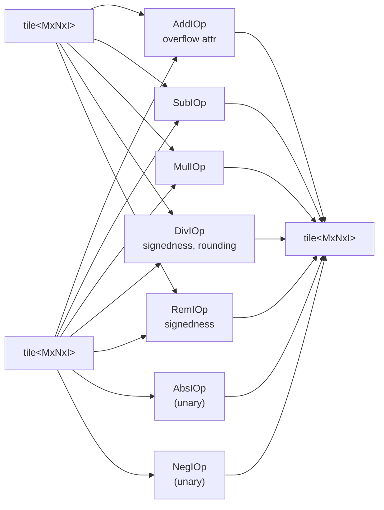
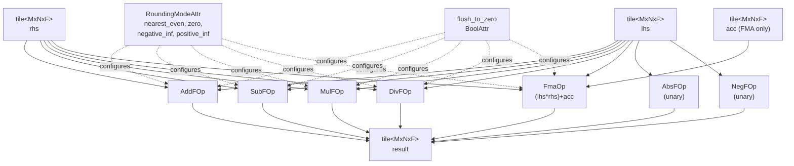
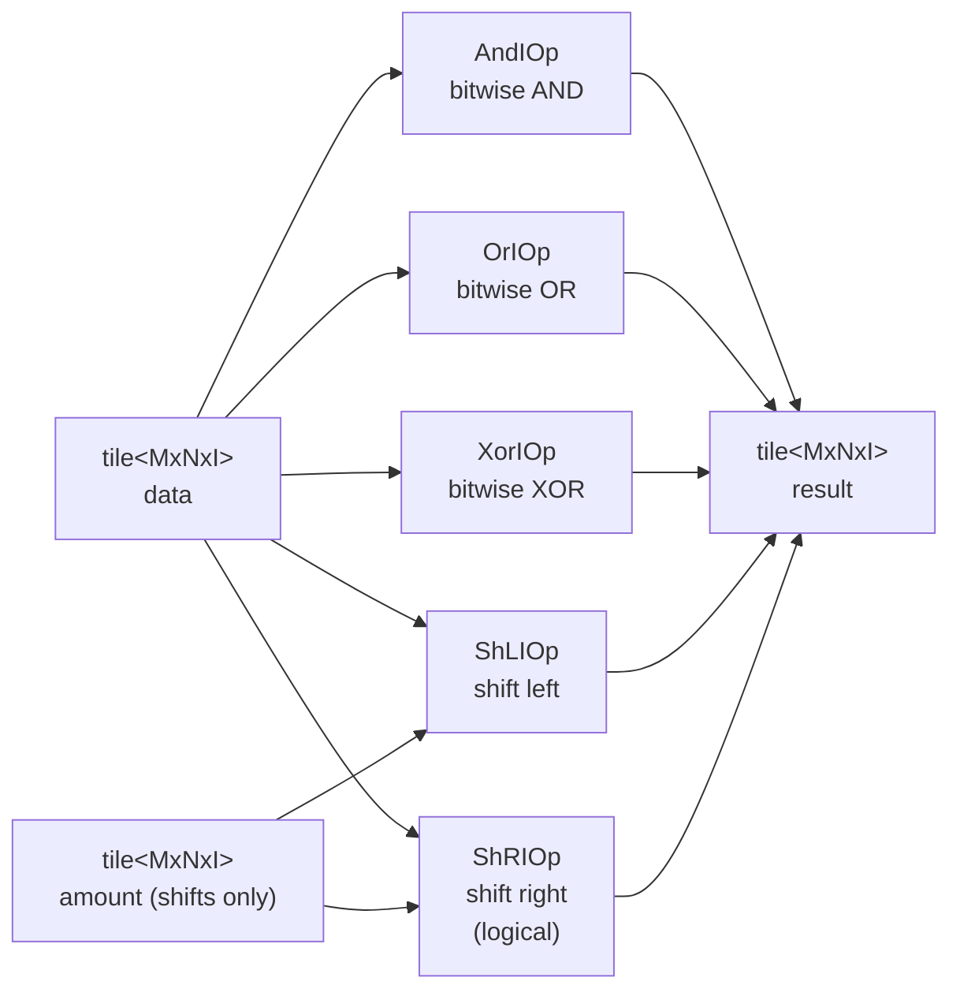

<!-- source: DeepWiki mcp.deepwiki.com · repo NVIDIA/cuda-tile · extra page Arithmetic and Bitwise Operations · fetched 2026-10-26 -->

# Arithmetic and Bitwise Operations

<details>
<summary>Relevant source files</summary>

The following files were used as context for generating this wiki page:

- [lib/Dialect/CudaTile/IR/CudaTile.cpp](lib/Dialect/CudaTile/IR/CudaTile.cpp)
- [python/cuda_tile/dialects/cuda_tile_ops.py](python/cuda_tile/dialects/cuda_tile_ops.py)

</details>


## Purpose and Scope

This page documents arithmetic and bitwise operations in the CUDA Tile dialect. These operations perform element-wise numerical computations and bit manipulations on `TileType` operands, producing `TileType` results. Operations are categorized into:

- **Integer arithmetic**: `add`, `sub`, `mul`, `div`, `rem`, `abs`, `neg`
- **Floating-point arithmetic**: `addf`, `subf`, `mulf`, `divf`, `remf`, `absf`, `negf`, `fma`, `pow`, `exp`, `sqrt`
- **Bitwise operations**: `and`, `or`, `xor`, `shl`, `shr`

All operations operate element-wise on tiles with compatible shapes. For tiles with shape `[M, N]`, the operation `tile<M x N x T> ⊗ tile<M x N x T> → tile<M x N x T>` applies the operation to corresponding elements.

For memory operations, see [Memory Operations](#3.3.2). For control flow, see [Control Flow Operations](#3.3.3). For type conversions, see [Tensor and View Operations](#3.3.4).

---

## Integer Arithmetic Operations

Integer operations perform element-wise arithmetic on tiles containing integer elements (`i1`, `i8`, `i16`, `i32`, `i64`). Operations support both signed and unsigned semantics through attributes.

### AddIOp - Integer Addition

**Operation:** `cuda_tile.addi`

Performs element-wise integer addition with optional overflow checking.

**Signature:**
```
%result = cuda_tile.addi %lhs, %rhs {overflow = #cuda_tile.integer_overflow<none>}
  : tile<MxNxi32>
```

**Attributes:**
- `overflow`: `IntegerOverflowAttr` - overflow semantics (`none`, `no_signed_wrap`, `no_unsigned_wrap`, `no_wrap`)

**Verification:** Ensures operands have matching integer element types and shapes.

**Python API:**
```python
result = add(lhs, rhs, overflow=IntegerOverflow.NONE)
```

**Sources:** [lib/Dialect/CudaTile/IR/CudaTile.cpp:1406-1414](), [python/cuda_tile/dialects/cuda_tile_ops.py:1505-1541]()

### SubIOp - Integer Subtraction

**Operation:** `cuda_tile.subi`

Performs element-wise integer subtraction.

**Signature:**
```
%result = cuda_tile.subi %lhs, %rhs : tile<MxNxi32>
```

**Python API:**
```python
result = sub(lhs, rhs)  # dispatches to _subi for integer tiles
```

**Sources:** [lib/Dialect/CudaTile/IR/CudaTile.cpp:2073-2075](), [python/cuda_tile/dialects/cuda_tile_ops.py:2115-2142]()

### MulIOp - Integer Multiplication

**Operation:** `cuda_tile.muli`

Performs element-wise integer multiplication.

**Signature:**
```
%result = cuda_tile.muli %lhs, %rhs : tile<MxNxi32>
```

**Python API:**
```python
result = mul(lhs, rhs)  # dispatches to _muli for integer tiles
```

**Sources:** [lib/Dialect/CudaTile/IR/CudaTile.cpp:3038-3040](), [python/cuda_tile/dialects/cuda_tile_ops.py:3095-3122]()

### DivIOp - Integer Division

**Operation:** `cuda_tile.divi`

Performs element-wise integer division with configurable rounding and signedness.

**Signature:**
```
%result = cuda_tile.divi %lhs, %rhs {signedness = #cuda_tile.signedness<signed>,
                                      rounding = #cuda_tile.rounding_mode<zero>}
  : tile<MxNxi32>
```

**Attributes:**
- `signedness`: `SignednessAttr` - `signed` or `unsigned` interpretation
- `rounding`: `RoundingModeAttr` - one of `zero`, `negative_inf`, `positive_inf`

**Verification:** 
- Validates rounding mode is one of the three allowed modes [lib/Dialect/CudaTile/IR/CudaTile.cpp:1757-1763]()
- Rejects `negative_inf` with unsigned signedness [lib/Dialect/CudaTile/IR/CudaTile.cpp:1764-1768]()

**Python API:**
```python
result = div(lhs, rhs, signedness=Signedness.SIGNED, rounding_mode=RoundingMode.ZERO)
```

**Sources:** [lib/Dialect/CudaTile/IR/CudaTile.cpp:1754-1770](), [python/cuda_tile/dialects/cuda_tile_ops.py:1911-1938]()

### RemIOp - Integer Remainder

**Operation:** `cuda_tile.remi`

Computes element-wise integer remainder (modulo operation).

**Signature:**
```
%result = cuda_tile.remi %lhs, %rhs {signedness = #cuda_tile.signedness<signed>}
  : tile<MxNxi32>
```

**Attributes:**
- `signedness`: `SignednessAttr` - `signed` or `unsigned`

**Python API:**
```python
result = rem(lhs, rhs, signedness=Signedness.SIGNED)
```

**Sources:** [lib/Dialect/CudaTile/IR/CudaTile.cpp:2021-2037](), [python/cuda_tile/dialects/cuda_tile_ops.py:2050-2066]()

### AbsIOp - Integer Absolute Value

**Operation:** `cuda_tile.absi`

Computes element-wise absolute value for signed integers.

**Signature:**
```
%result = cuda_tile.absi %source : tile<MxNxi32>
```

**Python API:**
```python
result = absi(source)
```

**Sources:** [lib/Dialect/CudaTile/IR/CudaTile.cpp:1388-1392](), [python/cuda_tile/dialects/cuda_tile_ops.py:1388-1392]()

### NegIOp - Integer Negation

**Operation:** `cuda_tile.negi`

Computes element-wise arithmetic negation (two's complement).

**Signature:**
```
%result = cuda_tile.negi %source : tile<MxNxi32>
```

**Python API:**
```python
result = negi(source)
```

**Sources:** [lib/Dialect/CudaTile/IR/CudaTile.cpp:1833-1836](), [python/cuda_tile/dialects/cuda_tile_ops.py:1833-1836]()

### Integer Operations Summary



**Sources:** [lib/Dialect/CudaTile/IR/CudaTile.cpp:1388-2075](), [python/cuda_tile/dialects/cuda_tile_ops.py:1388-2142]()

---

## Integer Arithmetic Operations

Integer operations perform arithmetic on tile types containing integer elements. These operations support both signed and unsigned integer semantics depending on the specific operation.

### Common Integer Operations

The following table lists typical integer arithmetic operations available in the CUDA Tile dialect:

| Operation | Mnemonic | Description | Typical Traits |
|-----------|----------|-------------|----------------|
| Addition | `add` | Element-wise integer addition | Commutative, Associative |
| Multiplication | `mul` | Element-wise integer multiplication | Commutative, Associative |
| Division | `div` | Element-wise signed integer division | None |
| Unsigned Division | `udiv` | Element-wise unsigned integer division | None |
| Remainder | `rem` | Signed integer remainder | None |
| Unsigned Remainder | `urem` | Unsigned integer remainder | None |
| Subtraction | `sub` | Element-wise integer subtraction | None |

### Operational Semantics

Integer operations in CUDA Tile IR operate element-wise on tile types. For a tile with shape `[M, N]` containing integer elements:

```
tile<M x N x i32> × tile<M x N x i32> → tile<M x N x i32>
```

Each operation applies the arithmetic operation independently to corresponding elements at the same position in the input tiles.

**Sources:** [include/cuda_tile/Dialect/CudaTile/IR/Dialect.td:113-114]()

---

## Floating-Point Arithmetic Operations

Floating-point operations perform element-wise computations on tiles with IEEE 754 floating-point element types (`f16`, `bf16`, `f32`, `f64`, `tf32`, `f8E4M3FN`, `f8E5M2`). Most operations support optional rounding mode and flush-to-zero attributes.

### AddFOp - Floating-Point Addition

**Operation:** `cuda_tile.addf`

Performs element-wise floating-point addition with IEEE 754 rounding.

**Signature:**
```
%result = cuda_tile.addf %lhs, %rhs 
  {rounding_mode = #cuda_tile.rounding_mode<nearest_even>,
   flush_to_zero = false} : tile<MxNxf32>
```

**Attributes:**
- `rounding_mode`: `RoundingModeAttr` - one of `nearest_even`, `zero`, `negative_inf`, `positive_inf`
- `flush_to_zero`: `BoolAttr` - whether to flush denormals to zero

**Verification:**
- Validates rounding mode is IEEE-compliant [lib/Dialect/CudaTile/IR/CudaTile.cpp:1228-1239]()
- Verifies flush-to-zero is valid for element type [lib/Dialect/CudaTile/IR/CudaTile.cpp:1241-1245]()

**Canonicalization:**
The operation canonicalizes to place multiply operations on the left-hand side to enable FMA fusion patterns [lib/Dialect/CudaTile/IR/CudaTile.cpp:1250-1269]().

**Python API:**
```python
result = add(lhs, rhs, rounding_mode=RoundingMode.NEAREST_EVEN, flush_to_zero=False)
```

**Sources:** [lib/Dialect/CudaTile/IR/CudaTile.cpp:1224-1269](), [python/cuda_tile/dialects/cuda_tile_ops.py:1421-1451]()

### SubFOp - Floating-Point Subtraction

**Operation:** `cuda_tile.subf`

Performs element-wise floating-point subtraction.

**Signature:**
```
%result = cuda_tile.subf %lhs, %rhs
  {rounding_mode = #cuda_tile.rounding_mode<nearest_even>,
   flush_to_zero = false} : tile<MxNxf32>
```

**Attributes:** Same as `AddFOp`

**Python API:**
```python
result = sub(lhs, rhs, rounding_mode=RoundingMode.NEAREST_EVEN, flush_to_zero=False)
```

**Sources:** [lib/Dialect/CudaTile/IR/CudaTile.cpp:2082-2111](), [python/cuda_tile/dialects/cuda_tile_ops.py:2082-2142]()

### MulFOp - Floating-Point Multiplication

**Operation:** `cuda_tile.mulf`

Performs element-wise floating-point multiplication.

**Signature:**
```
%result = cuda_tile.mulf %lhs, %rhs
  {rounding_mode = #cuda_tile.rounding_mode<nearest_even>,
   flush_to_zero = false} : tile<MxNxf32>
```

**Attributes:** Same as `AddFOp`

**Python API:**
```python
result = mul(lhs, rhs, rounding_mode=RoundingMode.NEAREST_EVEN, flush_to_zero=False)
```

**Sources:** [lib/Dialect/CudaTile/IR/CudaTile.cpp:3047-3077](), [python/cuda_tile/dialects/cuda_tile_ops.py:3047-3122]()

### DivFOp - Floating-Point Division

**Operation:** `cuda_tile.divf`

Performs element-wise floating-point division with extended rounding modes.

**Signature:**
```
%result = cuda_tile.divf %lhs, %rhs
  {rounding_mode = #cuda_tile.rounding_mode<nearest_even>,
   flush_to_zero = false} : tile<MxNxf32>
```

**Attributes:**
- `rounding_mode`: `RoundingModeAttr` - one of `nearest_even`, `zero`, `negative_inf`, `positive_inf`, `approx`, `full`
- `flush_to_zero`: `BoolAttr`

**Verification:** Validates rounding mode and flush-to-zero compatibility [lib/Dialect/CudaTile/IR/CudaTile.cpp:1734-1750]()

**Python API:**
```python
result = div(lhs, rhs, rounding_mode=RoundingMode.NEAREST_EVEN, flush_to_zero=False)
```

**Sources:** [lib/Dialect/CudaTile/IR/CudaTile.cpp:1732-1750](), [python/cuda_tile/dialects/cuda_tile_ops.py:1945-1977]()

### FmaOp - Fused Multiply-Add

**Operation:** `cuda_tile.fma`

Computes `(lhs × rhs) + acc` with a single rounding operation, providing better numerical accuracy than separate multiply and add.

**Signature:**
```
%result = cuda_tile.fma %lhs, %rhs, %acc
  {rounding_mode = #cuda_tile.rounding_mode<nearest_even>,
   flush_to_zero = false} : tile<MxNxf32>
```

**Attributes:** Same as `AddFOp`

**Verification:**
- Validates IEEE rounding modes [lib/Dialect/CudaTile/IR/CudaTile.cpp:1948-1951]()
- Verifies flush-to-zero validity [lib/Dialect/CudaTile/IR/CudaTile.cpp:1948-1952]()

**Python API:**
```python
result = fma(lhs, rhs, acc, rounding_mode=RoundingMode.NEAREST_EVEN, flush_to_zero=False)
```

**Sources:** [lib/Dialect/CudaTile/IR/CudaTile.cpp:1948-1952](), [python/cuda_tile/dialects/cuda_tile_ops.py:1459-1491]()

### AbsFOp - Floating-Point Absolute Value

**Operation:** `cuda_tile.absf`

Computes element-wise absolute value (clears sign bit).

**Signature:**
```
%result = cuda_tile.absf %source : tile<MxNxf32>
```

**Python API:**
```python
result = absf(source)
```

**Sources:** [lib/Dialect/CudaTile/IR/CudaTile.cpp:1395-1399](), [python/cuda_tile/dialects/cuda_tile_ops.py:1395-1399]()

### NegFOp - Floating-Point Negation

**Operation:** `cuda_tile.negf`

Computes element-wise negation (flips sign bit).

**Signature:**
```
%result = cuda_tile.negf %source : tile<MxNxf32>
```

**Python API:**
```python
result = negf(source)
```

**Sources:** [lib/Dialect/CudaTile/IR/CudaTile.cpp:1839-1843](), [python/cuda_tile/dialects/cuda_tile_ops.py:1839-1843]()

### Floating-Point Rounding Modes

Floating-point operations support IEEE 754 rounding modes through the `RoundingModeAttr`:

| Mode | Value | Description |
|------|-------|-------------|
| `nearest_even` | `RoundingMode::NEAREST_EVEN` | Round to nearest, ties to even (default) |
| `zero` | `RoundingMode::ZERO` | Round toward zero (truncate) |
| `negative_inf` | `RoundingMode::NEGATIVE_INF` | Round toward negative infinity (floor) |
| `positive_inf` | `RoundingMode::POSITIVE_INF` | Round toward positive infinity (ceil) |
| `approx` | `RoundingMode::APPROX` | Fast approximation (division only) |
| `full` | `RoundingMode::FULL` | Full precision (division only) |

**Sources:** [lib/Dialect/CudaTile/IR/CudaTile.cpp:1228-1239](), [python/cuda_tile/dialects/cuda_tile_ops.py:209-221]()

### Floating-Point Operations Data Flow



**Sources:** [lib/Dialect/CudaTile/IR/CudaTile.cpp:1224-1952](), [python/cuda_tile/dialects/cuda_tile_ops.py:1395-3122]()

---

## Bitwise Operations

Bitwise operations manipulate individual bits within integer tile elements. All bitwise operations require integer element types and operate element-wise.

### AndIOp - Bitwise AND

**Operation:** `cuda_tile.andi`

Performs element-wise bitwise AND.

**Signature:**
```
%result = cuda_tile.andi %lhs, %rhs : tile<MxNxi32>
```

**Properties:** Commutative, associative

**Python API:**
```python
result = andi(lhs, rhs)
# Also available via operator: result = lhs & rhs
```

**Sources:** [lib/Dialect/CudaTile/IR/CudaTile.cpp:1548-1550](), [python/cuda_tile/dialects/cuda_tile_ops.py:1548-1550]()

### OrIOp - Bitwise OR

**Operation:** `cuda_tile.ori`

Performs element-wise bitwise OR.

**Signature:**
```
%result = cuda_tile.ori %lhs, %rhs : tile<MxNxi32>
```

**Properties:** Commutative, associative

**Python API:**
```python
result = ori(lhs, rhs)
# Also available via operator: result = lhs | rhs
```

**Sources:** [lib/Dialect/CudaTile/IR/CudaTile.cpp:1864-1867](), [python/cuda_tile/dialects/cuda_tile_ops.py:1864-1867]()

### XorIOp - Bitwise XOR

**Operation:** `cuda_tile.xori`

Performs element-wise bitwise XOR (exclusive OR).

**Signature:**
```
%result = cuda_tile.xori %lhs, %rhs : tile<MxNxi32>
```

**Properties:** Commutative, associative

**Python API:**
```python
result = xori(lhs, rhs)
# XOR pattern: result = lhs ^ rhs
```

**Sources:** [python/cuda_tile/dialects/cuda_tile_ops.py:766-777]()

### ShLIOp - Shift Left

**Operation:** `cuda_tile.shli`

Performs element-wise logical shift left. Shifts in zeros from the right.

**Signature:**
```
%result = cuda_tile.shli %data, %amount : tile<MxNxi32>
```

**Operands:**
- `data`: tile to be shifted
- `amount`: number of bit positions to shift (can be scalar or tile)

**Python API:**
```python
result = shli(data, amount)
# Also available via operator: result = data << amount
```

**Sources:** [python/cuda_tile/dialects/cuda_tile_ops.py:778-783]()

### ShRIOp - Shift Right

**Operation:** `cuda_tile.shri`

Performs element-wise logical shift right (unsigned). Shifts in zeros from the left.

**Signature:**
```
%result = cuda_tile.shri %data, %amount : tile<MxNxi32>
```

**Operands:**
- `data`: tile to be shifted
- `amount`: number of bit positions to shift (can be scalar or tile)

**Note:** For arithmetic right shift (signed, preserving sign bit), use a separate operation with signedness attribute.

**Python API:**
```python
result = shri(data, amount)
# Also available via operator: result = data >> amount
```

**Sources:** [python/cuda_tile/dialects/cuda_tile_ops.py:778-783]()

### Bitwise Operations Summary



**Sources:** [lib/Dialect/CudaTile/IR/CudaTile.cpp:1548-1867](), [python/cuda_tile/dialects/cuda_tile_ops.py:766-1867]()

---

## Python API Integration

The Python bindings provide high-level wrappers for arithmetic and bitwise operations with automatic type promotion and operator overloading.

### Tile Class Operator Overloading

The `Tile` class overloads Python operators to provide natural arithmetic syntax:

```python
class Tile:
    def __add__(self, rhs): return add(self, rhs)
    def __sub__(self, rhs): return sub(self, rhs)
    def __mul__(self, rhs): return mul(self, rhs)
    def __truediv__(self, rhs): return div(self, rhs)
    def __mod__(self, rhs): return rem(self, rhs)
    def __floordiv__(self, rhs): return floordivi(self, rhs)
    
    def __and__(self, rhs): return andi(self, rhs)
    def __or__(self, rhs): return ori(self, rhs)
    def __xor__(self, rhs): return xori(self, rhs)
    def __lshift__(self, rhs): return shli(self, rhs)
    def __rshift__(self, rhs): return shri(self, rhs)
    
    def __neg__(self): return negi(self) if integer else negf(self)
    def __abs__(self): return absi(self) if integer else absf(self)
```

**Sources:** [python/cuda_tile/dialects/cuda_tile_ops.py:706-829]()

### Type-Polymorphic Operations

High-level operations automatically dispatch to the appropriate integer or floating-point variant:

```python
@cuda_tile_op
def add(lhs, rhs, *, flush_to_zero=False, rounding_mode=RoundingMode.NEAREST_EVEN,
        overflow=IntegerOverflow.NONE, loc=None, ip=None):
    if isinstance(lhs.element_type, _ods_ir.IntegerType):
        return _addi(lhs, rhs, overflow=overflow, loc=loc, ip=ip)
    elif isinstance(lhs.element_type, _ods_ir.FloatType):
        return _addf(lhs, rhs, flush_to_zero=flush_to_zero,
                     rounding_mode=rounding_mode, loc=loc, ip=ip)
    elif PointerType.isinstance(lhs.element_type):
        return _offset(lhs, rhs, loc=loc, ip=ip)  # pointer arithmetic
```

**Sources:** [python/cuda_tile/dialects/cuda_tile_ops.py:1505-1541]()

### Automatic Type Promotion

The `_check_is_rhs_tile` function automatically promotes Python scalars and lists to tiles:

```python
def _check_is_rhs_tile(lhs: Tile, rhs: Tile):
    if isinstance(rhs, Tile):
        return rhs
    if isinstance(rhs, list):
        # Promote list to constant tile matching lhs shape
        return constant(rhs, tile_type=lhs.tile_type)
    if isinstance(rhs, Number):
        # Promote scalar to constant tile
        return constant([rhs], tile_type=lhs.tile_type)
```

This enables natural mixed-type expressions:
```python
result = tile_a + 1.0          # scalar promoted to tile
result = tile_b * [2, 3, 4]    # list promoted to tile
```

**Sources:** [python/cuda_tile/dialects/cuda_tile_ops.py:1341-1385]()

### cuda_tile_op Decorator

The `@cuda_tile_op` decorator automatically captures source location information for debugging:

```python
def cuda_tile_op(opFunc):
    @_wraps(opFunc)
    def wrapper(*args, **kwargs):
        loc = kwargs.pop("loc", None)
        if loc is None:
            frame = _inspect.currentframe().f_back
            file_loc = _ods_ir.Location.file(frame.f_code.co_filename, frame.f_lineno, 0)
            loc = _ods_ir.Location.name(frame.f_code.co_name, childLoc=file_loc)
        return opFunc(*args, **kwargs, loc=loc)
    return wrapper
```

**Sources:** [python/cuda_tile/dialects/cuda_tile_ops.py:966-986]()

### Python API Usage Example

```python
import cuda_tile as ct

# Create tiles
a = ct.constant([1.0, 2.0, 3.0], tile_type=ct.make_tile_type(ct.Float32, [3]))
b = ct.constant([4.0, 5.0, 6.0], tile_type=ct.make_tile_type(ct.Float32, [3]))

# Natural operator syntax
c = a + b                              # AddFOp with default rounding
d = a * b                              # MulFOp
e = (a * b) + c                       # Can be fused to FmaOp via canonicalization

# Explicit operation calls with attributes
f = ct.add(a, b, rounding_mode=ct.RoundingMode.ZERO, flush_to_zero=True)
g = ct.fma(a, b, c, rounding_mode=ct.RoundingMode.NEAREST_EVEN)

# Integer operations with modifiers
i1 = ct.constant([10, 20, 30], tile_type=ct.make_tile_type(ct.Int32, [3]))
i2 = ct.constant([3, 4, 5], tile_type=ct.make_tile_type(ct.Int32, [3]))
i3 = ct.div(i1, i2, signedness=ct.Signedness.SIGNED, 
            rounding_mode=ct.RoundingMode.ZERO)

# Bitwise operations
mask = ct.constant([0xFF, 0x0F, 0xF0], tile_type=ct.make_tile_type(ct.Int32, [3]))
masked = i1 & mask                     # AndIOp
shifted = i1 << 2                      # ShLIOp
```

**Sources:** [python/cuda_tile/dialects/cuda_tile_ops.py:1324-3122]()

---

## Summary

Arithmetic operations in CUDA Tile IR are organized into three categories using dedicated TableGen base classes:

- **`CudaTileBitwiseOpDef`** for bitwise manipulation operations
- **`CudaTileIntegerOpDef`** for integer arithmetic operations  
- **`CudaTileFloatingPointOpDef`** for floating-point arithmetic operations

All operations inherit from `CudaTileOpDef`, providing versioning metadata, specification categorization, and documentation infrastructure. The TableGen definitions are processed by `cuda-tile-tblgen` to generate C++ implementation code that integrates with MLIR's operation infrastructure.

For specific operation usage patterns, see the bytecode examples in [Bytecode System](#4). For optimization of arithmetic operations, see [Optimization Passes](#7.1).

---

