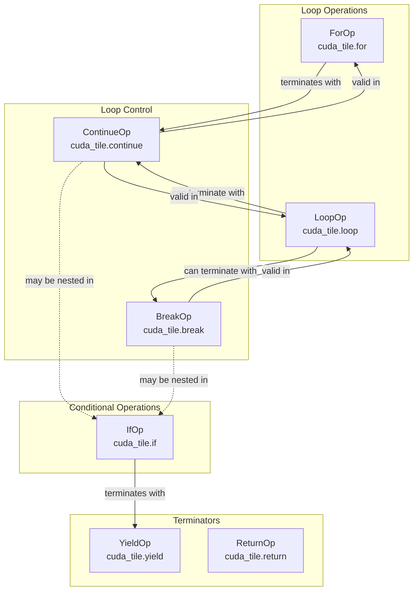
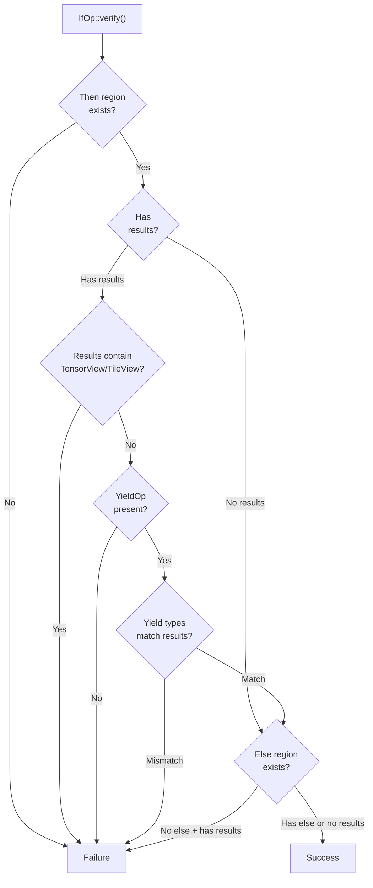
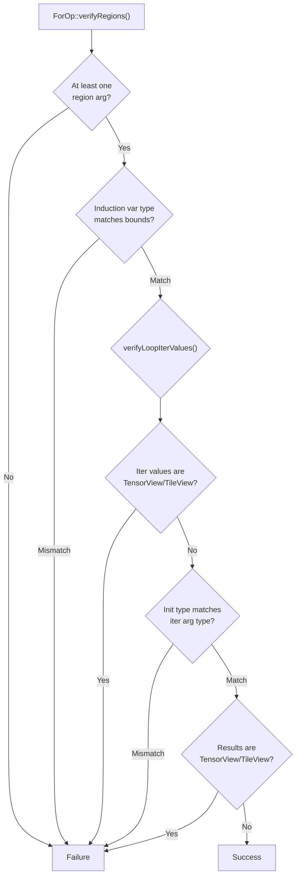
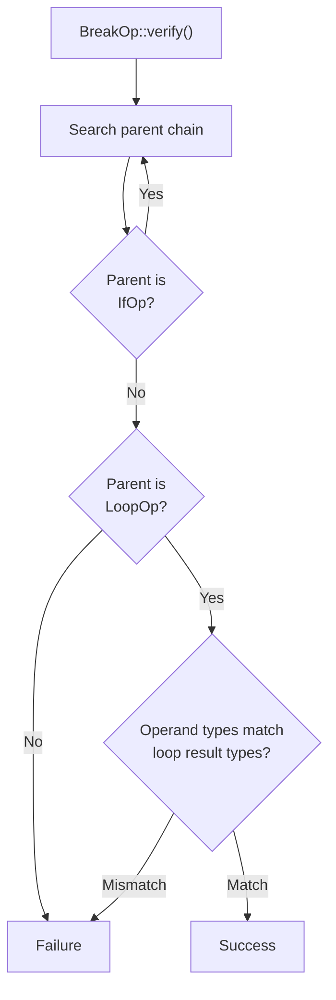
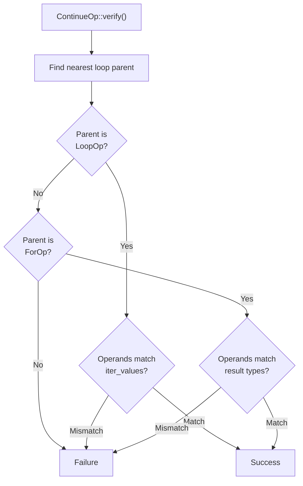

<!-- source: DeepWiki mcp.deepwiki.com · repo NVIDIA/cuda-tile · extra page Control Flow Operations · fetched 2026-10-26 -->

# Control Flow Operations

<details>
<summary>Relevant source files</summary>

The following files were used as context for generating this wiki page:

- [lib/Dialect/CudaTile/IR/CudaTile.cpp](lib/Dialect/CudaTile/IR/CudaTile.cpp)
- [python/cuda_tile/dialects/cuda_tile_ops.py](python/cuda_tile/dialects/cuda_tile_ops.py)

</details>


## Purpose and Scope

This page documents the control flow operations in the CudaTile dialect, which enable conditional execution, loops, and structured early exits within CUDA Tile IR kernels. These operations provide the building blocks for expressing complex control flow patterns while maintaining structured control flow semantics suitable for GPU execution.

For information about arithmetic and memory operations, see [3.3.1](#3.3.1) and [3.3.2](#3.3.2). For tensor manipulation operations, see [3.3.4](#3.3.4).

## Overview

Control flow operations in CUDA Tile IR are designed around structured control flow principles, where all control flow constructs have well-defined entry and exit points. The dialect provides:

- **Conditional branching** via `IfOp`
- **Counted loops** via `ForOp` 
- **While-style loops** via `LoopOp`
- **Early exits** via `BreakOp` and `ContinueOp`
- **Region terminators** via `YieldOp` and `ReturnOp`

All control flow operations use MLIR regions to encapsulate their bodies, ensuring proper dominance relationships and SSA form.

## Control Flow Operation Hierarchy



**Sources:** [lib/Dialect/CudaTile/IR/CudaTile.cpp:963-1005](), [lib/Dialect/CudaTile/IR/CudaTile.cpp:1543-1626]()

## IfOp - Conditional Execution

### Operation Semantics

`cuda_tile.if` provides conditional branching with optional else blocks. The operation evaluates a boolean condition tile and executes either the then-region or else-region accordingly. Both regions may return values via `YieldOp` terminators.

**Operation Signature:**
```
%results = cuda_tile.if %condition : tile<i1> -> (result_types...) {
  ^then_region:
    // then body
    cuda_tile.yield %values... : types...
} else {
  ^else_region:
    // else body  
    cuda_tile.yield %values... : types...
}
```

### Verification Rules

The implementation enforces several structural constraints:

| Rule | Description |
|------|-------------|
| **Then Region Required** | IfOp must define a then region |
| **Else Region Conditional** | Else region is required only if the operation has results |
| **Yield Type Matching** | YieldOp operands in both branches must match the operation's result types |
| **No View Results** | Result types cannot be `TensorViewType` or `TileView` types |

### Implementation Details

The verification logic for IfOp performs the following checks:



**Sources:** [lib/Dialect/CudaTile/IR/CudaTile.cpp:2323-2379]()

### Python API

The `if_generate` function provides a high-level interface for constructing IfOp operations:

```python
def if_generate(
    condition: Tile,
    then_body: Callable,
    else_body: Optional[Callable] = None,
    input_args: List[Tile] | None = None,
    return_types: List[Tile] | None = None,
) -> Tile
```

The function automatically constructs the MLIR regions and inserts appropriate `YieldOp` terminators based on the return values from the body functions.

**Sources:** [python/cuda_tile/dialects/cuda_tile_ops.py:2989-3030]()

## ForOp - Counted Loops

### Operation Semantics

`cuda_tile.for` implements counted loops with an induction variable that iterates from a lower bound to an upper bound with a specified step. The operation supports loop-carried values (iteration arguments) that can be updated across iterations.

**Operation Signature:**
```
%results = cuda_tile.for %iv in (%lb to %ub, step %step) : index_type
    iter_values(%iter_arg1 = %init1, ...) -> (result_types...) {
  ^body(%iv: index_type, %iter_arg1: type1, ...):
    // loop body
    cuda_tile.continue %next_values... : types...
}
```

### Region Arguments and Results

The ForOp body region receives the following arguments:

| Argument Position | Name | Description |
|------------------|------|-------------|
| 0 | Induction Variable | Loop counter, initialized to `%lb`, incremented by `%step` |
| 1..N | Iteration Arguments | Loop-carried values, initialized from `init_values` |

The loop terminates with `ContinueOp`, whose operands become the iteration arguments for the next iteration (or results if the loop exits).

### Verification Rules



**Sources:** [lib/Dialect/CudaTile/IR/CudaTile.cpp:2048-2061](), [lib/Dialect/CudaTile/IR/CudaTile.cpp:1960-2002]()

### Builder Interface

The ForOp provides a convenient builder that accepts a function for constructing the loop body:

```cpp
void ForOp::build(
    OpBuilder &builder, 
    OperationState &result,
    Value lb, Value ub, Value step,
    ValueRange initArgs,
    function_ref<void(OpBuilder &, Location, Value, ValueRange)> bodyBuilder
)
```

**Sources:** [lib/Dialect/CudaTile/IR/CudaTile.cpp:2020-2046]()

### Python API

The `for_loop` function provides the Python interface for ForOp:

```python
def for_loop(
    body: Callable,
    lower_bound: int | Tile,
    upper_bound: int | Tile,
    step: int | Tile = 1,
    init_values: Sequence[Tile] = (),
    el_type=Int32,
) -> Tuple[Tile, ...]
```

Integer bounds are automatically converted to constant tiles. The body callable receives the induction variable and iteration arguments as parameters.

**Sources:** [python/cuda_tile/dialects/cuda_tile_ops.py:3190-3249]()

## LoopOp - While-Style Loops

### Operation Semantics

`cuda_tile.loop` implements while-style loops where the loop continuation condition is determined within the loop body via `BreakOp` or `ContinueOp`. Unlike ForOp, there is no automatic induction variable.

**Operation Signature:**
```
%results = cuda_tile.loop iter_values(%iter_arg1 = %init1, ...) -> (result_types...) {
  ^body(%iter_arg1: type1, ...):
    // loop body
    // Either:
    cuda_tile.continue %next_values... : types...
    // Or:
    cuda_tile.break %exit_values... : types...
}
```

### Verification Rules

The LoopOp verification enforces similar rules to ForOp regarding iteration values:

- Iteration arguments must not be `TensorViewType` or `TileView` types
- Initial values must match iteration argument types
- Result types must not be `TensorViewType` or `TileView` types

**Sources:** [lib/Dialect/CudaTile/IR/CudaTile.cpp:1960-2002]()

### Python API

The `loop_generate` function constructs LoopOp operations:

```python
def loop_generate(
    inputs: Iterable[Union[Tile, Token]],
    loop_body: Callable,
) -> Union[Tile, Token]
```

The function accepts both `Tile` and `Token` types as iteration arguments, supporting token-based synchronization patterns within loops.

**Sources:** [python/cuda_tile/dialects/cuda_tile_ops.py:3125-3154]()

## BreakOp - Loop Early Exit

### Operation Semantics

`cuda_tile.break` provides early exit from `LoopOp`, terminating the loop and returning specified values as the loop results.

**Operation Signature:**
```
cuda_tile.break %values... : types...
```

### Nesting and Verification

The BreakOp enforces strict nesting rules through `verifyEarlyExitOp`:



**Key Rule:** BreakOp can be nested within any chain of `IfOp` operations, but must ultimately be contained within a `LoopOp`. The operand types must exactly match the parent `LoopOp`'s result types.

**Sources:** [lib/Dialect/CudaTile/IR/CudaTile.cpp:1538-1584](), [lib/Dialect/CudaTile/IR/CudaTile.cpp:1543-1566]()

### Python API

```python
def loop_break(
    operands: Union[Tile, Token, Iterable[Union[Tile, Token]]]
)
```

**Sources:** [python/cuda_tile/dialects/cuda_tile_ops.py:3158-3170]()

## ContinueOp - Loop Continuation

### Operation Semantics

`cuda_tile.continue` skips to the next iteration of a loop, providing updated values for iteration arguments (in `LoopOp`) or result values (in `ForOp`).

**Operation Signature:**
```
cuda_tile.continue %values... : types...
```

### Dual Semantics

ContinueOp behaves differently depending on its containing loop:

| Loop Type | Operand Meaning | Type Constraint |
|-----------|-----------------|-----------------|
| `LoopOp` | Next iteration values | Must match loop's `iter_values` types |
| `ForOp` | Result values for this iteration | Must match loop's result types |

### Verification Logic



Like BreakOp, ContinueOp can be nested within `IfOp` operations but must be contained within either `ForOp` or `LoopOp`.

**Sources:** [lib/Dialect/CudaTile/IR/CudaTile.cpp:1588-1626]()

### Python API

```python
def loop_continue(
    operands: Union[Tile, Token, Iterable[Union[Tile, Token]]]
)
```

**Sources:** [python/cuda_tile/dialects/cuda_tile_ops.py:3174-3186]()

## YieldOp - Region Terminator

### Operation Semantics

`cuda_tile.yield` serves as the terminator for control flow regions, returning values from within `IfOp` branches and other constructs. It is not used for loops (which use `ContinueOp` or `BreakOp` instead).

**Operation Signature:**
```
cuda_tile.yield %values... : types...
```

### Implicit Terminator Pattern

Control flow operations automatically insert YieldOp terminators when regions are empty:

```cpp
template <typename OpT>
static void printControlFlowRegion(OpAsmPrinter &p, OpT op, Region &region) {
  bool printBlockTerminators =
      region.front().getTerminator()->getNumOperands() != 0 ||
      !isa<ImplicitTerminatorOpT>(region.front().getTerminator());
  p.printRegion(region, /*printEntryBlockArgs=*/false, printBlockTerminators);
}
```

When a YieldOp has no operands and is the implicit terminator, it is not printed in the textual format.

**Sources:** [lib/Dialect/CudaTile/IR/CudaTile.cpp:980-990](), [lib/Dialect/CudaTile/IR/CudaTile.cpp:2973-2974]()

## ReturnOp - Function Return

### Operation Semantics

`cuda_tile.return` terminates function execution and returns values to the caller. In the context of `EntryOp` (kernel entry points), the operation must have no operands as kernels do not return values.

**Operation Signature:**
```
cuda_tile.return %values... : types...
```

### Python API

```python
def ret(args: Iterable[Tile])
```

**Sources:** [python/cuda_tile/dialects/cuda_tile_ops.py:3288-3290](), [lib/Dialect/CudaTile/IR/CudaTile.cpp:2268-2269]()

## Control Flow Operation Code Mapping

The following table maps high-level control flow concepts to their implementation across the codebase:

| Operation | C++ Class | TableGen Definition | Python API | Verification Method |
|-----------|-----------|---------------------|------------|---------------------|
| If | `IfOp` | `Ops.td` | `if_generate()` | `IfOp::verify()` |
| For Loop | `ForOp` | `Ops.td` | `for_loop()` | `ForOp::verifyRegions()` |
| While Loop | `LoopOp` | `Ops.td` | `loop_generate()` | Inherits from template |
| Break | `BreakOp` | `Ops.td` | `loop_break()` | `BreakOp::verify()` |
| Continue | `ContinueOp` | `Ops.td` | `loop_continue()` | `ContinueOp::verify()` |
| Yield | `YieldOp` | `Ops.td` | Implicit via builders | Type-checked |
| Return | `ReturnOp` | `Ops.td` | `ret()` | Type-checked |

**Sources:** [lib/Dialect/CudaTile/IR/CudaTile.cpp:1217-1221](), [python/cuda_tile/dialects/cuda_tile_ops.py:2989-3290]()

## Parser and Printer Utilities

### Custom Region Parsing

Control flow operations use specialized parsing logic to handle cuda_tile type syntax within regions:

```cpp
template <typename OpT>
static ParseResult parseControlFlowRegion(
    OpAsmParser &p, 
    Region &region,
    ArrayRef<OpAsmParser::Argument> arguments = {}
) {
  if (failed(p.parseRegion(region, arguments)))
    return failure();
  OpT::ensureTerminator(region, p.getBuilder(),
                       p.getEncodedSourceLoc(p.getNameLoc()));
  return success();
}
```

This pattern automatically ensures proper terminator insertion when parsing control flow operation bodies.

**Sources:** [lib/Dialect/CudaTile/IR/CudaTile.cpp:966-975]()

### Iteration Value Printing

ForOp and LoopOp use specialized printing for iteration arguments:

```cpp
static void printLoopIteratorValues(
    OpAsmPrinter &p, 
    OperandRange initVals,
    Block::BlockArgListType regionIterValues
) {
  p << "iter_values(";
  llvm::interleaveComma(llvm::zip(regionIterValues, initVals), p, [&](auto it) {
    p << std::get<0>(it) << " = " << std::get<1>(it);
  });
  p << ") -> (";
  printCudaTileType(p, initVals.getTypes());
  p << ") ";
}
```

This produces the `iter_values(%arg = %init, ...) -> (types...)` syntax seen in loop operations.

**Sources:** [lib/Dialect/CudaTile/IR/CudaTile.cpp:2005-2018]()

## Canonicalization Patterns

### AddFOp Canonicalization

The AddFOp operation includes a canonicalization pattern that reorders operands to facilitate FMA fusion:

```cpp
LogicalResult canonicalizeAddOperands(AddFOp op, PatternRewriter &rewriter) {
  Value lhs = op.getLhs();
  Value rhs = op.getRhs();

  bool rhsIsMul = isa_and_nonnull<MulFOp>(rhs.getDefiningOp());
  bool lhsIsMul = isa_and_nonnull<MulFOp>(lhs.getDefiningOp());

  // If RHS is multiply but LHS is not, swap them
  if (rhsIsMul && !lhsIsMul) {
    rewriter.replaceOpWithNewOp<AddFOp>(op, rhs, lhs, ...);
    return success();
  }
  return failure();
}
```

This pattern ensures multiply operations appear on the LHS of additions, enabling downstream FMA fusion patterns.

**Sources:** [lib/Dialect/CudaTile/IR/CudaTile.cpp:1247-1269]()

---

